# attendance-management-service-django - Existing Database Architecture

## 1. Document Metadata

| Item | Value |
|---|---|
| Service | `attendance-management-service-django` (repository folder is spelled `Attendence-management-service-django`) |
| Repository path | `/Users/akshay/Development/autoscal/main-autoscal-repos/Attendence-management-service-django` |
| Branch / commit | `dev` @ `738aee7` (2026-10-13, "Merge pull request #731 from autoscal-SP18/chore/ai-skills-plugins") |
| Analysis date | 2026-10-14 |
| Scope | All Django models in `account/`, `attendance/`, `holiday/`, `leave/` and `core/utils/models.py`; all 182 migration files across the four apps (account 23, attendance 38, holiday 9, leave 93, plus `__init__`); the migrations of installed third-party apps (`django.contrib.*`, `django-auditlog` 3.1.2) read from the local venv; runtime code (views, serializers, services, helpers, utils, managers, signals, Celery tasks, admin, seed data, urls); settings, compose files and `start.sh`; tests that query `information_schema`; HTTP clients and schemas of the other active Autoscal repos for cross-service references |
| Method | Static analysis only. Five parallel read-only investigations (one per domain slice) traced every model against its cumulative migration operations and traced runtime access by grep and call-chain reading; results were merged, deduplicated and validated by script. `makemigrations --check --dry-run` was run once with `test_settings` |
| Not done | No live database was queried (no authorised connection; `.env*` reads are blocked by repo hooks). `sqlmigrate` was not run (it would load `.env`). Mermaid diagrams were generated from the same edge list as the relationship tables and checked structurally, not rendered |

**Important limitations**

- Every table, column and constraint below is what models and migrations declare. None of it is confirmed against a running database. Index and constraint names are inferred from Django naming conventions unless a migration names them explicitly.
- "Referenced by runtime code" means a static reference was found in non-test, non-migration code. It does not prove the code path runs in production. "No runtime reference found" never means safe to drop.
- Excluded repos per workspace CLAUDE.md: `finance-service-backend` (deprecated) and `autoscal-claude-plugins` (developer tooling).

## 2. Service Overview

attendance-management-service-django owns attendance (clock-in, time entries, adjustments), work from home, leave (types, plans, rules, applications, approvals, balances, accrual, year end, comp-off) and holidays for every tenant (`CLAUDE.md:3`). It is the system of record for all of those tables. Employees and roles are a local mirror pushed by auth-service over HTTP. auth-service, job-service, spark-assist-ai, autoscal-middleware and the frontend consume its HTTP API; no other service connects to its database (see [R28](#r-28)).

| Item | Verified value | Evidence |
|---|---|---|
| Engine | PostgreSQL (`django.db.backends.postgresql`, driver `psycopg2-binary==2.9.9`). Local dev image `postgres:16` on host port 8081; demo and prod compose files have no DB service, so those databases are external | `attendance_service_django/settings.py:226-235`, `requirements.txt:11`, `docker-compose.dev.yml:7-26` |
| ORM | Django 4.2.27 ORM, Django REST Framework. `DEFAULT_AUTO_FIELD = BigAutoField` in settings and every `apps.py`. `USE_TZ=True`, `TIME_ZONE=UTC` | `requirements.txt:1`, `settings.py:123-140`, `*/apps.py:5` |
| Schema organization | One database alias (`default`), one schema (`public`), no `DATABASE_ROUTERS`. Four local apps: `account`, `attendance`, `holiday`, `leave`. Default table names are `<app>_<model>`; 16 models set `Meta.db_table` explicitly | `settings.py:42-60,226-235`, model files |
| Base classes | Most models extend `django_extensions.db.models.TimeStampedModel` (`created`, `modified`, set in Python). `EmployeeTenantMixin` copies `employee.tenant_id` onto the row in `save()` (bypassed by `bulk_create` and queryset `update`). Abstract `SoftDeleteModel` exists but no concrete model was found using it | `core/utils/models.py:4-40`, `account/models.py:3` |
| Defaults | Django 4.2 has no `db_default`: every `default=` in this document is applied by Python, not by the database, unless marked "DB:" | Django 4.2 semantics |
| Migration tooling | Django migrations (182 files). `start.sh` runs `manage.py migrate --no-input` at container start and exits on failure. Raw SQL appears only in `attendance/0035`, `leave/0089`, `leave/0092` | `start.sh:3-16`, migration files |
| Model vs migrations | `makemigrations --check --dry-run` (test settings) exited 0, "No changes detected". It could not run the history consistency check against a DB, and it does not cover RunSQL-only constraints | run on 2026-10-14 |
| Celery and cache | Celery broker and result backend are Redis; Beat uses the static file scheduler; no `django_celery_beat` or `django_celery_results` tables. Django cache is Redis | `settings.py:215-245`, `attendance_service_django/celery.py:15-18` |

**Sources used to determine the schema:** model files (current state), the cumulative operations of every migration (history and RunSQL objects), third-party migrations for framework tables, and tests that inspect `information_schema` (`leave/tests/test_tenant_id_column_type.py`, `leave/tests/test_leave_tenant_consistency.py`, `attendance/tests/test_attendance_tenant_column.py`).

**Live database caveat:** no table, column, index or constraint is confirmed against a live database. The RunSQL constraints, the effect of historical data migrations and every row-count-dependent risk need `pg_catalog` and data checks before migration decisions.

### 2.1 Service-Level Metrics

Counting rules are in [5.1](#51-counting-rules). Views and other database objects are counted separately from tables.

| Metric | Value | Notes |
|---|---:|---|
| Application modules identified | 10 | From the CLAUDE.md domain map plus one Platform & Shared Infrastructure module |
| Distinct tables declared (schema or migrations) | 85 | 66 service model tables + 8 auto-created M2M through tables (local migrations) + 11 framework tables from installed apps (3 of them M2M) |
| Distinct tables referenced by application code but missing from schema | 0 | Every table name found in code resolves to a declared model |
| Tables confirmed in a live database | 0 | No live access |
| Tables referenced by runtime application code | 75 | Static evidence per table in section 3 |
| Tables with no runtime-code reference found | 10 | 8 framework tables reachable only through the gated Django admin, plus 2 apparently unused leave tables |
| Active tables | 74 | |
| Deprecated or legacy tables (evidence-backed) | 1 | [`leave_leavequota`](#t-leave_leavequota) |
| Apparently unused tables | 2 | [`leave_leaveencashmentapprovalconfig`](#t-leave_leaveencashmentapprovalconfig), [`leave_leaveencashmentapprover`](#t-leave_leaveencashmentapprover) |
| Uncertain tables | 8 | Framework tables used only by Django admin, which is off unless `DJANGO_ADMIN_ENABLED=True` |
| Conflicting-source cases (schema, migrations and code disagree) | 7 | [R1](#r-1), [R7](#r-7), [R8](#r-8), [R35](#r-35), [R36](#r-36), [R50](#r-50), [R52](#r-52) |
| Tables with a declared primary key | 85 | All tables; service tables use `bigint` identity except `account_employee` (uuid `employee_id`) and `audit_log_entry_actor` (integer, 1:1 with `auditlog_logentry`) |
| Tables with at least one outbound declared FK | 67 | Includes RunSQL composite FKs |
| Tables referenced by at least one inbound declared FK | 40 | |
| Declared FK relationships (single-column, Django) | 145 | Incl. M2M through-table FKs; self-references: 2 |
| Declared FK relationships (composite, RunSQL only) | 8 | Not in Django model state |
| Logical relationships between local tables (no FK) | 15 | Self-references: 1 |
| Logical references to external services or generic objects | 35 | Mostly `tenant_id` to auth-service tenants |
| Leaf tables (declared FKs) | 39 | Same count when local logical relationships are included (39); list in 5.1 |
| Isolated tables (declared FKs only) | 6 | [`attendance_admin_setting`](#t-attendance_admin_setting), [`django_migrations`](#t-django_migrations), [`django_session`](#t-django_session), [`holiday_holiday`](#t-holiday_holiday), [`tenant_leave_cycle`](#t-tenant_leave_cycle), [`tenant_settings`](#t-tenant_settings) |
| Isolated tables (declared and logical, local) | 6 | [`attendance_admin_setting`](#t-attendance_admin_setting), [`django_migrations`](#t-django_migrations), [`django_session`](#t-django_session), [`holiday_holiday`](#t-holiday_holiday), [`tenant_leave_cycle`](#t-tenant_leave_cycle), [`tenant_settings`](#t-tenant_settings). 4 of them still hold a logical `tenant_id` reference to auth-service; fully isolated: [`django_migrations`](#t-django_migrations), [`django_session`](#t-django_session) |
| FK cycles (strongly connected groups, excluding self-references) | 1 | {`leave_leaveaccrualconfig`, `leave_leaveapplicationconfig`, `leave_leaveapprovalconfig`, `leave_leavecarryforwardconfig`, `leave_leaveencashmentconfig`, `leave_leaveplanleavetypeconfig`, `leave_leavesandwichpolicyconfig`, `leave_noticeperiodleaveconfig`, `leave_probationleaveconfig`} |
| Junction tables (auto-created M2M through tables) | 11 | 8 service + 3 framework; explicit association models (for example `holiday_regionholiday`, `wfh_admin_setting_type_config`, `leave_leaveplanleavetypeconfig`) carry payload columns and are described per table |
| Views, materialized views, triggers, functions, custom sequences | 0 | None in any migration or code |
| Other database objects (named constraints created by RunSQL or relied on by them) | 16 | Listed in 2.2 |

### 2.2 Database Object Inventory

**Tables by category and status**

| Category | Total | Active | Deprecated/Legacy | Apparently Unused | Uncertain | Runtime-referenced |
|---|---:|---:|---:|---:|---:|---:|
| Service model tables (local migrations) | 66 | 63 | 1 | 2 | 0 | 64 |
| Auto-created M2M through tables (local migrations) | 8 | 8 | 0 | 0 | 0 | 8 |
| Framework and third-party tables (installed app migrations) | 11 | 3 | 0 | 0 | 8 | 3 |
| **Total** | **85** | **74** | **1** | **2** | **8** | **75** |

**Evidence categories**

| Category | Count | Notes |
|---|---:|---|
| 1. Declared in schema or migration files | 85 | All tables in this document |
| 2. Referenced by runtime application code | 75 | Subset of 1 |
| 3. Confirmed in a live database | 0 | Not accessed |
| 4. Existence or runtime usage cannot be verified statically | 10 | The tables in 1 without runtime references |

**Full table register**

| Table | Category | Status | Owner module | Modules using it |
|---|---|---|---|---:|
| [`account_employee`](#t-account_employee) | model | active | [Employees & Roles](#m-employees-roles) | 9 |
| [`account_role`](#t-account_role) | model | active | [Employees & Roles](#m-employees-roles) | 5 |
| [`attendance_adjustment_approval_assignee`](#t-attendance_adjustment_approval_assignee) | model | active | [Attendance Adjustments](#m-attendance-adjustments) | 1 |
| [`attendance_adjustment_approval_config`](#t-attendance_adjustment_approval_config) | model | active | [Attendance Adjustments](#m-attendance-adjustments) | 1 |
| [`attendance_adjustment_approval_level`](#t-attendance_adjustment_approval_level) | model | active | [Attendance Adjustments](#m-attendance-adjustments) | 1 |
| [`attendance_admin_setting`](#t-attendance_admin_setting) | model | active | [Clock-in & Time Entries](#m-clock-in-time-entries) | 2 |
| [`attendance_attendance`](#t-attendance_attendance) | model | active | [Clock-in & Time Entries](#m-clock-in-time-entries) | 6 |
| [`attendance_attendance_adjusted_time_entries`](#t-attendance_attendance_adjusted_time_entries) | auto m2m | active | [Attendance Adjustments](#m-attendance-adjustments) | 3 |
| [`attendance_attendance_time_entries`](#t-attendance_attendance_time_entries) | auto m2m | active | [Clock-in & Time Entries](#m-clock-in-time-entries) | 3 |
| [`attendance_locationaddress`](#t-attendance_locationaddress) | model | active | [Clock-in & Time Entries](#m-clock-in-time-entries) | 2 |
| [`attendance_timeentry`](#t-attendance_timeentry) | model | active | [Clock-in & Time Entries](#m-clock-in-time-entries) | 4 |
| [`attendance_timeentryadjustmentlog`](#t-attendance_timeentryadjustmentlog) | model | active | [Attendance Adjustments](#m-attendance-adjustments) | 2 |
| [`attendance_wfhaccrualsetting`](#t-attendance_wfhaccrualsetting) | model | active | [WFH](#m-wfh) | 1 |
| [`attendance_wfhapprovalassignee`](#t-attendance_wfhapprovalassignee) | model | active | [WFH](#m-wfh) | 2 |
| [`attendance_wfhapprovalconfig`](#t-attendance_wfhapprovalconfig) | model | active | [WFH](#m-wfh) | 2 |
| [`attendance_wfhapprovallevel`](#t-attendance_wfhapprovallevel) | model | active | [WFH](#m-wfh) | 2 |
| [`attendance_wfhautoapprovenotifyassignee`](#t-attendance_wfhautoapprovenotifyassignee) | model | active | [WFH](#m-wfh) | 1 |
| [`attendance_wfhpriornoticesetting`](#t-attendance_wfhpriornoticesetting) | model | active | [WFH](#m-wfh) | 1 |
| [`audit_log_entry_actor`](#t-audit_log_entry_actor) | model | active | [Platform & Shared Infrastructure](#m-platform-shared-infrastructure) | 2 |
| [`auditlog_logentry`](#t-auditlog_logentry) | framework | active | [Platform & Shared Infrastructure](#m-platform-shared-infrastructure) | 2 |
| [`auth_group`](#t-auth_group) | framework | uncertain | [Platform & Shared Infrastructure](#m-platform-shared-infrastructure) | 1 |
| [`auth_group_permissions`](#t-auth_group_permissions) | framework | uncertain | [Platform & Shared Infrastructure](#m-platform-shared-infrastructure) | 1 |
| [`auth_permission`](#t-auth_permission) | framework | uncertain | [Platform & Shared Infrastructure](#m-platform-shared-infrastructure) | 1 |
| [`auth_user`](#t-auth_user) | framework | uncertain | [Platform & Shared Infrastructure](#m-platform-shared-infrastructure) | 1 |
| [`auth_user_groups`](#t-auth_user_groups) | framework | uncertain | [Platform & Shared Infrastructure](#m-platform-shared-infrastructure) | 1 |
| [`auth_user_user_permissions`](#t-auth_user_user_permissions) | framework | uncertain | [Platform & Shared Infrastructure](#m-platform-shared-infrastructure) | 1 |
| [`django_admin_log`](#t-django_admin_log) | framework | uncertain | [Platform & Shared Infrastructure](#m-platform-shared-infrastructure) | 1 |
| [`django_content_type`](#t-django_content_type) | framework | active | [Platform & Shared Infrastructure](#m-platform-shared-infrastructure) | 2 |
| [`django_migrations`](#t-django_migrations) | framework | active | [Platform & Shared Infrastructure](#m-platform-shared-infrastructure) | 1 |
| [`django_session`](#t-django_session) | framework | uncertain | [Platform & Shared Infrastructure](#m-platform-shared-infrastructure) | 1 |
| [`employee_leave_balance_history`](#t-employee_leave_balance_history) | model | active | [Leave Requests & Balances](#m-leave-requests-balances) | 4 |
| [`employee_wfh_type_override`](#t-employee_wfh_type_override) | model | active | [WFH](#m-wfh) | 1 |
| [`holiday_holiday`](#t-holiday_holiday) | model | active | [Holidays & Regions](#m-holidays-regions) | 5 |
| [`holiday_region`](#t-holiday_region) | model | active | [Holidays & Regions](#m-holidays-regions) | 1 |
| [`holiday_regionholiday`](#t-holiday_regionholiday) | model | active | [Holidays & Regions](#m-holidays-regions) | 1 |
| [`leave_accruallog`](#t-leave_accruallog) | model | active | [Accrual & Year End](#m-accrual-year-end) | 2 |
| [`leave_accrualratebytenure`](#t-leave_accrualratebytenure) | model | active | [Leave Configuration](#m-leave-configuration) | 2 |
| [`leave_approvalassignee`](#t-leave_approvalassignee) | model | active | [Leave Configuration](#m-leave-configuration) | 3 |
| [`leave_approvallevel`](#t-leave_approvallevel) | model | active | [Leave Configuration](#m-leave-configuration) | 3 |
| [`leave_autoapprovenotifyassignee`](#t-leave_autoapprovenotifyassignee) | model | active | [Leave Configuration](#m-leave-configuration) | 2 |
| [`leave_bulkuploadlog`](#t-leave_bulkuploadlog) | model | active | [Platform & Shared Infrastructure](#m-platform-shared-infrastructure) | 1 |
| [`leave_compoffcreditrequest`](#t-leave_compoffcreditrequest) | model | active | [Leave Requests & Balances](#m-leave-requests-balances) | 3 |
| [`leave_compoffcreditrequest_attachments`](#t-leave_compoffcreditrequest_attachments) | auto m2m | active | [Leave Requests & Balances](#m-leave-requests-balances) | 2 |
| [`leave_employeeleavebalance`](#t-leave_employeeleavebalance) | model | active | [Leave Requests & Balances](#m-leave-requests-balances) | 6 |
| [`leave_employeeleavelog`](#t-leave_employeeleavelog) | model | active | [Leave Requests & Balances](#m-leave-requests-balances) | 6 |
| [`leave_employeeleavelog_attachments`](#t-leave_employeeleavelog_attachments) | auto m2m | active | [Leave Requests & Balances](#m-leave-requests-balances) | 2 |
| [`leave_employeeyearendbalance`](#t-leave_employeeyearendbalance) | model | active | [Accrual & Year End](#m-accrual-year-end) | 3 |
| [`leave_file`](#t-leave_file) | model | active | [Platform & Shared Infrastructure](#m-platform-shared-infrastructure) | 3 |
| [`leave_leaveaccrualconfig`](#t-leave_leaveaccrualconfig) | model | active | [Leave Configuration](#m-leave-configuration) | 5 |
| [`leave_leaveaccrualconfig_restricted_leave_types`](#t-leave_leaveaccrualconfig_restricted_leave_types) | auto m2m | active | [Leave Configuration](#m-leave-configuration) | 2 |
| [`leave_leaveapplicationconfig`](#t-leave_leaveapplicationconfig) | model | active | [Leave Configuration](#m-leave-configuration) | 2 |
| [`leave_leaveapplicationrestrictionconfig`](#t-leave_leaveapplicationrestrictionconfig) | model | active | [Leave Configuration](#m-leave-configuration) | 2 |
| [`leave_leaveapplicationrestrictionconfig_cannot_be_availed_w3b41`](#t-leave_leaveapplicationrestrictionconfig_cannot_be_availed_w3b41) | auto m2m | active | [Leave Configuration](#m-leave-configuration) | 2 |
| [`leave_leaveapplicationrestrictionconfig_unavailable_types`](#t-leave_leaveapplicationrestrictionconfig_unavailable_types) | auto m2m | active | [Leave Configuration](#m-leave-configuration) | 2 |
| [`leave_leaveapprovalconfig`](#t-leave_leaveapprovalconfig) | model | active | [Leave Configuration](#m-leave-configuration) | 3 |
| [`leave_leavecarryforwardconfig`](#t-leave_leavecarryforwardconfig) | model | active | [Leave Configuration](#m-leave-configuration) | 2 |
| [`leave_leaveencashmentapprovalconfig`](#t-leave_leaveencashmentapprovalconfig) | model | apparently unused | [Leave Configuration](#m-leave-configuration) | 2 |
| [`leave_leaveencashmentapprover`](#t-leave_leaveencashmentapprover) | model | apparently unused | [Leave Configuration](#m-leave-configuration) | 2 |
| [`leave_leaveencashmentconfig`](#t-leave_leaveencashmentconfig) | model | active | [Leave Configuration](#m-leave-configuration) | 2 |
| [`leave_leaveencashmentthreshold`](#t-leave_leaveencashmentthreshold) | model | active | [Leave Configuration](#m-leave-configuration) | 2 |
| [`leave_leaveplan`](#t-leave_leaveplan) | model | active | [Leave Configuration](#m-leave-configuration) | 5 |
| [`leave_leaveplanleavetypeconfig`](#t-leave_leaveplanleavetypeconfig) | model | active | [Leave Configuration](#m-leave-configuration) | 5 |
| [`leave_leavepriornoticerule`](#t-leave_leavepriornoticerule) | model | active | [Leave Configuration](#m-leave-configuration) | 2 |
| [`leave_leavequota`](#t-leave_leavequota) | model | deprecated/legacy | [Leave Requests & Balances](#m-leave-requests-balances) | 2 |
| [`leave_leavesandwichpolicyconfig`](#t-leave_leavesandwichpolicyconfig) | model | active | [Leave Configuration](#m-leave-configuration) | 2 |
| [`leave_leavetype`](#t-leave_leavetype) | model | active | [Leave Configuration](#m-leave-configuration) | 5 |
| [`leave_leavetypeyearendtransaction`](#t-leave_leavetypeyearendtransaction) | model | active | [Accrual & Year End](#m-accrual-year-end) | 2 |
| [`leave_leaveusagecountrule`](#t-leave_leaveusagecountrule) | model | active | [Leave Configuration](#m-leave-configuration) | 2 |
| [`leave_leaveusagelimitconfig`](#t-leave_leaveusagelimitconfig) | model | active | [Leave Configuration](#m-leave-configuration) | 2 |
| [`leave_noticeperiodaccrualslab`](#t-leave_noticeperiodaccrualslab) | model | active | [Leave Configuration](#m-leave-configuration) | 2 |
| [`leave_noticeperiodleaveconfig`](#t-leave_noticeperiodleaveconfig) | model | active | [Leave Configuration](#m-leave-configuration) | 3 |
| [`leave_probationaccrualslab`](#t-leave_probationaccrualslab) | model | active | [Leave Configuration](#m-leave-configuration) | 2 |
| [`leave_probationfirstmonthslab`](#t-leave_probationfirstmonthslab) | model | active | [Leave Configuration](#m-leave-configuration) | 2 |
| [`leave_probationleaveconfig`](#t-leave_probationleaveconfig) | model | active | [Leave Configuration](#m-leave-configuration) | 3 |
| [`leave_request_action_log`](#t-leave_request_action_log) | model | active | [Leave Requests & Balances](#m-leave-requests-balances) | 2 |
| [`leave_yearendprocessing`](#t-leave_yearendprocessing) | model | active | [Accrual & Year End](#m-accrual-year-end) | 3 |
| [`tenant_leave_cycle`](#t-tenant_leave_cycle) | model | active | [Leave Configuration](#m-leave-configuration) | 3 |
| [`tenant_settings`](#t-tenant_settings) | model | active | [Platform & Shared Infrastructure](#m-platform-shared-infrastructure) | 2 |
| [`wfh_admin_setting`](#t-wfh_admin_setting) | model | active | [WFH](#m-wfh) | 3 |
| [`wfh_admin_setting_type_config`](#t-wfh_admin_setting_type_config) | model | active | [WFH](#m-wfh) | 1 |
| [`wfh_balance`](#t-wfh_balance) | model | active | [WFH](#m-wfh) | 2 |
| [`wfh_balance_accrual_history`](#t-wfh_balance_accrual_history) | model | active | [WFH](#m-wfh) | 1 |
| [`wfh_request`](#t-wfh_request) | model | active | [WFH](#m-wfh) | 4 |
| [`wfh_request_attachments`](#t-wfh_request_attachments) | auto m2m | active | [WFH](#m-wfh) | 1 |
| [`wfh_type`](#t-wfh_type) | model | active | [WFH](#m-wfh) | 1 |

**Other database objects (non-table)**

No views, materialized views, triggers, functions or custom sequences are created by any migration (searched all migration files for `CREATE VIEW`, `TRIGGER`, `FUNCTION`, `SEQUENCE` and all RunSQL; see [R54](#r-54)). The named constraints below are created by RunSQL or are the targets RunSQL depends on.

| Name | Type | Table | Defined in | Purpose |
|---|---|---|---|---|
| `leave_balance_employee_tenant_fk` | foreign key constraint (composite, RunSQL) | [`leave_employeeleavebalance`](#t-leave_employeeleavebalance) | `leave/migrations/0089_leave_tenant_consistency.py:13 (applied via _add_fk :20-28, :51)` | FOREIGN KEY (tenant_id, employee_id) REFERENCES account_employee(tenant_id, employee_id) DEFERRABLE INITIALLY DEFERRED; pins balance to employee tenant. Not in Django model state. |
| `leave_balance_leave_type_tenant_fk` | foreign key constraint (composite, RunSQL) | [`leave_employeeleavebalance`](#t-leave_employeeleavebalance) | `leave/migrations/0089_leave_tenant_consistency.py:14` | (tenant_id, leave_type_id) -> leave_leavetype(tenant_id, id); forces employee and leave type in same tenant. |
| `leave_log_employee_tenant_fk` | foreign key constraint (composite, RunSQL) | [`leave_employeeleavelog`](#t-leave_employeeleavelog) | `leave/migrations/0089_leave_tenant_consistency.py:15` | (tenant_id, employee_id) -> account_employee(tenant_id, employee_id). |
| `leave_log_leave_type_tenant_fk` | foreign key constraint (composite, RunSQL) | [`leave_employeeleavelog`](#t-leave_employeeleavelog) | `leave/migrations/0089_leave_tenant_consistency.py:16` | (tenant_id, leave_type_id) -> leave_leavetype(tenant_id, id). |
| `compoff_employee_tenant_fk` | foreign key constraint (composite, RunSQL) | [`leave_compoffcreditrequest`](#t-leave_compoffcreditrequest) | `leave/migrations/0092_compoff_tenant_consistency.py:19` | (tenant_id, employee_id) -> account_employee(tenant_id, employee_id). |
| `compoff_leave_type_tenant_fk` | foreign key constraint (composite, RunSQL) | [`leave_compoffcreditrequest`](#t-leave_compoffcreditrequest) | `leave/migrations/0092_compoff_tenant_consistency.py:20` | (tenant_id, leave_type_id) -> leave_leavetype(tenant_id, id). |
| `leave_balance_tenant_set` | check constraint | [`leave_employeeleavebalance`](#t-leave_employeeleavebalance) | `leave/migrations/0089_leave_tenant_consistency.py:39` | CHECK (employee_id IS NULL OR tenant_id IS NOT NULL). Declared in model Meta. |
| `leave_log_tenant_set` | check constraint | [`leave_employeeleavelog`](#t-leave_employeeleavelog) | `leave/migrations/0089_leave_tenant_consistency.py:43` | CHECK (employee_id IS NULL OR tenant_id IS NOT NULL). Declared in model Meta. |
| `compoff_tenant_set` | check constraint | [`leave_compoffcreditrequest`](#t-leave_compoffcreditrequest) | `leave/migrations/0092_compoff_tenant_consistency.py:44` | CHECK (tenant_id IS NOT NULL) while column is nullable. Declared in model Meta. |
| `uniq_leave_type_tenant_pk` | unique constraint (prerequisite) | [`leave_leavetype`](#t-leave_leavetype) | `leave/migrations/0089_leave_tenant_consistency.py:47` | UNIQUE (tenant_id, id) target for leave composite FKs (table owned by Leave Configuration slice). |
| `uniq_employee_tenant_pk` | unique constraint (prerequisite) | [`account_employee`](#t-account_employee) | `account/migrations/0023_leave_tenant_consistency.py:15` | UNIQUE (tenant_id, employee_id) target for all composite FKs (account slice). |
| `attendance_employee_tenant_fk` | foreign key constraint (composite, RunSQL) | [`attendance_attendance`](#t-attendance_attendance) | `attendance/migrations/0035_attendance_tenant_consistency.py:34` | (tenant_id, employee_id) -> account_employee; documented by attendance agent. |
| `attendance_adjustment_employee_tenant_fk` | foreign key constraint (composite, RunSQL) | [`attendance_timeentryadjustmentlog`](#t-attendance_timeentryadjustmentlog) | `attendance/migrations/0035_attendance_tenant_consistency.py:35` | (tenant_id, employee_id) -> account_employee; documented by attendance agent. |
| `attendance_tenant_set` | check constraint | [`attendance_attendance`](#t-attendance_attendance) | `attendance/migrations/0035_attendance_tenant_consistency.py:59` | CHECK tenant_id IS NOT NULL (model-declared). |
| `attendance_adjustment_tenant_set` | check constraint | [`attendance_timeentryadjustmentlog`](#t-attendance_timeentryadjustmentlog) | `attendance/migrations/0035_attendance_tenant_consistency.py:63` | CHECK tenant_id IS NOT NULL (model-declared). |
| `time_entry_tenant_set` | check constraint (NOT VALID, RunSQL) | [`attendance_timeentry`](#t-attendance_timeentry) | `attendance/migrations/0035_attendance_tenant_consistency.py:68` | CHECK (tenant_id IS NOT NULL) NOT VALID; not in Django model state; legacy rows unchecked. |

### 2.3 Module Summary

| Module | Purpose | Total Tables | Active | Deprecated/Legacy | Apparently Unused | Shared/Uncertain |
|---|---|---:|---:|---:|---:|---:|
| [Clock-in & Time Entries](#m-clock-in-time-entries) | Punches, daily attendance, office hours | 10 | 10 | 0 | 0 | 10 / 0 |
| [Attendance Adjustments](#m-attendance-adjustments) | Punch correction requests and approvals | 11 | 11 | 0 | 0 | 8 / 0 |
| [Reports & Reconciliation](#m-reports-reconciliation) | Read-only reports over attendance, WFH, leave | 9 | 9 | 0 | 0 | 9 / 0 |
| [WFH](#m-wfh) | WFH types, policies, approvals, balances, requests | 18 | 18 | 0 | 0 | 10 / 0 |
| [Leave Configuration](#m-leave-configuration) | Leave types, plans, rule panels, leave cycle | 40 | 38 | 0 | 2 | 40 / 0 |
| [Leave Requests & Balances](#m-leave-requests-balances) | Applications, comp-off, balances, history | 33 | 32 | 1 | 0 | 33 / 0 |
| [Accrual & Year End](#m-accrual-year-end) | Accrual engine, accrual log, year-end runs | 24 | 24 | 0 | 0 | 24 / 0 |
| [Holidays & Regions](#m-holidays-regions) | Tenant holidays, region templates | 3 | 3 | 0 | 0 | 1 / 0 |
| [Employees & Roles](#m-employees-roles) | Mirror of auth-service users and roles | 9 | 8 | 0 | 0 | 9 / 1 |
| [Platform & Shared Infrastructure](#m-platform-shared-infrastructure) | Framework, audit, files, admin, tenant settings | 46 | 19 | 1 | 0 | 36 / 26 |

**Counting method:** a table counts for a module when the module's code reads or writes it (directly or through a helper, serializer, manager or task it calls), or when the table is registered in the module's admin. Each table gets one usage status per module: active (non-test, non-migration runtime reference), deprecated/legacy (explicit evidence), apparently unused (no runtime reference found), uncertain/indirect (admin-only, framework-only or indirect access). "Shared" counts tables also used by at least one other module. Module totals are non-exclusive: a table used by several modules is counted in each, so the column sums (203) exceed the 85 distinct tables and must not be added together. Platform & Shared Infrastructure is inflated by Django admin registrations, which are counted as uncertain/indirect.

**Most shared tables** (used by four or more modules):

| Table | Modules | Owner |
|---|---:|---|
| [`account_employee`](#t-account_employee) | 9 | Employees & Roles |
| [`attendance_attendance`](#t-attendance_attendance) | 6 | Clock-in & Time Entries |
| [`leave_employeeleavebalance`](#t-leave_employeeleavebalance) | 6 | Leave Requests & Balances |
| [`leave_employeeleavelog`](#t-leave_employeeleavelog) | 6 | Leave Requests & Balances |
| [`account_role`](#t-account_role) | 5 | Employees & Roles |
| [`holiday_holiday`](#t-holiday_holiday) | 5 | Holidays & Regions |
| [`leave_leaveaccrualconfig`](#t-leave_leaveaccrualconfig) | 5 | Leave Configuration |
| [`leave_leaveplan`](#t-leave_leaveplan) | 5 | Leave Configuration |
| [`leave_leaveplanleavetypeconfig`](#t-leave_leaveplanleavetypeconfig) | 5 | Leave Configuration |
| [`leave_leavetype`](#t-leave_leavetype) | 5 | Leave Configuration |
| [`attendance_timeentry`](#t-attendance_timeentry) | 4 | Clock-in & Time Entries |
| [`employee_leave_balance_history`](#t-employee_leave_balance_history) | 4 | Leave Requests & Balances |
| [`wfh_request`](#t-wfh_request) | 4 | WFH |

### 2.4 Migration-Relevant Findings

Highest-priority items. Full evidence, impact and next step for each is in [section 4](#4-migration-risks-and-unresolved-issues).

- [R1](#r-1): Composite `(tenant_id, employee_id)` and `(tenant_id, leave_type_id)` FKs, their unique targets and `*_tenant_set` CHECKs exist only as RunSQL in `attendance/0035`, `leave/0089`, `leave/0092`. A schema rebuilt from Django models (or by any ORM introspecting model state) silently loses them.
- [R2](#r-2): `attendance_timeentry` keeps legacy NULL `tenant_id` rows under a `NOT VALID` CHECK. Copying them into a target where the CHECK is validated will fail.
- [R26](#r-26): auth-service stores `account_employee.employee_id` (uuid) in `users.attendance_employee_id`; job-service stores `wfh_request` ids. Primary keys must be preserved exactly.
- [R13](#r-13): Leave config panels are linked both ways (hub forward pointer and child back pointer), forming FK cycles. Load order needs deferred constraints or a two-pass load; code reads both directions.
- [R14](#r-14): DO_NOTHING FKs on `wfh_request` and `employee_leave_balance_history` make parent deletes fail at commit, and imply orphan-sensitive history data.
- [R24](#r-24): No uniqueness on active leave or WFH balances; some lookups use `.get()`. Duplicates in live data would break or change balance behaviour after migration.
- [R32](#r-32): WFH and attendance-adjustment state changes are mostly unlocked and non-transactional; a known credit-back defect exists. Balances may have drifted: recompute and reconcile before migrating.
- [R17](#r-17): `leave_accruallog` stores employee, plan and type references as text business keys (uuids), not FKs; mapping must use business keys, not PKs.
- [R36](#r-36): The monthly year-end Beat task references attributes LeavePlan does not have and swallows the error, so year-end rows probably only come from the API.
- [R50](#r-50): `leave_leavequota` is legacy with broken write paths; two encashment approval tables are never read or written. Decide keep or drop only after row counts.
- [R48](#r-48): `start.sh` and the compose files both start Celery Beat, so scheduled jobs (accrual, escalation) may run twice. Freeze schedulers during cutover.
- [R3](#r-3): Renamed tables (`wfh_admin_setting`, `wfh_balance_accrual_history`) probably keep index and constraint names with old prefixes; one M2M table name is truncated by Django (`..._w3b41`).

## 3. Module Documentation

Each module lists every table it touches. Each table's full definition appears exactly once, under its primary owning module. Reports & Reconciliation owns no tables. No table needed a separate Shared or Unassigned section: every table has a well-supported owner, and shared use is shown in the indexes and in [2.3](#23-module-summary).

**Diagram legend:** arrows point from the referenced parent table to the child table that holds the reference. Solid arrow `-->` is a Django-declared FK constraint. Thick arrow `==>` is a composite FK created only by RunSQL. Dotted arrow `-.->` is a logical relationship with no FK, inferred from application code (evidence in the table's Relationships section). Grey dashed nodes are tables owned by other modules; orange dashed nodes are external services or generic references. Edge labels are the child column(s); several relationships between the same two tables are merged into one arrow with all columns listed. Large diagrams are split into parts; every relationship touching the module appears in exactly one of its diagrams.

<a id="m-clock-in-time-entries"></a>

### 3.1 Clock-in & Time Entries

**Purpose:** Employee clock-in and clock-out punches, the daily attendance row that groups them, punch location addresses and the tenant attendance admin setting (office hours). Routes `api/self/attendance/*`, `api/self/clocked-in-status`, `api/tenants/attendance/clocked-hours/`; code in `attendance/views/time_entries.py`, `attendance/views/summary.py`, `attendance/helpers/`. Feeds Reports & Reconciliation and the comp-off flow in Leave Requests & Balances.

**Module metrics:** 10 distinct tables (5 owned here): 10 active, 0 deprecated/legacy, 0 apparently unused, 0 uncertain/indirect; 10 shared with other modules.

**Tables used:**

| Table | Usage status |
|---|---|
| [`account_employee`](#t-account_employee) | active |
| [`attendance_admin_setting`](#t-attendance_admin_setting) | active |
| [`attendance_attendance`](#t-attendance_attendance) | active |
| [`attendance_attendance_adjusted_time_entries`](#t-attendance_attendance_adjusted_time_entries) | active |
| [`attendance_attendance_time_entries`](#t-attendance_attendance_time_entries) | active |
| [`attendance_locationaddress`](#t-attendance_locationaddress) | active |
| [`attendance_timeentry`](#t-attendance_timeentry) | active |
| [`holiday_holiday`](#t-holiday_holiday) | active |
| [`leave_employeeleavelog`](#t-leave_employeeleavelog) | active |
| [`wfh_request`](#t-wfh_request) | active |

**Table details**

#### `attendance_locationaddress`
<a id="t-attendance_locationaddress"></a>

**Overview**

- **Canonical name:** `public.attendance_locationaddress` (Django model `attendance.LocationAddress`, `attendance/models/attendance.py:9`)
- **Object type:** table
- **Purpose:** Geo/address snapshot captured with a clock-in or clock-out punch. Each row belongs to at most one [attendance_timeentry](#t-attendance_timeentry) row (OneToOne from the time entry side).
- **Definition source:** `attendance/models/attendance.py:9`; created in `attendance/migrations/0001_initial.py`; later altered in: none (no migration after 0001 touches this table).
- **Accessed by modules:** Clock-in & Time Entries (active), Platform & Shared Infrastructure (uncertain/indirect: Django admin registration only, `attendance/admin.py:6`)
- **Status:** active. Evidence: a row is created on every clock-in/out by `TimeEntrySerializer.create` (`attendance/serializers/attendance.py:82-86`), even when the client sends an empty `location_address` object; read through `select_related("location_address")` in `attendance/views/time_entries.py:418-419` and nested `LocationAddressSerializer` (`attendance/serializers/attendance.py:18-21,61`).
- **Primary owner:** Clock-in & Time Entries (listed under that domain's models in repo `CLAUDE.md`; only writer is the clock-in serializer).

**Attributes**

| Column | Database Type | Nullable | Default | Key/Constraint | Description |
|---|---|---|---|---|---|
| id | bigint (identity) | No | DB: identity | PK | Surrogate key. |
| created | timestamptz | No | Python: now() on insert (django-extensions CreationDateTimeField) | | Row creation time. |
| modified | timestamptz | No | Python: now() on every save (ModificationDateTimeField) | | Last save time; not touched by queryset `update()`. |
| geo_location_name | varchar(255) | Yes | none | | Free-text place name from the client (inferred). |
| address_line_1 | varchar(255) | Yes | none | | Address line 1. |
| address_line_2 | varchar(255) | Yes | none | | Address line 2. |
| country_code | varchar(2) | Yes | none | | ISO 3166 alpha-2 country code (inferred from length). |
| city | varchar(255) | Yes | none | | City. |
| state | varchar(255) | Yes | none | | State code or name (inferred). |
| state_name | varchar(255) | Yes | none | | State display name (inferred). |
| zip | varchar(10) | Yes | none | | Postal code. |
| latitude | double precision | Yes | none | | Latitude of punch. |
| longitude | double precision | Yes | none | | Longitude of punch. |

**Relationships**

| Direction | Related table | Columns | Cardinality | Enforcement | Notes |
|---|---|---|---|---|---|
| Inbound | [attendance_timeentry](#t-attendance_timeentry) | attendance_timeentry.location_address_id -> id | 1:0..1 | DB FK (on_delete=CASCADE) + UNIQUE on location_address_id | Deleting an address deletes its time entry (Django-emulated cascade). Deleting a time entry does NOT delete the address. |

**Additional details**

- Indexes / constraints: PK only. No Meta.ordering (inherits `get_latest_by = "modified"` from TimeStampedModel).
- No tenant_id, no employee reference: tenant and owner are reachable only via `attendance_timeentry.location_address_id` and then the Attendance M2M. No soft delete.
- Query patterns: single-row `objects.create(**location_address_data)` inside the clock-in `transaction.atomic()` (`attendance/views/time_entries.py:155-156`, `attendance/serializers/attendance.py:83`). Adjustment-created time entries never get an address (`attendance/helpers/attendance_adjustment.py:25,34`).
- Migration risks: likely many all-NULL rows (every punch creates one, even with `{}` payload). Orphans are possible if a time entry is deleted (admin) because the cascade only runs address to entry. Rows carry no tenant, so per-tenant extraction must join through `attendance_timeentry` and the M2M tables.

#### `attendance_timeentry`
<a id="t-attendance_timeentry"></a>

**Overview**

- **Canonical name:** `public.attendance_timeentry` (Django model `attendance.TimeEntry`, `attendance/models/attendance.py:25`)
- **Object type:** table
- **Purpose:** One punch (clock-in or clock-out) or one adjustment-generated punch. Linked to its day via [attendance_attendance_time_entries](#t-attendance_attendance_time_entries) (raw punches) or [attendance_attendance_adjusted_time_entries](#t-attendance_attendance_adjusted_time_entries) (approved adjustments). Has no direct employee FK.
- **Definition source:** `attendance/models/attendance.py:25`; created in `attendance/migrations/0001_initial.py`; later altered in: `0002` (rename actual_timestamp to time_stamp, rename adjusted_timestamp to adjusted_time_stamp, drop has_address, is_manually_added, modified_punch_status, premise_name, add adjusted_by FK), `0003` (drop adjusted_time_stamp), `0004` (time_entry_id max_length 16 to 36), `0012` (add is_adjustment_cancelled), `0034` (add tenant_id + RunPython backfill from holding attendance), `0035` (RunSQL CHECK time_entry_tenant_set NOT VALID).
- **Accessed by modules:** Clock-in & Time Entries (active), Attendance Adjustments (active), Reports & Reconciliation (active), Platform & Shared Infrastructure (uncertain/indirect: admin only, `attendance/admin.py:7`)
- **Status:** active. Evidence: created on every punch (`attendance/serializers/attendance.py:84`, `attendance/views/time_entries.py:156`) and on adjustment approval (`attendance/helpers/attendance_adjustment.py:24,33`); read by summary, reconciliation and reports.
- **Primary owner:** Clock-in & Time Entries.

**Attributes**

| Column | Database Type | Nullable | Default | Key/Constraint | Description |
|---|---|---|---|---|---|
| id | bigint (identity) | No | DB: identity | PK | Surrogate key; referenced by both M2M tables. |
| created | timestamptz | No | Python: now() on insert | | Row creation time. |
| modified | timestamptz | No | Python: now() on save | | Not updated by `adjusted_time_entries.update(...)` in cancel path. |
| time_entry_id | varchar(36) | No | Python: uuid.uuid4 (stored as 36-char text) | UNIQUE (+ varchar_pattern_ops index from db_index) | Public id exposed by API. Was varchar(16) in 0001, widened in 0004. |
| time_stamp | timestamptz | No | none | | Punch instant. Clock-in path sets `datetime.now()` server side, ignoring client value (`attendance/serializers/attendance.py:85`). Renamed from actual_timestamp in 0002. |
| punch_status | varchar(1) | No | none | | Choices `0` = Punch In, `1` = Punch Out. Declared with integer choices but stored as text `'0'`/`'1'`. |
| location_address_id | bigint | Yes | none | FK -> attendance_locationaddress.id, UNIQUE (OneToOne) | Address snapshot; NULL for adjustment-generated entries. |
| ip_address | inet | Yes | none | | Client IP (GenericIPAddressField). |
| is_adjusted | boolean | No | Python: False | | True for entries created by an approved adjustment. |
| is_adjustment_cancelled | boolean | No | Python: False | | Set True in bulk when an adjustment is cancelled (0012). |
| adjusted_by_id | uuid | Yes | none | FK -> account_employee.employee_id, index | Approver who applied the adjustment; NULL for raw punches and for auto-approved adjustments (`attendance/tasks.py:963`). |
| note | text | Yes | none | | Adjustment note or "Auto clock out". |
| tenant_id | varchar(36) | Yes (column) | none | index (+ _like index); CHECK `time_entry_tenant_set` (tenant_id IS NOT NULL) NOT VALID, DB only | Punching employee's tenant, set explicitly by every create site (no mixin). Legacy rows held by no attendance remain NULL. |

**Relationships**

| Direction | Related table | Columns | Cardinality | Enforcement | Notes |
|---|---|---|---|---|---|
| Outbound | [attendance_locationaddress](#t-attendance_locationaddress) | location_address_id -> id | 0..1:1 | DB FK (on_delete=CASCADE), UNIQUE | OneToOne. |
| Outbound | [account_employee](#t-account_employee) | adjusted_by_id -> employee_id | N:1 | DB FK (on_delete=SET_NULL) | Reverse accessor `employee.timeentry_set` (unused). |
| Outbound | external:auth-service.tenant | tenant_id | N:1 | Logical only (no FK): `attendance/views/time_entries.py:156`, `attendance/helpers/attendance_adjustment.py:28` | Copied from employee.tenant_id at create time. |
| Inbound | [attendance_attendance_time_entries](#t-attendance_attendance_time_entries) | timeentry_id -> id | 1:N (in practice 1:1) | DB FK (on_delete=CASCADE) | Raw punches of a day. |
| Inbound | [attendance_attendance_adjusted_time_entries](#t-attendance_attendance_adjusted_time_entries) | timeentry_id -> id | 1:N (in practice 1:1) | DB FK (on_delete=CASCADE) | Adjusted punches of a day; can also contain an original raw punch (see details). |

**Additional details**

- Indexes / constraints: PK; UNIQUE time_entry_id (0001, width changed 0004); UNIQUE location_address_id (OneToOne, 0001); index adjusted_by_id (0002); index tenant_id (0034); CHECK `time_entry_tenant_set` NOT VALID added by RunSQL in `0035_attendance_tenant_consistency.py:68-74`. No Meta.ordering.
- Model vs migration discrepancy: the CHECK constraint exists only in the DB (RunSQL, intentionally not mirrored in model state, `0035:15-16`); the model only documents it in a comment (`attendance/models/attendance.py:39-43`). A schema regenerated from models would lose it.
- No soft delete. `is_adjustment_cancelled` acts as a logical "ignore this row" flag for adjusted entries; summary and reconciliation filter on it (`attendance/helpers/attendance_summary.py:17-30`, `attendance/services/reconciliation.py:8-10`).
- Query patterns: clock-in creates inside `transaction.atomic()` (`attendance/views/time_entries.py:92,155-165`); last punch lookup `time_entries.order_by("-time_stamp").first()` (`:116-117`); cancel path does queryset `.update(is_adjustment_cancelled=True)` over the attendance's adjusted entries (`attendance/serializers/attendance.py:401`), which skips `modified`. No select_for_update, no bulk_create.
- Dead/buggy branch: the previous-day auto clock-out compares `last_time_entry.punch_status == 0` (`attendance/views/time_entries.py:179`) while the column is text `'0'`, so it never fires. If it did, it would reuse the previous entry's `location_address` (`:185`) and violate the OneToOne UNIQUE.
- Migration risks: (1) legacy NULL tenant_id rows: loading data into a target that already ran 0035 will reject them on INSERT because NOT VALID only skips rows that existed when the constraint was added; dump/restore with pg_dump preserves NOT VALID. (2) punch_status is text, not int. (3) Ownership is only derivable through the M2M tables; orphan entries (in no attendance) exist by design of 0034's comment.

#### `attendance_attendance`
<a id="t-attendance_attendance"></a>

**Overview**

- **Canonical name:** `public.attendance_attendance` (Django model `attendance.Attendance`, `attendance/models/attendance.py:47`)
- **Object type:** table
- **Purpose:** One employee's attendance day (date + day type), grouping raw punches and adjusted punches through two M2M tables.
- **Definition source:** `attendance/models/attendance.py:47`; created in `attendance/migrations/0001_initial.py`; later altered in: `0002` (rename attendance_date to date, drop varchar employee_id and has_location, add employee FK, add adjusted_time_entries M2M), `0004` (employee related_name only, no DDL), `0005` (attendance_id max_length 16 to 36), `0034` (add tenant_id + backfill), `0035` (RunSQL backfill, CHECK attendance_tenant_set, RunSQL composite FK attendance_employee_tenant_fk).
- **Accessed by modules:** Clock-in & Time Entries (active), Attendance Adjustments (active), Reports & Reconciliation (active), Accrual & Year End (active), Leave Requests & Balances (active), Platform & Shared Infrastructure (uncertain/indirect: admin only, `attendance/admin.py:8`)
- **Status:** active. Evidence: `attendance/views/time_entries.py:159`, `attendance/helpers/attendance_adjustment.py:13`, `attendance/services/reports.py:22`, `attendance/services/reconciliation.py:42`, `leave/services/leave_accrual_engine.py:640`, `leave/serializers/comp_off_serializers.py:168`.
- **Primary owner:** Clock-in & Time Entries.

**Attributes**

| Column | Database Type | Nullable | Default | Key/Constraint | Description |
|---|---|---|---|---|---|
| id | bigint (identity) | No | DB: identity | PK | Surrogate key; referenced by both M2M tables as `attendance_id`. |
| created | timestamptz | No | Python: now() on insert | | Row creation time. |
| modified | timestamptz | No | Python: now() on save | | Last save. |
| attendance_id | varchar(36) | No | Python: uuid.uuid4 | UNIQUE (+ _like index) | Public id (sent to job-service as gem reference, `attendance/views/time_entries.py:222-230`). Name collides with the M2M FK column `attendance_id` (bigint). Was varchar(16) until 0005. |
| employee_id | uuid | No | none | FK -> account_employee.employee_id, index | Owning employee. In 0001 this was a varchar(36) column of the same name, dropped and recreated as FK in 0002 (old values not carried). |
| tenant_id | varchar(36) | Yes (column) | none | index; CHECK `attendance_tenant_set` (NOT NULL); composite FK (tenant_id, employee_id) | Employee's tenant, stamped by EmployeeTenantMixin.save(). |
| date | date | No | none | | Attendance day in Asia/Kolkata calendar (clock-in computes it that way, `attendance/views/time_entries.py:108`). Renamed from attendance_date in 0002. |
| day_type | varchar(1) | No | Python: 'W' | | Choices W = Work Day, O = Off Day, H = Holiday, L = Leave. Caller-supplied on clock-in (`attendance/views/time_entries.py:102`); adjustment path always 'W'. |

**Relationships**

| Direction | Related table | Columns | Cardinality | Enforcement | Notes |
|---|---|---|---|---|---|
| Outbound | [account_employee](#t-account_employee) | employee_id -> employee_id | N:1 | DB FK (on_delete=CASCADE) | related_name `attendances`. |
| Outbound | [account_employee](#t-account_employee) | (tenant_id, employee_id) -> (tenant_id, employee_id) | N:1 | DB FK via RunSQL `attendance_employee_tenant_fk`, DEFERRABLE INITIALLY DEFERRED, no ON DELETE action (`attendance/migrations/0035_attendance_tenant_consistency.py:33-47`) | Target is UNIQUE `uniq_employee_tenant_pk` (account 0023). Not in Django model state. |
| Outbound | external:auth-service.tenant | tenant_id | N:1 | Logical only (no FK): `core/utils/models.py:33-35`, requests scoped by `request.tenant_id` (`attendance/views/summary.py:66-67`) | |
| Inbound | [attendance_attendance_time_entries](#t-attendance_attendance_time_entries) | attendance_id -> id | 1:N | DB FK (on_delete=CASCADE) | Raw punches. |
| Inbound | [attendance_attendance_adjusted_time_entries](#t-attendance_attendance_adjusted_time_entries) | attendance_id -> id | 1:N | DB FK (on_delete=CASCADE) | Adjusted punches. |
| Inbound | [attendance_timeentryadjustmentlog](#t-attendance_timeentryadjustmentlog) | (employee_id, date) | N:1 (not unique) | Logical only (no FK): `attendance/helpers/attendance_adjustment.py:11`, `attendance/serializers/attendance.py:396-398` | An adjustment request targets the attendance day of the same employee/date. |

**Additional details**

- Indexes / constraints: PK; UNIQUE attendance_id; index employee_id; index tenant_id (0034); CHECK `attendance_tenant_set` (0035, AddConstraint, in model Meta at `attendance/models/attendance.py:67-69`); composite FK `attendance_employee_tenant_fk` (0035 RunSQL, DB only). No UNIQUE (employee_id, date) and no composite index on it (confirmed by comment `attendance/views/time_entries.py:205-210`). No Meta.ordering.
- Model vs migration discrepancy: composite FK exists only in DB, documented in model comment (`attendance/models/attendance.py:65-66`).
- Tenant stamping: EmployeeTenantMixin.save() (`core/utils/models.py:33-39`). No bulk_create/queryset update on this table found, so all writes go through save(). Writes: `get_or_create(employee, date, day_type)` (`attendance/views/time_entries.py:159-163`) and `objects.create` (`attendance/helpers/attendance_adjustment.py:13`).
- Query patterns: per-employee date filters (`attendance/views/time_entries.py:109-110,169-171`); tenant + team_member + date range (`attendance/views/summary.py:458-465`, `attendance/services/reconciliation.py:42-50` with `prefetch_related('time_entries','adjusted_time_entries')`); report loop per employee with prefetch (`attendance/services/reports.py:21-24`, N+1 on employees); 4 separate `count()` by day_type for accrual (`leave/services/leave_accrual_engine.py:640-648`); existence check for comp-off (`leave/serializers/comp_off_serializers.py:168-170`); tenant adjustment list prefetches ALL attendances of each employee without a date filter (`attendance/views/time_entries.py:412-422`).
- Semantics: reports use only raw `time_entries` (`attendance/services/reports.py:35`) while summary and reconciliation prefer non-cancelled `adjusted_time_entries` (`attendance/helpers/attendance_summary.py:26-30`, `attendance/services/reconciliation.py:8-10`).
- Migration risks: possible duplicate (employee_id, date) rows (get_or_create keyed also on day_type); composite FK and CHECK must be recreated by hand; `date` is an IST calendar date while `time_stamp` values are UTC.

#### `attendance_attendance_time_entries`
<a id="t-attendance_attendance_time_entries"></a>

**Overview**

- **Canonical name:** `public.attendance_attendance_time_entries` (auto-created M2M through table for `attendance.Attendance.time_entries`, `attendance/models/attendance.py:61`)
- **Object type:** table (implicit M2M through)
- **Purpose:** Links an attendance day to its raw clock-in/clock-out punches.
- **Definition source:** `attendance/models/attendance.py:61`; created in `attendance/migrations/0001_initial.py` (field `time_entries`); later altered in: none.
- **Accessed by modules:** Clock-in & Time Entries (active), Attendance Adjustments (active), Reports & Reconciliation (active)
- **Status:** active. Evidence: `attendance.time_entries.add(...)` (`attendance/views/time_entries.py:165,192`); reads in `attendance/helpers/attendance_adjustment.py:18-19`, `attendance/services/reports.py:24,35`, `attendance/services/reconciliation.py:10,49`, `attendance/helpers/attendance_summary.py:218`.
- **Primary owner:** Clock-in & Time Entries.

**Attributes**

| Column | Database Type | Nullable | Default | Key/Constraint | Description |
|---|---|---|---|---|---|
| id | bigint (identity) | No | DB: identity | PK | Type inferred from DEFAULT_AUTO_FIELD / app default_auto_field = BigAutoField (`attendance/apps.py`); verify in DB. |
| attendance_id | bigint | No | none | FK -> attendance_attendance.id, index; UNIQUE (attendance_id, timeentry_id) | Holding attendance (note: not the varchar `attendance_attendance.attendance_id`). |
| timeentry_id | bigint | No | none | FK -> attendance_timeentry.id, index | Punch. |

**Relationships**

| Direction | Related table | Columns | Cardinality | Enforcement | Notes |
|---|---|---|---|---|---|
| Outbound | [attendance_attendance](#t-attendance_attendance) | attendance_id -> id | N:1 | DB FK (on_delete=CASCADE) | |
| Outbound | [attendance_timeentry](#t-attendance_timeentry) | timeentry_id -> id | N:1 | DB FK (on_delete=CASCADE) | No UNIQUE on timeentry_id alone, so one punch could belong to several days (0034 comment says never observed). |

**Additional details**

- Indexes / constraints: PK, UNIQUE (attendance_id, timeentry_id), index on each FK column (Django M2M defaults, 0001).
- No tenant column; tenant consistency between attendance and time entry is not enforced (only set to the same employee tenant by code).
- Writes are M2M `.add()` inside the clock-in transaction; no bulk ops.
- Migration risks: column name `attendance_id` here is a bigint FK, while `attendance_attendance.attendance_id` is the varchar public UUID; ETL mappings must not confuse them.

#### `attendance_admin_setting`
<a id="t-attendance_admin_setting"></a>

**Overview**

- **Canonical name:** `public.attendance_admin_setting` (Django model `attendance.AttendanceAdminSetting`, `attendance/models/attendance_admin_settings.py:12`)
- **Object type:** table
- **Purpose:** One row per tenant holding office start and end time (UTC) used as the default working window for attendance summaries.
- **Definition source:** `attendance/models/attendance_admin_settings.py:12`; created in `attendance/migrations/0025_attendanceadminsetting.py`; later altered in: none.
- **Accessed by modules:** Clock-in & Time Entries (active), Attendance Adjustments (active: settings endpoint lives under `api/attendance/settings/*`)
- **Status:** active. Evidence: CRUD via `api/attendance/settings/office-hours/` (`attendance_service_django/urls.py:240-244`, `attendance/views/attendance_admin_settings.py:46,99,114-136`); read by summary `attendance/views/summary.py:170-180`.
- **Primary owner:** Clock-in & Time Entries (repo `CLAUDE.md` lists the model under that domain; route prefix belongs to Attendance Adjustments).

**Attributes**

| Column | Database Type | Nullable | Default | Key/Constraint | Description |
|---|---|---|---|---|---|
| created | timestamptz | No | Python: now() on insert | | |
| modified | timestamptz | No | Python: now() on save | | Meta.ordering `-modified`. |
| id | uuid | No | Python: uuid.uuid4 | PK | |
| tenant_id | varchar(36) | No | none | UNIQUE (+ _like index) | Tenant (one config per tenant). |
| office_start_time | time | No | Python: '04:30' | | Office start in UTC (04:30 = 10:00 IST). |
| office_end_time | time | No | Python: '13:30' | | Office end in UTC (13:30 = 19:00 IST). |

**Relationships**

| Direction | Related table | Columns | Cardinality | Enforcement | Notes |
|---|---|---|---|---|---|
| Outbound | external:auth-service.tenant | tenant_id | 1:1 | Logical only (no FK): `attendance/views/attendance_admin_settings.py:46-47,99` (set from `request.tenant_id`) | |

**Additional details**

- Indexes / constraints: PK (uuid), UNIQUE tenant_id. Meta.ordering `["-modified"]` (0025). No check that start < end in DB (serializer only, `attendance/serializers/attendance_admin_settings.py:15-27`).
- Defaults are duplicated in code: summary fallback (`attendance/views/summary.py:180`), GET fallback (`attendance/views/attendance_admin_settings.py:66-67`). Punctuality streak ignores this table and hardcodes 10:00 (`attendance/helpers/punctuality_streak.py:11`).
- Query pattern: single `filter(tenant_id=...).first()`; no transactions needed.
- Migration risks: low; table may be sparse because missing rows fall back to code defaults, so target must keep the same fallback.

#### Clock-in & Time Entries relationship diagrams

82 relationships touch this module's tables.

**Diagram Clock-in & Time Entries: relationships among this module's tables**

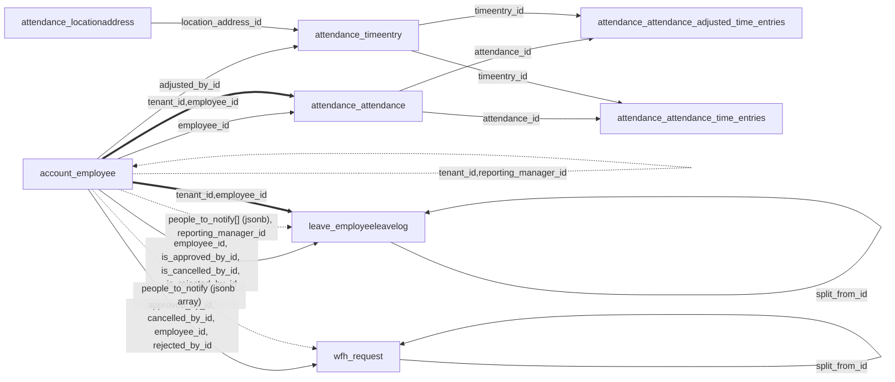

**Cross-module relationships with tables owned by Attendance Adjustments, WFH, Leave Configuration, Leave Requests & Balances, Accrual & Year End, Employees & Roles**

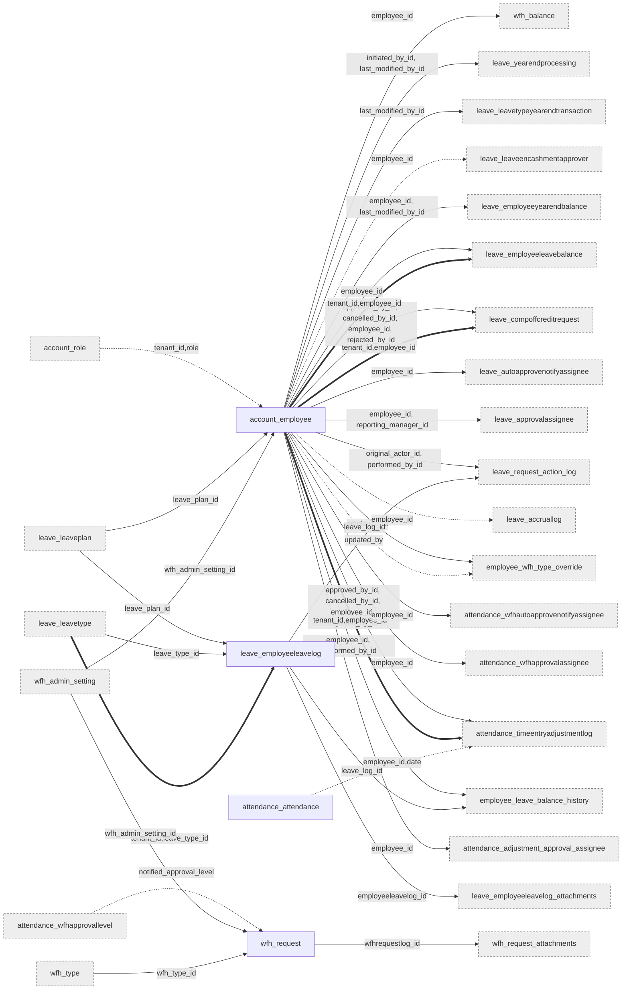

**Cross-module relationships with tables owned by Platform & Shared Infrastructure**

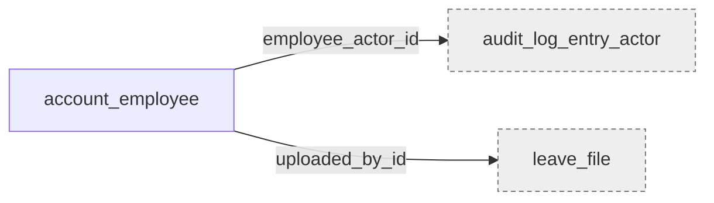

**Logical references to external services and generic objects**

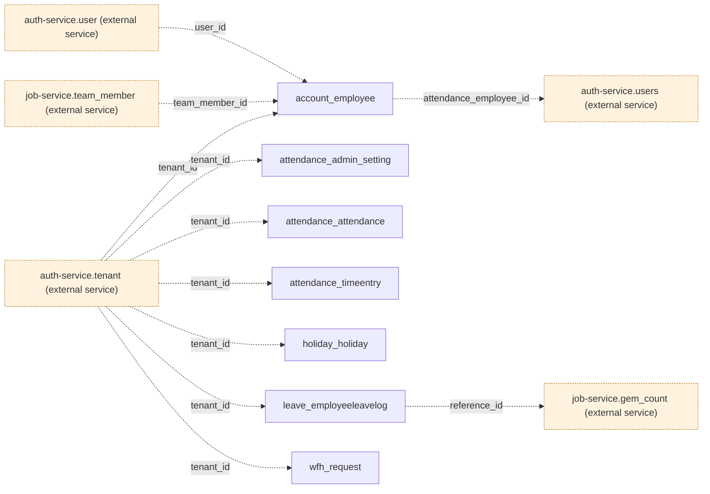

<a id="m-attendance-adjustments"></a>

### 3.2 Attendance Adjustments

**Purpose:** Employee requests to correct punches for a day, their multi-level approval configuration and the daily escalation task. Routes `api/attendance/adjustments/*`, `api/attendance/settings/*`, `api/tenants/<tenant_id>/attendance/adjustments`; code in `attendance/views/attendance_adjustment_approval.py`, `attendance/helpers/attendance_adjustment*.py`. Writes adjusted time entries back into Clock-in & Time Entries tables.

**Module metrics:** 11 distinct tables (5 owned here): 11 active, 0 deprecated/legacy, 0 apparently unused, 0 uncertain/indirect; 8 shared with other modules.

**Tables used:**

| Table | Usage status |
|---|---|
| [`account_employee`](#t-account_employee) | active |
| [`account_role`](#t-account_role) | active |
| [`attendance_adjustment_approval_assignee`](#t-attendance_adjustment_approval_assignee) | active |
| [`attendance_adjustment_approval_config`](#t-attendance_adjustment_approval_config) | active |
| [`attendance_adjustment_approval_level`](#t-attendance_adjustment_approval_level) | active |
| [`attendance_admin_setting`](#t-attendance_admin_setting) | active |
| [`attendance_attendance`](#t-attendance_attendance) | active |
| [`attendance_attendance_adjusted_time_entries`](#t-attendance_attendance_adjusted_time_entries) | active |
| [`attendance_attendance_time_entries`](#t-attendance_attendance_time_entries) | active |
| [`attendance_timeentry`](#t-attendance_timeentry) | active |
| [`attendance_timeentryadjustmentlog`](#t-attendance_timeentryadjustmentlog) | active |

**Table details**

#### `attendance_attendance_adjusted_time_entries`
<a id="t-attendance_attendance_adjusted_time_entries"></a>

**Overview**

- **Canonical name:** `public.attendance_attendance_adjusted_time_entries` (auto-created M2M through table for `attendance.Attendance.adjusted_time_entries`, `attendance/models/attendance.py:62`)
- **Object type:** table (implicit M2M through)
- **Purpose:** Links an attendance day to the punches that should replace the raw ones after an approved adjustment.
- **Definition source:** `attendance/models/attendance.py:62`; created in `attendance/migrations/0002_rename_attendance_date_attendance_date_and_more.py` (AddField adjusted_time_entries); later altered in: none.
- **Accessed by modules:** Attendance Adjustments (active), Clock-in & Time Entries (active), Reports & Reconciliation (active)
- **Status:** active. Evidence: write `attendance.adjusted_time_entries.add(...)` (`attendance/helpers/attendance_adjustment.py:39`); cancel updates rows reached through it (`attendance/serializers/attendance.py:401`); reads `attendance/helpers/attendance_summary.py:17,26-27,70,94,163`, `attendance/services/reconciliation.py:8,49`.
- **Primary owner:** Attendance Adjustments.

**Attributes**

| Column | Database Type | Nullable | Default | Key/Constraint | Description |
|---|---|---|---|---|---|
| id | bigint (identity) | No | DB: identity | PK | Type inferred from BigAutoField default; verify in DB. |
| attendance_id | bigint | No | none | FK -> attendance_attendance.id, index; UNIQUE (attendance_id, timeentry_id) | Holding attendance. |
| timeentry_id | bigint | No | none | FK -> attendance_timeentry.id, index | Adjusted (or reused original) punch. |

**Relationships**

| Direction | Related table | Columns | Cardinality | Enforcement | Notes |
|---|---|---|---|---|---|
| Outbound | [attendance_attendance](#t-attendance_attendance) | attendance_id -> id | N:1 | DB FK (on_delete=CASCADE) | |
| Outbound | [attendance_timeentry](#t-attendance_timeentry) | timeentry_id -> id | N:1 | DB FK (on_delete=CASCADE) | Reverse accessor on TimeEntry is `adjusted_time_entries` (related_name). |

**Additional details**

- Indexes / constraints: PK, UNIQUE (attendance_id, timeentry_id), index on each FK column (0002).
- Overlap with raw punches: when only one side is requested, `adjust_time_entries` adds the existing raw punch (from `time_entries`) to this table too (`attendance/helpers/attendance_adjustment.py:18-19,39`), so the same time entry can be in both M2M tables. Cancelling then flags that raw punch `is_adjustment_cancelled=True` (`attendance/serializers/attendance.py:401`), which also hides it from the raw-punch fallback in summaries.
- No link back to the TimeEntryAdjustmentLog that produced a row; multiple approved adjustments for the same day accumulate here.
- Migration risks: rows are derived state of approvals; cannot be rebuilt from `attendance_timeentryadjustmentlog` alone.

#### `attendance_timeentryadjustmentlog`
<a id="t-attendance_timeentryadjustmentlog"></a>

**Overview**

- **Canonical name:** `public.attendance_timeentryadjustmentlog` (Django model `attendance.TimeEntryAdjustmentLog`, `attendance/models/attendance.py:72`)
- **Object type:** table
- **Purpose:** Employee request to correct clock-in/clock-out for a past date, with approval workflow state (pending, approved, rejected, cancelled) and escalation level.
- **Definition source:** `attendance/models/attendance.py:72`; created in `attendance/migrations/0002_rename_attendance_date_attendance_date_and_more.py`; later altered in: `0003` (drop clock_in_entry and clock_out_entry FKs to timeentry), `0005` (time_entry_adjustment_id max_length 16 to 36), `0006` (drop is_approved, add status), `0007` (add approval_note, approved_at), `0008` (requested_clock_in/out made nullable), `0009` (add rejected_at, rejected_by), `0010` (add cancelled_at, cancelled_by, CANCELLED choice), `0011` (add cancellation_note, rejection_note), `0024` (add notified_approval_level), `0034` (add tenant_id + backfill), `0035` (RunSQL backfill, CHECK attendance_adjustment_tenant_set, RunSQL composite FK attendance_adjustment_employee_tenant_fk).
- **Accessed by modules:** Attendance Adjustments (active), Platform & Shared Infrastructure (uncertain/indirect: admin only, `attendance/admin.py:9`)
- **Status:** active. Evidence: create `attendance/serializers/attendance.py:189`; approve/reject `:240-251`; cancel `:377-393`; list/history `attendance/views/time_entries.py:411,798`; pending count `attendance/views/summary.py:353`; Celery Beat escalation `attendance/tasks.py:969-975,1043-1056` scheduled in `attendance_service_django/celery_tasks.py:30-33`.
- **Primary owner:** Attendance Adjustments.

**Attributes**

| Column | Database Type | Nullable | Default | Key/Constraint | Description |
|---|---|---|---|---|---|
| id | bigint (identity) | No | DB: identity | PK | Surrogate key. |
| created | timestamptz | No | Python: now() on insert | | Also the base date for escalation deadlines (`attendance/tasks.py:1013`). |
| modified | timestamptz | No | Python: now() on save | | |
| time_entry_adjustment_id | varchar(36) | No | Python: uuid.uuid4 | UNIQUE (+ _like index) | Public id used in URLs. varchar(16) until 0005. |
| employee_id | uuid | No | none | FK -> account_employee.employee_id, index | Requesting employee (related_name `adjustment_logs`). |
| tenant_id | varchar(36) | Yes (column) | none | index; CHECK `attendance_adjustment_tenant_set` (NOT NULL); composite FK (tenant_id, employee_id) | Stamped by EmployeeTenantMixin (0034). |
| date | date | No | none | | Day being corrected; must be in the past (`attendance/serializers/attendance.py:143-146`). |
| requested_clock_in | time | Yes | none | | Requested clock-in as UTC time of day (`attendance/serializers/attendance.py:180-182`). Nullable since 0008. |
| requested_clock_out | time | Yes | none | | Requested clock-out as UTC time of day. |
| status | varchar(10) | No | Python: 'PENDING' | | Choices PENDING, APPROVED, REJECTED, CANCELLED. Replaced boolean is_approved in 0006. |
| approved_by_id | uuid | Yes | none | FK -> account_employee.employee_id, index | Approver (related_name `approved_adjustments`). NULL for auto-approve. |
| note | varchar(300) | Yes | none | | Employee reason (API requires it). |
| approval_note | varchar(300) | Yes | none | | Approver note or "AUTO-APPROVED" (`attendance/tasks.py:958`). |
| approved_at | timestamptz | Yes | none | | Approval time. |
| rejected_by_id | uuid | Yes | none | FK -> account_employee.employee_id, index | Rejector. |
| rejected_at | timestamptz | Yes | none | | Rejection time. |
| cancelled_by_id | uuid | Yes | none | FK -> account_employee.employee_id, index | Canceller. |
| cancelled_at | timestamptz | Yes | none | | Cancellation time. |
| rejection_note | varchar(300) | Yes | none | | Rejection reason. |
| cancellation_note | varchar(300) | Yes | none | | Cancellation reason. |
| notified_approval_level | smallint | No | Python: 0 | CHECK >= 0 (PositiveSmallIntegerField) | Highest approval level already notified (0 = none). Logical pointer to `attendance_adjustment_approval_level.level`. |

**Relationships**

| Direction | Related table | Columns | Cardinality | Enforcement | Notes |
|---|---|---|---|---|---|
| Outbound | [account_employee](#t-account_employee) | employee_id -> employee_id | N:1 | DB FK (on_delete=CASCADE) | |
| Outbound | [account_employee](#t-account_employee) | (tenant_id, employee_id) -> (tenant_id, employee_id) | N:1 | DB FK via RunSQL `attendance_adjustment_employee_tenant_fk`, DEFERRABLE INITIALLY DEFERRED, no ON DELETE action (`attendance/migrations/0035_attendance_tenant_consistency.py:33-47`) | Not in model state. |
| Outbound | [account_employee](#t-account_employee) | approved_by_id -> employee_id | N:1 | DB FK (on_delete=SET_NULL) | |
| Outbound | [account_employee](#t-account_employee) | rejected_by_id -> employee_id | N:1 | DB FK (on_delete=SET_NULL) | |
| Outbound | [account_employee](#t-account_employee) | cancelled_by_id -> employee_id | N:1 | DB FK (on_delete=SET_NULL) | |
| Outbound | external:auth-service.tenant | tenant_id | N:1 | Logical only (no FK): `attendance/tasks.py:1050-1053` filters by auth-service active tenants | |
| Outbound | [attendance_attendance](#t-attendance_attendance) | (employee_id, date) | N:1 (not unique) | Logical only (no FK): `attendance/helpers/attendance_adjustment.py:11`, `attendance/serializers/attendance.py:396-398`, `:291-300` | Replaced the dropped clock_in_entry/clock_out_entry FKs (0003). |
| Outbound | [attendance_adjustment_approval_config](#t-attendance_adjustment_approval_config) | tenant_id -> tenant_id | N:0..1 | Logical only (no FK): `attendance/views/time_entries.py:320`, `attendance/tasks.py:983-985` | Approval chain chosen by tenant at request and escalation time. |
| Outbound | [attendance_adjustment_approval_level](#t-attendance_adjustment_approval_level) | notified_approval_level -> level (within tenant's config) | N:0..1 | Logical only (no FK): `attendance/views/time_entries.py:361-362`, `attendance/tasks.py:1006-1034` | Plain integer; changes to the config can leave it pointing at a level that no longer exists. |

**Additional details**

- Indexes / constraints: PK; UNIQUE time_entry_adjustment_id; indexes on employee_id, approved_by_id, rejected_by_id, cancelled_by_id, tenant_id; CHECK `attendance_adjustment_tenant_set` (0035, in model Meta `attendance/models/attendance.py:107-111`); CHECK notified_approval_level >= 0 (0024); composite FK (0035, DB only). No Meta.ordering. No index on (tenant_id, status) or (employee_id, date) although both are hot filters (`attendance/views/summary.py:353-354`, `attendance/views/time_entries.py:296-305`).
- Status convention: `status` column is the state machine; no soft delete. Duplicate guard (no PENDING/APPROVED for same employee/date) is application-only (`attendance/views/time_entries.py:295-311`), no DB unique.
- Transactions: create runs in `transaction.atomic()` (`attendance/views/time_entries.py:291`). Approve/reject (`attendance/views/time_entries.py:592-640`, serializer `attendance/serializers/attendance.py:240-251`) and cancel have no transaction and no select_for_update; the PENDING check is unlocked, so concurrent approvals can apply `adjust_time_entries` twice. The Celery escalation does a full-row `save()` on a stale instance (`attendance/tasks.py:1033-1034`), which can overwrite a concurrent approval back to PENDING (lost update).
- Celery: `escalate_pending_attendance_adjustment_requests` daily 09:30 (`attendance_service_django/celery_tasks.py:30-33`) scans all PENDING rows across tenants (`attendance/tasks.py:969-975`). Pending-count endpoint evaluates visibility per row in Python with per-row approver queries (`attendance/views/summary.py:366-378`).
- Model vs migration discrepancy: composite FK only in DB; otherwise cumulative migration state matches the model.
- Migration risks: requested_clock_in/out are UTC times without a date offset, recombined with `date` (`attendance/serializers/attendance.py:192-212`), so IST early-morning corrections can land on the wrong UTC day; status values are free text constrained only by Django choices.

#### `attendance_adjustment_approval_config`
<a id="t-attendance_adjustment_approval_config"></a>

**Overview**

- **Canonical name:** `public.attendance_adjustment_approval_config` (Django model `attendance.AttendanceAdjustmentApprovalConfig`, `attendance/models/attendance_admin_settings.py:62`)
- **Object type:** table
- **Purpose:** Per-tenant switchboard for the attendance adjustment approval chain (requires approval, auto-approve if no approver, suppress approver emails).
- **Definition source:** `attendance/models/attendance_admin_settings.py:62`; created in `attendance/migrations/0024_attendanceadjustmentapprovalconfig_and_more.py`; later altered in: none.
- **Accessed by modules:** Attendance Adjustments (active)
- **Status:** active. Evidence: CRUD `attendance/views/attendance_adjustment_approval.py:52-53`, `attendance/serializers/attendance_adjustment_approval.py:174,179-193`; read `attendance/helpers/attendance_adjustment_approval.py:24-36` from `attendance/views/time_entries.py:320`, `attendance/views/summary.py:366`, `attendance/tasks.py:983`.
- **Primary owner:** Attendance Adjustments.

**Attributes**

| Column | Database Type | Nullable | Default | Key/Constraint | Description |
|---|---|---|---|---|---|
| created | timestamptz | No | Python: now() on insert | | |
| modified | timestamptz | No | Python: now() on save | | Meta.ordering `-modified`. |
| id | uuid | No | Python: uuid.uuid4 | PK | |
| tenant_id | varchar(36) | No | none | UNIQUE (+ _like index) | Tenant (one config per tenant). |
| requires_approval | boolean | No | Python: False | | If False, adjustments stay PENDING for admin action (inferred from `attendance/helpers/attendance_adjustment_approval.py:155-156`). |
| auto_approve_if_missing | boolean | No | Python: False | | Auto-approve when no approver resolves at a level. |
| suppress_approver_notifications | boolean | No | Python: False | | Skip approver emails; also stops the escalation task entirely (`attendance/tasks.py:990-991`). |
| is_active | boolean | No | Python: True | | Never read or written by runtime code; not in the API serializer fields. |

**Relationships**

| Direction | Related table | Columns | Cardinality | Enforcement | Notes |
|---|---|---|---|---|---|
| Inbound | [attendance_adjustment_approval_level](#t-attendance_adjustment_approval_level) | approval_config_id -> id | 1:N | DB FK (on_delete=CASCADE) | related_name `levels`. |
| Outbound | external:auth-service.tenant | tenant_id | 1:1 | Logical only (no FK): `attendance/views/attendance_adjustment_approval.py:52-53`, `attendance/serializers/attendance_adjustment_approval.py:169-174` | |
| Inbound | [attendance_timeentryadjustmentlog](#t-attendance_timeentryadjustmentlog) | tenant_id -> tenant_id | N:0..1 | Logical only (no FK): `attendance/tasks.py:983-985` | Config looked up by request owner's tenant. |

**Additional details**

- Indexes / constraints: PK (uuid), UNIQUE tenant_id. Meta.ordering `["-modified"]` (0024).
- `is_active` looks unused: lookup docstring says an inactive config returns None, but the query does not filter on it (`attendance/helpers/attendance_adjustment_approval.py:20-36`); serializer fields omit it (`attendance/serializers/attendance_adjustment_approval.py:122-131`).
- Writes: create and update with nested levels inside `@transaction.atomic` (`attendance/serializers/attendance_adjustment_approval.py:167-193`); update deletes all levels and recreates them (`:190`).
- Read pattern: one query + 2 prefetches (`levels`, `levels__assignees` with select_related employee, role).
- Migration risks: low; config semantics depend on code (no DB rules).

#### `attendance_adjustment_approval_level`
<a id="t-attendance_adjustment_approval_level"></a>

**Overview**

- **Canonical name:** `public.attendance_adjustment_approval_level` (Django model `attendance.AttendanceAdjustmentApprovalLevel`, `attendance/models/attendance_admin_settings.py:108`)
- **Object type:** table
- **Purpose:** Ordered approval levels of a tenant's adjustment approval chain, with escalation delay per level.
- **Definition source:** `attendance/models/attendance_admin_settings.py:108`; created in `attendance/migrations/0024_attendanceadjustmentapprovalconfig_and_more.py`; later altered in: none.
- **Accessed by modules:** Attendance Adjustments (active)
- **Status:** active. Evidence: created `attendance/serializers/attendance_adjustment_approval.py:200`, deleted/recreated `:190`; read `attendance/helpers/attendance_adjustment_approval.py:60,158`, `attendance/tasks.py:1006-1013`.
- **Primary owner:** Attendance Adjustments.

**Attributes**

| Column | Database Type | Nullable | Default | Key/Constraint | Description |
|---|---|---|---|---|---|
| id | bigint (identity) | No | DB: identity | PK | |
| created | timestamptz | No | Python: now() on insert | | |
| modified | timestamptz | No | Python: now() on save | | |
| level | smallint | No | none | CHECK >= 0; UNIQUE (approval_config_id, level) | Level number 1..N; API enforces consecutive from 1 (`attendance/serializers/attendance_adjustment_approval.py:149-163`). |
| skip_if_no_action_days | smallint | Yes | Python: 0 | CHECK >= 0 | Days before escalating past this level. |
| approval_config_id | uuid | No | none | FK -> attendance_adjustment_approval_config.id, index | Parent config. |

**Relationships**

| Direction | Related table | Columns | Cardinality | Enforcement | Notes |
|---|---|---|---|---|---|
| Outbound | [attendance_adjustment_approval_config](#t-attendance_adjustment_approval_config) | approval_config_id -> id | N:1 | DB FK (on_delete=CASCADE) | |
| Inbound | [attendance_adjustment_approval_assignee](#t-attendance_adjustment_approval_assignee) | approval_level_id -> id | 1:N | DB FK (on_delete=CASCADE) | related_name `assignees`. |
| Inbound | [attendance_timeentryadjustmentlog](#t-attendance_timeentryadjustmentlog) | notified_approval_level -> level | N:0..1 | Logical only (no FK): `attendance/tasks.py:1033` | Integer level number, not id. |

**Additional details**

- Indexes / constraints: PK; index approval_config_id; UNIQUE (approval_config_id, level) via unique_together (0024); CHECK >= 0 on level and skip_if_no_action_days. Meta.ordering `["level"]`.
- No tenant_id column; tenant only via parent config.
- Rows are replaced wholesale on config update (ids change every PUT), so nothing should store level ids.
- Migration risks: low.

#### `attendance_adjustment_approval_assignee`
<a id="t-attendance_adjustment_approval_assignee"></a>

**Overview**

- **Canonical name:** `public.attendance_adjustment_approval_assignee` (Django model `attendance.AttendanceAdjustmentApprovalAssignee`, `attendance/models/attendance_admin_settings.py:140`)
- **Object type:** table
- **Purpose:** Who approves at a level: a role, a specific employee, the requester's reporting manager or project manager(s).
- **Definition source:** `attendance/models/attendance_admin_settings.py:140`; created in `attendance/migrations/0024_attendanceadjustmentapprovalconfig_and_more.py`; later altered in: `0029` (assignee_type choices add project_manager, no DDL change).
- **Accessed by modules:** Attendance Adjustments (active)
- **Status:** active. Evidence: created `attendance/serializers/attendance_adjustment_approval.py:205`; read via prefetch `attendance/helpers/attendance_adjustment_approval.py:27-31,68-136`.
- **Primary owner:** Attendance Adjustments.

**Attributes**

| Column | Database Type | Nullable | Default | Key/Constraint | Description |
|---|---|---|---|---|---|
| id | bigint (identity) | No | DB: identity | PK | |
| created | timestamptz | No | Python: now() on insert | | Meta.ordering `created`. |
| modified | timestamptz | No | Python: now() on save | | |
| assignee_type | varchar(20) | No | none | | Choices role, employee, reporting_manager, project_manager (0029). help_text still lists only three. |
| approval_level_id | bigint | No | none | FK -> attendance_adjustment_approval_level.id, index | Parent level. |
| employee_id | uuid | Yes | none | FK -> account_employee.employee_id, index | Set only when assignee_type = employee. |
| role_id | uuid | Yes | none | FK -> account_role.role_id, index | Set only when assignee_type = role. |

**Relationships**

| Direction | Related table | Columns | Cardinality | Enforcement | Notes |
|---|---|---|---|---|---|
| Outbound | [attendance_adjustment_approval_level](#t-attendance_adjustment_approval_level) | approval_level_id -> id | N:1 | DB FK (on_delete=CASCADE) | |
| Outbound | [account_employee](#t-account_employee) | employee_id -> employee_id | N:0..1 | DB FK (on_delete=CASCADE) | Same-tenant check only in serializer (`attendance/serializers/attendance_adjustment_approval.py:80-81`). |
| Outbound | [account_role](#t-account_role) | role_id -> role_id | N:0..1 | DB FK (on_delete=CASCADE) | Same-tenant check only in serializer (`attendance/serializers/attendance_adjustment_approval.py:73-74`). Resolution is by role name matched to `account_employee.role` text (`attendance/helpers/attendance_adjustment_approval.py:66-81`). |

**Additional details**

- Indexes / constraints: PK; indexes on approval_level_id, employee_id, role_id. No CHECK tying assignee_type to which of role_id/employee_id is set (serializer only, `attendance/serializers/attendance_adjustment_approval.py:52-92`). Meta.ordering `["created"]`.
- reporting_manager and project_manager types store no id; resolved at request time from `account_employee.reporting_manager_id` (team_member_id) and job-service project data (`attendance/helpers/attendance_adjustment_approval.py:84-116`).
- Deleting an Employee or Role cascades and silently removes the assignee (no runtime delete path found in `account/`, so only admin/manual deletes).
- Migration risks: cross-tenant assignee rows possible from before the F32 serializer fix; verify `role.tenant_id` and `employee.tenant_id` equal the parent config tenant.

#### Attendance Adjustments relationship diagrams

80 relationships touch this module's tables.

**Diagram Attendance Adjustments: relationships among this module's tables**

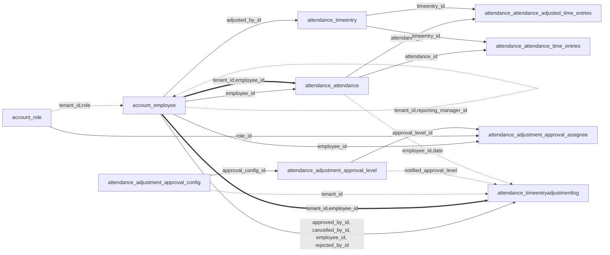

**Cross-module relationships with tables owned by Clock-in & Time Entries, WFH, Leave Configuration, Leave Requests & Balances, Accrual & Year End, Platform & Shared Infrastructure**

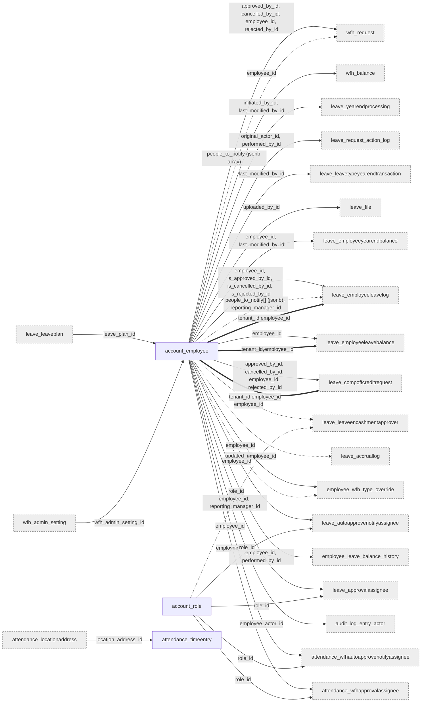

**Logical references to external services and generic objects**

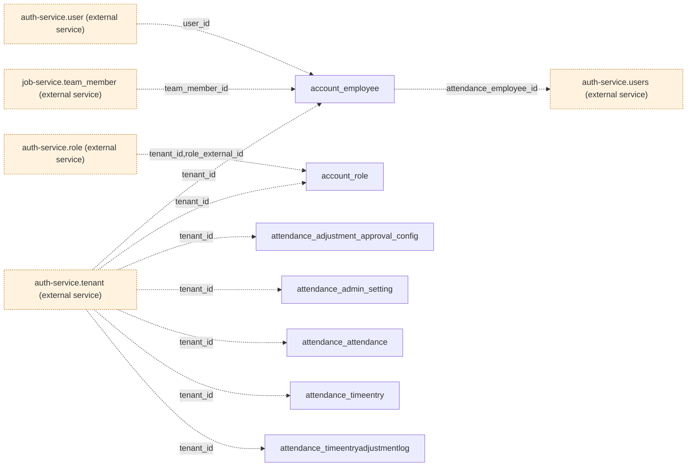

<a id="m-reports-reconciliation"></a>

### 3.3 Reports & Reconciliation

**Purpose:** Read-only reporting and reconciliation over attendance, WFH and leave data. Routes `api/reports/attendance/`, `api/reports/leave/`, `api/tenants/attendance/reconciliation-history`; code in `attendance/views/reports.py`, `attendance/views/reconciliation.py`, `leave/views/reports.py`, `attendance/services/`, `leave/services/reports.py`. Owns no tables (CLAUDE.md domain map says "none of their own"); every table it reads is owned elsewhere.

**Module metrics:** 9 distinct tables (0 owned here): 9 active, 0 deprecated/legacy, 0 apparently unused, 0 uncertain/indirect; 9 shared with other modules.

**Tables used:**

| Table | Usage status |
|---|---|
| [`account_employee`](#t-account_employee) | active |
| [`attendance_attendance`](#t-attendance_attendance) | active |
| [`attendance_attendance_adjusted_time_entries`](#t-attendance_attendance_adjusted_time_entries) | active |
| [`attendance_attendance_time_entries`](#t-attendance_attendance_time_entries) | active |
| [`attendance_timeentry`](#t-attendance_timeentry) | active |
| [`holiday_holiday`](#t-holiday_holiday) | active |
| [`leave_employeeleavebalance`](#t-leave_employeeleavebalance) | active |
| [`leave_employeeleavelog`](#t-leave_employeeleavelog) | active |
| [`wfh_request`](#t-wfh_request) | active |

**Table details:** none owned. See the linked definitions above.

#### Reports & Reconciliation relationship diagrams

85 relationships touch this module's tables.

**Diagram Reports & Reconciliation: relationships among this module's tables**

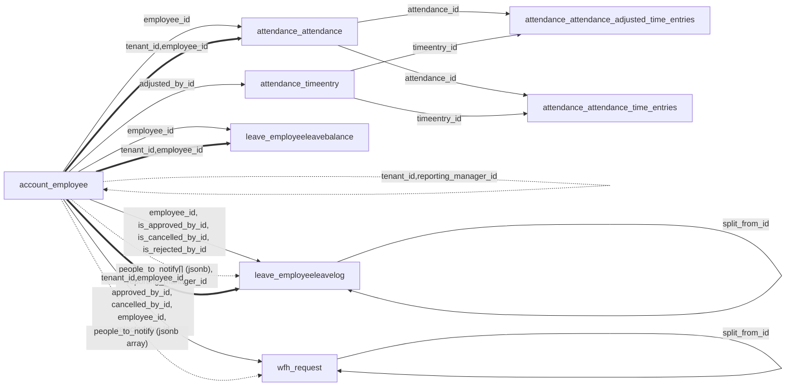

**Cross-module relationships with tables owned by Clock-in & Time Entries, Attendance Adjustments, WFH, Leave Configuration, Leave Requests & Balances**

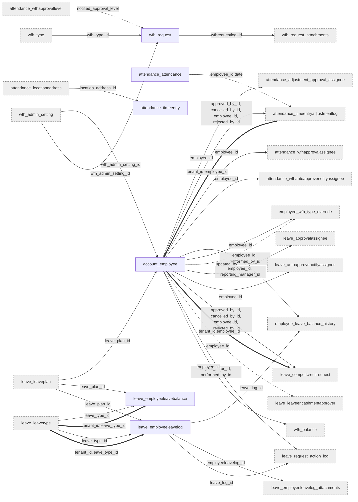

**Cross-module relationships with tables owned by Accrual & Year End, Employees & Roles, Platform & Shared Infrastructure**

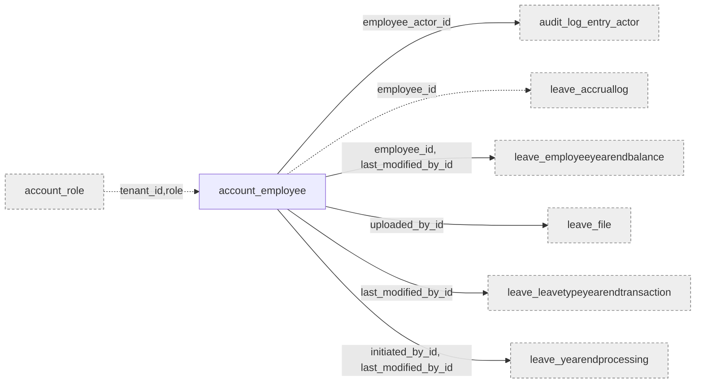

**Logical references to external services and generic objects**

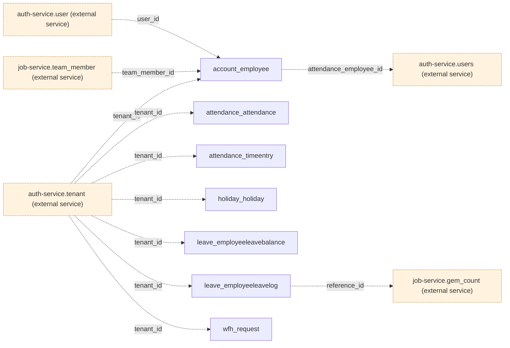

<a id="m-wfh"></a>

### 3.4 WFH

**Purpose:** Work-from-home types, admin settings (policies) with prior-notice, accrual and multi-level approval configuration, per-employee type overrides, balances with accrual history, and WFH requests. Routes `api/wfh/*`, `api/tenants/wfh-requests`; code in `attendance/views/wfh/`, `attendance/helpers/wfh_*.py`, `attendance/services/wfh_*.py`. Depends on Employees & Roles and shares `leave_file` attachments with Platform.

**Module metrics:** 18 distinct tables (14 owned here): 18 active, 0 deprecated/legacy, 0 apparently unused, 0 uncertain/indirect; 10 shared with other modules.

**Tables used:**

| Table | Usage status |
|---|---|
| [`account_employee`](#t-account_employee) | active |
| [`account_role`](#t-account_role) | active |
| [`attendance_wfhaccrualsetting`](#t-attendance_wfhaccrualsetting) | active |
| [`attendance_wfhapprovalassignee`](#t-attendance_wfhapprovalassignee) | active |
| [`attendance_wfhapprovalconfig`](#t-attendance_wfhapprovalconfig) | active |
| [`attendance_wfhapprovallevel`](#t-attendance_wfhapprovallevel) | active |
| [`attendance_wfhautoapprovenotifyassignee`](#t-attendance_wfhautoapprovenotifyassignee) | active |
| [`attendance_wfhpriornoticesetting`](#t-attendance_wfhpriornoticesetting) | active |
| [`employee_wfh_type_override`](#t-employee_wfh_type_override) | active |
| [`holiday_holiday`](#t-holiday_holiday) | active |
| [`leave_file`](#t-leave_file) | active |
| [`wfh_admin_setting`](#t-wfh_admin_setting) | active |
| [`wfh_admin_setting_type_config`](#t-wfh_admin_setting_type_config) | active |
| [`wfh_balance`](#t-wfh_balance) | active |
| [`wfh_balance_accrual_history`](#t-wfh_balance_accrual_history) | active |
| [`wfh_request`](#t-wfh_request) | active |
| [`wfh_request_attachments`](#t-wfh_request_attachments) | active |
| [`wfh_type`](#t-wfh_type) | active |

**Table details**

#### `wfh_request`
<a id="t-wfh_request"></a>

**Overview**

- **Canonical name:** `public.wfh_request` (Django model `attendance.WFHRequestLog`, `attendance/models/wfh_application.py:13`)
- **Object type:** table
- **Purpose:** One row per WFH request (or per piece of a request split by partial cancel): dates, half-day session, WFH type, approval workflow state, approver/rejecter/canceller, watchers and escalation progress.
- **Definition source:** `attendance/models/wfh_application.py:13`; created in `attendance/migrations/0013_wfhadminsetting_wfhapprovalconfig_wfhbalance_and_more.py` (db_table `wfh_request` from the start); later altered in: `0014` (add notified_approval_level), `0015` (add duration_days), `0016` (add people_to_notify), `0020` (add wfh_admin_setting FK), `0027` (add applied_after_cutoff), `0030` (add wfh_type FK and index `wfh_request_emp_type_date_idx`), `0031` (RunPython backfill of wfh_type_id), `0036_wfh_split_from` (add split_from self FK), `0036_wfh_request_attachments` (add M2M attachments, creates [wfh_request_attachments](#t-wfh_request_attachments)).
- **Accessed by modules:** WFH (active), Reports & Reconciliation (active), Clock-in & Time Entries (active), Platform & Shared Infrastructure (uncertain: Django admin registration only)
- **Status:** active. Evidence: created in `attendance/serializers/wfh_application.py:359`, listed/approved/cancelled in `attendance/views/wfh/application.py:337,737,924`, escalated by Beat task `attendance/tasks.py:430,725`, read by reports `attendance/services/reports.py:44` and pending counts `attendance/views/summary.py:330`.
- **Primary owner:** WFH

**Attributes**

| Column | Database Type | Nullable | Default | Key/Constraint | Description |
|---|---|---|---|---|---|
| wfh_request_id | uuid | NO | Python: uuid.uuid4 | PK | Public request id; also sent to job-service as gem-count `reference_id` |
| created | timestamptz | NO | Python: now (auto_now_add) | none | Row creation time (TimeStampedModel) |
| modified | timestamptz | NO | Python: now (auto_now on save) | none | Last save time; not touched by queryset.update(). Default ordering `-modified` |
| tenant_id | varchar(100) | NO | none | btree index + varchar_pattern_ops `_like` index (db_index) | Tenant identifier from auth-service |
| employee_id | uuid | NO | none | FK to account_employee.employee_id, index | Applicant |
| wfh_admin_setting_id | uuid | YES | none | FK to wfh_admin_setting, index | Snapshot of the applicant's WFH policy at creation (serializers/wfh_application.py:363); NULL for rows created before 0020 (no backfill) |
| wfh_type_id | bigint | YES | none | FK to wfh_type.id (bigint PK, NOT wfh_type.wfh_type_id), index | WFH kind; NULL treated as legacy ordinary WFH (helpers/wfh_type.py:86-88) |
| start_date | date | NO | none | part of index (start_date, end_date) | First WFH day |
| end_date | date | NO | none | part of index (start_date, end_date) | Last WFH day |
| is_half_day | boolean | NO | Python: False | none | Half-day request flag |
| half_day_session | varchar(20) | YES | none | choices: FIRST_HALF, SECOND_HALF | Which half when is_half_day |
| duration_days | double precision | NO | Python: 0 | none | Total WFH days requested; 0 for cancelled split pieces; rows that existed before 0015 got 0 |
| reason | text | YES | none | none | Applicant reason |
| status | varchar(20) | NO | Python: PENDING | index; choices: PENDING, APPROVED, REJECTED, CANCELLED | Workflow status |
| approved_by_id | uuid | YES | none | FK to account_employee, index | Approver |
| approval_comment | text | YES | none | none | Approver comment; "AUTO-APPROVED" for auto approvals (tasks.py:527) |
| approved_at | timestamptz | YES | none | none | Approval time |
| rejected_by_id | uuid | YES | none | FK to account_employee, index | Rejecter |
| rejection_comment | text | YES | none | none | Rejection comment |
| rejected_at | timestamptz | YES | none | none | Rejection time |
| cancelled_by_id | uuid | YES | none | FK to account_employee, index | Canceller |
| cancellation_comment | text | YES | none | none | Cancellation comment |
| cancelled_at | timestamptz | YES | none | none | Cancellation time |
| split_from_id | uuid | YES | none | FK to wfh_request.wfh_request_id (self), index | Root request a partial-cancel piece was cut from; always the lineage root, NULL on originals |
| people_to_notify | jsonb | NO | Python: list | none | Array of watcher `team_member_id` strings (logical, see Relationships) |
| notified_approval_level | smallint | NO | Python: 0 | CHECK (>= 0) | Highest approval level number notified so far (logical to attendance_wfhapprovallevel.level) |
| applied_after_cutoff | boolean | NO | Python: False | none | Request accepted after the same-day cutoff in "warning" mode |

**Relationships**

| Direction | Related table | Columns | Cardinality | Enforcement | Notes |
|---|---|---|---|---|---|
| Outbound | `account_employee` | employee_id to employee_id | N:1 | DB FK (on_delete=CASCADE) | related_name `wfh_requests` |
| Outbound | [wfh_admin_setting](#t-wfh_admin_setting) | wfh_admin_setting_id to wfh_admin_setting_id | N:1 | DB FK (on_delete=DO_NOTHING) | Deleting a referenced setting fails at commit; code only archives settings |
| Outbound | [wfh_type](#t-wfh_type) | wfh_type_id to id | N:1 | DB FK (on_delete=PROTECT) | Type in use can be archived, not deleted |
| Outbound | `account_employee` | approved_by_id to employee_id | N:1 | DB FK (on_delete=SET_NULL) | related_name `wfh_approved_requests` |
| Outbound | `account_employee` | rejected_by_id to employee_id | N:1 | DB FK (on_delete=SET_NULL) | related_name `wfh_rejected_requests` |
| Outbound | `account_employee` | cancelled_by_id to employee_id | N:1 | DB FK (on_delete=SET_NULL) | related_name `wfh_cancelled_requests` |
| Outbound | [wfh_request](#t-wfh_request) (self) | split_from_id to wfh_request_id | N:1 | DB FK (on_delete=CASCADE) | Pieces to root; depth always 1 (`attendance/services/wfh_partial_cancel.py:39`, `leave/utils/partial_cancel.py:39`) |
| Outbound | `account_employee` | people_to_notify[] to team_member_id | N:M | Logical only (no FK): `attendance/tasks.py:361-364` | JSON array of team_member_id strings |
| Outbound | [attendance_wfhapprovallevel](#t-attendance_wfhapprovallevel) | notified_approval_level to level | N:1 | Logical only (no FK): `attendance/tasks.py:667,697` | Level number, resolved through wfh_admin_setting to approval config |
| Outbound | external:auth-service.tenant | tenant_id | N:1 | Logical only (no FK): `attendance/tasks.py:731-741` | Escalation skips tenants not Active in auth-service |
| Inbound | [wfh_request_attachments](#t-wfh_request_attachments) | wfhrequestlog_id | 1:N | DB FK (on_delete=CASCADE) | M2M to leave_file |
| Inbound | [wfh_request](#t-wfh_request) (self) | split_from_id | 1:N | DB FK (on_delete=CASCADE) | related_name `split_pieces` |

**Additional details**

- Indexes: `wfh_request_tenant__a8fff0_idx` (tenant_id, employee_id), `wfh_request_status_9d54ac_idx` (status), `wfh_request_start_d_d31f0c_idx` (start_date, end_date) from 0013; `wfh_request_emp_type_date_idx` (employee_id, wfh_type_id, start_date) from 0030 (manually reordered after the AddField, comment in 0030); Django auto indexes on tenant_id (plus `_like`) and on every FK column. Meta.ordering `-modified`. No unique or check constraints besides the smallint CHECK.
- Model vs migrations: every column, index and option matches the cumulative migrations; no drift found by manual comparison (`makemigrations --check` not run, per instructions).
- Status convention: status column (PENDING/APPROVED/REJECTED/CANCELLED); no soft delete. Partial cancel splits a row into an APPROVED kept piece plus CANCELLED pieces with duration_days 0, all pointing to the root via split_from (`attendance/services/wfh_partial_cancel.py:36-60`); COPIED_FIELDS lists columns copied to pieces (`wfh_partial_cancel.py:18`). Lists sort by `Coalesce(split_from__created, created)` (`leave/utils/partial_cancel.py:49`).
- Locking/transactions: create wraps in `transaction.atomic` and locks the applicant's `account_employee` row with select_for_update to serialise monthly-cap checks (`attendance/views/wfh/application.py:134-147`); cancel locks the request row `select_for_update(of=("self",))` (`application.py:924-927`); partial cancel locks all APPROVED lineage rows (`wfh_partial_cancel.py:70-75`). Approve/reject and self-update run in atomic blocks (`application.py:525,780`).
- Bulk/queryset ops: data migration 0031 `.update(wfh_type=...)`; assign/unassign and archive cancel pending requests row by row (`attendance/views/wfh/admin_settings.py:575,654,1084`).
- Celery: `escalate_pending_wfh_requests` daily 09:00 (`attendance_service_django/celery_tasks.py:22-25`) loads all PENDING rows across tenants (`attendance/tasks.py:430`), skips rows whose wfh_admin_setting is NULL or inactive (`tasks.py:441-448`), may auto-approve (`tasks.py:520-527`).
- Data migration 0031: for every tenant found in wfh_admin_setting or wfh_request, get_or_create seeded types REG ("Work From Home") and MEN ("Menstrual WFH") in [wfh_type](#t-wfh_type), then backfilled `wfh_type_id = REG` on all untyped requests per tenant. Reverse clears wfh_type on rows typed with system types.
- Migration risks: rows created before 0014/0015/0016 received notified_approval_level 0, duration_days 0, people_to_notify [] at AddField time; rows before 0020 have NULL wfh_admin_setting_id and are skipped by escalation. wfh_type_id FK column holds the bigint `wfh_type.id`, not the public `wfh_type.wfh_type_id` uuid string. No DB-level tenant consistency between tenant_id and employee's tenant (unlike attendance tables in 0035). wfh_request_id is referenced externally by job-service gem counts (`attendance/serializers/wfh_application.py:371-377`, `wfh_partial_cancel.py:94`), so PKs must be preserved.

#### `wfh_request_attachments`
<a id="t-wfh_request_attachments"></a>

**Overview**

- **Canonical name:** `public.wfh_request_attachments` (Django auto-created M2M through for `attendance.WFHRequestLog.attachments`, `attendance/models/wfh_application.py:115`)
- **Object type:** m2m through table
- **Purpose:** Links WFH requests to uploaded proof files stored in `leave_file`.
- **Definition source:** `attendance/models/wfh_application.py:115`; created in `attendance/migrations/0036_wfh_request_attachments.py`; later altered in: none (merged by `0038_merge_20261012_0933.py`).
- **Accessed by modules:** WFH (active)
- **Status:** active. Evidence: `attendance/serializers/wfh_application.py:26-28` (set and mark files UPLOADED), `:368`; `attendance/services/wfh_partial_cancel.py:42` (pieces share the same files); prefetched in `attendance/views/wfh/application.py:354`.
- **Primary owner:** WFH

**Attributes**

| Column | Database Type | Nullable | Default | Key/Constraint | Description |
|---|---|---|---|---|---|
| id | bigint identity | NO | DB: identity | PK | Surrogate key (BigAutoField per attendance AppConfig) |
| wfhrequestlog_id | uuid | NO | none | FK to wfh_request.wfh_request_id, index; part of unique (wfhrequestlog_id, file_id) | Request |
| file_id | uuid | NO | none | FK to leave_file.file_id, index; part of unique (wfhrequestlog_id, file_id) | Attached file |

**Relationships**

| Direction | Related table | Columns | Cardinality | Enforcement | Notes |
|---|---|---|---|---|---|
| Outbound | [wfh_request](#t-wfh_request) | wfhrequestlog_id to wfh_request_id | N:1 | DB FK (on_delete=CASCADE) | |
| Outbound | `leave_file` | file_id to file_id | N:1 | DB FK (on_delete=CASCADE) | File reverse accessor `wfh_requests`; ownership checked via `leave/utils/attachments.py` (`check_attachment_ownership`) |

**Additional details**

- Unique constraint (wfhrequestlog_id, file_id) and per-FK indexes (Django defaults).
- One file can be linked to several rows of the same split lineage (`wfh_partial_cancel.py:42`).
- Migration risks: depends on leave app (`leave.0092`); the File row is owned by Leave Requests & Balances / Platform file upload, so both tables must migrate together.

#### `wfh_type`
<a id="t-wfh_type"></a>

**Overview**

- **Canonical name:** `public.wfh_type` (Django model `attendance.WFHType`, `attendance/models/wfh_type.py:9`)
- **Object type:** table
- **Purpose:** Per-tenant catalogue of WFH kinds (REGULAR, MENSTRUAL) and their rules: balance deduction, per-type monthly caps, half-day override, auto-approval, gender restriction.
- **Definition source:** `attendance/models/wfh_type.py:9`; created in `attendance/migrations/0030_employeewfhtypeoverride_wfhadminsettingtypeconfig_and_more.py` (with 4 indexes, 2 unique constraints); later altered in: `0031` (RunPython seed of REG and MEN per tenant), `0033` (add auto_approve + RunPython set auto_approve=True for type MENSTRUAL).
- **Accessed by modules:** WFH (active)
- **Status:** active. Evidence: CRUD `attendance/views/wfh/types.py:157,281,365`; resolution and availability `attendance/helpers/wfh_type.py:94,158,280`; on-demand seeding `attendance/helpers/wfh_admin_setting.py:193-198`; notifications read type `attendance/tasks.py:330`.
- **Primary owner:** WFH

**Attributes**

| Column | Database Type | Nullable | Default | Key/Constraint | Description |
|---|---|---|---|---|---|
| id | bigint identity | NO | DB: identity | PK | Internal key; target of all `wfh_type_id` FK columns in other tables |
| created | timestamptz | NO | Python: now | none | Creation time; Meta.ordering `-created` |
| modified | timestamptz | NO | Python: now | none | Last save time |
| tenant_id | varchar(36) | NO | none | index `wfh_type_tenant_idx`; part of `wfh_type_tenant_type_idx`, both unique constraints | Tenant |
| wfh_type_id | varchar(36) | NO | Python: uuid.uuid4 (stringified) | UNIQUE (+ `_like` index) | Public id used in URLs (`api/wfh/types/<wfh_type_id>/`) and request payloads |
| type | varchar(20) | NO | Python: REGULAR | choices: REGULAR, MENSTRUAL; part of `wfh_type_tenant_type_idx` | System category stable across renames |
| code | varchar(6) | NO | none | UNIQUE (tenant_id, code) `unique_wfh_type_code_per_tenant` | Short code (seeded REG, MEN) |
| name | varchar(255) | NO | none | UNIQUE (tenant_id, name) `unique_wfh_type_name_per_tenant` | Display name |
| description | text | YES | none | none | Description |
| color | varchar(7) | NO | Python: #000000 | none | Hex colour |
| restricted_to_gender | varchar(20) | NO | Python: ALL | index `wfh_type_gender_idx`; choices: ALL, MALE, FEMALE, NON_BINARY, PREFER_NOT, OTHER | Gender eligibility |
| is_system_generated | boolean | NO | Python: False | none | Seeded types: editable, not deletable |
| is_archived | boolean | NO | Python: False | index `wfh_type_archived_idx` | Archive flag (soft retire) |
| deducts_balance | boolean | NO | Python: True | none | False = additive type excluded from balance, admin monthly caps and accrual used-days |
| enable_days_per_month | boolean | NO | Python: False | none | Enable per-type monthly day cap |
| days_per_month | double precision | NO | Python: 0.0 | none | Per-type monthly day cap |
| enable_instances_per_month | boolean | NO | Python: False | none | Enable per-type monthly instance cap |
| instances_per_month | integer | NO | Python: 0 | CHECK (>= 0) | Per-type monthly instance cap |
| allow_half_day | boolean | YES | Python: None | none | Overrides admin setting's is_half_day_allowed; NULL inherits (`helpers/wfh_type.py:259-264`) |
| auto_approve | boolean | NO | Python: False | none | Approve on creation, bypassing the approval chain (`views/wfh/application.py:227-231`) |

**Relationships**

| Direction | Related table | Columns | Cardinality | Enforcement | Notes |
|---|---|---|---|---|---|
| Inbound | [wfh_request](#t-wfh_request) | wfh_type_id to id | 1:N | DB FK (on_delete=PROTECT) | |
| Inbound | [wfh_admin_setting_type_config](#t-wfh_admin_setting_type_config) | wfh_type_id to id | 1:N | DB FK (on_delete=CASCADE) | |
| Inbound | [employee_wfh_type_override](#t-employee_wfh_type_override) | wfh_type_id to id | 1:N | DB FK (on_delete=CASCADE) | |
| Outbound | external:auth-service.tenant | tenant_id | N:1 | Logical only (no FK): `attendance/views/wfh/types.py:147-149` (tenant-scoped queryset) | |

**Additional details**

- Indexes `wfh_type_tenant_idx`, `wfh_type_tenant_type_idx`, `wfh_type_archived_idx`, `wfh_type_gender_idx`; unique constraints `unique_wfh_type_name_per_tenant`, `unique_wfh_type_code_per_tenant`; unique on wfh_type_id. All from 0030. `wfh_type_tenant_idx` is a left prefix of `wfh_type_tenant_type_idx` (redundant).
- Model vs migrations: matches (auto_approve added in 0033). No drift found.
- Soft delete: is_archived; types are never deleted by runtime code (no `.delete()` in WFH code paths).
- Seed data: 0031 created REG "Work From Home" (#4A7BF7, ALL, deducts_balance True, no caps, allow_half_day NULL) and MEN "Menstrual WFH" (#C0577B, FEMALE, deducts_balance False, 1.0 day/month cap, allow_half_day True), both is_system_generated, for each tenant present in wfh_admin_setting or wfh_request at deploy. 0033 then set auto_approve=True on every row with type MENSTRUAL. Tenants onboarded later get the same two rows lazily on WFH policy creation via `ensure_system_wfh_types` (`attendance/helpers/wfh_admin_setting.py:143,177-200`, matched on code OR name).
- Migration risks: two id columns with confusing names (bigint `id` used by FKs, varchar `wfh_type_id` used by API). Seed definitions are duplicated in 0031 and `helpers/wfh_admin_setting.py:143`, so seeded rows may differ by tenant onboarding date only in timestamps.

#### `wfh_admin_setting_type_config`
<a id="t-wfh_admin_setting_type_config"></a>

**Overview**

- **Canonical name:** `public.wfh_admin_setting_type_config` (Django model `attendance.WFHAdminSettingTypeConfig`, `attendance/models/wfh_type.py:117`)
- **Object type:** table
- **Purpose:** Which WFH types a WFH admin setting (policy) offers; detaching sets is_active False instead of deleting.
- **Definition source:** `attendance/models/wfh_type.py:117`; created in `attendance/migrations/0030_employeewfhtypeoverride_wfhadminsettingtypeconfig_and_more.py` (FKs, index and unique constraint added in the same migration); later altered in: `0032` (RunPython attach seeded types to every existing admin setting).
- **Accessed by modules:** WFH (active)
- **Status:** active. Evidence: attach/detach `attendance/views/wfh/types.py:507-521`; availability `attendance/helpers/wfh_type.py:113,143`; list annotation `attendance/views/wfh/types.py:175,449`; auto attach on policy create `attendance/helpers/wfh_admin_setting.py:212`.
- **Primary owner:** WFH

**Attributes**

| Column | Database Type | Nullable | Default | Key/Constraint | Description |
|---|---|---|---|---|---|
| wfh_admin_setting_type_config_id | uuid | NO | Python: uuid.uuid4 | PK | Row id |
| created | timestamptz | NO | Python: now | none | Creation time |
| modified | timestamptz | NO | Python: now | none | Last save; Meta.ordering `-modified`; not bumped by detach `.update()` |
| tenant_id | varchar(36) | NO | none | part of index and unique constraint | Tenant |
| wfh_admin_setting_id | uuid | NO | none | FK to wfh_admin_setting, index; part of unique | Policy |
| wfh_type_id | bigint | NO | none | FK to wfh_type.id, index; part of unique | Type (internal bigint id) |
| is_active | boolean | NO | Python: True | part of `wfh_type_cfg_setting_idx` | Attached (True) or detached (False) |

**Relationships**

| Direction | Related table | Columns | Cardinality | Enforcement | Notes |
|---|---|---|---|---|---|
| Outbound | [wfh_admin_setting](#t-wfh_admin_setting) | wfh_admin_setting_id | N:1 | DB FK (on_delete=CASCADE) | related_name `type_configs` |
| Outbound | [wfh_type](#t-wfh_type) | wfh_type_id to id | N:1 | DB FK (on_delete=CASCADE) | related_name `admin_setting_configs` |
| Outbound | external:auth-service.tenant | tenant_id | N:1 | Logical only (no FK): `attendance/views/wfh/types.py:511` | Expected to equal the setting's and type's tenant_id; not enforced |

**Additional details**

- Index `wfh_type_cfg_setting_idx` (tenant_id, wfh_admin_setting_id, is_active); unique `unique_wfh_type_per_admin_setting` (tenant_id, wfh_admin_setting_id, wfh_type_id); both 0030. Plus Django FK indexes.
- Effectively a rich M2M between wfh_admin_setting and wfh_type with an is_active soft flag.
- Writes: `update_or_create` per type inside `transaction.atomic` (`views/wfh/types.py:507-521`); detach is a queryset `.update(is_active=False)` (`types.py:517-521`).
- Data migration 0032: for every wfh_admin_setting row, update_or_create a config (is_active True) for each seeded type of its tenant. Reverse deletes configs for system types.
- Migration risks: tenant_id consistency with parent rows is not enforced.

#### `employee_wfh_type_override`
<a id="t-employee_wfh_type_override"></a>

**Overview**

- **Canonical name:** `public.employee_wfh_type_override` (Django model `attendance.EmployeeWFHTypeOverride`, `attendance/models/wfh_type.py:161`)
- **Object type:** table
- **Purpose:** Per-employee decision for a WFH type; currently only used to disable a type for an otherwise eligible employee (absence of a row means allowed).
- **Definition source:** `attendance/models/wfh_type.py:161`; created in `attendance/migrations/0030_employeewfhtypeoverride_wfhadminsettingtypeconfig_and_more.py`; later altered in: none.
- **Accessed by modules:** WFH (active)
- **Status:** active. Evidence: write `attendance/views/wfh/types.py:614-668`; reads `attendance/helpers/wfh_type.py:126,149`, `attendance/views/wfh/types.py:758`.
- **Primary owner:** WFH

**Attributes**

| Column | Database Type | Nullable | Default | Key/Constraint | Description |
|---|---|---|---|---|---|
| employee_wfh_type_override_id | uuid | NO | Python: uuid.uuid4 | PK | Row id |
| created | timestamptz | NO | Python: now | none | Creation time |
| modified | timestamptz | NO | Python: now | none | Last save; Meta.ordering `-modified` |
| tenant_id | varchar(36) | NO | none | part of index and unique constraint | Tenant |
| employee_id | uuid | NO | none | FK to account_employee, index; part of unique | Employee |
| wfh_type_id | bigint | NO | none | FK to wfh_type.id, index; part of index and unique | Type |
| is_enabled | boolean | NO | Python: True | part of `wfh_type_override_type_idx` | False means the employee cannot use the type |
| updated_by | varchar(36) | YES | none | none | employee_id of the admin who last changed it (logical) |

**Relationships**

| Direction | Related table | Columns | Cardinality | Enforcement | Notes |
|---|---|---|---|---|---|
| Outbound | `account_employee` | employee_id | N:1 | DB FK (on_delete=CASCADE) | related_name `wfh_type_overrides` |
| Outbound | [wfh_type](#t-wfh_type) | wfh_type_id to id | N:1 | DB FK (on_delete=CASCADE) | related_name `employee_overrides` |
| Outbound | `account_employee` | updated_by to employee_id | N:1 | Logical only (no FK): `attendance/views/wfh/types.py:612,668` | Set from `request.employee_id` |
| Outbound | external:auth-service.tenant | tenant_id | N:1 | Logical only (no FK): `attendance/views/wfh/types.py:662-663` | |

**Additional details**

- Index `wfh_type_override_type_idx` (tenant_id, wfh_type_id, is_enabled); unique `unique_wfh_type_override_per_employee` (tenant_id, employee_id, wfh_type_id); 0030.
- Rows are flipped, never deleted (`update_or_create` inside `transaction.atomic`, `types.py:614-668`).
- Migration risks: updated_by is a free-text uuid string with no FK; may reference deleted employees.

#### `wfh_admin_setting`
<a id="t-wfh_admin_setting"></a>

**Overview**

- **Canonical name:** `public.wfh_admin_setting` (Django model `attendance.WFHAdminSetting`, `attendance/models/wfh_admin_settings.py:25`)
- **Object type:** table
- **Purpose:** A WFH policy per tenant: application rules (reason, half-day, future dates, admin-level monthly caps, prior notice, same-day cutoff) and archive flag. Employees are assigned via `account_employee.wfh_admin_setting_id`.
- **Definition source:** `attendance/models/wfh_admin_settings.py:25`; created in `attendance/migrations/0013_wfhadminsetting_wfhapprovalconfig_wfhbalance_and_more.py` as table `attendance_wfhadminsetting`; later altered in: `0017` (ordering options, add is_active default False, add name with one-off default "default_wfh_sechma", alter allow_future_date default to True, add 2 indexes, AlterModelTable to `wfh_admin_setting`), `0019` (alter is_active default to True), `0023` (add prior_notice_required), `0026` (add enable_same_day_cutoff, same_day_cutoff_time), `0027` (add same_day_cutoff_mode), `0031`/`0032` (read only, to seed and attach types). Inbound FK added by `account/migrations/0019_employee_wfh_admin_setting.py`.
- **Accessed by modules:** WFH (active), Employees & Roles (uncertain/indirect: filters on account_employee.wfh_admin_setting_id only), Platform & Shared Infrastructure (uncertain: admin registration only)
- **Status:** active. Evidence: CRUD `attendance/views/wfh/admin_settings.py:81,222,509,1011`; serializer create `attendance/serializers/wfh_admin_settings.py:846`; validation `attendance/helpers/wfh_application.py:438-517`; accrual task `attendance/services/wfh_accrual_engine.py:192`; escalation `attendance/tasks.py:441-448`; account filter `account/filters.py:112,180`.
- **Primary owner:** WFH

**Attributes**

| Column | Database Type | Nullable | Default | Key/Constraint | Description |
|---|---|---|---|---|---|
| wfh_admin_setting_id | uuid | NO | Python: uuid.uuid4 | PK | Policy id |
| created | timestamptz | NO | Python: now | none | Creation time |
| modified | timestamptz | NO | Python: now | none | Last save; Meta.ordering `-modified` |
| name | varchar(100) | NO | none (rows existing at 0017 got "default_wfh_sechma") | part of `wfh_setting_tenant_name_idx` | Policy name; uniqueness per tenant checked in serializer only (`serializers/wfh_admin_settings.py:734-743`) |
| tenant_id | varchar(36) | NO | none | btree + `_like` index (db_index) and `wfh_admin_setting_tenant_idx` | Tenant |
| reason_required | boolean | NO | Python: False | none | Reason mandatory (`helpers/wfh_application.py:438`) |
| is_half_day_allowed | boolean | NO | Python: False | none | Half-day allowed unless a type overrides |
| allow_future_date | boolean | NO | Python: True (was False in 0013) | none | Allow requests for future dates |
| enable_instances_per_month | boolean | NO | Python: False | none | Enable admin-level instance cap |
| instances_per_month | integer | NO | Python: 0 | CHECK (>= 0) | Admin-level monthly instance cap |
| enable_days_per_month | boolean | NO | Python: False | none | Enable admin-level day cap |
| days_per_month | integer | NO | Python: 0 | CHECK (>= 0) | Admin-level monthly day cap (integer, whereas wfh_type.days_per_month is float) |
| prior_notice_required | boolean | NO | Python: False | none | Enforce rules in [attendance_wfhpriornoticesetting](#t-attendance_wfhpriornoticesetting) |
| enable_same_day_cutoff | boolean | NO | Python: False | none | Block or flag same-day requests after cutoff |
| same_day_cutoff_time | time | YES | none | none | Cutoff time (UTC) |
| same_day_cutoff_mode | varchar(10) | NO | Python: mandatory | choices: mandatory, warning | Block vs flag |
| is_active | boolean | NO | Python: True (rows existing at 0017 got False) | none | Active vs archived |

**Relationships**

| Direction | Related table | Columns | Cardinality | Enforcement | Notes |
|---|---|---|---|---|---|
| Inbound | `account_employee` | wfh_admin_setting_id | 1:N | DB FK (on_delete=SET_NULL) | Assignment of employees to the policy (`account/models.py:91`) |
| Inbound | [wfh_request](#t-wfh_request) | wfh_admin_setting_id | 1:N | DB FK (on_delete=DO_NOTHING) | |
| Inbound | [wfh_balance](#t-wfh_balance) | wfh_admin_setting_id | 1:N | DB FK (on_delete=CASCADE) | |
| Inbound | [wfh_admin_setting_type_config](#t-wfh_admin_setting_type_config) | wfh_admin_setting_id | 1:N | DB FK (on_delete=CASCADE) | |
| Inbound | [attendance_wfhpriornoticesetting](#t-attendance_wfhpriornoticesetting) | wfh_admin_setting_id | 1:N | DB FK (on_delete=CASCADE) | |
| Inbound | [attendance_wfhaccrualsetting](#t-attendance_wfhaccrualsetting) | wfh_admin_setting_id | 1:1 | DB FK (on_delete=CASCADE), UNIQUE | |
| Inbound | [attendance_wfhapprovalconfig](#t-attendance_wfhapprovalconfig) | wfh_admin_setting_id | 1:1 | DB FK (on_delete=CASCADE), UNIQUE | |
| Outbound | external:auth-service.tenant | tenant_id | N:1 | Logical only (no FK): `attendance/tasks.py:755-762` | Accrual skips settings of tenants not Active in auth-service |

**Additional details**

- Indexes: `wfh_admin_setting_tenant_idx` (tenant_id) and `wfh_setting_tenant_name_idx` (tenant_id, name) from 0017, plus the auto db_index on tenant_id from 0013 (duplicate single-column index on tenant_id) and its `_like` index. No unique constraints besides PK.
- Table renamed by AlterModelTable in 0017: old name `attendance_wfhadminsetting`, new name `wfh_admin_setting`. Index/constraint names auto-generated in 0013 (PK, tenant_id index, CHECK constraints, FKs from approval/accrual config) likely still carry the `attendance_wfhadminsetting` prefix (not verified against a live DB).
- Soft delete: is_active (archive). Archiving cancels pending requests, deactivates balances and unassigns employees (`attendance/views/wfh/admin_settings.py:1061-1140`). No runtime `.delete()` of settings.
- Policy creation also seeds and attaches system types (`serializers/wfh_admin_settings.py:879`).
- Model vs migrations: matches. Discrepancy in history only: 0017 added is_active with default False (existing rows set to False by Django's AddField backfill) and 0019 changed the default to True without a data update, so any setting created before 0017 is archived unless edited later.
- Deprecated/legacy: none with evidence. Admin-level caps (instances_per_month, days_per_month) coexist with per-type caps in wfh_type and are still enforced (`helpers/wfh_application.py:506-517`); per-type `allow_half_day` overrides `is_half_day_allowed` (`helpers/wfh_type.py:259-264`).

#### `attendance_wfhpriornoticesetting`
<a id="t-attendance_wfhpriornoticesetting"></a>

**Overview**

- **Canonical name:** `public.attendance_wfhpriornoticesetting` (Django model `attendance.WFHPriorNoticeSetting`, `attendance/models/wfh_admin_settings.py:103`)
- **Object type:** table
- **Purpose:** Prior-notice rules of a WFH policy: requests of at least min_wfh_days need calendar_days_notice calendar days and working_days_needed working days of notice.
- **Definition source:** `attendance/models/wfh_admin_settings.py:103` (no db_table, Django default name); created in `attendance/migrations/0023_wfhadminsetting_prior_notice_required_and_more.py`; later altered in: none.
- **Accessed by modules:** WFH (active)
- **Status:** active. Evidence: validation `attendance/helpers/wfh_application.py:568-573`; create/update `attendance/serializers/wfh_admin_settings.py:871,940-962`.
- **Primary owner:** WFH

**Attributes**

| Column | Database Type | Nullable | Default | Key/Constraint | Description |
|---|---|---|---|---|---|
| id | bigint identity | NO | DB: identity | PK | Row id (client sends it back on update) |
| created | timestamptz | NO | Python: now | none | Creation time |
| modified | timestamptz | NO | Python: now | none | Last save |
| calendar_days_notice | integer | NO | Python: 0 | CHECK (>= 0) | Calendar days of notice required |
| working_days_needed | integer | NO | Python: 0 | CHECK (>= 0) | Working days of notice required |
| min_wfh_days | integer | NO | Python: 0 | CHECK (>= 0) | Request length threshold the rule applies to |
| wfh_admin_setting_id | uuid | NO | none | FK to wfh_admin_setting, index | Policy |

**Relationships**

| Direction | Related table | Columns | Cardinality | Enforcement | Notes |
|---|---|---|---|---|---|
| Outbound | [wfh_admin_setting](#t-wfh_admin_setting) | wfh_admin_setting_id | N:1 | DB FK (on_delete=CASCADE) | related_name `prior_notice_rules` |

**Additional details**

- No tenant_id column; tenant derived through wfh_admin_setting.
- Update path: rules matched by id are updated, unmatched created, leftovers hard deleted (`serializers/wfh_admin_settings.py:944-962`).
- Model vs migrations: matches. Only effective when `wfh_admin_setting.prior_notice_required` is True.

#### `attendance_wfhaccrualsetting`
<a id="t-attendance_wfhaccrualsetting"></a>

**Overview**

- **Canonical name:** `public.attendance_wfhaccrualsetting` (Django model `attendance.WFHAccrualSetting`, `attendance/models/wfh_admin_settings.py:137`)
- **Object type:** table
- **Purpose:** One accrual configuration per WFH policy: yearly quota or unlimited, immediate vs periodic accrual, frequency, per-period amount and per-month/quarter/half-year overrides.
- **Definition source:** `attendance/models/wfh_admin_settings.py:137`; created in `attendance/migrations/0013_wfhadminsetting_wfhapprovalconfig_wfhbalance_and_more.py`; later altered in: none.
- **Accessed by modules:** WFH (active)
- **Status:** active. Evidence: accrual engine `attendance/services/wfh_accrual_engine.py:24,141,152`; quota calc `attendance/helpers/wfh_admin_setting.py:23-26`; balance classification `attendance/helpers/wfh_application.py:593`; serializer create `attendance/serializers/wfh_admin_settings.py:668`.
- **Primary owner:** WFH

**Attributes**

| Column | Database Type | Nullable | Default | Key/Constraint | Description |
|---|---|---|---|---|---|
| wfh_accrual_setting_id | uuid | NO | Python: uuid.uuid4 | PK | Row id |
| created | timestamptz | NO | Python: now | none | Creation time |
| modified | timestamptz | NO | Python: now | none | Last save |
| is_unlimited | boolean | NO | Python: False | none | Unlimited WFH |
| yearly_quota | integer | NO | Python: 0 | CHECK (>= 0) | Days per year |
| quota_unit | varchar(10) | NO | Python: days | choices: days | Unit (only "days"; serialized only, no logic reads it) |
| is_quota_available_immediately | boolean | NO | Python: False | none | Full quota granted up front |
| accrues_periodically | boolean | NO | Python: True | none | Periodic accrual on |
| accrual_frequency | varchar(20) | YES | none | choices: monthly, quarterly, semi_annual, annual | Accrual cadence |
| accrual_day_of_period | smallint | YES | none | CHECK (>= 0) | Day of period to accrue |
| accrual_day_is_last | boolean | NO | Python: False | none | Accrue on last day of period |
| accrual_amount_per_period | numeric(5,2) | YES | none | none | Days per period |
| varies_by_month | boolean | NO | Python: False | none | Use accrual_by_month |
| accrual_by_month | jsonb | NO | Python: dict | none | e.g. {"jan": 2, ..., "dec": 3} |
| varies_by_quarter | boolean | NO | Python: False | none | Use accrual_by_quarter |
| accrual_by_quarter | jsonb | NO | Python: dict | none | Per-quarter amounts (inferred keys) |
| varies_by_halfyear | boolean | NO | Python: False | none | Use accrual_by_halfyear |
| accrual_by_halfyear | jsonb | NO | Python: dict | none | Per-half-year amounts (inferred keys) |
| wfh_admin_setting_id | uuid | NO | none | FK to wfh_admin_setting, UNIQUE | Policy (one-to-one) |

**Relationships**

| Direction | Related table | Columns | Cardinality | Enforcement | Notes |
|---|---|---|---|---|---|
| Outbound | [wfh_admin_setting](#t-wfh_admin_setting) | wfh_admin_setting_id | 1:1 | DB FK (on_delete=CASCADE), UNIQUE | related_name `accrual_setting_reverse` |

**Additional details**

- Unique constraint on wfh_admin_setting_id (OneToOneField). No tenant_id.
- Model vs migrations: matches; untouched since 0013.
- Consumed daily by Beat task `accrue_wfh_balances_for_all_employees` at 01:00 (`attendance_service_django/celery_tasks.py:26-29`).

#### `attendance_wfhapprovalconfig`
<a id="t-attendance_wfhapprovalconfig"></a>

**Overview**

- **Canonical name:** `public.attendance_wfhapprovalconfig` (Django model `attendance.WFHApprovalConfig`, `attendance/models/wfh_admin_settings.py:190`)
- **Object type:** table
- **Purpose:** Approval chain header for a WFH policy: whether approval is required, auto-approve when no approver, suppress approver notifications.
- **Definition source:** `attendance/models/wfh_admin_settings.py:190`; created in `attendance/migrations/0013_wfhadminsetting_wfhapprovalconfig_wfhbalance_and_more.py`; later altered in: none.
- **Accessed by modules:** WFH (active), Platform & Shared Infrastructure (uncertain: admin registration only)
- **Status:** active. Evidence: approver resolution `attendance/helpers/wfh_application.py:21-36,112`; escalation `attendance/tasks.py:638-653`; auto-approve notify `attendance/tasks.py:452-459,539-541`; create/update `attendance/serializers/wfh_admin_settings.py:227,296-304`.
- **Primary owner:** WFH

**Attributes**

| Column | Database Type | Nullable | Default | Key/Constraint | Description |
|---|---|---|---|---|---|
| wfh_approval_config_id | uuid | NO | Python: uuid.uuid4 | PK | Row id |
| created | timestamptz | NO | Python: now | none | Creation time |
| modified | timestamptz | NO | Python: now | none | Last save |
| requires_approval | boolean | NO | Python: False | none | Requests need approval |
| auto_approve_if_missing | boolean | NO | Python: False | none | Auto-approve when no approver resolves |
| suppress_approver_notifications | boolean | NO | Python: False | none | Do not notify approvers |
| wfh_admin_setting_id | uuid | NO | none | FK to wfh_admin_setting, UNIQUE | Policy (one-to-one) |

**Relationships**

| Direction | Related table | Columns | Cardinality | Enforcement | Notes |
|---|---|---|---|---|---|
| Outbound | [wfh_admin_setting](#t-wfh_admin_setting) | wfh_admin_setting_id | 1:1 | DB FK (on_delete=CASCADE), UNIQUE | related_name `wfh_approval_config_reverse` |
| Inbound | [attendance_wfhapprovallevel](#t-attendance_wfhapprovallevel) | wfh_approval_config_id | 1:N | DB FK (on_delete=CASCADE) | |
| Inbound | [attendance_wfhautoapprovenotifyassignee](#t-attendance_wfhautoapprovenotifyassignee) | approval_config_id | 1:N | DB FK (on_delete=CASCADE) | |

**Additional details**

- Unique on wfh_admin_setting_id. No tenant_id. Model vs migrations: matches.

#### `attendance_wfhapprovallevel`
<a id="t-attendance_wfhapprovallevel"></a>

**Overview**

- **Canonical name:** `public.attendance_wfhapprovallevel` (Django model `attendance.WFHApprovalLevel`, `attendance/models/wfh_admin_settings.py:222`)
- **Object type:** table
- **Purpose:** Ordered levels of a WFH approval chain with optional skip-after-N-days escalation.
- **Definition source:** `attendance/models/wfh_admin_settings.py:222`; created in `attendance/migrations/0013_wfhadminsetting_wfhapprovalconfig_wfhbalance_and_more.py`; later altered in: none.
- **Accessed by modules:** WFH (active), Platform & Shared Infrastructure (uncertain: admin registration only)
- **Status:** active. Evidence: `attendance/helpers/wfh_application.py:34`; escalation `attendance/tasks.py:653,667-697`; recreate on update `attendance/serializers/wfh_admin_settings.py:236,304,312`.
- **Primary owner:** WFH

**Attributes**

| Column | Database Type | Nullable | Default | Key/Constraint | Description |
|---|---|---|---|---|---|
| id | bigint identity | NO | DB: identity | PK | Row id (not stable, see below) |
| created | timestamptz | NO | Python: now | none | Creation time; escalation deadlines are computed from request timestamps, not this |
| modified | timestamptz | NO | Python: now | none | Last save |
| level | smallint | NO | none | CHECK (>= 0) | Level number; Meta.ordering `level` |
| skip_if_no_action_days | smallint | YES | none | CHECK (>= 0) | Escalate to next level after N days without action (`tasks.py:672`) |
| wfh_approval_config_id | uuid | YES | none | FK to attendance_wfhapprovalconfig, index | Parent chain |

**Relationships**

| Direction | Related table | Columns | Cardinality | Enforcement | Notes |
|---|---|---|---|---|---|
| Outbound | [attendance_wfhapprovalconfig](#t-attendance_wfhapprovalconfig) | wfh_approval_config_id | N:1 | DB FK (on_delete=CASCADE) | Nullable FK; related_name `levels` |
| Inbound | [attendance_wfhapprovalassignee](#t-attendance_wfhapprovalassignee) | approval_level_id | 1:N | DB FK (on_delete=CASCADE) | |
| Inbound | [wfh_request](#t-wfh_request) | notified_approval_level to level | 1:N | Logical only (no FK): `attendance/tasks.py:667,697` | By level number |

**Additional details**

- No unique constraint on (wfh_approval_config_id, level); uniqueness relies on serializer input.
- Updating a policy's chain hard deletes all levels (cascading assignees) and recreates them (`serializers/wfh_admin_settings.py:304-350`), so ids churn; requests reference levels only by number.
- Migration risks: nullable parent FK allows orphan levels (none created by current code paths, not verified in data).

#### `attendance_wfhapprovalassignee`
<a id="t-attendance_wfhapprovalassignee"></a>

**Overview**

- **Canonical name:** `public.attendance_wfhapprovalassignee` (Django model `attendance.WFHApprovalAssignee`, `attendance/models/wfh_admin_settings.py:244`)
- **Object type:** table
- **Purpose:** Who approves at a level: a role, a specific employee, the reporting manager or the project manager.
- **Definition source:** `attendance/models/wfh_admin_settings.py:244`; created in `attendance/migrations/0013_wfhadminsetting_wfhapprovalconfig_wfhbalance_and_more.py` (with reporting_manager FK); later altered in: `0019` (RemoveField reporting_manager), `0028` (AlterField assignee_type choices add project_manager; no DB change).
- **Accessed by modules:** WFH (active), Platform & Shared Infrastructure (uncertain: admin registration only)
- **Status:** active. Evidence: `attendance/helpers/wfh_application.py:39-81`, `:112`; writes `attendance/serializers/wfh_admin_settings.py:62,279,350`.
- **Primary owner:** WFH

**Attributes**

| Column | Database Type | Nullable | Default | Key/Constraint | Description |
|---|---|---|---|---|---|
| id | bigint identity | NO | DB: identity | PK | Row id |
| created | timestamptz | NO | Python: now | none | Creation time |
| modified | timestamptz | NO | Python: now | none | Last save |
| assignee_type | varchar(20) | NO | none | choices: role, employee, reporting_manager, project_manager | Kind of assignee |
| approval_level_id | bigint | NO | none | FK to attendance_wfhapprovallevel.id, index | Level |
| employee_id | uuid | YES | none | FK to account_employee, index | Set when assignee_type = employee |
| role_id | uuid | YES | none | FK to account_role.role_id, index | Set when assignee_type = role |

**Relationships**

| Direction | Related table | Columns | Cardinality | Enforcement | Notes |
|---|---|---|---|---|---|
| Outbound | [attendance_wfhapprovallevel](#t-attendance_wfhapprovallevel) | approval_level_id | N:1 | DB FK (on_delete=CASCADE) | related_name `wfh_approval_assignees` |
| Outbound | `account_employee` | employee_id | N:1 | DB FK (on_delete=CASCADE) | |
| Outbound | `account_role` | role_id | N:1 | DB FK (on_delete=CASCADE) | Role resolved to employees by `account_employee.role = account_role.name` (logical, `helpers/wfh_application.py:47-50`) |

**Additional details**

- reporting_manager and project_manager carry no id: resolved at runtime from `account_employee.reporting_manager_id` (team_member_id) and from an external project-manager lookup (`helpers/wfh_application.py:54-81`, `fetch_project_manager_team_member_ids`).
- No check constraint ties assignee_type to which FK is set.
- Legacy: column `reporting_manager_id` (FK to account_employee) existed from 0013 and was dropped in 0019; it is gone from the schema.
- Deleting an employee or role cascades and silently removes them from approval chains.

#### `attendance_wfhautoapprovenotifyassignee`
<a id="t-attendance_wfhautoapprovenotifyassignee"></a>

**Overview**

- **Canonical name:** `public.attendance_wfhautoapprovenotifyassignee` (Django model `attendance.WFHAutoApproveNotifyAssignee`, `attendance/models/wfh_admin_settings.py:273`)
- **Object type:** table
- **Purpose:** Who is notified when a WFH request is auto-approved (role, employee, reporting manager, project manager).
- **Definition source:** `attendance/models/wfh_admin_settings.py:273`; created in `attendance/migrations/0036_wfh_auto_approve_notify_assignee.py`; later altered in: none (merged by `0037_merge_20261009_0754.py`).
- **Accessed by modules:** WFH (active)
- **Status:** active. Evidence: `attendance/tasks.py:452-518` (resolve recipients), writes `attendance/serializers/wfh_admin_settings.py:287,369,373`.
- **Primary owner:** WFH

**Attributes**

| Column | Database Type | Nullable | Default | Key/Constraint | Description |
|---|---|---|---|---|---|
| id | bigint identity | NO | DB: identity | PK | Row id |
| created | timestamptz | NO | Python: now | none | Creation time |
| modified | timestamptz | NO | Python: now | none | Last save |
| assignee_type | varchar(20) | NO | none | choices: role, employee, reporting_manager, project_manager | Kind of recipient |
| approval_config_id | uuid | NO | none | FK to attendance_wfhapprovalconfig, index | Chain header |
| employee_id | uuid | YES | none | FK to account_employee, index | Set for employee type |
| role_id | uuid | YES | none | FK to account_role, index | Set for role type |

**Relationships**

| Direction | Related table | Columns | Cardinality | Enforcement | Notes |
|---|---|---|---|---|---|
| Outbound | [attendance_wfhapprovalconfig](#t-attendance_wfhapprovalconfig) | approval_config_id | N:1 | DB FK (on_delete=CASCADE) | related_name `auto_approve_notify_assignees` |
| Outbound | `account_employee` | employee_id | N:1 | DB FK (on_delete=CASCADE) | |
| Outbound | `account_role` | role_id | N:1 | DB FK (on_delete=CASCADE) | Role resolved by name match like approvers |

**Additional details**

- Update keeps rows by id and deletes the rest (`serializers/wfh_admin_settings.py:369-373`).
- Model declares its own ASSIGNEE_TYPE_CHOICES list duplicating the module-level choices; same values, no DB impact.
- Not registered in Django admin (unlike the other approval tables).

#### `wfh_balance`
<a id="t-wfh_balance"></a>

**Overview**

- **Canonical name:** `public.wfh_balance` (Django model `attendance.WFHBalance`, `attendance/models/wfh_balance.py:7`)
- **Object type:** table
- **Purpose:** Current WFH allowance per employee per policy (allocated, used, remaining, unlimited flag); one active row expected per (employee, policy).
- **Definition source:** `attendance/models/wfh_balance.py:7`; created in `attendance/migrations/0013_wfhadminsetting_wfhapprovalconfig_wfhbalance_and_more.py` (db_table `wfh_balance` from the start); later altered in: `0017` (add wfh_admin_setting FK), `0018` (add is_unlimited).
- **Accessed by modules:** WFH (active), Platform & Shared Infrastructure (uncertain: admin registration only)
- **Status:** active. Evidence: self balance `attendance/views/wfh/wfh_balance.py:53`; debit on create `attendance/views/wfh/application.py:169-205`; credit on reject `application.py:803-820`; cancel credit (locked) `attendance/helpers/wfh_application.py:597`; admin edit `attendance/views/wfh/admin_settings.py:1235-1264`; accrual `attendance/services/wfh_accrual_engine.py:97,123,183`; initial create `attendance/helpers/wfh_admin_setting.py:83`.
- **Primary owner:** WFH

**Attributes**

| Column | Database Type | Nullable | Default | Key/Constraint | Description |
|---|---|---|---|---|---|
| wfh_balance_id | uuid | NO | Python: uuid.uuid4 | PK | Row id |
| created | timestamptz | NO | Python: now | none | Creation time |
| modified | timestamptz | NO | Python: now | none | Last save; Meta.ordering `-modified`; not bumped by deactivation `.update()` |
| tenant_id | varchar(100) | NO | none | btree + `_like` index | Tenant |
| wfh_admin_setting_id | uuid | YES | none | FK to wfh_admin_setting, index | Policy the balance belongs to; NULL possible for rows from before 0017 |
| employee_id | uuid | NO | none | FK to account_employee, index | Employee |
| is_unlimited | boolean | NO | Python: False | none | Unlimited allowance |
| balance_days | double precision | NO | Python: 0.0 | none | Remaining days |
| total_allocated_days | double precision | NO | Python: 0.0 | none | Allocated days |
| total_used_days | double precision | NO | Python: 0.0 | none | Used days |
| is_active | boolean | NO | Python: True | none | Current row flag; old rows deactivated when an employee changes or loses policy |

**Relationships**

| Direction | Related table | Columns | Cardinality | Enforcement | Notes |
|---|---|---|---|---|---|
| Outbound | [wfh_admin_setting](#t-wfh_admin_setting) | wfh_admin_setting_id | N:1 | DB FK (on_delete=CASCADE) | related_name `wfh_balances` |
| Outbound | `account_employee` | employee_id | N:1 | DB FK (on_delete=CASCADE) | related_name `wfh_balances` |
| Outbound | external:auth-service.tenant | tenant_id | N:1 | Logical only (no FK): `attendance/services/wfh_accrual_engine.py:131` (copied from employee.tenant_id) | |
| Inbound | [wfh_balance_accrual_history](#t-wfh_balance_accrual_history) | wfh_balance_id | 1:N | DB FK (on_delete=DO_NOTHING) | |

**Additional details**

- No indexes beyond PK, tenant_id and FK auto indexes; no unique constraint for one active row per (employee_id, wfh_admin_setting_id); code relies on `.filter(...is_active=True).first()` (`wfh_accrual_engine.py:97-100`).
- Locking: only the cancel credit path uses select_for_update (`helpers/wfh_application.py:597`). Create debit is serialised indirectly by the employee row lock (`views/wfh/application.py:138`); reject credit (`application.py:803`), self-update (`application.py:528-606`), admin edit (row read outside the atomic block at `admin_settings.py:1235`, written at `:1256-1264`), assign/unassign/archive (`admin_settings.py:590-628,1097-1133`) and the accrual engine (`wfh_accrual_engine.py:97-183`) do unlocked read-modify-write.
- Bulk ops: deactivation via queryset `.update(is_active=False)` (`admin_settings.py:628-631,705-708,1130-1133`).
- Known defect retained in code: on reassignment the credit-back reads key "present" which `classify_wfh_request_days` never returns, so balances are not restored before deactivation (comment at `attendance/views/wfh/admin_settings.py:614-619`).
- Migration risks: balance figures are derived and may have drifted (unlocked writes, known defect); consider recomputing from wfh_request plus accrual history. Deleting a wfh_admin_setting would cascade here and then fail on the DO_NOTHING FK from history.

#### `wfh_balance_accrual_history`
<a id="t-wfh_balance_accrual_history"></a>

**Overview**

- **Canonical name:** `public.wfh_balance_accrual_history` (Django model `attendance.WFHAccrualHistory`, `attendance/models/wfh_balance.py:48`)
- **Object type:** table
- **Purpose:** Append-only log of WFH balance changes (accrual runs, initial grant, accrual-setting changes, admin manual edits) with old/new values and the period end the balance is valid until.
- **Definition source:** `attendance/models/wfh_balance.py:48`; created in `attendance/migrations/0021_wfhaccrualhistory.py` as table `wfh_balance_history`; later altered in: `0022_alter_wfhaccrualhistory_table.py` (AlterModelTable to `wfh_balance_accrual_history`).
- **Accessed by modules:** WFH (active)
- **Status:** active. Evidence: accrual idempotency check `attendance/services/wfh_accrual_engine.py:49-58`; inserts `wfh_accrual_engine.py:168`, `attendance/helpers/wfh_admin_setting.py:124`, `attendance/views/wfh/admin_settings.py:448,1271`.
- **Primary owner:** WFH

**Attributes**

| Column | Database Type | Nullable | Default | Key/Constraint | Description |
|---|---|---|---|---|---|
| wfh_balance_history_id | uuid | NO | Python: uuid.uuid4 | PK | Row id |
| created | timestamptz | NO | Python: now | none | Creation time; latest row chosen by `-created` |
| modified | timestamptz | NO | Python: now | none | Last save; Meta.ordering `-modified` |
| tenant_id | varchar(100) | NO | none | btree + `_like` index | Tenant |
| wfh_balance_id | uuid | NO | none | FK to wfh_balance, index | Balance row changed |
| is_old_unlimited | boolean | NO | Python: False | none | Unlimited before |
| old_used_days | double precision | YES | none | none | Used before |
| old_total_allocated_days | double precision | YES | none | none | Allocated before |
| old_balance_days | double precision | YES | none | none | Balance before |
| new_balance_days | double precision | YES | none | none | Balance after |
| new_total_allocated_days | double precision | YES | none | none | Allocated after |
| new_used_days | double precision | YES | none | none | Used after |
| is_new_unlimited | boolean | NO | Python: False | none | Unlimited after |
| reason_for_change | text | YES | none | none | Free text, e.g. "Accrual update as of YYYY-MM-DD" |
| balance_valid_until | date | YES | none | none | End of the accrual period; NULL for manual admin edits so the next accrual run recalculates (`admin_settings.py:1269-1282`) |

**Relationships**

| Direction | Related table | Columns | Cardinality | Enforcement | Notes |
|---|---|---|---|---|---|
| Outbound | [wfh_balance](#t-wfh_balance) | wfh_balance_id | N:1 | DB FK (on_delete=DO_NOTHING) | related_name `balance_histories` |
| Outbound | external:auth-service.tenant | tenant_id | N:1 | Logical only (no FK): `attendance/services/wfh_accrual_engine.py:180` | |

**Additional details**

- Table renamed by AlterModelTable: old name `wfh_balance_history` (0021), new name `wfh_balance_accrual_history` (0022). Auto-generated index/constraint names from 0021 likely still use the `wfh_balance_history` prefix (not verified against a live DB).
- Accrual idempotency: the daily accrual (01:00) skips an employee if a history row exists whose balance_valid_until falls in the current period and is not before today (`wfh_accrual_engine.py:18-72`); each employee runs in its own `transaction.atomic` (`attendance/tasks.py:766`).
- No indexes for the idempotency query (filters by tenant_id, wfh_balance join, balance_valid_until); only tenant_id and FK indexes exist.
- Model vs migrations: matches.
- Migration risks: history is the only audit trail of WFH balances (WFH models are not registered with django-auditlog; registration is driven by `leave/utils/audit_config.py` and gated by AUDITLOG_ENABLED). DO_NOTHING FK means parent wfh_balance rows cannot be deleted while history exists.

#### WFH relationship diagrams

95 relationships touch this module's tables.

**Diagram WFH: relationships among this module's tables**

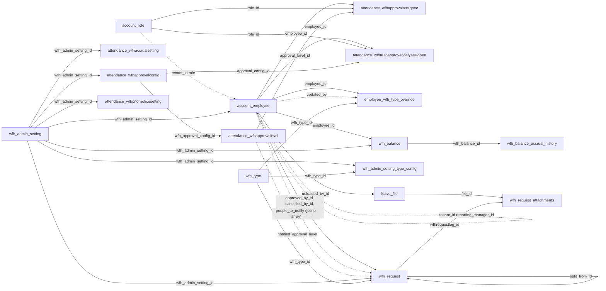

**Cross-module relationships with tables owned by Clock-in & Time Entries, Attendance Adjustments, Leave Configuration, Leave Requests & Balances, Accrual & Year End, Platform & Shared Infrastructure**

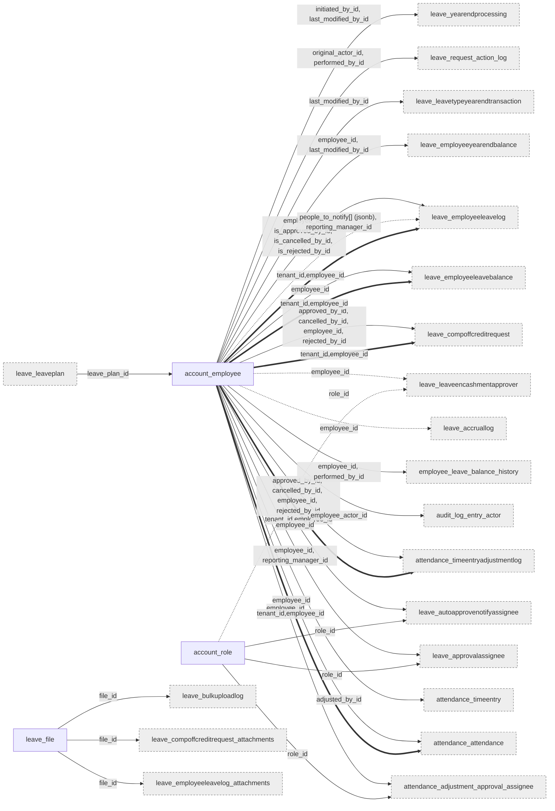

**Logical references to external services and generic objects**

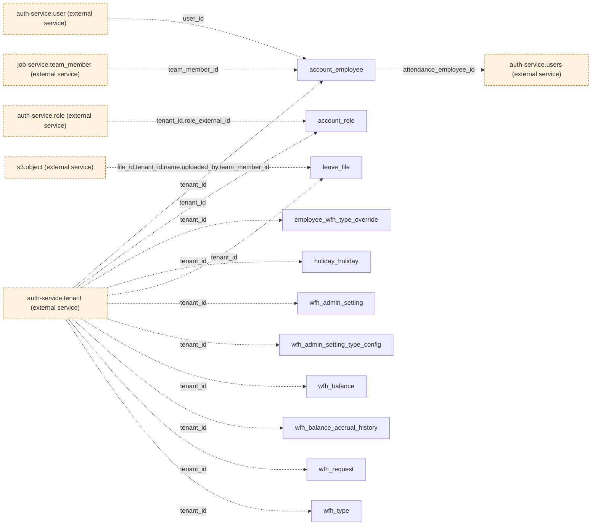

<a id="m-leave-configuration"></a>

### 3.5 Leave Configuration

**Purpose:** Tenant leave setup: leave types, leave plans, the plan to type configuration hub and its rule panels (accrual, application rules, approval chains, probation, notice period, encashment, carry forward) and the tenant leave cycle. Routes `api/tenants/<tenant_id>/*` in `leave/urls.py`; code in `leave/views/leave_type_view.py`, `leave/views/leave_plan_*.py`, `leave/views/tenant_leave_cycle.py`, `leave/services/leave_type_service.py`. Read heavily by Leave Requests & Balances and Accrual & Year End.

**Module metrics:** 40 distinct tables (29 owned here): 38 active, 0 deprecated/legacy, 2 apparently unused, 0 uncertain/indirect; 40 shared with other modules.

**Tables used:**

| Table | Usage status |
|---|---|
| [`account_employee`](#t-account_employee) | active |
| [`account_role`](#t-account_role) | active |
| [`audit_log_entry_actor`](#t-audit_log_entry_actor) | active |
| [`auditlog_logentry`](#t-auditlog_logentry) | active |
| [`django_content_type`](#t-django_content_type) | active |
| [`employee_leave_balance_history`](#t-employee_leave_balance_history) | active |
| [`leave_accrualratebytenure`](#t-leave_accrualratebytenure) | active |
| [`leave_approvalassignee`](#t-leave_approvalassignee) | active |
| [`leave_approvallevel`](#t-leave_approvallevel) | active |
| [`leave_autoapprovenotifyassignee`](#t-leave_autoapprovenotifyassignee) | active |
| [`leave_compoffcreditrequest`](#t-leave_compoffcreditrequest) | active |
| [`leave_employeeleavebalance`](#t-leave_employeeleavebalance) | active |
| [`leave_employeeleavelog`](#t-leave_employeeleavelog) | active |
| [`leave_employeeyearendbalance`](#t-leave_employeeyearendbalance) | active |
| [`leave_leaveaccrualconfig`](#t-leave_leaveaccrualconfig) | active |
| [`leave_leaveaccrualconfig_restricted_leave_types`](#t-leave_leaveaccrualconfig_restricted_leave_types) | active |
| [`leave_leaveapplicationconfig`](#t-leave_leaveapplicationconfig) | active |
| [`leave_leaveapplicationrestrictionconfig`](#t-leave_leaveapplicationrestrictionconfig) | active |
| [`leave_leaveapplicationrestrictionconfig_cannot_be_availed_w3b41`](#t-leave_leaveapplicationrestrictionconfig_cannot_be_availed_w3b41) | active |
| [`leave_leaveapplicationrestrictionconfig_unavailable_types`](#t-leave_leaveapplicationrestrictionconfig_unavailable_types) | active |
| [`leave_leaveapprovalconfig`](#t-leave_leaveapprovalconfig) | active |
| [`leave_leavecarryforwardconfig`](#t-leave_leavecarryforwardconfig) | active |
| [`leave_leaveencashmentapprovalconfig`](#t-leave_leaveencashmentapprovalconfig) | no runtime ref |
| [`leave_leaveencashmentapprover`](#t-leave_leaveencashmentapprover) | no runtime ref |
| [`leave_leaveencashmentconfig`](#t-leave_leaveencashmentconfig) | active |
| [`leave_leaveencashmentthreshold`](#t-leave_leaveencashmentthreshold) | active |
| [`leave_leaveplan`](#t-leave_leaveplan) | active |
| [`leave_leaveplanleavetypeconfig`](#t-leave_leaveplanleavetypeconfig) | active |
| [`leave_leavepriornoticerule`](#t-leave_leavepriornoticerule) | active |
| [`leave_leavesandwichpolicyconfig`](#t-leave_leavesandwichpolicyconfig) | active |
| [`leave_leavetype`](#t-leave_leavetype) | active |
| [`leave_leaveusagecountrule`](#t-leave_leaveusagecountrule) | active |
| [`leave_leaveusagelimitconfig`](#t-leave_leaveusagelimitconfig) | active |
| [`leave_noticeperiodaccrualslab`](#t-leave_noticeperiodaccrualslab) | active |
| [`leave_noticeperiodleaveconfig`](#t-leave_noticeperiodleaveconfig) | active |
| [`leave_probationaccrualslab`](#t-leave_probationaccrualslab) | active |
| [`leave_probationfirstmonthslab`](#t-leave_probationfirstmonthslab) | active |
| [`leave_probationleaveconfig`](#t-leave_probationleaveconfig) | active |
| [`leave_yearendprocessing`](#t-leave_yearendprocessing) | active |
| [`tenant_leave_cycle`](#t-tenant_leave_cycle) | active |

**Table details**

#### `leave_leavetype`
<a id="t-leave_leavetype"></a>

**Overview**

- **Canonical name:** `public.leave_leavetype` (Django model `leave.LeaveType`, `leave/models/leave_type.py:10`)
- **Object type:** table
- **Purpose:** Tenant catalogue of leave types (code, name, category, eligibility restrictions, colour). Every plan configuration, balance, log, comp-off request and year-end transaction hangs off a row here.
- **Definition source:** `leave/models/leave_type.py:10`; created in `leave/migrations/0001_initial.py` (with many columns since dropped); later altered in: 0002 (leave_type_id to varchar(36)), 0004 (add tenant_id), 0005 (unique_together tenant_id+code), 0007 (add color), 0018 (add is_floater), 0020 (drop unique_together, add is_archived/is_sick_leave/reasons/type, nine indexes, drop per_year_quota/quota_during_probation), 0024 (drop 15 legacy columns incl. is_active, is_paid, is_floater; add is_description_visible_to_employee/is_system_generated; code to varchar(6); unique (tenant_id,name) and (tenant_id,code)), 0025/0026 (ordering, gender choices), 0058 (RunPython reassigns colour on every row), 0066 (re-add is_floater), 0089 (unique (tenant_id,id) as composite FK target).
- **Accessed by modules:** Leave Configuration (active), Leave Requests & Balances (active), Accrual & Year End (active), Employees & Roles (active), Platform & Shared Infrastructure (active)
- **Status:** active. Evidence: CRUD/archive in `leave/views/leave_type_view.py:88`, create in `leave/serializers/leave_type_serializer.py:126`, read by `leave/validators/leave_rules_engine.py:67` and `leave/services/leave_accrual_engine.py:122`.
- **Primary owner:** Leave Configuration

**Attributes**

| Column | Database Type | Nullable | Default | Key/Constraint | Description |
|---|---|---|---|---|---|
| id | bigint identity | NO | DB: identity | PK; part of UNIQUE `uniq_leave_type_tenant_pk` (tenant_id, id) | Surrogate key; target of all inbound FKs |
| created | timestamptz | NO | Python: now (auto_now_add) | | Row creation time |
| modified | timestamptz | NO | Python: now (auto_now) | | Last save time |
| tenant_id | varchar(36) | NO | none | INDEX `leave_leave_tenant__f1494a_idx`; in UNIQUE (tenant_id,name), (tenant_id,code), (tenant_id,id) | Owning tenant (logical ref to auth-service tenant) |
| leave_type_id | varchar(36) | NO | Python: uuid4 | UNIQUE; INDEX `leave_leave_leave_t_ce0a41_idx` (redundant with unique) | Public UUID string used in URLs, AccrualLog and API payloads |
| code | varchar(6) | NO | none | INDEX `leave_leave_code_766ec1_idx`; UNIQUE per tenant `unique_leave_type_code_per_tenant` | Short leave code |
| type | varchar(20) | NO | Python: 'REGULAR' | INDEX `leave_leave_type_748014_idx` | Category. Choices: REGULAR, INCIDENT, COMP_OFF, UNPAID (UNPAID drives `is_paid` property) |
| name | varchar(255) | NO | none | UNIQUE per tenant `unique_leave_type_name_per_tenant` | Display name |
| description | text | YES | none | | Free-text description |
| is_description_visible_to_employee | boolean | NO | Python: False | | Show description to employees |
| is_sick_leave | boolean | NO | Python: False | | Sick-leave flag |
| restricted_to_gender | varchar(20) | NO | Python: 'ALL' | INDEX `leave_leave_restric_8f7331_idx` | Gender eligibility. Choices: ALL, MALE, FEMALE, NON_BINARY, PREFER_NOT, OTHER |
| restricted_to_marital_status | varchar(20) | NO | Python: 'ALL' | INDEX `leave_leave_restric_6a4092_idx` | Marital eligibility. Choices: ALL, MARRIED, UNMARRIED, WIDOWED, SEPARATED |
| reasons | varchar(255)[] | NO | Python: [] | | Allowed reasons; non-empty means a reason is required |
| is_system_generated | boolean | NO | Python: False | | Created by system seed (inferred) |
| is_archived | boolean | NO | Python: False | INDEX `leave_leave_is_arch_e2f8f1_idx` | Archive flag (soft removal) |
| color | varchar(7) | NO | Python: '#000000' | | Hex colour for UI; 0058 RunPython overwrote all existing rows |
| is_floater | boolean | NO | Python: False | | Floater leave flag (display); enforcement uses `leave_leaveapplicationconfig.is_floater` |

Historical columns (dropped, data not preserved): `is_active`, `is_gender_specific`, `is_paid`, `is_prior_notice_required`, `prior_notice_days`, `is_note_required`, `is_approval_required`, `is_approval_note_required`, `is_rejection_note_required`, `is_marital_status_specific`, `min_gap_days`, `max_duration_days`, `allow_half_day`, `require_document_proof` (all RemoveField in 0024), `per_year_quota`, `quota_during_probation` (0020). `is_floater` was dropped in 0024 and re-added in 0066, so values from before 0024 were lost.

**Relationships**

| Direction | Related table | Columns | Cardinality | Enforcement | Notes |
|---|---|---|---|---|---|
| Outbound | external: auth-service tenant | tenant_id | N:1 | Logical only (no FK): `leave/serializers/leave_balance_serializers.py:31` | Tenant id string |
| Inbound | [leave_leavequota](#t-leave_leavequota) | leave_type_id -> id | 1:N | DB FK (on_delete=CASCADE) | Legacy quota rows |
| Inbound | [leave_leaveplanleavetypeconfig](#t-leave_leaveplanleavetypeconfig) | leave_type_id -> id | 1:N | DB FK (on_delete=CASCADE) | One config per plan and type |
| Inbound | [leave_leavecarryforwardconfig](#t-leave_leavecarryforwardconfig) | carry_to_leave_type_id -> id | 1:N | DB FK (on_delete=SET_NULL) | Carry-forward target type |
| Inbound | [leave_leaveaccrualconfig_restricted_leave_types](#t-leave_leaveaccrualconfig_restricted_leave_types) | leavetype_id -> id | 1:N | DB FK (on_delete=CASCADE) | M2M through |
| Inbound | [leave_leaveapplicationrestrictionconfig_unavailable_types](#t-leave_leaveapplicationrestrictionconfig_unavailable_types) | leavetype_id -> id | 1:N | DB FK (on_delete=CASCADE) | M2M through |
| Inbound | [leave_leaveapplicationrestrictionconfig_cannot_be_availed_w3b41](#t-leave_leaveapplicationrestrictionconfig_cannot_be_availed_w3b41) | leavetype_id -> id | 1:N | DB FK (on_delete=CASCADE) | M2M through |
| Inbound | leave_employeeleavebalance | leave_type_id -> id; (tenant_id, leave_type_id) -> (tenant_id, id) | 1:N | DB FK (on_delete=CASCADE) plus composite FK `leave_balance_leave_type_tenant_fk` (RunSQL 0089) | `leave/models/leave_applications.py:34` |
| Inbound | leave_employeeleavelog | leave_type_id -> id; (tenant_id, leave_type_id) -> (tenant_id, id) | 1:N | DB FK (on_delete=CASCADE) plus composite FK `leave_log_leave_type_tenant_fk` (RunSQL 0089) | `leave/models/leave_applications.py:83` |
| Inbound | leave_employeeleavebalancehistory | leave_type_id -> id | 1:N | DB FK (on_delete=DO_NOTHING) | `leave/models/employee_leave_balance_history.py:57`; a leave type delete fails at commit if history exists |
| Inbound | leave_compoffcreditrequest | leave_type_id -> id; (tenant_id, leave_type_id) -> (tenant_id, id) | 1:N | DB FK (on_delete=CASCADE) plus composite FK `compoff_leave_type_tenant_fk` (RunSQL 0092) | `leave/models/compoff_credit_request.py:23` |
| Inbound | leave_leavetypeyearendtransaction | leave_type_id -> id; carryover_to_id -> id | 1:N (x2) | DB FK (on_delete=CASCADE), nullable | `leave/models/year_end_processing.py:44` |
| Inbound | leave_accruallog | leave_type_id (varchar) -> leave_type_id | 1:N | Logical only (no FK): `leave/services/leave_accrual_engine.py:173` | Joins on the public UUID string, not the PK |

**Additional details**

- Constraints: UNIQUE `unique_leave_type_name_per_tenant` and `unique_leave_type_code_per_tenant` (0024), UNIQUE `uniq_leave_type_tenant_pk` (0089, exists only to be the target of the composite tenant FKs from balances, logs and comp-off requests). Global UNIQUE on leave_type_id. Meta.ordering `-created` (0025, ORM only).
- Indexes added in 0020 on is_paid and is_sick_leave were removed in 0024. Remaining Meta indexes match migrations.
- Soft delete: none. Archive = `is_archived=True` (`leave/views/leave_type_view.py:255`); archiving also hard-deletes every `leave_leaveplanleavetypeconfig` row for the type (`leave/views/leave_type_view.py:252`), cascading to all child config tables. Most read paths filter `leave_type__is_archived=False` (47 occurrences outside models/tests), e.g. `leave/views/leave_plan_type_config_view.py:90`, `leave/services/leave_accrual_engine.py:126`.
- Manager `LeaveTypeManager` (`leave/managers/leave_type_manager.py:16`) does not filter. It is a plain `models.Manager` whose methods call `get_queryset().filter_by_*`, but `LeaveTypeQuerySet` is never attached (no `from_queryset`), so those helpers raise AttributeError. Their only caller is the unused `LeaveTypeService` (`leave/services/leave_type_service.py:42`).
- Writes: create `leave/serializers/leave_type_serializer.py:126`; bulk create endpoint `leave/views/leave_type_view.py:370` (inside `transaction.atomic`); archive inside `transaction.atomic` (`leave/views/leave_type_view.py` archive action).
- Migration risks: composite FKs from three child tables require (tenant_id, id) uniqueness and matching tenant values on load; `reasons` is a Postgres array (no direct equivalent in some targets); `leave_type_id` is a varchar UUID string separate from the PK and is the join key for `leave_accruallog`.

#### `leave_leaveplan`
<a id="t-leave_leaveplan"></a>

**Overview**

- **Canonical name:** `public.leave_leaveplan` (Django model `leave.LeavePlan`, `leave/models/leave_plan.py:9`)
- **Object type:** table
- **Purpose:** Named leave policy per tenant; employees are assigned to one plan and each plan holds one configuration per leave type.
- **Definition source:** `leave/models/leave_plan.py:9`; created in `leave/migrations/0020_leaveplan_alter_leavetype_unique_together_and_more.py` (with five indexes); later altered in: 0021 (policy_doc FileField to URLField(255)), 0022 (add created/modified, backfilled with migrate-time naive `datetime.now()`), 0023 (add leave_plan_id), 0025 (calendar_start drops db_index), 0061 (UNIQUE name per tenant), 0070 (three composite/modified indexes).
- **Accessed by modules:** Leave Configuration (active), Leave Requests & Balances (active), Accrual & Year End (active), Employees & Roles (active), Platform & Shared Infrastructure (active)
- **Status:** active. Evidence: create `leave/serializers/leave_plan_serializers.py:134`, default switch `leave/serializers/leave_plan_serializers.py:211`, archive `leave/utils/leave_plan_utils.py:232`, default plan lookup on employee create `account/views.py:189`, year-end scheduling `leave/tasks.py:860`.
- **Primary owner:** Leave Configuration

**Attributes**

| Column | Database Type | Nullable | Default | Key/Constraint | Description |
|---|---|---|---|---|---|
| id | bigint identity | NO | DB: identity | PK | Surrogate key |
| created | timestamptz | NO | Python: now (auto_now_add) | | Row creation time (pre-0022 rows carry the migrate-time value) |
| modified | timestamptz | NO | Python: now (auto_now) | INDEX `idx_leaveplan_modified` | Last save time |
| leave_plan_id | varchar(36) | NO | Python: uuid4 | UNIQUE; INDEX | Public UUID string used in URLs and AccrualLog |
| name | varchar(255) | NO | none | INDEX (db_index) plus Meta INDEX `leave_leave_name_9e12d7_idx`; UNIQUE (name, tenant_id) `unique_leaveplan_name_per_tenant` | Plan name |
| description | text | NO | none (blank allowed) | | Description |
| calendar_start | varchar(20) | NO | none | INDEX `leave_leave_calenda_68edd7_idx` | Cycle anchor. Choices: fixed_month, joining_date |
| start_date | date | YES | none | | Start date for fixed_month plans (inferred) |
| policy_explanation | boolean | NO | Python: True | INDEX (db_index) | Show policy explanation (inferred) |
| policy_doc | varchar(255) | YES | none | | URL of the policy document (was FileField before 0021) |
| is_default | boolean | NO | Python: False | INDEX (db_index) plus Meta INDEX `leave_leave_is_defa_545d66_idx` | Tenant default plan; single default enforced only in Python |
| is_active | boolean | NO | Python: True | INDEX (db_index) plus Meta INDEX `leave_leave_is_acti_f02a14_idx`; composite INDEX `idx_leaveplan_tenant_active` | Archive flag (False = archived) |
| tenant_id | varchar(50) | NO | none | INDEX `leave_leave_tenant__51e435_idx`; composite INDEXes `idx_leaveplan_tenant_active`, `idx_leaveplan_tenant_calendar` | Owning tenant (logical); note width 50 vs 36 elsewhere |

**Relationships**

| Direction | Related table | Columns | Cardinality | Enforcement | Notes |
|---|---|---|---|---|---|
| Outbound | external: auth-service tenant | tenant_id | N:1 | Logical only (no FK): `leave/views/leave_plan_type_config_view.py:56` | |
| Inbound | [leave_leaveplanleavetypeconfig](#t-leave_leaveplanleavetypeconfig) | leave_plan_id -> id | 1:N | DB FK (on_delete=CASCADE) | |
| Inbound | account_employee | leave_plan_id -> id | 1:N | DB FK (on_delete=SET_NULL), nullable | `account/models.py:77` |
| Inbound | leave_employeeleavebalance | leave_plan_id -> id | 1:N | DB FK (on_delete=CASCADE), nullable | `leave/models/leave_applications.py:37` |
| Inbound | leave_employeeleavelog | leave_plan_id -> id | 1:N | DB FK (on_delete=SET_NULL), nullable | `leave/models/leave_applications.py:86` |
| Inbound | leave_employeeleavebalancehistory | leave_plan_id -> id | 1:N | DB FK (on_delete=DO_NOTHING), nullable | `leave/models/employee_leave_balance_history.py:63` |
| Inbound | leave_yearendprocessing | leave_plan_id -> id | 1:N | DB FK (on_delete=CASCADE) | `leave/models/leave_year_end_processing_config.py:157` |
| Inbound | leave_employeeyearendbalance | leave_plan_id -> id | 1:N | DB FK (on_delete=CASCADE), nullable | `leave/models/year_end_processing.py:26` |
| Inbound | leave_accruallog | leave_plan_id (varchar) -> leave_plan_id | 1:N | Logical only (no FK): `leave/services/leave_accrual_engine.py:172` | Joins on public UUID string |

**Additional details**

- Duplicate indexes: `name`, `is_default` and `is_active` each have both a `db_index=True` index and an identical Meta index; `leave_plan_id` has a unique index plus a db_index.
- Soft delete: none. Archive/restore toggles `is_active` (`leave/views/leave_plan_view.py:504`, `leave/utils/leave_plan_utils.py:232`); archiving reassigns employees and balances to the default plan inside `transaction.atomic` with `bulk_update`/`bulk_create` (`leave/utils/leave_plan_utils.py:120`, `:174`, `:215`, `:219`). List views default to `is_active=True` (`leave/views/leave_plan_view.py:108`).
- Manager `LeavePlanManager` (`leave/managers/leave_plan_manager.py:4`) does not filter; `create_with_default_handling` and `set_default_plan` clear other defaults with `QuerySet.update` inside `transaction.atomic` (so `modified` is not bumped on the demoted rows).
- Migration risks: "one default plan per tenant" is not a DB constraint; `tenant_id` is varchar(50) while related tables use 36; `created` for rows older than 0022 is synthetic.

#### `leave_leaveplanleavetypeconfig`
<a id="t-leave_leaveplanleavetypeconfig"></a>

**Overview**

- **Canonical name:** `public.leave_leaveplanleavetypeconfig` (Django model `leave.LeavePlanLeaveTypeConfig`, `leave/models/leave_plan_type_config.py:7`)
- **Object type:** table
- **Purpose:** Hub row for one leave type inside one leave plan. Holds forward OneToOne/FK pointers to each config panel (accrual, application rules, approvals, sandwich, encashment, carry-forward, probation, notice period).
- **Definition source:** `leave/models/leave_plan_type_config.py:7`; created in `leave/migrations/0027_approvallevel_leaveaccrualconfig_and_more.py` (CreateModel plus AddField for every pointer, index, unique_together); later altered in: 0035 (probation_config related_name), 0037 (add comp_off_approval_config O2O), 0038 (rename to comp_off_approval), 0039 (leave_approval and comp_off_approval become FK with SET_NULL, dropping their unique constraints).
- **Accessed by modules:** Leave Configuration (active), Leave Requests & Balances (active), Accrual & Year End (active), Employees & Roles (active), Platform & Shared Infrastructure (active)
- **Status:** active. Evidence: `leave/views/leave_plan_type_config_view.py:87`, `leave/views/leave_plan_view.py:252`, `leave/validators/leave_rules_engine.py:67`, `leave/services/leave_accrual_engine.py:122`, `leave/tasks.py:953`, `account/views.py:340`, signal `leave/signals/leave_plan_type_config_signals.py:19`.
- **Primary owner:** Leave Configuration

**Attributes**

| Column | Database Type | Nullable | Default | Key/Constraint | Description |
|---|---|---|---|---|---|
| id | bigint identity | NO | DB: identity | PK | Surrogate key |
| created | timestamptz | NO | Python: now (auto_now_add) | | Row creation time |
| modified | timestamptz | NO | Python: now (auto_now) | | Last save time |
| leave_plan_type_config_id | varchar(36) | NO | Python: uuid4 | UNIQUE; INDEX | Public UUID string used in URLs and clone API |
| tenant_id | varchar(36) | NO | none | INDEX; part of UNIQUE (tenant_id, leave_plan_id, leave_type_id) and composite INDEX `leave_leave_tenant__52172e_idx` | Tenant (logical); not checked against plan/type tenant |
| leave_plan_id | bigint | NO | none | FK -> leave_leaveplan.id; INDEX | Plan |
| leave_type_id | bigint | NO | none | FK -> leave_leavetype.id; INDEX | Leave type |
| is_setup_complete | boolean | NO | Python: False | | Config finished; gates accrual and balance creation |
| leave_accrual_id | bigint | YES | none | FK -> leave_leaveaccrualconfig.id; UNIQUE | Forward pointer to accrual config |
| applying_leave_id | bigint | YES | none | FK -> leave_leaveapplicationconfig.id; UNIQUE | Forward pointer to application rules |
| leave_approval_id | bigint | YES | none | FK -> leave_leaveapprovalconfig.id; INDEX | Regular approval chain (limit_choices_to config_type=regular, ORM only) |
| comp_off_approval_id | bigint | YES | none | FK -> leave_leaveapprovalconfig.id; INDEX | Comp-off approval chain (limit_choices_to config_type=comp_off, ORM only) |
| intervening_holidays_id | bigint | YES | none | FK -> leave_leavesandwichpolicyconfig.id; UNIQUE | Forward pointer to sandwich policy; only set by the clone API |
| year_end_processing_encashment_id | bigint | YES | none | FK -> leave_leaveencashmentconfig.id; UNIQUE | Forward pointer to encashment config |
| year_end_processing_carryforward_id | bigint | YES | none | FK -> leave_leavecarryforwardconfig.id; UNIQUE | Forward pointer to carry-forward config |
| probation_config_id | bigint | YES | none | FK -> leave_probationleaveconfig.id; UNIQUE | Forward pointer to probation config |
| notice_period_config_id | bigint | YES | none | FK -> leave_noticeperiodleaveconfig.id; UNIQUE | Forward pointer to notice-period config |

**Relationships**

| Direction | Related table | Columns | Cardinality | Enforcement | Notes |
|---|---|---|---|---|---|
| Outbound | [leave_leaveplan](#t-leave_leaveplan) | leave_plan_id -> id | N:1 | DB FK (on_delete=CASCADE) | |
| Outbound | [leave_leavetype](#t-leave_leavetype) | leave_type_id -> id | N:1 | DB FK (on_delete=CASCADE) | |
| Outbound | [leave_leaveaccrualconfig](#t-leave_leaveaccrualconfig) | leave_accrual_id -> id | 1:1 | DB FK (on_delete=CASCADE) | Paired with reverse column `leave_leaveaccrualconfig.leave_plan_config_id` |
| Outbound | [leave_leaveapplicationconfig](#t-leave_leaveapplicationconfig) | applying_leave_id -> id | 1:1 | DB FK (on_delete=CASCADE) | Paired with `leave_leaveapplicationconfig.leave_plan_config_id` |
| Outbound | [leave_leaveapprovalconfig](#t-leave_leaveapprovalconfig) | leave_approval_id -> id | N:1 | DB FK (on_delete=SET_NULL) | Shared across cloned configs |
| Outbound | [leave_leaveapprovalconfig](#t-leave_leaveapprovalconfig) | comp_off_approval_id -> id | N:1 | DB FK (on_delete=SET_NULL) | Shared across cloned configs |
| Outbound | [leave_leavesandwichpolicyconfig](#t-leave_leavesandwichpolicyconfig) | intervening_holidays_id -> id | 1:1 | DB FK (on_delete=CASCADE) | Not maintained by normal create/update |
| Outbound | [leave_leaveencashmentconfig](#t-leave_leaveencashmentconfig) | year_end_processing_encashment_id -> id | 1:1 | DB FK (on_delete=CASCADE) | Paired with reverse `leave_plan_config_id` |
| Outbound | [leave_leavecarryforwardconfig](#t-leave_leavecarryforwardconfig) | year_end_processing_carryforward_id -> id | 1:1 | DB FK (on_delete=CASCADE) | Paired with reverse `leave_plan_config_id` |
| Outbound | [leave_probationleaveconfig](#t-leave_probationleaveconfig) | probation_config_id -> id | 1:1 | DB FK (on_delete=CASCADE) | Paired with reverse `plan_leave_type_id` |
| Outbound | [leave_noticeperiodleaveconfig](#t-leave_noticeperiodleaveconfig) | notice_period_config_id -> id | 1:1 | DB FK (on_delete=CASCADE) | Paired with reverse `plan_leave_type_id` |
| Outbound | external: auth-service tenant | tenant_id | N:1 | Logical only (no FK): `leave/views/leave_plan_type_config_view.py:56` | |
| Inbound | [leave_leaveaccrualconfig](#t-leave_leaveaccrualconfig) | leave_plan_config_id -> id | 1:1 | DB FK (on_delete=CASCADE) | |
| Inbound | [leave_leaveapplicationconfig](#t-leave_leaveapplicationconfig) | leave_plan_config_id -> id | 1:1 | DB FK (on_delete=CASCADE) | |
| Inbound | [leave_leaveapprovalconfig](#t-leave_leaveapprovalconfig) | leave_plan_config_id -> id | 1:N (max one per config_type) | DB FK (on_delete=CASCADE) | |
| Inbound | [leave_probationleaveconfig](#t-leave_probationleaveconfig) | plan_leave_type_id -> id | 1:1 | DB FK (on_delete=CASCADE) | |
| Inbound | [leave_noticeperiodleaveconfig](#t-leave_noticeperiodleaveconfig) | plan_leave_type_id -> id | 1:1 | DB FK (on_delete=CASCADE) | |
| Inbound | [leave_leaveencashmentconfig](#t-leave_leaveencashmentconfig) | leave_plan_config_id -> id | 1:1 | DB FK (on_delete=CASCADE) | |
| Inbound | [leave_leavecarryforwardconfig](#t-leave_leavecarryforwardconfig) | leave_plan_config_id -> id | 1:1 | DB FK (on_delete=CASCADE) | |

**Additional details**

- Constraints: unique_together (tenant_id, leave_plan_id, leave_type_id) (0027); composite INDEX on the same columns (redundant with the unique index). No DB check that `tenant_id` equals the plan's and type's tenant.
- Circular, doubly-linked 1:1 design: each panel row points back to this table (`leave_plan_config_id` / `plan_leave_type_id`, NOT NULL) and this table points forward to it (nullable). Writers set both sides: `_upsert` in `leave/serializers/leave_plan_type_config_serializers.py:55` saves the child with `leave_plan_config=instance` then `setattr` + `instance.save()`. Readers use both sides: forward in `leave/validators/leave_rules_engine.py:82` and `leave/services/leave_accrual_engine.py:810`; reverse (`accrual_config`, `probation_cfg`, `notice_config`) in `leave/services/leave_accrual_engine.py:149`, `:155`, `:345`. Any drift between the two links changes behaviour.
- Approval chains are FK not 1:1 because the clone API shares them: `new_config.leave_approval = source.leave_approval` (`leave/views/leave_plan_type_config_view.py:485`). The shared `leave_leaveapprovalconfig` row still belongs (via its own CASCADE FK) to the source config, so deleting the source config deletes the chain and the clone silently falls back to NULL (SET_NULL).
- Clone (`leave/views/leave_plan_type_config_view.py:459`, `transaction.atomic`) copies only concrete fields of each panel plus M2M sets (`_deep_clone_instance`, `:419`). Child rows are not cloned: tenure rates, prior-notice rules, restrictions, usage limits, usage count rules, probation and notice slabs, encashment thresholds. Clone lookups by public id are not tenant-scoped (`leave/serializers/leave_plan_type_config_serializers.py:136`, `leave/views/leave_plan_type_config_view.py:452`).
- Writes: `bulk_create` on assign (`leave/views/leave_plan_view.py:252`, skips signals); hard delete on remove-from-plan (`leave/views/leave_plan_view.py:368`), on leave-type archive (`leave/views/leave_type_view.py:252`) and on DELETE (`leave/views/leave_plan_type_config_view.py:375`). `post_save` signal creates missing balances for every active employee of the plan when an existing row is saved with `is_setup_complete=True` (`leave/signals/leave_plan_type_config_signals.py:19`).
- Update with balance recalculation runs in `transaction.atomic` (`leave/views/leave_plan_type_config_view.py:247`).
- Migration risks: circular FKs need deferred constraint checking or a two-pass load; forward and reverse links must be loaded consistently; `intervening_holidays_id` is NULL for non-cloned rows.

#### `leave_leaveaccrualconfig`
<a id="t-leave_leaveaccrualconfig"></a>

**Overview**

- **Canonical name:** `public.leave_leaveaccrualconfig` (Django model `leave.LeaveAccrualConfig`, `leave/models/leave_accrual_config.py:8`)
- **Object type:** table
- **Purpose:** Accrual panel for one plan/type config: yearly quota, accrual frequency and amounts, comp-off request rules, expiry, attendance-based restrictions, negative balance and tenure-based accrual switches.
- **Definition source:** `leave/models/leave_accrual_config.py:8`; created in `leave/migrations/0027_approvallevel_leaveaccrualconfig_and_more.py` (plus AddField leave_plan_config and restricted_leave_types M2M); later altered in: 0028 (created/modified, backfilled with migrate-time now), 0030 (quarter/half-year accrual, *_is_last flags, leave_presence_type, accrue_based_on_tenure, negative_balance_year_end_action choices), 0040 (enable_restrict_* flags), 0045 (comp-off request fields), 0083 (no_prorata).
- **Accessed by modules:** Leave Configuration (active), Accrual & Year End (active), Leave Requests & Balances (active), Employees & Roles (active), Platform & Shared Infrastructure (active)
- **Status:** active. Evidence: write `leave/serializers/leave_accrual_config.py:194`; read `leave/services/leave_accrual_engine.py:345`, `:810`, `leave/utils/leave_utils.py:776`, `leave/services/tenant_cycle_service.py:44`, `account/views.py:340`; admin `leave/admin.py:29`.
- **Primary owner:** Leave Configuration

**Attributes**

| Column | Database Type | Nullable | Default | Key/Constraint | Description |
|---|---|---|---|---|---|
| id | bigint identity | NO | DB: identity | PK | Surrogate key |
| created | timestamptz | NO | Python: now (auto_now_add) | | Row creation time |
| modified | timestamptz | NO | Python: now (auto_now) | | Last save time |
| leave_plan_config_id | bigint | NO | none | FK -> leave_leaveplanleavetypeconfig.id; UNIQUE | Owning plan/type config (reverse accessor `accrual_config`) |
| is_unlimited | boolean | NO | Python: False | | Unlimited quota; no accrual |
| yearly_quota | numeric(5,2) | YES | none | | Yearly quota |
| quota_unit | varchar(10) | NO | Python: 'days' | | Choices: days, hours |
| is_quota_available_immediately | boolean | NO | Python: False | | Full quota at cycle start |
| no_prorata | boolean | NO | Python: False | | Disable proration for late joiners (inferred) |
| accrues_periodically | boolean | NO | Python: True | | Periodic accrual on |
| accrual_frequency | varchar(20) | YES | none | | Choices: monthly, quarterly, semi_annual, annual |
| accrual_day_of_period | smallint CHECK >= 0 | YES | none | | Day of period when accrual runs |
| accrual_day_is_last | boolean | NO | Python: False | | Accrue on last day of period |
| accrual_amount_per_period | numeric(5,2) | YES | none | | Fixed amount per period |
| varies_by_month | boolean | NO | Python: False | | Use accrual_by_month |
| accrual_by_month | jsonb | NO | Python: {} | | Month key to amount, e.g. {"jan": 2} |
| varies_by_quarter | boolean | NO | Python: False | | Use accrual_by_quarter |
| accrual_by_quarter | jsonb | NO | Python: {} | | Quarter to amount (inferred) |
| varies_by_halfyear | boolean | NO | Python: False | | Use accrual_by_halfyear |
| accrual_by_halfyear | jsonb | NO | Python: {} | | Half-year to amount (inferred) |
| allow_comp_off_request | boolean | NO | Python: False | | Employees may request comp-off credit |
| enable_request_within_days | boolean | NO | Python: False | | Enable request-within window |
| request_within_days | integer CHECK >= 0 | YES | none | | Days after worked date to request |
| enable_max_comp_off_instances | boolean | NO | Python: False | | Enable max instances |
| max_comp_off_instances | integer CHECK >= 0 | YES | none | | Max comp-off requests |
| max_comp_off_instances_period | varchar(10) | YES | none | | Choices: day, week, month, year |
| restrict_to_non_working_days | boolean | NO | Python: False | | Comp-off only for weekly off/holidays |
| disallow_on_no_attendance | boolean | NO | Python: False | | Block comp-off without attendance |
| allow_manager_to_award_comp_off | boolean | NO | Python: False | | Managers may grant comp-off |
| expires | boolean | NO | Python: False | | Accrued leave expires |
| expiry_type | varchar(20) | YES | none | | Choices: days, month_end, quarter_end, year_end |
| expiry_after_days | integer CHECK >= 0 | YES | none | | Expiry window when expiry_type=days |
| restrict_based_on_attendance | boolean | NO | Python: False | | Gate accrual on attendance |
| attendance_cycle_start_day | smallint CHECK >= 0 | YES | none | | Attendance cycle start day |
| attendance_cycle_start_day_is_last | boolean | NO | Python: False | | Cycle starts on last day |
| min_present_weekly_off_days | smallint CHECK >= 0 | YES | none | | Attendance threshold |
| min_present_holiday_days | smallint CHECK >= 0 | YES | none | | Attendance threshold |
| min_present_leave_days | smallint CHECK >= 0 | YES | none | | Attendance threshold |
| leave_presence_type | varchar(20) | YES | Python: 'all' | | Choices: all, paid, unpaid |
| enable_restrict_if_leave_exceeds | boolean | NO | Python: False | | Enable leave-taken restriction |
| restrict_if_leave_exceeds | integer CHECK >= 0 | YES | none | | Leave days threshold |
| enable_restrict_if_balance_exceeds | boolean | NO | Python: False | | Enable balance restriction |
| restrict_if_balance_exceeds | integer CHECK >= 0 | YES | none | | Balance threshold |
| enable_restrict_if_joined_after_day | boolean | NO | Python: False | | Enable joining-day restriction |
| restrict_if_joined_after_day | smallint CHECK >= 0 | YES | none | | Joining day threshold |
| allow_manager_to_override | boolean | NO | Python: False | | Manager may override (inferred) |
| allow_negative_balance | boolean | NO | Python: False | | Negative balance allowed |
| negative_balance_days_allowed | smallint CHECK >= 0 | YES | none | | Max negative days |
| negative_balance_scope | varchar(20) | NO | Python: 'within_quota' | | Choices: within_quota, beyond_quota |
| negative_balance_year_end_action | varchar(30) | NO | Python: 'reset' | | Choices: reset, adjust_pay, carry_forward |
| accrue_based_on_tenure | boolean | NO | Python: False | | Use tenure rates table |

**Relationships**

| Direction | Related table | Columns | Cardinality | Enforcement | Notes |
|---|---|---|---|---|---|
| Outbound | [leave_leaveplanleavetypeconfig](#t-leave_leaveplanleavetypeconfig) | leave_plan_config_id -> id | 1:1 | DB FK (on_delete=CASCADE) | |
| Inbound | [leave_leaveplanleavetypeconfig](#t-leave_leaveplanleavetypeconfig) | leave_accrual_id -> id | 1:1 | DB FK (on_delete=CASCADE) | Forward pointer, duplicate link |
| Inbound | [leave_accrualratebytenure](#t-leave_accrualratebytenure) | accrual_config_id -> id | 1:N | DB FK (on_delete=CASCADE) | |
| Inbound | [leave_leaveaccrualconfig_restricted_leave_types](#t-leave_leaveaccrualconfig_restricted_leave_types) | leaveaccrualconfig_id -> id | 1:N | DB FK (on_delete=CASCADE) | M2M to leave types |

**Additional details**

- No Meta indexes or constraints. Manager `LeaveAccrualConfigManager` (`leave/managers/leave_accrual_config_manager.py:4`) adds helper filters only; none are called outside the manager.
- Integer threshold columns are Postgres CHECK >= 0 (PositiveIntegerField / PositiveSmallIntegerField).
- Written only through nested serializer upsert (`leave/serializers/leave_plan_type_config_serializers.py:73`) or clone (`leave/views/leave_plan_type_config_view.py:482`). Accrual-affecting updates trigger balance recalculation in `leave/views/leave_plan_type_config_view.py:103`.
- Migration risks: three jsonb maps with free-form keys; amounts are numeric(5,2) (max 999.99).

#### `leave_leaveaccrualconfig_restricted_leave_types`
<a id="t-leave_leaveaccrualconfig_restricted_leave_types"></a>

**Overview**

- **Canonical name:** `public.leave_leaveaccrualconfig_restricted_leave_types` (implicit through table of `leave.LeaveAccrualConfig.restricted_leave_types`, `leave/models/leave_accrual_config.py:146`)
- **Object type:** m2m through table
- **Purpose:** Leave types whose usage restricts accrual for this accrual config (attendance-based restriction).
- **Definition source:** `leave/models/leave_accrual_config.py:146`; created in `leave/migrations/0027_approvallevel_leaveaccrualconfig_and_more.py` (AddField restricted_leave_types); never altered.
- **Accessed by modules:** Leave Configuration (active), Accrual & Year End (active)
- **Status:** active. Evidence: write `leave/serializers/leave_accrual_config.py:190`; read `leave/services/leave_accrual_engine.py:705`, `:730`; copied by clone `leave/views/leave_plan_type_config_view.py:445`.
- **Primary owner:** Leave Configuration

**Attributes**

| Column | Database Type | Nullable | Default | Key/Constraint | Description |
|---|---|---|---|---|---|
| id | bigint identity (inferred from app default_auto_field) | NO | DB: identity | PK | Surrogate key |
| leaveaccrualconfig_id | bigint | NO | none | FK -> leave_leaveaccrualconfig.id; INDEX; UNIQUE (leaveaccrualconfig_id, leavetype_id) | Accrual config |
| leavetype_id | bigint | NO | none | FK -> leave_leavetype.id; INDEX | Restricted leave type |

**Relationships**

| Direction | Related table | Columns | Cardinality | Enforcement | Notes |
|---|---|---|---|---|---|
| Outbound | [leave_leaveaccrualconfig](#t-leave_leaveaccrualconfig) | leaveaccrualconfig_id -> id | N:1 | DB FK (on_delete=CASCADE) | |
| Outbound | [leave_leavetype](#t-leave_leavetype) | leavetype_id -> id | N:1 | DB FK (on_delete=CASCADE) | related_name `accrual_restricted_in` |

**Additional details**

- No timestamps. No tenant check that the referenced leave type belongs to the config's tenant.
- Migration risks: PK type of auto-created through tables should be confirmed against the live schema.

#### `leave_accrualratebytenure`
<a id="t-leave_accrualratebytenure"></a>

**Overview**

- **Canonical name:** `public.leave_accrualratebytenure` (Django model `leave.AccrualRateByTenure`, `leave/models/leave_accrual_config.py:176`)
- **Object type:** table
- **Purpose:** Tenure slabs: days per year once an employee reaches N years from joining.
- **Definition source:** `leave/models/leave_accrual_config.py:176`; created in `leave/migrations/0027_approvallevel_leaveaccrualconfig_and_more.py` (with unique_together); later altered in: 0029 (created/modified).
- **Accessed by modules:** Leave Configuration (active), Accrual & Year End (active)
- **Status:** active. Evidence: write `leave/serializers/leave_accrual_config.py:213`, `:293`; read `leave/services/leave_accrual_engine.py:979`.
- **Primary owner:** Leave Configuration

**Attributes**

| Column | Database Type | Nullable | Default | Key/Constraint | Description |
|---|---|---|---|---|---|
| id | bigint identity | NO | DB: identity | PK | Surrogate key |
| created | timestamptz | NO | Python: now (auto_now_add) | | Row creation time |
| modified | timestamptz | NO | Python: now (auto_now) | | Last save time |
| accrual_config_id | bigint | NO | none | FK -> leave_leaveaccrualconfig.id; INDEX; UNIQUE (accrual_config_id, years_from_joining) | Parent accrual config |
| years_from_joining | smallint CHECK >= 0 | NO | none | | Tenure threshold in years |
| days_per_year | numeric(5,2) | NO | none | | Yearly accrual at this tenure |

**Relationships**

| Direction | Related table | Columns | Cardinality | Enforcement | Notes |
|---|---|---|---|---|---|
| Outbound | [leave_leaveaccrualconfig](#t-leave_leaveaccrualconfig) | accrual_config_id -> id | N:1 | DB FK (on_delete=CASCADE) | related_name `tenure_based_rates` |

**Additional details**

- unique_together (accrual_config, years_from_joining) (0027); Meta.ordering years_from_joining.
- Serializer sync deletes rows missing from the payload (`leave/serializers/leave_accrual_config.py:299`). Not copied by the clone API.

#### `leave_leaveapplicationconfig`
<a id="t-leave_leaveapplicationconfig"></a>

**Overview**

- **Canonical name:** `public.leave_leaveapplicationconfig` (Django model `leave.LeaveApplicationConfig`, `leave/models/leave_application_config.py:9`)
- **Object type:** table
- **Purpose:** "Applying leave" panel: half/quarter day, prior notice switch, backdating limits, same-day cutoff, balance rounding, comment requirement, floater and calendar-day counting.
- **Definition source:** `leave/models/leave_application_config.py:9`; created in `leave/migrations/0027_approvallevel_leaveaccrualconfig_and_more.py`; later altered in: 0028 (created/modified), 0031 (three RenameFields, eight RemoveFields, add limit_backdate/prior_notice_required, choices), 0032 (round_to_unit choices), 0040 (enable_backdate_* flags), 0067 (is_floater), 0077 (count_as_calender_days), 0080 (same-day cutoff), 0081 (same_day_cutoff_mode).
- **Accessed by modules:** Leave Configuration (active), Leave Requests & Balances (active)
- **Status:** active. Evidence: write `leave/serializers/leave_application_config.py:205`, clone `leave/utils/leave_utils.py:63`; read `leave/validators/leave_rules_engine.py:82`, `leave/serializers/hr_leave_application_serializers.py:53`.
- **Primary owner:** Leave Configuration

**Attributes**

| Column | Database Type | Nullable | Default | Key/Constraint | Description |
|---|---|---|---|---|---|
| id | bigint identity | NO | DB: identity | PK | Surrogate key |
| created | timestamptz | NO | Python: now (auto_now_add) | | Row creation time |
| modified | timestamptz | NO | Python: now (auto_now) | | Last save time |
| leave_plan_config_id | bigint | NO | none | FK -> leave_leaveplanleavetypeconfig.id; UNIQUE | Owning config (reverse accessor `application_config`) |
| allow_half_day | boolean | NO | Python: False | | Half-day allowed |
| allow_quarter_day | boolean | NO | Python: False | | Quarter-day allowed |
| prior_notice_required | boolean | NO | Python: False | | Enable prior-notice rules |
| limit_backdate | boolean | NO | Python: False | | Limit backdated requests |
| enable_backdate_within_days | boolean | NO | Python: False | | Enable N-day backdate window |
| backdate_within_days | smallint CHECK >= 0 | YES | none | | Backdate window (renamed from min_balance_required in 0031) |
| enable_backdate_by_month_day | boolean | NO | Python: False | | Enable month-day backdate cutoff |
| backdate_before_day | smallint CHECK >= 0 | YES | none | | Cutoff day (renamed from earliest_apply_days_before_start in 0031) |
| backdate_before_last | boolean | NO | Python: False | | Cutoff is last day (renamed from restrict_past_date_application in 0031) |
| enable_same_day_cutoff | boolean | NO | Python: False | | Enable same-day cutoff |
| same_day_cutoff_time | time | YES | none | | Cutoff time |
| same_day_cutoff_mode | varchar(10) | NO | Python: 'mandatory' | | Choices: mandatory, warning |
| round_leave_balance | boolean | NO | Python: False | | Round balances |
| round_direction | varchar(8) | YES | none | | Choices: nearest, up, down |
| round_to_unit | varchar(12) | YES | none | | Choices: full_day, half_day |
| require_comment | boolean | NO | Python: False | | Comment required |
| is_floater | boolean | NO | Python: False | | Floater rule enforcement |
| count_as_calender_days | boolean | NO | Python: False | | Count weekends/holidays as leave days |

Historical columns (RemoveField 0031): `allow_employee_to_apply`, `allow_future_date_application`, `allow_manager_override`, `min_days_to_apply_if_balance_gt`, `past_leave_within_days`, `require_attachment_if_exceeds_days`, `restrict_leave_if_joining_after_day`, `restrict_past_date_before_day`.

**Relationships**

| Direction | Related table | Columns | Cardinality | Enforcement | Notes |
|---|---|---|---|---|---|
| Outbound | [leave_leaveplanleavetypeconfig](#t-leave_leaveplanleavetypeconfig) | leave_plan_config_id -> id | 1:1 | DB FK (on_delete=CASCADE) | |
| Inbound | [leave_leaveplanleavetypeconfig](#t-leave_leaveplanleavetypeconfig) | applying_leave_id -> id | 1:1 | DB FK (on_delete=CASCADE) | Forward duplicate link |
| Inbound | [leave_leavepriornoticerule](#t-leave_leavepriornoticerule) | config_id -> id | 1:N | DB FK (on_delete=CASCADE) | |
| Inbound | [leave_leaveapplicationrestrictionconfig](#t-leave_leaveapplicationrestrictionconfig) | config_id -> id | 1:1 | DB FK (on_delete=CASCADE) | |
| Inbound | [leave_leaveusagelimitconfig](#t-leave_leaveusagelimitconfig) | config_id -> id | 1:1 | DB FK (on_delete=CASCADE) | |
| Inbound | [leave_leavesandwichpolicyconfig](#t-leave_leavesandwichpolicyconfig) | config_id -> id | 1:1 | DB FK (on_delete=CASCADE) | |

**Additional details**

- No Meta indexes or constraints. `LeaveApplicationConfigManager` and siblings in `leave/managers/leave_application_config_manager.py` are never attached to any model and reference removed fields (`allow_employee_to_apply`, `require_attachment_if_exceeds_days`, `cannot_apply_if_balance_in_leave_types`): dead code.
- The 0031 renames kept column data while changing meaning (a PositiveSmallInteger min balance became a backdate window; a past-date restriction boolean became "cutoff is last day"); there is no data migration, so rows created before 0031 may hold misinterpreted values.
- Clone copies this row and its sandwich policy only (`leave/utils/leave_utils.py:55`); restrictions, usage limits and prior-notice rules are not copied.

#### `leave_leavepriornoticerule`
<a id="t-leave_leavepriornoticerule"></a>

**Overview**

- **Canonical name:** `public.leave_leavepriornoticerule` (Django model `leave.LeavePriorNoticeRule`, `leave/models/leave_application_config.py:69`)
- **Object type:** table
- **Purpose:** Prior-notice rule rows: requests of at least N days need M calendar days notice and K working days.
- **Definition source:** `leave/models/leave_application_config.py:69`; created in `leave/migrations/0027_approvallevel_leaveaccrualconfig_and_more.py`; later altered in: 0029 (created/modified).
- **Accessed by modules:** Leave Configuration (active), Leave Requests & Balances (active)
- **Status:** active. Evidence: write `leave/serializers/leave_application_config.py:209`, `:254`; read `leave/validators/leave_rules_engine.py:1713`.
- **Primary owner:** Leave Configuration

**Attributes**

| Column | Database Type | Nullable | Default | Key/Constraint | Description |
|---|---|---|---|---|---|
| id | bigint identity | NO | DB: identity | PK | Surrogate key |
| created | timestamptz | NO | Python: now (auto_now_add) | | Row creation time |
| modified | timestamptz | NO | Python: now (auto_now) | | Last save time |
| config_id | bigint | NO | none | FK -> leave_leaveapplicationconfig.id; INDEX | Parent application config |
| calendar_days_notice | smallint CHECK >= 0 | NO | none | | Calendar days of notice |
| working_days_needed | smallint CHECK >= 0 | NO | none | | Working days of notice |
| min_leave_days_required | smallint CHECK >= 0 | NO | none | | Rule applies from this request length |

**Relationships**

| Direction | Related table | Columns | Cardinality | Enforcement | Notes |
|---|---|---|---|---|---|
| Outbound | [leave_leaveapplicationconfig](#t-leave_leaveapplicationconfig) | config_id -> id | N:1 | DB FK (on_delete=CASCADE) | related_name `prior_notice_rules` |

**Additional details**

- No constraints or ordering. Serializer sync deletes rows not in the payload (`leave/serializers/leave_application_config.py:256`). Not copied by the clone API. `LeavePriorNoticeRuleManager` exists but is not attached.

#### `leave_leaveapplicationrestrictionconfig`
<a id="t-leave_leaveapplicationrestrictionconfig"></a>

**Overview**

- **Canonical name:** `public.leave_leaveapplicationrestrictionconfig` (Django model `leave.LeaveApplicationRestrictionConfig`, `leave/models/leave_application_config.py:89`)
- **Object type:** table
- **Purpose:** "Leave application restrictions" panel: self-apply block, attachment rule, early/future application, same-year usage, balance and combination restrictions, minimum request size.
- **Definition source:** `leave/models/leave_application_config.py:89`; created in `leave/migrations/0027_approvallevel_leaveaccrualconfig_and_more.py`; later altered in: 0029 (created/modified), 0031 (drop two M2Ms and restrict_use_in_same_year_as_accrual; re-add `cannot_be_availed_with` as boolean; add 12 columns and two new M2Ms).
- **Accessed by modules:** Leave Configuration (active), Leave Requests & Balances (active)
- **Status:** active. Evidence: write via nested serializer `leave/serializers/leave_application_config.py:258`; read `leave/validators/leave_rules_engine.py:84`, `:2108`, `:2135`.
- **Primary owner:** Leave Configuration

**Attributes**

| Column | Database Type | Nullable | Default | Key/Constraint | Description |
|---|---|---|---|---|---|
| id | bigint identity | NO | DB: identity | PK | Surrogate key |
| created | timestamptz | NO | Python: now (auto_now_add) | | Row creation time |
| modified | timestamptz | NO | Python: now (auto_now) | | Last save time |
| config_id | bigint | NO | none | FK -> leave_leaveapplicationconfig.id; UNIQUE | Parent application config |
| prevent_employee_from_applying | boolean | NO | Python: False | | Employees cannot apply themselves |
| require_attachment_if_exceeds | boolean | NO | Python: False | | Attachment rule on |
| require_attachment_if_exceeds_days | smallint CHECK >= 0 | YES | none | | Attachment threshold |
| restrict_early_application | boolean | NO | Python: False | | Earliest-apply rule on |
| earliest_apply_days_before_start | smallint CHECK >= 0 | YES | none | | Earliest days before start |
| restrict_use_same_year | boolean | NO | Python: False | | Cannot use in accrual year |
| unavailable_if_balance | boolean | NO | Python: False | | Unavailable while other types have balance |
| cannot_be_availed_with | boolean | NO | Python: False | | Combination restriction on (was an M2M before 0031) |
| restrict_future_date_application | boolean | NO | Python: False | | Block future dates |
| restrict_if_balance_exceeds | boolean | NO | Python: False | | Balance threshold rule on |
| restrict_if_balance_exceeds_days | smallint CHECK >= 0 | YES | none | | Balance threshold |
| min_request_days | smallint CHECK >= 0 | YES | none | | Minimum days per request |
| manager_cannot_override | boolean | NO | Python: False | | Manager cannot override |

Historical: column `restrict_use_in_same_year_as_accrual` and through tables `leave_leaveapplicationrestrictionconfig_cannot_apply_if_bal3bc9` (field cannot_apply_if_balance_in_leave_types, name truncated by Django) and `leave_leaveapplicationrestrictionconfig_cannot_be_availed_with` (old M2M) were dropped in 0031.

**Relationships**

| Direction | Related table | Columns | Cardinality | Enforcement | Notes |
|---|---|---|---|---|---|
| Outbound | [leave_leaveapplicationconfig](#t-leave_leaveapplicationconfig) | config_id -> id | 1:1 | DB FK (on_delete=CASCADE) | related_name `restrictions` |
| Inbound | [leave_leaveapplicationrestrictionconfig_unavailable_types](#t-leave_leaveapplicationrestrictionconfig_unavailable_types) | leaveapplicationrestrictionconfig_id -> id | 1:N | DB FK (on_delete=CASCADE) | M2M |
| Inbound | [leave_leaveapplicationrestrictionconfig_cannot_be_availed_w3b41](#t-leave_leaveapplicationrestrictionconfig_cannot_be_availed_w3b41) | leaveapplicationrestrictionconfig_id -> id | 1:N | DB FK (on_delete=CASCADE) | M2M |

**Additional details**

- No Meta constraints. Not copied by the clone API.

#### `leave_leaveapplicationrestrictionconfig_unavailable_types`
<a id="t-leave_leaveapplicationrestrictionconfig_unavailable_types"></a>

**Overview**

- **Canonical name:** `public.leave_leaveapplicationrestrictionconfig_unavailable_types` (implicit through table of `leave.LeaveApplicationRestrictionConfig.unavailable_types`, `leave/models/leave_application_config.py:128`)
- **Object type:** m2m through table
- **Purpose:** Leave types whose remaining balance makes this leave type unavailable.
- **Definition source:** `leave/models/leave_application_config.py:128`; created in `leave/migrations/0031_rename_earliest_apply_days_before_start_leaveapplicationconfig_backdate_before_day_and_more.py`; never altered.
- **Accessed by modules:** Leave Configuration (active), Leave Requests & Balances (active)
- **Status:** active. Evidence: write `leave/serializers/leave_application_config.py:115`; read `leave/validators/leave_rules_engine.py:2111`.
- **Primary owner:** Leave Configuration

**Attributes**

| Column | Database Type | Nullable | Default | Key/Constraint | Description |
|---|---|---|---|---|---|
| id | bigint identity (inferred) | NO | DB: identity | PK | Surrogate key |
| leaveapplicationrestrictionconfig_id | bigint | NO | none | FK; INDEX; UNIQUE (leaveapplicationrestrictionconfig_id, leavetype_id) | Restriction config |
| leavetype_id | bigint | NO | none | FK -> leave_leavetype.id; INDEX | Blocking leave type |

**Relationships**

| Direction | Related table | Columns | Cardinality | Enforcement | Notes |
|---|---|---|---|---|---|
| Outbound | [leave_leaveapplicationrestrictionconfig](#t-leave_leaveapplicationrestrictionconfig) | leaveapplicationrestrictionconfig_id -> id | N:1 | DB FK (on_delete=CASCADE) | |
| Outbound | [leave_leavetype](#t-leave_leavetype) | leavetype_id -> id | N:1 | DB FK (on_delete=CASCADE) | related_name `unavailable_by_balance` |

**Additional details**

- No tenant check between restriction config and referenced leave type.

#### `leave_leaveapplicationrestrictionconfig_cannot_be_availed_w3b41`
<a id="t-leave_leaveapplicationrestrictionconfig_cannot_be_availed_w3b41"></a>

**Overview**

- **Canonical name:** `public.leave_leaveapplicationrestrictionconfig_cannot_be_availed_w3b41` (implicit through table of `leave.LeaveApplicationRestrictionConfig.cannot_be_availed_with_types`, `leave/models/leave_application_config.py:138`). The natural name `leave_leaveapplicationrestrictionconfig_cannot_be_availed_with_types` is 68 characters, so Django truncates it to 59 characters plus a 4-character md5 suffix; the suffix was computed offline with Django's algorithm and must be confirmed against the live schema.
- **Object type:** m2m through table
- **Purpose:** Leave types that cannot be combined with this leave type in adjacent requests.
- **Definition source:** `leave/models/leave_application_config.py:138`; created in `leave/migrations/0031_rename_earliest_apply_days_before_start_leaveapplicationconfig_backdate_before_day_and_more.py`; never altered.
- **Accessed by modules:** Leave Configuration (active), Leave Requests & Balances (active)
- **Status:** active. Evidence: write `leave/serializers/leave_application_config.py:119`; read `leave/validators/leave_rules_engine.py:2135`, `:2140`.
- **Primary owner:** Leave Configuration

**Attributes**

| Column | Database Type | Nullable | Default | Key/Constraint | Description |
|---|---|---|---|---|---|
| id | bigint identity (inferred) | NO | DB: identity | PK | Surrogate key |
| leaveapplicationrestrictionconfig_id | bigint | NO | none | FK; INDEX; UNIQUE (leaveapplicationrestrictionconfig_id, leavetype_id) | Restriction config |
| leavetype_id | bigint | NO | none | FK -> leave_leavetype.id; INDEX | Excluded leave type |

**Relationships**

| Direction | Related table | Columns | Cardinality | Enforcement | Notes |
|---|---|---|---|---|---|
| Outbound | [leave_leaveapplicationrestrictionconfig](#t-leave_leaveapplicationrestrictionconfig) | leaveapplicationrestrictionconfig_id -> id | N:1 | DB FK (on_delete=CASCADE) | |
| Outbound | [leave_leavetype](#t-leave_leavetype) | leavetype_id -> id | N:1 | DB FK (on_delete=CASCADE) | related_name `cannot_availed_with` |

**Additional details**

- Migration risk: truncated identifier; target systems with longer identifier limits may want the full name.

#### `leave_leaveusagelimitconfig`
<a id="t-leave_leaveusagelimitconfig"></a>

**Overview**

- **Canonical name:** `public.leave_leaveusagelimitconfig` (Django model `leave.LeaveUsageLimitConfig`, `leave/models/leave_application_config.py:171`)
- **Object type:** table
- **Purpose:** "Leave usage limits" panel: max consecutive days, monthly cap, allowed request date range, minimum gap, instance limits.
- **Definition source:** `leave/models/leave_application_config.py:171`; created in `leave/migrations/0027_approvallevel_leaveaccrualconfig_and_more.py`; later altered in: 0029 (created/modified), 0031 (three RenameFields, six enable/last flags).
- **Accessed by modules:** Leave Configuration (active), Leave Requests & Balances (active)
- **Status:** active. Evidence: write `leave/serializers/leave_application_config.py:59`; read `leave/validators/leave_rules_engine.py:87`, `:2008`.
- **Primary owner:** Leave Configuration

**Attributes**

| Column | Database Type | Nullable | Default | Key/Constraint | Description |
|---|---|---|---|---|---|
| id | bigint identity | NO | DB: identity | PK | Surrogate key |
| created | timestamptz | NO | Python: now (auto_now_add) | | Row creation time |
| modified | timestamptz | NO | Python: now (auto_now) | | Last save time |
| config_id | bigint | NO | none | FK -> leave_leaveapplicationconfig.id; UNIQUE | Parent application config |
| max_consecutive_days_enabled | boolean | NO | Python: False | | Rule on |
| max_consecutive_days | smallint CHECK >= 0 | YES | none | | Max consecutive days |
| max_days_per_month_enabled | boolean | NO | Python: False | | Rule on |
| max_days_per_month | smallint CHECK >= 0 | YES | none | | Monthly cap |
| restrict_request_range_enabled | boolean | NO | Python: False | | Date-range rule on |
| restrict_request_from_day | smallint CHECK >= 0 | YES | none | | Range start day (renamed from restrict_leave_from_day) |
| restrict_request_from_last | boolean | NO | Python: False | | Range starts last day |
| restrict_request_to_day | smallint CHECK >= 0 | YES | none | | Range end day (renamed from restrict_leave_to_day) |
| restrict_request_to_last | boolean | NO | Python: False | | Range ends last day |
| min_gap_between_requests_enabled | boolean | NO | Python: False | | Gap rule on |
| min_gap_between_requests | smallint CHECK >= 0 | YES | none | | Minimum gap in days |
| limit_instances_enabled | boolean | NO | Python: False | | Instance limit on |
| limit_instances_count | smallint CHECK >= 0 | YES | none | | Max instances (renamed from limit_instances_value) |
| limit_instances_period | varchar(10) | YES | none | | Choices: month, year, tenure |

**Relationships**

| Direction | Related table | Columns | Cardinality | Enforcement | Notes |
|---|---|---|---|---|---|
| Outbound | [leave_leaveapplicationconfig](#t-leave_leaveapplicationconfig) | config_id -> id | 1:1 | DB FK (on_delete=CASCADE) | related_name `usage_limits` |
| Inbound | [leave_leaveusagecountrule](#t-leave_leaveusagecountrule) | config_id -> id | 1:N | DB FK (on_delete=CASCADE) | |

**Additional details**

- No constraints. Not copied by the clone API. `LeaveUsageLimitConfigManager` exists but is not attached.

#### `leave_leaveusagecountrule`
<a id="t-leave_leaveusagecountrule"></a>

**Overview**

- **Canonical name:** `public.leave_leaveusagecountrule` (Django model `leave.LeaveUsageCountRule`, `leave/models/leave_application_config.py:220`)
- **Object type:** table
- **Purpose:** "How many times this leave can be taken" rules (N times per month/year/tenure).
- **Definition source:** `leave/models/leave_application_config.py:220`; created in `leave/migrations/0031_rename_earliest_apply_days_before_start_leaveapplicationconfig_backdate_before_day_and_more.py`; never altered.
- **Accessed by modules:** Leave Configuration (active), Leave Requests & Balances (active)
- **Status:** active. Evidence: write `leave/serializers/leave_application_config.py:63`, `:89`; read `leave/validators/leave_rules_engine.py:2008`.
- **Primary owner:** Leave Configuration

**Attributes**

| Column | Database Type | Nullable | Default | Key/Constraint | Description |
|---|---|---|---|---|---|
| id | bigint identity | NO | DB: identity | PK | Surrogate key |
| created | timestamptz | NO | Python: now (auto_now_add) | | Row creation time |
| modified | timestamptz | NO | Python: now (auto_now) | | Last save time |
| config_id | bigint | NO | none | FK -> leave_leaveusagelimitconfig.id; INDEX | Parent usage limit config |
| times | smallint CHECK >= 0 | NO | none | | Allowed count |
| period | varchar(10) | NO | none | | Choices: month, year, tenure |

**Relationships**

| Direction | Related table | Columns | Cardinality | Enforcement | Notes |
|---|---|---|---|---|---|
| Outbound | [leave_leaveusagelimitconfig](#t-leave_leaveusagelimitconfig) | config_id -> id | N:1 | DB FK (on_delete=CASCADE) | related_name `usage_count_rules` |

**Additional details**

- Serializer sync deletes rows missing from the payload (`leave/serializers/leave_application_config.py:96`).

#### `leave_leavesandwichpolicyconfig`
<a id="t-leave_leavesandwichpolicyconfig"></a>

**Overview**

- **Canonical name:** `public.leave_leavesandwichpolicyconfig` (Django model `leave.LeaveSandwichPolicyConfig`, `leave/models/leave_application_config.py:239`)
- **Object type:** table
- **Purpose:** Sandwich policy: whether weekly offs/holidays adjacent to or between leave days are counted as leave, and clubbing across leave types.
- **Definition source:** `leave/models/leave_application_config.py:239`; created in `leave/migrations/0027_approvallevel_leaveaccrualconfig_and_more.py`; later altered in: 0029 (created/modified), 0031 (four RenameFields, drop *_day_type, add *_exceed_unit, condition choices), 0050 (condition choices `falls_between_*`).
- **Accessed by modules:** Leave Configuration (active), Leave Requests & Balances (active)
- **Status:** active. Evidence: write `leave/serializers/leave_application_config.py:288`, clone `leave/utils/leave_utils.py:71`; read `leave/validators/leave_rules_engine.py:90`, `:305`, `:491`.
- **Primary owner:** Leave Configuration

**Attributes**

| Column | Database Type | Nullable | Default | Key/Constraint | Description |
|---|---|---|---|---|---|
| id | bigint identity | NO | DB: identity | PK | Surrogate key |
| created | timestamptz | NO | Python: now (auto_now_add) | | Row creation time |
| modified | timestamptz | NO | Python: now (auto_now) | | Last save time |
| config_id | bigint | NO | none | FK -> leave_leaveapplicationconfig.id; UNIQUE | Parent application config |
| include_weekly_off | boolean | NO | Python: False | | Weekly-off sandwich on |
| weekly_off_condition | varchar(32) | YES | none | | Choices: between_leave_days, before, after, around, falls_between_weekly_off |
| weekly_off_min_exceed | smallint CHECK >= 0 | YES | none | | Threshold (renamed from weekly_off_min_leave_total) |
| weekly_off_exceed_unit | varchar(12) | YES | none | | Choices: calendar, leave |
| ignore_weekly_half_day | boolean | NO | Python: False | | Ignore half days (renamed from ignore_half_day_weekly) |
| include_holiday | boolean | NO | Python: False | | Holiday sandwich on |
| holiday_condition | varchar(32) | YES | none | | Choices: between_leave_days, before, after, around, falls_between_holiday |
| holiday_min_exceed | smallint CHECK >= 0 | YES | none | | Threshold (renamed from holiday_min_leave_total) |
| holiday_exceed_unit | varchar(12) | YES | none | | Choices: calendar, leave |
| ignore_holiday_half_day | boolean | NO | Python: False | | Ignore half days (renamed from ignore_half_day_holiday) |
| club_across_leave_types | boolean | NO | Python: False | | Club adjacent requests across types |

Historical columns (RemoveField 0031): `weekly_off_day_type`, `holiday_day_type`.

**Relationships**

| Direction | Related table | Columns | Cardinality | Enforcement | Notes |
|---|---|---|---|---|---|
| Outbound | [leave_leaveapplicationconfig](#t-leave_leaveapplicationconfig) | config_id -> id | 1:1 | DB FK (on_delete=CASCADE) | related_name `sandwich_policy`; the link the rules engine reads |
| Inbound | [leave_leaveplanleavetypeconfig](#t-leave_leaveplanleavetypeconfig) | intervening_holidays_id -> id | 1:1 | DB FK (on_delete=CASCADE) | Set only by the clone API (`leave/views/leave_plan_type_config_view.py:481`) |

**Additional details**

- Condition choice codes changed twice (0027 `leave_day_falls_on_*`, 0031 `falls_on_*`, 0050 `falls_between_*`) with no data migration; legacy rows may hold codes no longer in the choices list.
- `LeaveSandwichPolicyConfigManager` exists but is not attached.

#### `leave_leaveapprovalconfig`
<a id="t-leave_leaveapprovalconfig"></a>

**Overview**

- **Canonical name:** `public.leave_leaveapprovalconfig` (Django model `leave.LeaveApprovalConfig`, `leave/models/leave_approval_config.py:8`)
- **Object type:** table
- **Purpose:** Approval chain header for a plan/type config, either for regular leave or for comp-off credit requests.
- **Definition source:** `leave/models/leave_approval_config.py:8`; created in `leave/migrations/0027_approvallevel_leaveaccrualconfig_and_more.py` (leave_plan_config as OneToOne); later altered in: 0028 (created/modified), 0039 (add config_type, leave_plan_config becomes FK, unique_together (leave_plan_config, config_type)).
- **Accessed by modules:** Leave Configuration (active), Leave Requests & Balances (active), Platform & Shared Infrastructure (active)
- **Status:** active. Evidence: write `leave/serializers/approval_config.py:156`; read `leave/utils/leave_utils.py:113`, `:244`, `:434`, `leave/views/compoff_credit_application.py:369`, escalation tasks `leave/tasks.py:1138`, `:1665`; admin `leave/admin.py:52`.
- **Primary owner:** Leave Configuration

**Attributes**

| Column | Database Type | Nullable | Default | Key/Constraint | Description |
|---|---|---|---|---|---|
| id | bigint identity | NO | DB: identity | PK | Surrogate key |
| created | timestamptz | NO | Python: now (auto_now_add) | | Row creation time |
| modified | timestamptz | NO | Python: now (auto_now) | | Last save time |
| leave_plan_config_id | bigint | NO | none | FK -> leave_leaveplanleavetypeconfig.id; INDEX; UNIQUE (leave_plan_config_id, config_type) | Owning config (the one that created it) |
| config_type | varchar(20) | NO | Python: 'regular' | part of UNIQUE | Choices: regular, comp_off |
| requires_approval | boolean | NO | Python: False | | Approval required; False means auto approve |
| auto_approve_if_missing | boolean | NO | Python: False | | Auto approve when no approver resolves |
| suppress_approver_notifications | boolean | NO | Python: False | | Do not notify approvers |

**Relationships**

| Direction | Related table | Columns | Cardinality | Enforcement | Notes |
|---|---|---|---|---|---|
| Outbound | [leave_leaveplanleavetypeconfig](#t-leave_leaveplanleavetypeconfig) | leave_plan_config_id -> id | N:1 | DB FK (on_delete=CASCADE) | related_name `approval_config_reverse` |
| Inbound | [leave_leaveplanleavetypeconfig](#t-leave_leaveplanleavetypeconfig) | leave_approval_id -> id | 1:N | DB FK (on_delete=SET_NULL) | Read path used at runtime; shared by clones |
| Inbound | [leave_leaveplanleavetypeconfig](#t-leave_leaveplanleavetypeconfig) | comp_off_approval_id -> id | 1:N | DB FK (on_delete=SET_NULL) | Read path for comp-off |
| Inbound | [leave_approvallevel](#t-leave_approvallevel) | leave_approval_config_id -> id | 1:N | DB FK (on_delete=CASCADE) | |
| Inbound | [leave_autoapprovenotifyassignee](#t-leave_autoapprovenotifyassignee) | approval_config_id -> id | 1:N | DB FK (on_delete=CASCADE) | |

**Additional details**

- unique_together (leave_plan_config, config_type) (0039). The forward columns on the hub are not constrained to point at a row whose `config_type` matches (`limit_choices_to` is ORM/admin only).
- Ownership vs usage diverge after cloning: see [leave_leaveplanleavetypeconfig](#t-leave_leaveplanleavetypeconfig). Runtime reads go through the hub's forward column (`config.leave_approval`), never through `approval_config_reverse`.
- Update replaces levels: rows not in the payload are hard-deleted (`leave/serializers/approval_config.py:201`, `:220`).

#### `leave_approvallevel`
<a id="t-leave_approvallevel"></a>

**Overview**

- **Canonical name:** `public.leave_approvallevel` (Django model `leave.ApprovalLevel`, `leave/models/approval_level.py:8`)
- **Object type:** table
- **Purpose:** Ordered approval level inside either a leave approval chain or an encashment approval chain (polymorphic via two nullable FKs).
- **Definition source:** `leave/models/approval_level.py:8`; created in `leave/migrations/0027_approvallevel_leaveaccrualconfig_and_more.py` (with two CHECK and two partial UNIQUE constraints); later altered in: 0028 (created/modified), 0043 (all four constraints removed).
- **Accessed by modules:** Leave Configuration (active), Leave Requests & Balances (active), Platform & Shared Infrastructure (active)
- **Status:** active. Evidence: write `leave/serializers/approval_config.py:60`; read `leave/utils/leave_utils.py:114`, `:251`, `leave/views/compoff_credit_application.py:369`, `leave/views/hr_leave_application.py` (import), `leave/views/dashboard.py`; admin `leave/admin.py:47`.
- **Primary owner:** Leave Configuration

**Attributes**

| Column | Database Type | Nullable | Default | Key/Constraint | Description |
|---|---|---|---|---|---|
| id | bigint identity | NO | DB: identity | PK | Surrogate key |
| created | timestamptz | NO | Python: now (auto_now_add) | | Row creation time |
| modified | timestamptz | NO | Python: now (auto_now) | | Last save time |
| leave_approval_config_id | bigint | YES | none | FK -> leave_leaveapprovalconfig.id; INDEX | Parent leave approval chain |
| encashment_approval_config_id | bigint | YES | none | FK -> leave_leaveencashmentapprovalconfig.id; INDEX | Parent encashment chain (never populated by code) |
| level | smallint CHECK >= 0 | NO | none | | Level number (1 = first) |
| skip_if_no_action_days | smallint CHECK >= 0 | YES | none | | Escalate/skip after N idle days |

**Relationships**

| Direction | Related table | Columns | Cardinality | Enforcement | Notes |
|---|---|---|---|---|---|
| Outbound | [leave_leaveapprovalconfig](#t-leave_leaveapprovalconfig) | leave_approval_config_id -> id | N:1 | DB FK (on_delete=CASCADE) | related_name `levels` |
| Outbound | [leave_leaveencashmentapprovalconfig](#t-leave_leaveencashmentapprovalconfig) | encashment_approval_config_id -> id | N:1 | DB FK (on_delete=CASCADE) | related_name `levels` |
| Inbound | [leave_approvalassignee](#t-leave_approvalassignee) | approval_level_id -> id | 1:N | DB FK (on_delete=CASCADE) | |
| Inbound | [leave_leaveencashmentapprover](#t-leave_leaveencashmentapprover) | approval_level_id -> id | 1:N | DB FK (on_delete=CASCADE) | |

**Additional details**

- Constraints `one_config_present`, `only_one_config_type`, `unique_leave_approval_level`, `unique_encashment_approval_level` were added in 0027 and removed in 0043: nothing in the DB now prevents a level with both or neither parent, or duplicate level numbers per chain. Meta.ordering `level`.
- `ApprovalLevelManager` (`leave/managers/approval_level_manager.py:5`) does not filter; only `for_leave_approval` is used.
- Migration risk: validate (exactly one parent, unique level per parent) before adding constraints in the target.

#### `leave_approvalassignee`
<a id="t-leave_approvalassignee"></a>

**Overview**

- **Canonical name:** `public.leave_approvalassignee` (Django model `leave.ApprovalAssignee`, `leave/models/leave_approval_config.py:39`)
- **Object type:** table
- **Purpose:** Who approves at a level: a role, a specific employee, the reporting manager or project managers.
- **Definition source:** `leave/models/leave_approval_config.py:39`; created in `leave/migrations/0027_approvallevel_leaveaccrualconfig_and_more.py` (role_id/employee_id as plain UUID columns); later altered in: 0029 (created/modified), 0037 (assignee_type choices), 0041 (drop UUID role_id/employee_id, add FK role and employee reusing the same column names), 0057 (add reporting_manager FK, choices), 0079 (add project_manager choice).
- **Accessed by modules:** Leave Configuration (active), Leave Requests & Balances (active), Platform & Shared Infrastructure (active)
- **Status:** active. Evidence: write `leave/serializers/approval_config.py:62`, `:86`; read `leave/utils/leave_utils.py:119`; admin `leave/admin.py:43`.
- **Primary owner:** Leave Configuration

**Attributes**

| Column | Database Type | Nullable | Default | Key/Constraint | Description |
|---|---|---|---|---|---|
| id | bigint identity | NO | DB: identity | PK | Surrogate key |
| created | timestamptz | NO | Python: now (auto_now_add) | | Row creation time |
| modified | timestamptz | NO | Python: now (auto_now) | | Last save time |
| approval_level_id | bigint | NO | none | FK -> leave_approvallevel.id; INDEX | Parent level |
| assignee_type | varchar(20) | NO | none | | Choices: role, employee, reporting_manager, project_manager |
| role_id | uuid | YES | none | FK -> account_role.role_id; INDEX | Approver role when assignee_type=role |
| employee_id | uuid | YES | none | FK -> account_employee.employee_id; INDEX | Approver when assignee_type=employee |
| reporting_manager_id | uuid | YES | none | FK -> account_employee.employee_id; INDEX | Never written or read by code; reporting manager is resolved at runtime from the applicant |

**Relationships**

| Direction | Related table | Columns | Cardinality | Enforcement | Notes |
|---|---|---|---|---|---|
| Outbound | [leave_approvallevel](#t-leave_approvallevel) | approval_level_id -> id | N:1 | DB FK (on_delete=CASCADE) | |
| Outbound | account_role | role_id -> role_id | N:1 | DB FK (on_delete=CASCADE) | Resolved to employees by matching `account_employee.role` (varchar) to `account_role.name` (`leave/utils/leave_utils.py:124`) |
| Outbound | account_employee | employee_id -> employee_id | N:1 | DB FK (on_delete=CASCADE) | |
| Outbound | account_employee | reporting_manager_id -> employee_id | N:1 | DB FK (on_delete=CASCADE) | Apparently unused column |

**Additional details**

- No check constraint tying `assignee_type` to which FK is set. No tenant check that the role/employee belongs to the config's tenant.
- Deleting an employee or role cascades away approver rows (ORM CASCADE).
- 0041 dropped UUID data in `role_id`/`employee_id` and recreated columns with the same names as FKs; pre-0041 assignments were lost.

#### `leave_autoapprovenotifyassignee`
<a id="t-leave_autoapprovenotifyassignee"></a>

**Overview**

- **Canonical name:** `public.leave_autoapprovenotifyassignee` (Django model `leave.AutoApproveNotifyAssignee`, `leave/models/leave_approval_config.py:80`)
- **Object type:** table
- **Purpose:** People to notify when a request is auto-approved under an approval config.
- **Definition source:** `leave/models/leave_approval_config.py:80`; created in `leave/migrations/0082_auto_approve_notify_assignee.py`; never altered.
- **Accessed by modules:** Leave Configuration (active), Leave Requests & Balances (active)
- **Status:** active. Evidence: write `leave/serializers/approval_config.py:161`, `:216`; read `leave/utils/leave_utils.py:361`.
- **Primary owner:** Leave Configuration

**Attributes**

| Column | Database Type | Nullable | Default | Key/Constraint | Description |
|---|---|---|---|---|---|
| id | bigint identity | NO | DB: identity | PK | Surrogate key |
| created | timestamptz | NO | Python: now (auto_now_add) | | Row creation time |
| modified | timestamptz | NO | Python: now (auto_now) | | Last save time |
| approval_config_id | bigint | NO | none | FK -> leave_leaveapprovalconfig.id; INDEX | Parent approval config |
| assignee_type | varchar(20) | NO | none | | Choices: role, employee, reporting_manager, project_manager |
| role_id | uuid | YES | none | FK -> account_role.role_id; INDEX | Role to notify |
| employee_id | uuid | YES | none | FK -> account_employee.employee_id; INDEX | Employee to notify |

**Relationships**

| Direction | Related table | Columns | Cardinality | Enforcement | Notes |
|---|---|---|---|---|---|
| Outbound | [leave_leaveapprovalconfig](#t-leave_leaveapprovalconfig) | approval_config_id -> id | N:1 | DB FK (on_delete=CASCADE) | |
| Outbound | account_role | role_id -> role_id | N:1 | DB FK (on_delete=CASCADE) | |
| Outbound | account_employee | employee_id -> employee_id | N:1 | DB FK (on_delete=CASCADE) | |

**Additional details**

- Not in the auditlog model map (`leave/utils/audit_config.py:23`), unlike its siblings. No constraints.

#### `leave_probationleaveconfig`
<a id="t-leave_probationleaveconfig"></a>

**Overview**

- **Canonical name:** `public.leave_probationleaveconfig` (Django model `leave.ProbationLeaveConfig`, `leave/models/probation_leave_config.py:5`)
- **Object type:** table
- **Purpose:** Probation rules for a plan/type config: first-month proration, accrual during probation, application waiting period, cap during probation, encashment block, carry-over at probation end.
- **Definition source:** `leave/models/probation_leave_config.py:5`; created in `leave/migrations/0027_approvallevel_leaveaccrualconfig_and_more.py`; later altered in: 0028 (created/modified), 0035 (drop allow_application_during_probation and prorated_based_on_range, add seven fields, related_name), 0078 (carry_forward_on_probation_end).
- **Accessed by modules:** Leave Configuration (active), Accrual & Year End (active), Leave Requests & Balances (active)
- **Status:** active. Evidence: write `leave/serializers/probation_leave.py:157`; read `leave/services/leave_accrual_engine.py:149`, `:548`, `leave/validators/leave_rules_engine.py:100`.
- **Primary owner:** Leave Configuration

**Attributes**

| Column | Database Type | Nullable | Default | Key/Constraint | Description |
|---|---|---|---|---|---|
| id | bigint identity | NO | DB: identity | PK | Surrogate key |
| created | timestamptz | NO | Python: now (auto_now_add) | | Row creation time |
| modified | timestamptz | NO | Python: now (auto_now) | | Last save time |
| plan_leave_type_id | bigint | NO | none | FK -> leave_leaveplanleavetypeconfig.id; UNIQUE | Owning config (reverse accessor `probation_cfg`) |
| prorate_first_month | boolean | NO | Python: False | | Prorate joining month |
| first_month_reference | varchar(50) | YES | none | | Choices: joining_date, range_of_joining_date |
| accrue_during_probation | boolean | NO | Python: False | | Accrue while on probation |
| accrue_start_immediately | boolean | NO | Python: False | | Start at joining |
| accrue_after_days | integer CHECK >= 0 | YES | none | | Delay before accrual |
| accrue_every_month_enabled | boolean | NO | Python: False | | Fixed monthly grant |
| accrue_days_per_month | numeric(5,2) | NO | Python: 0.0 | | Monthly grant |
| prorate_after_end_based_on_range | boolean | NO | Python: False | | Use probation-end slabs |
| application_after_enabled | boolean | NO | Python: False | | Waiting period on |
| application_allowed_after_days | integer CHECK >= 0 | NO | Python: 0 | | Waiting period days |
| application_reference_point | varchar(20) | NO | Python: 'joining_date' | | Choices: joining_date, probation_end |
| max_leave_during_probation_enabled | boolean | NO | Python: False | | Cap on |
| max_leave_during_probation | numeric(5,2) | YES | none | | Cap value |
| block_encashment | boolean | NO | Python: False | | No encashment during probation |
| carry_forward_on_probation_end | boolean | NO | Python: False | | Move probation accrual to regular balance |

Historical columns (RemoveField 0035): `allow_application_during_probation`, `prorated_based_on_range`.

**Relationships**

| Direction | Related table | Columns | Cardinality | Enforcement | Notes |
|---|---|---|---|---|---|
| Outbound | [leave_leaveplanleavetypeconfig](#t-leave_leaveplanleavetypeconfig) | plan_leave_type_id -> id | 1:1 | DB FK (on_delete=CASCADE) | |
| Inbound | [leave_leaveplanleavetypeconfig](#t-leave_leaveplanleavetypeconfig) | probation_config_id -> id | 1:1 | DB FK (on_delete=CASCADE) | Forward duplicate link (rules engine reads this side) |
| Inbound | [leave_probationfirstmonthslab](#t-leave_probationfirstmonthslab) | probation_config_id -> id | 1:N | DB FK (on_delete=CASCADE) | |
| Inbound | [leave_probationaccrualslab](#t-leave_probationaccrualslab) | probation_config_id -> id | 1:N | DB FK (on_delete=CASCADE) | |

**Additional details**

- Accrual engine reads the reverse side (`probation_cfg`), rules engine the forward side (`probation_config`). Clone copies this row but not its slabs.

#### `leave_probationfirstmonthslab`
<a id="t-leave_probationfirstmonthslab"></a>

**Overview**

- **Canonical name:** `public.leave_probationfirstmonthslab` (Django model `leave.ProbationFirstMonthSlab`, `leave/models/probation_leave_config.py:93`)
- **Object type:** table
- **Purpose:** First-month proration slabs by joining-day range.
- **Definition source:** `leave/models/probation_leave_config.py:93`; created in `leave/migrations/0035_remove_probationleaveconfig_allow_application_during_probation_and_more.py`; never altered.
- **Accessed by modules:** Leave Configuration (active), Accrual & Year End (active)
- **Status:** active. Evidence: write `leave/serializers/probation_leave.py:159`; read `leave/services/leave_accrual_engine.py:1051`.
- **Primary owner:** Leave Configuration

**Attributes**

| Column | Database Type | Nullable | Default | Key/Constraint | Description |
|---|---|---|---|---|---|
| id | bigint identity | NO | DB: identity | PK | Surrogate key |
| created | timestamptz | NO | Python: now (auto_now_add) | | Row creation time |
| modified | timestamptz | NO | Python: now (auto_now) | | Last save time |
| probation_config_id | bigint | NO | none | FK -> leave_probationleaveconfig.id; INDEX | Parent probation config |
| start_day | integer CHECK >= 0 | YES | none | | Range start day |
| start_day_is_last | boolean | NO | Python: False | | Start is last day of month |
| end_day | integer CHECK >= 0 | YES | none | | Range end day |
| end_day_is_last | boolean | NO | Python: False | | End is last day of month |
| allocate_days | numeric(5,2) | NO | none | | Days granted in first month |

**Relationships**

| Direction | Related table | Columns | Cardinality | Enforcement | Notes |
|---|---|---|---|---|---|
| Outbound | [leave_probationleaveconfig](#t-leave_probationleaveconfig) | probation_config_id -> id | N:1 | DB FK (on_delete=CASCADE) | related_name `first_month_slabs` |

**Additional details**

- Meta.ordering start_day. No overlap constraint between slabs. Synced (delete missing) by `leave/serializers/probation_leave.py:152`.

#### `leave_probationaccrualslab`
<a id="t-leave_probationaccrualslab"></a>

**Overview**

- **Canonical name:** `public.leave_probationaccrualslab` (Django model `leave.ProbationAccrualSlab`, `leave/models/probation_leave_config.py:129`)
- **Object type:** table
- **Purpose:** Slabs granting days depending on which day of the month probation ends.
- **Definition source:** `leave/models/probation_leave_config.py:129`; created in `leave/migrations/0027_approvallevel_leaveaccrualconfig_and_more.py`; later altered in: 0029 (created/modified), 0035 (start/end nullable, *_is_last flags).
- **Accessed by modules:** Leave Configuration (active), Accrual & Year End (active)
- **Status:** active. Evidence: write `leave/serializers/probation_leave.py` (`_sync_slabs`); read `leave/services/leave_accrual_engine.py:1097`.
- **Primary owner:** Leave Configuration

**Attributes**

| Column | Database Type | Nullable | Default | Key/Constraint | Description |
|---|---|---|---|---|---|
| id | bigint identity | NO | DB: identity | PK | Surrogate key |
| created | timestamptz | NO | Python: now (auto_now_add) | | Row creation time |
| modified | timestamptz | NO | Python: now (auto_now) | | Last save time |
| probation_config_id | bigint | NO | none | FK -> leave_probationleaveconfig.id; INDEX | Parent probation config |
| start_day | integer CHECK >= 0 | YES | none | | Range start day |
| start_day_is_last | boolean | NO | Python: False | | Start is last day |
| end_day | integer CHECK >= 0 | YES | none | | Range end day |
| end_day_is_last | boolean | NO | Python: False | | End is last day |
| allocate_days | numeric(5,2) | NO | none | | Days granted |

**Relationships**

| Direction | Related table | Columns | Cardinality | Enforcement | Notes |
|---|---|---|---|---|---|
| Outbound | [leave_probationleaveconfig](#t-leave_probationleaveconfig) | probation_config_id -> id | N:1 | DB FK (on_delete=CASCADE) | related_name `accrual_slabs` |

**Additional details**

- Meta.ordering start_day. Not copied by clone.

#### `leave_noticeperiodleaveconfig`
<a id="t-leave_noticeperiodleaveconfig"></a>

**Overview**

- **Canonical name:** `public.leave_noticeperiodleaveconfig` (Django model `leave.NoticePeriodLeaveConfig`, `leave/models/notice_period_leave_config.py:11`)
- **Object type:** table
- **Purpose:** Notice-period rules: accrual proration strategy on exit, notice extension per leave, encashment block, whether leave is allowed during notice.
- **Definition source:** `leave/models/notice_period_leave_config.py:11`; created in `leave/migrations/0027_approvallevel_leaveaccrualconfig_and_more.py`; later altered in: 0028 (created/modified), 0036 (drop accrue_during_notice and prorate_on_exit_date, add prorate_notice and notice_prorate_strategy), 0064 (enable_leave_in_notice_period).
- **Accessed by modules:** Leave Configuration (active), Accrual & Year End (active), Leave Requests & Balances (active)
- **Status:** active. Evidence: write `leave/serializers/notice_period.py:106`; read `leave/services/leave_accrual_engine.py:155`, `:599`, `leave/validators/leave_rules_engine.py:101`.
- **Primary owner:** Leave Configuration

**Attributes**

| Column | Database Type | Nullable | Default | Key/Constraint | Description |
|---|---|---|---|---|---|
| id | bigint identity | NO | DB: identity | PK | Surrogate key |
| created | timestamptz | NO | Python: now (auto_now_add) | | Row creation time |
| modified | timestamptz | NO | Python: now (auto_now) | | Last save time |
| plan_leave_type_id | bigint | NO | none | FK -> leave_leaveplanleavetypeconfig.id; UNIQUE | Owning config (reverse accessor `notice_config`) |
| prorate_notice | boolean | NO | Python: False | | Notice accrual settings on |
| notice_prorate_strategy | varchar(20) | NO | Python: 'exit_date' | | Choices: exit_date, range, none |
| leave_extends_notice | boolean | NO | Python: False | | Leave extends notice |
| extension_days_per_leave | numeric(4,2) | YES | none | | Extension per leave day |
| block_encashment | boolean | NO | Python: False | | No encashment during notice |
| enable_leave_in_notice_period | boolean | NO | Python: False | | Leave allowed during notice |

Historical columns (RemoveField 0036): `accrue_during_notice`, `prorate_on_exit_date`.

**Relationships**

| Direction | Related table | Columns | Cardinality | Enforcement | Notes |
|---|---|---|---|---|---|
| Outbound | [leave_leaveplanleavetypeconfig](#t-leave_leaveplanleavetypeconfig) | plan_leave_type_id -> id | 1:1 | DB FK (on_delete=CASCADE) | |
| Inbound | [leave_leaveplanleavetypeconfig](#t-leave_leaveplanleavetypeconfig) | notice_period_config_id -> id | 1:1 | DB FK (on_delete=CASCADE) | Forward duplicate link |
| Inbound | [leave_noticeperiodaccrualslab](#t-leave_noticeperiodaccrualslab) | notice_config_id -> id | 1:N | DB FK (on_delete=CASCADE) | |

**Additional details**

- No constraints. Clone copies this row but not its slabs.

#### `leave_noticeperiodaccrualslab`
<a id="t-leave_noticeperiodaccrualslab"></a>

**Overview**

- **Canonical name:** `public.leave_noticeperiodaccrualslab` (Django model `leave.NoticePeriodAccrualSlab`, `leave/models/notice_period_leave_config.py:60`)
- **Object type:** table
- **Purpose:** Days granted depending on which day of the month the exit date falls (strategy `range`).
- **Definition source:** `leave/models/notice_period_leave_config.py:60`; created in `leave/migrations/0027_approvallevel_leaveaccrualconfig_and_more.py`; later altered in: 0029 (created/modified), 0036 (start/end nullable, *_last_of_month flags, ordering).
- **Accessed by modules:** Leave Configuration (active), Accrual & Year End (active)
- **Status:** active. Evidence: write `leave/serializers/notice_period.py:94`; read `leave/services/leave_accrual_engine.py:281`.
- **Primary owner:** Leave Configuration

**Attributes**

| Column | Database Type | Nullable | Default | Key/Constraint | Description |
|---|---|---|---|---|---|
| id | bigint identity | NO | DB: identity | PK | Surrogate key |
| created | timestamptz | NO | Python: now (auto_now_add) | | Row creation time |
| modified | timestamptz | NO | Python: now (auto_now) | | Last save time |
| notice_config_id | bigint | NO | none | FK -> leave_noticeperiodleaveconfig.id; INDEX | Parent notice config |
| start_day | smallint CHECK >= 0 | YES | none | | Range start day |
| start_last_of_month | boolean | NO | Python: False | | Start is last day |
| end_day | smallint CHECK >= 0 | YES | none | | Range end day |
| end_last_of_month | boolean | NO | Python: False | | End is last day |
| allocate_days | numeric(5,2) | NO | none | | Days granted |

**Relationships**

| Direction | Related table | Columns | Cardinality | Enforcement | Notes |
|---|---|---|---|---|---|
| Outbound | [leave_noticeperiodleaveconfig](#t-leave_noticeperiodleaveconfig) | notice_config_id -> id | N:1 | DB FK (on_delete=CASCADE) | related_name `accrual_slabs` |

**Additional details**

- Meta.ordering (start_last_of_month, start_day). Update may delete all slabs (`leave/serializers/notice_period.py:123`).

#### `leave_leaveencashmentconfig`
<a id="t-leave_leaveencashmentconfig"></a>

**Overview**

- **Canonical name:** `public.leave_leaveencashmentconfig` (Django model `leave.LeaveEncashmentConfig`, `leave/models/leave_year_end_processing_config.py:7`)
- **Object type:** table
- **Purpose:** Encashment rules for a plan/type config: allowed or not, frequency limit, allowed months, manager application, fixed or percentage mode.
- **Definition source:** `leave/models/leave_year_end_processing_config.py:7`; created in `leave/migrations/0027_approvallevel_leaveaccrualconfig_and_more.py`; later altered in: 0028 (created/modified), 0032 (encash_upto_days nullable), 0033 (drop threshold_balance and encash_upto_days, moved to threshold table), 0034 (allowed_before_day_is_last), 0042 (enable_encashment_between_months).
- **Accessed by modules:** Leave Configuration (active), Accrual & Year End (active)
- **Status:** active. Evidence: write `leave/serializers/leave_encashment.py:56` via `leave/serializers/leave_plan_type_config_serializers.py:101`; read `leave/serializers/year_end_process_serializers.py:307`, `leave/tasks.py:959`.
- **Primary owner:** Leave Configuration

**Attributes**

| Column | Database Type | Nullable | Default | Key/Constraint | Description |
|---|---|---|---|---|---|
| id | bigint identity | NO | DB: identity | PK | Surrogate key |
| created | timestamptz | NO | Python: now (auto_now_add) | | Row creation time |
| modified | timestamptz | NO | Python: now (auto_now) | | Last save time |
| leave_plan_config_id | bigint | NO | none | FK -> leave_leaveplanleavetypeconfig.id; UNIQUE | Owning config (reverse accessor `encashment_config`) |
| is_allowed | boolean | NO | Python: False | | Encashment allowed |
| limit_times_enabled | boolean | NO | Python: False | | Frequency limit on |
| max_times | smallint CHECK >= 0 | YES | none | | Max encashments |
| max_times_duration | varchar(20) | YES | none | | Choices: week, month, quarter, half_year, year |
| enable_encashment_between_months | boolean | NO | Python: False | | Month window on |
| allowed_start_month | smallint CHECK >= 0 | YES | none | | Window start month (1 = Jan) |
| allowed_end_month | smallint CHECK >= 0 | YES | none | | Window end month |
| allowed_before_day | smallint CHECK >= 0 | YES | none | | Day cutoff |
| allowed_before_day_is_last | boolean | NO | Python: False | | Cutoff is last day |
| can_be_applied_by_manager | boolean | NO | Python: False | | Manager can apply |
| encashment_mode | varchar(30) | NO | Python: 'fixed' | | Choices: fixed, percentage |

Historical columns (RemoveField 0033): `threshold_balance`, `encash_upto_days` (data not copied into the threshold table).

**Relationships**

| Direction | Related table | Columns | Cardinality | Enforcement | Notes |
|---|---|---|---|---|---|
| Outbound | [leave_leaveplanleavetypeconfig](#t-leave_leaveplanleavetypeconfig) | leave_plan_config_id -> id | 1:1 | DB FK (on_delete=CASCADE) | |
| Inbound | [leave_leaveplanleavetypeconfig](#t-leave_leaveplanleavetypeconfig) | year_end_processing_encashment_id -> id | 1:1 | DB FK (on_delete=CASCADE) | Forward duplicate link |
| Inbound | [leave_leaveencashmentthreshold](#t-leave_leaveencashmentthreshold) | encashment_config_id -> id | 1:N | DB FK (on_delete=CASCADE) | |
| Inbound | [leave_leaveencashmentapprovalconfig](#t-leave_leaveencashmentapprovalconfig) | encashment_config_id -> id | 1:1 | DB FK (on_delete=CASCADE) | |

**Additional details**

- `validate_encashment` checks `encashment_mode == 'disabled'` (`leave/serializers/year_end_process_serializers.py:149`), a value not in the choices.

#### `leave_leaveencashmentthreshold`
<a id="t-leave_leaveencashmentthreshold"></a>

**Overview**

- **Canonical name:** `public.leave_leaveencashmentthreshold` (Django model `leave.LeaveEncashmentThreshold`, `leave/models/leave_year_end_processing_config.py:53`)
- **Object type:** table
- **Purpose:** Threshold rules: when balance exceeds X, encash up to Y days.
- **Definition source:** `leave/models/leave_year_end_processing_config.py:53`; created in `leave/migrations/0033_remove_leaveencashmentconfig_encash_upto_days_and_more.py`; never altered.
- **Accessed by modules:** Leave Configuration (active), Accrual & Year End (active)
- **Status:** active. Evidence: write `leave/serializers/leave_encashment.py:58`, `:84`; read `leave/serializers/year_end_process_serializers.py:157`.
- **Primary owner:** Leave Configuration

**Attributes**

| Column | Database Type | Nullable | Default | Key/Constraint | Description |
|---|---|---|---|---|---|
| id | bigint identity | NO | DB: identity | PK | Surrogate key |
| created | timestamptz | NO | Python: now (auto_now_add) | | Row creation time |
| modified | timestamptz | NO | Python: now (auto_now) | | Last save time |
| encashment_config_id | bigint | NO | none | FK -> leave_leaveencashmentconfig.id; INDEX | Parent encashment config |
| threshold_balance | numeric(8,2) | NO | none | | Balance threshold |
| encash_upto_days | numeric(8,2) | NO | none | | Max encashable days |

**Relationships**

| Direction | Related table | Columns | Cardinality | Enforcement | Notes |
|---|---|---|---|---|---|
| Outbound | [leave_leaveencashmentconfig](#t-leave_leaveencashmentconfig) | encashment_config_id -> id | N:1 | DB FK (on_delete=CASCADE) | related_name `threshold_rules` |

**Additional details**

- Meta.ordering threshold_balance. Not copied by clone.

#### `leave_leaveencashmentapprovalconfig`
<a id="t-leave_leaveencashmentapprovalconfig"></a>

**Overview**

- **Canonical name:** `public.leave_leaveencashmentapprovalconfig` (Django model `leave.LeaveEncashmentApprovalConfig`, `leave/models/leave_year_end_processing_config.py:78`)
- **Object type:** table
- **Purpose:** Intended approval header for encashment requests (levels in `leave_approvallevel`).
- **Definition source:** `leave/models/leave_year_end_processing_config.py:78`; created in `leave/migrations/0027_approvallevel_leaveaccrualconfig_and_more.py`; later altered in: 0029 (created/modified).
- **Accessed by modules:** Leave Configuration (no runtime ref), Platform & Shared Infrastructure (uncertain/indirect)
- **Status:** apparently unused. Evidence: no create/update/read outside its serializer class, the auditlog map (`leave/utils/audit_config.py:43`) and unused `ApprovalLevelManager` helpers; `LeaveEncashmentConfigSerializer` does not nest it (`leave/serializers/leave_encashment.py:37`). Search scope: all non-test, non-migration `*.py`.
- **Primary owner:** Leave Configuration

**Attributes**

| Column | Database Type | Nullable | Default | Key/Constraint | Description |
|---|---|---|---|---|---|
| id | bigint identity | NO | DB: identity | PK | Surrogate key |
| created | timestamptz | NO | Python: now (auto_now_add) | | Row creation time |
| modified | timestamptz | NO | Python: now (auto_now) | | Last save time |
| encashment_config_id | bigint | NO | none | FK -> leave_leaveencashmentconfig.id; UNIQUE | Parent encashment config |
| auto_approve_if_missing | boolean | NO | Python: False | | Auto approve without approver |
| suppress_approver_notifications | boolean | NO | Python: False | | Do not notify |

**Relationships**

| Direction | Related table | Columns | Cardinality | Enforcement | Notes |
|---|---|---|---|---|---|
| Outbound | [leave_leaveencashmentconfig](#t-leave_leaveencashmentconfig) | encashment_config_id -> id | 1:1 | DB FK (on_delete=CASCADE) | related_name `approval_config` |
| Inbound | [leave_approvallevel](#t-leave_approvallevel) | encashment_approval_config_id -> id | 1:N | DB FK (on_delete=CASCADE) | |

**Additional details**

- Confirm row count in production; likely empty.

#### `leave_leaveencashmentapprover`
<a id="t-leave_leaveencashmentapprover"></a>

**Overview**

- **Canonical name:** `public.leave_leaveencashmentapprover` (Django model `leave.LeaveEncashmentApprover`, `leave/models/leave_year_end_processing_config.py:92`)
- **Object type:** table
- **Purpose:** Intended assignees for encashment approval levels; uses plain UUID columns, the pattern `leave_approvalassignee` abandoned in 0041.
- **Definition source:** `leave/models/leave_year_end_processing_config.py:92`; created in `leave/migrations/0027_approvallevel_leaveaccrualconfig_and_more.py`; later altered in: 0029 (created/modified).
- **Accessed by modules:** Leave Configuration (no runtime ref), Platform & Shared Infrastructure (uncertain/indirect)
- **Status:** apparently unused. Evidence: only its serializer (`leave/serializers/leave_encashment.py:19`) and auditlog map (`leave/utils/audit_config.py:44`); no writes or reads. Search scope: all non-test, non-migration `*.py`.
- **Primary owner:** Leave Configuration

**Attributes**

| Column | Database Type | Nullable | Default | Key/Constraint | Description |
|---|---|---|---|---|---|
| id | bigint identity | NO | DB: identity | PK | Surrogate key |
| created | timestamptz | NO | Python: now (auto_now_add) | | Row creation time |
| modified | timestamptz | NO | Python: now (auto_now) | | Last save time |
| approval_level_id | bigint | NO | none | FK -> leave_approvallevel.id; INDEX | Parent level |
| assignee_type | varchar(20) | NO | none | | Choices: reporting_manager, role, employee |
| role_id | uuid | YES | none | | Role UUID, no FK (inferred to mean account_role.role_id) |
| employee_id | uuid | YES | none | | Employee UUID, no FK (inferred to mean account_employee.employee_id) |

**Relationships**

| Direction | Related table | Columns | Cardinality | Enforcement | Notes |
|---|---|---|---|---|---|
| Outbound | [leave_approvallevel](#t-leave_approvallevel) | approval_level_id -> id | N:1 | DB FK (on_delete=CASCADE) | related_name `encashment_assignees` |
| Outbound | account_role | role_id | N:1 | Logical only (no FK): `leave/models/leave_year_end_processing_config.py:106` (naming only, no resolving code) | |
| Outbound | account_employee | employee_id | N:1 | Logical only (no FK): `leave/models/leave_year_end_processing_config.py:107` (naming only, no resolving code) | |

**Additional details**

- No constraints. Likely empty.

#### `leave_leavecarryforwardconfig`
<a id="t-leave_leavecarryforwardconfig"></a>

**Overview**

- **Canonical name:** `public.leave_leavecarryforwardconfig` (Django model `leave.LeaveCarryForwardConfig`, `leave/models/leave_year_end_processing_config.py:110`)
- **Object type:** table
- **Purpose:** Year-end carry-forward strategy for a plan/type config, optional target leave type and expiry.
- **Definition source:** `leave/models/leave_year_end_processing_config.py:110`; created in `leave/migrations/0027_approvallevel_leaveaccrualconfig_and_more.py`; later altered in: 0029 (created/modified).
- **Accessed by modules:** Leave Configuration (active), Accrual & Year End (active)
- **Status:** active. Evidence: write via `leave/serializers/leave_plan_type_config_serializers.py:108`; read `leave/tasks.py:979`, `:981`, `:1008`.
- **Primary owner:** Leave Configuration

**Attributes**

| Column | Database Type | Nullable | Default | Key/Constraint | Description |
|---|---|---|---|---|---|
| id | bigint identity | NO | DB: identity | PK | Surrogate key |
| created | timestamptz | NO | Python: now (auto_now_add) | | Row creation time |
| modified | timestamptz | NO | Python: now (auto_now) | | Last save time |
| leave_plan_config_id | bigint | NO | none | FK -> leave_leaveplanleavetypeconfig.id; UNIQUE | Owning config (reverse accessor `carry_forward_config`) |
| carry_forward_strategy | varchar(50) | NO | Python: 'carry_all' | | Choices: reset, encash_all, carry_all, encash_then_carry, carry_then_encash |
| carry_to_leave_type_id | bigint | YES | none | FK -> leave_leavetype.id; INDEX | Target leave type for carried days |
| expiry_in_days | smallint CHECK >= 0 | YES | none | | Expiry of carried days |
| retain_original_expiry | boolean | NO | Python: False | | Keep original expiry |
| allow_apply_next_calendar_year | boolean | NO | Python: False | | Usable next year (inferred) |

**Relationships**

| Direction | Related table | Columns | Cardinality | Enforcement | Notes |
|---|---|---|---|---|---|
| Outbound | [leave_leaveplanleavetypeconfig](#t-leave_leaveplanleavetypeconfig) | leave_plan_config_id -> id | 1:1 | DB FK (on_delete=CASCADE) | |
| Outbound | [leave_leavetype](#t-leave_leavetype) | carry_to_leave_type_id -> id | N:1 | DB FK (on_delete=SET_NULL) | related_name `carry_forwarded_from`; no tenant check |
| Inbound | [leave_leaveplanleavetypeconfig](#t-leave_leaveplanleavetypeconfig) | year_end_processing_carryforward_id -> id | 1:1 | DB FK (on_delete=CASCADE) | Forward duplicate link (year-end task reads this side) |

**Additional details**

- No constraints.

#### `tenant_leave_cycle`
<a id="t-tenant_leave_cycle"></a>

**Overview**

- **Canonical name:** `public.tenant_leave_cycle` (Django model `leave.TenantLeaveCycle`, `leave/models/tenant_leave_cycle.py:5`)
- **Object type:** table
- **Purpose:** One row per tenant defining the leave year (start and end month).
- **Definition source:** `leave/models/tenant_leave_cycle.py:5` (Meta.db_table `tenant_leave_cycle`); created in `leave/migrations/0073_tenantleavecycle.py` (tenant_id as uuid); later altered in: 0085 (tenant_id uuid to varchar(36)).
- **Accessed by modules:** Leave Configuration (active), Accrual & Year End (active), Leave Requests & Balances (active)
- **Status:** active. Evidence: `leave/views/tenant_leave_cycle.py:38`, `:59`, `:87`; `leave/utils/leave_utils.py:607` (used by `calculate_leave_balances` `:808` and `charged_in_current_cycle` `:972`); `leave/services/employee_leave_balance_history.py:23`; `leave/services/leave_accrual_engine.py:40`.
- **Primary owner:** Leave Configuration

**Attributes**

| Column | Database Type | Nullable | Default | Key/Constraint | Description |
|---|---|---|---|---|---|
| id | bigint identity | NO | DB: identity | PK | Surrogate key |
| created | timestamptz | NO | Python: now (auto_now_add) | | Row creation time |
| modified | timestamptz | NO | Python: now (auto_now) | | Last save time |
| tenant_id | varchar(36) | NO | none | UNIQUE; INDEX | Tenant (logical) |
| cycle_type | varchar(20) | NO | Python: 'financial' | | Choices: financial, calendar, custom |
| start_month | integer | NO | Python: 4 | | 1 to 12; cycle starts on day 1 |
| end_month | integer | NO | Python: 3 | | 1 to 12; cycle ends on last day |

**Relationships**

| Direction | Related table | Columns | Cardinality | Enforcement | Notes |
|---|---|---|---|---|---|
| Outbound | external: auth-service tenant | tenant_id | 1:1 | Logical only (no FK): `leave/views/tenant_leave_cycle.py:59` (URL tenant) | |

**Additional details**

- `get_current_tenant_cycle` uses `.get()` (`leave/utils/leave_utils.py:607`): a tenant without a row raises DoesNotExist in balance calculation, accrual and history paths. Every tenant must have a row after migration.
- Month values have no CHECK constraint. Create/update recalculates balances (`leave/views/tenant_leave_cycle.py:78`, `:112`) without an enclosing transaction in the view.

#### Leave Configuration relationship diagrams

146 relationships touch this module's tables.

**Diagram Leave Configuration: relationships among this module's tables (part 1)**

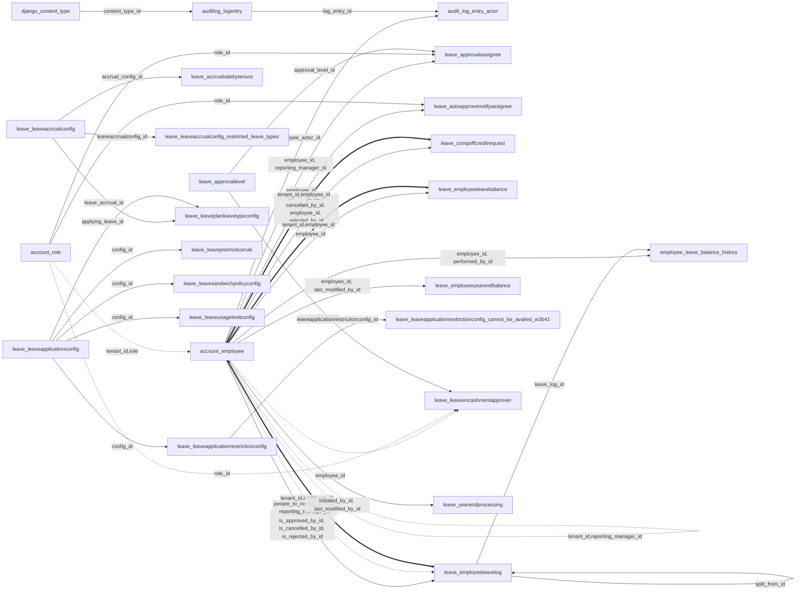

**Diagram Leave Configuration: relationships among this module's tables (part 2)**

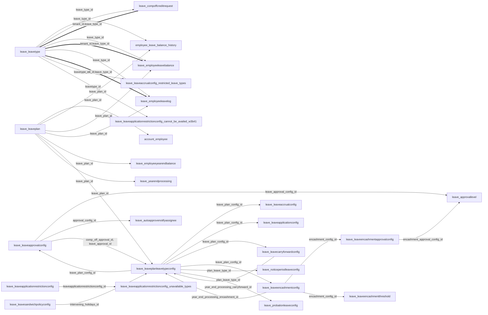

**Diagram Leave Configuration: relationships among this module's tables (part 3)**

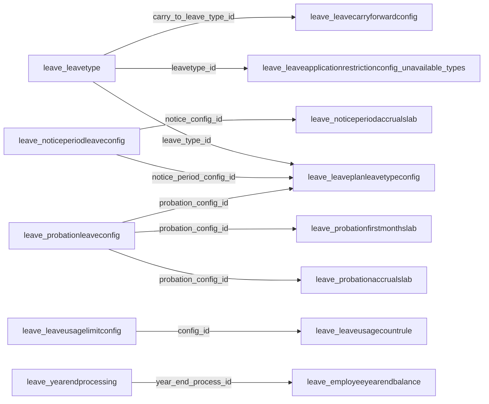

**Cross-module relationships with tables owned by Clock-in & Time Entries, Attendance Adjustments, WFH, Leave Requests & Balances, Accrual & Year End, Platform & Shared Infrastructure**

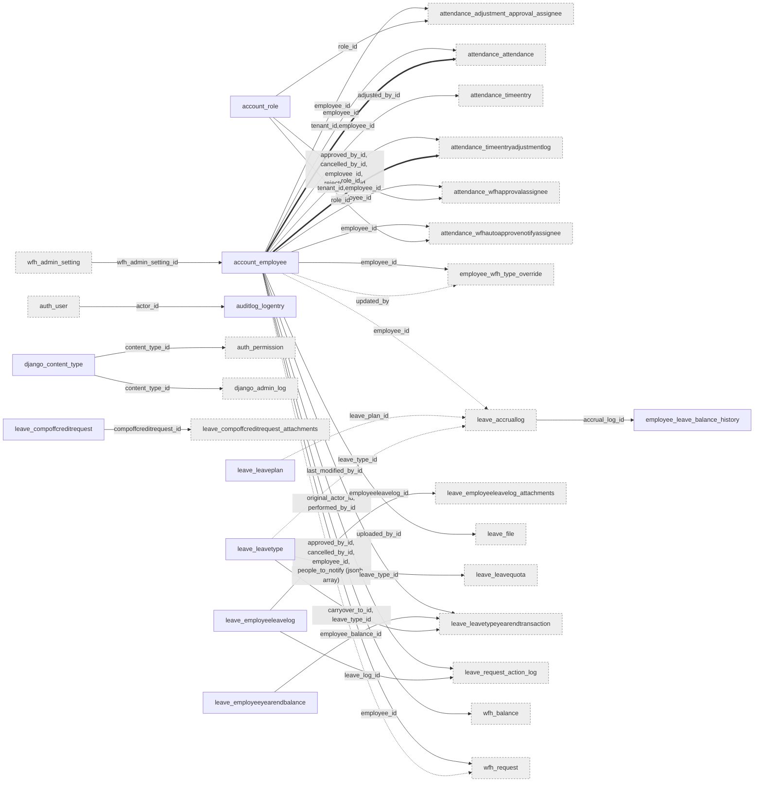

**Logical references to external services and generic objects**

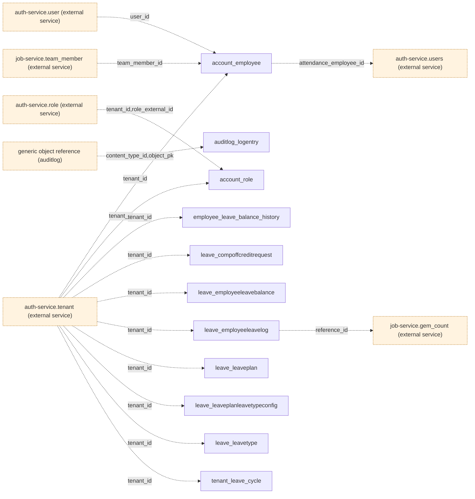

<a id="m-leave-requests-balances"></a>

### 3.6 Leave Requests & Balances

**Purpose:** Leave applications (self and HR on behalf), approvals, cancellation and partial cancellation, comp-off credit requests, employee leave balances and their history and action logs. Routes `api/leave-applications/*`, `api/self/leave-applications/`, `api/hr/*`, `api/leaves/*`, `api/leave-balance*`, `api/employees/<id>/leave-balance`, `api/comp-off/*`; code in `leave/views/leave_application.py`, `hr_leave_application.py`, `compoff_credit_application.py`, `leave_balance.py`, `leave/utils/leave_utils.py`.

**Module metrics:** 33 distinct tables (8 owned here): 32 active, 1 deprecated/legacy, 0 apparently unused, 0 uncertain/indirect; 33 shared with other modules.

**Tables used:**

| Table | Usage status |
|---|---|
| [`account_employee`](#t-account_employee) | active |
| [`account_role`](#t-account_role) | active |
| [`attendance_attendance`](#t-attendance_attendance) | active |
| [`employee_leave_balance_history`](#t-employee_leave_balance_history) | active |
| [`holiday_holiday`](#t-holiday_holiday) | active |
| [`leave_approvalassignee`](#t-leave_approvalassignee) | active |
| [`leave_approvallevel`](#t-leave_approvallevel) | active |
| [`leave_autoapprovenotifyassignee`](#t-leave_autoapprovenotifyassignee) | active |
| [`leave_compoffcreditrequest`](#t-leave_compoffcreditrequest) | active |
| [`leave_compoffcreditrequest_attachments`](#t-leave_compoffcreditrequest_attachments) | active |
| [`leave_employeeleavebalance`](#t-leave_employeeleavebalance) | active |
| [`leave_employeeleavelog`](#t-leave_employeeleavelog) | active |
| [`leave_employeeleavelog_attachments`](#t-leave_employeeleavelog_attachments) | active |
| [`leave_file`](#t-leave_file) | active |
| [`leave_leaveaccrualconfig`](#t-leave_leaveaccrualconfig) | active |
| [`leave_leaveapplicationconfig`](#t-leave_leaveapplicationconfig) | active |
| [`leave_leaveapplicationrestrictionconfig`](#t-leave_leaveapplicationrestrictionconfig) | active |
| [`leave_leaveapplicationrestrictionconfig_cannot_be_availed_w3b41`](#t-leave_leaveapplicationrestrictionconfig_cannot_be_availed_w3b41) | active |
| [`leave_leaveapplicationrestrictionconfig_unavailable_types`](#t-leave_leaveapplicationrestrictionconfig_unavailable_types) | active |
| [`leave_leaveapprovalconfig`](#t-leave_leaveapprovalconfig) | active |
| [`leave_leaveplan`](#t-leave_leaveplan) | active |
| [`leave_leaveplanleavetypeconfig`](#t-leave_leaveplanleavetypeconfig) | active |
| [`leave_leavepriornoticerule`](#t-leave_leavepriornoticerule) | active |
| [`leave_leavequota`](#t-leave_leavequota) | deprecated/legacy |
| [`leave_leavesandwichpolicyconfig`](#t-leave_leavesandwichpolicyconfig) | active |
| [`leave_leavetype`](#t-leave_leavetype) | active |
| [`leave_leaveusagecountrule`](#t-leave_leaveusagecountrule) | active |
| [`leave_leaveusagelimitconfig`](#t-leave_leaveusagelimitconfig) | active |
| [`leave_noticeperiodleaveconfig`](#t-leave_noticeperiodleaveconfig) | active |
| [`leave_probationleaveconfig`](#t-leave_probationleaveconfig) | active |
| [`leave_request_action_log`](#t-leave_request_action_log) | active |
| [`tenant_leave_cycle`](#t-tenant_leave_cycle) | active |
| [`tenant_settings`](#t-tenant_settings) | active |

**Table details**

#### `leave_leavequota`
<a id="t-leave_leavequota"></a>

**Overview**

- **Canonical name:** `public.leave_leavequota` (Django model `leave.LeaveQuota`, `leave/models/leave_type.py:90`)
- **Object type:** table
- **Purpose:** Original per-leave-type quota and carry-forward settings by employee type. Superseded in practice by the per-plan accrual and year-end config tables.
- **Definition source:** `leave/models/leave_type.py:90`; created in `leave/migrations/0006_leavequota.py`; never altered afterwards.
- **Accessed by modules:** Leave Requests & Balances (deprecated/legacy), Platform & Shared Infrastructure (deprecated/legacy)
- **Status:** deprecated/legacy. Evidence: both writers pass LeaveType fields that 0024 removed, so they cannot succeed: `core/seed_data/leave_types.py:8` (`is_paid`, `is_active`, `allow_half_day`, ...) used at `core/seed_data/leave_types.py:80`, and `seed_data.py:150` whose only API entry is commented out (`leave/views/leave_type_view.py:387`). The routed reader `EmployeeLeaveBalanceCreateSerializer` filters `LeaveType` on removed `is_active` (`leave/serializers/leave_balance_serializers.py:38`, would raise FieldError). `LeaveTypeDetailSerializer` lists removed fields (`leave/serializers/leave_setup_serializers.py:43`). Remaining reads: `leave/serializers/leave_balance_serializers.py:233` (APIKey bulk balance create, `attendance_service_django/urls.py:89`), prefetch in `leave/views/dashboard.py:65`, ad hoc `leave/tasks.py:696` (no caller).
- **Primary owner:** Leave Requests & Balances (its only routed reader is the bulk balance create serializer; the model is defined beside LeaveType in `leave/models/leave_type.py`; legacy, no live writer)

**Attributes**

| Column | Database Type | Nullable | Default | Key/Constraint | Description |
|---|---|---|---|---|---|
| id | bigint identity | NO | DB: identity | PK | Surrogate key |
| created | timestamptz | NO | Python: now (auto_now_add) | | Row creation time |
| modified | timestamptz | NO | Python: now (auto_now) | | Last save time |
| leave_type_id | bigint | NO | none | FK -> leave_leavetype.id; INDEX | Owning leave type |
| employee_type | varchar(36) | NO | Python: 'ALL' | | Choices: ALL, PERMANENT, PROBATION, CONTRACT, INTERN, NOTICE |
| leave_quota_id | varchar(36) | NO | Python: uuid4 | UNIQUE; INDEX | Public UUID string |
| default_quota | integer | NO | Python: 0 | | Yearly quota; -1 means unlimited (model comment) |
| is_incremental | boolean | NO | Python: False | | Quota accrues incrementally |
| incremental_value | integer | NO | Python: 0 | | Increment amount |
| increment_rate | varchar(20) | YES | Python: '' | | Choices: MONTHLY, YEARLY, HALF_YEARLY, QUARTERLY |
| is_carried_forward | boolean | NO | Python: False | | Carry-forward enabled |
| max_carry_forward | integer | NO | Python: 0 | | Max days carried |
| date_of_carry_forward | date | YES | none | | Carry-forward date |
| carry_forward_expire_after_months | integer | NO | Python: 0 | | Expiry of carried days |

**Relationships**

| Direction | Related table | Columns | Cardinality | Enforcement | Notes |
|---|---|---|---|---|---|
| Outbound | [leave_leavetype](#t-leave_leavetype) | leave_type_id -> id | N:1 | DB FK (on_delete=CASCADE) | related_name `leave_type_quota` |

**Additional details**

- No Meta indexes, constraints or ordering. Not registered with auditlog or admin.
- Superseded by [leave_leaveaccrualconfig](#t-leave_leaveaccrualconfig) (`yearly_quota`, accrual frequency) and [leave_leavecarryforwardconfig](#t-leave_leavecarryforwardconfig); the accrual engine and year-end tasks never read this table.
- Migration risk: likely empty or stale in production; confirm row counts before deciding to migrate or drop.

#### `leave_employeeleavebalance`
<a id="t-leave_employeeleavebalance"></a>

**Overview**

- **Canonical name:** `public.leave_employeeleavebalance` (Django model `leave.EmployeeLeaveBalance`, `leave/models/leave_applications.py:15`)
- **Object type:** table
- **Purpose:** Current leave balance per employee, leave type and leave plan (allocated, remaining, used). One active row per (employee, leave type, plan) by convention; older rows are kept with `is_active=false`.
- **Definition source:** model `leave/models/leave_applications.py:15`; created in `leave/migrations/0001_initial.py:170`; later altered in: 0002 (employee_id char, leave_balance_id unique, unique_together (employee_id, leave_type)), 0010 (add user_employee FK), 0011 (remove char employee_id, unique_together on user_employee), 0012 (add employee FK, remove user_employee, unique_together (employee, leave_type)), 0014 (balance/used float default 0), 0046 (add is_active, leave_plan, total_allocated), 0047 (add quota_unit), 0048_alter (unique_together (employee, leave_type, leave_plan)), 0048_reason (add reason) and 0049 (remove reason), 0053 (unique_together cleared, get_latest_by), 0069 (add index ix_elb_emp_lp_active) and 0071 (remove it), 0072 (used validator), 0088 (add tenant_id + backfill), 0089 (CHECK leave_balance_tenant_set + 2 composite FKs via RunSQL)
- **Accessed by modules:** Leave Requests & Balances (active), Accrual & Year End (active), Leave Configuration (active), Employees & Roles (active), Reports & Reconciliation (active), Platform & Shared Infrastructure (active: seed data; admin)
- **Status:** active. Evidence: `leave/views/leave_balance.py:60`, `leave/serializers/leave_application_serializers.py:776`, `leave/services/leave_accrual_engine.py:1261`, `account/views.py:366`, `leave/services/reports.py:28`
- **Primary owner:** Leave Requests & Balances

**Attributes**

| Column | Database Type | Nullable | Default | Key/Constraint | Description |
|---|---|---|---|---|---|
| id | bigint identity | NO | DB: identity | PK | Surrogate key |
| created | timestamptz | NO | Python: now (CreationDateTimeField) | | Row creation time |
| modified | timestamptz | NO | Python: now on every save() (ModificationDateTimeField) | | Last save time; not bumped by queryset.update()/bulk_update |
| leave_balance_id | varchar(36) | NO | Python: uuid4 | UNIQUE (+ varchar_pattern_ops index) | Public business id exposed in APIs (inferred) |
| employee_id | uuid | YES | none | FK -> account_employee.employee_id; part of composite FK | Owning employee |
| tenant_id | varchar(36) | YES | none (Python: copied from employee by EmployeeTenantMixin.save) | index; CHECK leave_balance_tenant_set; part of both composite FKs | Tenant (auth-service tenant id); must equal employee's and leave type's tenant |
| leave_type_id | bigint | NO | none | FK -> leave_leavetype.id; part of composite FK | Leave type |
| leave_plan_id | bigint | YES | none | FK -> leave_leaveplan.id | Plan the balance was allocated under; NULL on old rows (`leave/services/employee_leave_balance_history.py:65`) |
| total_allocated | double precision | NO | Python: 0 | | Total allocated in cycle; -1 means unlimited (`leave/services/leave_accrual_engine.py:876`) |
| balance | double precision | NO | Python: 0 | | Remaining balance; -1 means unlimited |
| used | double precision | NO | Python: 0 | Python validator >= 0; save() clamps negative to 0 (no DB CHECK) | Days/hours consumed |
| is_reset | boolean | NO | Python: False | | Set when balance reset via balance serializer (`leave/serializers/leave_balance_serializers.py:173`) |
| reset_date | date | YES | none | | Date of last reset |
| is_active | boolean | NO | Python: True | | Only active row is used; deactivated on plan/type changes |
| quota_unit | varchar(10) | NO | Python: 'days' | choices: days, hours | Unit of the amounts |

**Relationships**

| Direction | Related table | Columns | Cardinality | Enforcement | Notes |
|---|---|---|---|---|---|
| Outbound | account_employee | employee_id -> employee_id | N:1 | DB FK (on_delete=CASCADE) | Nullable |
| Outbound | [leave_leavetype](#t-leave_leavetype) | leave_type_id -> id | N:1 | DB FK (on_delete=CASCADE) | |
| Outbound | [leave_leaveplan](#t-leave_leaveplan) | leave_plan_id -> id | N:1 | DB FK (on_delete=CASCADE) | Nullable |
| Outbound | account_employee | (tenant_id, employee_id) -> (tenant_id, employee_id) | N:1 | DB composite FK `leave_balance_employee_tenant_fk` (RunSQL, NO ACTION, deferred, MATCH SIMPLE): `leave/migrations/0089_leave_tenant_consistency.py:13` | Requires `uniq_employee_tenant_pk` from `account/migrations/0023_leave_tenant_consistency.py:15` |
| Outbound | [leave_leavetype](#t-leave_leavetype) | (tenant_id, leave_type_id) -> (tenant_id, id) | N:1 | DB composite FK `leave_balance_leave_type_tenant_fk` (RunSQL): `leave/migrations/0089_leave_tenant_consistency.py:14` | Requires `uniq_leave_type_tenant_pk` (0089:47) |
| Outbound | external: auth-service tenant | tenant_id | N:1 | Logical only (no FK): `core/auth_service/tenants.py:169`, `core/utils/models.py:33` | |
| Inbound | none found | | | | History rows copy balance values but do not reference this table ([employee_leave_balance_history](#t-employee_leave_balance_history)) |

**Additional details**

- Indexes: PK; unique leave_balance_id; FK indexes on employee_id, leave_type_id, leave_plan_id; tenant_id index. No composite index (ix_elb_emp_lp_active added in 0069, dropped in 0071). No unique constraint on (employee, leave_type, leave_plan, is_active) since 0053, so duplicates are possible; code uses `.first()` in most paths but `.get()` in `leave/services/leave_accrual_engine.py:1261` and `leave/validators/leave_rules_engine.py:2075` (MultipleObjectsReturned risk).
- Check constraint `leave_balance_tenant_set`: `employee_id IS NULL OR tenant_id IS NOT NULL` (0089:39). Meta.get_latest_by = modified.
- Soft state: `is_active` flag, not soft delete.
- Locking: `select_for_update()` in approval/deduction `leave/serializers/leave_application_serializers.py:776` and refund `leave/services/employee_leave_balance_history.py:61` (inside caller's transaction.atomic). Accrual writes wrapped in `@transaction.atomic` (`leave/services/leave_accrual_engine.py:850`, `:1247`) but without row lock. Comp-off credit uses unlocked get_or_create + read-modify-write (`leave/views/compoff_credit_application.py:237`).
- Bulk paths bypassing EmployeeTenantMixin: `bulk_create` in `leave/utils/leave_plan_utils.py:219` sets tenant_id explicitly (`:58`); `bulk_update` in `leave/utils/leave_plan_utils.py:174`, `leave/views/leave_application.py:1326` (balance, total_allocated only; no `modified` bump).
- Every balance change is expected to be followed by a history row via `LeaveBalanceService.log_history` (`leave/services/employee_leave_balance_history.py:11`), around 35 call sites.
- Migration risks: composite FKs are RunSQL only (not in Django state); a schema dump/regeneration from models will miss them. Changing `account_employee.tenant_id` is blocked while balances reference it (NO ACTION). Float columns for money-like day counts.

#### `leave_employeeleavelog`
<a id="t-leave_employeeleavelog"></a>

**Overview**

- **Canonical name:** `public.leave_employeeleavelog` (Django model `leave.EmployeeLeaveLog`, `leave/models/leave_applications.py:72`)
- **Object type:** table
- **Purpose:** The leave request (application) itself, despite the "log" name: dates, duration, approval/rejection/cancel state and actors, notes, notify list. Partial cancel (0093) splits an approved request into pieces linked by `split_from`.
- **Definition source:** model `leave/models/leave_applications.py:72`; created in `leave/migrations/0001_initial.py:98`; later altered in: 0002 (employee_id char), 0003 (people_to_notify, duration_days, note), 0008 (reporting_manager_id), 0009 (approver cols to char), 0010/0011/0012 (employee char -> user_employee -> employee FK), 0013 (approver cols to FKs), 0015/0016/0017 (rejection_note removed, re-added, removed), 0019 (half_day_type), 0059 (note nullable), 0060 (notified_to_level), 0062 (attachments M2M), 0065 (approved_at/rejected_at/cancelled_at), 0069 (partial index ix_ell_upcoming) and 0071 (removed), 0076 (leave_plan FK), 0081 (applied_after_cutoff), 0088 (tenant_id + backfill), 0089 (CHECK leave_log_tenant_set + 2 composite FKs), 0093 (split_from self FK)
- **Accessed by modules:** Leave Requests & Balances (active), Leave Configuration (active), Accrual & Year End (active), Reports & Reconciliation (active), Clock-in & Time Entries (active), Platform & Shared Infrastructure (uncertain: admin only)
- **Status:** active. Evidence: `leave/serializers/leave_application_serializers.py:492`, `leave/views/leave_application.py:84`, `leave/services/partial_cancel.py:46`, `attendance/views/summary.py:305`, `attendance/helpers/attendance_summary.py:116`, `leave/services/reports.py:17`
- **Primary owner:** Leave Requests & Balances

**Attributes**

| Column | Database Type | Nullable | Default | Key/Constraint | Description |
|---|---|---|---|---|---|
| id | bigint identity | NO | DB: identity | PK | Surrogate key |
| created | timestamptz | NO | Python: now | | Apply time; also used to order lineage |
| modified | timestamptz | NO | Python: now on save() | | Not bumped by queryset.update() bulk approve/reject |
| leave_log_id | varchar(36) | NO | Python: uuid4 | UNIQUE (+ pattern index) | Public request id used in URLs and as job-service reference_id |
| employee_id | uuid | YES | none | FK -> account_employee; composite FK | Applicant |
| tenant_id | varchar(36) | YES | none (Python: EmployeeTenantMixin; copied in partial cancel) | index; CHECK leave_log_tenant_set; composite FKs | Tenant id |
| leave_type_id | bigint | NO | none | FK -> leave_leavetype; composite FK | Leave type |
| leave_plan_id | bigint | YES | none | FK -> leave_leaveplan (SET_NULL) | Plan at apply time (added 0076; NULL on older rows) |
| start_date | date | NO | none | | First day |
| end_date | date | NO | none | | Last day |
| duration_days | double precision | NO | Python: 0 | | Charged duration |
| is_half_day | boolean | NO | Python: False | | Half-day flag |
| half_day_type | varchar(20) | YES | none | choices: first_half, second_half | Which half |
| is_approved | boolean | NO | Python: False | | Status flag |
| is_rejected | boolean | NO | Python: False | | Status flag |
| is_cancelled | boolean | NO | Python: False | | Status flag (status is derived from the 3 booleans) |
| is_approved_by_id | uuid | YES | none | FK -> account_employee (CASCADE) | Approver |
| is_rejected_by_id | uuid | YES | none | FK -> account_employee (CASCADE) | Rejecter |
| is_cancelled_by_id | uuid | YES | none | FK -> account_employee (CASCADE) | Canceller |
| note | text | YES | none | | Applicant note |
| approval_note | text | YES | none | | Approver note ("Auto-approved." for auto approval) |
| cancellation_note | text | YES | none | | Cancel note |
| people_to_notify | jsonb | NO | Python: [] | | Array of team_member_id strings (`leave/tasks.py:268`) |
| reporting_manager_id | varchar(36) | YES | none | | Not set by create path; only copied by partial cancel (`leave/services/partial_cancel.py:27`) (legacy, inferred) |
| notified_to_level | smallint | YES | none | CHECK >= 0 | Approval level last notified (escalation) |
| applied_after_cutoff | boolean | NO | Python: False | | Applied after same-day cutoff |
| approved_at | timestamptz | YES | none | | Not set by bulk approve update (`leave/serializers/leave_application_serializers.py:1413`) |
| rejected_at | timestamptz | YES | none | | |
| cancelled_at | timestamptz | YES | none | | |
| split_from_id | bigint | YES | none | FK -> leave_employeeleavelog.id (CASCADE) | Root request a partial-cancel piece was cut from |

**Relationships**

| Direction | Related table | Columns | Cardinality | Enforcement | Notes |
|---|---|---|---|---|---|
| Outbound | account_employee | employee_id | N:1 | DB FK (on_delete=CASCADE) | |
| Outbound | account_employee | is_approved_by_id / is_rejected_by_id / is_cancelled_by_id | N:1 each | DB FK (on_delete=CASCADE) | Deleting an approver deletes the requests they approved |
| Outbound | [leave_leavetype](#t-leave_leavetype) | leave_type_id | N:1 | DB FK (on_delete=CASCADE) | |
| Outbound | [leave_leaveplan](#t-leave_leaveplan) | leave_plan_id | N:1 | DB FK (on_delete=SET_NULL) | |
| Outbound | [leave_employeeleavelog](#t-leave_employeeleavelog) | split_from_id -> id | N:1 (self) | DB FK (on_delete=CASCADE) | 0093 partial cancel lineage |
| Outbound | account_employee | (tenant_id, employee_id) | N:1 | DB composite FK `leave_log_employee_tenant_fk`: `leave/migrations/0089_leave_tenant_consistency.py:15` | RunSQL |
| Outbound | [leave_leavetype](#t-leave_leavetype) | (tenant_id, leave_type_id) -> (tenant_id, id) | N:1 | DB composite FK `leave_log_leave_type_tenant_fk`: `leave/migrations/0089_leave_tenant_consistency.py:16` | RunSQL |
| Outbound | account_employee | people_to_notify[] -> team_member_id | N:M | Logical only (no FK): `leave/tasks.py:268` | ids inside jsonb |
| Outbound | account_employee | reporting_manager_id -> team_member_id | N:1 | Logical only (no FK): `leave/services/partial_cancel.py:27` (inferred from `leave/services/leave_change_notifications.py:45` semantics) | |
| Outbound | external: auth-service tenant | tenant_id | N:1 | Logical only (no FK): `core/auth_service/tenants.py:169` | |
| Inbound | [leave_employeeleavelog_attachments](#t-leave_employeeleavelog_attachments) | employeeleavelog_id | 1:N | DB FK (on_delete=CASCADE) | M2M to File |
| Inbound | [employee_leave_balance_history](#t-employee_leave_balance_history) | leave_log_id | 1:N | DB FK (on_delete=DO_NOTHING) | Blocks deletion of a request that has history |
| Inbound | [leave_request_action_log](#t-leave_request_action_log) | leave_log_id | 1:N | DB FK (on_delete=CASCADE) | |
| Inbound | external: job-service gem count | reference_id = leave_log_id | 1:N | Logical only (no FK): `leave/serializers/leave_application_serializers.py:517`, `leave/services/partial_cancel.py:193` | |

**Additional details**

- Indexes: PK; unique leave_log_id; FK indexes (employee_id, leave_type_id, leave_plan_id, 3 approver cols, split_from_id); tenant_id index. Partial index ix_ell_upcoming (0069) was dropped in 0071, so overlap and pending queries (`leave/validators/leave_rules_engine.py:2138`) rely on employee_id FK index only.
- Check constraint `leave_log_tenant_set` (0089:43). Meta.get_latest_by = modified.
- Status is derived from three booleans (no status column); "Pending" = all false.
- Transactions: request queryset locked with `select_for_update(of=("self",))` `leave/views/leave_application.py:837`; partial cancel locks lineage rows `leave/services/partial_cancel.py:137` and fires on_commit side effects (`:192`, `:196`).
- Bulk approve/reject use queryset `.update()` (`leave/serializers/leave_application_serializers.py:1413`, `:1470`): no `modified` bump, no approved_at.
- Attendance reads this table directly: `attendance/helpers/attendance_summary.py:116` filters by `employee__user_id` without tenant filter (user_id is unique only per tenant).
- Migration risks: partial cancel pieces share the root's attachments and history is recorded against the root only (`leave/utils/leave_utils.py:962`). Employee delete cascades here, but DO_NOTHING history FK makes hard deletes fail at commit.

#### `leave_employeeleavelog_attachments`
<a id="t-leave_employeeleavelog_attachments"></a>

**Overview**

- **Canonical name:** `public.leave_employeeleavelog_attachments` (Django auto-created through model for `leave.EmployeeLeaveLog.attachments`, `leave/models/leave_applications.py:125`)
- **Object type:** m2m through table
- **Purpose:** Links leave requests to uploaded proof files.
- **Definition source:** field `leave/models/leave_applications.py:125`; created in `leave/migrations/0062_employeeleavelog_attachments_and_more.py:12`; referenced column renamed by 0063 (leave_file.id -> file_id)
- **Accessed by modules:** Leave Requests & Balances (active), Platform & Shared Infrastructure (active: files)
- **Status:** active. Evidence: `leave/models/leave_applications.py:154` (save_attachments), `leave/services/partial_cancel.py:48`
- **Primary owner:** Leave Requests & Balances

**Attributes**

| Column | Database Type | Nullable | Default | Key/Constraint | Description |
|---|---|---|---|---|---|
| id | bigint identity | NO | DB: identity | PK | Surrogate key (leave app default BigAutoField) |
| employeeleavelog_id | bigint | NO | none | FK -> leave_employeeleavelog.id; UNIQUE (employeeleavelog_id, file_id) | Request |
| file_id | uuid | NO | none | FK -> leave_file.file_id | File |

**Relationships**

| Direction | Related table | Columns | Cardinality | Enforcement | Notes |
|---|---|---|---|---|---|
| Outbound | [leave_employeeleavelog](#t-leave_employeeleavelog) | employeeleavelog_id | N:1 | DB FK (on_delete=CASCADE) | |
| Outbound | [leave_file](#t-leave_file) | file_id | N:1 | DB FK (on_delete=CASCADE) | |

**Additional details**

- Unique (employeeleavelog_id, file_id) plus FK indexes (Django auto).
- Written via `.set()` (`leave/models/leave_applications.py:156`); attach then marks files Uploaded with queryset update (`:159`). Partial cancel pieces get the same file rows (`leave/services/partial_cancel.py:48`).
- Ownership/tenant of attached files is checked in Python only (`leave/utils/attachments.py:4`).

#### `employee_leave_balance_history`
<a id="t-employee_leave_balance_history"></a>

**Overview**

- **Canonical name:** `public.employee_leave_balance_history` (Django model `leave.EmployeeLeaveBalanceHistory`, `leave/models/employee_leave_balance_history.py:38`)
- **Object type:** table
- **Purpose:** Append-only ledger of every leave balance change (credit/debit/inactive) with a snapshot of the resulting balance, the reason, cycle and optional links to the leave request, actor and accrual log.
- **Definition source:** model `leave/models/employee_leave_balance_history.py:38`; created in `leave/migrations/0074_employeeleavebalancehistory.py:17`; later altered in: 0075 (dropped 4 explicit indexes), 0084 (reason choices), 0085 (tenant_id uuid -> varchar(36)), 0093 (reason choices add leave_partially_cancelled)
- **Accessed by modules:** Leave Requests & Balances (active), Accrual & Year End (active), Leave Configuration (active), Employees & Roles (active)
- **Status:** active. Evidence: writer `leave/services/employee_leave_balance_history.py:28` called from about 35 sites (e.g. `leave/serializers/leave_application_serializers.py:542`, `leave/services/leave_accrual_engine.py:1308`, `account/views.py:402`, `leave/views/leave_plan_view.py:1019`); reader `leave/utils/leave_utils.py:968`
- **Primary owner:** Leave Requests & Balances

**Attributes**

| Column | Database Type | Nullable | Default | Key/Constraint | Description |
|---|---|---|---|---|---|
| history_id | uuid | NO | Python: uuid4 | PK | Row id |
| created | timestamptz | NO | Python: now | | Event time; Meta.ordering -created |
| modified | timestamptz | NO | Python: now on save() | | |
| employee_id | uuid | NO | none | FK -> account_employee (DO_NOTHING) | Employee |
| tenant_id | varchar(36) | NO | none | index | Tenant (was uuid until 0085) |
| leave_type_id | bigint | NO | none | FK -> leave_leavetype (DO_NOTHING) | Leave type |
| leave_plan_id | bigint | YES | none | FK -> leave_leaveplan (DO_NOTHING) | Plan of the balance |
| cycle_start_date | date | NO | none | | Tenant leave cycle start at write time |
| cycle_end_date | date | NO | none | | Tenant leave cycle end |
| transaction_type | varchar(10) | NO | none | choices: credit, debit, in_active | Direction |
| change_amount | double precision | NO | none | | Amount added/deducted |
| total_allocated | double precision | NO | none | | Snapshot after change |
| balance | double precision | NO | none | | Snapshot after change |
| quota_unit | varchar(10) | NO | Python: 'days' | choices: days, hours | Unit |
| reason | varchar(50) | NO | none | choices: system_accrual, system_year_end_reset, leave_applied, leave_cancelled, leave_partially_cancelled, leave_undo_rejection, manual_adjustment, leave_plan_update, leave_rejected, employee_details_update, leave_type_update, comp_off, initial_creation, cycle_update | Cause |
| leave_log_id | bigint | YES | none | FK -> leave_employeeleavelog (DO_NOTHING) | Request that caused it |
| performed_by_id | uuid | YES | none | FK -> account_employee (DO_NOTHING) | Actor |
| accrual_log_id | bigint | YES | none | FK -> leave_accruallog (DO_NOTHING) | Accrual event |
| remarks | text | YES | none | | Free text |

**Relationships**

| Direction | Related table | Columns | Cardinality | Enforcement | Notes |
|---|---|---|---|---|---|
| Outbound | account_employee | employee_id | N:1 | DB FK (on_delete=DO_NOTHING) | Constraint exists; Django does not cascade, so deleting the employee fails at commit |
| Outbound | account_employee | performed_by_id | N:1 | DB FK (on_delete=DO_NOTHING) | |
| Outbound | [leave_leavetype](#t-leave_leavetype) | leave_type_id | N:1 | DB FK (on_delete=DO_NOTHING) | |
| Outbound | [leave_leaveplan](#t-leave_leaveplan) | leave_plan_id | N:1 | DB FK (on_delete=DO_NOTHING) | |
| Outbound | [leave_employeeleavelog](#t-leave_employeeleavelog) | leave_log_id | N:1 | DB FK (on_delete=DO_NOTHING) | |
| Outbound | [leave_accruallog](#t-leave_accruallog) | accrual_log_id | N:1 | DB FK (on_delete=DO_NOTHING) | |
| Outbound | external: auth-service tenant | tenant_id | N:1 | Logical only (no FK): `leave/services/employee_leave_balance_history.py:30` | Not pinned by a composite FK (unlike balance/log) |

**Additional details**

- Indexes: PK; FK indexes on all 6 FK columns; tenant_id index. The 4 explicit indexes from 0074 (employee, leave_type, reason, created) were removed in 0075. `charged_in_current_cycle` (`leave/utils/leave_utils.py:968`) filters by leave_log_id + transaction_type ordered by created; served by the leave_log_id FK index.
- No tenant CHECK or composite FK; tenant_id is passed explicitly by callers (not via EmployeeTenantMixin).
- Not append-only at DB level (no trigger); append-only by convention.
- Now load-bearing: refund eligibility reads the latest DEBIT row's cycle (`leave/utils/leave_utils.py:962`). Rows before 0074 (2026-03) do not exist; code falls back to request created date.
- Migration risks: DO_NOTHING FKs make parent deletes fail; volume grows with every accrual run; float snapshots.

#### `leave_request_action_log`
<a id="t-leave_request_action_log"></a>

**Overview**

- **Canonical name:** `public.leave_request_action_log` (Django model `leave.LeaveRequestActionLog`, `leave/models/leave_request_action_log.py:28`)
- **Object type:** table
- **Purpose:** Append-only audit trail of state-changing actions on a leave request (approve, reject, undo, partial_cancel) with from/to status, actor and role, and for undo the original action and actor.
- **Definition source:** model `leave/models/leave_request_action_log.py:28`; created in `leave/migrations/0084_alter_employeeleavebalancehistory_reason_and_more.py:22`; later altered in: 0093 (action/original_action choices add partial_cancel)
- **Accessed by modules:** Leave Requests & Balances (active), Platform & Shared Infrastructure (uncertain: admin only)
- **Status:** active. Evidence: writes `leave/services/leave_action_log.py:37`, `:43` called from `leave/serializers/leave_application_serializers.py:668`, `:726`, `:1513`, `leave/services/partial_cancel.py:181`. No runtime reader besides `leave/admin.py:57` (write-only from the API's point of view).
- **Primary owner:** Leave Requests & Balances

**Attributes**

| Column | Database Type | Nullable | Default | Key/Constraint | Description |
|---|---|---|---|---|---|
| action_id | uuid | NO | Python: uuid4 | PK | Row id |
| created | timestamptz | NO | Python: now (also set on bulk_create via pre_save) | | Action time; Meta.ordering -created |
| modified | timestamptz | NO | Python: now | | |
| leave_log_id | bigint | NO | none | FK -> leave_employeeleavelog (CASCADE) | Request (root for partial cancel) |
| tenant_id | varchar(36) | NO | none | index | Tenant |
| action | varchar(20) | NO | none | choices: approve, reject, undo, partial_cancel | Action |
| from_status | varchar(20) | NO | none | choices: Pending, Approved, Rejected, Cancelled | Before |
| to_status | varchar(20) | NO | none | same choices | After |
| performed_by_id | uuid | YES | none | FK -> account_employee (SET_NULL) | Actor |
| performed_by_role | varchar(50) | YES | none | | Role string (e.g. "admin") |
| original_actor_id | uuid | YES | none | FK -> account_employee (SET_NULL) | For undo: original actor |
| original_action | varchar(20) | YES | none | same choices as action | For undo: action reversed |
| note | text | YES | none | | Note; partial cancel stores the cancelled date range |

**Relationships**

| Direction | Related table | Columns | Cardinality | Enforcement | Notes |
|---|---|---|---|---|---|
| Outbound | [leave_employeeleavelog](#t-leave_employeeleavelog) | leave_log_id | N:1 | DB FK (on_delete=CASCADE) | |
| Outbound | account_employee | performed_by_id | N:1 | DB FK (on_delete=SET_NULL) | |
| Outbound | account_employee | original_actor_id | N:1 | DB FK (on_delete=SET_NULL) | |
| Outbound | external: auth-service tenant | tenant_id | N:1 | Logical only (no FK): `leave/services/leave_action_log.py:26` | |

**Additional details**

- Indexes: PK, FK indexes (leave_log_id, performed_by_id, original_actor_id), tenant_id index.
- Bulk inserts via `bulk_create` (`leave/services/leave_action_log.py:43`); no tenant mixin, tenant passed explicitly.
- Overlaps with django-auditlog for config models only; leave requests are not auditlog-registered, so this is the only actor trail for request decisions.

#### `leave_compoffcreditrequest`
<a id="t-leave_compoffcreditrequest"></a>

**Overview**

- **Canonical name:** `public.leave_compoffcreditrequest` (Django model `leave.CompOffCreditRequest`, `leave/models/compoff_credit_request.py:11`)
- **Object type:** table
- **Purpose:** Employee request to be credited comp-off days for a worked period, with approval workflow and a credited flag once the balance is topped up.
- **Definition source:** model `leave/models/compoff_credit_request.py:11`; created in `leave/migrations/0068_compoffcreditrequest.py:16`; later altered in: 0087 (tenant_id + RunPython backfill), 0092 (RunSQL backfill, CHECK compoff_tenant_set, 2 composite FKs)
- **Accessed by modules:** Leave Requests & Balances (active), Leave Configuration (active), Platform & Shared Infrastructure (active: files)
- **Status:** active. Evidence: `leave/views/compoff_credit_application.py:77`, `:995`, `leave/serializers/comp_off_serializers.py:205`, `leave/tasks.py:1652`, `leave/views/leave_plan_view.py:1035`
- **Primary owner:** Leave Requests & Balances

**Attributes**

| Column | Database Type | Nullable | Default | Key/Constraint | Description |
|---|---|---|---|---|---|
| id | bigint identity | NO | DB: identity | PK | Surrogate key |
| created | timestamptz | NO | Python: now | index | Meta.ordering -created |
| modified | timestamptz | NO | Python: now | | |
| comp_off_request_id | varchar(36) | NO | Python: uuid4 | UNIQUE | Public id in URLs (`leave/urls.py:358`) |
| employee_id | uuid | NO | none | FK -> account_employee (CASCADE); composite FK | Requester |
| tenant_id | varchar(36) | YES (but CHECK NOT NULL) | none (Python: EmployeeTenantMixin) | index; CHECK compoff_tenant_set; composite FKs | Tenant |
| leave_type_id | bigint | NO | none | FK -> leave_leavetype (CASCADE); composite FK | Comp-off leave type |
| start_work_date | date | NO | none | index (with end_work_date) | Worked period start |
| end_work_date | date | NO | none | | Worked period end |
| credit_days | double precision | NO | Python: 1.0 | | Days to credit |
| reason | text | YES | none | | Request reason |
| is_approved | boolean | NO | Python: False | index (employee, is_approved, is_rejected) | |
| is_rejected | boolean | NO | Python: False | | |
| is_cancelled | boolean | NO | Python: False | | |
| approved_by_id | uuid | YES | none | FK -> account_employee (CASCADE) | |
| rejected_by_id | uuid | YES | none | FK -> account_employee (CASCADE) | |
| cancelled_by_id | uuid | YES | none | FK -> account_employee (CASCADE) | |
| approval_note | text | YES | none | | |
| rejection_note | text | YES | none | | |
| cancellation_note | text | YES | none | | |
| approved_at | timestamptz | YES | none | | |
| rejected_at | timestamptz | YES | none | | |
| cancelled_at | timestamptz | YES | none | | |
| people_to_notify | jsonb | NO | Python: [] | | Written by serializer (`leave/serializers/comp_off_serializers.py:674`); no reader found |
| notified_to_level | smallint | YES | none | CHECK >= 0 | Escalation level |
| is_balance_credited | boolean | NO | Python: False | | Balance credited |
| credited_at | timestamptz | YES | none | | |

**Relationships**

| Direction | Related table | Columns | Cardinality | Enforcement | Notes |
|---|---|---|---|---|---|
| Outbound | account_employee | employee_id | N:1 | DB FK (on_delete=CASCADE) | |
| Outbound | account_employee | approved_by_id / rejected_by_id / cancelled_by_id | N:1 each | DB FK (on_delete=CASCADE) | |
| Outbound | [leave_leavetype](#t-leave_leavetype) | leave_type_id | N:1 | DB FK (on_delete=CASCADE) | |
| Outbound | account_employee | (tenant_id, employee_id) | N:1 | DB composite FK `compoff_employee_tenant_fk`: `leave/migrations/0092_compoff_tenant_consistency.py:19` | RunSQL |
| Outbound | [leave_leavetype](#t-leave_leavetype) | (tenant_id, leave_type_id) | N:1 | DB composite FK `compoff_leave_type_tenant_fk`: `leave/migrations/0092_compoff_tenant_consistency.py:20` | RunSQL |
| Outbound | external: auth-service tenant | tenant_id | N:1 | Logical only (no FK): `core/utils/models.py:33` | |
| Inbound | [leave_compoffcreditrequest_attachments](#t-leave_compoffcreditrequest_attachments) | compoffcreditrequest_id | 1:N | DB FK (on_delete=CASCADE) | |

**Additional details**

- Indexes: `leave_compo_employe_b6dd11_idx` (employee_id, is_approved, is_rejected), `leave_compo_start_w_976303_idx` (start_work_date, end_work_date), `leave_compo_created_53edb8_idx` (created); unique comp_off_request_id; FK and tenant_id indexes.
- CHECK `compoff_tenant_set` (tenant_id IS NOT NULL) in 0092:44 while the column itself stays nullable in the model.
- Approval/credit paths wrapped in transaction.atomic (`leave/views/compoff_credit_application.py:144`, `:994`); balance credit is get_or_create + unlocked increment (`:237`).
- No reference from comp-off request to the history row it produced (history comp_off rows have no FK back).

#### `leave_compoffcreditrequest_attachments`
<a id="t-leave_compoffcreditrequest_attachments"></a>

**Overview**

- **Canonical name:** `public.leave_compoffcreditrequest_attachments` (auto-created through for `leave.CompOffCreditRequest.attachments`, `leave/models/compoff_credit_request.py:84`)
- **Object type:** m2m through table
- **Purpose:** Links comp-off requests to proof-of-work files.
- **Definition source:** field `leave/models/compoff_credit_request.py:84`; created in `leave/migrations/0068_compoffcreditrequest.py:16` (attachments field at ~:103)
- **Accessed by modules:** Leave Requests & Balances (active), Platform & Shared Infrastructure (active)
- **Status:** active. Evidence: `leave/models/compoff_credit_request.py:111` (save_attachments) used by comp-off serializers/views
- **Primary owner:** Leave Requests & Balances

**Attributes**

| Column | Database Type | Nullable | Default | Key/Constraint | Description |
|---|---|---|---|---|---|
| id | bigint identity | NO | DB: identity | PK | Surrogate key |
| compoffcreditrequest_id | bigint | NO | none | FK; UNIQUE (compoffcreditrequest_id, file_id) | Request |
| file_id | uuid | NO | none | FK -> leave_file.file_id | File |

**Relationships**

| Direction | Related table | Columns | Cardinality | Enforcement | Notes |
|---|---|---|---|---|---|
| Outbound | [leave_compoffcreditrequest](#t-leave_compoffcreditrequest) | compoffcreditrequest_id | N:1 | DB FK (on_delete=CASCADE) | |
| Outbound | [leave_file](#t-leave_file) | file_id | N:1 | DB FK (on_delete=CASCADE) | |

**Additional details**

- Unique pair + FK indexes (Django auto). Files marked Uploaded by queryset update after `.set()` (`leave/models/compoff_credit_request.py:116`).

#### Leave Requests & Balances relationship diagrams

149 relationships touch this module's tables.

**Diagram Leave Requests & Balances: relationships among this module's tables (part 1)**

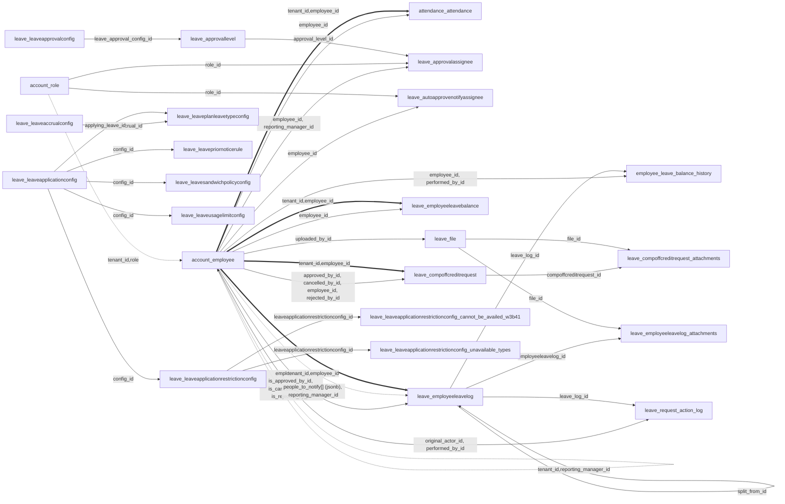

**Diagram Leave Requests & Balances: relationships among this module's tables (part 2)**

```mermaid
flowchart LR
  classDef ext fill:#eeeeee,stroke:#777777,stroke-dasharray:4 3,color:#333333
  classDef svc fill:#fff3e0,stroke:#b26a00,stroke-dasharray:2 2,color:#333333
  n_account_employee["account_employee"]
  n_employee_leave_balance_history["employee_leave_balance_history"]
  n_leave_autoapprovenotifyassignee["leave_autoapprovenotifyassignee"]
  n_leave_compoffcreditrequest["leave_compoffcreditrequest"]
  n_leave_employeeleavebalance["leave_employeeleavebalance"]
  n_leave_employeeleavelog["leave_employeeleavelog"]
  n_leave_leaveaccrualconfig["leave_leaveaccrualconfig"]
  n_leave_leaveapplicationconfig["leave_leaveapplicationconfig"]
  n_leave_leaveapplicationrestrictionconfig_cannot_be_availed_w3b41["leave_leaveapplicationrestrictionconfig_cannot_be_availed_w3b41"]
  n_leave_leaveapplicationrestrictionconfig_unavailable_types["leave_leaveapplicationrestrictionconfig_unavailable_types"]
  n_leave_leaveapprovalconfig["leave_leaveapprovalconfig"]
  n_leave_leaveplan["leave_leaveplan"]
  n_leave_leaveplanleavetypeconfig["leave_leaveplanleavetypeconfig"]
  n_leave_leavequota["leave_leavequota"]
  n_leave_leavesandwichpolicyconfig["leave_leavesandwichpolicyconfig"]
  n_leave_leavetype["leave_leavetype"]
  n_leave_leaveusagecountrule["leave_leaveusagecountrule"]
  n_leave_leaveusagelimitconfig["leave_leaveusagelimitconfig"]
  n_leave_noticeperiodleaveconfig["leave_noticeperiodleaveconfig"]
  n_leave_probationleaveconfig["leave_probationleaveconfig"]
  n_leave_leaveapprovalconfig -->|"approval_config_id"| n_leave_autoapprovenotifyassignee
  n_leave_leaveapprovalconfig -->|"comp_off_approval_id, leave_approval_id"| n_leave_leaveplanleavetypeconfig
  n_leave_leaveplan -->|"leave_plan_id"| n_account_employee
  n_leave_leaveplan -->|"leave_plan_id"| n_employee_leave_balance_history
  n_leave_leaveplan -->|"leave_plan_id"| n_leave_employeeleavebalance
  n_leave_leaveplan -->|"leave_plan_id"| n_leave_employeeleavelog
  n_leave_leaveplan -->|"leave_plan_id"| n_leave_leaveplanleavetypeconfig
  n_leave_leaveplanleavetypeconfig -->|"leave_plan_config_id"| n_leave_leaveaccrualconfig
  n_leave_leaveplanleavetypeconfig -->|"leave_plan_config_id"| n_leave_leaveapplicationconfig
  n_leave_leaveplanleavetypeconfig -->|"leave_plan_config_id"| n_leave_leaveapprovalconfig
  n_leave_leaveplanleavetypeconfig -->|"plan_leave_type_id"| n_leave_noticeperiodleaveconfig
  n_leave_leaveplanleavetypeconfig -->|"plan_leave_type_id"| n_leave_probationleaveconfig
  n_leave_leavesandwichpolicyconfig -->|"intervening_holidays_id"| n_leave_leaveplanleavetypeconfig
  n_leave_leavetype -->|"leave_type_id"| n_employee_leave_balance_history
  n_leave_leavetype -->|"leave_type_id"| n_leave_compoffcreditrequest
  n_leave_leavetype ==>|"tenant_id,leave_type_id"| n_leave_compoffcreditrequest
  n_leave_leavetype -->|"leave_type_id"| n_leave_employeeleavebalance
  n_leave_leavetype ==>|"tenant_id,leave_type_id"| n_leave_employeeleavebalance
  n_leave_leavetype -->|"leave_type_id"| n_leave_employeeleavelog
  n_leave_leavetype ==>|"tenant_id,leave_type_id"| n_leave_employeeleavelog
  n_leave_leavetype -->|"leavetype_id"| n_leave_leaveapplicationrestrictionconfig_cannot_be_availed_w3b41
  n_leave_leavetype -->|"leavetype_id"| n_leave_leaveapplicationrestrictionconfig_unavailable_types
  n_leave_leavetype -->|"leave_type_id"| n_leave_leaveplanleavetypeconfig
  n_leave_leavetype -->|"leave_type_id"| n_leave_leavequota
  n_leave_leaveusagelimitconfig -->|"config_id"| n_leave_leaveusagecountrule
  n_leave_noticeperiodleaveconfig -->|"notice_period_config_id"| n_leave_leaveplanleavetypeconfig
  n_leave_probationleaveconfig -->|"probation_config_id"| n_leave_leaveplanleavetypeconfig
```

**Cross-module relationships with tables owned by Clock-in & Time Entries, Attendance Adjustments, WFH**

```mermaid
flowchart LR
  classDef ext fill:#eeeeee,stroke:#777777,stroke-dasharray:4 3,color:#333333
  classDef svc fill:#fff3e0,stroke:#b26a00,stroke-dasharray:2 2,color:#333333
  n_account_employee["account_employee"]
  n_account_role["account_role"]
  n_attendance_adjustment_approval_assignee["attendance_adjustment_approval_assignee"]
  n_attendance_attendance["attendance_attendance"]
  n_attendance_attendance_adjusted_time_entries["attendance_attendance_adjusted_time_entries"]
  n_attendance_attendance_time_entries["attendance_attendance_time_entries"]
  n_attendance_timeentry["attendance_timeentry"]
  n_attendance_timeentryadjustmentlog["attendance_timeentryadjustmentlog"]
  n_attendance_wfhapprovalassignee["attendance_wfhapprovalassignee"]
  n_attendance_wfhautoapprovenotifyassignee["attendance_wfhautoapprovenotifyassignee"]
  n_employee_wfh_type_override["employee_wfh_type_override"]
  n_leave_file["leave_file"]
  n_wfh_admin_setting["wfh_admin_setting"]
  n_wfh_balance["wfh_balance"]
  n_wfh_request["wfh_request"]
  n_wfh_request_attachments["wfh_request_attachments"]
  n_account_employee -->|"employee_id"| n_attendance_adjustment_approval_assignee
  n_account_employee -->|"adjusted_by_id"| n_attendance_timeentry
  n_account_employee -->|"approved_by_id, cancelled_by_id, employee_id, rejected_by_id"| n_attendance_timeentryadjustmentlog
  n_account_employee ==>|"tenant_id,employee_id"| n_attendance_timeentryadjustmentlog
  n_account_employee -->|"employee_id"| n_attendance_wfhapprovalassignee
  n_account_employee -->|"employee_id"| n_attendance_wfhautoapprovenotifyassignee
  n_account_employee -->|"employee_id"| n_employee_wfh_type_override
  n_account_employee -.->|"updated_by"| n_employee_wfh_type_override
  n_account_employee -->|"employee_id"| n_wfh_balance
  n_account_employee -->|"approved_by_id, cancelled_by_id, employee_id, rejected_by_id"| n_wfh_request
  n_account_employee -.->|"people_to_notify (jsonb array)"| n_wfh_request
  n_account_role -->|"role_id"| n_attendance_adjustment_approval_assignee
  n_account_role -->|"role_id"| n_attendance_wfhapprovalassignee
  n_account_role -->|"role_id"| n_attendance_wfhautoapprovenotifyassignee
  n_attendance_attendance -->|"attendance_id"| n_attendance_attendance_adjusted_time_entries
  n_attendance_attendance -->|"attendance_id"| n_attendance_attendance_time_entries
  n_attendance_attendance -.->|"employee_id,date"| n_attendance_timeentryadjustmentlog
  n_leave_file -->|"file_id"| n_wfh_request_attachments
  n_wfh_admin_setting -->|"wfh_admin_setting_id"| n_account_employee
  class n_attendance_adjustment_approval_assignee,n_attendance_attendance_adjusted_time_entries,n_attendance_attendance_time_entries,n_attendance_timeentry,n_attendance_timeentryadjustmentlog,n_attendance_wfhapprovalassignee,n_attendance_wfhautoapprovenotifyassignee,n_employee_wfh_type_override,n_wfh_admin_setting,n_wfh_balance,n_wfh_request,n_wfh_request_attachments ext
```

**Cross-module relationships with tables owned by Leave Configuration, Accrual & Year End, Platform & Shared Infrastructure**

```mermaid
flowchart LR
  classDef ext fill:#eeeeee,stroke:#777777,stroke-dasharray:4 3,color:#333333
  classDef svc fill:#fff3e0,stroke:#b26a00,stroke-dasharray:2 2,color:#333333
  n_account_employee["account_employee"]
  n_account_role["account_role"]
  n_audit_log_entry_actor["audit_log_entry_actor"]
  n_employee_leave_balance_history["employee_leave_balance_history"]
  n_leave_accruallog["leave_accruallog"]
  n_leave_accrualratebytenure["leave_accrualratebytenure"]
  n_leave_approvallevel["leave_approvallevel"]
  n_leave_bulkuploadlog["leave_bulkuploadlog"]
  n_leave_employeeyearendbalance["leave_employeeyearendbalance"]
  n_leave_file["leave_file"]
  n_leave_leaveaccrualconfig["leave_leaveaccrualconfig"]
  n_leave_leaveaccrualconfig_restricted_leave_types["leave_leaveaccrualconfig_restricted_leave_types"]
  n_leave_leavecarryforwardconfig["leave_leavecarryforwardconfig"]
  n_leave_leaveencashmentapprovalconfig["leave_leaveencashmentapprovalconfig"]
  n_leave_leaveencashmentapprover["leave_leaveencashmentapprover"]
  n_leave_leaveencashmentconfig["leave_leaveencashmentconfig"]
  n_leave_leaveplan["leave_leaveplan"]
  n_leave_leaveplanleavetypeconfig["leave_leaveplanleavetypeconfig"]
  n_leave_leavetype["leave_leavetype"]
  n_leave_leavetypeyearendtransaction["leave_leavetypeyearendtransaction"]
  n_leave_noticeperiodaccrualslab["leave_noticeperiodaccrualslab"]
  n_leave_noticeperiodleaveconfig["leave_noticeperiodleaveconfig"]
  n_leave_probationaccrualslab["leave_probationaccrualslab"]
  n_leave_probationfirstmonthslab["leave_probationfirstmonthslab"]
  n_leave_probationleaveconfig["leave_probationleaveconfig"]
  n_leave_yearendprocessing["leave_yearendprocessing"]
  n_account_employee -->|"employee_actor_id"| n_audit_log_entry_actor
  n_account_employee -.->|"employee_id"| n_leave_accruallog
  n_account_employee -->|"employee_id, last_modified_by_id"| n_leave_employeeyearendbalance
  n_account_employee -.->|"employee_id"| n_leave_leaveencashmentapprover
  n_account_employee -->|"last_modified_by_id"| n_leave_leavetypeyearendtransaction
  n_account_employee -->|"initiated_by_id, last_modified_by_id"| n_leave_yearendprocessing
  n_account_role -.->|"role_id"| n_leave_leaveencashmentapprover
  n_leave_accruallog -->|"accrual_log_id"| n_employee_leave_balance_history
  n_leave_approvallevel -->|"approval_level_id"| n_leave_leaveencashmentapprover
  n_leave_file -->|"file_id"| n_leave_bulkuploadlog
  n_leave_leaveaccrualconfig -->|"accrual_config_id"| n_leave_accrualratebytenure
  n_leave_leaveaccrualconfig -->|"leaveaccrualconfig_id"| n_leave_leaveaccrualconfig_restricted_leave_types
  n_leave_leavecarryforwardconfig -->|"year_end_processing_carryforward_id"| n_leave_leaveplanleavetypeconfig
  n_leave_leaveencashmentapprovalconfig -->|"encashment_approval_config_id"| n_leave_approvallevel
  n_leave_leaveencashmentconfig -->|"year_end_processing_encashment_id"| n_leave_leaveplanleavetypeconfig
  n_leave_leaveplan -.->|"leave_plan_id"| n_leave_accruallog
  n_leave_leaveplan -->|"leave_plan_id"| n_leave_employeeyearendbalance
  n_leave_leaveplan -->|"leave_plan_id"| n_leave_yearendprocessing
  n_leave_leaveplanleavetypeconfig -->|"leave_plan_config_id"| n_leave_leavecarryforwardconfig
  n_leave_leaveplanleavetypeconfig -->|"leave_plan_config_id"| n_leave_leaveencashmentconfig
  n_leave_leavetype -.->|"leave_type_id"| n_leave_accruallog
  n_leave_leavetype -->|"leavetype_id"| n_leave_leaveaccrualconfig_restricted_leave_types
  n_leave_leavetype -->|"carry_to_leave_type_id"| n_leave_leavecarryforwardconfig
  n_leave_leavetype -->|"carryover_to_id, leave_type_id"| n_leave_leavetypeyearendtransaction
  n_leave_noticeperiodleaveconfig -->|"notice_config_id"| n_leave_noticeperiodaccrualslab
  n_leave_probationleaveconfig -->|"probation_config_id"| n_leave_probationaccrualslab
  n_leave_probationleaveconfig -->|"probation_config_id"| n_leave_probationfirstmonthslab
  class n_audit_log_entry_actor,n_leave_accruallog,n_leave_accrualratebytenure,n_leave_bulkuploadlog,n_leave_employeeyearendbalance,n_leave_leaveaccrualconfig_restricted_leave_types,n_leave_leavecarryforwardconfig,n_leave_leaveencashmentapprovalconfig,n_leave_leaveencashmentapprover,n_leave_leaveencashmentconfig,n_leave_leavetypeyearendtransaction,n_leave_noticeperiodaccrualslab,n_leave_probationaccrualslab,n_leave_probationfirstmonthslab,n_leave_yearendprocessing ext
```

**Logical references to external services and generic objects**

```mermaid
flowchart LR
  classDef ext fill:#eeeeee,stroke:#777777,stroke-dasharray:4 3,color:#333333
  classDef svc fill:#fff3e0,stroke:#b26a00,stroke-dasharray:2 2,color:#333333
  n_account_employee["account_employee"]
  n_account_role["account_role"]
  n_attendance_attendance["attendance_attendance"]
  n_employee_leave_balance_history["employee_leave_balance_history"]
  n_external_auth_service_role["auth-service.role (external service)"]
  n_external_auth_service_tenant["auth-service.tenant (external service)"]
  n_external_auth_service_user["auth-service.user (external service)"]
  n_external_auth_service_users["auth-service.users (external service)"]
  n_external_job_service_gem_count["job-service.gem_count (external service)"]
  n_external_job_service_team_member["job-service.team_member (external service)"]
  n_external_s3_object["s3.object (external service)"]
  n_holiday_holiday["holiday_holiday"]
  n_leave_compoffcreditrequest["leave_compoffcreditrequest"]
  n_leave_employeeleavebalance["leave_employeeleavebalance"]
  n_leave_employeeleavelog["leave_employeeleavelog"]
  n_leave_file["leave_file"]
  n_leave_leaveplan["leave_leaveplan"]
  n_leave_leaveplanleavetypeconfig["leave_leaveplanleavetypeconfig"]
  n_leave_leavetype["leave_leavetype"]
  n_leave_request_action_log["leave_request_action_log"]
  n_tenant_leave_cycle["tenant_leave_cycle"]
  n_tenant_settings["tenant_settings"]
  n_account_employee -.->|"attendance_employee_id"| n_external_auth_service_users
  n_external_auth_service_role -.->|"tenant_id,role_external_id"| n_account_role
  n_external_auth_service_tenant -.->|"tenant_id"| n_account_employee
  n_external_auth_service_tenant -.->|"tenant_id"| n_account_role
  n_external_auth_service_tenant -.->|"tenant_id"| n_attendance_attendance
  n_external_auth_service_tenant -.->|"tenant_id"| n_employee_leave_balance_history
  n_external_auth_service_tenant -.->|"tenant_id"| n_holiday_holiday
  n_external_auth_service_tenant -.->|"tenant_id"| n_leave_compoffcreditrequest
  n_external_auth_service_tenant -.->|"tenant_id"| n_leave_employeeleavebalance
  n_external_auth_service_tenant -.->|"tenant_id"| n_leave_employeeleavelog
  n_external_auth_service_tenant -.->|"tenant_id"| n_leave_file
  n_external_auth_service_tenant -.->|"tenant_id"| n_leave_leaveplan
  n_external_auth_service_tenant -.->|"tenant_id"| n_leave_leaveplanleavetypeconfig
  n_external_auth_service_tenant -.->|"tenant_id"| n_leave_leavetype
  n_external_auth_service_tenant -.->|"tenant_id"| n_leave_request_action_log
  n_external_auth_service_tenant -.->|"tenant_id"| n_tenant_leave_cycle
  n_external_auth_service_tenant -.->|"tenant_id"| n_tenant_settings
  n_external_auth_service_user -.->|"user_id"| n_account_employee
  n_external_job_service_team_member -.->|"team_member_id"| n_account_employee
  n_external_s3_object -.->|"file_id,tenant_id,name,uploaded_by.team_member_id"| n_leave_file
  n_leave_employeeleavelog -.->|"reference_id"| n_external_job_service_gem_count
  class n_external_auth_service_role,n_external_auth_service_tenant,n_external_auth_service_user,n_external_auth_service_users,n_external_job_service_gem_count,n_external_job_service_team_member,n_external_s3_object svc
```

<a id="m-accrual-year-end"></a>

### 3.7 Accrual & Year End

**Purpose:** Periodic leave accrual (Celery Beat), accrual logs and year-end processing runs with per-employee and per-type results (carry forward, encashment, lapse). Routes `api/year-end-processings/*` plus Beat jobs in `attendance_service_django/celery_tasks.py`; code in `leave/services/leave_accrual_engine.py`, `leave/views/year_end_processing.py`, `leave/tasks.py`. Writes balances owned by Leave Requests & Balances.

**Module metrics:** 24 distinct tables (4 owned here): 24 active, 0 deprecated/legacy, 0 apparently unused, 0 uncertain/indirect; 24 shared with other modules.

**Tables used:**

| Table | Usage status |
|---|---|
| [`account_employee`](#t-account_employee) | active |
| [`attendance_attendance`](#t-attendance_attendance) | active |
| [`employee_leave_balance_history`](#t-employee_leave_balance_history) | active |
| [`leave_accruallog`](#t-leave_accruallog) | active |
| [`leave_accrualratebytenure`](#t-leave_accrualratebytenure) | active |
| [`leave_employeeleavebalance`](#t-leave_employeeleavebalance) | active |
| [`leave_employeeleavelog`](#t-leave_employeeleavelog) | active |
| [`leave_employeeyearendbalance`](#t-leave_employeeyearendbalance) | active |
| [`leave_leaveaccrualconfig`](#t-leave_leaveaccrualconfig) | active |
| [`leave_leaveaccrualconfig_restricted_leave_types`](#t-leave_leaveaccrualconfig_restricted_leave_types) | active |
| [`leave_leavecarryforwardconfig`](#t-leave_leavecarryforwardconfig) | active |
| [`leave_leaveencashmentconfig`](#t-leave_leaveencashmentconfig) | active |
| [`leave_leaveencashmentthreshold`](#t-leave_leaveencashmentthreshold) | active |
| [`leave_leaveplan`](#t-leave_leaveplan) | active |
| [`leave_leaveplanleavetypeconfig`](#t-leave_leaveplanleavetypeconfig) | active |
| [`leave_leavetype`](#t-leave_leavetype) | active |
| [`leave_leavetypeyearendtransaction`](#t-leave_leavetypeyearendtransaction) | active |
| [`leave_noticeperiodaccrualslab`](#t-leave_noticeperiodaccrualslab) | active |
| [`leave_noticeperiodleaveconfig`](#t-leave_noticeperiodleaveconfig) | active |
| [`leave_probationaccrualslab`](#t-leave_probationaccrualslab) | active |
| [`leave_probationfirstmonthslab`](#t-leave_probationfirstmonthslab) | active |
| [`leave_probationleaveconfig`](#t-leave_probationleaveconfig) | active |
| [`leave_yearendprocessing`](#t-leave_yearendprocessing) | active |
| [`tenant_leave_cycle`](#t-tenant_leave_cycle) | active |

**Table details**

#### `leave_accruallog`
<a id="t-leave_accruallog"></a>

**Overview**

- **Canonical name:** `public.leave_accruallog` (Django model `leave.AccrualLog`, `leave/models/leave_accrual_log.py:5`)
- **Object type:** table
- **Purpose:** One row per accrual credit applied by the accrual engine (old/new value, amount, type, reason, optional expiry); also used as an idempotency guard ("already allocated").
- **Definition source:** model `leave/models/leave_accrual_log.py:5`; created in `leave/migrations/0055_accruallog.py:14`; no later alterations
- **Accessed by modules:** Accrual & Year End (active), Leave Requests & Balances (no runtime ref; listed under it in repo CLAUDE.md), Platform & Shared Infrastructure (uncertain: admin only)
- **Status:** active. Evidence: `leave/services/leave_accrual_engine.py:885`, `:1305` (create), `:169`, `:260`, `:324`, `:372`, `:1073` (idempotency reads)
- **Primary owner:** Accrual & Year End (repo CLAUDE.md lists AccrualLog under Leave Requests & Balances, but the only writer/reader is the accrual engine)

**Attributes**

| Column | Database Type | Nullable | Default | Key/Constraint | Description |
|---|---|---|---|---|---|
| id | bigint identity | NO | DB: identity | PK | Surrogate key |
| created | timestamptz | NO | Python: now | index (leave_accru_created_109d8c_idx) | Accrual time |
| modified | timestamptz | NO | Python: now | | |
| accrual_log_id | varchar(36) | NO | Python: uuid4 | UNIQUE | Business id |
| employee_id | varchar(36) | NO | none | composite index with leave_type_id | Employee.employee_id as text (no FK; type differs from uuid PK) |
| leave_plan_id | varchar(36) | NO | none | | LeavePlan.leave_plan_id business key (not leave_leaveplan.id) |
| leave_type_id | varchar(36) | NO | none | composite index | LeaveType.leave_type_id business key (not leave_leavetype.id) |
| extra_leave | numeric(8,2) | YES | none | | Tenure-based extra |
| old_value | numeric(8,2) | NO | none | | Balance before |
| new_value | numeric(8,2) | NO | none | | Balance after |
| accrual_amount | numeric(8,2) | NO | none | | Amount accrued |
| accrual_type | varchar(50) | NO | none | free text (e.g. regular, probation, notice_period) | Accrual kind |
| accrual_reason | text | NO | none | | Reason text; exact string used as idempotency key (`leave/services/leave_accrual_engine.py:173`) |
| tenant_id | varchar(36) | NO | none | (no index) | Tenant |
| expires_on | date | YES | none | | Written (`:1283`), never read in runtime code |

**Relationships**

| Direction | Related table | Columns | Cardinality | Enforcement | Notes |
|---|---|---|---|---|---|
| Outbound | account_employee | employee_id -> employee_id | N:1 | Logical only (no FK): `leave/services/leave_accrual_engine.py:1290` | varchar vs uuid |
| Outbound | [leave_leaveplan](#t-leave_leaveplan) | leave_plan_id -> leave_plan_id | N:1 | Logical only (no FK): `leave/services/leave_accrual_engine.py:1291` | Business key |
| Outbound | [leave_leavetype](#t-leave_leavetype) | leave_type_id -> leave_type_id | N:1 | Logical only (no FK): `leave/services/leave_accrual_engine.py:1292` | Business key |
| Outbound | external: auth-service tenant | tenant_id | N:1 | Logical only (no FK): `leave/services/leave_accrual_engine.py:1301` | |
| Inbound | [employee_leave_balance_history](#t-employee_leave_balance_history) | accrual_log_id | 1:N | DB FK (on_delete=DO_NOTHING) | |

**Additional details**

- Indexes: PK; unique accrual_log_id (Django also adds a pattern index); `leave_accru_employe_574a49_idx` (employee_id, leave_type_id); `leave_accru_created_109d8c_idx` (created). Idempotency queries also filter tenant_id, leave_plan_id and accrual_reason (unindexed).
- Writes inside `@transaction.atomic` methods (`leave/services/leave_accrual_engine.py:850`, `:1247`); no unique constraint prevents duplicate accrual for the same period (guard is a Python exists() check).
- Overlap: each AccrualLog row is mirrored by a history row with reason system_accrual linked by accrual_log_id; AccrualLog adds old/new value, type, reason and expiry.
- Migration risks: id columns are text holding uuids of other tables with no referential integrity; orphan rows likely after employee/plan deletes.

#### `leave_yearendprocessing`
<a id="t-leave_yearendprocessing"></a>

**Overview**

- **Canonical name:** `public.leave_yearendprocessing` (Django model `leave.YearEndProcessing`, `leave/models/leave_year_end_processing_config.py:145`)
- **Object type:** table
- **Purpose:** One year-end processing run per leave plan and year: status, step, dates, employee count, initiator.
- **Definition source:** model `leave/models/leave_year_end_processing_config.py:145`; created in `leave/migrations/0051_yearendprocessing.py:17`; no later alterations
- **Accessed by modules:** Accrual & Year End (active), Leave Configuration (active), Platform & Shared Infrastructure (uncertain: auditlog registration gated by AUDITLOG_ENABLED)
- **Status:** active. Evidence: `leave/views/year_end_processing.py:22`, `leave/serializers/year_end_process_serializers.py:136`, `leave/tasks.py:904`, `leave/views/leave_plan_view.py:1145`, `leave/utils/leave_plan_utils.py:75`
- **Primary owner:** Accrual & Year End

**Attributes**

| Column | Database Type | Nullable | Default | Key/Constraint | Description |
|---|---|---|---|---|---|
| id | uuid | NO | Python: uuid4 | PK | Run id |
| created | timestamptz | NO | Python: now | | |
| modified | timestamptz | NO | Python: now | | |
| leave_plan_id | bigint | NO | none | FK -> leave_leaveplan (CASCADE) | Plan; tenant reached through plan (no tenant_id column) |
| employees_count | integer | NO | none | CHECK >= 0 | Active employees on plan |
| is_ready_to_process | boolean | NO | Python: True | | |
| year_end_date | timestamptz | NO | none | | Cycle end |
| year_end_processing_available_date | timestamptz | NO | none | | Window open date (task passes a date, `leave/tasks.py:909`) |
| month | smallint | NO | none | CHECK >= 0 | Year-end month |
| year | integer | NO | none | CHECK >= 0 | Year-end year |
| processed_on | timestamptz | YES | none | | |
| initiated_on | timestamptz | NO | Python: now (auto_now_add) | | Meta.ordering -initiated_on |
| initiated_by_id | uuid | YES | none | FK -> account_employee (CASCADE) | |
| last_modified_by_id | uuid | YES | none | FK -> account_employee (CASCADE) | |
| last_modified_on | timestamptz | NO | Python: now (auto_now) | | |
| status | varchar(20) | NO | Python: 'pending' | choices: pending, processing, processed, failed | |
| current_step | varchar(200) | YES | none | | Wizard step (e.g. pending_leave_requests) |

**Relationships**

| Direction | Related table | Columns | Cardinality | Enforcement | Notes |
|---|---|---|---|---|---|
| Outbound | [leave_leaveplan](#t-leave_leaveplan) | leave_plan_id | N:1 | DB FK (on_delete=CASCADE) | |
| Outbound | account_employee | initiated_by_id | N:1 | DB FK (on_delete=CASCADE) | Deleting initiator deletes the run and its balances |
| Outbound | account_employee | last_modified_by_id | N:1 | DB FK (on_delete=CASCADE) | |
| Inbound | [leave_employeeyearendbalance](#t-leave_employeeyearendbalance) | year_end_process_id | 1:N | DB FK (on_delete=CASCADE) | |

**Additional details**

- Indexes: PK and FK indexes only. No unique (leave_plan, year); uniqueness checked in Python (`leave/tasks.py:869`).
- Beat task `create_year_end_processing_records` (monthly, `attendance_service_django/celery_tasks.py:6`) reads `plan.leave_type` and `leave_plan.created_by` (`leave/tasks.py:893`, `:913`), neither exists on LeavePlan (`leave/models/leave_plan.py:9`); the AttributeError is swallowed per plan (`:920`), so the Beat path likely never creates rows. API POST (`leave/views/year_end_processing.py:87`) is the working creator.
- Registered with django-auditlog when AUDITLOG_ENABLED (`leave/utils/audit_config.py:45`).

#### `leave_employeeyearendbalance`
<a id="t-leave_employeeyearendbalance"></a>

**Overview**

- **Canonical name:** `public.leave_employeeyearendbalance` (Django model `leave.EmployeeYearEndBalance`, `leave/models/year_end_processing.py:22`)
- **Object type:** table
- **Purpose:** Per-employee row inside a year-end run, parent of per-leave-type transactions.
- **Definition source:** model `leave/models/year_end_processing.py:22`; created in `leave/migrations/0052_employeeyearendbalance_leavetypeyearendtransaction.py:17`; later altered in: 0054 (removed current_balance varchar column)
- **Accessed by modules:** Accrual & Year End (active), Leave Configuration (active), Platform & Shared Infrastructure (uncertain: auditlog)
- **Status:** active. Evidence: `leave/tasks.py:988` (update_or_create), `leave/views/year_end_processing.py:219`, `leave/serializers/year_end_process_serializers.py:327`, `leave/serializers/leave_plan_serializers.py:258`
- **Primary owner:** Accrual & Year End

**Attributes**

| Column | Database Type | Nullable | Default | Key/Constraint | Description |
|---|---|---|---|---|---|
| id | bigint identity | NO | DB: identity | PK | |
| created | timestamptz | NO | Python: now | | |
| modified | timestamptz | NO | Python: now | | |
| employee_year_end_balance_id | varchar(36) | NO | Python: uuid4 | UNIQUE | Public id |
| year_end_process_id | uuid | YES | none | FK -> leave_yearendprocessing (CASCADE); UNIQUE (year_end_process_id, employee_id) | Run |
| leave_plan_id | bigint | YES | none | FK -> leave_leaveplan (CASCADE) | |
| employee_id | uuid | YES | none | FK -> account_employee (CASCADE) | |
| pay_group | varchar(255) | YES | none | | Never written by runtime code (only serialized, `leave/serializers/year_end_process_serializers.py:214`) |
| status | varchar(20) | NO | Python: 'PENDING' | choices: PENDING, PROCESSED, FAILED | Upper-case, unlike parent's lower-case statuses |
| processed_on | timestamptz | YES | none | | Set to run year_end_date at init |
| last_modified_by_id | uuid | YES | none | FK -> account_employee (SET_NULL) | |

**Relationships**

| Direction | Related table | Columns | Cardinality | Enforcement | Notes |
|---|---|---|---|---|---|
| Outbound | [leave_yearendprocessing](#t-leave_yearendprocessing) | year_end_process_id | N:1 | DB FK (on_delete=CASCADE) | |
| Outbound | [leave_leaveplan](#t-leave_leaveplan) | leave_plan_id | N:1 | DB FK (on_delete=CASCADE) | |
| Outbound | account_employee | employee_id | N:1 | DB FK (on_delete=CASCADE) | |
| Outbound | account_employee | last_modified_by_id | N:1 | DB FK (on_delete=SET_NULL) | |
| Inbound | [leave_leavetypeyearendtransaction](#t-leave_leavetypeyearendtransaction) | employee_balance_id | 1:N | DB FK (on_delete=CASCADE) | |

**Additional details**

- Unique (year_end_process_id, employee_id) from 0052; both columns nullable so NULLs bypass it.
- Written by `initialize_year_end_process` inside transaction.atomic (`leave/tasks.py:951`). No tenant_id; tenant via employee (`leave/utils/audit_config.py:88`).

#### `leave_leavetypeyearendtransaction`
<a id="t-leave_leavetypeyearendtransaction"></a>

**Overview**

- **Canonical name:** `public.leave_leavetypeyearendtransaction` (Django model `leave.LeaveTypeYearEndTransaction`, `leave/models/year_end_processing.py:40`)
- **Object type:** table
- **Purpose:** Per employee and leave type year-end figures: balance, carry forward, encashable, expired, quota, negative-balance treatment, carry target type.
- **Definition source:** model `leave/models/year_end_processing.py:40` (inherits abstract `DurationField` mixin at `:9` for duration/unit); created in `leave/migrations/0052_employeeyearendbalance_leavetypeyearendtransaction.py:37`; later altered in: 0054 (add current_balance), 0055_rename (actual_carry_forward_duration renamed to encashable_duration; removed actual_encashed_duration, overridden_carry_forward_duration, overridden_encashed_duration, override_carry_forward_days, override_encashable_days)
- **Accessed by modules:** Accrual & Year End (active), Platform & Shared Infrastructure (uncertain: auditlog)
- **Status:** active. Evidence: `leave/tasks.py:1017`, `leave/serializers/year_end_process_serializers.py:344`, `leave/views/year_end_processing.py:225`
- **Primary owner:** Accrual & Year End

**Attributes**

| Column | Database Type | Nullable | Default | Key/Constraint | Description |
|---|---|---|---|---|---|
| id | bigint identity | NO | DB: identity | PK | |
| created | timestamptz | NO | Python: now | | |
| modified | timestamptz | NO | Python: now | | Not bumped by queryset update in `year_end_process_serializers.py:344` |
| duration | numeric(10,2) | NO | none | | From DurationField mixin; set to current balance |
| unit | integer | NO | Python: 2 | choices: 1 Hours, 2 Days, 3 Weeks, 4 Months | |
| leave_type_year_end_transaction_id | varchar(36) | NO | Python: uuid4 | UNIQUE | Public id |
| employee_balance_id | bigint | YES | none | FK -> leave_employeeyearendbalance (CASCADE); UNIQUE (employee_balance_id, leave_type_id) | |
| leave_type_id | bigint | YES | none | FK -> leave_leavetype (CASCADE) | Source type |
| carryover_to_id | bigint | YES | none | FK -> leave_leavetype (CASCADE) | Destination type |
| total_balance_duration | numeric(10,2) | YES | none | | |
| carry_forward_duration | numeric(10,2) | YES | none | | |
| encashable_duration | numeric(10,2) | YES | none | | Physically the renamed actual_carry_forward_duration column (0055) |
| total_expired | numeric(10,2) | NO | Python: 0 | | |
| consumed_current_year_balance_in_next_year_duration | numeric(10,2) | NO | Python: 0 | | Never written by runtime code |
| annual_quota | numeric(10,2) | NO | Python: 0 | | |
| negative_balance_processing_type | varchar(255) | NO | Python: 'reset' | choices: reset, adjust_pay, carry_forward | |
| last_modified_by_id | uuid | YES | none | FK -> account_employee (SET_NULL) | |
| last_modified_reason | varchar(255) | YES | none | | |
| current_balance | numeric(10,2) | NO | Python: 0 | | Added 0054 |

**Relationships**

| Direction | Related table | Columns | Cardinality | Enforcement | Notes |
|---|---|---|---|---|---|
| Outbound | [leave_employeeyearendbalance](#t-leave_employeeyearendbalance) | employee_balance_id | N:1 | DB FK (on_delete=CASCADE) | |
| Outbound | [leave_leavetype](#t-leave_leavetype) | leave_type_id | N:1 | DB FK (on_delete=CASCADE) | |
| Outbound | [leave_leavetype](#t-leave_leavetype) | carryover_to_id | N:1 | DB FK (on_delete=CASCADE) | Deleting target type deletes the transaction |
| Outbound | account_employee | last_modified_by_id | N:1 | DB FK (on_delete=SET_NULL) | |

**Additional details**

- Unique (employee_balance_id, leave_type_id); FK indexes.
- Model properties `actual_carry_forward` and `actual_encashed` (`leave/models/year_end_processing.py:73`, `:89`) reference columns removed in 0055 (would raise AttributeError if called); serializer validation still reads `txn['actual_carry_forward_duration']` (`leave/serializers/year_end_process_serializers.py:298`).
- Numeric(10,2) here versus float in live balances: conversion at the boundary.

#### Accrual & Year End relationship diagrams

123 relationships touch this module's tables.

**Diagram Accrual & Year End: relationships among this module's tables (part 1)**

```mermaid
flowchart LR
  classDef ext fill:#eeeeee,stroke:#777777,stroke-dasharray:4 3,color:#333333
  classDef svc fill:#fff3e0,stroke:#b26a00,stroke-dasharray:2 2,color:#333333
  n_account_employee["account_employee"]
  n_attendance_attendance["attendance_attendance"]
  n_employee_leave_balance_history["employee_leave_balance_history"]
  n_leave_accruallog["leave_accruallog"]
  n_leave_accrualratebytenure["leave_accrualratebytenure"]
  n_leave_employeeleavebalance["leave_employeeleavebalance"]
  n_leave_employeeleavelog["leave_employeeleavelog"]
  n_leave_employeeyearendbalance["leave_employeeyearendbalance"]
  n_leave_leaveaccrualconfig["leave_leaveaccrualconfig"]
  n_leave_leaveaccrualconfig_restricted_leave_types["leave_leaveaccrualconfig_restricted_leave_types"]
  n_leave_leavecarryforwardconfig["leave_leavecarryforwardconfig"]
  n_leave_leaveencashmentconfig["leave_leaveencashmentconfig"]
  n_leave_leaveencashmentthreshold["leave_leaveencashmentthreshold"]
  n_leave_leaveplan["leave_leaveplan"]
  n_leave_leaveplanleavetypeconfig["leave_leaveplanleavetypeconfig"]
  n_leave_leavetypeyearendtransaction["leave_leavetypeyearendtransaction"]
  n_leave_yearendprocessing["leave_yearendprocessing"]
  n_account_employee -.->|"tenant_id,reporting_manager_id"| n_account_employee
  n_account_employee -->|"employee_id"| n_attendance_attendance
  n_account_employee ==>|"tenant_id,employee_id"| n_attendance_attendance
  n_account_employee -->|"employee_id, performed_by_id"| n_employee_leave_balance_history
  n_account_employee -.->|"employee_id"| n_leave_accruallog
  n_account_employee -->|"employee_id"| n_leave_employeeleavebalance
  n_account_employee ==>|"tenant_id,employee_id"| n_leave_employeeleavebalance
  n_account_employee -->|"employee_id, is_approved_by_id, is_cancelled_by_id, is_rejected_by_id"| n_leave_employeeleavelog
  n_account_employee -.->|"people_to_notify[] (jsonb), reporting_manager_id"| n_leave_employeeleavelog
  n_account_employee ==>|"tenant_id,employee_id"| n_leave_employeeleavelog
  n_account_employee -->|"employee_id, last_modified_by_id"| n_leave_employeeyearendbalance
  n_account_employee -->|"last_modified_by_id"| n_leave_leavetypeyearendtransaction
  n_account_employee -->|"initiated_by_id, last_modified_by_id"| n_leave_yearendprocessing
  n_leave_accruallog -->|"accrual_log_id"| n_employee_leave_balance_history
  n_leave_employeeleavelog -->|"leave_log_id"| n_employee_leave_balance_history
  n_leave_employeeleavelog -->|"split_from_id"| n_leave_employeeleavelog
  n_leave_employeeyearendbalance -->|"employee_balance_id"| n_leave_leavetypeyearendtransaction
  n_leave_leaveaccrualconfig -->|"accrual_config_id"| n_leave_accrualratebytenure
  n_leave_leaveaccrualconfig -->|"leaveaccrualconfig_id"| n_leave_leaveaccrualconfig_restricted_leave_types
  n_leave_leaveaccrualconfig -->|"leave_accrual_id"| n_leave_leaveplanleavetypeconfig
  n_leave_leavecarryforwardconfig -->|"year_end_processing_carryforward_id"| n_leave_leaveplanleavetypeconfig
  n_leave_leaveencashmentconfig -->|"encashment_config_id"| n_leave_leaveencashmentthreshold
  n_leave_leaveencashmentconfig -->|"year_end_processing_encashment_id"| n_leave_leaveplanleavetypeconfig
  n_leave_leaveplan -->|"leave_plan_id"| n_account_employee
  n_leave_leaveplan -->|"leave_plan_id"| n_employee_leave_balance_history
  n_leave_leaveplan -.->|"leave_plan_id"| n_leave_accruallog
  n_leave_leaveplan -->|"leave_plan_id"| n_leave_employeeleavebalance
  n_leave_leaveplan -->|"leave_plan_id"| n_leave_employeeleavelog
  n_leave_leaveplan -->|"leave_plan_id"| n_leave_employeeyearendbalance
  n_leave_leaveplan -->|"leave_plan_id"| n_leave_leaveplanleavetypeconfig
  n_leave_leaveplan -->|"leave_plan_id"| n_leave_yearendprocessing
  n_leave_leaveplanleavetypeconfig -->|"leave_plan_config_id"| n_leave_leaveaccrualconfig
  n_leave_leaveplanleavetypeconfig -->|"leave_plan_config_id"| n_leave_leavecarryforwardconfig
  n_leave_leaveplanleavetypeconfig -->|"leave_plan_config_id"| n_leave_leaveencashmentconfig
```

**Diagram Accrual & Year End: relationships among this module's tables (part 2)**

```mermaid
flowchart LR
  classDef ext fill:#eeeeee,stroke:#777777,stroke-dasharray:4 3,color:#333333
  classDef svc fill:#fff3e0,stroke:#b26a00,stroke-dasharray:2 2,color:#333333
  n_employee_leave_balance_history["employee_leave_balance_history"]
  n_leave_accruallog["leave_accruallog"]
  n_leave_employeeleavebalance["leave_employeeleavebalance"]
  n_leave_employeeleavelog["leave_employeeleavelog"]
  n_leave_employeeyearendbalance["leave_employeeyearendbalance"]
  n_leave_leaveaccrualconfig_restricted_leave_types["leave_leaveaccrualconfig_restricted_leave_types"]
  n_leave_leavecarryforwardconfig["leave_leavecarryforwardconfig"]
  n_leave_leaveplanleavetypeconfig["leave_leaveplanleavetypeconfig"]
  n_leave_leavetype["leave_leavetype"]
  n_leave_leavetypeyearendtransaction["leave_leavetypeyearendtransaction"]
  n_leave_noticeperiodaccrualslab["leave_noticeperiodaccrualslab"]
  n_leave_noticeperiodleaveconfig["leave_noticeperiodleaveconfig"]
  n_leave_probationaccrualslab["leave_probationaccrualslab"]
  n_leave_probationfirstmonthslab["leave_probationfirstmonthslab"]
  n_leave_probationleaveconfig["leave_probationleaveconfig"]
  n_leave_yearendprocessing["leave_yearendprocessing"]
  n_leave_leaveplanleavetypeconfig -->|"plan_leave_type_id"| n_leave_noticeperiodleaveconfig
  n_leave_leaveplanleavetypeconfig -->|"plan_leave_type_id"| n_leave_probationleaveconfig
  n_leave_leavetype -->|"leave_type_id"| n_employee_leave_balance_history
  n_leave_leavetype -.->|"leave_type_id"| n_leave_accruallog
  n_leave_leavetype -->|"leave_type_id"| n_leave_employeeleavebalance
  n_leave_leavetype ==>|"tenant_id,leave_type_id"| n_leave_employeeleavebalance
  n_leave_leavetype -->|"leave_type_id"| n_leave_employeeleavelog
  n_leave_leavetype ==>|"tenant_id,leave_type_id"| n_leave_employeeleavelog
  n_leave_leavetype -->|"leavetype_id"| n_leave_leaveaccrualconfig_restricted_leave_types
  n_leave_leavetype -->|"carry_to_leave_type_id"| n_leave_leavecarryforwardconfig
  n_leave_leavetype -->|"leave_type_id"| n_leave_leaveplanleavetypeconfig
  n_leave_leavetype -->|"carryover_to_id, leave_type_id"| n_leave_leavetypeyearendtransaction
  n_leave_noticeperiodleaveconfig -->|"notice_period_config_id"| n_leave_leaveplanleavetypeconfig
  n_leave_noticeperiodleaveconfig -->|"notice_config_id"| n_leave_noticeperiodaccrualslab
  n_leave_probationleaveconfig -->|"probation_config_id"| n_leave_leaveplanleavetypeconfig
  n_leave_probationleaveconfig -->|"probation_config_id"| n_leave_probationaccrualslab
  n_leave_probationleaveconfig -->|"probation_config_id"| n_leave_probationfirstmonthslab
  n_leave_yearendprocessing -->|"year_end_process_id"| n_leave_employeeyearendbalance
```

**Cross-module relationships with tables owned by Clock-in & Time Entries, Attendance Adjustments, WFH, Leave Configuration, Leave Requests & Balances, Employees & Roles**

```mermaid
flowchart LR
  classDef ext fill:#eeeeee,stroke:#777777,stroke-dasharray:4 3,color:#333333
  classDef svc fill:#fff3e0,stroke:#b26a00,stroke-dasharray:2 2,color:#333333
  n_account_employee["account_employee"]
  n_account_role["account_role"]
  n_attendance_adjustment_approval_assignee["attendance_adjustment_approval_assignee"]
  n_attendance_attendance["attendance_attendance"]
  n_attendance_attendance_adjusted_time_entries["attendance_attendance_adjusted_time_entries"]
  n_attendance_attendance_time_entries["attendance_attendance_time_entries"]
  n_attendance_timeentry["attendance_timeentry"]
  n_attendance_timeentryadjustmentlog["attendance_timeentryadjustmentlog"]
  n_attendance_wfhapprovalassignee["attendance_wfhapprovalassignee"]
  n_attendance_wfhautoapprovenotifyassignee["attendance_wfhautoapprovenotifyassignee"]
  n_employee_wfh_type_override["employee_wfh_type_override"]
  n_leave_approvalassignee["leave_approvalassignee"]
  n_leave_autoapprovenotifyassignee["leave_autoapprovenotifyassignee"]
  n_leave_compoffcreditrequest["leave_compoffcreditrequest"]
  n_leave_employeeleavelog["leave_employeeleavelog"]
  n_leave_employeeleavelog_attachments["leave_employeeleavelog_attachments"]
  n_leave_leaveapplicationconfig["leave_leaveapplicationconfig"]
  n_leave_leaveapplicationrestrictionconfig_cannot_be_availed_w3b41["leave_leaveapplicationrestrictionconfig_cannot_be_availed_w3b41"]
  n_leave_leaveapplicationrestrictionconfig_unavailable_types["leave_leaveapplicationrestrictionconfig_unavailable_types"]
  n_leave_leaveapprovalconfig["leave_leaveapprovalconfig"]
  n_leave_leaveencashmentapprovalconfig["leave_leaveencashmentapprovalconfig"]
  n_leave_leaveencashmentapprover["leave_leaveencashmentapprover"]
  n_leave_leaveencashmentconfig["leave_leaveencashmentconfig"]
  n_leave_leaveplanleavetypeconfig["leave_leaveplanleavetypeconfig"]
  n_leave_leavequota["leave_leavequota"]
  n_leave_leavesandwichpolicyconfig["leave_leavesandwichpolicyconfig"]
  n_leave_leavetype["leave_leavetype"]
  n_leave_request_action_log["leave_request_action_log"]
  n_wfh_admin_setting["wfh_admin_setting"]
  n_wfh_balance["wfh_balance"]
  n_wfh_request["wfh_request"]
  n_account_employee -->|"employee_id"| n_attendance_adjustment_approval_assignee
  n_account_employee -->|"adjusted_by_id"| n_attendance_timeentry
  n_account_employee -->|"approved_by_id, cancelled_by_id, employee_id, rejected_by_id"| n_attendance_timeentryadjustmentlog
  n_account_employee ==>|"tenant_id,employee_id"| n_attendance_timeentryadjustmentlog
  n_account_employee -->|"employee_id"| n_attendance_wfhapprovalassignee
  n_account_employee -->|"employee_id"| n_attendance_wfhautoapprovenotifyassignee
  n_account_employee -->|"employee_id"| n_employee_wfh_type_override
  n_account_employee -.->|"updated_by"| n_employee_wfh_type_override
  n_account_employee -->|"employee_id, reporting_manager_id"| n_leave_approvalassignee
  n_account_employee -->|"employee_id"| n_leave_autoapprovenotifyassignee
  n_account_employee -->|"approved_by_id, cancelled_by_id, employee_id, rejected_by_id"| n_leave_compoffcreditrequest
  n_account_employee ==>|"tenant_id,employee_id"| n_leave_compoffcreditrequest
  n_account_employee -.->|"employee_id"| n_leave_leaveencashmentapprover
  n_account_employee -->|"original_actor_id, performed_by_id"| n_leave_request_action_log
  n_account_employee -->|"employee_id"| n_wfh_balance
  n_account_employee -->|"approved_by_id, cancelled_by_id, employee_id, rejected_by_id"| n_wfh_request
  n_account_employee -.->|"people_to_notify (jsonb array)"| n_wfh_request
  n_account_role -.->|"tenant_id,role"| n_account_employee
  n_attendance_attendance -->|"attendance_id"| n_attendance_attendance_adjusted_time_entries
  n_attendance_attendance -->|"attendance_id"| n_attendance_attendance_time_entries
  n_attendance_attendance -.->|"employee_id,date"| n_attendance_timeentryadjustmentlog
  n_leave_employeeleavelog -->|"employeeleavelog_id"| n_leave_employeeleavelog_attachments
  n_leave_employeeleavelog -->|"leave_log_id"| n_leave_request_action_log
  n_leave_leaveapplicationconfig -->|"applying_leave_id"| n_leave_leaveplanleavetypeconfig
  n_leave_leaveapprovalconfig -->|"comp_off_approval_id, leave_approval_id"| n_leave_leaveplanleavetypeconfig
  n_leave_leaveencashmentconfig -->|"encashment_config_id"| n_leave_leaveencashmentapprovalconfig
  n_leave_leaveplanleavetypeconfig -->|"leave_plan_config_id"| n_leave_leaveapplicationconfig
  n_leave_leaveplanleavetypeconfig -->|"leave_plan_config_id"| n_leave_leaveapprovalconfig
  n_leave_leavesandwichpolicyconfig -->|"intervening_holidays_id"| n_leave_leaveplanleavetypeconfig
  n_leave_leavetype -->|"leave_type_id"| n_leave_compoffcreditrequest
  n_leave_leavetype ==>|"tenant_id,leave_type_id"| n_leave_compoffcreditrequest
  n_leave_leavetype -->|"leavetype_id"| n_leave_leaveapplicationrestrictionconfig_cannot_be_availed_w3b41
  n_leave_leavetype -->|"leavetype_id"| n_leave_leaveapplicationrestrictionconfig_unavailable_types
  n_leave_leavetype -->|"leave_type_id"| n_leave_leavequota
  n_wfh_admin_setting -->|"wfh_admin_setting_id"| n_account_employee
  class n_account_role,n_attendance_adjustment_approval_assignee,n_attendance_attendance_adjusted_time_entries,n_attendance_attendance_time_entries,n_attendance_timeentry,n_attendance_timeentryadjustmentlog,n_attendance_wfhapprovalassignee,n_attendance_wfhautoapprovenotifyassignee,n_employee_wfh_type_override,n_leave_approvalassignee,n_leave_autoapprovenotifyassignee,n_leave_compoffcreditrequest,n_leave_employeeleavelog_attachments,n_leave_leaveapplicationconfig,n_leave_leaveapplicationrestrictionconfig_cannot_be_availed_w3b41,n_leave_leaveapplicationrestrictionconfig_unavailable_types,n_leave_leaveapprovalconfig,n_leave_leaveencashmentapprovalconfig,n_leave_leaveencashmentapprover,n_leave_leavequota,n_leave_leavesandwichpolicyconfig,n_leave_request_action_log,n_wfh_admin_setting,n_wfh_balance,n_wfh_request ext
```

**Cross-module relationships with tables owned by Platform & Shared Infrastructure**

```mermaid
flowchart LR
  classDef ext fill:#eeeeee,stroke:#777777,stroke-dasharray:4 3,color:#333333
  classDef svc fill:#fff3e0,stroke:#b26a00,stroke-dasharray:2 2,color:#333333
  n_account_employee["account_employee"]
  n_audit_log_entry_actor["audit_log_entry_actor"]
  n_leave_file["leave_file"]
  n_account_employee -->|"employee_actor_id"| n_audit_log_entry_actor
  n_account_employee -->|"uploaded_by_id"| n_leave_file
  class n_audit_log_entry_actor,n_leave_file ext
```

**Logical references to external services and generic objects**

```mermaid
flowchart LR
  classDef ext fill:#eeeeee,stroke:#777777,stroke-dasharray:4 3,color:#333333
  classDef svc fill:#fff3e0,stroke:#b26a00,stroke-dasharray:2 2,color:#333333
  n_account_employee["account_employee"]
  n_attendance_attendance["attendance_attendance"]
  n_employee_leave_balance_history["employee_leave_balance_history"]
  n_external_auth_service_tenant["auth-service.tenant (external service)"]
  n_external_auth_service_user["auth-service.user (external service)"]
  n_external_auth_service_users["auth-service.users (external service)"]
  n_external_job_service_gem_count["job-service.gem_count (external service)"]
  n_external_job_service_team_member["job-service.team_member (external service)"]
  n_leave_accruallog["leave_accruallog"]
  n_leave_employeeleavebalance["leave_employeeleavebalance"]
  n_leave_employeeleavelog["leave_employeeleavelog"]
  n_leave_leaveplan["leave_leaveplan"]
  n_leave_leaveplanleavetypeconfig["leave_leaveplanleavetypeconfig"]
  n_leave_leavetype["leave_leavetype"]
  n_tenant_leave_cycle["tenant_leave_cycle"]
  n_account_employee -.->|"attendance_employee_id"| n_external_auth_service_users
  n_external_auth_service_tenant -.->|"tenant_id"| n_account_employee
  n_external_auth_service_tenant -.->|"tenant_id"| n_attendance_attendance
  n_external_auth_service_tenant -.->|"tenant_id"| n_employee_leave_balance_history
  n_external_auth_service_tenant -.->|"tenant_id"| n_leave_accruallog
  n_external_auth_service_tenant -.->|"tenant_id"| n_leave_employeeleavebalance
  n_external_auth_service_tenant -.->|"tenant_id"| n_leave_employeeleavelog
  n_external_auth_service_tenant -.->|"tenant_id"| n_leave_leaveplan
  n_external_auth_service_tenant -.->|"tenant_id"| n_leave_leaveplanleavetypeconfig
  n_external_auth_service_tenant -.->|"tenant_id"| n_leave_leavetype
  n_external_auth_service_tenant -.->|"tenant_id"| n_tenant_leave_cycle
  n_external_auth_service_user -.->|"user_id"| n_account_employee
  n_external_job_service_team_member -.->|"team_member_id"| n_account_employee
  n_leave_employeeleavelog -.->|"reference_id"| n_external_job_service_gem_count
  class n_external_auth_service_tenant,n_external_auth_service_user,n_external_auth_service_users,n_external_job_service_gem_count,n_external_job_service_team_member svc
```

<a id="m-holidays-regions"></a>

### 3.8 Holidays & Regions

**Purpose:** Tenant holiday calendar plus platform-wide region holiday templates. Routes `api/holidays/*`, `api/regions/*`, `api/add-holidays`; code in `holiday/`. Holidays are read by leave day counting and attendance summaries.

**Module metrics:** 3 distinct tables (3 owned here): 3 active, 0 deprecated/legacy, 0 apparently unused, 0 uncertain/indirect; 1 shared with other modules.

**Tables used:**

| Table | Usage status |
|---|---|
| [`holiday_holiday`](#t-holiday_holiday) | active |
| [`holiday_region`](#t-holiday_region) | active |
| [`holiday_regionholiday`](#t-holiday_regionholiday) | active |

**Table details**

#### `holiday_holiday`
<a id="t-holiday_holiday"></a>

**Overview**

- **Canonical name:** `public.holiday_holiday` (Django model `holiday.Holiday`, `holiday/models.py:8`)
- **Object type:** table
- **Purpose:** Tenant holiday calendar. Used to exclude holidays from working-day, leave duration, WFH and punctuality calculations.
- **Definition source:** `holiday/models.py:8-21`; created in `holiday/migrations/0001_initial.py`; later altered in: `0002` (add tenant_id, indexed), `0003` (add is_optional), `0006` (drop get_latest_by option, add unique_together (tenant_id, name, date)), `0008_auto_20251103_1047` (hand-written AddIndex ix_holiday_tenant_date on (tenant_id, date)), `0009` (RemoveIndex ix_holiday_tenant_date).
- **Accessed by modules:** Holidays & Regions (active), Leave Requests & Balances (active), WFH (active), Clock-in & Time Entries (active), Reports & Reconciliation (active).
- **Status:** active. Evidence: `holiday/views.py:68-290` (CRUD, Redis-cached list), `holiday/views.py:559-575` (template copy), `leave/serializers/leave_application_serializers.py:201,936`, `leave/validators/leave_rules_engine.py:1629`, `leave/serializers/dashboard_serializers.py:105`, `leave/utils/date_utils.py:24` (used by `leave/serializers/comp_off_serializers.py:17`), `attendance/helpers/date_cal.py:23` (used by `attendance/helpers/wfh_application.py:15`), `attendance/helpers/punctuality_streak.py:39` (used by `attendance/views/time_entries.py:23`), `attendance/helpers/attendance_summary.py:112` (used by `attendance/views/summary.py:7`). Also read over HTTP by job-service (`job-service-node/app/services/attendenceService/holiday.js`) and the Slack middleware. Test-only: `holiday/tests.py`, `leave/tests/test_leave_holiday_deduction.py` and 4 more.
- **Primary owner:** Holidays & Regions.

**Attributes**

| Column | Database Type | Nullable | Default | Key/Constraint | Description |
|---|---|---|---|---|---|
| id | bigint identity | NOT NULL | DB identity | PK | Surrogate key. |
| created | timestamptz | NOT NULL | Python: auto_now_add | none | Row creation time. |
| modified | timestamptz | NOT NULL | Python: auto_now on save() | none | Last save time. |
| tenant_id | varchar(36) | NOT NULL | none | index (db_index) plus varchar_pattern_ops index; part of unique_together | auth-service tenant id (logical). |
| holiday_id | varchar(36) | NOT NULL | Python: uuid.uuid4 (stored as text) | UNIQUE | Public id used in URLs (`api/holidays/<holiday_id>`). UUID stored as varchar, not uuid. |
| name | varchar(255) | NOT NULL | none | part of unique_together (tenant_id, name, date) | Holiday name. |
| date | date | NOT NULL | none | part of unique_together | Holiday date. |
| description | text | NULL | none | none | Description. |
| is_optional | boolean | NOT NULL | Python: False | none | Optional holiday; excluded from working-day holiday checks (`leave/utils/date_utils.py:24-29`). |
| is_active | boolean | NOT NULL | Python: True | none | Active flag; list endpoints filter on it, some helpers do not (`attendance/helpers/attendance_summary.py:112`, `attendance/helpers/punctuality_streak.py:39`). |

**Relationships**

| Direction | Related table | Columns | Cardinality | Enforcement | Notes |
|---|---|---|---|---|---|
| Outbound | external: auth-service tenant | `tenant_id` | N:1 | Logical only (no FK): `holiday/views.py:30-44` | Tenant from token, or query param for internal callers. |
| Inbound (data copy) | [holiday_regionholiday](#t-holiday_regionholiday) | name, date, description, is_optional, is_active copied | none stored | Logical only (no FK): `holiday/views.py:558-583` | Copy, not a reference; no back-link column. |

**Additional details**

- Constraints: PK id; UNIQUE holiday_id; unique_together (tenant_id, name, date) from 0006; index on tenant_id from 0002. Django also creates `_like` varchar_pattern_ops indexes for indexed or unique CharFields. No ordering; 0006 removed get_latest_by.
- 0008 added `ix_holiday_tenant_date` (tenant_id, date) by hand (commit f8fe899, leave dashboard optimisation) without declaring it in `Holiday.Meta.indexes`; 0009 (auto-generated in unrelated commit 2198f6c) removed it to match model state. Net: the intended (tenant_id, date) index does not exist.
- Hard delete (`holiday/views.py:286`); no soft delete beyond is_active. Per-tenant Redis cache key `holidays:<tenant_id>` (`holiday/views.py:26-27`) invalidated on create/update/delete/template copy (`holiday/views.py:178,256,288,612`).
- Template copy skips existing rows by `name__icontains` plus date (`holiday/views.py:563-567`), then saves through `HolidaySerializer(many=True)`; no transaction around the batch.
- Migration risks: holiday_id is a text UUID used as a public identifier (keep values); cache must be flushed after a data move.

#### `holiday_region`
<a id="t-holiday_region"></a>

**Overview**

- **Canonical name:** `public.holiday_region` (Django model `holiday.Region`, `holiday/models.py:24`)
- **Object type:** table
- **Purpose:** Platform-wide (not tenant scoped) holiday template region, for example a country. Tenants copy its holidays into `holiday_holiday`.
- **Definition source:** `holiday/models.py:24-31`; created in `holiday/migrations/0004_region_regionholiday.py`; later altered in: `0007` (name unique).
- **Accessed by modules:** Holidays & Regions (active).
- **Status:** active. Evidence: `holiday/views.py:298-410` (list/create/retrieve/update/delete; writes need `request.is_super`, `holiday/views.py:47-65`), `holiday/views.py:436`, `holiday/views.py:603` (template copy). Test-only: `holiday/tests.py:84-88`.
- **Primary owner:** Holidays & Regions.

**Attributes**

| Column | Database Type | Nullable | Default | Key/Constraint | Description |
|---|---|---|---|---|---|
| id | bigint identity | NOT NULL | DB identity | PK | Surrogate key; target of `holiday_regionholiday.region_id`. |
| created | timestamptz | NOT NULL | Python: auto_now_add | none | Row creation time. |
| modified | timestamptz | NOT NULL | Python: auto_now on save() | none | Last save time. |
| region_id | varchar(36) | NOT NULL | Python: uuid.uuid4 (stored as text) | UNIQUE | Public id used in URLs. Not the FK column of the same name in holiday_regionholiday. |
| name | varchar(255) | NOT NULL | none | UNIQUE (0007), global | Region name. |
| description | text | NULL | none | none | Description. |
| is_active | boolean | NOT NULL | Python: True | none | Active flag. |

**Relationships**

| Direction | Related table | Columns | Cardinality | Enforcement | Notes |
|---|---|---|---|---|---|
| Inbound | [holiday_regionholiday](#t-holiday_regionholiday) | `holiday_regionholiday.region_id` -> `holiday_region.id` | N:1 | DB FK (on_delete=CASCADE) | `holiday.RegionHoliday`, NOT NULL, `holiday/models.py:36` |

**Additional details**

- Constraints: PK id, UNIQUE region_id, UNIQUE name. Meta inherits get_latest_by = modified; no ordering.
- No tenant_id by design (shared templates). Hard delete (`holiday/views.py:404`) cascades to every RegionHoliday.
- Rows are created only through the API by platform operators; no seed or data migration found.
- Migration risks: naming collision between `holiday_region.region_id` (text UUID) and `holiday_regionholiday.region_id` (bigint FK to holiday_region.id).

#### `holiday_regionholiday`
<a id="t-holiday_regionholiday"></a>

**Overview**

- **Canonical name:** `public.holiday_regionholiday` (Django model `holiday.RegionHoliday`, `holiday/models.py:34`)
- **Object type:** table
- **Purpose:** Holiday entries of a platform-wide region template.
- **Definition source:** `holiday/models.py:34-44`; created in `holiday/migrations/0004_region_regionholiday.py`; later altered in: `0005` (add is_active, is_optional).
- **Accessed by modules:** Holidays & Regions (active).
- **Status:** active. Evidence: `holiday/views.py:413-545` (CRUD under `api/regions/<region_id>/holidays`), `holiday/views.py:559` (template copy source).
- **Primary owner:** Holidays & Regions.

**Attributes**

| Column | Database Type | Nullable | Default | Key/Constraint | Description |
|---|---|---|---|---|---|
| id | bigint identity | NOT NULL | DB identity | PK | Surrogate key. |
| created | timestamptz | NOT NULL | Python: auto_now_add | none | Row creation time. |
| modified | timestamptz | NOT NULL | Python: auto_now on save() | none | Last save time. |
| region_holiday_id | varchar(36) | NOT NULL | Python: uuid.uuid4 (stored as text) | UNIQUE | Public id used in URLs. |
| region_id | bigint | NOT NULL | none | FK to holiday_region.id (CASCADE), indexed | Parent region (internal bigint id, not holiday_region.region_id). |
| name | varchar(255) | NOT NULL | none | none | Holiday name. |
| date | date | NOT NULL | none | none | Holiday date. |
| description | text | NULL | none | none | Description. |
| is_optional | boolean | NOT NULL | Python: False | none | Copied to tenant holiday. |
| is_active | boolean | NOT NULL | Python: True | none | Copied to tenant holiday. |

**Relationships**

| Direction | Related table | Columns | Cardinality | Enforcement | Notes |
|---|---|---|---|---|---|
| Outbound | [holiday_region](#t-holiday_region) | `region_id` -> `holiday_region.id` | N:1 | DB FK (on_delete=CASCADE) | Created in holiday 0004. |
| Outbound (data copy) | [holiday_holiday](#t-holiday_holiday) | copied fields | none stored | Logical only (no FK): `holiday/views.py:558-583` | Copy into tenant calendar. |

**Additional details**

- No unique constraint on (region_id, name, date); duplicates possible. Meta get_latest_by = modified; no ordering.
- Hard delete (`holiday/views.py:538`).
- Migration risks: FK column name `region_id` collides semantically with the parent's public `region_id` text column.

#### Holidays & Regions relationship diagrams

2 relationships touch this module's tables.

**Diagram Holidays & Regions: relationships among this module's tables**

```mermaid
flowchart LR
  classDef ext fill:#eeeeee,stroke:#777777,stroke-dasharray:4 3,color:#333333
  classDef svc fill:#fff3e0,stroke:#b26a00,stroke-dasharray:2 2,color:#333333
  n_holiday_region["holiday_region"]
  n_holiday_regionholiday["holiday_regionholiday"]
  n_holiday_region -->|"region_id"| n_holiday_regionholiday
```

**Logical references to external services and generic objects**

```mermaid
flowchart LR
  classDef ext fill:#eeeeee,stroke:#777777,stroke-dasharray:4 3,color:#333333
  classDef svc fill:#fff3e0,stroke:#b26a00,stroke-dasharray:2 2,color:#333333
  n_external_auth_service_tenant["auth-service.tenant (external service)"]
  n_holiday_holiday["holiday_holiday"]
  n_external_auth_service_tenant -.->|"tenant_id"| n_holiday_holiday
  class n_external_auth_service_tenant svc
```

<a id="m-employees-roles"></a>

### 3.9 Employees & Roles

**Purpose:** Local mirror of auth-service users (`account_employee`) and roles (`account_role`), provisioned by auth-service through internal API calls (`api/account/*`, `account/`). `account_employee` is the parent of most foreign keys in the service.

**Module metrics:** 9 distinct tables (2 owned here): 8 active, 0 deprecated/legacy, 0 apparently unused, 1 uncertain/indirect; 9 shared with other modules.

**Tables used:**

| Table | Usage status |
|---|---|
| [`account_employee`](#t-account_employee) | active |
| [`account_role`](#t-account_role) | active |
| [`employee_leave_balance_history`](#t-employee_leave_balance_history) | active |
| [`leave_employeeleavebalance`](#t-leave_employeeleavebalance) | active |
| [`leave_leaveaccrualconfig`](#t-leave_leaveaccrualconfig) | active |
| [`leave_leaveplan`](#t-leave_leaveplan) | active |
| [`leave_leaveplanleavetypeconfig`](#t-leave_leaveplanleavetypeconfig) | active |
| [`leave_leavetype`](#t-leave_leavetype) | active |
| [`wfh_admin_setting`](#t-wfh_admin_setting) | uncertain/indirect |

**Table details**

#### `account_employee`
<a id="t-account_employee"></a>

**Overview**

- **Canonical name:** `public.account_employee` (Django model `account.Employee`, `account/models.py:34`)
- **Object type:** table
- **Purpose:** Local mirror of an auth-service user / job-service team member inside one tenant. It is the identity anchor for every attendance, WFH and leave row in this service (about 45 single-column FKs and 5 composite FKs point at it). Rows are provisioned and updated by auth-service over the shared API key, not by end users (`account/views.py:57-79`).
- **Definition source:** `account/models.py:34-127`; created in `account/migrations/0001_initial.py`; later altered in: `0002_migrate_employees_data` (RunPython CSV import, now skipped when CSVs are absent), `0003` (add puntuality_streak), `0004` (add profile_picture, rgb_icon_hex), `0005` (rename to punctuality_streak), `0006` (drop get_latest_by option, add unique_together (tenant_id, team_member_id)), `0007` (add is_tenant_admin, status varchar(50)), `0008` (remove is_tenant_admin and status), `0011` (add department), `0012` (notice period and probation fields), `0013` (joining_date), `0014` (date_of_birth, gender, marital_status, status varchar(30) with choices), `0015` (leave_plan FK), `0016` (employee_code), `0017` (reporting_manager_id), `0018` (4 composite indexes), `0019` (wfh_admin_setting FK), `0020` (leave_plan_joining_date), `0021` (profile_picture max_length 1500), `0023` (UniqueConstraint uniq_employee_tenant_pk). Other apps' data migrations read it: `attendance/migrations/0034_attendance_tenant_id.py:11`, `leave/migrations/0087_compoffcreditrequest_tenant_id.py:8`, `leave/migrations/0088_leave_balance_and_log_tenant_id.py:10`, and RunSQL backfills in `attendance/migrations/0035_attendance_tenant_consistency.py:22-31` and `leave/migrations/0092_compoff_tenant_consistency.py:12-15`.
- **Accessed by modules:** Employees & Roles (active), Platform & Shared Infrastructure (active), Clock-in & Time Entries (active), Attendance Adjustments (active), Reports & Reconciliation (active), WFH (active), Leave Configuration (active), Leave Requests & Balances (active), Accrual & Year End (active). Holidays & Regions: no runtime ref.
- **Status:** active. Evidence: read on every authenticated request (`core/auth_service/backends.py:397-399`, `core/auth_service/backends.py:46-50`); written by the internal sync endpoints (`account/views.py:151-210`, `account/views.py:266-295`); 65 non-model runtime files reference `Employee` (plus 16 model files, 54 test files, 18 migrations).
- **Primary owner:** Employees & Roles (source of truth is auth-service; this table is a synced copy).

Representative runtime access per module (file counts are files naming `Employee`):

- Employees & Roles (4 files): `account/views.py:81` (list, tenant scoped at :112-118), `account/views.py:168` (create returns existing (tenant_id, team_member_id)), `account/views.py:189-204` (assign default leave plan in `transaction.atomic`), `account/views.py:248-264` (update by `user_id` within tenant), `account/views.py:271` (atomic update plus balance recalculation), `account/serializers.py:7-91`, `account/filters.py:52-60` (icontains search on full_name, email, team_member_id, employee_code).
- Platform & Shared Infrastructure (about 9 files): `core/auth_service/backends.py:397` (identity resolution by (tenant_id, user_id, is_active)), `core/auth_service/backends.py:46` (fills user_role), `leave/utils/audit_context.py:31` (audit actor), `leave/serializers/bulk_upload_serializer.py:40` (lookup by team_member_id), `leave/views/file_views.py:43`, `core/seed_data/leave_types.py:86` (no live caller: import only at `account/views.py:23`, call commented at :185), `seed_data.py:152,162,176` (no live caller: `leave/views/leave_type_view.py:385` call commented), `account/admin.py:5` (admin only, gated by DJANGO_ADMIN_ENABLED).
- Clock-in & Time Entries (4 files): `attendance/views/time_entries.py:99`, `attendance/views/time_entries.py:279`, `attendance/helpers/punctuality_streak.py:29` and `:69` (writes punctuality_streak via save()), `attendance/serializers/attendance.py:175`, `attendance/serializers/attendance.py:226`.
- Attendance Adjustments (4 files): `attendance/helpers/attendance_adjustment_approval.py:75-80` (role__in by role name), `attendance/helpers/attendance_adjustment.py:9`, `attendance/serializers/attendance_adjustment_approval.py:25`, `attendance/tasks.py:482-510` (escalation recipients).
- Reports & Reconciliation (3 files): `attendance/services/reports.py:16`, `attendance/views/summary.py:186`, `attendance/views/summary.py:276`, `attendance/services/reconciliation.py` (type reference).
- WFH (about 14 files): `attendance/views/wfh/application.py:89`, `attendance/views/wfh/application.py:138` (`select_for_update` row lock to serialise WFH creates), `attendance/views/wfh/admin_settings.py:367`, `attendance/views/wfh/admin_settings.py:634` (employee.save() of wfh_admin_setting), `attendance/helpers/wfh_application.py:46-61`, `attendance/services/wfh_accrual_engine.py:197`, `attendance/views/wfh/types.py:604`, `attendance/services/wfh_change_notifications.py:22`.
- Leave Configuration (about 6 files): `leave/views/leave_plan_view.py:114`, `leave/views/leave_plan_view.py:723` and `:889` (save(update_fields=[leave_plan, leave_plan_joining_date])), `leave/utils/leave_plan_utils.py:215` (`bulk_update(employees, ["leave_plan"])`), `leave/serializers/leave_plan_serializers.py:249`, `leave/serializers/leave_plan_serializers.py:283` (team_member_id__in without tenant filter), `leave/signals/leave_plan_type_config_signals.py:38`, `leave/views/leave_type_view.py:515`.
- Leave Requests & Balances (about 20 files): `leave/views/leave_application.py:98`, `leave/serializers/leave_application_serializers.py:400`, `leave/views/leave_balance.py:81`, `leave/views/compoff_credit_application.py:89`, `leave/serializers/comp_off_serializers.py:316`, `leave/views/hr_leave_application.py:83`, `leave/utils/leave_utils.py:126-140` (approver resolution), `leave/views/dashboard.py:56`.
- Accrual & Year End (about 5 files): `leave/services/leave_accrual_engine.py:56`, `leave/tasks.py:267`, `leave/tasks.py:275`, `leave/serializers/year_end_process_serializers.py:29-30`, `leave/services/tenant_cycle_service.py` (type reference).

**Attributes**

| Column | Database Type | Nullable | Default | Key/Constraint | Description |
|---|---|---|---|---|---|
| created | timestamptz | NOT NULL | Python: auto_now_add (timezone.now on insert) | none | Row creation time (django_extensions CreationDateTimeField). |
| modified | timestamptz | NOT NULL | Python: auto_now on every save() | none | Last save time. Not bumped by queryset `.update()` or `bulk_update` unless listed (e.g. `leave/utils/leave_plan_utils.py:215`). |
| employee_id | uuid | NOT NULL | Python: uuid.uuid4 | PK | Service-local employee id. Also stored externally as auth-service `users.attendance_employee_id` (`auth-service-node/prisma/schema.prisma:42`). |
| team_member_id | varchar(100) | NULL | none | UNIQUE (tenant_id, team_member_id) via unique_together (0006) | Team member id from auth-service / job-service (inferred from `.claude/skills/attendance-service-conventions/references/auth-and-permissions.md:20`). Target of reporting_manager_id lookups. NULLs are not deduplicated. |
| full_name | varchar(100) | NULL | none | none | Display name synced from auth-service. |
| email | varchar(100) | NULL | none | none | EmailField with max_length=100 (not the usual 254). |
| department | varchar(100) | NULL | none | none | Department name (auth-service sends `department.name`). |
| role | varchar(50) | NULL | none | none | Role name string synced from auth-service `role.name`; joined to [account_role](#t-account_role).name by string at runtime. No FK, no index. |
| tenant_id | varchar(36) | NOT NULL | none | part of unique_together, uniq_employee_tenant_pk and 3 indexes | auth-service tenant id (logical). Referenced by 5 composite FKs, so it is effectively immutable. |
| user_id | varchar(36) | NOT NULL | none | index employee_tenant_user_idx (tenant_id, user_id); not unique | auth-service user id; per-request identity lookup key and update lookup_field. |
| is_active | boolean | NOT NULL | Python: True | in idx_employee_tenant_active, idx_employee_leaveplan_status | Active flag synced from auth-service; filtered in most queries. |
| punctuality_streak | integer | NOT NULL | Python: 0 | none | Consecutive on-time clock-ins, reset at 5 (`attendance/helpers/punctuality_streak.py:60-69`). |
| profile_picture | varchar(1500) | NULL | none | none | URLField(max_length=1500) since 0021. |
| rgb_icon_hex | varchar(7) | NULL | Python: '#f27979' | none | Avatar colour. |
| employee_code | varchar(100) | NULL | none | none | HR employee code. |
| is_serving_notice_period | boolean | NULL | Python: False | none | Notice period flag (nullable boolean). |
| notice_period_start_date | date | NULL | none | none | Notice period start. |
| notice_period_end_date | date | NULL | none | none | Notice period end. |
| is_under_probation | boolean | NULL | Python: False | none | Probation flag (nullable boolean). |
| probation_start_date | date | NULL | none | none | Probation start. |
| probation_end_date | date | NULL | none | none | Probation end. |
| joining_date | date | NULL | none | none | Joining date; required to recalculate balances (`account/views.py` update path). |
| date_of_birth | date | NULL | none | none | Personal detail. |
| gender | varchar(20) | NULL | none | choices: Male, Female, Other, Non_Binary, Prefer_Not_To_Say (no DB CHECK) | Used for gender-specific leave types. |
| marital_status | varchar(20) | NULL | none | choices: Single, Married, Divorced, Widowed (no DB CHECK) | Used for leave type eligibility. |
| status | varchar(30) | NULL | none | choices: onboarding, onboarded, PreClearance, Clearance, InExit, Exited, PreInvited, Invited, PendingActivation, Deactivated (no DB CHECK); in idx_employee_leaveplan_status | Member lifecycle status from auth-service; gates default leave plan assignment (`leave.constants.LEAVE_PLAN_ELIGIBLE_STATUSES`). |
| leave_plan_id | bigint | NULL | none | FK to leave_leaveplan.id (SET_NULL), indexed | Assigned leave plan. |
| leave_plan_joining_date | date | NULL | none | none | Date the employee started under the current leave plan. |
| wfh_admin_setting_id | uuid | NULL | none | FK to wfh_admin_setting.wfh_admin_setting_id (SET_NULL), indexed | Assigned WFH policy. |
| reporting_manager_id | varchar(36) | NULL | none | none | Manager's team_member_id in the same tenant (logical self-reference). |

**Relationships**

| Direction | Related table | Columns | Cardinality | Enforcement | Notes |
|---|---|---|---|---|---|
| Outbound | [leave_leaveplan](#t-leave_leaveplan) | `leave_plan_id` -> `leave_leaveplan.id` | N:1 | DB FK (on_delete=SET_NULL) | Added in account 0015. |
| Outbound | [wfh_admin_setting](#t-wfh_admin_setting) | `wfh_admin_setting_id` -> `wfh_admin_setting.wfh_admin_setting_id` | N:1 | DB FK (on_delete=SET_NULL) | Added in account 0019. |
| Outbound (self) | [account_employee](#t-account_employee) | `(tenant_id, reporting_manager_id)` -> `(tenant_id, team_member_id)` | N:1 | Logical only (no FK): `attendance/helpers/wfh_application.py:57-61`, `leave/utils/leave_utils.py:136-140`, `leave/services/leave_change_notifications.py:44-47` | Lookups also require is_active=True. |
| Outbound | [account_role](#t-account_role) | `(tenant_id, role)` -> `(tenant_id, name)` | N:1 | Logical only (no FK): `leave/utils/leave_utils.py:127`, `attendance/tasks.py:491`, `attendance/helpers/attendance_adjustment_approval.py:75-78`, `attendance/helpers/wfh_application.py:47` | String join on role name; Employee.role is varchar(50), Role.name varchar(100). |
| Outbound | external: auth-service tenant | `tenant_id` | N:1 | Logical only (no FK): `account/views.py:60-62`, `auth-service-node/services/attendanceService/employee.js` (tenant.id) | Cross-service. |
| Outbound | external: auth-service user | `user_id` | 1:1 per tenant (not enforced) | Logical only (no FK): `auth-service-node/services/attendanceService/employee.js` (user_id: id), `core/auth_service/backends.py:397` | No unique constraint on (tenant_id, user_id). |
| Inbound | external: auth-service `users.attendance_employee_id` | `attendance_employee_id` -> `employee_id` | 1:1 | Logical only (no FK): `auth-service-node/prisma/schema.prisma:42`, `auth-service-node/services/attendanceService/employee.js:87,160` | auth-service stores this service's UUID; ids must be preserved by a migration. |
| Inbound | [attendance_attendance](#t-attendance_attendance) | `(tenant_id, employee_id)` -> `(tenant_id, employee_id)` | N:1 | DB FK composite `attendance_employee_tenant_fk` (RunSQL, NO ACTION, DEFERRABLE INITIALLY DEFERRED): `attendance/migrations/0035_attendance_tenant_consistency.py:39-46` | Not in Django model state. |
| Inbound | [attendance_timeentryadjustmentlog](#t-attendance_timeentryadjustmentlog) | `(tenant_id, employee_id)` -> `(tenant_id, employee_id)` | N:1 | DB FK composite `attendance_adjustment_employee_tenant_fk` (RunSQL): `attendance/migrations/0035_attendance_tenant_consistency.py:33-36` | Not in Django model state. |
| Inbound | [leave_employeeleavebalance](#t-leave_employeeleavebalance) | `(tenant_id, employee_id)` -> `(tenant_id, employee_id)` | N:1 | DB FK composite `leave_balance_employee_tenant_fk` (RunSQL, MATCH SIMPLE): `leave/migrations/0089_leave_tenant_consistency.py:12-27` | Not in Django model state. |
| Inbound | [leave_employeeleavelog](#t-leave_employeeleavelog) | `(tenant_id, employee_id)` -> `(tenant_id, employee_id)` | N:1 | DB FK composite `leave_log_employee_tenant_fk` (RunSQL): `leave/migrations/0089_leave_tenant_consistency.py:12-27` | Not in Django model state. |
| Inbound | [leave_compoffcreditrequest](#t-leave_compoffcreditrequest) | `(tenant_id, employee_id)` -> `(tenant_id, employee_id)` | N:1 | DB FK composite `compoff_employee_tenant_fk` (RunSQL): `leave/migrations/0092_compoff_tenant_consistency.py:17-31` | Not in Django model state. |
| Inbound | [leave_leaveencashmentapprover](#t-leave_leaveencashmentapprover) | `employee_id` (uuid) -> `employee_id` | N:1 | Logical only (no FK): `leave/models/leave_year_end_processing_config.py:105` | Naming plus assignee_type choice only; no resolver code found. |
| Inbound | [attendance_timeentry](#t-attendance_timeentry) | `attendance_timeentry.adjusted_by_id` -> `account_employee.employee_id` | N:1 | DB FK (on_delete=SET_NULL) | `attendance.TimeEntry`, nullable, `attendance/models/attendance.py:37` |
| Inbound | [attendance_attendance](#t-attendance_attendance) | `attendance_attendance.employee_id` -> `account_employee.employee_id` | N:1 | DB FK (on_delete=CASCADE) | `attendance.Attendance`, NOT NULL, `attendance/models/attendance.py:56` |
| Inbound | [attendance_timeentryadjustmentlog](#t-attendance_timeentryadjustmentlog) | `attendance_timeentryadjustmentlog.employee_id` -> `account_employee.employee_id` | N:1 | DB FK (on_delete=CASCADE) | `attendance.TimeEntryAdjustmentLog`, NOT NULL, `attendance/models/attendance.py:81-101` |
| Inbound | [attendance_timeentryadjustmentlog](#t-attendance_timeentryadjustmentlog) | `attendance_timeentryadjustmentlog.approved_by_id` -> `account_employee.employee_id` | N:1 | DB FK (on_delete=SET_NULL) | `attendance.TimeEntryAdjustmentLog`, nullable, `attendance/models/attendance.py:81-101` |
| Inbound | [attendance_timeentryadjustmentlog](#t-attendance_timeentryadjustmentlog) | `attendance_timeentryadjustmentlog.rejected_by_id` -> `account_employee.employee_id` | N:1 | DB FK (on_delete=SET_NULL) | `attendance.TimeEntryAdjustmentLog`, nullable, `attendance/models/attendance.py:81-101` |
| Inbound | [attendance_timeentryadjustmentlog](#t-attendance_timeentryadjustmentlog) | `attendance_timeentryadjustmentlog.cancelled_by_id` -> `account_employee.employee_id` | N:1 | DB FK (on_delete=SET_NULL) | `attendance.TimeEntryAdjustmentLog`, nullable, `attendance/models/attendance.py:81-101` |
| Inbound | [attendance_adjustment_approval_assignee](#t-attendance_adjustment_approval_assignee) | `attendance_adjustment_approval_assignee.employee_id` -> `account_employee.employee_id` | N:1 | DB FK (on_delete=CASCADE) | `attendance.AttendanceAdjustmentApprovalAssignee`, nullable, `attendance/models/attendance_admin_settings.py:158-171` |
| Inbound | [wfh_request](#t-wfh_request) | `wfh_request.employee_id` -> `account_employee.employee_id` | N:1 | DB FK (on_delete=CASCADE) | `attendance.WFHRequestLog`, NOT NULL, `attendance/models/wfh_application.py:30-103` |
| Inbound | [wfh_request](#t-wfh_request) | `wfh_request.approved_by_id` -> `account_employee.employee_id` | N:1 | DB FK (on_delete=SET_NULL) | `attendance.WFHRequestLog`, nullable, `attendance/models/wfh_application.py:30-103` |
| Inbound | [wfh_request](#t-wfh_request) | `wfh_request.rejected_by_id` -> `account_employee.employee_id` | N:1 | DB FK (on_delete=SET_NULL) | `attendance.WFHRequestLog`, nullable, `attendance/models/wfh_application.py:30-103` |
| Inbound | [wfh_request](#t-wfh_request) | `wfh_request.cancelled_by_id` -> `account_employee.employee_id` | N:1 | DB FK (on_delete=SET_NULL) | `attendance.WFHRequestLog`, nullable, `attendance/models/wfh_application.py:30-103` |
| Inbound | [attendance_wfhapprovalassignee](#t-attendance_wfhapprovalassignee) | `attendance_wfhapprovalassignee.employee_id` -> `account_employee.employee_id` | N:1 | DB FK (on_delete=CASCADE) | `attendance.WFHApprovalAssignee`, nullable, `attendance/models/wfh_admin_settings.py:254-266` |
| Inbound | [attendance_wfhautoapprovenotifyassignee](#t-attendance_wfhautoapprovenotifyassignee) | `attendance_wfhautoapprovenotifyassignee.employee_id` -> `account_employee.employee_id` | N:1 | DB FK (on_delete=CASCADE) | `attendance.WFHAutoApproveNotifyAssignee`, nullable, `attendance/models/wfh_admin_settings.py:288-300` |
| Inbound | [wfh_balance](#t-wfh_balance) | `wfh_balance.employee_id` -> `account_employee.employee_id` | N:1 | DB FK (on_delete=CASCADE) | `attendance.WFHBalance`, NOT NULL, `attendance/models/wfh_balance.py:26` |
| Inbound | [employee_wfh_type_override](#t-employee_wfh_type_override) | `employee_wfh_type_override.employee_id` -> `account_employee.employee_id` | N:1 | DB FK (on_delete=CASCADE) | `attendance.EmployeeWFHTypeOverride`, NOT NULL, `attendance/models/wfh_type.py:174` |
| Inbound | [leave_file](#t-leave_file) | `leave_file.uploaded_by_id` -> `account_employee.employee_id` | N:1 | DB FK (on_delete=SET_NULL) | `leave.File`, nullable, `leave/models/files.py:29` |
| Inbound | [leave_employeeleavebalance](#t-leave_employeeleavebalance) | `leave_employeeleavebalance.employee_id` -> `account_employee.employee_id` | N:1 | DB FK (on_delete=CASCADE) | `leave.EmployeeLeaveBalance`, nullable, `leave/models/leave_applications.py:24` |
| Inbound | [leave_employeeleavelog](#t-leave_employeeleavelog) | `leave_employeeleavelog.employee_id` -> `account_employee.employee_id` | N:1 | DB FK (on_delete=CASCADE) | `leave.EmployeeLeaveLog`, nullable, `leave/models/leave_applications.py:76-116` |
| Inbound | [leave_employeeleavelog](#t-leave_employeeleavelog) | `leave_employeeleavelog.is_approved_by_id` -> `account_employee.employee_id` | N:1 | DB FK (on_delete=CASCADE) | `leave.EmployeeLeaveLog`, nullable, `leave/models/leave_applications.py:76-116` |
| Inbound | [leave_employeeleavelog](#t-leave_employeeleavelog) | `leave_employeeleavelog.is_rejected_by_id` -> `account_employee.employee_id` | N:1 | DB FK (on_delete=CASCADE) | `leave.EmployeeLeaveLog`, nullable, `leave/models/leave_applications.py:76-116` |
| Inbound | [leave_employeeleavelog](#t-leave_employeeleavelog) | `leave_employeeleavelog.is_cancelled_by_id` -> `account_employee.employee_id` | N:1 | DB FK (on_delete=CASCADE) | `leave.EmployeeLeaveLog`, nullable, `leave/models/leave_applications.py:76-116` |
| Inbound | [leave_approvalassignee](#t-leave_approvalassignee) | `leave_approvalassignee.employee_id` -> `account_employee.employee_id` | N:1 | DB FK (on_delete=CASCADE) | `leave.ApprovalAssignee`, nullable, `leave/models/leave_approval_config.py:54-73` |
| Inbound | [leave_approvalassignee](#t-leave_approvalassignee) | `leave_approvalassignee.reporting_manager_id` -> `account_employee.employee_id` | N:1 | DB FK (on_delete=CASCADE) | `leave.ApprovalAssignee`, nullable, `leave/models/leave_approval_config.py:54-73` |
| Inbound | [leave_autoapprovenotifyassignee](#t-leave_autoapprovenotifyassignee) | `leave_autoapprovenotifyassignee.employee_id` -> `account_employee.employee_id` | N:1 | DB FK (on_delete=CASCADE) | `leave.AutoApproveNotifyAssignee`, nullable, `leave/models/leave_approval_config.py:95-107` |
| Inbound | [leave_yearendprocessing](#t-leave_yearendprocessing) | `leave_yearendprocessing.initiated_by_id` -> `account_employee.employee_id` | N:1 | DB FK (on_delete=CASCADE) | `leave.YearEndProcessing`, nullable, `leave/models/leave_year_end_processing_config.py:170-181` |
| Inbound | [leave_yearendprocessing](#t-leave_yearendprocessing) | `leave_yearendprocessing.last_modified_by_id` -> `account_employee.employee_id` | N:1 | DB FK (on_delete=CASCADE) | `leave.YearEndProcessing`, nullable, `leave/models/leave_year_end_processing_config.py:170-181` |
| Inbound | [leave_employeeyearendbalance](#t-leave_employeeyearendbalance) | `leave_employeeyearendbalance.employee_id` -> `account_employee.employee_id` | N:1 | DB FK (on_delete=CASCADE) | `leave.EmployeeYearEndBalance`, nullable, `leave/models/year_end_processing.py:27-35` |
| Inbound | [leave_employeeyearendbalance](#t-leave_employeeyearendbalance) | `leave_employeeyearendbalance.last_modified_by_id` -> `account_employee.employee_id` | N:1 | DB FK (on_delete=SET_NULL) | `leave.EmployeeYearEndBalance`, nullable, `leave/models/year_end_processing.py:27-35` |
| Inbound | [leave_leavetypeyearendtransaction](#t-leave_leavetypeyearendtransaction) | `leave_leavetypeyearendtransaction.last_modified_by_id` -> `account_employee.employee_id` | N:1 | DB FK (on_delete=SET_NULL) | `leave.LeaveTypeYearEndTransaction`, nullable, `leave/models/year_end_processing.py:57` |
| Inbound | [leave_compoffcreditrequest](#t-leave_compoffcreditrequest) | `leave_compoffcreditrequest.employee_id` -> `account_employee.employee_id` | N:1 | DB FK (on_delete=CASCADE) | `leave.CompOffCreditRequest`, NOT NULL, `leave/models/compoff_credit_request.py:17-67` |
| Inbound | [leave_compoffcreditrequest](#t-leave_compoffcreditrequest) | `leave_compoffcreditrequest.approved_by_id` -> `account_employee.employee_id` | N:1 | DB FK (on_delete=CASCADE) | `leave.CompOffCreditRequest`, nullable, `leave/models/compoff_credit_request.py:17-67` |
| Inbound | [leave_compoffcreditrequest](#t-leave_compoffcreditrequest) | `leave_compoffcreditrequest.rejected_by_id` -> `account_employee.employee_id` | N:1 | DB FK (on_delete=CASCADE) | `leave.CompOffCreditRequest`, nullable, `leave/models/compoff_credit_request.py:17-67` |
| Inbound | [leave_compoffcreditrequest](#t-leave_compoffcreditrequest) | `leave_compoffcreditrequest.cancelled_by_id` -> `account_employee.employee_id` | N:1 | DB FK (on_delete=CASCADE) | `leave.CompOffCreditRequest`, nullable, `leave/models/compoff_credit_request.py:17-67` |
| Inbound | [audit_log_entry_actor](#t-audit_log_entry_actor) | `audit_log_entry_actor.employee_actor_id` -> `account_employee.employee_id` | N:1 | DB FK (on_delete=SET_NULL) | `leave.AuditLogEntryActor`, nullable, `leave/models/audit_log_actor.py:12-24` |
| Inbound | [employee_leave_balance_history](#t-employee_leave_balance_history) | `employee_leave_balance_history.employee_id` -> `account_employee.employee_id` | N:1 | DB FK (on_delete=DO_NOTHING) | `leave.EmployeeLeaveBalanceHistory`, NOT NULL, `leave/models/employee_leave_balance_history.py:49-110` |
| Inbound | [employee_leave_balance_history](#t-employee_leave_balance_history) | `employee_leave_balance_history.performed_by_id` -> `account_employee.employee_id` | N:1 | DB FK (on_delete=DO_NOTHING) | `leave.EmployeeLeaveBalanceHistory`, nullable, `leave/models/employee_leave_balance_history.py:49-110` |
| Inbound | [leave_request_action_log](#t-leave_request_action_log) | `leave_request_action_log.performed_by_id` -> `account_employee.employee_id` | N:1 | DB FK (on_delete=SET_NULL) | `leave.LeaveRequestActionLog`, nullable, `leave/models/leave_request_action_log.py:64-80` |
| Inbound | [leave_request_action_log](#t-leave_request_action_log) | `leave_request_action_log.original_actor_id` -> `account_employee.employee_id` | N:1 | DB FK (on_delete=SET_NULL) | `leave.LeaveRequestActionLog`, nullable, `leave/models/leave_request_action_log.py:64-80` |

**Additional details**

- Constraints and indexes (final state): PK `employee_id`; unique_together (tenant_id, team_member_id) from 0006 (auto-named); UniqueConstraint `uniq_employee_tenant_pk` (tenant_id, employee_id) from 0023 (target of the 5 composite FKs); Index `idx_employee_tenant_active` (tenant_id, is_active), `idx_employee_leaveplan_status` (leave_plan_id, is_active, status), `employee_tenant_user_idx` (tenant_id, user_id), `employee_tenant_empid_idx` (tenant_id, employee_id) from 0018; FK indexes on leave_plan_id and wfh_admin_setting_id. `employee_tenant_empid_idx` duplicates `uniq_employee_tenant_pk`.
- No Meta.ordering (0006 removed get_latest_by). Default ordering applied in views: `account/views.py:118` (full_name, employee_id).
- No soft delete. `is_active` and `status` are the lifecycle flags; deactivation comes from auth-service sync. No delete endpoint exists; deleting a row would CASCADE into attendance, WFH, leave balances/logs and comp-off rows, SET_NULL many actor columns, and fail on `employee_leave_balance_history` (DO_NOTHING with DB FK).
- Writes: create and update only via internal API key callers (`account/views.py:73-78`); update and balance recalculation run in `transaction.atomic` (`account/views.py:271`); `select_for_update` used as a WFH serialisation lock (`attendance/views/wfh/application.py:138`); `bulk_update` of leave_plan (`leave/utils/leave_plan_utils.py:215`) bypasses save() and `modified`.
- Provisioning: auth-service `services/attendanceService/employee.js` POSTs `/api/account/employees/` and PUTs `/api/account/employees/<user_id>/` with retry; a daily auth-service cron `syncAttendanceEmployeeWithTeamMember` (`auth-service-node/app/helpers/users.helper.js:353`) re-pushes all members.
- Migration risks: the 5 composite FKs and the uniq_employee_tenant_pk dependency exist only in RunSQL, so a schema rebuilt from model state alone would miss them; tenant_id cannot be updated in place (NO ACTION composite FKs); employee_id UUIDs are referenced from auth-service and must be preserved; user_id is not unique per tenant (duplicates would make `.first()` lookups nondeterministic and `get_object()` raise); account 0002 RunPython depends on CSV files absent from the repo (skipped on fresh DBs).

#### `account_role`
<a id="t-account_role"></a>

**Overview**

- **Canonical name:** `public.account_role` (Django model `account.Role`, `account/models.py:130`)
- **Object type:** table
- **Purpose:** Local mirror of auth-service roles per tenant, used as an approval assignee type (leave, WFH, attendance adjustment approval chains). Employees are matched to a role by name string.
- **Definition source:** `account/models.py:130-152`; created in `account/migrations/0009_role.py`; later altered in: `0010` (description nullable), `0022` (add UniqueConstraint uniq_role_tenant_external_id, drop global unique on role_external_id).
- **Accessed by modules:** Employees & Roles (active), Attendance Adjustments (active), WFH (active), Leave Configuration (active), Leave Requests & Balances (active).
- **Status:** active. Evidence: `account/views.py:456-590` (list/create/update endpoints), `attendance/serializers/wfh_admin_settings.py:25,138,251,324`, `attendance/serializers/attendance_adjustment_approval.py:17,74`, `leave/serializers/approval_config.py:82`, `leave/utils/leave_utils.py:127,393`, `attendance/tasks.py:489-491`. Test-only: `account/test_role_unique_per_tenant.py`, 2 test files total. Not registered in admin.
- **Primary owner:** Employees & Roles (source of truth is auth-service).

**Attributes**

| Column | Database Type | Nullable | Default | Key/Constraint | Description |
|---|---|---|---|---|---|
| created | timestamptz | NOT NULL | Python: auto_now_add | none | Row creation time. |
| modified | timestamptz | NOT NULL | Python: auto_now on save() | none | Last save time. |
| role_id | uuid | NOT NULL | Python: uuid.uuid4 | PK | Service-local role id, referenced by approval assignee FKs. |
| role_external_id | varchar(36) | NOT NULL | none | UNIQUE (tenant_id, role_external_id) `uniq_role_tenant_external_id` (0022) | auth-service role id; lookup_field of the update endpoint. |
| tenant_id | varchar(36) | NOT NULL | none | part of uniq_role_tenant_external_id | auth-service tenant id (logical). |
| name | varchar(100) | NULL | none | none | Role name; matched against `account_employee.role` (varchar(50)). |
| description | text | NULL | none | none | Description (nullable since 0010). |
| created_by | varchar(100) | NULL | none | none | Creator reference from auth-service (inferred). |
| is_custom | boolean | NOT NULL | Python: True | none | Custom (tenant-defined) role flag. |
| is_default | boolean | NOT NULL | Python: False | none | Default role flag. |
| is_removable | boolean | NOT NULL | Python: False | none | Removable flag. |
| is_editable | boolean | NOT NULL | Python: True | none | Editable flag; read-only on update (`account/serializers.py:138-150`). |
| is_super | boolean | NOT NULL | Python: False | none | Super role flag; read-only on update. |

**Relationships**

| Direction | Related table | Columns | Cardinality | Enforcement | Notes |
|---|---|---|---|---|---|
| Outbound | external: auth-service role | `(tenant_id, role_external_id)` | 1:1 | Logical only (no FK): `auth-service-node/services/attendanceService/role.js:34` | auth-service POSTs roles; no PUT caller found. |
| Outbound | external: auth-service tenant | `tenant_id` | N:1 | Logical only (no FK): `account/views.py:60-62` | Cross-service. |
| Inbound | [account_employee](#t-account_employee) | `(tenant_id, role)` -> `(tenant_id, name)` | 1:N | Logical only (no FK): `leave/utils/leave_utils.py:127`, `attendance/tasks.py:491` | Name-string join. |
| Inbound | [leave_leaveencashmentapprover](#t-leave_leaveencashmentapprover) | `role_id` (uuid) -> `role_id` | N:1 | Logical only (no FK): `leave/models/leave_year_end_processing_config.py:104` | Naming plus assignee_type choice only; no resolver code found. |
| Inbound | [attendance_adjustment_approval_assignee](#t-attendance_adjustment_approval_assignee) | `attendance_adjustment_approval_assignee.role_id` -> `account_role.role_id` | N:1 | DB FK (on_delete=CASCADE) | `attendance.AttendanceAdjustmentApprovalAssignee`, nullable, `attendance/models/attendance_admin_settings.py:158-171` |
| Inbound | [attendance_wfhapprovalassignee](#t-attendance_wfhapprovalassignee) | `attendance_wfhapprovalassignee.role_id` -> `account_role.role_id` | N:1 | DB FK (on_delete=CASCADE) | `attendance.WFHApprovalAssignee`, nullable, `attendance/models/wfh_admin_settings.py:254-266` |
| Inbound | [attendance_wfhautoapprovenotifyassignee](#t-attendance_wfhautoapprovenotifyassignee) | `attendance_wfhautoapprovenotifyassignee.role_id` -> `account_role.role_id` | N:1 | DB FK (on_delete=CASCADE) | `attendance.WFHAutoApproveNotifyAssignee`, nullable, `attendance/models/wfh_admin_settings.py:288-300` |
| Inbound | [leave_approvalassignee](#t-leave_approvalassignee) | `leave_approvalassignee.role_id` -> `account_role.role_id` | N:1 | DB FK (on_delete=CASCADE) | `leave.ApprovalAssignee`, nullable, `leave/models/leave_approval_config.py:54-73` |
| Inbound | [leave_autoapprovenotifyassignee](#t-leave_autoapprovenotifyassignee) | `leave_autoapprovenotifyassignee.role_id` -> `account_role.role_id` | N:1 | DB FK (on_delete=CASCADE) | `leave.AutoApproveNotifyAssignee`, nullable, `leave/models/leave_approval_config.py:95-107` |

**Additional details**

- Constraints: PK role_id; `uniq_role_tenant_external_id` (tenant_id, role_external_id). Meta inherits TimeStampedModel.Meta, so `get_latest_by = "modified"`; no ordering. No index on name although runtime joins by name.
- No soft delete, no delete endpoint. Deleting a role CASCADEs to 5 assignee tables.
- Writes only from internal API key callers (`account/views.py:73-78`); duplicate check in serializer to return 400 instead of IntegrityError (`account/serializers.py:106-118`).
- `RoleUpdateAPIView.get_queryset` filters on `request.tenant_id` only (`account/views.py:580`), unlike the employee update which uses `resolve_target_tenant_id`; an API key caller without a tenant gets 404. No current caller of the PUT route was found.
- Migration risks: 0022 reverse fails if two tenants now share an external id (noted in the migration). Name-based join with Employee.role means renaming a role in auth-service must be synced to both tables in step.

#### Employees & Roles relationship diagrams

120 relationships touch this module's tables.

**Diagram Employees & Roles: relationships among this module's tables**

```mermaid
flowchart LR
  classDef ext fill:#eeeeee,stroke:#777777,stroke-dasharray:4 3,color:#333333
  classDef svc fill:#fff3e0,stroke:#b26a00,stroke-dasharray:2 2,color:#333333
  n_account_employee["account_employee"]
  n_account_role["account_role"]
  n_employee_leave_balance_history["employee_leave_balance_history"]
  n_leave_employeeleavebalance["leave_employeeleavebalance"]
  n_leave_leaveaccrualconfig["leave_leaveaccrualconfig"]
  n_leave_leaveplan["leave_leaveplan"]
  n_leave_leaveplanleavetypeconfig["leave_leaveplanleavetypeconfig"]
  n_leave_leavetype["leave_leavetype"]
  n_wfh_admin_setting["wfh_admin_setting"]
  n_account_employee -.->|"tenant_id,reporting_manager_id"| n_account_employee
  n_account_employee -->|"employee_id, performed_by_id"| n_employee_leave_balance_history
  n_account_employee -->|"employee_id"| n_leave_employeeleavebalance
  n_account_employee ==>|"tenant_id,employee_id"| n_leave_employeeleavebalance
  n_account_role -.->|"tenant_id,role"| n_account_employee
  n_leave_leaveaccrualconfig -->|"leave_accrual_id"| n_leave_leaveplanleavetypeconfig
  n_leave_leaveplan -->|"leave_plan_id"| n_account_employee
  n_leave_leaveplan -->|"leave_plan_id"| n_employee_leave_balance_history
  n_leave_leaveplan -->|"leave_plan_id"| n_leave_employeeleavebalance
  n_leave_leaveplan -->|"leave_plan_id"| n_leave_leaveplanleavetypeconfig
  n_leave_leaveplanleavetypeconfig -->|"leave_plan_config_id"| n_leave_leaveaccrualconfig
  n_leave_leavetype -->|"leave_type_id"| n_employee_leave_balance_history
  n_leave_leavetype -->|"leave_type_id"| n_leave_employeeleavebalance
  n_leave_leavetype ==>|"tenant_id,leave_type_id"| n_leave_employeeleavebalance
  n_leave_leavetype -->|"leave_type_id"| n_leave_leaveplanleavetypeconfig
  n_wfh_admin_setting -->|"wfh_admin_setting_id"| n_account_employee
```

**Cross-module relationships with tables owned by Clock-in & Time Entries, Attendance Adjustments, WFH**

```mermaid
flowchart LR
  classDef ext fill:#eeeeee,stroke:#777777,stroke-dasharray:4 3,color:#333333
  classDef svc fill:#fff3e0,stroke:#b26a00,stroke-dasharray:2 2,color:#333333
  n_account_employee["account_employee"]
  n_account_role["account_role"]
  n_attendance_adjustment_approval_assignee["attendance_adjustment_approval_assignee"]
  n_attendance_attendance["attendance_attendance"]
  n_attendance_timeentry["attendance_timeentry"]
  n_attendance_timeentryadjustmentlog["attendance_timeentryadjustmentlog"]
  n_attendance_wfhaccrualsetting["attendance_wfhaccrualsetting"]
  n_attendance_wfhapprovalassignee["attendance_wfhapprovalassignee"]
  n_attendance_wfhapprovalconfig["attendance_wfhapprovalconfig"]
  n_attendance_wfhautoapprovenotifyassignee["attendance_wfhautoapprovenotifyassignee"]
  n_attendance_wfhpriornoticesetting["attendance_wfhpriornoticesetting"]
  n_employee_wfh_type_override["employee_wfh_type_override"]
  n_wfh_admin_setting["wfh_admin_setting"]
  n_wfh_admin_setting_type_config["wfh_admin_setting_type_config"]
  n_wfh_balance["wfh_balance"]
  n_wfh_request["wfh_request"]
  n_account_employee -->|"employee_id"| n_attendance_adjustment_approval_assignee
  n_account_employee -->|"employee_id"| n_attendance_attendance
  n_account_employee ==>|"tenant_id,employee_id"| n_attendance_attendance
  n_account_employee -->|"adjusted_by_id"| n_attendance_timeentry
  n_account_employee -->|"approved_by_id, cancelled_by_id, employee_id, rejected_by_id"| n_attendance_timeentryadjustmentlog
  n_account_employee ==>|"tenant_id,employee_id"| n_attendance_timeentryadjustmentlog
  n_account_employee -->|"employee_id"| n_attendance_wfhapprovalassignee
  n_account_employee -->|"employee_id"| n_attendance_wfhautoapprovenotifyassignee
  n_account_employee -->|"employee_id"| n_employee_wfh_type_override
  n_account_employee -.->|"updated_by"| n_employee_wfh_type_override
  n_account_employee -->|"employee_id"| n_wfh_balance
  n_account_employee -->|"approved_by_id, cancelled_by_id, employee_id, rejected_by_id"| n_wfh_request
  n_account_employee -.->|"people_to_notify (jsonb array)"| n_wfh_request
  n_account_role -->|"role_id"| n_attendance_adjustment_approval_assignee
  n_account_role -->|"role_id"| n_attendance_wfhapprovalassignee
  n_account_role -->|"role_id"| n_attendance_wfhautoapprovenotifyassignee
  n_wfh_admin_setting -->|"wfh_admin_setting_id"| n_attendance_wfhaccrualsetting
  n_wfh_admin_setting -->|"wfh_admin_setting_id"| n_attendance_wfhapprovalconfig
  n_wfh_admin_setting -->|"wfh_admin_setting_id"| n_attendance_wfhpriornoticesetting
  n_wfh_admin_setting -->|"wfh_admin_setting_id"| n_wfh_admin_setting_type_config
  n_wfh_admin_setting -->|"wfh_admin_setting_id"| n_wfh_balance
  n_wfh_admin_setting -->|"wfh_admin_setting_id"| n_wfh_request
  class n_attendance_adjustment_approval_assignee,n_attendance_attendance,n_attendance_timeentry,n_attendance_timeentryadjustmentlog,n_attendance_wfhaccrualsetting,n_attendance_wfhapprovalassignee,n_attendance_wfhapprovalconfig,n_attendance_wfhautoapprovenotifyassignee,n_attendance_wfhpriornoticesetting,n_employee_wfh_type_override,n_wfh_admin_setting_type_config,n_wfh_balance,n_wfh_request ext
```

**Cross-module relationships with tables owned by Leave Configuration**

```mermaid
flowchart LR
  classDef ext fill:#eeeeee,stroke:#777777,stroke-dasharray:4 3,color:#333333
  classDef svc fill:#fff3e0,stroke:#b26a00,stroke-dasharray:2 2,color:#333333
  n_account_employee["account_employee"]
  n_account_role["account_role"]
  n_leave_accrualratebytenure["leave_accrualratebytenure"]
  n_leave_approvalassignee["leave_approvalassignee"]
  n_leave_autoapprovenotifyassignee["leave_autoapprovenotifyassignee"]
  n_leave_leaveaccrualconfig["leave_leaveaccrualconfig"]
  n_leave_leaveaccrualconfig_restricted_leave_types["leave_leaveaccrualconfig_restricted_leave_types"]
  n_leave_leaveapplicationconfig["leave_leaveapplicationconfig"]
  n_leave_leaveapplicationrestrictionconfig_cannot_be_availed_w3b41["leave_leaveapplicationrestrictionconfig_cannot_be_availed_w3b41"]
  n_leave_leaveapplicationrestrictionconfig_unavailable_types["leave_leaveapplicationrestrictionconfig_unavailable_types"]
  n_leave_leaveapprovalconfig["leave_leaveapprovalconfig"]
  n_leave_leavecarryforwardconfig["leave_leavecarryforwardconfig"]
  n_leave_leaveencashmentapprover["leave_leaveencashmentapprover"]
  n_leave_leaveencashmentconfig["leave_leaveencashmentconfig"]
  n_leave_leaveplanleavetypeconfig["leave_leaveplanleavetypeconfig"]
  n_leave_leavesandwichpolicyconfig["leave_leavesandwichpolicyconfig"]
  n_leave_leavetype["leave_leavetype"]
  n_leave_noticeperiodleaveconfig["leave_noticeperiodleaveconfig"]
  n_leave_probationleaveconfig["leave_probationleaveconfig"]
  n_account_employee -->|"employee_id, reporting_manager_id"| n_leave_approvalassignee
  n_account_employee -->|"employee_id"| n_leave_autoapprovenotifyassignee
  n_account_employee -.->|"employee_id"| n_leave_leaveencashmentapprover
  n_account_role -->|"role_id"| n_leave_approvalassignee
  n_account_role -->|"role_id"| n_leave_autoapprovenotifyassignee
  n_account_role -.->|"role_id"| n_leave_leaveencashmentapprover
  n_leave_leaveaccrualconfig -->|"accrual_config_id"| n_leave_accrualratebytenure
  n_leave_leaveaccrualconfig -->|"leaveaccrualconfig_id"| n_leave_leaveaccrualconfig_restricted_leave_types
  n_leave_leaveapplicationconfig -->|"applying_leave_id"| n_leave_leaveplanleavetypeconfig
  n_leave_leaveapprovalconfig -->|"comp_off_approval_id, leave_approval_id"| n_leave_leaveplanleavetypeconfig
  n_leave_leavecarryforwardconfig -->|"year_end_processing_carryforward_id"| n_leave_leaveplanleavetypeconfig
  n_leave_leaveencashmentconfig -->|"year_end_processing_encashment_id"| n_leave_leaveplanleavetypeconfig
  n_leave_leaveplanleavetypeconfig -->|"leave_plan_config_id"| n_leave_leaveapplicationconfig
  n_leave_leaveplanleavetypeconfig -->|"leave_plan_config_id"| n_leave_leaveapprovalconfig
  n_leave_leaveplanleavetypeconfig -->|"leave_plan_config_id"| n_leave_leavecarryforwardconfig
  n_leave_leaveplanleavetypeconfig -->|"leave_plan_config_id"| n_leave_leaveencashmentconfig
  n_leave_leaveplanleavetypeconfig -->|"plan_leave_type_id"| n_leave_noticeperiodleaveconfig
  n_leave_leaveplanleavetypeconfig -->|"plan_leave_type_id"| n_leave_probationleaveconfig
  n_leave_leavesandwichpolicyconfig -->|"intervening_holidays_id"| n_leave_leaveplanleavetypeconfig
  n_leave_leavetype -->|"leavetype_id"| n_leave_leaveaccrualconfig_restricted_leave_types
  n_leave_leavetype -->|"leavetype_id"| n_leave_leaveapplicationrestrictionconfig_cannot_be_availed_w3b41
  n_leave_leavetype -->|"leavetype_id"| n_leave_leaveapplicationrestrictionconfig_unavailable_types
  n_leave_leavetype -->|"carry_to_leave_type_id"| n_leave_leavecarryforwardconfig
  n_leave_noticeperiodleaveconfig -->|"notice_period_config_id"| n_leave_leaveplanleavetypeconfig
  n_leave_probationleaveconfig -->|"probation_config_id"| n_leave_leaveplanleavetypeconfig
  class n_leave_accrualratebytenure,n_leave_approvalassignee,n_leave_autoapprovenotifyassignee,n_leave_leaveaccrualconfig_restricted_leave_types,n_leave_leaveapplicationconfig,n_leave_leaveapplicationrestrictionconfig_cannot_be_availed_w3b41,n_leave_leaveapplicationrestrictionconfig_unavailable_types,n_leave_leaveapprovalconfig,n_leave_leavecarryforwardconfig,n_leave_leaveencashmentapprover,n_leave_leaveencashmentconfig,n_leave_leavesandwichpolicyconfig,n_leave_noticeperiodleaveconfig,n_leave_probationleaveconfig ext
```

**Cross-module relationships with tables owned by Leave Requests & Balances, Accrual & Year End, Platform & Shared Infrastructure**

```mermaid
flowchart LR
  classDef ext fill:#eeeeee,stroke:#777777,stroke-dasharray:4 3,color:#333333
  classDef svc fill:#fff3e0,stroke:#b26a00,stroke-dasharray:2 2,color:#333333
  n_account_employee["account_employee"]
  n_audit_log_entry_actor["audit_log_entry_actor"]
  n_employee_leave_balance_history["employee_leave_balance_history"]
  n_leave_accruallog["leave_accruallog"]
  n_leave_compoffcreditrequest["leave_compoffcreditrequest"]
  n_leave_employeeleavelog["leave_employeeleavelog"]
  n_leave_employeeyearendbalance["leave_employeeyearendbalance"]
  n_leave_file["leave_file"]
  n_leave_leaveplan["leave_leaveplan"]
  n_leave_leavequota["leave_leavequota"]
  n_leave_leavetype["leave_leavetype"]
  n_leave_leavetypeyearendtransaction["leave_leavetypeyearendtransaction"]
  n_leave_request_action_log["leave_request_action_log"]
  n_leave_yearendprocessing["leave_yearendprocessing"]
  n_account_employee -->|"employee_actor_id"| n_audit_log_entry_actor
  n_account_employee -.->|"employee_id"| n_leave_accruallog
  n_account_employee -->|"approved_by_id, cancelled_by_id, employee_id, rejected_by_id"| n_leave_compoffcreditrequest
  n_account_employee ==>|"tenant_id,employee_id"| n_leave_compoffcreditrequest
  n_account_employee -->|"employee_id, is_approved_by_id, is_cancelled_by_id, is_rejected_by_id"| n_leave_employeeleavelog
  n_account_employee -.->|"people_to_notify[] (jsonb), reporting_manager_id"| n_leave_employeeleavelog
  n_account_employee ==>|"tenant_id,employee_id"| n_leave_employeeleavelog
  n_account_employee -->|"employee_id, last_modified_by_id"| n_leave_employeeyearendbalance
  n_account_employee -->|"uploaded_by_id"| n_leave_file
  n_account_employee -->|"last_modified_by_id"| n_leave_leavetypeyearendtransaction
  n_account_employee -->|"original_actor_id, performed_by_id"| n_leave_request_action_log
  n_account_employee -->|"initiated_by_id, last_modified_by_id"| n_leave_yearendprocessing
  n_leave_accruallog -->|"accrual_log_id"| n_employee_leave_balance_history
  n_leave_employeeleavelog -->|"leave_log_id"| n_employee_leave_balance_history
  n_leave_leaveplan -.->|"leave_plan_id"| n_leave_accruallog
  n_leave_leaveplan -->|"leave_plan_id"| n_leave_employeeleavelog
  n_leave_leaveplan -->|"leave_plan_id"| n_leave_employeeyearendbalance
  n_leave_leaveplan -->|"leave_plan_id"| n_leave_yearendprocessing
  n_leave_leavetype -.->|"leave_type_id"| n_leave_accruallog
  n_leave_leavetype -->|"leave_type_id"| n_leave_compoffcreditrequest
  n_leave_leavetype ==>|"tenant_id,leave_type_id"| n_leave_compoffcreditrequest
  n_leave_leavetype -->|"leave_type_id"| n_leave_employeeleavelog
  n_leave_leavetype ==>|"tenant_id,leave_type_id"| n_leave_employeeleavelog
  n_leave_leavetype -->|"leave_type_id"| n_leave_leavequota
  n_leave_leavetype -->|"carryover_to_id, leave_type_id"| n_leave_leavetypeyearendtransaction
  class n_audit_log_entry_actor,n_leave_accruallog,n_leave_compoffcreditrequest,n_leave_employeeleavelog,n_leave_employeeyearendbalance,n_leave_file,n_leave_leavequota,n_leave_leavetypeyearendtransaction,n_leave_request_action_log,n_leave_yearendprocessing ext
```

**Logical references to external services and generic objects**

```mermaid
flowchart LR
  classDef ext fill:#eeeeee,stroke:#777777,stroke-dasharray:4 3,color:#333333
  classDef svc fill:#fff3e0,stroke:#b26a00,stroke-dasharray:2 2,color:#333333
  n_account_employee["account_employee"]
  n_account_role["account_role"]
  n_employee_leave_balance_history["employee_leave_balance_history"]
  n_external_auth_service_role["auth-service.role (external service)"]
  n_external_auth_service_tenant["auth-service.tenant (external service)"]
  n_external_auth_service_user["auth-service.user (external service)"]
  n_external_auth_service_users["auth-service.users (external service)"]
  n_external_job_service_team_member["job-service.team_member (external service)"]
  n_leave_employeeleavebalance["leave_employeeleavebalance"]
  n_leave_leaveplan["leave_leaveplan"]
  n_leave_leaveplanleavetypeconfig["leave_leaveplanleavetypeconfig"]
  n_leave_leavetype["leave_leavetype"]
  n_wfh_admin_setting["wfh_admin_setting"]
  n_account_employee -.->|"attendance_employee_id"| n_external_auth_service_users
  n_external_auth_service_role -.->|"tenant_id,role_external_id"| n_account_role
  n_external_auth_service_tenant -.->|"tenant_id"| n_account_employee
  n_external_auth_service_tenant -.->|"tenant_id"| n_account_role
  n_external_auth_service_tenant -.->|"tenant_id"| n_employee_leave_balance_history
  n_external_auth_service_tenant -.->|"tenant_id"| n_leave_employeeleavebalance
  n_external_auth_service_tenant -.->|"tenant_id"| n_leave_leaveplan
  n_external_auth_service_tenant -.->|"tenant_id"| n_leave_leaveplanleavetypeconfig
  n_external_auth_service_tenant -.->|"tenant_id"| n_leave_leavetype
  n_external_auth_service_tenant -.->|"tenant_id"| n_wfh_admin_setting
  n_external_auth_service_user -.->|"user_id"| n_account_employee
  n_external_job_service_team_member -.->|"team_member_id"| n_account_employee
  class n_external_auth_service_role,n_external_auth_service_tenant,n_external_auth_service_user,n_external_auth_service_users,n_external_job_service_team_member svc
```

<a id="m-platform-shared-infrastructure"></a>

### 3.10 Platform & Shared Infrastructure

**Purpose:** Cross-cutting infrastructure: Django framework tables (migrations, content types, auth, sessions, admin log), django-auditlog with the local actor side table, file uploads (`leave_file`) shared by leave and WFH, bulk upload logs, tenant settings, Django admin registrations, seed data and internal sync. Many domain tables appear here only because they are registered in the gated Django admin; those are counted as uncertain/indirect.

**Module metrics:** 46 distinct tables (15 owned here): 19 active, 1 deprecated/legacy, 0 apparently unused, 26 uncertain/indirect; 36 shared with other modules.

**Tables used:**

| Table | Usage status |
|---|---|
| [`account_employee`](#t-account_employee) | active |
| [`attendance_attendance`](#t-attendance_attendance) | uncertain/indirect |
| [`attendance_locationaddress`](#t-attendance_locationaddress) | uncertain/indirect |
| [`attendance_timeentry`](#t-attendance_timeentry) | uncertain/indirect |
| [`attendance_timeentryadjustmentlog`](#t-attendance_timeentryadjustmentlog) | uncertain/indirect |
| [`attendance_wfhapprovalassignee`](#t-attendance_wfhapprovalassignee) | uncertain/indirect |
| [`attendance_wfhapprovalconfig`](#t-attendance_wfhapprovalconfig) | uncertain/indirect |
| [`attendance_wfhapprovallevel`](#t-attendance_wfhapprovallevel) | uncertain/indirect |
| [`audit_log_entry_actor`](#t-audit_log_entry_actor) | active |
| [`auditlog_logentry`](#t-auditlog_logentry) | active |
| [`auth_group`](#t-auth_group) | uncertain/indirect |
| [`auth_group_permissions`](#t-auth_group_permissions) | uncertain/indirect |
| [`auth_permission`](#t-auth_permission) | uncertain/indirect |
| [`auth_user`](#t-auth_user) | uncertain/indirect |
| [`auth_user_groups`](#t-auth_user_groups) | uncertain/indirect |
| [`auth_user_user_permissions`](#t-auth_user_user_permissions) | uncertain/indirect |
| [`django_admin_log`](#t-django_admin_log) | uncertain/indirect |
| [`django_content_type`](#t-django_content_type) | active |
| [`django_migrations`](#t-django_migrations) | active |
| [`django_session`](#t-django_session) | uncertain/indirect |
| [`leave_accruallog`](#t-leave_accruallog) | uncertain/indirect |
| [`leave_approvalassignee`](#t-leave_approvalassignee) | active |
| [`leave_approvallevel`](#t-leave_approvallevel) | active |
| [`leave_bulkuploadlog`](#t-leave_bulkuploadlog) | active |
| [`leave_compoffcreditrequest`](#t-leave_compoffcreditrequest) | active |
| [`leave_compoffcreditrequest_attachments`](#t-leave_compoffcreditrequest_attachments) | active |
| [`leave_employeeleavebalance`](#t-leave_employeeleavebalance) | active |
| [`leave_employeeleavelog`](#t-leave_employeeleavelog) | uncertain/indirect |
| [`leave_employeeleavelog_attachments`](#t-leave_employeeleavelog_attachments) | active |
| [`leave_employeeyearendbalance`](#t-leave_employeeyearendbalance) | uncertain/indirect |
| [`leave_file`](#t-leave_file) | active |
| [`leave_leaveaccrualconfig`](#t-leave_leaveaccrualconfig) | active |
| [`leave_leaveapprovalconfig`](#t-leave_leaveapprovalconfig) | active |
| [`leave_leaveencashmentapprovalconfig`](#t-leave_leaveencashmentapprovalconfig) | uncertain/indirect |
| [`leave_leaveencashmentapprover`](#t-leave_leaveencashmentapprover) | uncertain/indirect |
| [`leave_leaveplan`](#t-leave_leaveplan) | active |
| [`leave_leaveplanleavetypeconfig`](#t-leave_leaveplanleavetypeconfig) | active |
| [`leave_leavequota`](#t-leave_leavequota) | deprecated/legacy |
| [`leave_leavetype`](#t-leave_leavetype) | active |
| [`leave_leavetypeyearendtransaction`](#t-leave_leavetypeyearendtransaction) | uncertain/indirect |
| [`leave_request_action_log`](#t-leave_request_action_log) | uncertain/indirect |
| [`leave_yearendprocessing`](#t-leave_yearendprocessing) | uncertain/indirect |
| [`tenant_settings`](#t-tenant_settings) | active |
| [`wfh_admin_setting`](#t-wfh_admin_setting) | uncertain/indirect |
| [`wfh_balance`](#t-wfh_balance) | uncertain/indirect |
| [`wfh_request`](#t-wfh_request) | uncertain/indirect |

**Table details**

#### `auditlog_logentry`
<a id="t-auditlog_logentry"></a>

**Overview**

- **Canonical name:** `public.auditlog_logentry` (Django model `auditlog.LogEntry`, `venv/lib/python3.11/site-packages/auditlog/models.py:305`, django-auditlog 3.1.2)
- **Object type:** framework table (third-party)
- **Purpose:** Change history (create/update/delete) of the 20 leave configuration models in `MODEL_SERIALIZER_MAP` (`leave/utils/audit_config.py:23-44`), shown by the audit history API.
- **Definition source:** third-party model above; created in `auditlog/migrations/0001_initial.py`; later altered in: 0002 (object_id bigint), 0003 (remote_addr), 0004 (additional_data), 0005 (verbose name), 0006 and 0007 (object_pk varchar(255) indexed), 0008 (action index), 0009 (additional_data), 0010 and 0013 (timestamp default and index), 0011 (serialized_data), 0012 (ACCESS action choice), 0014 (cid), 0015 (changes text to jsonb plus changes_text; single-step path because AUDITLOG_TWO_STEP_MIGRATION is unset), 0016 (remote_port), 0017 (actor_email).
- **Accessed by modules:** Leave Configuration (active), Platform & Shared Infrastructure (active).
- **Status:** active (framework). Evidence: writes happen only when `AUDITLOG_ENABLED` is true (`attendance_service_django/settings.py:38`, default False; registration in `leave/apps.py:18-21`); reads always routed: `leave/urls.py:331-338` to `leave/views/leave_type_view.py:425-500` (`LogEntry.objects.filter(...)` at :498); post_save hook `leave/signals/log_entry_signals.py:9-16`; middleware `attendance_service_django/settings.py:76`. Whether rows exist in a given environment depends on that flag (uncertain without live data).
- **Primary owner:** Platform & Shared Infrastructure (third-party table); only Leave Configuration writes and reads it.

**Attributes**

| Column | Database Type | Nullable | Default | Key/Constraint | Description |
|---|---|---|---|---|---|
| id | integer (AutoField) | NOT NULL | DB identity or serial (depends on Django version at creation) | PK | auditlog app uses AutoField (`auditlog/apps.py:8`). |
| content_type_id | integer | NOT NULL | none | FK to django_content_type.id (CASCADE), indexed | Audited model. |
| object_pk | varchar(255) | NOT NULL | none | indexed | Audited row pk as text; joined by text cast (`leave/views/leave_type_view.py:493-497`). |
| object_id | bigint | NULL | none | indexed | Integer pk when applicable. |
| object_repr | text | NOT NULL | none | none | str() of the object. |
| serialized_data | jsonb | NULL | none | none | Serialized object (only if configured; not configured here). |
| action | smallint | NOT NULL | none | CHECK >= 0, indexed; choices 0 create, 1 update, 2 delete, 3 access | Action type. |
| changes_text | text | NOT NULL | none | none | Legacy text diff column (blank). |
| changes | jsonb | NULL | none | none | Field diff. |
| actor_id | integer | NULL | none | FK to auth_user.id (SET_NULL), indexed | Always NULL in practice: requests carry no Django user (`auditlog/middleware.py` `_get_actor`). The employee actor lives in `audit_log_entry_actor`. |
| cid | varchar(255) | NULL | none | indexed | Correlation id from `x-correlation-id` header. |
| remote_addr | inet | NULL | none | none | Client IP (X-Forwarded-For aware). |
| remote_port | integer | NULL | none | CHECK >= 0 | Client port. |
| timestamp | timestamptz | NOT NULL | Python: django.utils.timezone.now | indexed | Event time. |
| additional_data | jsonb | NULL | none | none | Extra data. |
| actor_email | varchar(254) | NULL | none | none | Actor email (NULL here). |

**Relationships**

| Direction | Related table | Columns | Cardinality | Enforcement | Notes |
|---|---|---|---|---|---|
| Outbound | [django_content_type](#t-django_content_type) | `content_type_id` -> `id` | N:1 | DB FK (on_delete=CASCADE) | |
| Outbound | [auth_user](#t-auth_user) | `actor_id` -> `id` | N:1 | DB FK (on_delete=SET_NULL) | Unused in practice. |
| Outbound | generic: 20 leave configuration tables in `leave/utils/audit_config.py:23-44` | `(content_type_id, object_pk)` | N:1 | Logical only (no FK): `leave/views/leave_type_view.py:489-500` | Generic relation; entries survive deletion of the audited row. |
| Inbound | [audit_log_entry_actor](#t-audit_log_entry_actor) | `audit_log_entry_actor.log_entry_id` -> `auditlog_logentry.id` | 1:1 | DB FK (on_delete=CASCADE) | `leave.AuditLogEntryActor`, NOT NULL, `leave/models/audit_log_actor.py:12-24` |

**Additional details**

- Meta ordering `-timestamp`, get_latest_by timestamp. Append-only; no retention or purge job found.
- Registration: `leave/apps.py:18-21` registers each model in `MODEL_SERIALIZER_MAP` when `AUDITLOG_ENABLED`; no other `auditlog.register` calls; no AUDITLOG_* settings besides the app's own AUDITLOG_ENABLED flag, so library defaults apply (`auditlog/conf.py`).
- Migration risks: object_pk is text, so pk type changes in audited tables break the history join; the 1:1 side table `audit_log_entry_actor` must move with it.

#### `django_content_type`
<a id="t-django_content_type"></a>

**Overview**

- **Canonical name:** `public.django_content_type` (Django model `contenttypes.ContentType`, `venv/lib/python3.11/site-packages/django/contrib/contenttypes/models.py:139`)
- **Object type:** framework table
- **Purpose:** Registry of installed models; populated by the post_migrate signal.
- **Definition source:** created in `django/contrib/contenttypes/migrations/0001_initial.py`; altered in `0002_remove_content_type_name`.
- **Accessed by modules:** Leave Configuration (active), Platform & Shared Infrastructure (active).
- **Status:** active (framework). Evidence: `leave/views/leave_type_view.py:492` (`ContentType.objects.get_for_model`), FK target of auditlog_logentry, auth_permission, django_admin_log.
- **Primary owner:** Platform & Shared Infrastructure.

**Attributes**

| Column | Database Type | Nullable | Default | Key/Constraint | Description |
|---|---|---|---|---|---|
| id | integer (AutoField) | NOT NULL | DB identity or serial | PK | Content type id. |
| app_label | varchar(100) | NOT NULL | none | UNIQUE (app_label, model) | App label. |
| model | varchar(100) | NOT NULL | none | UNIQUE (app_label, model) | Lowercase model name. |

**Relationships**

| Direction | Related table | Columns | Cardinality | Enforcement | Notes |
|---|---|---|---|---|---|
| Inbound | [django_admin_log](#t-django_admin_log) | `django_admin_log.content_type_id` -> `django_content_type.id` | N:1 | DB FK (on_delete=SET_NULL) | `admin.LogEntry`, nullable, `venv/lib/python3.11/site-packages/django/contrib/admin/models.py:48` |
| Inbound | [auth_permission](#t-auth_permission) | `auth_permission.content_type_id` -> `django_content_type.id` | N:1 | DB FK (on_delete=CASCADE) | `auth.Permission`, NOT NULL, `venv/lib/python3.11/site-packages/django/contrib/auth/models.py:38` |
| Inbound | [auditlog_logentry](#t-auditlog_logentry) | `auditlog_logentry.content_type_id` -> `django_content_type.id` | N:1 | DB FK (on_delete=CASCADE) | `auditlog.LogEntry`, NOT NULL, `venv/lib/python3.11/site-packages/auditlog/models.py:339-365` |

**Additional details**

- Ids are environment specific (assigned on first migrate). Migration risk: copying auditlog_logentry rows between databases requires remapping content_type_id by (app_label, model).

#### `django_migrations`
<a id="t-django_migrations"></a>

**Overview**

- **Canonical name:** `public.django_migrations` (Django `MigrationRecorder.Migration`, `venv/lib/python3.11/site-packages/django/db/migrations/recorder.py:30-38`)
- **Object type:** framework table
- **Purpose:** Records applied migrations (171 project migration files plus framework ones).
- **Definition source:** created on demand by `MigrationRecorder.ensure_schema` (no migration file).
- **Accessed by modules:** Platform & Shared Infrastructure (active).
- **Status:** active (framework). Evidence: `start.sh:10` runs `manage.py migrate --no-input` on every container start.
- **Primary owner:** Platform & Shared Infrastructure.

**Attributes**

| Column | Database Type | Nullable | Default | Key/Constraint | Description |
|---|---|---|---|---|---|
| id | bigint identity (inferred from DEFAULT_AUTO_FIELD; integer if created under an older default) | NOT NULL | DB identity | PK | Row id. |
| app | varchar(255) | NOT NULL | none | none | App label. |
| name | varchar(255) | NOT NULL | none | none | Migration name. |
| applied | timestamptz | NOT NULL | Python: django.utils.timezone.now | none | Apply time. |

**Relationships**

| Direction | Related table | Columns | Cardinality | Enforcement | Notes |
|---|---|---|---|---|---|
| none | | | | | |

**Additional details**

- Migration risk: must be carried over (or faked) so the target DB does not re-run RunPython/RunSQL migrations (account 0002, attendance 0031 to 0035, leave 0058, 0086 to 0092).

#### `auth_user`
<a id="t-auth_user"></a>

**Overview**

- **Canonical name:** `public.auth_user` (Django model `auth.User`, `venv/lib/python3.11/site-packages/django/contrib/auth/models.py:405`)
- **Object type:** framework table
- **Purpose:** Django user accounts. Only used for Django admin login; API auth is token based against auth-service (`attendance_service_django/settings.py:142-152`).
- **Definition source:** created in `django/contrib/auth/migrations/0001_initial.py`; altered in 0003 (email 254), 0004 (username options), 0005 (last_login nullable), 0007 (validators), 0008 (username 150), 0009 (last_name 150), 0012 (first_name 150).
- **Accessed by modules:** Platform & Shared Infrastructure (uncertain/indirect).
- **Status:** uncertain. Evidence: no code references (`get_user_model`, `User.objects`, `contrib.auth.models` absent from runtime code); reachable only through admin (mounted only when DJANGO_ADMIN_ENABLED, `attendance_service_django/urls.py:434-435`) and as FK target of auditlog actor_id (always NULL). Likely empty or a few superusers.
- **Primary owner:** Platform & Shared Infrastructure.

**Attributes**

| Column | Database Type | Nullable | Default | Key/Constraint | Description |
|---|---|---|---|---|---|
| id | integer (AutoField) | NOT NULL | DB identity or serial | PK | User id. |
| password | varchar(128) | NOT NULL | none | none | Password hash. |
| last_login | timestamptz | NULL | none | none | Last login. |
| is_superuser | boolean | NOT NULL | Python: False | none | Superuser flag. |
| username | varchar(150) | NOT NULL | none | UNIQUE | Username. |
| first_name | varchar(150) | NOT NULL | none | none | First name. |
| last_name | varchar(150) | NOT NULL | none | none | Last name. |
| email | varchar(254) | NOT NULL | none | none | Email. |
| is_staff | boolean | NOT NULL | Python: False | none | Admin access flag. |
| is_active | boolean | NOT NULL | Python: True | none | Active flag. |
| date_joined | timestamptz | NOT NULL | Python: timezone.now | none | Join time. |

**Relationships**

| Direction | Related table | Columns | Cardinality | Enforcement | Notes |
|---|---|---|---|---|---|
| Inbound | [django_admin_log](#t-django_admin_log) | `django_admin_log.user_id` -> `auth_user.id` | N:1 | DB FK (on_delete=CASCADE) | `admin.LogEntry`, NOT NULL, `venv/lib/python3.11/site-packages/django/contrib/admin/models.py:48` |
| Inbound | [auth_user_groups](#t-auth_user_groups) | `auth_user_groups.user_id` -> `auth_user.id` | N:1 | DB FK (on_delete=CASCADE) | `auth.User_groups`, NOT NULL, `venv/lib/python3.11/site-packages/django/contrib/auth/models.py:242` |
| Inbound | [auth_user_user_permissions](#t-auth_user_user_permissions) | `auth_user_user_permissions.user_id` -> `auth_user.id` | N:1 | DB FK (on_delete=CASCADE) | `auth.User_user_permissions`, NOT NULL, `venv/lib/python3.11/site-packages/django/contrib/auth/models.py:242` |
| Inbound | [auditlog_logentry](#t-auditlog_logentry) | `auditlog_logentry.actor_id` -> `auth_user.id` | N:1 | DB FK (on_delete=SET_NULL) | `auditlog.LogEntry`, nullable, `venv/lib/python3.11/site-packages/auditlog/models.py:339-365` |

**Additional details**

- Candidate to skip or recreate in the target (no business data), subject to a live row count.

#### `auth_group`
<a id="t-auth_group"></a>

**Overview**

- **Canonical name:** `public.auth_group` (Django model `auth.Group`, `venv/lib/python3.11/site-packages/django/contrib/auth/models.py:98`)
- **Object type:** framework table
- **Purpose:** Django permission groups (admin only).
- **Definition source:** created in `django/contrib/auth/migrations/0001_initial.py`; altered in 0010 (name 150).
- **Accessed by modules:** Platform & Shared Infrastructure (uncertain/indirect).
- **Status:** uncertain. Evidence: no code references; editable only through Django admin (gated).
- **Primary owner:** Platform & Shared Infrastructure.

**Attributes**

| Column | Database Type | Nullable | Default | Key/Constraint | Description |
|---|---|---|---|---|---|
| id | integer (AutoField) | NOT NULL | DB identity or serial | PK | Group id. |
| name | varchar(150) | NOT NULL | none | UNIQUE | Group name. |

**Relationships**

| Direction | Related table | Columns | Cardinality | Enforcement | Notes |
|---|---|---|---|---|---|
| Inbound | [auth_group_permissions](#t-auth_group_permissions) | `auth_group_permissions.group_id` -> `auth_group.id` | N:1 | DB FK (on_delete=CASCADE) | `auth.Group_permissions`, NOT NULL, `venv/lib/python3.11/site-packages/django/contrib/auth/models.py:98` |
| Inbound | [auth_user_groups](#t-auth_user_groups) | `auth_user_groups.group_id` -> `auth_group.id` | N:1 | DB FK (on_delete=CASCADE) | `auth.User_groups`, NOT NULL, `venv/lib/python3.11/site-packages/django/contrib/auth/models.py:242` |

**Additional details**

- Likely empty.

#### `auth_permission`
<a id="t-auth_permission"></a>

**Overview**

- **Canonical name:** `public.auth_permission` (Django model `auth.Permission`, `venv/lib/python3.11/site-packages/django/contrib/auth/models.py:38`)
- **Object type:** framework table
- **Purpose:** Model permissions created by post_migrate for every model.
- **Definition source:** created in `django/contrib/auth/migrations/0001_initial.py`; altered in 0002 (name 255), 0011 (proxy permission data update).
- **Accessed by modules:** Platform & Shared Infrastructure (uncertain/indirect).
- **Status:** uncertain. Evidence: populated by framework on migrate; no runtime reads (service permissions come from auth-service policies, `core/auth_service/policy_access.py`); used only by admin.
- **Primary owner:** Platform & Shared Infrastructure.

**Attributes**

| Column | Database Type | Nullable | Default | Key/Constraint | Description |
|---|---|---|---|---|---|
| id | integer (AutoField) | NOT NULL | DB identity or serial | PK | Permission id. |
| name | varchar(255) | NOT NULL | none | none | Human name. |
| content_type_id | integer | NOT NULL | none | FK to django_content_type.id (CASCADE); UNIQUE (content_type_id, codename) | Model. |
| codename | varchar(100) | NOT NULL | none | UNIQUE (content_type_id, codename) | Codename. |

**Relationships**

| Direction | Related table | Columns | Cardinality | Enforcement | Notes |
|---|---|---|---|---|---|
| Outbound | [django_content_type](#t-django_content_type) | `content_type_id` -> `id` | N:1 | DB FK (on_delete=CASCADE) | |
| Inbound | [auth_group_permissions](#t-auth_group_permissions) | `auth_group_permissions.permission_id` -> `auth_permission.id` | N:1 | DB FK (on_delete=CASCADE) | `auth.Group_permissions`, NOT NULL, `venv/lib/python3.11/site-packages/django/contrib/auth/models.py:98` |
| Inbound | [auth_user_user_permissions](#t-auth_user_user_permissions) | `auth_user_user_permissions.permission_id` -> `auth_permission.id` | N:1 | DB FK (on_delete=CASCADE) | `auth.User_user_permissions`, NOT NULL, `venv/lib/python3.11/site-packages/django/contrib/auth/models.py:242` |

**Additional details**

- Regenerated automatically on migrate; no need to migrate data. Meta ordering by content type and codename.

#### `auth_group_permissions`
<a id="t-auth_group_permissions"></a>

**Overview**

- **Canonical name:** `public.auth_group_permissions` (implicit M2M through for `auth.Group.permissions`)
- **Object type:** m2m through table
- **Purpose:** Group to permission link (admin only).
- **Definition source:** `django/contrib/auth/migrations/0001_initial.py` (Group.permissions M2M).
- **Accessed by modules:** Platform & Shared Infrastructure (uncertain/indirect).
- **Status:** uncertain. Evidence: no code references; admin only.
- **Primary owner:** Platform & Shared Infrastructure.

**Attributes**

| Column | Database Type | Nullable | Default | Key/Constraint | Description |
|---|---|---|---|---|---|
| id | integer (AutoField) | NOT NULL | DB identity or serial | PK | Row id. |
| group_id | integer | NOT NULL | none | FK to auth_group.id (CASCADE); UNIQUE (group_id, permission_id) | Group. |
| permission_id | integer | NOT NULL | none | FK to auth_permission.id (CASCADE) | Permission. |

**Relationships**

| Direction | Related table | Columns | Cardinality | Enforcement | Notes |
|---|---|---|---|---|---|
| Outbound | [auth_group](#t-auth_group) | `group_id` -> `id` | N:1 | DB FK (on_delete=CASCADE) | |
| Outbound | [auth_permission](#t-auth_permission) | `permission_id` -> `id` | N:1 | DB FK (on_delete=CASCADE) | |

**Additional details**

- Likely empty.

#### `auth_user_groups`
<a id="t-auth_user_groups"></a>

**Overview**

- **Canonical name:** `public.auth_user_groups` (implicit M2M through for `auth.User.groups`)
- **Object type:** m2m through table
- **Purpose:** User to group link (admin only).
- **Definition source:** `django/contrib/auth/migrations/0001_initial.py`.
- **Accessed by modules:** Platform & Shared Infrastructure (uncertain/indirect).
- **Status:** uncertain. Evidence: no code references; admin only.
- **Primary owner:** Platform & Shared Infrastructure.

**Attributes**

| Column | Database Type | Nullable | Default | Key/Constraint | Description |
|---|---|---|---|---|---|
| id | integer (AutoField) | NOT NULL | DB identity or serial | PK | Row id. |
| user_id | integer | NOT NULL | none | FK to auth_user.id (CASCADE); UNIQUE (user_id, group_id) | User. |
| group_id | integer | NOT NULL | none | FK to auth_group.id (CASCADE) | Group. |

**Relationships**

| Direction | Related table | Columns | Cardinality | Enforcement | Notes |
|---|---|---|---|---|---|
| Outbound | [auth_user](#t-auth_user) | `user_id` -> `id` | N:1 | DB FK (on_delete=CASCADE) | |
| Outbound | [auth_group](#t-auth_group) | `group_id` -> `id` | N:1 | DB FK (on_delete=CASCADE) | |

**Additional details**

- Likely empty.

#### `auth_user_user_permissions`
<a id="t-auth_user_user_permissions"></a>

**Overview**

- **Canonical name:** `public.auth_user_user_permissions` (implicit M2M through for `auth.User.user_permissions`)
- **Object type:** m2m through table
- **Purpose:** User to permission link (admin only).
- **Definition source:** `django/contrib/auth/migrations/0001_initial.py`.
- **Accessed by modules:** Platform & Shared Infrastructure (uncertain/indirect).
- **Status:** uncertain. Evidence: no code references; admin only.
- **Primary owner:** Platform & Shared Infrastructure.

**Attributes**

| Column | Database Type | Nullable | Default | Key/Constraint | Description |
|---|---|---|---|---|---|
| id | integer (AutoField) | NOT NULL | DB identity or serial | PK | Row id. |
| user_id | integer | NOT NULL | none | FK to auth_user.id (CASCADE); UNIQUE (user_id, permission_id) | User. |
| permission_id | integer | NOT NULL | none | FK to auth_permission.id (CASCADE) | Permission. |

**Relationships**

| Direction | Related table | Columns | Cardinality | Enforcement | Notes |
|---|---|---|---|---|---|
| Outbound | [auth_user](#t-auth_user) | `user_id` -> `id` | N:1 | DB FK (on_delete=CASCADE) | |
| Outbound | [auth_permission](#t-auth_permission) | `permission_id` -> `id` | N:1 | DB FK (on_delete=CASCADE) | |

**Additional details**

- Likely empty.

#### `django_admin_log`
<a id="t-django_admin_log"></a>

**Overview**

- **Canonical name:** `public.django_admin_log` (Django model `admin.LogEntry`, `venv/lib/python3.11/site-packages/django/contrib/admin/models.py:48`)
- **Object type:** framework table
- **Purpose:** Django admin change history.
- **Definition source:** created in `django/contrib/admin/migrations/0001_initial.py`; altered in 0002 (action_time default), 0003 (action_flag choices).
- **Accessed by modules:** Platform & Shared Infrastructure (uncertain/indirect).
- **Status:** uncertain. Evidence: written only by Django admin, mounted only when DJANGO_ADMIN_ENABLED (`attendance_service_django/urls.py:434-435`, default False at `attendance_service_django/settings.py:36`). Registered models: `account/admin.py:5` (Employee), `leave/admin.py`, `attendance/admin.py`.
- **Primary owner:** Platform & Shared Infrastructure.

**Attributes**

| Column | Database Type | Nullable | Default | Key/Constraint | Description |
|---|---|---|---|---|---|
| id | integer (AutoField) | NOT NULL | DB identity or serial | PK | Row id. |
| action_time | timestamptz | NOT NULL | Python: timezone.now | none | Action time. |
| user_id | integer | NOT NULL | none | FK to auth_user.id (CASCADE) | Admin user. |
| content_type_id | integer | NULL | none | FK to django_content_type.id (SET_NULL) | Edited model. |
| object_id | text | NULL | none | none | Edited object pk as text. |
| object_repr | varchar(200) | NOT NULL | none | none | str() of object. |
| action_flag | smallint | NOT NULL | none | CHECK >= 0; choices 1 addition, 2 change, 3 deletion | Action. |
| change_message | text | NOT NULL | none | none | Change message (JSON text). |

**Relationships**

| Direction | Related table | Columns | Cardinality | Enforcement | Notes |
|---|---|---|---|---|---|
| Outbound | [auth_user](#t-auth_user) | `user_id` -> `id` | N:1 | DB FK (on_delete=CASCADE) | |
| Outbound | [django_content_type](#t-django_content_type) | `content_type_id` -> `id` | N:1 | DB FK (on_delete=SET_NULL) | |

**Additional details**

- Meta ordering `-action_time`. Admin is not tenant scoped (comment at `attendance_service_django/urls.py:430-433`).

#### `django_session`
<a id="t-django_session"></a>

**Overview**

- **Canonical name:** `public.django_session` (Django model `sessions.Session`, `venv/lib/python3.11/site-packages/django/contrib/sessions/models.py:8`)
- **Object type:** framework table
- **Purpose:** Database session store (default SESSION_ENGINE).
- **Definition source:** created in `django/contrib/sessions/migrations/0001_initial.py`.
- **Accessed by modules:** Platform & Shared Infrastructure (uncertain/indirect).
- **Status:** uncertain. Evidence: `SessionMiddleware` is installed (`attendance_service_django/settings.py:66`) but no code touches `request.session`; DRF uses `CustomAuthentication` bearer tokens and Swagger has `USE_SESSION_AUTH: False` (`attendance_service_django/settings.py:159`). Sessions are written only by Django admin login (gated).
- **Primary owner:** Platform & Shared Infrastructure.

**Attributes**

| Column | Database Type | Nullable | Default | Key/Constraint | Description |
|---|---|---|---|---|---|
| session_key | varchar(40) | NOT NULL | none | PK | Session key. |
| session_data | text | NOT NULL | none | none | Encoded session payload. |
| expire_date | timestamptz | NOT NULL | none | indexed | Expiry. |

**Relationships**

| Direction | Related table | Columns | Cardinality | Enforcement | Notes |
|---|---|---|---|---|---|
| none | | | | | |

**Additional details**

- No `clearsessions` job found. Safe to not migrate data (sessions are ephemeral).

#### `tenant_settings`
<a id="t-tenant_settings"></a>

**Overview**

- **Canonical name:** `public.tenant_settings` (Django model `leave.TenantSettings`, `leave/models/tenant_settings.py:5`)
- **Object type:** table
- **Purpose:** Per-tenant feature switches formerly held in environment variables; currently only `external_leave_sync_enabled`.
- **Definition source:** `leave/models/tenant_settings.py:5` (Meta.db_table `tenant_settings`); created in `leave/migrations/0090_tenant_settings.py` with RunPython `backfill_from_env_allow_list` (inserts rows for tenants in `settings.LEAVE_EXTERNAL_SERVICE_ENABLED_TENANTS` at migrate time).
- **Accessed by modules:** Leave Requests & Balances (active), Platform & Shared Infrastructure (active)
- **Status:** active. Evidence: read `leave/utils/external_services.py:23` (called before notifying the external leave service for approved leaves, `leave/utils/leave_utils.py:28`, `leave/serializers/leave_application_serializers.py:60`); write only via admin `leave/admin.py:62` and migration 0090.
- **Primary owner:** Platform & Shared Infrastructure (admin-managed tenant switch; consumed by leave approval sync)

**Attributes**

| Column | Database Type | Nullable | Default | Key/Constraint | Description |
|---|---|---|---|---|---|
| id | bigint identity | NO | DB: identity | PK | Surrogate key |
| created | timestamptz | NO | Python: now (auto_now_add) | | Row creation time |
| modified | timestamptz | NO | Python: now (auto_now) | | Last save time |
| tenant_id | varchar(36) | NO | none | UNIQUE | Tenant (logical) |
| external_leave_sync_enabled | boolean | NO | Python: False | | Send approved leaves to the external leave service |

**Relationships**

| Direction | Related table | Columns | Cardinality | Enforcement | Notes |
|---|---|---|---|---|---|
| Outbound | external: auth-service tenant | tenant_id | 1:1 | Logical only (no FK): `leave/utils/external_services.py:23` | |

**Additional details**

- Missing row means fall back to the deprecated env list (`leave/utils/external_services.py:29`); the docstring says the fallback will be removed in a later release.
- Migration risk: 0090 data depends on the environment where it ran; copy rows, do not re-run the backfill.

#### `leave_bulkuploadlog`
<a id="t-leave_bulkuploadlog"></a>

**Overview**

- **Canonical name:** `public.leave_bulkuploadlog` (Django model `leave.BulkUploadLog`, `leave/models/bulk_upload_logs.py:11`)
- **Object type:** table
- **Purpose:** Tracks a bulk upload (leave type, plan or balance spreadsheet) tied to a File: category, processing flag, error.
- **Definition source:** model `leave/models/bulk_upload_logs.py:11`; created in `leave/migrations/0044_file_bulkuploadlog.py:35`; later altered in: 0086 (tenant_id + RunPython backfill from File)
- **Accessed by modules:** Platform & Shared Infrastructure (active)
- **Status:** active. Evidence: create `leave/serializers/bulk_upload_serializer.py:75`, read `leave/views/bulk_upload_view.py:106`; processor `leave/tasks.py:720` is imported in `leave/views/bulk_upload_view.py:11` but never called (no `.delay`/call found), so `is_processed`/`error_message` are apparently never set in production.
- **Primary owner:** Platform & Shared Infrastructure

**Attributes**

| Column | Database Type | Nullable | Default | Key/Constraint | Description |
|---|---|---|---|---|---|
| id | uuid | NO | Python: uuid4 | PK | Upload id (`bulk-upload/status/<uuid:id>/`, `leave/urls.py:270`) |
| created | timestamptz | NO | Python: now | | get_latest_by modified |
| modified | timestamptz | NO | Python: now | | |
| file_id | uuid | YES | none | FK -> leave_file.file_id (CASCADE) | Uploaded file |
| tenant_id | varchar(36) | YES | none (Python: copied from File at create) | index | Tenant; NULL when no file |
| category | varchar(50) | NO | none | choices: Leave Type, Leave Plan, Leave Balance | |
| error_message | text | YES | none | | Processing error |
| is_processed | boolean | NO | Python: False | | |

**Relationships**

| Direction | Related table | Columns | Cardinality | Enforcement | Notes |
|---|---|---|---|---|---|
| Outbound | [leave_file](#t-leave_file) | file_id | N:1 | DB FK (on_delete=CASCADE) | |
| Outbound | external: auth-service tenant | tenant_id | N:1 | Logical only (no FK): `leave/views/bulk_upload_view.py:106` | |

**Additional details**

- Indexes: PK, file_id FK index, tenant_id index. No CHECK on tenant.
- Processor uses `get_file_key()` without `is_bulk_upload=True` (`leave/tasks.py:730`) while uploads are keyed with the bulk path (inferred mismatch; dormant since processor is not invoked).

#### `leave_file`
<a id="t-leave_file"></a>

**Overview**

- **Canonical name:** `public.leave_file` (Django model `leave.File`, `leave/models/files.py:23`)
- **Object type:** table
- **Purpose:** Metadata for files stored in S3 (leave proofs, comp-off proofs, WFH proofs, bulk uploads); key is derived from tenant, uploader, file_id and name.
- **Definition source:** model `leave/models/files.py:23`; created in `leave/migrations/0044_file_bulkuploadlog.py:17`; later altered in: 0062 (upload_status choices Completed -> Uploaded), 0063 (PK renamed id -> file_id)
- **Accessed by modules:** Platform & Shared Infrastructure (active), Leave Requests & Balances (active), WFH (active)
- **Status:** active. Evidence: `leave/views/file_views.py:15`, `:109`, `leave/serializers/file_serializer.py:77`, `leave/serializers/bulk_upload_serializer.py:30`, `leave/utils/attachments.py:25`, `attendance/models/wfh_application.py:115`, `attendance/serializers/wfh_application.py:28`
- **Primary owner:** Platform & Shared Infrastructure

**Attributes**

| Column | Database Type | Nullable | Default | Key/Constraint | Description |
|---|---|---|---|---|---|
| file_id | uuid | NO | Python: uuid4 | PK | Id; part of S3 key (`leave/models/files.py:48`) |
| created | timestamptz | NO | Python: now | | |
| modified | timestamptz | NO | Python: now | | |
| size | integer | NO | none | | Bytes |
| tenant_id | varchar(36) | NO | none (Python: from request context) | (no index) | Tenant; part of S3 key |
| name | varchar(255) | NO | none | | File name; part of S3 key; uniqueness per tenant checked in Python for bulk uploads |
| file_type | varchar(50) | YES | none | | MIME or extension |
| uploaded_by_id | uuid | YES | none | FK -> account_employee (SET_NULL) | Uploader; team_member_id used in S3 key |
| upload_status | varchar(20) | NO | Python: 'Pending' | choices: Pending, Uploaded, Failed | Pre-0062 rows may hold 'Completed' (inferred) |

**Relationships**

| Direction | Related table | Columns | Cardinality | Enforcement | Notes |
|---|---|---|---|---|---|
| Outbound | account_employee | uploaded_by_id | N:1 | DB FK (on_delete=SET_NULL) | S3 key for proofs needs uploader; NULL breaks key building (`leave/models/files.py:50`) |
| Outbound | external: S3 object | (tenant_id, uploaded_by.team_member_id, file_id, name) -> object key | 1:1 | Logical only (no FK): `leave/models/files.py:41` | |
| Outbound | external: auth-service tenant | tenant_id | N:1 | Logical only (no FK): `leave/views/file_views.py:109` | |
| Inbound | [leave_bulkuploadlog](#t-leave_bulkuploadlog) | file_id | 1:N | DB FK (on_delete=CASCADE) | |
| Inbound | [leave_employeeleavelog_attachments](#t-leave_employeeleavelog_attachments) | file_id | 1:N | DB FK (on_delete=CASCADE) | |
| Inbound | [leave_compoffcreditrequest_attachments](#t-leave_compoffcreditrequest_attachments) | file_id | 1:N | DB FK (on_delete=CASCADE) | |
| Inbound | [wfh_request_attachments](#t-wfh_request_attachments) | file_id | 1:N | DB FK (on_delete=CASCADE) | From `attendance/models/wfh_application.py:115` (attendance app owns the through table) |

**Additional details**

- Indexes: PK, uploaded_by_id FK index. No tenant_id index although every list/delete filters by tenant (`leave/views/file_views.py:109`).
- No DB link from row to S3 object; deleting a row does not delete the object (explicit `delete_file_from_s3`, `leave/models/files.py:66`).
- Migration risks: shared by leave and WFH (cross-app inbound M2M); S3 keys embed tenant_id and uploader team_member_id, so changing those values orphans objects.

#### `audit_log_entry_actor`
<a id="t-audit_log_entry_actor"></a>

**Overview**

- **Canonical name:** `public.audit_log_entry_actor` (Django model `leave.AuditLogEntryActor`, `leave/models/audit_log_actor.py:4`)
- **Object type:** table (managed, real table; 1:1 side table to third-party `auditlog_logentry`)
- **Purpose:** Records which Employee made an audited change, because auditlog's own actor FK targets Django auth users which this service does not use.
- **Definition source:** model `leave/models/audit_log_actor.py:4` (Meta.db_table only; managed default True); created in `leave/migrations/0091_audit_log_entry_actor.py:16`; no later alterations
- **Accessed by modules:** Platform & Shared Infrastructure (active), Leave Configuration (active: audit history API)
- **Status:** active. Evidence: written by post_save signal on LogEntry `leave/signals/log_entry_signals.py:9`, `:16` (actor from thread-local set in `core/auth_service/backends.py:51`, middleware `attendance_service_django/settings.py:77`); read by `leave/views/leave_type_view.py:499`. Rows only appear when AUDITLOG_ENABLED registers models (`leave/apps.py:17`, default False at `attendance_service_django/settings.py:38`); production flag value not verified.
- **Primary owner:** Platform & Shared Infrastructure

**Attributes**

| Column | Database Type | Nullable | Default | Key/Constraint | Description |
|---|---|---|---|---|---|
| log_entry_id | integer | NO | none | PK; FK -> auditlog_logentry.id | Audit entry (auditlog uses AutoField, so integer) |
| employee_actor_id | uuid | YES | none | FK -> account_employee (SET_NULL) | Acting employee |

**Relationships**

| Direction | Related table | Columns | Cardinality | Enforcement | Notes |
|---|---|---|---|---|---|
| Outbound | auditlog_logentry | log_entry_id -> id | 1:1 | DB FK (on_delete=CASCADE) | Third-party table from django-auditlog 3.1.2 |
| Outbound | account_employee | employee_actor_id | N:1 | DB FK (on_delete=SET_NULL) | |

**Additional details**

- No created/modified columns (plain models.Model). Indexes: PK, employee_actor_id FK index.
- Write happens in the same transaction as the LogEntry insert (post_save). Only created when an actor is resolved; entries from Celery tasks get no row.
- Migration risks: depends on auditlog_logentry (third-party schema, integer PK, object_pk stored as text) which must be migrated together.

#### Platform & Shared Infrastructure relationship diagrams

173 relationships touch this module's tables.

**Diagram Platform & Shared Infrastructure: relationships among this module's tables (part 1)**

```mermaid
flowchart LR
  classDef ext fill:#eeeeee,stroke:#777777,stroke-dasharray:4 3,color:#333333
  classDef svc fill:#fff3e0,stroke:#b26a00,stroke-dasharray:2 2,color:#333333
  n_account_employee["account_employee"]
  n_attendance_attendance["attendance_attendance"]
  n_attendance_locationaddress["attendance_locationaddress"]
  n_attendance_timeentry["attendance_timeentry"]
  n_attendance_timeentryadjustmentlog["attendance_timeentryadjustmentlog"]
  n_attendance_wfhapprovalassignee["attendance_wfhapprovalassignee"]
  n_attendance_wfhapprovalconfig["attendance_wfhapprovalconfig"]
  n_attendance_wfhapprovallevel["attendance_wfhapprovallevel"]
  n_audit_log_entry_actor["audit_log_entry_actor"]
  n_auditlog_logentry["auditlog_logentry"]
  n_auth_group["auth_group"]
  n_auth_group_permissions["auth_group_permissions"]
  n_auth_permission["auth_permission"]
  n_auth_user["auth_user"]
  n_auth_user_groups["auth_user_groups"]
  n_auth_user_user_permissions["auth_user_user_permissions"]
  n_leave_accruallog["leave_accruallog"]
  n_leave_approvalassignee["leave_approvalassignee"]
  n_leave_compoffcreditrequest["leave_compoffcreditrequest"]
  n_leave_employeeleavebalance["leave_employeeleavebalance"]
  n_leave_employeeleavelog["leave_employeeleavelog"]
  n_leave_employeeyearendbalance["leave_employeeyearendbalance"]
  n_leave_file["leave_file"]
  n_leave_leaveencashmentapprover["leave_leaveencashmentapprover"]
  n_leave_leavetypeyearendtransaction["leave_leavetypeyearendtransaction"]
  n_leave_request_action_log["leave_request_action_log"]
  n_leave_yearendprocessing["leave_yearendprocessing"]
  n_wfh_balance["wfh_balance"]
  n_wfh_request["wfh_request"]
  n_account_employee -.->|"tenant_id,reporting_manager_id"| n_account_employee
  n_account_employee -->|"employee_id"| n_attendance_attendance
  n_account_employee ==>|"tenant_id,employee_id"| n_attendance_attendance
  n_account_employee -->|"adjusted_by_id"| n_attendance_timeentry
  n_account_employee -->|"approved_by_id, cancelled_by_id, employee_id, rejected_by_id"| n_attendance_timeentryadjustmentlog
  n_account_employee ==>|"tenant_id,employee_id"| n_attendance_timeentryadjustmentlog
  n_account_employee -->|"employee_id"| n_attendance_wfhapprovalassignee
  n_account_employee -->|"employee_actor_id"| n_audit_log_entry_actor
  n_account_employee -.->|"employee_id"| n_leave_accruallog
  n_account_employee -->|"employee_id, reporting_manager_id"| n_leave_approvalassignee
  n_account_employee -->|"approved_by_id, cancelled_by_id, employee_id, rejected_by_id"| n_leave_compoffcreditrequest
  n_account_employee ==>|"tenant_id,employee_id"| n_leave_compoffcreditrequest
  n_account_employee -->|"employee_id"| n_leave_employeeleavebalance
  n_account_employee ==>|"tenant_id,employee_id"| n_leave_employeeleavebalance
  n_account_employee -->|"employee_id, is_approved_by_id, is_cancelled_by_id, is_rejected_by_id"| n_leave_employeeleavelog
  n_account_employee -.->|"people_to_notify[] (jsonb), reporting_manager_id"| n_leave_employeeleavelog
  n_account_employee ==>|"tenant_id,employee_id"| n_leave_employeeleavelog
  n_account_employee -->|"employee_id, last_modified_by_id"| n_leave_employeeyearendbalance
  n_account_employee -->|"uploaded_by_id"| n_leave_file
  n_account_employee -.->|"employee_id"| n_leave_leaveencashmentapprover
  n_account_employee -->|"last_modified_by_id"| n_leave_leavetypeyearendtransaction
  n_account_employee -->|"original_actor_id, performed_by_id"| n_leave_request_action_log
  n_account_employee -->|"initiated_by_id, last_modified_by_id"| n_leave_yearendprocessing
  n_account_employee -->|"employee_id"| n_wfh_balance
  n_account_employee -->|"approved_by_id, cancelled_by_id, employee_id, rejected_by_id"| n_wfh_request
  n_account_employee -.->|"people_to_notify (jsonb array)"| n_wfh_request
  n_attendance_attendance -.->|"employee_id,date"| n_attendance_timeentryadjustmentlog
  n_attendance_locationaddress -->|"location_address_id"| n_attendance_timeentry
  n_attendance_wfhapprovalconfig -->|"wfh_approval_config_id"| n_attendance_wfhapprovallevel
  n_attendance_wfhapprovallevel -->|"approval_level_id"| n_attendance_wfhapprovalassignee
  n_attendance_wfhapprovallevel -.->|"notified_approval_level"| n_wfh_request
  n_auditlog_logentry -->|"log_entry_id"| n_audit_log_entry_actor
  n_auth_group -->|"group_id"| n_auth_group_permissions
  n_auth_group -->|"group_id"| n_auth_user_groups
  n_auth_permission -->|"permission_id"| n_auth_group_permissions
  n_auth_permission -->|"permission_id"| n_auth_user_user_permissions
  n_auth_user -->|"actor_id"| n_auditlog_logentry
```

**Diagram Platform & Shared Infrastructure: relationships among this module's tables (part 2)**

```mermaid
flowchart LR
  classDef ext fill:#eeeeee,stroke:#777777,stroke-dasharray:4 3,color:#333333
  classDef svc fill:#fff3e0,stroke:#b26a00,stroke-dasharray:2 2,color:#333333
  n_account_employee["account_employee"]
  n_auditlog_logentry["auditlog_logentry"]
  n_auth_permission["auth_permission"]
  n_auth_user["auth_user"]
  n_auth_user_groups["auth_user_groups"]
  n_auth_user_user_permissions["auth_user_user_permissions"]
  n_django_admin_log["django_admin_log"]
  n_django_content_type["django_content_type"]
  n_leave_accruallog["leave_accruallog"]
  n_leave_approvalassignee["leave_approvalassignee"]
  n_leave_approvallevel["leave_approvallevel"]
  n_leave_bulkuploadlog["leave_bulkuploadlog"]
  n_leave_compoffcreditrequest["leave_compoffcreditrequest"]
  n_leave_compoffcreditrequest_attachments["leave_compoffcreditrequest_attachments"]
  n_leave_employeeleavebalance["leave_employeeleavebalance"]
  n_leave_employeeleavelog["leave_employeeleavelog"]
  n_leave_employeeleavelog_attachments["leave_employeeleavelog_attachments"]
  n_leave_employeeyearendbalance["leave_employeeyearendbalance"]
  n_leave_file["leave_file"]
  n_leave_leaveaccrualconfig["leave_leaveaccrualconfig"]
  n_leave_leaveapprovalconfig["leave_leaveapprovalconfig"]
  n_leave_leaveencashmentapprovalconfig["leave_leaveencashmentapprovalconfig"]
  n_leave_leaveencashmentapprover["leave_leaveencashmentapprover"]
  n_leave_leaveplan["leave_leaveplan"]
  n_leave_leaveplanleavetypeconfig["leave_leaveplanleavetypeconfig"]
  n_leave_leavetype["leave_leavetype"]
  n_leave_leavetypeyearendtransaction["leave_leavetypeyearendtransaction"]
  n_leave_request_action_log["leave_request_action_log"]
  n_leave_yearendprocessing["leave_yearendprocessing"]
  n_auth_user -->|"user_id"| n_auth_user_groups
  n_auth_user -->|"user_id"| n_auth_user_user_permissions
  n_auth_user -->|"user_id"| n_django_admin_log
  n_django_content_type -->|"content_type_id"| n_auditlog_logentry
  n_django_content_type -->|"content_type_id"| n_auth_permission
  n_django_content_type -->|"content_type_id"| n_django_admin_log
  n_leave_approvallevel -->|"approval_level_id"| n_leave_approvalassignee
  n_leave_approvallevel -->|"approval_level_id"| n_leave_leaveencashmentapprover
  n_leave_compoffcreditrequest -->|"compoffcreditrequest_id"| n_leave_compoffcreditrequest_attachments
  n_leave_employeeleavelog -->|"split_from_id"| n_leave_employeeleavelog
  n_leave_employeeleavelog -->|"employeeleavelog_id"| n_leave_employeeleavelog_attachments
  n_leave_employeeleavelog -->|"leave_log_id"| n_leave_request_action_log
  n_leave_employeeyearendbalance -->|"employee_balance_id"| n_leave_leavetypeyearendtransaction
  n_leave_file -->|"file_id"| n_leave_bulkuploadlog
  n_leave_file -->|"file_id"| n_leave_compoffcreditrequest_attachments
  n_leave_file -->|"file_id"| n_leave_employeeleavelog_attachments
  n_leave_leaveaccrualconfig -->|"leave_accrual_id"| n_leave_leaveplanleavetypeconfig
  n_leave_leaveapprovalconfig -->|"leave_approval_config_id"| n_leave_approvallevel
  n_leave_leaveapprovalconfig -->|"comp_off_approval_id, leave_approval_id"| n_leave_leaveplanleavetypeconfig
  n_leave_leaveencashmentapprovalconfig -->|"encashment_approval_config_id"| n_leave_approvallevel
  n_leave_leaveplan -->|"leave_plan_id"| n_account_employee
  n_leave_leaveplan -.->|"leave_plan_id"| n_leave_accruallog
  n_leave_leaveplan -->|"leave_plan_id"| n_leave_employeeleavebalance
  n_leave_leaveplan -->|"leave_plan_id"| n_leave_employeeleavelog
  n_leave_leaveplan -->|"leave_plan_id"| n_leave_employeeyearendbalance
  n_leave_leaveplan -->|"leave_plan_id"| n_leave_leaveplanleavetypeconfig
  n_leave_leaveplan -->|"leave_plan_id"| n_leave_yearendprocessing
  n_leave_leaveplanleavetypeconfig -->|"leave_plan_config_id"| n_leave_leaveaccrualconfig
  n_leave_leaveplanleavetypeconfig -->|"leave_plan_config_id"| n_leave_leaveapprovalconfig
  n_leave_leavetype -.->|"leave_type_id"| n_leave_accruallog
```

**Diagram Platform & Shared Infrastructure: relationships among this module's tables (part 3)**

```mermaid
flowchart LR
  classDef ext fill:#eeeeee,stroke:#777777,stroke-dasharray:4 3,color:#333333
  classDef svc fill:#fff3e0,stroke:#b26a00,stroke-dasharray:2 2,color:#333333
  n_account_employee["account_employee"]
  n_attendance_wfhapprovalconfig["attendance_wfhapprovalconfig"]
  n_leave_compoffcreditrequest["leave_compoffcreditrequest"]
  n_leave_employeeleavebalance["leave_employeeleavebalance"]
  n_leave_employeeleavelog["leave_employeeleavelog"]
  n_leave_employeeyearendbalance["leave_employeeyearendbalance"]
  n_leave_leaveplanleavetypeconfig["leave_leaveplanleavetypeconfig"]
  n_leave_leavequota["leave_leavequota"]
  n_leave_leavetype["leave_leavetype"]
  n_leave_leavetypeyearendtransaction["leave_leavetypeyearendtransaction"]
  n_leave_yearendprocessing["leave_yearendprocessing"]
  n_wfh_admin_setting["wfh_admin_setting"]
  n_wfh_balance["wfh_balance"]
  n_wfh_request["wfh_request"]
  n_leave_leavetype -->|"leave_type_id"| n_leave_compoffcreditrequest
  n_leave_leavetype ==>|"tenant_id,leave_type_id"| n_leave_compoffcreditrequest
  n_leave_leavetype -->|"leave_type_id"| n_leave_employeeleavebalance
  n_leave_leavetype ==>|"tenant_id,leave_type_id"| n_leave_employeeleavebalance
  n_leave_leavetype -->|"leave_type_id"| n_leave_employeeleavelog
  n_leave_leavetype ==>|"tenant_id,leave_type_id"| n_leave_employeeleavelog
  n_leave_leavetype -->|"leave_type_id"| n_leave_leaveplanleavetypeconfig
  n_leave_leavetype -->|"leave_type_id"| n_leave_leavequota
  n_leave_leavetype -->|"carryover_to_id, leave_type_id"| n_leave_leavetypeyearendtransaction
  n_leave_yearendprocessing -->|"year_end_process_id"| n_leave_employeeyearendbalance
  n_wfh_admin_setting -->|"wfh_admin_setting_id"| n_account_employee
  n_wfh_admin_setting -->|"wfh_admin_setting_id"| n_attendance_wfhapprovalconfig
  n_wfh_admin_setting -->|"wfh_admin_setting_id"| n_wfh_balance
  n_wfh_admin_setting -->|"wfh_admin_setting_id"| n_wfh_request
  n_wfh_request -->|"split_from_id"| n_wfh_request
```

**Cross-module relationships with tables owned by Clock-in & Time Entries, Attendance Adjustments, WFH**

```mermaid
flowchart LR
  classDef ext fill:#eeeeee,stroke:#777777,stroke-dasharray:4 3,color:#333333
  classDef svc fill:#fff3e0,stroke:#b26a00,stroke-dasharray:2 2,color:#333333
  n_account_employee["account_employee"]
  n_attendance_adjustment_approval_assignee["attendance_adjustment_approval_assignee"]
  n_attendance_adjustment_approval_config["attendance_adjustment_approval_config"]
  n_attendance_adjustment_approval_level["attendance_adjustment_approval_level"]
  n_attendance_attendance["attendance_attendance"]
  n_attendance_attendance_adjusted_time_entries["attendance_attendance_adjusted_time_entries"]
  n_attendance_attendance_time_entries["attendance_attendance_time_entries"]
  n_attendance_timeentry["attendance_timeentry"]
  n_attendance_timeentryadjustmentlog["attendance_timeentryadjustmentlog"]
  n_attendance_wfhaccrualsetting["attendance_wfhaccrualsetting"]
  n_attendance_wfhapprovalconfig["attendance_wfhapprovalconfig"]
  n_attendance_wfhautoapprovenotifyassignee["attendance_wfhautoapprovenotifyassignee"]
  n_attendance_wfhpriornoticesetting["attendance_wfhpriornoticesetting"]
  n_employee_wfh_type_override["employee_wfh_type_override"]
  n_leave_file["leave_file"]
  n_wfh_admin_setting["wfh_admin_setting"]
  n_wfh_admin_setting_type_config["wfh_admin_setting_type_config"]
  n_wfh_balance["wfh_balance"]
  n_wfh_balance_accrual_history["wfh_balance_accrual_history"]
  n_wfh_request["wfh_request"]
  n_wfh_request_attachments["wfh_request_attachments"]
  n_wfh_type["wfh_type"]
  n_account_employee -->|"employee_id"| n_attendance_adjustment_approval_assignee
  n_account_employee -->|"employee_id"| n_attendance_wfhautoapprovenotifyassignee
  n_account_employee -->|"employee_id"| n_employee_wfh_type_override
  n_account_employee -.->|"updated_by"| n_employee_wfh_type_override
  n_attendance_adjustment_approval_config -.->|"tenant_id"| n_attendance_timeentryadjustmentlog
  n_attendance_adjustment_approval_level -.->|"notified_approval_level"| n_attendance_timeentryadjustmentlog
  n_attendance_attendance -->|"attendance_id"| n_attendance_attendance_adjusted_time_entries
  n_attendance_attendance -->|"attendance_id"| n_attendance_attendance_time_entries
  n_attendance_timeentry -->|"timeentry_id"| n_attendance_attendance_adjusted_time_entries
  n_attendance_timeentry -->|"timeentry_id"| n_attendance_attendance_time_entries
  n_attendance_wfhapprovalconfig -->|"approval_config_id"| n_attendance_wfhautoapprovenotifyassignee
  n_leave_file -->|"file_id"| n_wfh_request_attachments
  n_wfh_admin_setting -->|"wfh_admin_setting_id"| n_attendance_wfhaccrualsetting
  n_wfh_admin_setting -->|"wfh_admin_setting_id"| n_attendance_wfhpriornoticesetting
  n_wfh_admin_setting -->|"wfh_admin_setting_id"| n_wfh_admin_setting_type_config
  n_wfh_balance -->|"wfh_balance_id"| n_wfh_balance_accrual_history
  n_wfh_request -->|"wfhrequestlog_id"| n_wfh_request_attachments
  n_wfh_type -->|"wfh_type_id"| n_wfh_request
  class n_attendance_adjustment_approval_assignee,n_attendance_adjustment_approval_config,n_attendance_adjustment_approval_level,n_attendance_attendance_adjusted_time_entries,n_attendance_attendance_time_entries,n_attendance_wfhaccrualsetting,n_attendance_wfhautoapprovenotifyassignee,n_attendance_wfhpriornoticesetting,n_employee_wfh_type_override,n_wfh_admin_setting_type_config,n_wfh_balance_accrual_history,n_wfh_request_attachments,n_wfh_type ext
```

**Cross-module relationships with tables owned by Leave Configuration, Leave Requests & Balances, Employees & Roles**

```mermaid
flowchart LR
  classDef ext fill:#eeeeee,stroke:#777777,stroke-dasharray:4 3,color:#333333
  classDef svc fill:#fff3e0,stroke:#b26a00,stroke-dasharray:2 2,color:#333333
  n_account_employee["account_employee"]
  n_account_role["account_role"]
  n_attendance_wfhapprovalassignee["attendance_wfhapprovalassignee"]
  n_employee_leave_balance_history["employee_leave_balance_history"]
  n_leave_accruallog["leave_accruallog"]
  n_leave_accrualratebytenure["leave_accrualratebytenure"]
  n_leave_approvalassignee["leave_approvalassignee"]
  n_leave_autoapprovenotifyassignee["leave_autoapprovenotifyassignee"]
  n_leave_employeeleavelog["leave_employeeleavelog"]
  n_leave_leaveaccrualconfig["leave_leaveaccrualconfig"]
  n_leave_leaveaccrualconfig_restricted_leave_types["leave_leaveaccrualconfig_restricted_leave_types"]
  n_leave_leaveapplicationconfig["leave_leaveapplicationconfig"]
  n_leave_leaveapplicationrestrictionconfig_cannot_be_availed_w3b41["leave_leaveapplicationrestrictionconfig_cannot_be_availed_w3b41"]
  n_leave_leaveapplicationrestrictionconfig_unavailable_types["leave_leaveapplicationrestrictionconfig_unavailable_types"]
  n_leave_leaveapprovalconfig["leave_leaveapprovalconfig"]
  n_leave_leavecarryforwardconfig["leave_leavecarryforwardconfig"]
  n_leave_leaveencashmentapprovalconfig["leave_leaveencashmentapprovalconfig"]
  n_leave_leaveencashmentapprover["leave_leaveencashmentapprover"]
  n_leave_leaveencashmentconfig["leave_leaveencashmentconfig"]
  n_leave_leaveplan["leave_leaveplan"]
  n_leave_leaveplanleavetypeconfig["leave_leaveplanleavetypeconfig"]
  n_leave_leavesandwichpolicyconfig["leave_leavesandwichpolicyconfig"]
  n_leave_leavetype["leave_leavetype"]
  n_leave_noticeperiodleaveconfig["leave_noticeperiodleaveconfig"]
  n_leave_probationleaveconfig["leave_probationleaveconfig"]
  n_account_employee -->|"employee_id, performed_by_id"| n_employee_leave_balance_history
  n_account_employee -->|"employee_id"| n_leave_autoapprovenotifyassignee
  n_account_role -.->|"tenant_id,role"| n_account_employee
  n_account_role -->|"role_id"| n_attendance_wfhapprovalassignee
  n_account_role -->|"role_id"| n_leave_approvalassignee
  n_account_role -.->|"role_id"| n_leave_leaveencashmentapprover
  n_leave_accruallog -->|"accrual_log_id"| n_employee_leave_balance_history
  n_leave_employeeleavelog -->|"leave_log_id"| n_employee_leave_balance_history
  n_leave_leaveaccrualconfig -->|"accrual_config_id"| n_leave_accrualratebytenure
  n_leave_leaveaccrualconfig -->|"leaveaccrualconfig_id"| n_leave_leaveaccrualconfig_restricted_leave_types
  n_leave_leaveapplicationconfig -->|"applying_leave_id"| n_leave_leaveplanleavetypeconfig
  n_leave_leaveapprovalconfig -->|"approval_config_id"| n_leave_autoapprovenotifyassignee
  n_leave_leavecarryforwardconfig -->|"year_end_processing_carryforward_id"| n_leave_leaveplanleavetypeconfig
  n_leave_leaveencashmentconfig -->|"encashment_config_id"| n_leave_leaveencashmentapprovalconfig
  n_leave_leaveencashmentconfig -->|"year_end_processing_encashment_id"| n_leave_leaveplanleavetypeconfig
  n_leave_leaveplan -->|"leave_plan_id"| n_employee_leave_balance_history
  n_leave_leaveplanleavetypeconfig -->|"leave_plan_config_id"| n_leave_leaveapplicationconfig
  n_leave_leaveplanleavetypeconfig -->|"leave_plan_config_id"| n_leave_leavecarryforwardconfig
  n_leave_leaveplanleavetypeconfig -->|"leave_plan_config_id"| n_leave_leaveencashmentconfig
  n_leave_leaveplanleavetypeconfig -->|"plan_leave_type_id"| n_leave_noticeperiodleaveconfig
  n_leave_leaveplanleavetypeconfig -->|"plan_leave_type_id"| n_leave_probationleaveconfig
  n_leave_leavesandwichpolicyconfig -->|"intervening_holidays_id"| n_leave_leaveplanleavetypeconfig
  n_leave_leavetype -->|"leave_type_id"| n_employee_leave_balance_history
  n_leave_leavetype -->|"leavetype_id"| n_leave_leaveaccrualconfig_restricted_leave_types
  n_leave_leavetype -->|"leavetype_id"| n_leave_leaveapplicationrestrictionconfig_cannot_be_availed_w3b41
  n_leave_leavetype -->|"leavetype_id"| n_leave_leaveapplicationrestrictionconfig_unavailable_types
  n_leave_leavetype -->|"carry_to_leave_type_id"| n_leave_leavecarryforwardconfig
  n_leave_noticeperiodleaveconfig -->|"notice_period_config_id"| n_leave_leaveplanleavetypeconfig
  n_leave_probationleaveconfig -->|"probation_config_id"| n_leave_leaveplanleavetypeconfig
  class n_account_role,n_employee_leave_balance_history,n_leave_accrualratebytenure,n_leave_autoapprovenotifyassignee,n_leave_leaveaccrualconfig_restricted_leave_types,n_leave_leaveapplicationconfig,n_leave_leaveapplicationrestrictionconfig_cannot_be_availed_w3b41,n_leave_leaveapplicationrestrictionconfig_unavailable_types,n_leave_leavecarryforwardconfig,n_leave_leaveencashmentconfig,n_leave_leavesandwichpolicyconfig,n_leave_noticeperiodleaveconfig,n_leave_probationleaveconfig ext
```

**Logical references to external services and generic objects**

```mermaid
flowchart LR
  classDef ext fill:#eeeeee,stroke:#777777,stroke-dasharray:4 3,color:#333333
  classDef svc fill:#fff3e0,stroke:#b26a00,stroke-dasharray:2 2,color:#333333
  n_account_employee["account_employee"]
  n_attendance_attendance["attendance_attendance"]
  n_attendance_timeentry["attendance_timeentry"]
  n_attendance_timeentryadjustmentlog["attendance_timeentryadjustmentlog"]
  n_auditlog_logentry["auditlog_logentry"]
  n_external_auth_service_tenant["auth-service.tenant (external service)"]
  n_external_auth_service_user["auth-service.user (external service)"]
  n_external_auth_service_users["auth-service.users (external service)"]
  n_external_job_service_gem_count["job-service.gem_count (external service)"]
  n_external_job_service_team_member["job-service.team_member (external service)"]
  n_external_s3_object["s3.object (external service)"]
  n_generic_leave_configuration_models_in_leave_utils_audit_config_py_23_44["generic object reference (auditlog)"]
  n_leave_accruallog["leave_accruallog"]
  n_leave_bulkuploadlog["leave_bulkuploadlog"]
  n_leave_compoffcreditrequest["leave_compoffcreditrequest"]
  n_leave_employeeleavebalance["leave_employeeleavebalance"]
  n_leave_employeeleavelog["leave_employeeleavelog"]
  n_leave_file["leave_file"]
  n_leave_leaveplan["leave_leaveplan"]
  n_leave_leaveplanleavetypeconfig["leave_leaveplanleavetypeconfig"]
  n_leave_leavetype["leave_leavetype"]
  n_leave_request_action_log["leave_request_action_log"]
  n_tenant_settings["tenant_settings"]
  n_wfh_admin_setting["wfh_admin_setting"]
  n_wfh_balance["wfh_balance"]
  n_wfh_request["wfh_request"]
  n_account_employee -.->|"attendance_employee_id"| n_external_auth_service_users
  n_external_auth_service_tenant -.->|"tenant_id"| n_account_employee
  n_external_auth_service_tenant -.->|"tenant_id"| n_attendance_attendance
  n_external_auth_service_tenant -.->|"tenant_id"| n_attendance_timeentry
  n_external_auth_service_tenant -.->|"tenant_id"| n_attendance_timeentryadjustmentlog
  n_external_auth_service_tenant -.->|"tenant_id"| n_leave_accruallog
  n_external_auth_service_tenant -.->|"tenant_id"| n_leave_bulkuploadlog
  n_external_auth_service_tenant -.->|"tenant_id"| n_leave_compoffcreditrequest
  n_external_auth_service_tenant -.->|"tenant_id"| n_leave_employeeleavebalance
  n_external_auth_service_tenant -.->|"tenant_id"| n_leave_employeeleavelog
  n_external_auth_service_tenant -.->|"tenant_id"| n_leave_file
  n_external_auth_service_tenant -.->|"tenant_id"| n_leave_leaveplan
  n_external_auth_service_tenant -.->|"tenant_id"| n_leave_leaveplanleavetypeconfig
  n_external_auth_service_tenant -.->|"tenant_id"| n_leave_leavetype
  n_external_auth_service_tenant -.->|"tenant_id"| n_leave_request_action_log
  n_external_auth_service_tenant -.->|"tenant_id"| n_tenant_settings
  n_external_auth_service_tenant -.->|"tenant_id"| n_wfh_admin_setting
  n_external_auth_service_tenant -.->|"tenant_id"| n_wfh_balance
  n_external_auth_service_tenant -.->|"tenant_id"| n_wfh_request
  n_external_auth_service_user -.->|"user_id"| n_account_employee
  n_external_job_service_team_member -.->|"team_member_id"| n_account_employee
  n_external_s3_object -.->|"file_id,tenant_id,name,uploaded_by.team_member_id"| n_leave_file
  n_generic_leave_configuration_models_in_leave_utils_audit_config_py_23_44 -.->|"content_type_id,object_pk"| n_auditlog_logentry
  n_leave_employeeleavelog -.->|"reference_id"| n_external_job_service_gem_count
  class n_external_auth_service_tenant,n_external_auth_service_user,n_external_auth_service_users,n_external_job_service_gem_count,n_external_job_service_team_member,n_external_s3_object,n_generic_leave_configuration_models_in_leave_utils_audit_config_py_23_44 svc
```

## 4. Migration Risks and Unresolved Issues

Each finding cites evidence, potential impact and the next verification step. Findings that several investigations reported independently are merged. Nothing here implies that a table can be dropped.

### 4.1 Schema definition and migration history

<a id="r-1"></a>

#### R1. Tenant composite FKs and CHECKs exist only as RunSQL, outside Django model state

- **Evidence:** attendance/migrations/0035_attendance_tenant_consistency.py:33-46; leave/migrations/0089_leave_tenant_consistency.py:12-27; leave/migrations/0092_compoff_tenant_consistency.py:17-31; target constraint uniq_employee_tenant_pk account/models.py:105-107 (account 0023). attendance/migrations/0035_attendance_tenant_consistency.py:33-47,68-74 (composite FKs attendance_employee_tenant_fk, attendance_adjustment_employee_tenant_fk; CHECK time_entry_tenant_set NOT VALID); attendance/models/attendance.py:39-43,65-66,108. leave/migrations/0089_leave_tenant_consistency.py:12-28,51; leave/migrations/0092_compoff_tenant_consistency.py:18-32; attendance/migrations/0035_attendance_tenant_consistency.py:33-46.
- **Potential impact:** A schema regenerated from models (or a tool diffing model state) silently drops tenant consistency enforcement; account_employee.tenant_id cannot be changed in place (NO ACTION); time_entry_tenant_set CHECK is NOT VALID and also absent from model state. A target schema generated from models (or a fresh migrate) relies on RunSQL; tooling that diffs model state will miss 3 constraints. Any schema regenerated from models (or a non-Django target ORM) silently drops 6 leave/attendance tenant-integrity FKs and the NOT VALID check; tenant_id changes on account_employee are blocked while children exist.
- **Next verification step:** Carry these constraints explicitly in the target DDL (pg_dump schema or hand-written), and verify with a live pg_constraint query. Recreate explicitly in the target DDL; include them in the migration checklist. Carry these constraints explicitly into the target schema; decide ON UPDATE behaviour for tenant moves.

<a id="r-2"></a>

#### R2. Legacy NULL tenant_id rows in attendance_timeentry under a NOT VALID CHECK

- **Evidence:** attendance/migrations/0034_attendance_tenant_id.py:20-29 (orphan entries stay NULL); 0035:68-74.
- **Potential impact:** Loading data into a target that already has the CHECK rejects those rows on INSERT; ownerless rows cannot be tenant-partitioned.
- **Next verification step:** Count rows WHERE tenant_id IS NULL and rows in neither M2M table; decide purge or backfill before load, or load before adding the constraint.

<a id="r-3"></a>

#### R3. Two WFH tables were renamed with AlterModelTable

- **Evidence:** 0017: attendance_wfhadminsetting -> wfh_admin_setting; 0021/0022: wfh_balance_history -> wfh_balance_accrual_history.
- **Potential impact:** Auto-generated index/constraint/FK names likely still carry old prefixes (not verified on live DB).
- **Next verification step:** Inspect pg_indexes/pg_constraint on live DB before scripting DDL.

<a id="r-4"></a>

#### R4. AddField defaults stamped historic WFH rows

- **Evidence:** 0017 is_active default False then 0019 default True with no data update; 0017 name default 'default_wfh_sechma'; 0015 duration_days 0; 0014 notified_approval_level 0; 0020 wfh_admin_setting NULL on older requests (escalation skips them, attendance/tasks.py:441-448).
- **Potential impact:** Pre-0017 admin settings archived; pre-0015 requests count 0 days.
- **Next verification step:** Query live data for these markers.

<a id="r-5"></a>

#### R5. Data migrations seeded and backfilled WFH types

- **Evidence:** 0031 get_or_create REG and MEN per tenant and set wfh_request.wfh_type_id=REG where NULL; 0032 attached seeded types to every admin setting; 0033 auto_approve=True for type MENSTRUAL; later tenants seeded lazily by attendance/helpers/wfh_admin_setting.py:177-217.
- **Potential impact:** Target system must reproduce seeding for new tenants; NULL wfh_type_id still treated as legacy ordinary (attendance/helpers/wfh_type.py:86-88).
- **Next verification step:** Carry seed definitions and lazy seeding into target.

<a id="r-6"></a>

#### R6. Semantics-changing RenameFields without data migration (leave configuration)

- **Evidence:** leave/migrations/0031_...py:14-24 (earliest_apply_days_before_start->backdate_before_day, restrict_past_date_application->backdate_before_last, min_balance_required->backdate_within_days); sandwich condition codes changed in 0031 and 0050 with no RunPython.
- **Potential impact:** Pre-0031 rows may carry values with old meaning or choice codes not in current choices.
- **Next verification step:** Query distinct weekly_off_condition/holiday_condition values and pre-0031 application configs.

<a id="r-7"></a>

#### R7. Stale columns and model properties after leave 0055 rename and removals

- **Evidence:** leave/models/year_end_processing.py:73,89 (properties use removed actual_* columns); leave/serializers/year_end_process_serializers.py:298; 0055_rename_actual_carry_forward_duration_...py:13.
- **Potential impact:** encashable_duration physically is the old actual_carry_forward_duration column; old data semantics differ for pre-0055 rows.
- **Next verification step:** Inspect pre-0055 rows before mapping encashable_duration.

<a id="r-8"></a>

#### R8. Holiday (tenant_id, date) index added by hand and then auto-removed

- **Evidence:** holiday/migrations/0008_auto_20251103_1047.py (commit f8fe899) adds ix_holiday_tenant_date without declaring it in holiday/models.py Meta; holiday/migrations/0009_remove_holiday_ix_holiday_tenant_date.py (commit 2198f6c) removes it.
- **Potential impact:** Holiday lookups by (tenant_id, date) (leave/utils/date_utils.py:24, attendance/helpers/date_cal.py:23) rely on the unique_together index; performance intent lost.
- **Next verification step:** Decide whether the target should have the index; if so declare it in Meta.indexes.

<a id="r-9"></a>

#### R9. account 0002 data migration depends on CSV files not in the repository

- **Evidence:** account/migrations/0002_migrate_employees_data.py:17; account/helpers/employee.py:9-10,45-66 (roles_dev.csv, users_dev.csv; skipped with a warning when absent since commit d2ef722).
- **Potential impact:** Historic one-off import of auth-service users and roles (columns id, team_member_id, tenant_id, role_id); fresh databases get no rows from it, which is correct today.
- **Next verification step:** Treat as legacy; no action other than keeping django_migrations so it is not re-run.

<a id="r-10"></a>

#### R10. Truncated M2M through-table name

- **Evidence:** leave/models/leave_application_config.py:138; natural name is 68 chars; Django truncate_name gives leave_leaveapplicationrestrictionconfig_cannot_be_availed_w3b41 (hash computed offline).
- **Potential impact:** Table name must be confirmed from live catalog.
- **Next verification step:** Check pg_tables for leave_leaveapplicationrestrictionconfig_cannot_be_availed%.

<a id="r-11"></a>

#### R11. Legacy column dropped from WFH approval assignee

- **Evidence:** attendance/migrations/0019_remove_wfhapprovalassignee_reporting_manager_and_more.py removed attendance_wfhapprovalassignee.reporting_manager_id; reporting manager now resolved at runtime via account_employee.reporting_manager_id.
- **Potential impact:** None for current schema.
- **Next verification step:** None.

<a id="r-12"></a>

#### R12. Redundant indexes, redundant uniqueness and inconsistent tenant_id widths

- **Evidence:** account/models.py:105-123 (uniq_employee_tenant_pk and employee_tenant_empid_idx on the same columns); (tenant_id, user_id) only indexed, not unique, yet used as identity at core/auth_service/backends.py:397 and lookup_field at account/views.py:234. wfh_admin_setting tenant_id db_index plus wfh_admin_setting_tenant_idx (0013, 0017); wfh_type_tenant_idx is prefix of wfh_type_tenant_type_idx (0030); wfh_request tenant_id db_index plus (tenant_id, employee_id). leave/models/leave_plan.py:16,22,23 db_index plus Meta indexes :33-36; leave/models/leave_type.py:34 unique plus :54 index; leave_plan.tenant_id varchar(50) vs varchar(36) elsewhere (leave/models/leave_plan.py:24).
- **Potential impact:** Extra index write cost; duplicate (tenant_id, user_id) rows would make auth resolution nondeterministic and update endpoint raise MultipleObjectsReturned. Extra write cost only. Extra write cost; type mismatch on joins/target typing.
- **Next verification step:** Check live duplicates: SELECT tenant_id, user_id, count(*) FROM account_employee GROUP BY 1,2 HAVING count(*)>1. Drop duplicates in target schema. Deduplicate indexes and normalize tenant_id type in target.

### 4.2 Relationships and referential integrity

<a id="r-13"></a>

#### R13. Doubly-linked one-to-one config panels form FK cycles

- **Evidence:** leave/models/leave_plan_type_config.py:24-58 vs leave/models/leave_accrual_config.py:28, probation_leave_config.py:6, notice_period_leave_config.py:12, leave_year_end_processing_config.py:8,111, leave_application_config.py:13; writers set both at leave/serializers/leave_plan_type_config_serializers.py:55; readers use forward (leave/validators/leave_rules_engine.py:82, leave/services/leave_accrual_engine.py:810) and reverse (leave/services/leave_accrual_engine.py:149,155,345).
- **Potential impact:** Two sources of truth per panel; drift changes accrual vs validation behaviour; circular FKs complicate load order.
- **Next verification step:** Run a consistency query (hub.forward_id = child.id AND child.back_id = hub.id) on production before migrating; pick one direction in the target schema.

<a id="r-14"></a>

#### R14. DO_NOTHING FKs block parent deletes

- **Evidence:** wfh_request.wfh_admin_setting_id (attendance/models/wfh_application.py:35), wfh_balance_accrual_history.wfh_balance_id (attendance/models/wfh_balance.py:59); wfh_balance cascades from wfh_admin_setting. leave/models/employee_leave_balance_history.py:51,59,65,101,109,116.
- **Potential impact:** Deleting an admin setting fails at commit; code only archives. Deleting an employee, leave type, plan, leave request or accrual log with history rows fails at commit (FK violation); CASCADE from Employee to leave_employeeleavelog also fails when history references the request.
- **Next verification step:** Do not rely on cascades during migration; load parents first. Pick explicit ON DELETE semantics for the target (RESTRICT or keep ledger with nullable refs).

<a id="r-15"></a>

#### R15. Employee.role joins Role.name by string with no FK

- **Evidence:** account/models.py:40 (varchar(50)) vs account/models.py:134 (varchar(100)); leave/utils/leave_utils.py:127,393; attendance/tasks.py:491; attendance/helpers/attendance_adjustment_approval.py:75-78.
- **Potential impact:** Role-based approver resolution depends on name equality; a role name over 50 chars cannot be stored on Employee; renames must hit both tables.
- **Next verification step:** Document as logical relation; consider role FK in a later redesign (out of migration scope).

<a id="r-16"></a>

#### R16. Adjustment log has no FK to the time entries it produced

- **Evidence:** attendance/migrations/0003_remove_timeentry_adjusted_time_stamp_and_more.py (dropped clock_in_entry/clock_out_entry); attendance/helpers/attendance_adjustment.py:11,18-19,39; attendance/serializers/attendance.py:396-401.
- **Potential impact:** Link is only (employee_id, date); cancel flags every adjusted entry of that day, including reused raw punches present in both M2M tables.
- **Next verification step:** Document the logical join; consider an explicit adjustment_id on adjusted entries in the target design.

<a id="r-17"></a>

#### R17. leave_accruallog stores foreign ids as text business keys with no FK

- **Evidence:** leave/models/leave_accrual_log.py:7-9; leave/services/leave_accrual_engine.py:1290-1292.
- **Potential impact:** employee_id holds Employee PK uuid as varchar; leave_plan_id/leave_type_id hold LeavePlan.leave_plan_id/LeaveType.leave_type_id (business uuids, not PKs). Orphans likely; type mismatch on joins. Idempotency depends on exact accrual_reason text.
- **Next verification step:** Map to typed FKs in target or keep as logical refs with documented key mapping.

<a id="r-18"></a>

#### R18. WFH tables lack the tenant consistency constraints added to attendance and leave tables

- **Evidence:** attendance/migrations/0035_attendance_tenant_consistency.py:30-33 covers only attendance_attendance and attendance_timeentryadjustmentlog; tenant_id varchar(100) on wfh_request/wfh_balance/history vs varchar(36) elsewhere.
- **Potential impact:** Cross-tenant mismatches between row tenant_id and employee/setting tenant_id are possible.
- **Next verification step:** Run tenant mismatch checks on all WFH tables before migration.

<a id="r-19"></a>

#### R19. tenant_id not cross-checked between config hub and plan/type; clone lookups unscoped

- **Evidence:** leave/models/leave_plan_type_config.py:11 (no composite FK); leave/serializers/leave_plan_type_config_serializers.py:136, leave/views/leave_plan_type_config_view.py:452-455.
- **Potential impact:** Cross-tenant mismatches possible.
- **Next verification step:** Query hub rows where tenant_id differs from leave_plan.tenant_id or leave_type.tenant_id.

<a id="r-20"></a>

#### R20. Approval assignee tenant consistency only enforced in serializer

- **Evidence:** attendance/serializers/attendance_adjustment_approval.py:52-92 (F32 fix).
- **Potential impact:** Rows created before the fix may reference another tenant's role or employee; nothing ties assignee_type to role_id/employee_id at DB level.
- **Next verification step:** Run a cross-tenant check join (assignee -> level -> config.tenant_id vs role/employee tenant_id) before migration.

<a id="r-21"></a>

#### R21. ApprovalLevel integrity constraints were removed

- **Evidence:** leave/migrations/0043_remove_approvallevel_one_config_present_and_more.py:12-24 removed one_config_present, only_one_config_type, unique_leave_approval_level, unique_encashment_approval_level.
- **Potential impact:** Levels with no/both parents or duplicate level numbers are possible.
- **Next verification step:** Validate data before re-adding constraints in target.

<a id="r-22"></a>

#### R22. Cloned plan/type configs share approval chains owned by the source

- **Evidence:** leave/views/leave_plan_type_config_view.py:485-486; leave/models/leave_approval_config.py:14 (CASCADE); leave/models/leave_plan_type_config.py:30-43 (SET_NULL); 0039 changed O2O to FK.
- **Potential impact:** Deleting/archiving the source config cascades the approval chain away and clones silently lose approvals (NULL).
- **Next verification step:** Count hub rows whose leave_approval_id/comp_off_approval_id points to a config whose leave_plan_config_id is a different hub row.

<a id="r-23"></a>

#### R23. No unique (employee_id, date) on attendance_attendance

- **Evidence:** attendance/views/time_entries.py:159-163,205-210 (get_or_create keyed on day_type too).
- **Potential impact:** Duplicate attendance days can exist; consumers use .first() and could pick either row.
- **Next verification step:** Query duplicates per (employee_id, date) in prod; decide merge rule before adding a unique in the target.

<a id="r-24"></a>

#### R24. No uniqueness on active leave and WFH balance rows

- **Evidence:** attendance/models/wfh_balance.py:42-44 (no constraints); lookups use .filter(is_active=True).first() at attendance/services/wfh_accrual_engine.py:97-100. unique_together removed in leave/migrations/0053_alter_employeeleavebalance_options_and_more.py:17; .get() at leave/services/leave_accrual_engine.py:1261, leave/validators/leave_rules_engine.py:2075.
- **Potential impact:** Duplicate active rows possible and silently ignored. Duplicate active (employee, leave_type, leave_plan) rows possible; .get() raises MultipleObjectsReturned.
- **Next verification step:** Check for duplicates; consider partial unique index in target. Count duplicates in production; consider partial unique index WHERE is_active in target.

<a id="r-25"></a>

#### R25. Logical id references held in JSON or text columns

- **Evidence:** wfh_request.people_to_notify holds team_member_id strings (attendance/tasks.py:361-364); employee_wfh_type_override.updated_by holds employee_id (attendance/views/wfh/types.py:612,668); role assignees resolved by account_employee.role = account_role.name (attendance/helpers/wfh_application.py:47-50).
- **Potential impact:** Ids must be preserved or remapped consistently.
- **Next verification step:** Include these columns in id remapping.

### 4.3 Cross-service identity and shared names

<a id="r-26"></a>

#### R26. Employee and role keys are stored by other services

- **Evidence:** auth-service-node/prisma/schema.prisma:42 (attendance_employee_id uuid); auth-service-node/services/attendanceService/employee.js:87,160; account/views.py:57-79.
- **Potential impact:** Regenerating UUIDs or re-provisioning employees during migration orphans auth-service references; tenant_id, user_id, team_member_id, role_external_id are unenforced cross-service ids.
- **Next verification step:** Preserve employee_id and role_id values byte for byte; reconcile counts against auth-service users with attendance_employee_id not null.

<a id="r-27"></a>

#### R27. wfh_request_id is referenced externally by job-service

- **Evidence:** attendance/serializers/wfh_application.py:371-377 (update_employee_gem_count reference_id), attendance/services/wfh_partial_cancel.py:94.
- **Potential impact:** Changing PKs breaks gem-count reversal.
- **Next verification step:** Preserve wfh_request_id values.

<a id="r-28"></a>

#### R28. No other service touches this database directly

- **Evidence:** grep of 8 active repos for table names / ATTENDANCE_DB found none; auth-service, job-service, autoscal-middleware, spark-assist-ai use ATTENDANCE(_/EN)SERVICE_BASE_URL + API key (auth-service-node/services/attendanceService/connection.js:3-9, job-service-node/app/services/attendenceService/*.js, spark-assist-ai/api_rag/http_executor.py:24).
- **Potential impact:** DB can move without coordinating other services' DB credentials; HTTP contracts (/api/account/employees/, /api/holidays, leave/wfh endpoints) must stay stable.
- **Next verification step:** Confirm with infra that no BI/reporting tool or read replica consumer connects to this DB (not visible in code).

<a id="r-29"></a>

#### R29. finance-service-node owns a separate table also named account_employee

- **Evidence:** finance-service-node/prisma/schema.prisma:36 (@@map("account_employee")), datasource DATABASE_URL at :11-13; auth-service-node/services/financeService/employee.js:7.
- **Potential impact:** Name collision if the attendance and finance databases are consolidated into one schema; the finance copy still carries is_tenant_admin/status columns this service dropped in account 0008.
- **Next verification step:** Use separate schemas or prefixes in any consolidated target.

<a id="r-30"></a>

#### R30. leave_file shared across leave and WFH; S3 keys embed tenant and uploader

- **Evidence:** attendance/models/wfh_application.py:115; leave/models/files.py:41-64.
- **Potential impact:** Inbound M2M from wfh_request_attachments; no tenant_id index on leave_file; changing tenant_id/team_member_id orphans S3 objects.
- **Next verification step:** Migrate leave_file with all three through tables together; keep key derivation stable.

<a id="r-31"></a>

#### R31. audit_log_entry_actor depends on third-party auditlog_logentry and an env flag

- **Evidence:** leave/models/audit_log_actor.py:12; leave/signals/log_entry_signals.py:9; leave/apps.py:17; attendance_service_django/settings.py:38.
- **Potential impact:** Integer PK side table to auditlog; rows exist only if AUDITLOG_ENABLED was on in production (not verified).
- **Next verification step:** Ensure auditlog_logentry is inventoried by the Platform slice; check production flag.

### 4.4 Application behaviour that affects data quality

<a id="r-32"></a>

#### R32. WFHBalance is only partly locked

- **Evidence:** select_for_update only in attendance/helpers/wfh_application.py:597 (cancel credit); unlocked read-modify-write in attendance/views/wfh/application.py:169-205 (create, serialised via employee lock at :138), :528-606 (self-update), :803-820 (reject), attendance/views/wfh/admin_settings.py:1235-1264 (admin edit, row read outside atomic), :590-628 and :1097-1133 (assign/archive), attendance/services/wfh_accrual_engine.py:97-183.
- **Potential impact:** wfh_balance figures may have drifted via lost updates.
- **Next verification step:** Recompute balances from wfh_request and wfh_balance_accrual_history and diff before migrating.

<a id="r-33"></a>

#### R33. Known WFH balance credit-back defect left in code

- **Evidence:** attendance/views/wfh/admin_settings.py:614-619 (reads key 'present' that classify_wfh_request_days never returns).
- **Potential impact:** Balances are not credited back on reassignment/archive before deactivation; inactive wfh_balance rows are not reliable history.
- **Next verification step:** Treat inactive wfh_balance rows as non-authoritative.

<a id="r-34"></a>

#### R34. Attendance adjustment approve, cancel and escalate are not transactional or locked

- **Evidence:** attendance/views/time_entries.py:592-640; attendance/serializers/attendance.py:240-251,377-401; attendance/tasks.py:1033-1034 (full-row save on stale instance).
- **Potential impact:** Concurrent approvals can duplicate adjusted time entries; the daily escalation can overwrite a just-approved request back to PENDING.
- **Next verification step:** Check prod for adjustment days with more than 2 adjusted entries; note as data-quality risk during cutover.

<a id="r-35"></a>

#### R35. Auto clock-out branch is dead and would violate the one-to-one constraint if fixed

- **Evidence:** attendance/views/time_entries.py:179 (punch_status text compared to int 0), :185 (reuses location_address on a OneToOne).
- **Potential impact:** No 'Auto clock out' rows are produced by current code; any existing ones come from older code.
- **Next verification step:** Count note='Auto clock out' rows; flag to owners as a functional bug, not a migration blocker.

<a id="r-36"></a>

#### R36. Year-end Beat task references nonexistent LeavePlan attributes

- **Evidence:** leave/tasks.py:893 (plan.leave_type), :913 (leave_plan.created_by), :920 (except Exception); leave/models/leave_plan.py:9.
- **Potential impact:** Monthly create_year_end_processing_records likely creates no leave_yearendprocessing rows; only API POST (leave/views/year_end_processing.py:87) does.
- **Next verification step:** Verify with production row counts by initiated_on vs API usage before migrating year-end data.

<a id="r-37"></a>

#### R37. Bulk upload processor is never invoked

- **Evidence:** leave/tasks.py:720 defined; only imported at leave/views/bulk_upload_view.py:11; no call or .delay found.
- **Potential impact:** leave_bulkuploadlog.is_processed/error_message apparently never set by production code.
- **Next verification step:** Check production values; treat columns as possibly dead.

<a id="r-38"></a>

#### R38. Bulk and queryset writes skip modified, approved_at and the tenant mixin

- **Evidence:** leave/serializers/leave_application_serializers.py:1413,1470 (update); leave/views/leave_application.py:1326 and leave/utils/leave_plan_utils.py:174 (bulk_update); leave/serializers/year_end_process_serializers.py:344 (update). venv/lib/python3.11/site-packages/django_extensions/db/fields/__init__.py:421-473; leave/utils/leave_plan_utils.py:215 (bulk_update leave_plan).
- **Potential impact:** modified timestamps unreliable for CDC/incremental migration; bulk-approved requests lack approved_at. Rows inserted by raw SQL during migration must set created and modified explicitly (NOT NULL, no default); modified is not a reliable change marker for incremental sync.
- **Next verification step:** Do not use modified as a change watermark. Do not use modified for CDC-style incremental copies; use full copy or logical replication.

<a id="r-39"></a>

#### R39. Reports ignore adjusted punches

- **Evidence:** attendance/services/reports.py:22-35 vs attendance/helpers/attendance_summary.py:26-30 and attendance/services/reconciliation.py:8-10.
- **Potential impact:** Hours in attendance report differ from summary and reconciliation for adjusted days.
- **Next verification step:** Record as semantic discrepancy for report parity tests after migration.

<a id="r-40"></a>

#### R40. Office hours defaults duplicated in code; punctuality ignores the table

- **Evidence:** attendance/views/summary.py:180; attendance/views/attendance_admin_settings.py:66-67; attendance/helpers/punctuality_streak.py:11.
- **Potential impact:** Missing attendance_admin_setting rows are normal; target must preserve fallback.
- **Next verification step:** None for migration beyond noting the fallback.

<a id="r-41"></a>

#### R41. attendance_adjustment_approval_config.is_active is unused

- **Evidence:** attendance/helpers/attendance_adjustment_approval.py:20-36 (no is_active filter despite docstring); attendance/serializers/attendance_adjustment_approval.py:122-131 (field not exposed).
- **Potential impact:** Column is always True and has no effect.
- **Next verification step:** Candidate to drop or to wire up; confirm with owners.

<a id="r-42"></a>

#### R42. Clone API copies config panels but not their child rows

- **Evidence:** leave/views/leave_plan_type_config_view.py:419-447 (_meta.fields only), leave/utils/leave_utils.py:55-75.
- **Potential impact:** Cloned configs lack tenure rates, prior-notice rules, restrictions, usage limits/count rules, probation/notice slabs, encashment thresholds.
- **Next verification step:** Treat as behaviour, not schema; note for parity testing.

<a id="r-43"></a>

#### R43. intervening_holidays_id on the config hub is only set by clone

- **Evidence:** leave/views/leave_plan_type_config_view.py:481; normal writes go through leave/serializers/leave_application_config.py:288; rules engine reads app_config.sandwich_policy (leave/validators/leave_rules_engine.py:90).
- **Potential impact:** Column mostly NULL and not authoritative.
- **Next verification step:** Candidate to drop in target; authoritative link is leave_leavesandwichpolicyconfig.config_id.

<a id="r-44"></a>

#### R44. A tenant_leave_cycle row is mandatory per tenant

- **Evidence:** leave/utils/leave_utils.py:607 uses .get(); callers leave/utils/leave_utils.py:808,972, leave/services/employee_leave_balance_history.py:23.
- **Potential impact:** Missing row raises DoesNotExist in balance and accrual paths.
- **Next verification step:** Verify every tenant with leave data has a row after migration.

<a id="r-45"></a>

#### R45. Unpopulated or write-only leave columns

- **Evidence:** leave_employeeleavelog.reporting_manager_id (only copied, leave/services/partial_cancel.py:27); leave_employeeyearendbalance.pay_group (no writer); leave_leavetypeyearendtransaction.consumed_current_year_balance_in_next_year_duration (no writer); leave_accruallog.expires_on (written, never read); leave_compoffcreditrequest.people_to_notify (written leave/serializers/comp_off_serializers.py:674, no reader). leave/models/leave_approval_config.py:68; not in ApprovalAssigneeSerializer fields (leave/serializers/approval_config.py:14-19); runtime resolves reporting manager from applicant (leave/utils/leave_utils.py:131).
- **Potential impact:** Candidates to drop or migrate as-is; verify data in production first. Column likely all NULL.
- **Next verification step:** Run null/distinct counts on production. Confirm all NULL; drop in target.

<a id="r-46"></a>

#### R46. Type quirks: text punch_status, time-of-day without date, colliding id column names

- **Evidence:** attendance/models/attendance.py:26-32; attendance/serializers/attendance.py:180-186,192-212. attendance_attendance.attendance_id varchar(36) public UUID (attendance/models/attendance.py:55) vs attendance_attendance_time_entries.attendance_id / attendance_attendance_adjusted_time_entries.attendance_id bigint FK to attendance_attendance.id. attendance/models/wfh_type.py:32 (wfh_type.wfh_type_id varchar public id) vs FK columns wfh_request.wfh_type_id, wfh_admin_setting_type_config.wfh_type_id, employee_wfh_type_override.wfh_type_id which hold bigint wfh_type.id (attendance/views/wfh/types.py:449-453).
- **Potential impact:** ETL casting to int or reinterpreting times can change meaning; IST early-morning corrections may map to the wrong UTC day. ETL join mistakes. ETL can map the wrong key.
- **Next verification step:** Keep types as-is in target or add explicit conversion with tests. Call out in mapping docs. Map FK columns to wfh_type.id explicitly; keep wfh_type_id as API key.

<a id="r-47"></a>

#### R47. Approval levels are delete-and-recreate; WFH requests reference levels by number

- **Evidence:** attendance/serializers/wfh_admin_settings.py:304; attendance/tasks.py:667,697.
- **Potential impact:** Level ids are unstable; wfh_request.notified_approval_level is a logical number.
- **Next verification step:** Do not model it as FK.

<a id="r-48"></a>

#### R48. Celery Beat may run twice per deployment

- **Evidence:** start.sh:15-16 starts worker and beat inside the web container, while docker-compose.prod.yml:23-39 (and demo, dev) also run separate celery_worker and celery_beat services with the same image.
- **Potential impact:** Not a schema issue, but scheduled jobs (accrual, escalations) can double-write tables during and after migration cutover.
- **Next verification step:** Confirm the real deployment topology before cutover; pause beat during the data move.

<a id="r-49"></a>

#### R49. RoleUpdateAPIView scopes by request.tenant_id only

- **Evidence:** account/views.py:575-580 vs employee update using resolve_target_tenant_id at account/views.py:258.
- **Potential impact:** API key callers without a tenant get 404 on role update; no caller of the PUT route found (auth-service only POSTs roles, services/attendanceService/role.js:34).
- **Next verification step:** Adjacent issue; note only.

### 4.5 Legacy, unused and framework-only objects

<a id="r-50"></a>

#### R50. LeaveQuota is legacy and its write paths are broken

- **Evidence:** core/seed_data/leave_types.py:8-24 passes LeaveType fields removed in 0024 (is_paid, is_active, allow_half_day...), used by routed view leave/views/leave_balance.py:209; leave/serializers/leave_balance_serializers.py:38 filters LeaveType.is_active (removed); seed endpoint call commented out leave/views/leave_type_view.py:387.
- **Potential impact:** Table likely empty or stale; code paths raise TypeError/FieldError if hit.
- **Next verification step:** Check row count; likely exclude from target or archive.

<a id="r-51"></a>

#### R51. Encashment approval tables are never written or read

- **Evidence:** leave_leaveencashmentapprovalconfig and leave_leaveencashmentapprover referenced only by serializers and leave/utils/audit_config.py:43-44; LeaveEncashmentConfigSerializer does not nest them (leave/serializers/leave_encashment.py:37).
- **Potential impact:** Probably empty; leave_approvallevel.encashment_approval_config_id unused.
- **Next verification step:** Confirm zero rows, then drop from target.

<a id="r-52"></a>

#### R52. Dead manager and service code references removed fields

- **Evidence:** leave/managers/leave_application_config_manager.py:15,34 (allow_employee_to_apply, cannot_apply_if_balance_in_leave_types; managers never attached); leave/managers/leave_type_manager.py:16 (QuerySet not attached, helpers raise AttributeError); leave/services/leave_type_service.py:45 (is_deleted, class unused).
- **Potential impact:** No runtime effect today; misleading for migration readers.
- **Next verification step:** Ignore for schema; flag to owners.

<a id="r-53"></a>

#### R53. Django admin, auth_* and django_session are admin-only framework tables

- **Evidence:** attendance_service_django/urls.py:434-435 (admin mounted only if DJANGO_ADMIN_ENABLED, default False at settings.py:36); no runtime code uses auth models or request.session; auditlog actor_id always NULL (auditlog/middleware.py _get_actor).
- **Potential impact:** Likely empty or tiny; content not needed for business continuity.
- **Next verification step:** Get live row counts; recreate rather than copy if empty.

<a id="r-54"></a>

#### R54. No triggers, functions, views or custom sequences found

- **Evidence:** RunSQL appears only in leave 0089, 0092 and attendance 0035; catalog tests only read information_schema.columns (leave/tests/test_tenant_id_column_type.py:21).
- **Potential impact:** Other DB objects limited to constraints listed in other_objects.
- **Next verification step:** Confirm against a live pg_trigger/pg_proc dump of production.

## 5. Evidence and Validation

### 5.1 Counting rules

- **Table:** any relation created by a migration that applies to this database: 66 concrete local models, 8 auto-created M2M through tables of local models, and 11 tables of installed framework apps (`django.contrib.admin`, `auth`, `contenttypes`, `sessions`, `auditlog`, plus `django_migrations`). Abstract models (`SoftDeleteModel`, the `DurationField` mixin) create no table. Views and constraints are never counted as tables.
- **Distinctness:** one row per physical table name after `Meta.db_table` and `AlterModelTable` renames; historical names (`attendance_wfhadminsetting`, `wfh_balance_history`) are documented in the owning table, not counted.
- **Runtime reference:** a reference in non-test, non-migration code. Django admin registration alone makes a table uncertain/indirect for Platform, not active.
- **Relationships:** deduplicated by (child table, child columns, parent table). An M2M through table contributes two FKs. Composite RunSQL FKs are counted separately from the single-column Django FK on the same column. Logical relationships need code evidence; naming similarity alone was never used.
- **Leaf:** at least one outbound declared FK (to a local table) and no inbound declared FK. **Isolated:** no inbound or outbound relationship. Both are reported for declared FKs only and for declared plus logical local relationships. Self-references do not make a table non-leaf or non-isolated and are counted separately. Logical references to external services do not count. Missing FK constraints (logical-only links) therefore make the declared-only figures overstate isolation.
- **Cycles:** strongly connected components with more than one table in the declared FK graph (self-references excluded).
- **Module totals:** non-exclusive, see [2.3](#23-module-summary).

**Leaf tables (declared FKs):** [`attendance_adjustment_approval_assignee`](#t-attendance_adjustment_approval_assignee), [`attendance_attendance_adjusted_time_entries`](#t-attendance_attendance_adjusted_time_entries), [`attendance_attendance_time_entries`](#t-attendance_attendance_time_entries), [`attendance_timeentryadjustmentlog`](#t-attendance_timeentryadjustmentlog), [`attendance_wfhaccrualsetting`](#t-attendance_wfhaccrualsetting), [`attendance_wfhapprovalassignee`](#t-attendance_wfhapprovalassignee), [`attendance_wfhautoapprovenotifyassignee`](#t-attendance_wfhautoapprovenotifyassignee), [`attendance_wfhpriornoticesetting`](#t-attendance_wfhpriornoticesetting), [`audit_log_entry_actor`](#t-audit_log_entry_actor), [`auth_group_permissions`](#t-auth_group_permissions), [`auth_user_groups`](#t-auth_user_groups), [`auth_user_user_permissions`](#t-auth_user_user_permissions), [`django_admin_log`](#t-django_admin_log), [`employee_leave_balance_history`](#t-employee_leave_balance_history), [`employee_wfh_type_override`](#t-employee_wfh_type_override), [`holiday_regionholiday`](#t-holiday_regionholiday), [`leave_accrualratebytenure`](#t-leave_accrualratebytenure), [`leave_approvalassignee`](#t-leave_approvalassignee), [`leave_autoapprovenotifyassignee`](#t-leave_autoapprovenotifyassignee), [`leave_bulkuploadlog`](#t-leave_bulkuploadlog), [`leave_compoffcreditrequest_attachments`](#t-leave_compoffcreditrequest_attachments), [`leave_employeeleavebalance`](#t-leave_employeeleavebalance), [`leave_employeeleavelog_attachments`](#t-leave_employeeleavelog_attachments), [`leave_leaveaccrualconfig_restricted_leave_types`](#t-leave_leaveaccrualconfig_restricted_leave_types), [`leave_leaveapplicationrestrictionconfig_cannot_be_availed_w3b41`](#t-leave_leaveapplicationrestrictionconfig_cannot_be_availed_w3b41), [`leave_leaveapplicationrestrictionconfig_unavailable_types`](#t-leave_leaveapplicationrestrictionconfig_unavailable_types), [`leave_leaveencashmentapprover`](#t-leave_leaveencashmentapprover), [`leave_leaveencashmentthreshold`](#t-leave_leaveencashmentthreshold), [`leave_leavepriornoticerule`](#t-leave_leavepriornoticerule), [`leave_leavequota`](#t-leave_leavequota), [`leave_leavetypeyearendtransaction`](#t-leave_leavetypeyearendtransaction), [`leave_leaveusagecountrule`](#t-leave_leaveusagecountrule), [`leave_noticeperiodaccrualslab`](#t-leave_noticeperiodaccrualslab), [`leave_probationaccrualslab`](#t-leave_probationaccrualslab), [`leave_probationfirstmonthslab`](#t-leave_probationfirstmonthslab), [`leave_request_action_log`](#t-leave_request_action_log), [`wfh_admin_setting_type_config`](#t-wfh_admin_setting_type_config), [`wfh_balance_accrual_history`](#t-wfh_balance_accrual_history), [`wfh_request_attachments`](#t-wfh_request_attachments)

**Self-references:** [`wfh_request`](#t-wfh_request).`split_from_id` (fk), [`leave_employeeleavelog`](#t-leave_employeeleavelog).`split_from_id` (fk), [`account_employee`](#t-account_employee).`tenant_id,reporting_manager_id` (logical)

### 5.2 Additional infrastructure evidence

**Database configuration**

- **Engine and alias:** one alias, `default`, `django.db.backends.postgresql` (`attendance_service_django/settings.py:226-235`). Connection values come from env vars `DB_HOST`, `DB_PORT`, `DB_NAME`, `DB_USER`, `DB_PASSWORD` (names also listed in `.envSample`). Values were not read.
- **Not set (Django defaults apply):** `OPTIONS` (so no `sslmode` or `connect_timeout` set in code), `CONN_MAX_AGE` (0: a new connection per request and per Celery task), `ATOMIC_REQUESTS` (False), `DATABASE_ROUTERS`, `TEST`. Driver: `psycopg2-binary==2.9.9` (`requirements.txt:11`). `USE_TZ=True`, `TIME_ZONE=UTC`.
- **Cache is Redis, not DB:** `CACHES` uses `django_redis` with `REDIS_LOCATION` (`settings.py:237-245`); the holiday list is cached per tenant (`holiday/views.py:26-27,121-152`).
- **Test guard:** `attendance_service_django/test_settings.py:26-49` rejects a `TEST_DB_NAME` that lacks a `fixverify_` or `test_` prefix or equals `DB_NAME`, and rejects any non-local `DB_HOST` (only empty, localhost, 127.0.0.1, ::1 or a socket path). Its docstring states the suite must run on Postgres because migrations contain Postgres-only RunSQL composite FKs and ArrayField defaults.
- **Compose:** `docker-compose.dev.yml:7-26` defines `attendence_db` (`postgres:16`, host port 8081, healthcheck `pg_isready`, volume `postgres_data`); the app waits for it to be healthy (`docker-compose.dev.yml:52-56`). `docker-compose.demo.yml` and `docker-compose.prod.yml` define no DB service, so those environments use an external Postgres from `.env`. `dev-dckr-cmps` is an older compose file (image `sumitsp18/attendance-python:1`, env file `attendance_service_django/settings/.env.dev` that no longer exists).
- **Startup migrate:** `start.sh:3` runs `check-env.sh .envSample .env`, then `start.sh:10` runs `python3 manage.py migrate --no-input` as a blocking step and exits if it fails, then starts runserver, a Celery worker and Celery beat in the background (`start.sh:14-16`). `Dockerfile:29` has `migrate` commented out. README "Deploying" section documents the blocking migrate and the health probe grace period it needs.
- **makemigrations check:** `DJANGO_SETTINGS_MODULE=attendance_service_django.test_settings SENTRY_DSN= venv/bin/python manage.py makemigrations --check --dry-run` exited 0 with `No changes detected`. It printed a RuntimeWarning that the migration history consistency check could not connect to `localhost:5432` database `fixverify_attendance_tests` (does not exist). Model state matches migrations; note this does not cover RunSQL-only constraints.
- **Celery:** broker `CELERY_BROKER_URL` (default `redis://localhost:6379/0`); `CELERY_RESULT_BACKEND` reads the same `CELERY_BROKER_URL` env var (`settings.py:215-216`), so results go to Redis. `django_celery_beat` and `django_celery_results` are not installed (not in `INSTALLED_APPS` or `requirements.txt`); beat uses the static `CELERY_BEAT_SCHEDULE` from `attendance_service_django/celery_tasks.py` (`attendance_service_django/celery.py:15-18`) with the default file scheduler (`celerybeat-schedule` file at repo root). No Celery tables exist in Postgres. Note: demo, dev and prod compose files also run separate `celery_worker` and `celery_beat` containers (`docker-compose.prod.yml:23-39`) while `start.sh` starts its own worker and beat, so beat may run twice.

**Migration history for account and holiday** (attendance and leave histories are summarised in each table's Definition source)

**account** (23 files)

| Migration | What it does |
|---|---|
| 0001_initial | Creates Employee: created, modified, employee_id uuid PK, team_member_id, full_name, email varchar(100), role varchar(50), tenant_id, user_id, is_active; options get_latest_by=modified. |
| 0002_migrate_employees_data | RunPython `create_employee_from_csv` (`account/helpers/employee.py:45-66`). One-off import of employees from `users_dev.csv` with role names from `roles_dev.csv` (columns id, team_member_id, full_name, email, tenant_id, role_id: an export of auth-service users and roles, inferred). The CSVs were never committed; since commit d2ef722 (ATT-X1) it logs a warning and skips when they are absent. No reverse function. |
| 0003 | Adds `puntuality_streak` integer default 0 (typo). |
| 0004 | Adds profile_picture (URLField 200) and rgb_icon_hex default '#f27979'. |
| 0005 | Renames puntuality_streak to punctuality_streak. |
| 0006 | Clears options (drops get_latest_by); adds unique_together (tenant_id, team_member_id). |
| 0007 | Adds is_tenant_admin boolean and status varchar(50). |
| 0008 | Removes is_tenant_admin and status (dropped columns; finance-service-node's own copy still has them). |
| 0009_role | Creates Role with role_external_id globally unique and description NOT NULL. |
| 0010 | Role.description nullable. |
| 0011 | Adds department. |
| 0012 | Adds is_serving_notice_period, is_under_probation (nullable booleans) and the four notice/probation dates. |
| 0013 | Adds joining_date. |
| 0014 | Adds date_of_birth, gender, marital_status, status varchar(30) with choices. |
| 0015 | Adds leave_plan FK to leave.LeavePlan (SET_NULL); depends on leave 0054. |
| 0016 | Adds employee_code. |
| 0017 | Adds reporting_manager_id varchar(36). |
| 0018 | Adds 4 indexes: idx_employee_tenant_active, idx_employee_leaveplan_status, employee_tenant_user_idx, employee_tenant_empid_idx. |
| 0019 | Adds wfh_admin_setting FK to attendance.WFHAdminSetting (SET_NULL); depends on attendance 0017. |
| 0020 | Adds leave_plan_joining_date. |
| 0021 | profile_picture max_length 1500. |
| 0022 | Adds uniq_role_tenant_external_id, then drops the global unique on role_external_id (comment: 0 duplicates on dev DB; reverse fails if two tenants reuse an id). |
| 0023 | Adds uniq_employee_tenant_pk (tenant_id, employee_id), the target for the composite FKs added later in attendance 0035 and leave 0089/0092. |

**holiday** (9 files)

| Migration | What it does |
|---|---|
| 0001_initial | Creates Holiday (id bigint, created, modified, holiday_id varchar(36) unique default uuid4, name, date, description, is_active). |
| 0002 | Adds tenant_id varchar(36) NOT NULL indexed (preserve_default=False: one-off default supplied at generation time). |
| 0003 | Adds is_optional. |
| 0004 | Creates Region and RegionHoliday (FK region CASCADE). |
| 0005 | Adds is_active and is_optional to RegionHoliday. |
| 0006 | Clears Holiday options; unique_together (tenant_id, name, date). |
| 0007 | Region.name unique. |
| 0008_auto_20251103_1047 | Hand-written `AddIndex` `ix_holiday_tenant_date` on (tenant_id, date), added in commit f8fe899 ("optimises the leave dashboard") without changing `holiday/models.py`. |
| 0009_remove_holiday_ix_holiday_tenant_date | Auto-generated `RemoveIndex` of that index (commit 2198f6c, an unrelated attendance fix), because the model never declared it. Net effect: the index does not exist. |

No `DeleteModel`, `RenameModel` or `AlterModelTable` in either app.

**Raw SQL and connection usage**

- Searched all `*.py` outside `venv/`, `temp/`, migrations and tests for `connection.cursor`, `cursor()`, `execute(`, `.raw(`, `.extra(`, `RawSQL`, `connections[`, `connection.ops/vendor/queries`: **no hits**.
- Postgres-specific ORM in runtime: `.distinct('tenant_id')` (DISTINCT ON) at `seed_data.py:162` (no live caller); `ArrayField` import at `leave/models/leave_type.py:3`; `Cast(pk, CharField)` subquery to join auditlog `object_pk` at `leave/views/leave_type_view.py:493-497`.
- Transactions: explicit `transaction.atomic` blocks (e.g. `account/views.py:196,271`, `attendance/views/wfh/application.py:134`); row locks with `select_for_update` (`attendance/views/wfh/application.py:138` on account_employee, `leave/serializers/leave_application_serializers.py:776`, `attendance/helpers/wfh_application.py:597`); `transaction.on_commit` for notifications and job-service calls (`leave/tasks.py:225`, `attendance/views/time_entries.py:225,238`, `leave/services/partial_cancel.py:192-196`).
- Raw SQL exists only in migrations: `attendance/migrations/0035_attendance_tenant_consistency.py` (backfill, composite FKs, NOT VALID CHECK), `leave/migrations/0089_leave_tenant_consistency.py`, `leave/migrations/0092_compoff_tenant_consistency.py` (backfill and composite FKs).

**Cross-repository database access and employee provisioning**

- **Verdict: no other service reads or writes this service's tables directly. All integration is HTTP with an API key.**
- Scope: auth-service-node, job-service-node, finance-service-node, notification-service, calendar-scheduler-backend, spark-assist-ai, autoscal-middleware, frontend-main-service (excluding node_modules, .git, venvs, `.env*`). Patterns: `account_employee`, `account_role`, `leave_employeeleavebalance`, `leave_employeeleavelog`, `wfh_request`, `holiday_holiday`, `holiday_region`, `leave_leavetype`, `attendance_timeentry`, `attendance_attendance`, `ATTENDANCE_DB`, `attendance_db`, `attendence_db`, plus `dblink`, `postgres_fdw`, `FOREIGN TABLE`.
- Hits were not DB access: `wfh_request_id` field names in API payloads (spark-assist-ai, notification-service e2e scripts, autoscal-middleware types, frontend), and finance-service-node's own Prisma model mapped to a table also named `account_employee` (`finance-service-node/prisma/schema.prisma:36`) in its own `DATABASE_URL` database.
- Env var names in other repos' samples point at HTTP only: auth-service `ATTENDANCE_SERVICE_BASE_URL`, `ATTENDANCE_SERVICE_API_KEY`; job-service the same; autoscal-middleware `ATTENDENCE_SERVICE_BASE_URL`, `ATTENDENCE_SERVICE_API_KEY`; spark-assist-ai `ATTENDANCE_SERVICE_BASE_URL` (`api_rag/http_executor.py:24`). spark-assist-ai has its own Django `DATABASES` using generic `DB_*` names (`spark_assist_ai/settings.py:171-179`); values were not inspected, so whether it shares a Postgres server (not tables) is unknown.
- **Employee provisioning flow:**
  1. auth-service `services/attendanceService/connection.js:3-9` builds an axios client with `x-api-key`.
  2. Create: `services/attendanceService/employee.js:82` POSTs `/api/account/employees/` with full_name, email, role (role name), tenant_id, team_member_id, user_id, is_active, profile_picture, rgb_icon_hex, status, department name, gender, marital_status, dates, employee_code, reporting_manager_id; on success it stores the returned `employee_id` in auth-service `users.attendance_employee_id` (`employee.js:87`). Callers: tenant creation (`app/models/tenant.js:19`), public signup (`app/controllers/public/users.controller.js:5`), user helpers and a bulk script.
  3. Update: `employee.js:152` PUTs `/api/account/employees/<user_id>/` (retry on 502/503/504), plus a daily cron `syncAttendanceEmployeeWithTeamMember` (`app/helpers/users.helper.js:353`, scheduled in `app/helpers/scheduler.helper.js:84`) that re-pushes every user with an attendance_employee_id.
  4. Roles: `services/attendanceService/role.js:34` POSTs `/api/account/roles/`; no update caller.
  5. This service: `account/urls.py` routes to `EmployeeListCreateAPIView` (`account/views.py:81`) and `EmployeeUpdateAPIView` (`account/views.py:229`), both with `CombinedAuthentication` and `InternalServiceWriteMixin` (`account/views.py:57-79`, writes require `is_internal_service_caller`). Create resolves the tenant via `resolve_target_tenant_id` (`core/auth_service/policy_access.py:44-66`: request tenant, else body tenant_id for internal callers), returns the existing row for (tenant_id, team_member_id), else saves through `EmployeeSerializer` (`account/serializers.py:7-56`, tenant_id read-only and injected from context), then assigns the tenant default leave plan and balances in a transaction when status is eligible (`account/views.py:187-204`). Update locks identity fields via `EmployeeUpdateSerializer` (`account/serializers.py:59-91`; reporting_manager_id writable only for internal callers) and recalculates leave balances when gender, marital status or status change (`account/views.py:266-450`).
- job-service reads holidays, leave applications, WFH requests, reconciliation and clocked hours over HTTP (`job-service-node/app/services/attendenceService/*.js`); it does not provision employees.

**Deprecated and legacy markers**

- `account/helpers/employee.py:29-42`: commented original CSV import; `:45-52` comment "One-off import behind account/migrations/0002 ... legacy employee CSV import" (skipped when files are absent).
- `seed_data.py` (repo root): `SeedDataAPIView.put` has `# seed_data(tenant_id)` commented (`leave/views/leave_type_view.py:385`), so its `Employee` queries have no live caller. CLAUDE.md:42 forbids running it. `core/seed_data/leave_types.py:85` `create_leave_balances` is imported in `account/views.py:23` but its call is commented (`account/views.py:185`).
- Schema churn: account 0007/0008 added then dropped `is_tenant_admin` and `status`; holiday 0008/0009 added then dropped an index.
- `attendance/helpers/wfh_type.py:68`: WFH requests without a type are "legacy data" (other slice).
- `account/views.py:418`: commented bulk deactivate of balances.
- Docs: `CLAUDE.md:64-65` maps Holidays and regions and Employees and roles; `.claude/skills/attendance-service-conventions/references/attendance-domain.md:48-54` describes Region/RegionHoliday as platform-wide templates and Employee/Role as mirrors owned by other services ("Don't add fields that this service would be the source of truth for"). No doc marks any table in this slice as deprecated.
- Conclusion: no table in this slice is deprecated or legacy; legacy items are code paths (CSV import, root seed module) and the auth/session framework tables that only the gated admin uses.

**Module placement notes**

- `seed_data.py` at repo root fits Platform & Shared Infrastructure but is dead code; it belongs in `core/seed_data/` or should be removed.
- `leave/utils/audit_context.py` and `leave/signals/log_entry_signals.py` implement a generic audit actor, registered from `leave/apps.py`; they are Platform concerns living in the leave app (only leave configuration models are audited today).

### 5.3 Validation performed

- Every one of the 85 tables in the merged registry has exactly one detailed section (`#### `<table>``) with a matching `t-<table>` anchor; checked by script.
- Model count reconciled: 66 concrete `models.Model` subclasses found by grep across the four apps (66 = account 2 + attendance 21 + holiday 3 + leave 40).
- Every internal link `#t-...`, `#r-...`, `#m-...` resolves to an anchor in this file; checked by script after writing.
- Service-level and module metrics are computed by the same script from the merged registry that produced the table register and diagrams, so they cannot drift from each other.
- Relationship edges were collected by five independent investigations; 273 raw edges deduplicated to 203 with no conflicting enforcement classification between investigations.
- Every diagram is generated from the deduplicated edge list; the script asserts that the relationships rendered across a module's diagrams equal the relationships touching that module.
- Spot checks by hand against source: RunSQL constraints in `leave/migrations/0089`, `0092` and `attendance/migrations/0035`; `leave/tasks.py:892-913` (`plan.leave_type`, `leave_plan.created_by` not on `LeavePlan`, `leave/models/leave_plan.py`); `attendance/views/time_entries.py:179` integer compare on `CharField(max_length=1)` `punch_status` (`attendance/models/attendance.py:32`); `auth-service-node/prisma/schema.prisma:42`; holiday `0008` AddIndex and `0009` RemoveIndex; the truncated through-table name recomputed with Django's `truncate_name` rule (md5 suffix `3b41`).
- `makemigrations --check --dry-run` with `test_settings`: exit 0, no changes detected.
- No em dash or en dash characters in prose; checked by script.

### 5.4 Checks not completed

- No live database inspection: table existence, column types, index and constraint names, `pg_constraint` state of the RunSQL objects, `NOT VALID` status, row counts, NULL-tenant rows, duplicate balances and orphan rows are all unverified.
- `sqlmigrate` was not run, so DDL (including index names after `AlterModelTable`) is inferred from Django conventions.
- The migration history consistency check of `makemigrations` could not connect to a database.
- Production values of `AUDITLOG_ENABLED` and `DJANGO_ADMIN_ENABLED` are unknown (`.env*` not read), so whether `auditlog_logentry`, `audit_log_entry_actor` and the admin-only framework tables hold rows is unknown.
- spark-assist-ai's database host is unknown; its code shows no access to this service's tables.
- PK type of framework tables (identity versus serial) depends on the Django version at first migrate and was not confirmed.
- Mermaid diagrams were not rendered.
