# auth-service-node - Existing Database Architecture

## 1. Document Metadata

| Item | Value |
|---|---|
| Service | `auth-service-node` |
| Repository path | `/Users/akshay/Development/autoscal/main-autoscal-repos/auth-service-node` |
| Branch / commit | `chore/dev-freeze-for-monorepo` @ `3d291dc` (2026-10-14, "fix(tenants): store RSA-2048 calendar API keys and rotate existing ones (#613)") |
| Analysis date | 2026-10-14 |
| Scope | `prisma/schema.prisma`, all 158 folders under `prisma/migrations/`, `prisma/seed.js` and seed helpers, runtime code (`index.js`, `config/`, `routes/`, `app/`, `middleware/`, `services/`, `utils/`, `validators/`), ops code (`scripts/`), tests (`tests/`), repo docs (`CLAUDE.md`, `.claude/skills/`), and read-only cross-checks in the active sibling repos |
| Method | Static analysis only. Migration SQL was read in full and the enum and `tier.subscriptions` default history was replayed by script. Prisma delegate calls were traced from routes through controllers, validators, helpers, `app/models` query hooks, services and middleware |
| Not done | No live database was queried (no authorised connection; `.env*` and `env.enc` are blocked by repo hooks). `prisma migrate diff` was not run (needs a shadow or live DB). Mermaid rendering was not visually checked |

**Important limitations**

- Every table, column and constraint below is what the schema and migrations declare. None of it is confirmed against a running database.
- "Referenced by runtime code" means a static reference was found. It does not prove the code path runs in production.
- `finance-service-backend` (deprecated) and `autoscal-claude-plugins` were excluded from cross-service analysis, except where auth-service code still names `finance-backend` as a caller.

## 2. Service Overview

auth-service-node is the identity and tenancy hub of the platform. It issues and verifies JWTs for every other service (`GET /api/auth/verify-token`, `services/jobService/auth.js:20-86`), and owns tenants, users, roles, permission policies, subscription tiers, the policy-document library, platform reference data (sectors, themes) and platform email settings. Other services hold copies of auth ids (tenant id, role id, user ids) in their own databases and read auth data only over HTTP.

| Item | Verified value | Evidence |
|---|---|---|
| Engine | PostgreSQL | `prisma/schema.prisma:8-11` (`provider = "postgresql"`), `prisma/migrations/migration_lock.toml` |
| Connection | single datasource `DATABASE_URL` | `prisma/schema.prisma:10` |
| ORM | Prisma 6 (`@prisma/client` and `prisma` `^6.18.0`), `prisma-client-js` generator, CommonJS | `package.json:37,55`, `prisma/schema.prisma:4-6` |
| Schema organisation | one schema (`public`, implicit); 16 models, 6 enums, 1 implicit many-to-many join table, in a 441-line `schema.prisma` | `prisma/schema.prisma` |
| Migration tooling | Prisma Migrate, 158 migration folders (2023-07-20 `20230720085325_create_models` to 2026-10-13 `20261013000000_widen_calendar_api_credentials`, 1,304 SQL lines). `entrypoint.sh` runs `prisma migrate deploy` on every container start | `prisma/migrations/`, repo `CLAUDE.md` (Safety) |
| Data access | Base client with global `omit` and file-key query/result extensions (`app/models/prismaClient.js:24-78`), wrapped by a second `$extends` with business query hooks and exported as model aliases (`app/models/index.js:9-37`). 2 raw SQL sites, 4 runtime `$transaction` sites | see [5. Evidence and Validation](#5-evidence-and-validation) |
| Seeds | `prisma/seed.js` (super admin, `app_settings`, 52 sectors) plus 9 manual policy backfills in `prisma/seeds/` | `prisma/seed.js:7-9`, `package.json:16,72-73` |
| Stores outside Postgres | S3 (files referenced by `*_key` columns), AWS Route53 (tenant subdomains) | `app/models/fileKeyFieldMaps.js`, `utils/awsRoute53.utils.js` |

**Sources used to determine the schema**: `schema.prisma` (current declared state) and the replayed migration SQL (historical and final DDL). The two agree on every table, column type, length, nullability, default, unique index and foreign key. The only difference is the order of the `SubscriptionStatus` enum values (see [R1](#r1-subscriptionstatus-enum-history-and-order)).

**Live database caveat**: no environment was inspected. Long-lived environments may differ from a fresh migration replay because of out-of-order or failed migrations, manual seeds (`prisma/seeds/*` are run by hand) and one-off scripts. Every finding that depends on data or on the deployed DDL is listed with a verification step in [4. Migration Risks and Unresolved Issues](#4-migration-risks-and-unresolved-issues).

### 2.1 Service-Level Metrics

Counting rules are summarised under the table and defined fully in [5.1 Counting rules](#51-counting-rules).

| Metric | Value |
|---|---:|
| Application modules identified | 17 (15 runtime, 2 ops: Maintenance scripts, Seeds). 16 access the database; Upload does not |
| Distinct tables (declared in schema or migrations, after full replay) | 17 (16 Prisma models + 1 implicit join table) |
| Tables referenced by code outside schema/migrations that are not declared | 0 |
| Tables referenced by runtime application code | 17 (16 by Prisma delegate or nested relation; `_PolicyCategoryToPolicyDocument` through relation fields) |
| Tables with no runtime-code reference found | 0 |
| Tables confirmed in a live database | 0 (not verified, no access) |
| Status: Active / Deprecated or legacy / Apparently unused / Uncertain | 14 / 0 / 0 / 3 |
| Uncertain or conflicting cases | 3 tables (`clients`, `widgets`, `themes`); plus 1 schema-vs-migration conflict (`SubscriptionStatus` value order) |
| Tables with a declared primary key | 17 of 17 |
| Tables with at least one outbound FK / inbound FK | 13 / 10 |
| Declared FK relationships (schema `@relation` and migration SQL, matched 1:1) | 19 |
| Inferred intra-database relationships (no FK) | 1 (`users.invited_by` to `users.id`) |
| Cross-service id columns with no FK (point into other services' databases) | 11 |
| Leaf tables | 5 (`policies`, `tokens`, `widgets`, `feedback`, `_PolicyCategoryToPolicyDocument`) |
| Isolated tables | 2 (`themes`, `app_settings`) |
| Root-only tables (inbound FKs, no outbound) | 2 (`tier`, `sectors`) |
| Declared self-references / FK cycles | 0 / 0 |
| Junction tables | 1 implicit (`_PolicyCategoryToPolicyDocument`), 0 explicit |
| Tables used by more than one module | 15 (all except `widgets` and `_PolicyCategoryToPolicyDocument`) |
| Columns documented | 170 |
| Views / materialized views | 0 / 0 |
| Other database objects | 6 enum types; 17 primary keys; 19 secondary indexes (18 unique, 1 non-unique); 0 CHECK constraints, functions, triggers, sequences or extensions; Prisma's `_prisma_migrations` bookkeeping table (created by tooling, not counted) |
| Tables renamed in history / dropped | 1 (`department` renamed to `sectors`, `20250811111138`) / 0 |

- Tables are counted once, from the replayed migration state, and views and enums are never counted as tables.
- The single inferred self-reference (`users.invited_by`) is not a declared FK, so it does not change leaf, isolated or cycle counts. If it were enforced, `users` would still be non-leaf (it already has inbound FKs).
- Cross-service id columns are documented as logical relationships but do not count toward table relationship metrics, because their targets are not in this database.

### 2.2 Database Object Inventory

Status is exclusive: each table has exactly one. Evidence for each table is in its canonical definition.

| Status | Count | Basis | Tables |
|---|---:|---|---|
| Active | 14 | Runtime Prisma delegate call, nested relation read/write or raw SQL found, and a consumer found (frontend, sibling service or internal hook) | [`users`](#table-users), [`tenants`](#table-tenants), [`roles`](#table-roles), [`policies`](#table-policies), [`custom_permissions`](#table-custom_permissions), [`tokens`](#table-tokens), [`settings`](#table-settings), [`sectors`](#table-sectors), [`tier`](#table-tier), [`policy_category`](#table-policy_category), [`policy_document`](#table-policy_document), [`_PolicyCategoryToPolicyDocument`](#table-_policycategorytopolicydocument), [`feedback`](#table-feedback), [`app_settings`](#table-app_settings) |
| Uncertain | 3 | Runtime code reads and writes them, but no caller of their endpoints was found in the workspace frontend or sibling services, so production use is unverified | [`clients`](#table-clients), [`widgets`](#table-widgets), [`themes`](#table-themes) |
| Deprecated / legacy | 0 | No table is marked deprecated in code, docs or migrations | none |
| Apparently unused | 0 | Every table has a runtime reference | none |

**By source category**

| Category | Count | Notes |
|---|---:|---|
| 1. Declared in schema or migration files | 17 | 16 models plus the implicit join table implied by `PolicyCategory.policyDocuments` / `PolicyDocument.policyCategories` (`schema.prisma:386,404`) and created in `20240419123726_create_policy_documents` |
| 2. Referenced by application code | 17 | Same 17; no table is referenced by code without a declaration |
| 3. Confirmed in a live database | 0 | Not verified |
| 4. Existence or runtime use cannot be verified | 3 runtime-use cases | `clients`, `widgets`, `themes` (Uncertain). Existence of all 17 in any environment is unverified until category 3 is checked |

**Views and other objects (not counted as tables)**

| Object | Count | Source |
|---|---:|---|
| Views / materialized views | 0 | No `CREATE VIEW` in any migration; no `view` block in the schema |
| Enum types | 6 | `ClientStatus` (3 values), `SubscriptionStatus` (74), `Status` (4), `Size` (6), `Scope` (5), `event` (4) |
| Primary keys | 17 | One per table; join table PK `(A, B)` since `20251027182237` |
| Secondary indexes | 19 | 18 unique, 1 non-unique (`_PolicyCategoryToPolicyDocument_B_index`); no `@@index` in the schema |
| CHECK constraints, functions, triggers, sequences, extensions | 0 | grep of all migration SQL |
| Prisma migration bookkeeping | 1 | `_prisma_migrations`, created by Prisma Migrate; not in any migration file |
| Dropped tables (history) | 0 | `department` was renamed, not dropped |

### 2.3 Module Summary

| Module | Purpose | Total Tables | Active | Deprecated/Legacy | Apparently Unused | Shared/Uncertain |
|---|---|---:|---:|---:|---:|---:|
| [Tenants and onboarding](#31-tenants-and-onboarding) | Tenant signup, verification, activation fan-out, status | 11 | 8 | 0 | 0 | 3 |
| [Tenant config and reference reads](#32-tenant-config-and-reference-reads) | Dashboard settings and widgets, sector/theme lists, tier read | 7 | 5 | 0 | 0 | 2 |
| [Users, auth and tokens](#33-users-auth-and-tokens) | Login, signup, invites, reset, profile, verify-token | 10 | 8 | 0 | 0 | 2 |
| [Roles and access policies](#34-roles-and-access-policies) | Role CRUD with built-in and custom-permission policies | 6 | 6 | 0 | 0 | 0 |
| [Policy documents and categories](#35-policy-documents-and-categories) | Policy document library and categories | 5 | 4 | 0 | 0 | 1 |
| [Clients](#36-clients) | Tenant client companies | 1 | 0 | 0 | 0 | 1 |
| [Feedback](#37-feedback) | In-app feedback | 4 | 3 | 0 | 0 | 1 |
| [Email events (service-to-service)](#38-email-events-service-to-service) | Latest email-event token for API callers | 3 | 3 | 0 | 0 | 0 |
| [Upload](#39-upload) | S3 upload and presign (no DB access) | 0 | 0 | 0 | 0 | 0 |
| [Super admin (platform)](#310-super-admin-platform) | Sectors, themes, tiers, app settings, feedback triage, tenant admin | 12 | 6 | 0 | 0 | 6 |
| [Service-to-service public API](#311-service-to-service-public-api) | `/public/*` API for sibling services | 11 | 10 | 0 | 0 | 1 |
| [Scheduler and sync crons](#312-scheduler-and-sync-crons) | 12-hourly repair and nightly sync crons | 3 | 2 | 0 | 0 | 1 |
| [Auth middleware](#313-auth-middleware) | JWT, email-token and permission resolution | 6 | 6 | 0 | 0 | 0 |
| [Outbound service write-back](#314-outbound-service-write-back) | Store sibling-service ids after outbound calls | 2 | 2 | 0 | 0 | 0 |
| [Mailers](#315-mailers) | Email rendering lookups | 3 | 3 | 0 | 0 | 0 |
| [Maintenance scripts](#316-maintenance-scripts) | Ops scripts (not runtime) | 5 | 5 | 0 | 0 | 0 |
| [Seeds](#317-seeds) | Seed data (not runtime) | 5 | 5 | 0 | 0 | 0 |

- Total = Active + Deprecated/Legacy + Apparently Unused + Shared/Uncertain.
- **Active**: table status is Active and the module's own files (route, controller, validator, module-named helper) query it, including nested `include`/`select` and nested writes in the module's own calls.
- **Shared/Uncertain**: the module reaches the table only through shared code (another module's helper, an `app/models` query hook, a mailer, a service client), or the table's status is Uncertain.
- Deprecated/Legacy and Apparently Unused are 0 for every module because no table has those statuses.
- Module totals are non-exclusive: `users` and `tenants` alone appear in 14 modules each. Do not add module totals to get a service total; the service total is 17.

### 2.4 Migration-Relevant Findings

1. **Schema and migrations agree, history does not.** Columns, types, defaults, uniques and FKs match 1:1. The `SubscriptionStatus` enum has the same 74 values but a different order, and one migration (`20260715072214`) accidentally dropped three values that a later migration re-added. Long-lived environments may differ from a fresh replay ([R1](#r1-subscriptionstatus-enum-history-and-order), [R2](#r2-tiersubscriptions-default-and-backfill-drift)).
2. **`tenants` and `users` are platform-wide hubs.** 8 tables have FKs to `tenants`; 14 of 17 modules touch both tables; every sibling service stores auth tenant, role and user ids without FKs ([R5](#r5-cross-service-ids-without-foreign-keys)).
3. **Business rules live in the ORM layer, not the database.** Tenant activation fan-out, tier-to-policy sync, widget replacement, policy-document category linking and S3 file-key conversion run in Prisma `$extends` hooks and are skipped by base-client and transaction calls ([R9](#r9-business-logic-in-prisma-query-hooks)).
4. **Unenforced invariants.** No CHECK for the policy `service` XOR `custom_permission_id` rule, no unique `(role_id, service)`, `app_settings` singleton only by convention, nullable columns inside composite uniques ([R4](#r4-invariants-not-enforced-by-the-database)).
5. **Migration SQL hardcodes the `public` schema** in 4 migrations, which matters if auth tables move into a named schema in a shared database ([R11](#r11-hardcoded-public-schema-in-migration-sql)).
6. **Table name collisions with siblings.** `users` also exists in calendar-scheduler-backend and `feedback` in job-service-node, with different shapes. job-service-node's migration history also created and later dropped its own `tenants`, `users`, `roles`, `policies`, `tokens` and `clients` ([R13](#r13-table-name-collisions-with-sibling-services)).
7. **Uncertain tables.** `clients` runs in parallel to job-service's client table (`app_client`), which is what the frontend uses, and `/settings` (widgets) and `/themes` have no caller in the workspace ([R14](#r14-uncertain-tables-clients-widgets-themes)).
8. **Environment-dependent data.** `policies` rows depend on which manual `prisma/seeds/*` scripts ran in each environment ([R17](#r17-manual-seeds-make-policies-environment-dependent)).
9. **Not verified against a live database.** All findings come from the repository.

## 3. Module Documentation

Modules follow the route groups mounted in `routes/api.routes.js` (grouped as in the repo `CLAUDE.md` domain map, verified in code), plus cross-cutting code (middleware, crons, service clients, mailers) and ops code (scripts, seeds). Each table has exactly one canonical definition, placed under the module that writes it through its own files; ties go to the repo `CLAUDE.md` domain map. Every module subsection ends with a relationship diagram.

**Diagram conventions (all modules)**: Mermaid flowcharts. Arrows run from the referenced parent table to the child table that holds the FK, labelled with the FK column. Solid arrow: FK declared in `schema.prisma` and present in migration SQL. Dotted arrow: relationship inferred from application code, no FK. Dashed grey box: table outside the module, shown only as the parent of an FK held by a module table. Inbound FKs from tables outside the module are listed in each table's Relationships, not drawn. Cross-service references are not drawn (their targets are in other databases). No relationship is inferred from naming alone.

### 3.1 Tenants and onboarding

**Purpose:** Tenant signup by super admin, admin email verification, onboarding to Active activation and status changes, tenant listings for super admin and API callers. On activation the tenant query hook fans out provisioning to job-service, finance-service-node, attendance and spark-assist and writes their ids back. Entry: `routes/tenants.route.js` (`/api/tenants`), `app/controllers/tenants.controller.js`, `validators/tenants.validator.js`, hook `app/models/tenant.js`. Interacts with Users (admin user), Roles (default Admin and Default roles), Policy documents (default categories), Super admin (reuses these handlers under `/api/super-admin/tenants`).

**Module metrics:** 11 distinct tables: 8 active (direct), 0 deprecated/legacy, 0 apparently unused, 3 shared/uncertain (3 reached only via shared code, 0 with Uncertain status). 11 of 11 are also used by other modules.

**Tables used**

| Table | Usage status | Definition |
|---|---|---|
| `policies` | Active (direct) | [policies](#table-policies) (under Roles and access policies) |
| `policy_category` | Active (direct) | [policy_category](#table-policy_category) (under Policy documents and categories) |
| `policy_document` | Active (direct) | [policy_document](#table-policy_document) (under Policy documents and categories) |
| `roles` | Active (direct) | [roles](#table-roles) (under Roles and access policies) |
| `sectors` | Active (direct) | [sectors](#table-sectors) (under Super admin (platform)) |
| `tenants` | Active (direct) | [tenants](#table-tenants) (here) |
| `tier` | Active (direct) | [tier](#table-tier) (under Super admin (platform)) |
| `tokens` | Active (direct) | [tokens](#table-tokens) (under Users, auth and tokens) |
| `app_settings` | Active (via shared code) | [app_settings](#table-app_settings) (under Super admin (platform)) |
| `settings` | Active (via shared code) | [settings](#table-settings) (under Tenant config and reference reads) |
| `users` | Active (via shared code) | [users](#table-users) (under Users, auth and tokens) |

#### Table details

#### Table: tenants

**Table overview**

- Canonical name: `public.tenants` (model `Tenant`, `prisma/schema.prisma:186-223`).
- Purpose: one row per customer organisation. Holds identity (name, subdomain, admin email), lifecycle status, subscription tier, sector, calendar-service credentials and the ids of tenant-level resources created in other services.
- Accessed by: Tenants and onboarding, Tenant config, Users/auth, Roles, Policy documents, Feedback, Email events, Super admin, Public API, Crons, Auth middleware, Outbound write-back, Mailers, Maintenance scripts (14 modules).
- Classification: **Active**. Evidence: `Tenant.create` in a transaction (`tenants.controller.js:19-23`), `Tenant.update` with hook (`tenants.controller.js:46,61`, `app/models/tenant.js:82-168`), verify-token read (`services/jobService/auth.js:28-33`), auth gate (`middleware/authentication.js:28,40`), cron sweeps (`app/helpers/jobService/tenants.helper.js:11-113`).
- Definition source: created in `20230720085325_create_models`; 22 later migrations alter it (largest rewrite `20240229123601_alter_tenants`; last change `20261013000000_widen_calendar_api_credentials`).

**Attributes**

| Column | Database Type | Nullable | Default | Key/Constraint | Description |
|---|---|---|---|---|---|
| id | uuid | No | Prisma `uuid()` (client-side, no DB default) | PK `tenants_pkey` | Tenant id; copied into every sibling service as `tenant_id` |
| organization_name | varchar(255) | No | | UNIQUE `tenants_organization_name_key` | Organisation display name; writable by job-service via `PUT /public/tenants` |
| subdomain | varchar(255) | Yes | | UNIQUE `tenants_subdomain_key` | Tenant subdomain; used in mail links and Route53 records |
| status | enum `Status` | No | `'Pending'` | | Lifecycle: Pending, Onboarding, Active, Inactive. `Inactive` blocks login and is excluded by sync jobs |
| admin_email | varchar(255) | No | | UNIQUE `tenants_admin_email_key` | Email of the onboarding admin |
| admin_id | varchar(255) | Yes | | UNIQUE `tenants_admin_id_key` | job-service team member id of the admin (`app/helpers/tenants.helper.js:31`); written, never read |
| country | varchar(50) | Yes | | | Country (free text) |
| size | enum `Size` | Yes | | | Headcount band; DB labels `'1-10'` to `'1000+'`, Prisma names `very_small` to `enterprise` |
| calendar_organisation_id | varchar(50) | Yes | | | calendar-scheduler-backend organisation id (cross-service, no FK) |
| calendar_api_key | text | Yes | | | Calendar-service API key; omitted from every query by default (`prismaClient.js:32-35`); widened to TEXT for RSA-2048 keys |
| calendar_api_secret | text | Yes | | | Calendar-service secret; omitted by default, read only by verify-token for job-service and `services/jobService/teamMember.js` |
| is_verified | boolean | No | `false` | | Admin email verified; false to true triggers the onboarding token and mail in the tenant hook |
| created_at | timestamp(3) (no time zone) | No | `CURRENT_TIMESTAMP` | | Creation time; date-range filter in tenant list |
| updated_at | timestamp(3) (no time zone) | No | none (Prisma `@updatedAt` only) | | Last update, set by Prisma; raw INSERTs must supply it |
| sector_id | uuid | Yes | | FK `tenants_sector_id_fkey` to `sectors.id`, ON DELETE SET NULL, ON UPDATE CASCADE | Industry sector |
| tier_id | uuid | No | | FK `tenants_tier_id_fkey` to `tier.id`, ON DELETE RESTRICT, ON UPDATE CASCADE | Subscription tier; drives which policies roles may hold |
| isFinanceDataSeeded | boolean | No | `false` | | No runtime reference found (inferred dead) |
| isAttendenceDataSeeded | boolean | No | `false` | | No runtime reference found (inferred dead); spelling as in DB |
| organisation_id | uuid | Yes | | | job-service `organisations.id` (cross-service, no FK); filled by crons |
| onboarding_form_id | uuid | Yes | | | job-service onboarding form id (cross-service, no FK) |
| exit_form_id | uuid | Yes | | | job-service exit form id (cross-service, no FK) |
| exit_settings_id | uuid | Yes | | | job-service exit settings id (cross-service, no FK) |
| is_requisition_form_created | boolean | No | `false` | | Flag: requisition forms were created in job-service |
| is_subdomain_created_on_aws | boolean | No | `false` | | Flag: Route53 record exists; set by nightly AWS sync |

**Relationships**

| Direction | Related table | Columns | Cardinality | Enforcement | Modules |
|---|---|---|---|---|---|
| Out | [`tier`](#table-tier) | `tenants.tier_id` to `tier.id` | many tenants to 1 tier (required) | Declared FK, RESTRICT | Tenants, Super admin (tier delete migrates tenants first) |
| Out | [`sectors`](#table-sectors) | `tenants.sector_id` to `sectors.id` | many to 0..1 | Declared FK, SET NULL | Tenants, Public API, Super admin |
| In | [`users`](#table-users) | `users.tenant_id` | 1 to many | Declared FK, SET NULL | Users, all |
| In | [`roles`](#table-roles) | `roles.tenant_id` | 1 to many | Declared FK, RESTRICT | Roles |
| In | [`clients`](#table-clients) | `clients.tenant_id` | 1 to many | Declared FK, RESTRICT | Clients |
| In | [`tokens`](#table-tokens) | `tokens.tenant_id` | 1 to many | Declared FK, RESTRICT | Users, Tenants |
| In | [`settings`](#table-settings) | `settings.tenantId` (unique) | 1 to 0..1 | Declared FK, RESTRICT | Tenant config |
| In | [`policy_category`](#table-policy_category) | `policy_category.tenant_id` | 1 to many | Declared FK, SET NULL | Policy documents |
| In | [`policy_document`](#table-policy_document) | `policy_document.tenant_id` | 1 to many | Declared FK, SET NULL | Policy documents |
| In | [`custom_permissions`](#table-custom_permissions) | `custom_permissions.tenant_id` | 1 to many | Declared FK, RESTRICT | Public API, Roles |
| Cross-service | job-service `organisations`, forms, exit settings, team members; calendar-scheduler organisation | `organisation_id`, `onboarding_form_id`, `exit_form_id`, `exit_settings_id`, `admin_id`, `calendar_organisation_id` | 1 to 1 (inferred) | None (other databases) | Crons, Tenants |

**Additional details**

- No soft delete and no delete endpoint; `status = Inactive` is the disable mechanism (`middleware/authentication.js:40`, `services/jobService/auth.js:35`, `middleware/verifyToken.js:27`).
- Tenant create runs in a transaction with nested role, policy and settings creation (`tenants.controller.js:19-23`, `app/models/tenant.js:30-80`); tokens, mail and Route53 run after commit.
- `PUT /tenants/:id/status` updates inside `$transaction` on the base client, so the activation fan-out hook does not run (`tenants.controller.js:269-274`). See [R9](#r9-business-logic-in-prisma-query-hooks).
- The tenant `update` hook rewrites all role policies when `tier_id` changes (`app/models/tenant.js:96-97`, `app/helpers/tenants.helper.js:42-111`).
- Search uses `contains` + `mode: insensitive` on `organization_name` and `admin_email` (`tenants.controller.js:163-179`), which no index supports.
- Migration risks: timestamps without time zone ([R7](#r7-type-default-and-timezone-inconsistencies)); `tier_id` and `sector_id` have no index of their own ([R8](#r8-missing-indexes-on-foreign-keys-and-hot-filters)); six cross-service ids without FK ([R5](#r5-cross-service-ids-without-foreign-keys)); calendar secrets need the same `omit` protection in any new data layer.

**Module relationship diagram**

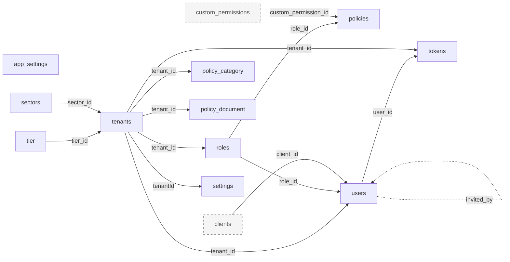

### 3.2 Tenant config and reference reads

**Purpose:** Per-tenant dashboard settings and widget layout (`/api/settings`), read-only sector and theme lists (`/api/sectors`, `/api/themes`), and the caller's tier subscriptions plus tenant custom permissions (`/api/tiers`). Entry: `routes/{settings,sector,themes,tier}.route.js`, `app/controllers/{settings,sector,themes,tier}.controller.js`, hook `app/models/settings.js`. Writes to sectors, themes and tiers happen in Super admin.

**Module metrics:** 7 distinct tables: 5 active (direct), 0 deprecated/legacy, 0 apparently unused, 2 shared/uncertain (0 reached only via shared code, 2 with Uncertain status). 6 of 7 are also used by other modules.

**Tables used**

| Table | Usage status | Definition |
|---|---|---|
| `custom_permissions` | Active (direct) | [custom_permissions](#table-custom_permissions) (under Service-to-service public API) |
| `sectors` | Active (direct) | [sectors](#table-sectors) (under Super admin (platform)) |
| `settings` | Active (direct) | [settings](#table-settings) (here) |
| `tenants` | Active (direct) | [tenants](#table-tenants) (under Tenants and onboarding) |
| `themes` | Uncertain (direct) | [themes](#table-themes) (under Super admin (platform)) |
| `tier` | Active (direct) | [tier](#table-tier) (under Super admin (platform)) |
| `widgets` | Uncertain (direct) | [widgets](#table-widgets) (here) |

#### Table details

#### Table: settings

**Table overview**

- Canonical name: `public.settings` (model `Settings`, `prisma/schema.prisma:316-327`).
- Purpose: one dashboard-settings row per tenant, parent of the widget layout.
- Accessed by: Tenant config (upsert, read), Tenants and onboarding (nested create on tenant signup), Users/auth (`/users/me` include tree), Super admin (via reused tenant create).
- Classification: **Active**. Evidence: created for every tenant (`app/models/tenant.js:75-77`), returned in `/users/me` (`users.controller.js:574-592`), upsert and read in `settings.controller.js:10-15,29-34`. Note: no workspace caller of `/api/settings` itself was found ([R14](#r14-uncertain-tables-clients-widgets-themes)).
- Definition source: `20240212102002_create_settings` (20 dashboard booleans and an array, all dropped in `20240325103908_widgets_model`, which added `show_greetings`).

**Attributes**

| Column | Database Type | Nullable | Default | Key/Constraint | Description |
|---|---|---|---|---|---|
| id | uuid | No | Prisma `uuid()` | PK `settings_pkey` | Settings id |
| show_greetings | boolean | No | `true` | | Show the greeting widget (inferred from name) |
| createdAt | timestamptz(3) | No | `CURRENT_TIMESTAMP` | | Creation time; camelCase physical name |
| updatedAt | timestamptz(3) | No | `CURRENT_TIMESTAMP` + `@updatedAt` | | Last update; camelCase physical name |
| tenantId | uuid | No | | UNIQUE `settings_tenantId_key`; FK `settings_tenantId_fkey` to `tenants.id`, RESTRICT | Owning tenant (1:1) |

**Relationships**

| Direction | Related table | Columns | Cardinality | Enforcement | Modules |
|---|---|---|---|---|---|
| Out | [`tenants`](#table-tenants) | `settings.tenantId` to `tenants.id` | 1 to 1 | Declared FK, RESTRICT, unique | Tenant config, Tenants |
| In | [`widgets`](#table-widgets) | `widgets.settingsId` | 1 to many | Declared FK, SET NULL | Tenant config |

**Additional details**

- Upsert by unique `tenantId`, with `req.verifiedtoken.tenant_id` (undefined for super admin) (`settings.controller.js:8,27`).
- RESTRICT FK means a tenant row cannot be deleted while its settings row exists (no tenant delete path exists today).
- Migration risk: camelCase column names need quoting in raw SQL ([R12](#r12-postgres-specific-features)).

#### Table: widgets

**Table overview**

- Canonical name: `public.widgets` (model `Widget`, `prisma/schema.prisma:350-365`).
- Purpose: dashboard widget layout (name, grid position and size) per settings row.
- Accessed by: Tenant config only.
- Classification: **Uncertain**. Evidence of runtime use: written only as a nested relation by the settings upsert hook (`app/models/settings.js:1-17`: create, or `deleteMany: {}` then create), read via `include: { widgets: true }` (`settings.controller.js:14,32`). No direct delegate call; the `Widget` alias (`app/models/index.js:30`) is unused. No caller of `/api/settings` was found in frontend-main-service or siblings (grep for `show_greetings`, `x_position`, `/settings` paths).
- Definition source: `20240325103908_widgets_model` (column misspelled `setingsId`), corrected by drop and re-add in `20240325111545_alter_settingsid_widgets`.

**Attributes**

| Column | Database Type | Nullable | Default | Key/Constraint | Description |
|---|---|---|---|---|---|
| id | uuid | No | Prisma `uuid()` | PK `widgets_pkey` | Widget id |
| name | varchar(500) | No | | UNIQUE `widgets_name_settingsId_key` (name, settingsId) | Widget key (inferred) |
| x_position | integer | No | `0` | | Grid column (inferred) |
| y_position | integer | No | `0` | | Grid row (inferred) |
| width | integer | No | `0` | | Grid width (inferred) |
| height | integer | No | `0` | | Grid height (inferred) |
| created_at | timestamptz(3) | No | `CURRENT_TIMESTAMP` | | Creation time |
| updated_at | timestamptz(3) | No | `CURRENT_TIMESTAMP` + `@updatedAt` | | Last update |
| settingsId | uuid | Yes | | FK `widgets_settingsId_fkey` to `settings.id`, SET NULL | Owning settings row |

**Relationships**

| Direction | Related table | Columns | Cardinality | Enforcement | Modules |
|---|---|---|---|---|---|
| Out | [`settings`](#table-settings) | `widgets.settingsId` to `settings.id` | many to 0..1 | Declared FK, SET NULL | Tenant config |

**Additional details**

- Every settings update deletes all widgets of that settings row and recreates them (`app/models/settings.js:8-12`), so widget ids are not stable.
- `UNIQUE (name, settingsId)` does not block duplicates when `settingsId` is NULL (Postgres NULLs are distinct).
- Leaf table.

**Module relationship diagram**

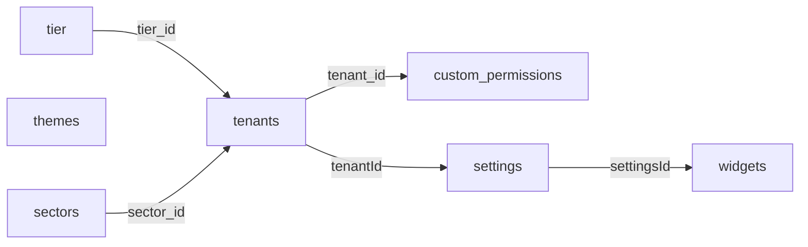

### 3.3 Users, auth and tokens

**Purpose:** Login (password, Slack, Google), admin signup, invites, password reset, profile, member lists, deactivation, and JWT verification for every other service. Entry: `routes/users.route.js`, `routes/teamMembers.route.js`, `routes/googleSessions.route.js`, `services/jobService/auth.route.js` (`/api/auth`), `app/controllers/{users,googleSessions}.controller.js`, `services/jobService/auth.js`, `app/helpers/users.helper.js`, `app/models/token.js`, `validators/users.validator.js`. `GET /users/me` can trigger the same tenant-wide repair sweeps as the 12-hourly cron (`users.helper.js:281-314`).

**Module metrics:** 10 distinct tables: 8 active (direct), 0 deprecated/legacy, 0 apparently unused, 2 shared/uncertain (1 reached only via shared code, 1 with Uncertain status). 10 of 10 are also used by other modules.

**Tables used**

| Table | Usage status | Definition |
|---|---|---|
| `clients` | Uncertain (direct) | [clients](#table-clients) (under Clients) |
| `custom_permissions` | Active (direct) | [custom_permissions](#table-custom_permissions) (under Service-to-service public API) |
| `policies` | Active (direct) | [policies](#table-policies) (under Roles and access policies) |
| `roles` | Active (direct) | [roles](#table-roles) (under Roles and access policies) |
| `settings` | Active (direct) | [settings](#table-settings) (under Tenant config and reference reads) |
| `tenants` | Active (direct) | [tenants](#table-tenants) (under Tenants and onboarding) |
| `tier` | Active (direct) | [tier](#table-tier) (under Super admin (platform)) |
| `tokens` | Active (direct) | [tokens](#table-tokens) (here) |
| `users` | Active (direct) | [users](#table-users) (here) |
| `app_settings` | Active (via shared code) | [app_settings](#table-app_settings) (under Super admin (platform)) |

#### Table details

#### Table: users

**Table overview**

- Canonical name: `public.users` (model `User`, `prisma/schema.prisma:14-59`).
- Purpose: every login identity: tenant employees, tenant admins, client users and the platform super admin (`tenant_id` NULL). Mirrors profile fields from job-service team members and stores the user's ids in attendance, finance and spark-assist.
- Accessed by: 14 modules (all except Tenant config, Clients and Upload).
- Classification: **Active**. Evidence: auth gate on every authenticated route (`middleware/authentication.js:28`), login and profile (`users.controller.js:40-1143`), job-service provisioning upsert (`app/controllers/public/users.controller.js:65`), nightly mirror (`users.helper.js:318-343`), service id write-back (`services/attendanceService/employee.js:85`, `services/financeService/employee.js:56`).
- Definition source: `20230720085325_create_models`; 17 later migrations (column adds, nullability changes, the `20260909030000` S3 URL-to-key data rewrite).

**Attributes**

| Column | Database Type | Nullable | Default | Key/Constraint | Description |
|---|---|---|---|---|---|
| id | uuid | No | Prisma `uuid()` | PK `users_pkey` | User id |
| cover_image | varchar(2000) | Yes | | | S3 object key of the cover image (Prisma field `cover_image_key`, omitted; URL exposed as computed `cover_image`) |
| profile_picture | varchar(1500) | Yes | | | S3 object key of the avatar (Prisma field `profile_picture_key`, omitted; computed URL `profile_picture`); converted from URLs by `20260909030000` |
| full_name | varchar(50) | Yes | | | Display name; mirrored from job-service nightly |
| first_name | varchar(50) | Yes | | | First name |
| last_name | varchar(50) | Yes | | | Last name |
| email | varchar(100) | No | | UNIQUE `users_email_tenant_id_key` (email, tenant_id) | Login email; looked up case-insensitively in most validators |
| rgb_icon | varchar(255) | No | none | | Random avatar colour (generated on create, `prisma/users/user.seed.js`) |
| password | varchar(100) | Yes | | | bcrypt hash; omitted globally, read only by login and change-password validators |
| is_staff | boolean | No | `false` | | Set only by the super admin seed; projected in one verify-token select |
| is_active | boolean | No | `true` | | Deactivation flag; user "delete" sets `false` (`users.controller.js:696-700`) |
| is_verified | boolean | No | `false` | | Signup completed; required by the auth gate |
| is_super | boolean | No | `false` | | Platform super admin; never client-writable |
| is_editable | boolean | No | `true` | | No runtime reference on users (all hits are on roles); inferred dead |
| is_removable | boolean | No | `false` | | No runtime reference on users; inferred dead |
| is_default | boolean | No | `false` | | No runtime reference on users; inferred dead |
| invited_otp_used | boolean | No | `false` | | Never written; projected in one select; inferred dead |
| invited_at | text | Yes | | | Invite time as text (was `timestamp(3)` until `20230829062247`) |
| invited_by | uuid | Yes | | none (logical self-reference) | Inviter's `users.id`; no FK |
| tenant_id | uuid | Yes | | FK `users_tenant_id_fkey` to `tenants.id`, SET NULL; part of unique (email, tenant_id) | Tenant; NULL for the platform super admin |
| role_id | uuid | Yes | | FK `users_role_id_fkey` to `roles.id`, SET NULL | Assigned role |
| client_id | text | Yes | | FK `users_client_id_fkey` to `clients.id`, SET NULL | Linked client company; TEXT because `clients.id` is TEXT |
| google_id | varchar(555) | Yes | | | Google account id; written by Google login, never read |
| google_refresh_token | text | Yes | | | Google refresh token; omitted globally |
| team_member_id | uuid | Yes | | | job-service `team_members.id` (cross-service, no FK); key for job-service user sync |
| isTenantAdmin | boolean | No | `false` | | Tenant admin flag; never client-writable |
| ai_assistant_user_id | uuid | Yes | | | spark-assist user id (cross-service, no FK) |
| attendance_employee_id | uuid | Yes | | | Attendance-service employee id (cross-service, no FK) |
| finance_employee_id | uuid | Yes | | | finance-service-node employee id (cross-service, no FK) |
| status | varchar (no length) | Yes | | | Free-text copy of job-service `TeamMemberStatus` (`app/constants/teamMember.js`); `Exited`/`Deactivated` block login |
| reporting_manager_id | uuid | Yes | | | Manager's job-service team member id (cross-service, no FK) |
| reporting_to | varchar(255) | Yes | | | Manager's full name, denormalised (`users.helper.js:339`) |
| created_at | timestamptz(3) | No | `CURRENT_TIMESTAMP` | | Creation time (Prisma field `createdAt`) |
| updated_at | timestamptz(3) | No | `CURRENT_TIMESTAMP` + `@updatedAt` | | Last update (Prisma field `updatedAt`) |

**Relationships**

| Direction | Related table | Columns | Cardinality | Enforcement | Modules |
|---|---|---|---|---|---|
| Out | [`tenants`](#table-tenants) | `users.tenant_id` to `tenants.id` | many to 0..1 | Declared FK, SET NULL | all user-facing modules |
| Out | [`roles`](#table-roles) | `users.role_id` to `roles.id` | many to 0..1 | Declared FK, SET NULL | Users, Roles, Auth middleware |
| Out | [`clients`](#table-clients) | `users.client_id` to `clients.id` | many to 0..1 | Declared FK, SET NULL | Users, Clients |
| Self | `users` | `users.invited_by` to `users.id` | many to 0..1 | **Inferred** from code (`users.controller.js:820,831` write; `:90-93,891-893` read); no FK | Users |
| In | [`tokens`](#table-tokens) | `tokens.user_id` | 1 to many | Declared FK, SET NULL | Users, Tenants |
| In | [`feedback`](#table-feedback) | `feedback.user_id` | 1 to many | Declared FK, SET NULL | Feedback, Super admin |
| Cross-service | job-service team members; attendance, finance, spark-assist employees/users | `team_member_id`, `reporting_manager_id`, `attendance_employee_id`, `finance_employee_id`, `ai_assistant_user_id` | 1 to 1 (inferred) | None (other databases) | Crons, Outbound write-back, Public API |

**Additional details**

- Soft deactivation only: `is_active = false, status = 'Deactivated'`; no hard delete path for users.
- `UNIQUE (email, tenant_id)` does not stop two rows with the same email and `tenant_id` NULL (super admins); the seed guards with `findFirst` (`prisma/users/user.seed.js:21`).
- Secrets are hidden by the global `omit` on the base client (`app/models/prismaClient.js:25-31`); scripts that build their own `new PrismaClient()` do not have it.
- Writes pick fields through `pickWritable` (`app/helpers/writableFields.helper.js`); flags such as `is_super`, `isTenantAdmin`, `tenant_id`, `role_id` are never client-writable.
- Hot filters without an index: `tenant_id`, `role_id`, `team_member_id`, `client_id`, case-insensitive email ([R8](#r8-missing-indexes-on-foreign-keys-and-hot-filters)).
- The nightly `syncUserWithTeamMember` rewrites names, avatar, reporting fields, status and `is_active` for every linked user (`users.helper.js:330-343`).

#### Table: tokens

**Table overview**

- Canonical name: `public.tokens` (model `Token`, `prisma/schema.prisma:299-314`).
- Purpose: one-time email tokens for invites, password reset, admin email verification and tenant onboarding.
- Accessed by: Users/auth, Tenants and onboarding, Email events, Super admin (reused tenant handlers), Public API (verify-email link), Auth middleware (`verifyToken`).
- Classification: **Active**. Evidence: `middleware/verifyToken.js:16` (findUnique by `token`), `app/models/token.js:9,29` (create, mark old tokens used), `users.controller.js:85,419`, `tenants.controller.js:298,326`, `app/helpers/emailEvents.helper.js:9-12`.
- Definition source: `20230720085325_create_models`; `tenant_id` added in `20230728074311`, `user_id` made nullable in `20240301143051`, timestamps added in `20250227105512`, `is_email_event` added and dropped (`20250227121401`, `20250303102608`).

**Attributes**

| Column | Database Type | Nullable | Default | Key/Constraint | Description |
|---|---|---|---|---|---|
| id | uuid | No | Prisma `uuid()` | PK `tokens_pkey` | Token row id |
| event | enum `event` | Yes | | | Purpose: INVITE_USER, RESET_PASSWORD, VERIFY_ADMIN_EMAIL, TENANT_ONBOARDING |
| token | varchar(500) | No | | UNIQUE `tokens_token_key` | Token string sent in email links |
| exptime | timestamp(3) (no time zone) | No | | | Expiry time |
| user_id | uuid | Yes | | FK `tokens_user_id_fkey` to `users.id`, SET NULL | Target user (NULL for tenant-level tokens) |
| tenant_id | uuid | No | | FK `tokens_tenant_id_fkey` to `tenants.id`, RESTRICT | Tenant |
| is_used | boolean | No | `false` | | Consumed flag; checked by `verifyToken` |
| created_at | timestamptz(3) | No | `CURRENT_TIMESTAMP` | | Creation time; `emailEvents` returns the latest by event |
| updated_at | timestamptz(3) | No | `CURRENT_TIMESTAMP` | | Insert time only: no `@updatedAt`, so it is not bumped on update |

**Relationships**

| Direction | Related table | Columns | Cardinality | Enforcement | Modules |
|---|---|---|---|---|---|
| Out | [`users`](#table-users) | `tokens.user_id` to `users.id` | many to 0..1 | Declared FK, SET NULL | Users |
| Out | [`tenants`](#table-tenants) | `tokens.tenant_id` to `tenants.id` | many to 1 | Declared FK, RESTRICT | Tenants, Users |

**Additional details**

- Rows are never deleted; the table only grows ([R19](#r19-unbounded-and-unindexed-token-lookups)).
- Several flows mark a token used in a separate statement after the user/tenant update, not in a transaction (`users.controller.js:40,54,85`; `tenants.controller.js:291,298`).
- `tokens(user_id, event)` lookups have no index. Leaf table.

**Module relationship diagram**

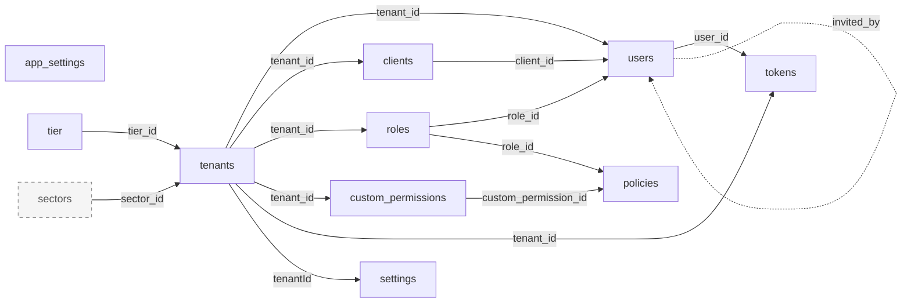

### 3.4 Roles and access policies

**Purpose:** Tenant role CRUD. Each role carries policy rows, one per built-in service (`SubscriptionStatus`) or per tenant custom permission, with a `scope` array (CREATE, EDIT, VIEW, DELETE, DOWNLOAD). Entry: `routes/roles.routes.js`, `app/controllers/roles.controller.js`, `validators/roles.validator.js`, `app/helpers/customPermissions.helper.js`, `app/helpers/policies.helper.js` (`orderMapping`). Policies are also written by tenant creation, tier changes (Tenants, Super admin) and the custom-permission sync (Public API), and read on every permission check (Auth middleware).

**Module metrics:** 6 distinct tables: 6 active (direct), 0 deprecated/legacy, 0 apparently unused, 0 shared/uncertain (0 reached only via shared code, 0 with Uncertain status). 6 of 6 are also used by other modules.

**Tables used**

| Table | Usage status | Definition |
|---|---|---|
| `custom_permissions` | Active (direct) | [custom_permissions](#table-custom_permissions) (under Service-to-service public API) |
| `policies` | Active (direct) | [policies](#table-policies) (here) |
| `roles` | Active (direct) | [roles](#table-roles) (here) |
| `tenants` | Active (direct) | [tenants](#table-tenants) (under Tenants and onboarding) |
| `tier` | Active (direct) | [tier](#table-tier) (under Super admin (platform)) |
| `users` | Active (direct) | [users](#table-users) (under Users, auth and tokens) |

#### Table details

#### Table: roles

**Table overview**

- Canonical name: `public.roles` (model `Role`, `prisma/schema.prisma:225-247`).
- Purpose: tenant roles. Each tenant gets a built-in Admin (`is_custom = is_removable = is_default = false`) and a Default role on creation (`app/models/tenant.js:41-73`); tenants add custom roles.
- Accessed by: Roles, Tenants, Users/auth, Super admin, Public API, Crons, Auth middleware, Maintenance scripts, Seeds.
- Classification: **Active**. Evidence: `roles.controller.js:37-48,82,104-114,145,191,236`; attendance repair sync raw UPDATE (`app/helpers/attendence/role.helper.js:24-28`); `GET /public/roles` for job-service (`app/controllers/public/roles.controller.js:14`).
- Definition source: `20230720085325_create_models`; `attendance_synced_at` added in `20260928000000_add_role_attendance_synced_at`.

**Attributes**

| Column | Database Type | Nullable | Default | Key/Constraint | Description |
|---|---|---|---|---|---|
| id | uuid | No | Prisma `uuid()` | PK `roles_pkey` | Role id; stored by attendance as `role_external_id` and by job-service team members |
| name | varchar(50) | No | | UNIQUE `roles_name_tenant_id_key` (name, tenant_id) | Role name; seeds match built-in roles by name |
| description | varchar(500) | No | | | Description |
| tenant_id | uuid | No | | FK `roles_tenant_id_fkey` to `tenants.id`, RESTRICT | Owning tenant |
| created_by | varchar(100) | Yes | | | Creator's full name as text, not an id (`roles.controller.js:40`) |
| is_custom | boolean | No | `true` | | Tenant-created role |
| is_default | boolean | No | `false` | | Default role for new users |
| is_removable | boolean | No | `true` | | Delete guard |
| is_editable | boolean | No | `true` | | Edit guard |
| is_super | boolean | No | `false` | | Never written by code; sent to attendance |
| created_at | timestamptz(3) | No | `CURRENT_TIMESTAMP` | | Creation time |
| updated_at | timestamptz(3) | No | `CURRENT_TIMESTAMP` + `@updatedAt` | | Last update; compared with `attendance_synced_at` by the repair sync |
| attendance_synced_at | timestamptz(3) | Yes | | | `updated_at` value at last successful attendance sync; omitted from responses |

**Relationships**

| Direction | Related table | Columns | Cardinality | Enforcement | Modules |
|---|---|---|---|---|---|
| Out | [`tenants`](#table-tenants) | `roles.tenant_id` to `tenants.id` | many to 1 | Declared FK, RESTRICT | Roles, Tenants |
| In | [`users`](#table-users) | `users.role_id` | 1 to many | Declared FK, SET NULL | Users |
| In | [`policies`](#table-policies) | `policies.role_id` | 1 to many | Declared FK, RESTRICT | Roles |
| Cross-service | attendance roles, job-service team members | `roles.id` stored as `role_external_id` / `role_id` | 1 to many (inferred) | None | Crons, Public API |

**Additional details**

- Role delete is two statements, not a transaction: `Policy.deleteMany` then `Role.delete` (`roles.controller.js:234-236`); RESTRICT on `policies.role_id` forces that order.
- The raw UPDATE of `attendance_synced_at` is deliberate so `@updatedAt` is not bumped (`role.helper.js:17`).
- `roles.tenant_id` alone has no index (only the second column of `(name, tenant_id)`).

#### Table: policies

**Table overview**

- Canonical name: `public.policies` (model `Policy`, `prisma/schema.prisma:258-273`).
- Purpose: permission grants. One row per (role, service) or (role, custom permission), with allowed scopes and a navigation order.
- Accessed by: Roles, Tenants, Users/auth, Super admin, Public API, Auth middleware, Maintenance scripts, Seeds.
- Classification: **Active**. Evidence: nested writes in `roles.controller.js:41-46,112`; tier sync `app/helpers/tenants.helper.js:78,93`; custom-permission sync `app/controllers/public/customPermissions.controller.js:45,64,71`; every `verifyPermission` (`middleware/authorisation.js:19-28`).
- Definition source: `20230720085325_create_models`; `order` added `20240321065621`; `service` retyped 4 times by enum recreation; `custom_permission_id` added and `service` made nullable in `20260715071510`; data migrations `20260715072214` (DELETE), `20260920120002` and `20260924000000` (INSERT).

**Attributes**

| Column | Database Type | Nullable | Default | Key/Constraint | Description |
|---|---|---|---|---|---|
| id | uuid | No | Prisma `uuid()`; SQL backfills use `gen_random_uuid()` | PK `policies_pkey`; UNIQUE `policies_role_id_id_key` (role_id, id) | Policy id |
| service | enum `SubscriptionStatus` | Yes | | | Built-in feature key; schema comment says exactly one of `service` or `custom_permission_id` is set (not enforced) |
| custom_permission_id | uuid | Yes | | FK `policies_custom_permission_id_fkey` to `custom_permissions.id`, SET NULL | Tenant custom permission |
| scope | enum array `"Scope"[]` | Yes at DB level (Prisma treats as required) | `ARRAY['CREATE','EDIT','VIEW','DELETE']` | | Allowed actions; code grants all 5 incl. DOWNLOAD via `Object.keys(Scope)` |
| role_id | uuid | No | | FK `policies_role_id_fkey` to `roles.id`, RESTRICT | Owning role |
| created_at | timestamptz(3) | No | `CURRENT_TIMESTAMP` | | Creation time |
| updated_at | timestamptz(3) | No | `CURRENT_TIMESTAMP` + `@updatedAt` | | Last update |
| order | integer | Yes | | | Navigation order from `orderMapping` (`app/helpers/policies.helper.js`); 10 services have no mapping, so NULL; reserved word |

**Relationships**

| Direction | Related table | Columns | Cardinality | Enforcement | Modules |
|---|---|---|---|---|---|
| Out | [`roles`](#table-roles) | `policies.role_id` to `roles.id` | many to 1 | Declared FK, RESTRICT | Roles |
| Out | [`custom_permissions`](#table-custom_permissions) | `policies.custom_permission_id` to `custom_permissions.id` | many to 0..1 | Declared FK, SET NULL | Public API, Roles |
| Logical | [`tier`](#table-tier) | `policies.service` must be in the tenant's `tier.subscriptions` | n/a | **Inferred**, enforced by tier sync (`app/helpers/tenants.helper.js:42-80`) | Tenants, Super admin |

**Additional details**

- No CHECK for the `service` XOR `custom_permission_id` rule and no unique `(role_id, service)`; backfills guard with `NOT EXISTS` in SQL or app code ([R4](#r4-invariants-not-enforced-by-the-database)).
- `UNIQUE (role_id, id)` is redundant with the PK; in practice it is the only index leading on `role_id`.
- Rows depend on manual seed scripts per environment ([R17](#r17-manual-seeds-make-policies-environment-dependent)).
- Tier changes delete and recreate a role's policies outside a transaction in the hook path (`app/models/tier.js:28-44`); inside the tier-delete transaction errors are swallowed by `handleError` (`tenants.helper.js:109-111`).
- Leaf table.

**Module relationship diagram**

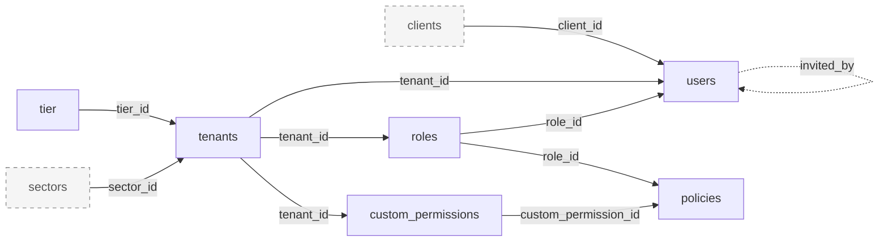

### 3.5 Policy documents and categories

**Purpose:** Company policy library (HR documents stored in S3) grouped into many-to-many categories; create and update are broadcast to notification-service. Entry: `routes/policyCategory.route.js`, `routes/policyDocument.route.js`, their controllers and validators, hook `app/models/policyDocument.js` (category ids to nested `connect`/`set`). Tenant activation creates 4 default categories (`app/helpers/policyCategory.helper.js:17`).

**Module metrics:** 5 distinct tables: 4 active (direct), 0 deprecated/legacy, 0 apparently unused, 1 shared/uncertain (1 reached only via shared code, 0 with Uncertain status). 4 of 5 are also used by other modules.

**Tables used**

| Table | Usage status | Definition |
|---|---|---|
| `_PolicyCategoryToPolicyDocument` | Active (direct) | [_PolicyCategoryToPolicyDocument](#table-_policycategorytopolicydocument) (here) |
| `policy_category` | Active (direct) | [policy_category](#table-policy_category) (here) |
| `policy_document` | Active (direct) | [policy_document](#table-policy_document) (here) |
| `tenants` | Active (direct) | [tenants](#table-tenants) (under Tenants and onboarding) |
| `users` | Active (via shared code) | [users](#table-users) (under Users, auth and tokens) |

#### Table details

#### Table: policy_category

**Table overview**

- Canonical name: `public.policy_category` (model `PolicyCategory`, `prisma/schema.prisma:377-390`).
- Purpose: per-tenant category labels (with a colour) for policy documents.
- Accessed by: Policy documents, Tenants (default categories on activation, include on tenant get), Super admin (via reused tenant handlers), Public API (email-link tenant get).
- Classification: **Active**. Evidence: `policyCategory.controller.js:12,42,69,103,105,125`; `policyCategory.helper.js:17` (createMany on activation).
- Definition source: `20240419122002_create_policy_category`; nullability relaxed `20240419150309`; timestamps replaced `20240422055603`; wrong `UNIQUE (tenant_id)` dropped `20240422062900`.

**Attributes**

| Column | Database Type | Nullable | Default | Key/Constraint | Description |
|---|---|---|---|---|---|
| id | uuid | No | Prisma `uuid()` | PK `policy_category_pkey` | Category id |
| name | varchar(500) | No | | UNIQUE `policy_category_name_tenant_id_key` (name, tenant_id) | Category name |
| rgbColour | varchar(500) | Yes | | | Display colour (random on default creation, `policyCategory.helper.js:14`) |
| created_at | timestamptz(3) | No | `CURRENT_TIMESTAMP` | | Creation time |
| updated_at | timestamptz(3) | No | `CURRENT_TIMESTAMP` + `@updatedAt` | | Last update |
| tenant_id | uuid | Yes | | FK `policy_category_tenant_id_fkey` to `tenants.id`, SET NULL | Owning tenant; code always sets it |

**Relationships**

| Direction | Related table | Columns | Cardinality | Enforcement | Modules |
|---|---|---|---|---|---|
| Out | [`tenants`](#table-tenants) | `policy_category.tenant_id` to `tenants.id` | many to 0..1 | Declared FK, SET NULL | Policy documents, Tenants |
| In | [`_PolicyCategoryToPolicyDocument`](#table-_policycategorytopolicydocument) | `A` | 1 to many (many-to-many with documents) | Declared FK, CASCADE | Policy documents |

**Additional details**

- Hard delete, guarded by a validator that checks linked documents (`validators/policyDocument.validator.js:58`); deleting a category cascades its join rows.
- The list validator allows `orderBy=createdAt|updatedAt`, which are not field names, so those sorts fail with 422 (`validators/policyCategory.validator.js:4`).
- Nullable `tenant_id` inside the composite unique allows duplicate names when NULL.

#### Table: policy_document

**Table overview**

- Canonical name: `public.policy_document` (model `PolicyDocument`, `prisma/schema.prisma:392-408`).
- Purpose: tenant policy documents (name, S3 file key, summary, upload date).
- Accessed by: Policy documents, Tenants (include on tenant get), Public API (email-link tenant get).
- Classification: **Active**. Evidence: `policyDocument.controller.js:13,54,94,140,142,172`; hook `app/models/policyDocument.js:7-35`; file-key conversion on the base client (`app/models/prismaClient.js:51,65-70`).
- Definition source: `20240419123726_create_policy_documents`; reshaped in `20240422055603`; `url` rewritten from URLs to S3 keys by `20260909030000_strip_bucket_url_from_user_files`.

**Attributes**

| Column | Database Type | Nullable | Default | Key/Constraint | Description |
|---|---|---|---|---|---|
| id | uuid | No | Prisma `uuid()` | PK `policy_document_pkey` | Document id |
| name | varchar(500) | No | | UNIQUE `policy_document_name_tenant_id_key` (name, tenant_id) | Document name |
| url | varchar(1500) | Yes | | | S3 object key (Prisma field `url_key`, omitted; computed `url` returns a presigned URL) |
| summary | text | Yes | | | Summary; searched with `contains` |
| uploadDate | date | Yes | | | Upload date; camelCase physical name |
| created_at | timestamptz(3) | No | `CURRENT_TIMESTAMP` | | Creation time |
| updated_at | timestamptz(3) | No | `CURRENT_TIMESTAMP` + `@updatedAt` | | Last update |
| tenant_id | uuid | Yes | | FK `policy_document_tenant_id_fkey` to `tenants.id`, SET NULL | Owning tenant |

**Relationships**

| Direction | Related table | Columns | Cardinality | Enforcement | Modules |
|---|---|---|---|---|---|
| Out | [`tenants`](#table-tenants) | `policy_document.tenant_id` to `tenants.id` | many to 0..1 | Declared FK, SET NULL | Policy documents |
| In | [`_PolicyCategoryToPolicyDocument`](#table-_policycategorytopolicydocument) | `B` | 1 to many (many-to-many with categories) | Declared FK, CASCADE | Policy documents |

**Additional details**

- Hard delete (`policyDocument.controller.js:172`), cascades join rows.
- Stored value is an S3 key; any data copy must keep the key form and the bucket configuration, not presigned URLs.

#### Table: _PolicyCategoryToPolicyDocument

**Table overview**

- Canonical name: `public."_PolicyCategoryToPolicyDocument"` (Prisma implicit many-to-many join table for `PolicyCategory.policyDocuments` and `PolicyDocument.policyCategories`, `prisma/schema.prisma:386,404`).
- Purpose: links documents to categories. Column `A` holds the `policy_category` id and `B` the `policy_document` id (alphabetical model order).
- Accessed by: Policy documents only.
- Classification: **Active**. Evidence: no direct query (Prisma manages rows); written through nested `connect` (create) and `set` (update) in `app/models/policyDocument.js:11-13,24-26`; read through `include: { policyCategories }` in `policyDocument.controller.js:18-20,57-59,89-91,147-149` and the `policyCategories.some` filter (`:125-135`).
- Definition source: `20240419123726_create_policy_documents` (unique index `_AB_unique`); replaced by PK `_PolicyCategoryToPolicyDocument_AB_pkey` in `20251027182237_alter_user_reporting_manager` (Prisma 5 to 6 change).

**Attributes**

| Column | Database Type | Nullable | Default | Key/Constraint | Description |
|---|---|---|---|---|---|
| A | uuid | No | | PK part (A, B); FK `_PolicyCategoryToPolicyDocument_A_fkey` to `policy_category.id`, ON DELETE CASCADE, ON UPDATE CASCADE | Category id |
| B | uuid | No | | PK part; FK `_PolicyCategoryToPolicyDocument_B_fkey` to `policy_document.id`, CASCADE; index `_PolicyCategoryToPolicyDocument_B_index` | Document id |

**Relationships**

| Direction | Related table | Columns | Cardinality | Enforcement | Modules |
|---|---|---|---|---|---|
| Out | [`policy_category`](#table-policy_category) | `A` to `policy_category.id` | many to 1 | Declared FK, CASCADE | Policy documents |
| Out | [`policy_document`](#table-policy_document) | `B` to `policy_document.id` | many to 1 | Declared FK, CASCADE | Policy documents |

**Additional details**

- Name and column layout are Prisma conventions; a different ORM or a schema rename needs an explicit mapping ([R12](#r12-postgres-specific-features)).
- `20251027182237` drops the old index with a hardcoded `"public"` schema ([R11](#r11-hardcoded-public-schema-in-migration-sql)).
- Leaf table; the only junction table.

**Module relationship diagram**

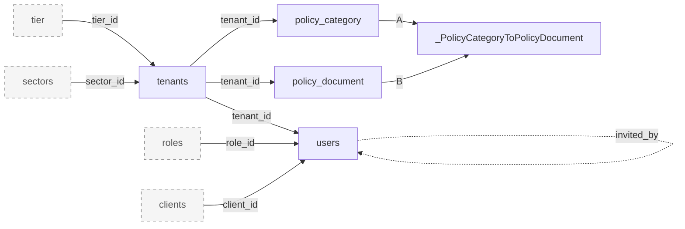

### 3.6 Clients

**Purpose:** A tenant's external client companies; users can be linked to a client through `users.client_id`. Entry: `routes/clients.route.js` (create, update, get, delete; no list endpoint, `routes/clients.route.js:18-21`), `app/controllers/clients.controller.js`, `validators/clients.validator.js`. The frontend manages clients through job-service (`app_client` table), not this module.

**Module metrics:** 1 distinct tables: 0 active (direct), 0 deprecated/legacy, 0 apparently unused, 1 shared/uncertain (0 reached only via shared code, 1 with Uncertain status). 1 of 1 are also used by other modules.

**Tables used**

| Table | Usage status | Definition |
|---|---|---|
| `clients` | Uncertain (direct) | [clients](#table-clients) (here) |

#### Table details

#### Table: clients

**Table overview**

- Canonical name: `public.clients` (model `Client`, `prisma/schema.prisma:68-90`).
- Purpose: tenant client companies with a contact person.
- Accessed by: Clients, Users/auth (`clientIdRule` validator `validators/users.validator.js:226`; invite writes `client_id`, `users.controller.js:772`).
- Classification: **Uncertain**. Evidence of runtime code: `clients.controller.js:34,56,64,81,103,108`. No consumer found: frontend-main-service calls `/clients` on job-service only (`src/pages/clients/client-preview/index.tsx:89-196`, `src/pages/admin-settings/onboarding-settings/content-library/index.tsx:80`), and job-service keeps its own client table `app_client` (`job-service-node/prisma/schema.prisma:449-471`). Production row count unknown.
- Definition source: `20230720085325_create_models`; global unique on `contact_phone` replaced by per-tenant unique in `20261001000000_client_contact_phone_unique_per_tenant`.

**Attributes**

| Column | Database Type | Nullable | Default | Key/Constraint | Description |
|---|---|---|---|---|---|
| id | text | No | Prisma `uuid()` | PK `clients_pkey` | Client id; TEXT, unlike every other id (no `@db.Uuid`) |
| name | varchar(50) | No | | | Company name |
| contact_person_first_name | varchar(50) | No | | | Contact first name |
| contact_person_last_name | varchar(50) | No | | | Contact last name |
| contact_email | varchar(100) | No | | UNIQUE `clients_contact_email_tenant_id_key` (contact_email, tenant_id) | Contact email |
| contact_phone | varchar(100) | No | | UNIQUE `clients_contact_phone_tenant_id_key` (contact_phone, tenant_id) | Contact phone |
| domain | varchar(100) | No | | | Company domain |
| status | enum `ClientStatus` | No | `'active'` | | active, completed, archive; validated only, never filtered on |
| tenant_id | uuid | No | | FK `clients_tenant_id_fkey` to `tenants.id`, RESTRICT | Owning tenant |
| created_at | timestamptz(3) | No | `CURRENT_TIMESTAMP` | | Creation time |
| updated_at | timestamptz(3) | No | `CURRENT_TIMESTAMP` + `@updatedAt` | | Last update |

**Relationships**

| Direction | Related table | Columns | Cardinality | Enforcement | Modules |
|---|---|---|---|---|---|
| Out | [`tenants`](#table-tenants) | `clients.tenant_id` to `tenants.id` | many to 1 | Declared FK, RESTRICT | Clients |
| In | [`users`](#table-users) | `users.client_id` (TEXT) | 1 to many | Declared FK, SET NULL | Users |

**Additional details**

- Hard delete (`clients.controller.js:108`); linked users keep a NULL `client_id` (SET NULL).
- Create and update spread the request body into the write (`clients.controller.js:27-34,55-64`), so columns are written without being named in code.
- Overlaps with job-service `app_client` (different shape: code, email, phone, VARCHAR status, `is_archived`). Merging both would need an id-type decision (TEXT here, UUID there) ([R14](#r14-uncertain-tables-clients-widgets-themes)).

**Module relationship diagram**

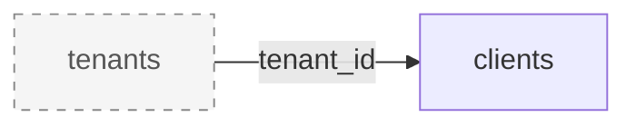

### 3.7 Feedback

**Purpose:** In-app feedback submission (note, screen URL, screenshot, attachments), emailed to the recipient configured in `app_settings`. Entry: `routes/feedback.route.js` (`/api/feedbacks`), `app/controllers/feedback.controller.js`, `validators/feedback.validator.js`, mailer `app/mailers/feedback.js`. Super admin triages feedback.

**Module metrics:** 4 distinct tables: 3 active (direct), 0 deprecated/legacy, 0 apparently unused, 1 shared/uncertain (1 reached only via shared code, 0 with Uncertain status). 4 of 4 are also used by other modules.

**Tables used**

| Table | Usage status | Definition |
|---|---|---|
| `feedback` | Active (direct) | [feedback](#table-feedback) (here) |
| `tenants` | Active (direct) | [tenants](#table-tenants) (under Tenants and onboarding) |
| `users` | Active (direct) | [users](#table-users) (under Users, auth and tokens) |
| `app_settings` | Active (via shared code) | [app_settings](#table-app_settings) (under Super admin (platform)) |

#### Table details

#### Table: feedback

**Table overview**

- Canonical name: `public.feedback` (model `Feedback`, `prisma/schema.prisma:410-423`).
- Purpose: user feedback reports.
- Accessed by: Feedback (create, read), Super admin (list, search, read).
- Classification: **Active**. Evidence: `feedback.controller.js:11-20,57-73`; `superadmin/feedback.controller.js:19,66,67`; frontend `src/components/submit-feedback/index.tsx:107` (`POST /feedbacks`, service auth).
- Definition source: `20240730055548_create_feedback_tenant`; `screen` replaced by `screenShot`/`screenUrl` (`20240731060308`); `user_id` added (`20240731083855`); `tenant_id` and its FK dropped (`20240731084213`).

**Attributes**

| Column | Database Type | Nullable | Default | Key/Constraint | Description |
|---|---|---|---|---|---|
| id | uuid | No | Prisma `uuid()` | PK `feedback_pkey` | Feedback id |
| screenUrl | varchar(2000) | Yes | | | Page URL the feedback was sent from |
| screenShot | varchar(2000) | Yes | | | Screenshot S3 key (Prisma field `screenShot_key`, omitted; computed `screenShot`); deliberately not rewritten by `20260909030000`, so old rows may still hold URLs |
| note | text | Yes | | | Feedback text |
| user_attachments | text array | Yes at DB level (Prisma treats as required) | `ARRAY[]::TEXT[]` | | Attachment URLs (absolute, presigned on read) |
| created_at | timestamptz(3) | No | `CURRENT_TIMESTAMP` | | Creation time |
| updated_at | timestamptz(3) | No | `CURRENT_TIMESTAMP` + `@updatedAt` | | Last update |
| user_id | uuid | Yes | | FK `feedback_user_id_fkey` to `users.id`, SET NULL | Author |

**Relationships**

| Direction | Related table | Columns | Cardinality | Enforcement | Modules |
|---|---|---|---|---|---|
| Out | [`users`](#table-users) | `feedback.user_id` to `users.id` | many to 0..1 | Declared FK, SET NULL | Feedback, Super admin |

**Additional details**

- Tenant scope is only through the author: `where: { user: { tenant_id } }` (`feedback.controller.js:47,57-73`). Feedback from a user whose `user_id` became NULL has no tenant.
- `feedback.user_id` has no index. Leaf table.
- The super admin list validator allows `orderBy=screenShot`, a computed field, which fails with 422 (`validators/feedback.validator.js:5`).

**Module relationship diagram**

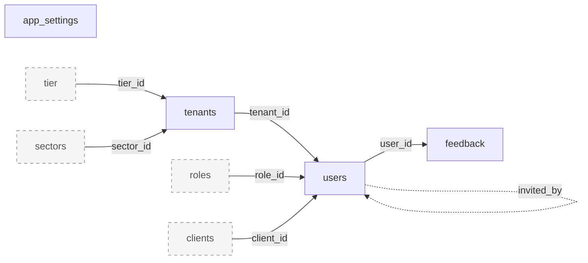

### 3.8 Email events (service-to-service)

**Purpose:** Returns the latest token and link for an email event (invite, reset, verification) to an API-key caller; used by notification-service e2e scripts (`notification-service/scripts/e2e-demo/lib/tenant.js:172`). Entry: `routes/emailEvents.route.js`, `app/controllers/emailEvents.controller.js`, `app/helpers/emailEvents.helper.js`, `validators/emailEvents.validator.js`. No table is owned here.

**Module metrics:** 3 distinct tables: 3 active (direct), 0 deprecated/legacy, 0 apparently unused, 0 shared/uncertain (0 reached only via shared code, 0 with Uncertain status). 3 of 3 are also used by other modules.

**Tables used**

| Table | Usage status | Definition |
|---|---|---|
| `tenants` | Active (direct) | [tenants](#table-tenants) (under Tenants and onboarding) |
| `tokens` | Active (direct) | [tokens](#table-tokens) (under Users, auth and tokens) |
| `users` | Active (direct) | [users](#table-users) (under Users, auth and tokens) |

**Module relationship diagram**

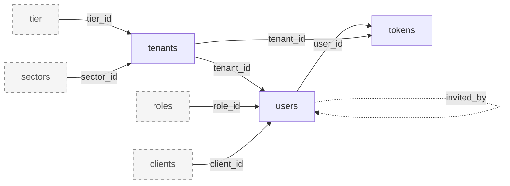

### 3.9 Upload

**Purpose:** S3 upload and presign (`/api/upload`). Entry: `routes/upload.route.js`, `app/controllers/upload.controller.js`, `app/helpers/upload.helper.js`, `app/helpers/s3/*`, `utils/awsS3.utils.js`. No Prisma call in the module's own files; the only DB access is the `authentication` middleware (counted under [3.13 Auth middleware](#313-auth-middleware)).

**Module metrics:** 0 distinct tables: 0 active (direct), 0 deprecated/legacy, 0 apparently unused, 0 shared/uncertain (0 reached only via shared code, 0 with Uncertain status). 0 of 0 are also used by other modules.

**Tables used**

_No table is accessed by this module's own code._

**Module relationship diagram:** none, the module accesses no tables.

### 3.10 Super admin (platform)

**Purpose:** Platform reference data (sectors, themes, tiers), tier deletion with tenant migration to a new tier, feedback triage, the super admin's own profile, global `app_settings`, and tenant administration (reusing Tenants handlers under `/api/super-admin/tenants`). Entry: `routes/superadmin/*.js`, `app/controllers/superadmin/*.js`, `validators/superadmin/*`, `validators/{themes,tier}.validator.js`, `app/helpers/tier.helper.js`, hook `app/models/tier.js`.

**Module metrics:** 12 distinct tables: 6 active (direct), 0 deprecated/legacy, 0 apparently unused, 6 shared/uncertain (5 reached only via shared code, 1 with Uncertain status). 12 of 12 are also used by other modules.

**Tables used**

| Table | Usage status | Definition |
|---|---|---|
| `app_settings` | Active (direct) | [app_settings](#table-app_settings) (here) |
| `feedback` | Active (direct) | [feedback](#table-feedback) (under Feedback) |
| `sectors` | Active (direct) | [sectors](#table-sectors) (here) |
| `tenants` | Active (direct) | [tenants](#table-tenants) (under Tenants and onboarding) |
| `themes` | Uncertain (direct) | [themes](#table-themes) (here) |
| `tier` | Active (direct) | [tier](#table-tier) (here) |
| `users` | Active (direct) | [users](#table-users) (under Users, auth and tokens) |
| `policies` | Active (via shared code) | [policies](#table-policies) (under Roles and access policies) |
| `policy_category` | Active (via shared code) | [policy_category](#table-policy_category) (under Policy documents and categories) |
| `roles` | Active (via shared code) | [roles](#table-roles) (under Roles and access policies) |
| `settings` | Active (via shared code) | [settings](#table-settings) (under Tenant config and reference reads) |
| `tokens` | Active (via shared code) | [tokens](#table-tokens) (under Users, auth and tokens) |

#### Table details

#### Table: sectors

**Table overview**

- Canonical name: `public.sectors` (model `Sector`, `prisma/schema.prisma:329-337`).
- Purpose: platform list of industry sectors a tenant belongs to (52 seeded names).
- Accessed by: Super admin (CRUD), Tenant config (list), Tenants (validator, connect), Public API (connect on job-service tenant update), Seeds.
- Classification: **Active**. Evidence: `superadmin/sector.controller.js:7,21,63,64,95,107`; `sector.controller.js:5`; `prisma/sectors/sectors.seed.js:7`.
- Definition source: created as `department` in `20240229075224_create_department`; renamed to `sectors` (table, PK and unique index) in `20250811111138_alter_tenant_sectors`.

**Attributes**

| Column | Database Type | Nullable | Default | Key/Constraint | Description |
|---|---|---|---|---|---|
| id | uuid | No | Prisma `uuid()` | PK `sectors_pkey` (renamed from `department_pkey`) | Sector id; job-service stores it as `organisations.department_id` |
| name | varchar(500) | No | | UNIQUE `sectors_name_key` (renamed from `department_name_key`) | Sector name; seed upserts by name |
| created_at | timestamptz(3) | No | `CURRENT_TIMESTAMP` | | Creation time |
| updated_at | timestamptz(3) | No | `CURRENT_TIMESTAMP` + `@updatedAt` | | Last update |

**Relationships**

| Direction | Related table | Columns | Cardinality | Enforcement | Modules |
|---|---|---|---|---|---|
| In | [`tenants`](#table-tenants) | `tenants.sector_id` | 1 to many | Declared FK, SET NULL | Tenants, Super admin |
| Cross-service | job-service `organisations` | `organisations.department_id` holds `sectors.id` | 1 to many (inferred) | None | Tenants (sent by `services/jobService/organisation.js:15,36,65`) |

**Additional details**

- Hard delete, guarded by a validator that checks linked tenants (`validators/superadmin/sector.validator.js:95`).
- Legacy naming: the old `department` name survives in job-service ([R3](#r3-renames-done-as-drop-and-re-add)). Root-only table.

#### Table: themes

**Table overview**

- Canonical name: `public.themes` (model `Theme`, `prisma/schema.prisma:367-375`).
- Purpose: platform list of theme names (inferred: UI themes).
- Accessed by: Super admin (CRUD), Tenant config (list).
- Classification: **Uncertain**. Evidence of runtime code: `superadmin/themes.controller.js:18,30,40,55,56,68`, `themes.controller.js:5`. No caller of `/themes` or `/super-admin/themes` found in frontend-main-service or sibling services; no column in any table refers to a theme.
- Definition source: `20240326104144_create_themes`; never altered.

**Attributes**

| Column | Database Type | Nullable | Default | Key/Constraint | Description |
|---|---|---|---|---|---|
| id | uuid | No | Prisma `uuid()` | PK `themes_pkey` | Theme id |
| name | varchar(500) | No | | UNIQUE `themes_name_key` | Theme name |
| created_at | timestamptz(3) | No | `CURRENT_TIMESTAMP` | | Creation time |
| updated_at | timestamptz(3) | No | `CURRENT_TIMESTAMP` + `@updatedAt` | | Last update |

**Relationships**: none declared or inferred. Isolated table.

**Additional details**: hard delete (`superadmin/themes.controller.js:68`); list paginated with a capped helper (`app/helpers/index.helper.js:50-56`).

#### Table: tier

**Table overview**

- Canonical name: `public.tier` (model `Tier`, `prisma/schema.prisma:339-348`).
- Purpose: subscription tiers. `subscriptions` lists the features (SubscriptionStatus values) a tenant on the tier can use; it bounds the policies each role may hold and is returned by verify-token to every service.
- Accessed by: Super admin (CRUD, delete with tenant migration), Tenants, Tenant config, Users/auth (verify-token, `/users/me`), Roles (validator), Public API, Maintenance scripts.
- Classification: **Active**. Evidence: `superadmin/tier.controller.js:20,32,42,61,62`; `app/helpers/tier.helper.js:7-38`; `services/jobService/auth.js:68`; `tenants.controller.js:245-248`.
- Definition source: `20240301053645_create_tier`; `subscription` replaced by `subscriptions` (drop and re-add) in `20240301062257`; 32 later migrations reset the default, retype through enum recreation or backfill rows; default last set by `20261005000000_sync_tier_subscriptions_default`.

**Attributes**

| Column | Database Type | Nullable | Default | Key/Constraint | Description |
|---|---|---|---|---|---|
| id | uuid | No | Prisma `uuid()` | PK `tier_pkey` | Tier id |
| name | varchar(500) | No | | UNIQUE `tier_name_key` | Tier name |
| subscriptions | enum array `"SubscriptionStatus"[]` | Yes at DB level (Prisma treats as required) | Array of 71 values (all except `GEMS`, `APPROVALS_NOTIFICATION_STRUCTURE`, `SEARCH`), `prisma/schema.prisma:342` | | Enabled features; filtered with `has` (`tenants.controller.js:246`) |
| created_at | timestamptz(3) | No | `CURRENT_TIMESTAMP` | | Creation time |
| updated_at | timestamptz(3) | No | `CURRENT_TIMESTAMP` + `@updatedAt` | | Last update |

**Relationships**

| Direction | Related table | Columns | Cardinality | Enforcement | Modules |
|---|---|---|---|---|---|
| In | [`tenants`](#table-tenants) | `tenants.tier_id` | 1 to many | Declared FK, RESTRICT | Tenants, Super admin |
| Logical | [`policies`](#table-policies) | `policies.service` in `tier.subscriptions` of the role's tenant | n/a | **Inferred**, app-level sync | Tenants, Super admin |

**Additional details**

- The tier `update` hook rewrites every role's policies for every tenant on the tier (`app/models/tier.js:6-65`), not in a transaction; scripts that use a bare client skip it (`scripts/remove-reimbursement-approval-permissions.js:22,27`).
- Tier delete moves tenants to `new_tier_id` inside a transaction, then deletes the tier (`app/helpers/tier.helper.js:19-38`).
- The column default only affects new tiers; existing rows received only the values that were explicitly backfilled ([R2](#r2-tiersubscriptions-default-and-backfill-drift)).
- Singular table name. Root-only table.

#### Table: app_settings

**Table overview**

- Canonical name: `public.app_settings` (model `AppSettings`, `prisma/schema.prisma:425-441`).
- Purpose: platform-wide email settings: feedback recipient, support email and image URLs used by email templates in this and other services.
- Accessed by: Super admin (read, update), Mailers, Tenants, Users/auth, Feedback (mail lookups), Public API (`GET /public/app-settings` for job, notification, attendance and the deprecated finance-backend), Seeds.
- Classification: **Active**. Evidence: `superadmin/appSettings.controller.js:5,35,38`; `app/controllers/public/appSettings.controller.js:5`; 6 mailers (`app/mailers/*.js`); consumer `notification-service/app/services/email/layout.service.js:71`.
- Definition source: `20251127072435_create_app_settings`; columns renamed by drop and re-add in `20251127111214`, `20260121*`; WFH image added `20260511093734`.

**Attributes**

| Column | Database Type | Nullable | Default | Key/Constraint | Description |
|---|---|---|---|---|---|
| id | uuid | No | Prisma `uuid()` | PK `app_settings_pkey` | Row id |
| feedbackRecipientEmail | varchar(255) | Yes | | | Where feedback emails go |
| supportEmail | varchar(255) | Yes | | | Support address shown in emails |
| emailTemplateHeaderLogoUrl | text | Yes | | | Email header logo URL |
| emailTemplateFooterLogoUrl | text | Yes | | | Email footer logo URL |
| dailySummaryEmailTemplateWorkAnniversaryUrl | text | Yes | | | Daily summary image: work anniversary |
| dailySummaryEmailTemplateBirthdayUrl | text | Yes | | | Daily summary image: birthday |
| dailySummaryEmailTemplateLeaveUrl | text | Yes | | | Daily summary image: leave |
| dailySummaryEmailTemplateHeaderUrl | text | Yes | | | Daily summary header image |
| dailySummaryEmailTemplateFooterUrl | text | Yes | | | Daily summary footer image |
| dailySummaryEmailTemplateWFHUrl | text | Yes | | | Daily summary image: work from home |
| created_at | timestamptz(3) | No | `CURRENT_TIMESTAMP` | | Creation time |
| updated_at | timestamptz(3) | No | `CURRENT_TIMESTAMP` + `@updatedAt` | | Last update |

**Relationships**: none. Isolated table.

**Additional details**

- Singleton by convention only: read with `findFirst({ where: {} })` at 7 runtime sites; the seed creates a row only if none exists (`prisma/appSettings/appSettings.seed.js:5`). No constraint stops a second row ([R4](#r4-invariants-not-enforced-by-the-database)).
- Values are absolute URLs, not S3 keys (unlike `users` and `policy_document`).

**Module relationship diagram**

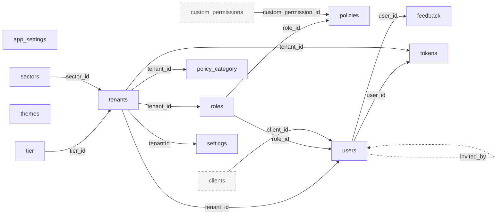

### 3.11 Service-to-service public API

**Purpose:** `/api/public/*` for other services, each route gated by `verifyAPIKey` plus `requireApiCaller('<svc>')` (`middleware/verifyAPIKey.js:28-37`): user provisioning from job-service, user and tenant lookups for autoscal-middleware, notification-service, attendance and finance, the custom-permission catalog sync from finance-service-node, spark-assist provisioning, `app_settings` read, plus email-link tenant routes (`verifyToken`). Entry: `routes/public/**`, `app/controllers/public/**`, `validators/public/**`, `app/helpers/{permissionMembers,audienceMembers}.helper.js`, `app/helpers/ai-assistant/*`.

**Module metrics:** 11 distinct tables: 10 active (direct), 0 deprecated/legacy, 0 apparently unused, 1 shared/uncertain (1 reached only via shared code, 0 with Uncertain status). 11 of 11 are also used by other modules.

**Tables used**

| Table | Usage status | Definition |
|---|---|---|
| `app_settings` | Active (direct) | [app_settings](#table-app_settings) (under Super admin (platform)) |
| `custom_permissions` | Active (direct) | [custom_permissions](#table-custom_permissions) (here) |
| `policies` | Active (direct) | [policies](#table-policies) (under Roles and access policies) |
| `policy_category` | Active (direct) | [policy_category](#table-policy_category) (under Policy documents and categories) |
| `policy_document` | Active (direct) | [policy_document](#table-policy_document) (under Policy documents and categories) |
| `roles` | Active (direct) | [roles](#table-roles) (under Roles and access policies) |
| `tenants` | Active (direct) | [tenants](#table-tenants) (under Tenants and onboarding) |
| `tier` | Active (direct) | [tier](#table-tier) (under Super admin (platform)) |
| `tokens` | Active (direct) | [tokens](#table-tokens) (under Users, auth and tokens) |
| `users` | Active (direct) | [users](#table-users) (under Users, auth and tokens) |
| `sectors` | Active (via shared code) | [sectors](#table-sectors) (under Super admin (platform)) |

#### Table details

#### Table: custom_permissions

**Table overview**

- Canonical name: `public.custom_permissions` (model `CustomPermission`, `prisma/schema.prisma:275-289`).
- Purpose: per-tenant permission keys defined outside auth (finance-service-node pushes its key set), granted to roles through `policies.custom_permission_id`.
- Accessed by: Public API (sync writes, list, members), Roles (validate and attach), Tenant config (`/tiers` list), Users/auth (verify-token and `/users/me` include), Auth middleware (permission checks).
- Classification: **Active**. Evidence: `app/controllers/public/customPermissions.controller.js:29-87` (transactional upsert, prune, re-grant to Admin); `tier.controller.js:14-18`; `app/helpers/customPermissions.helper.js:19`; caller `finance-service-node/app/services/authService/customPermissions.js:14`.
- Definition source: `20260715071510_custom_permissions_dual_policy`; never altered.

**Attributes**

| Column | Database Type | Nullable | Default | Key/Constraint | Description |
|---|---|---|---|---|---|
| id | uuid | No | Prisma `uuid()` | PK `custom_permissions_pkey` | Permission id |
| tenant_id | uuid | No | | FK `custom_permissions_tenant_id_fkey` to `tenants.id`, RESTRICT; UNIQUE `custom_permissions_tenant_id_key_key` (tenant_id, key) | Owning tenant |
| key | varchar(100) | No | | part of unique (tenant_id, key) | Permission key owned by the calling service |
| label | varchar(255) | No | | | Display label |
| order | integer | Yes | | | Display order; reserved word |
| created_at | timestamptz(3) | No | `CURRENT_TIMESTAMP` | | Creation time |
| updated_at | timestamptz(3) | No | `CURRENT_TIMESTAMP` + `@updatedAt` | | Last update |

**Relationships**

| Direction | Related table | Columns | Cardinality | Enforcement | Modules |
|---|---|---|---|---|---|
| Out | [`tenants`](#table-tenants) | `custom_permissions.tenant_id` to `tenants.id` | many to 1 | Declared FK, RESTRICT | Public API |
| In | [`policies`](#table-policies) | `policies.custom_permission_id` | 1 to many | Declared FK, SET NULL | Roles, Public API |

**Additional details**

- The sync deletes policies and permissions for keys the caller no longer sends, then re-grants the remaining keys to the tenant's Admin role, all in one transaction; it throws `AdminRoleNotFound` to roll back (`customPermissions.controller.js:29-87`).
- The key set is owned by finance-service-node; auth only stores it. Ownership in a merged database needs a decision.

**Module relationship diagram**

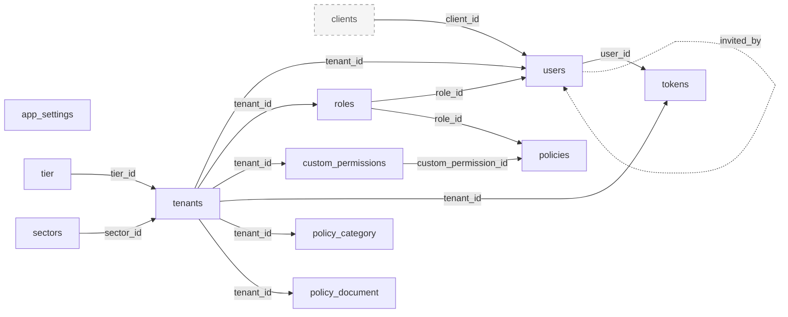

### 3.12 Scheduler and sync crons

**Purpose:** Repair and provisioning of tenants and users in sibling services (12-hourly, `0 */12 * * *`, `config/scheduler.js:5`), nightly mirror sync from job-service, attendance, finance and spark-assist (`0 0 * * *`, `:12`) and AWS Route53 subdomain creation. Registered on every instance at load (`config/app.js:9`) with no lock; also runnable by super admin via `GET /api/scheduler`. Entry: `config/scheduler.js`, `app/helpers/scheduler.helper.js`, `app/helpers/jobService/tenants.helper.js`, `app/helpers/attendence/role.helper.js`, shared `app/helpers/{tenants,users}.helper.js`.

**Module metrics:** 3 distinct tables: 2 active (direct), 0 deprecated/legacy, 0 apparently unused, 1 shared/uncertain (1 reached only via shared code, 0 with Uncertain status). 3 of 3 are also used by other modules.

**Tables used**

| Table | Usage status | Definition |
|---|---|---|
| `roles` | Active (direct) | [roles](#table-roles) (under Roles and access policies) |
| `tenants` | Active (direct) | [tenants](#table-tenants) (under Tenants and onboarding) |
| `users` | Active (via shared code) | [users](#table-users) (under Users, auth and tokens) |

**Module relationship diagram**

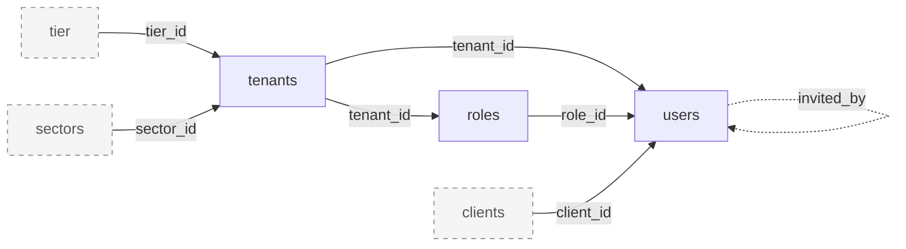

### 3.13 Auth middleware

**Purpose:** Cross-cutting. `authentication` resolves the JWT to a user with tenant and checks `is_verified`, `is_active`, tenant status and user status (`middleware/authentication.js:28-44`); `verifyToken` resolves email-link tokens (`middleware/verifyToken.js:16-27`); `authorisation.js` loads the user's role, policies and custom permissions for every `verifyPermission` and related guards (`middleware/authorisation.js:19-28,141-218`). `verifyAPIKey`, `requireApiCaller`, `isSuperAdmin`, `isTenantAdmin` do no DB I/O.

**Module metrics:** 6 distinct tables: 6 active (direct), 0 deprecated/legacy, 0 apparently unused, 0 shared/uncertain (0 reached only via shared code, 0 with Uncertain status). 6 of 6 are also used by other modules.

**Tables used**

| Table | Usage status | Definition |
|---|---|---|
| `custom_permissions` | Active (direct) | [custom_permissions](#table-custom_permissions) (under Service-to-service public API) |
| `policies` | Active (direct) | [policies](#table-policies) (under Roles and access policies) |
| `roles` | Active (direct) | [roles](#table-roles) (under Roles and access policies) |
| `tenants` | Active (direct) | [tenants](#table-tenants) (under Tenants and onboarding) |
| `tokens` | Active (direct) | [tokens](#table-tokens) (under Users, auth and tokens) |
| `users` | Active (direct) | [users](#table-users) (under Users, auth and tokens) |

**Module relationship diagram**

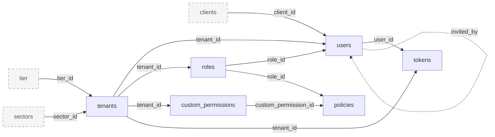

### 3.14 Outbound service write-back

**Purpose:** After calling a sibling service, stores the returned id on `users` (`services/attendanceService/employee.js:85-88,155-161`, `services/financeService/employee.js:56-59`), reads tenant calendar credentials for job-service team member calls (`services/jobService/teamMember.js:10-13`) and the actor's name for notification broadcasts (`services/notificationService/policy.js:9`). All other `services/*` files are HTTP-only. Verify-token (`services/jobService/auth.js`) is counted under Users, auth and tokens.

**Module metrics:** 2 distinct tables: 2 active (direct), 0 deprecated/legacy, 0 apparently unused, 0 shared/uncertain (0 reached only via shared code, 0 with Uncertain status). 2 of 2 are also used by other modules.

**Tables used**

| Table | Usage status | Definition |
|---|---|---|
| `tenants` | Active (direct) | [tenants](#table-tenants) (under Tenants and onboarding) |
| `users` | Active (direct) | [users](#table-users) (under Users, auth and tokens) |

**Module relationship diagram**

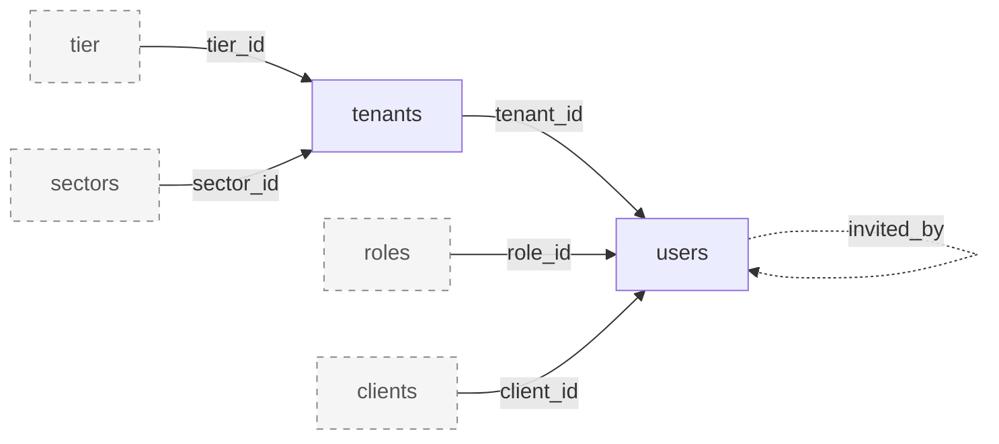

### 3.15 Mailers

**Purpose:** Every outgoing email reads `app_settings` for logos and support address; the invite mail reads the inviter with tenant (`app/mailers/userInviteMail.js:16-18`). Files: `app/mailers/{feedback,resetPasswordMail,tenantDeactivatedMail,tenantSignupEmail,userInviteMail,verifyAdminEmail}.js`.

**Module metrics:** 3 distinct tables: 3 active (direct), 0 deprecated/legacy, 0 apparently unused, 0 shared/uncertain (0 reached only via shared code, 0 with Uncertain status). 3 of 3 are also used by other modules.

**Tables used**

| Table | Usage status | Definition |
|---|---|---|
| `app_settings` | Active (direct) | [app_settings](#table-app_settings) (under Super admin (platform)) |
| `tenants` | Active (direct) | [tenants](#table-tenants) (under Tenants and onboarding) |
| `users` | Active (direct) | [users](#table-users) (under Users, auth and tokens) |

**Module relationship diagram**

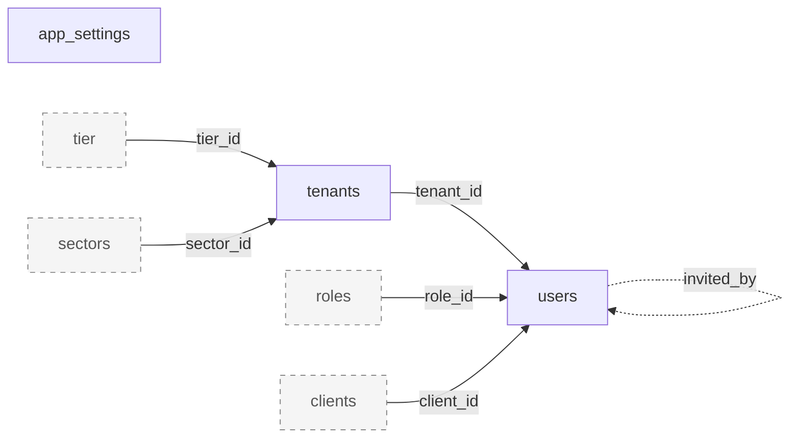

### 3.16 Maintenance scripts

**Purpose:** Ops code run by hand inside the container (not runtime): calendar API key rotation with a row lock across an HTTP call (`scripts/rotate-calendar-api-keys.js:38-53`), the one-off reimbursement-approval purge (`scripts/remove-reimbursement-approval-permissions.js`), bulk tenant member creation and role policy setting (`scripts/create-tenant-members/*`). Two scripts build a bare `new PrismaClient()` without the `omit` and hook layers.

**Module metrics:** 5 distinct tables: 5 active (direct), 0 deprecated/legacy, 0 apparently unused, 0 shared/uncertain (0 reached only via shared code, 0 with Uncertain status). 5 of 5 are also used by other modules.

**Tables used**

| Table | Usage status | Definition |
|---|---|---|
| `policies` | Active (direct) | [policies](#table-policies) (under Roles and access policies) |
| `roles` | Active (direct) | [roles](#table-roles) (under Roles and access policies) |
| `tenants` | Active (direct) | [tenants](#table-tenants) (under Tenants and onboarding) |
| `tier` | Active (direct) | [tier](#table-tier) (under Super admin (platform)) |
| `users` | Active (direct) | [users](#table-users) (under Users, auth and tokens) |

**Module relationship diagram**

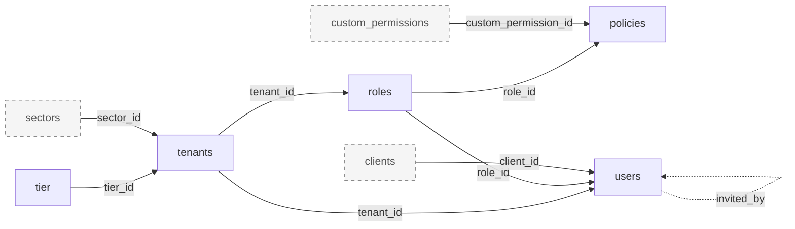

### 3.17 Seeds

**Purpose:** `npm run seed` (`prisma/seed.js:7-9`) creates the platform super admin (credentials from env), the `app_settings` row and 52 sectors. Nine `prisma/seeds/*.js` scripts are run by hand and add policies for newer services to existing roles; they are not wired into `seed.js`.

**Module metrics:** 5 distinct tables: 5 active (direct), 0 deprecated/legacy, 0 apparently unused, 0 shared/uncertain (0 reached only via shared code, 0 with Uncertain status). 5 of 5 are also used by other modules.

**Tables used**

| Table | Usage status | Definition |
|---|---|---|
| `app_settings` | Active (direct) | [app_settings](#table-app_settings) (under Super admin (platform)) |
| `policies` | Active (direct) | [policies](#table-policies) (under Roles and access policies) |
| `roles` | Active (direct) | [roles](#table-roles) (under Roles and access policies) |
| `sectors` | Active (direct) | [sectors](#table-sectors) (under Super admin (platform)) |
| `users` | Active (direct) | [users](#table-users) (under Users, auth and tokens) |

**Module relationship diagram**

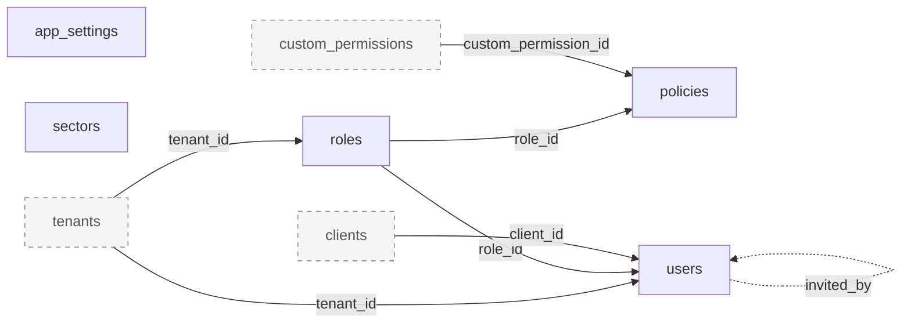

## 4. Migration Risks and Unresolved Issues

Ordered by migration impact. None of these were verified against a live database. A table with no apparent consumer is not safe to drop on that basis alone.

### 4.1 Schema, migration history and DDL

#### R1. SubscriptionStatus enum history and order

1. **Evidence:** After replaying all migrations, `SubscriptionStatus` holds the same 74 values as `prisma/schema.prisma:93-168`, in a different order at the tail (DB: `... GEMS, ENGINEERING_PROFILE, TIMESHEET_REPORTS, TIMESHEET, APPROVALS_TIMESHEET, TIMESHEET_SETTINGS, JIRA_INTEGRATION, SHIFT_PLANNER, APPROVALS_NOTIFICATION_STRUCTURE, APPROVALS_SHIFT_SWAP, REFERRAL_DESK, HOME, TEAM_FEEDBACK, PERFORMANCE, SEARCH`). `20260715072214_drop_reimbursement_approval_enum_values:8-29` recreates the type without `TIMESHEET`, `APPROVALS_TIMESHEET`, `TIMESHEET_SETTINGS`, which `20260710000000` had added (branch-merge artefact); `20260720000050:6-8` re-adds them. Duplicate no-op `GEMS` adds: `20260706110820`, `20260708163102`. Four migrations recreate the type inside explicit `BEGIN; ... COMMIT;` (`20240416131801`, `20260513062851`, `20260513101636`, `20260715072214`).
2. **Potential impact:** Any environment where a `tier` or `policies` row held a timesheet value when `20260715072214` ran would have failed the `::text::"SubscriptionStatus_new"` cast. Environments that applied the 2026-07 migrations in a different order have a different enum order than a fresh replay. Enum order changes `ORDER BY policies.service` and `<`/`>` comparisons. Rebuilding the enum rewrites `policies` and `tier` under an ACCESS EXCLUSIVE lock.
3. **Next verification step:** In every environment, `SELECT enumlabel, enumsortorder FROM pg_enum WHERE enumtypid = '"SubscriptionStatus"'::regtype ORDER BY 2`, and `SELECT migration_name, finished_at, rolled_back_at, logs FROM _prisma_migrations WHERE migration_name LIKE '202607%'`. Confirm whether Prisma's differ ignores enum order before relying on a schema-generated baseline.

#### R2. tier.subscriptions default and backfill drift

1. **Evidence:** The column default was reset by 30+ migrations and flip-flopped (`20260710000100` added TIMESHEET values and removed APPROVALS_REIMBURSEMENTS; `20260715071510:6` did the reverse) before `20261005000000` matched the schema again. Only 10 migrations backfill existing rows with `array_append`/`array_remove` (`20260701120001`, `20260715072214`, `20260720120000`, `20260721000001`, `20260724065458`, `20260907120001`, `20260911150001`, `20260918120001`, `20260920120001`, `20260924000000`), and 3 remap values while retyping (`20240416131801`, `20260513062851`, `20260513101636`).
2. **Potential impact:** Existing tier rows differ from the default for every value added by default-only migrations (for example `TIMESHEET`, `APPROVALS_TIMESHEET`, `TIMESHEET_SETTINGS`, `TIMESHEET_REPORTS`, `REFERRAL_DESK`) unless saved again in the UI. Row contents are environment-specific and cannot be derived from the repo.
3. **Next verification step:** Export `SELECT name, subscriptions FROM tier` per environment and diff against the schema default.

#### R3. Renames done as drop and re-add

1. **Evidence:** `tier.subscription` (`20240301062257`), `tenants.tierId`/`departmentId` (`20240304054145`), `widgets.setingsId` (`20240325111545`), `feedback.screen` (`20240731060308`), `policy_category`/`policy_document` camelCase timestamps (`20240422055603`), `app_settings` columns (`20251127111214`, `20260121062835`, `20260121122224`, `20260121122518`), `users.invited_by` type change (`20230728074311`). True renames only in `20250811111138` (`department` to `sectors`, `department_id` to `sector_id`) and the two enum value remaps. Six NOT NULL columns were added without defaults (for example `users.rgb_icon` `20230818075624:8`, `tenants.tier_id` `20240304054145:19`).
2. **Potential impact:** Historic data loss already happened where these ran on populated tables. Replaying history on a non-empty database fails or loses data. job-service still names the sector `department_id`.
3. **Next verification step:** If the monorepo migration squashes history, generate the new baseline from an introspected production schema (`prisma db pull` plus `migrate diff`) rather than replaying these 158 folders, and mark it applied with `migrate resolve`.

#### R4. Invariants not enforced by the database

1. **Evidence:** `policies` "exactly one of `service` or `custom_permission_id`" is a comment only (`prisma/schema.prisma:260`), enforced in `app/helpers/customPermissions.helper.js:15-30`. No unique `(role_id, service)`; `UNIQUE (role_id, id)` (`:271`) is redundant with the PK. `app_settings` singleton only by `findFirst`. Array columns `policies.scope`, `tier.subscriptions`, `feedback.user_attachments` are nullable in SQL. Composite uniques with a nullable column: `users (email, tenant_id)`, `widgets (name, settingsId)`, `policy_category`/`policy_document (name, tenant_id)`.
2. **Potential impact:** Duplicate or contradictory rows may already exist; adding constraints during migration could fail. Any non-Prisma writer can insert NULL arrays or a second `app_settings` row.
3. **Next verification step:** Run detection queries: `policies` with both or neither of `service`/`custom_permission_id`; `GROUP BY role_id, service HAVING count(*) > 1`; `SELECT count(*) FROM app_settings`; NULL arrays; duplicate `email` among `tenant_id IS NULL` users.

#### R7. Type, default and timezone inconsistencies

1. **Evidence:** `clients.id` and `users.client_id` are TEXT (`prisma/schema.prisma:69,36`); every other key is UUID. `tenants.created_at`, `tenants.updated_at`, `tokens.exptime` are `timestamp(3)` without time zone; all others are `timestamptz(3)`. `tenants.updated_at` has no DB default (`@updatedAt` only); `tokens.updated_at` has no `@updatedAt`. Every `id` uses Prisma client-side `uuid()` with no DB default.
2. **Potential impact:** A non-Prisma writer (SQL backfill, another ORM, a merged service) must supply `id` and `tenants.updated_at`. Timestamp-without-zone values depend on the server time zone when compared or moved. Joining `clients` to UUID keys elsewhere needs casts.
3. **Next verification step:** Check the database and session `TimeZone` in each environment; confirm all `clients.id` values are valid UUIDs before any type change.

#### R8. Missing indexes on foreign keys and hot filters

1. **Evidence:** 14 FK columns have no index leading on them: `users.tenant_id`, `users.role_id`, `users.client_id`, `clients.tenant_id`, `roles.tenant_id`, `policies.custom_permission_id`, `tokens.user_id`, `tokens.tenant_id`, `tenants.tier_id`, `tenants.sector_id`, `widgets.settingsId`, `policy_category.tenant_id`, `policy_document.tenant_id`, `feedback.user_id`. The schema has no `@@index`. Frequent filters `users.team_member_id`, `tokens(user_id, event)` and case-insensitive email equality (`mode: 'insensitive'`, for example `validators/users.validator.js:43`) have no supporting index.
2. **Potential impact:** Performance baseline for the target database; FK deletes on parents scan child tables.
3. **Next verification step:** Check `pg_indexes` in production for indexes created outside migrations, and `pg_stat_user_tables` for sequential scan counts.

#### R11. Hardcoded public schema in migration SQL

1. **Evidence:** `"public"."tier"` and `DROP TYPE "public"."SubscriptionStatus_old"` in `20260513062851:10,15`, `20260513101636:10,15`, `20260715072214:22,27`; `DROP INDEX "public"."_PolicyCategoryToPolicyDocument_AB_unique"` in `20251027182237:5`. `20250811111138:6,8` uses unqualified index names.
2. **Potential impact:** If auth tables move into a named schema of a shared database (`?schema=auth`), replaying these migrations fails or touches the wrong schema.
3. **Next verification step:** Decide the target schema layout first; if non-public, plan a fresh baseline instead of replay (see [R3](#r3-renames-done-as-drop-and-re-add)).

#### R12. Postgres-specific features

1. **Evidence:** 6 enum types (one with symbol labels `'1-10'`, `'1000+'`), 3 array columns, `ALTER TYPE ... ADD VALUE` with backfills split into separate migrations (comments `20260701120001:1-4`, `20260720000050:2-5`), `gen_random_uuid()` (`20260920120002:10`, `20260924000000:13`, built in from PG 13), `regexp_replace`/`split_part`/`~*` (`20260909030000`), `unnest(...::uuid[], ...::timestamptz[])` raw UPDATE (`app/helpers/attendence/role.helper.js:24-28`). Quoted identifiers needed for `order`, `event`, camelCase columns and `_PolicyCategoryToPolicyDocument`.
2. **Potential impact:** Target must be PostgreSQL 13 or later with the same enum semantics; tooling that lowercases identifiers will break camelCase columns.
3. **Next verification step:** Confirm the production PostgreSQL major version and that the target matches or exceeds it.

### 4.2 Relationships and shared data

#### R5. Cross-service ids without foreign keys

1. **Evidence:** 11 columns hold ids from other services' databases: `users.team_member_id`, `users.reporting_manager_id` (job-service team members), `users.ai_assistant_user_id` (spark-assist), `users.attendance_employee_id` (attendance), `users.finance_employee_id` (finance-service-node), `tenants.admin_id`, `tenants.organisation_id`, `tenants.onboarding_form_id`, `tenants.exit_form_id`, `tenants.exit_settings_id` (job-service), `tenants.calendar_organisation_id` (calendar-scheduler-backend). In the other direction, siblings store auth `tenants.id`, `roles.id` and `sectors.id` without FKs (for example job-service `organisations.department_id`; attendance `role_external_id`). No sibling connects to this database directly (no auth DB URL in any active sibling; all access is HTTP).
2. **Potential impact:** Orphans are likely where a sibling record was deleted or a sync failed. If databases are merged, these become candidates for real FKs, which will fail on orphans. Crons keep filling NULL ids, so values change during a migration window.
3. **Next verification step:** For each column, count non-NULL values with no matching row in the target service's table; freeze crons ([R18](#r18-crons-write-during-any-migration-window)) before taking the counts.

#### R6. Inferred self-reference users.invited_by

1. **Evidence:** `users.invited_by` (uuid) is written with the inviter's id (`users.controller.js:820,831`) and read back with `findUnique({ where: { id: invited_by } })` (`:90-93,891-893`); there has never been an FK (`20230728074311` dropped and re-added it as UUID).
2. **Potential impact:** Orphan inviter ids after any user hard delete in the future; a new FK would fail on them.
3. **Next verification step:** `SELECT count(*) FROM users u WHERE invited_by IS NOT NULL AND NOT EXISTS (SELECT 1 FROM users i WHERE i.id = u.invited_by)`.

#### R13. Table name collisions with sibling services

1. **Evidence:** `users` also exists in calendar-scheduler-backend (`prisma/schema.prisma:128`, different shape) and `feedback` in job-service-node (`prisma/schema.prisma:2355`). job-service-node's migration history created and then dropped its own `tenants`, `users`, `roles`, `policies`, `tokens` and `clients` (see `current-db-arch/job-service-node.md`, dropped tables).
2. **Potential impact:** Consolidating services into one database and schema requires renaming or schema separation; generic names like `settings`, `tier`, `feedback` are likely to collide as more services are analysed.
3. **Next verification step:** Build a cross-service table-name matrix from all `current-db-arch/*.md` docs before choosing a schema layout.

#### R16. Deprecated finance-service-backend is still an accepted caller

1. **Evidence:** `finance-backend` is accepted in `middleware/verifyAPIKey.js:33` and `middleware/authentication.js:120-123` for `GET /public/tenants/:id` (`routes/public/tenants.route.js:19-20`), `GET /public/app-settings` (`routes/public/appSettings.route.js:10-15`) and `GET /tenants/:id/verify`. Legacy shared API keys are accepted until `API_CALLER_STRICT=true` (`middleware/verifyAPIKey.js:39-53`).
2. **Potential impact:** A consumer of `tenants`, `tier` and `app_settings` outside the active-repo set; it must be part of any cutover or explicitly retired.
3. **Next verification step:** Check request logs for the `finance-backend` caller and whether `API_CALLER_STRICT` is set per environment.

### 4.3 Application behaviour that affects data

#### R9. Business logic in Prisma query hooks

1. **Evidence:** `app/models/index.js:9-18` adds query hooks for `tenant` (activation fan-out, tier change policy rewrite, `connect` for tier and sector: `app/models/tenant.js:82-193`), `tier` (rewrites all policies of all tenants on the tier: `app/models/tier.js:6-65`), `settings` (widget replacement: `app/models/settings.js:1-17`), `policyDocument` (category connect/set: `app/models/policyDocument.js:7-35`). The base client adds S3 key conversion and computed URL fields plus the global `omit` of secrets (`app/models/prismaClient.js:24-78`). Calls on the base client or on `tx` inside `$transaction` skip the business hooks; for example `PUT /tenants/:id/status` to Active does not run the activation fan-out (`tenants.controller.js:269-274`).
2. **Potential impact:** Data rules are not in the database. Any data move, new service or ORM must reimplement them, and data written by paths that skip hooks may be inconsistent (for example Active tenants never provisioned in siblings, which the 12-hourly repair cron partly compensates).
3. **Next verification step:** Count Active tenants missing `organisation_id`, form ids or an admin user with sibling ids; list every write path per table and whether it goes through hooks.

#### R10. Raw SQL and non-transactional multi-step writes

1. **Evidence:** 2 raw SQL sites, both parameterised tagged templates: `UPDATE "roles" ... FROM unnest(...)` (`app/helpers/attendence/role.helper.js:24-28`) and `SELECT ... FROM tenants WHERE id = $1 FOR UPDATE` held across an outbound HTTP call (`scripts/rotate-calendar-api-keys.js:38-53`). Multi-step writes outside a transaction: role delete (`roles.controller.js:234-236`), signup and token consumption (`users.controller.js:40,54,85`), verify-email (`tenants.controller.js:291,298`), the tenant activation chain and the tier hook. Inside the tier-delete transaction, policy errors are swallowed (`app/helpers/tenants.helper.js:109-111`).
2. **Potential impact:** Partial writes may exist (roles without policies, users signed up with unconsumed tokens). Raw SQL depends on exact table and column names.
3. **Next verification step:** Detect roles with zero policies and tokens still unused for verified users; update raw SQL if tables are renamed.

#### R14. Uncertain tables: clients, widgets, themes

1. **Evidence:** All three have runtime code. `clients`: frontend manages clients on job-service (`app_client`), auth has no list endpoint (`routes/clients.route.js:18-21`); only `users.client_id` links to it. `widgets` (and the `/settings` endpoints): no caller of `/api/settings`, `show_greetings` or `x_position` in frontend-main-service or siblings. `themes`: no caller of `/themes` or `/super-admin/themes` outside auth, no column references a theme.
2. **Potential impact:** Possibly superseded or unused features; migrating them may be unnecessary, but dropping them without data checks is unsafe (`users.client_id` FK).
3. **Next verification step:** Row counts and latest `updated_at` per environment; access-log check for `/api/clients`, `/api/settings`, `/api/themes`, `/api/super-admin/themes`; product owner confirmation.

#### R15. Dead or write-only columns and code referencing missing fields

1. **Evidence:** No runtime reference: `tenants.isFinanceDataSeeded`, `tenants.isAttendenceDataSeeded`. Never written on users: `is_default`, `is_editable`, `is_removable`, `invited_otp_used`; `is_staff` set only by seed. Written, never read: `tenants.admin_id`, `users.google_id`. Code reading fields that do not exist: `role.is_active` sent to attendance (`services/attendanceService/role.js:10,16`), `tenant.is_active` in spark-assist validators (`validators/public/spark-assist/tenants.validator.js:15`, `users.validator.js:15`), `user.created_at` in `signJWT` (`app/helpers/users.helper.js:129`), `fullName` in Slack login (`users.controller.js:1173,1180`).
2. **Potential impact:** Candidates to drop or not migrate; the code defects mean siblings receive `undefined` for those fields today (for example the spark-assist inactive-tenant guard never fires).
3. **Next verification step:** Check column value distributions (all default?) per environment before dropping. Code defects are noted only; fixing them is out of scope for this baseline.

#### R17. Manual seeds make policies environment-dependent

1. **Evidence:** Nine `prisma/seeds/*.js` scripts insert policies and are run by hand, not from `prisma/seed.js`. `seedEngineeringProfilePolicies.js` matches roles by name and leaves `order` NULL, using its own client (`:9-11,38`); `seedOnboardingPolicyForAllRoles.js:33` targets every role; `seedOnboardingSettingsAdminPolicy.js` overlaps with migration `20260924000000`; `seedHomeTeamFeedbackAdminPolicy.js:12` references a non-existent `seedReferralDeskAdminPolicy.js`. None checks tier subscriptions.
2. **Potential impact:** `policies` contents differ per environment in ways the repo does not record; a policy count comparison is needed to validate any data copy.
3. **Next verification step:** Per environment, `SELECT service, count(*) FROM policies GROUP BY service` and compare with which seed scripts were run.

#### R18. Crons write during any migration window

1. **Evidence:** Both crons are registered on every instance with no lock (`config/scheduler.js:5,12`, `config/app.js:9`); they read and write `users`, `tenants` and `roles` (raw UPDATE included). `GET /users/me` can trigger the same tenant-wide sweeps (`users.helper.js:281-314`).
2. **Potential impact:** Concurrent writes and duplicate outbound provisioning while data is being copied.
3. **Next verification step:** Plan a switch to disable crons (and the `/users/me` sweep) during cutover; confirm instance counts per environment.

#### R19. Unbounded and unindexed token lookups

1. **Evidence:** `tokens` rows are never deleted (only `is_used` set: `app/models/token.js:29`, `users.controller.js:85,419`); `tokens(user_id, event)` and `tokens.tenant_id` have no index.
2. **Potential impact:** Table size and copy time grow with every invite and reset; most rows are dead.
3. **Next verification step:** `SELECT count(*), count(*) FILTER (WHERE is_used OR exptime < now()) FROM tokens`; decide whether expired tokens need migrating.

## 5. Evidence and Validation

### 5.1 Counting rules

- **Table universe:** every table that exists after replaying all 158 migration folders in order on an empty database (CREATE, ALTER, RENAME, DROP). This equals the 16 Prisma models plus the implicit join table. `_prisma_migrations`, enum types, indexes and dropped or renamed predecessor names are not counted as tables.
- **Runtime code:** `index.js`, `config/`, `routes/`, `app/`, `middleware/`, `services/`, `utils/`, `validators/`. `scripts/` and `prisma/seed*` are ops code; `tests/` is reported separately. Only runtime references make a table Active.
- **Reference:** a Prisma delegate call on the base client, a transaction client or a model alias from `app/models/index.js`; a nested relation read or write (`include`, `select`, nested `create`/`connect`/`set`/`deleteMany`); or raw SQL naming the table. Grep patterns: `\b(prisma|tx|client)\.<model>\.(find|create|update|upsert|delete|count|aggregate|groupBy|fields)` and `\b<Alias>\.(find|create|update|upsert|delete|count|aggregate|groupBy)`; nested access verified by reading each hit file.
- **Status:** Active = runtime reference plus a consumer found. Uncertain = runtime reference but no consumer found in frontend-main-service or active siblings. Deprecated/legacy and Apparently unused require explicit evidence (none found).
- **Module membership:** a table belongs to a module if code reachable from the module's entry files references it. Direct when the referencing file is the module's own route, controller, validator or module-named helper; otherwise via shared code. Function-level call paths were traced for hooks, helpers and services; nested include trees were read for the main read paths but not exhaustively for every response.
- **Canonical owner:** the module that writes the table through its own files; ties resolved by the repo `CLAUDE.md` domain map.
- **Relationships:** declared FKs are counted once (schema `@relation` and migration SQL matched 1:1). Leaf = at least one outbound FK and no inbound FK. Isolated = no inbound or outbound FK. Self-references would not make a table non-leaf. Cycles = strongly connected groups of 2 or more tables; none exist (the FK graph is acyclic). Inferred and cross-service relationships are listed separately and excluded from leaf, isolated and cycle counts.

### 5.2 Evidence index

| Topic | Primary sources |
|---|---|
| Table structure | `prisma/schema.prisma` (line ranges in each table overview); final DDL from `prisma/migrations/*/migration.sql` |
| Client wiring, omit, hooks | `app/models/prismaClient.js:24-78`, `app/models/index.js:9-37`, `app/models/{tenant,tier,settings,policyDocument,token}.js` |
| Route mounting | `routes/index.js`, `routes/api.routes.js`, `routes/**` |
| Raw SQL | `app/helpers/attendence/role.helper.js:24-28`, `scripts/rotate-calendar-api-keys.js:40` (pattern `\$queryRaw|\$executeRaw|Unsafe|Prisma\.(sql|raw|join|empty)`; 2 hits, 0 `Unsafe`) |
| Transactions | `tenants.controller.js:19-23,269-274`, `app/helpers/tier.helper.js:19-38`, `app/controllers/public/customPermissions.controller.js:29-87`, plus 2 in `scripts/` |
| Crons | `config/scheduler.js:5,12`, `app/helpers/scheduler.helper.js:38-104` |
| Cross-service callers | `middleware/verifyAPIKey.js:28-53`, `routes/public/**`, sibling service clients (for example `job-service-node/app/services/authService/*`, `notification-service/app/services/auth-service.service.js`) |
| Consumer checks | frontend-main-service `src/**` (`service: "auth"` calls), sibling repos (grep, `*.js *.ts *.py *.prisma`) |

**Verified facts vs inferences:** column types, constraints, FKs, indexes, enum values and migration history are facts from the repository. Column descriptions marked "(inferred)" or "inferred dead" come from names or from the absence of references. Ownership, Uncertain status and cross-service targets are inferences from code and are labelled as such.

### 5.3 Validation performed

| Check | Result |
|---|---|
| Internal links resolve to headings | 200 links, 52 distinct targets, 0 broken |
| Every table has exactly one canonical definition | 17 definitions for 17 tables; duplicates: none; missing: none |
| Attribute inventories match schema.prisma physical column names | 170 columns documented, 170 in schema (incl. join table A/B); mismatches: none |
| Relationship docs list both directions of every declared FK | 19 FKs checked; gaps: none |
| Diagram edges exist in the relationship inventory | 16 diagrams, 144 edges; unknown edges: none |
| Module totals = Active + Deprecated + Unused + Shared/Uncertain | holds for all 17 modules |
| Service totals reconcile with inventory | 14 Active + 3 Uncertain + 0 + 0 = 17; owners assigned: 17; every table in at least one module: True |
| Leaf / isolated / FK counts recomputed from edge list | FKs 19, outbound 13, inbound 10, leaf 5, isolated 2 |
| No em or en dashes in prose | 0 found |

### 5.4 Checks not completed

- No live database access: nothing in category 3 (live-confirmed) was checked; row counts, enum order, production-only indexes and `_prisma_migrations` state are unknown.
- `prisma migrate diff` and `prisma validate` against a database were not run.
- Mermaid diagrams were checked structurally (nodes and edges match the FK list) but not rendered.
- Consumer search covered the workspace repos only; external clients (mobile apps, scripts outside the workspace, the deprecated finance-service-backend's actual traffic) were not checked.
- Nested `include` trees in every response were not exhaustively enumerated, so a module may read a related table through an include not listed here.
- SQL was read by hand and replayed for enums and the tier default by script; other DDL was reconciled by hand, not by executing the migrations.
