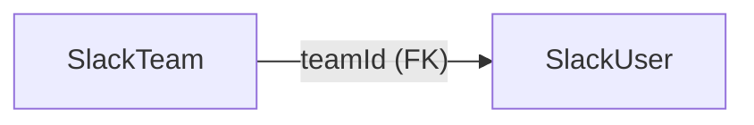
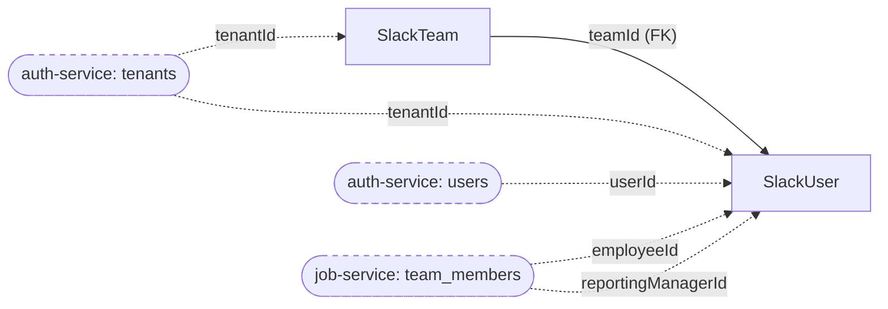
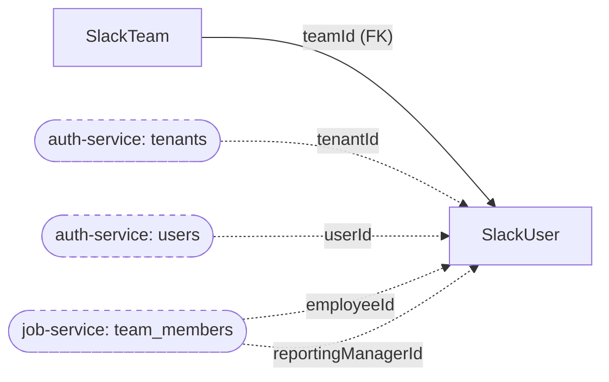
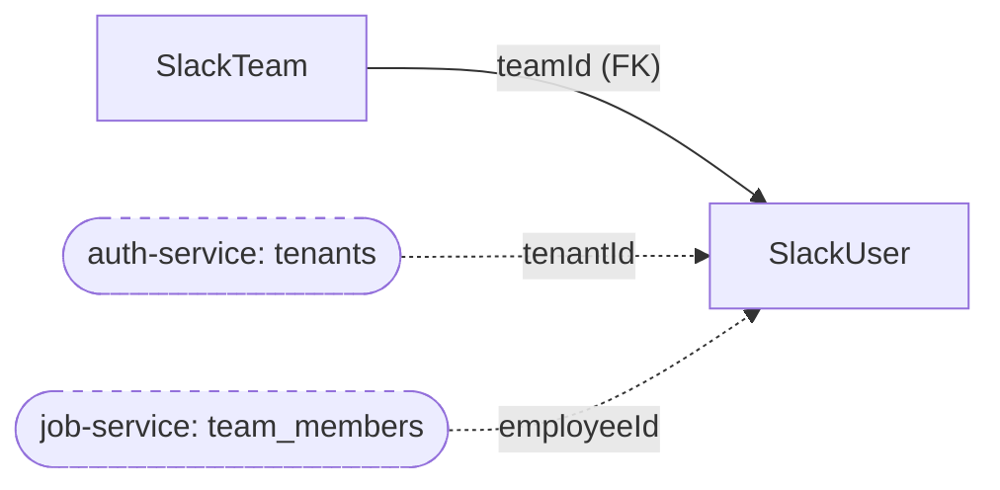
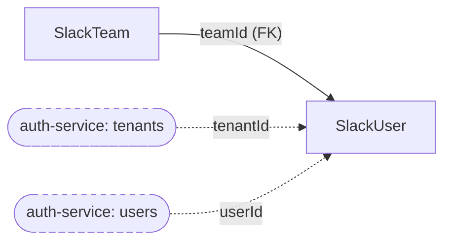
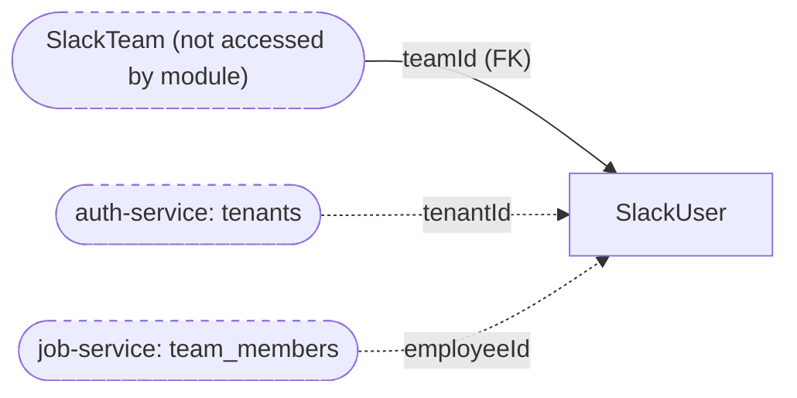
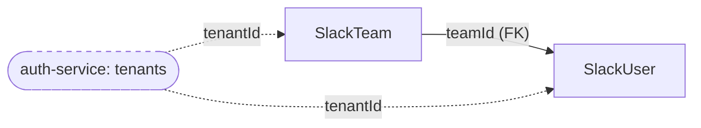
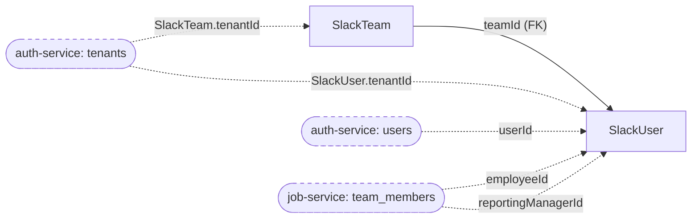

# autoscal-middleware - Existing Database Architecture

## 1. Document Metadata

| Item | Value |
|---|---|
| Service | `autoscal-middleware` |
| Repository path | `/Users/akshay/Development/autoscal/main-autoscal-repos/autoscal-middleware` |
| Branch / commit analysed | `dev` at `ab604f2` (2026-10-13) |
| Analysis date | 2026-10-15 |
| Scope | `prisma/schema.prisma`, all 9 folders under `prisma/migrations/`, every `.ts` file under `src/` (runtime, scripts, tests), `entrypoint.sh`, `check-env.sh`, `Dockerfile`, `docker-compose.*.yml`, `package.json`, `CLAUDE.md`, `.claude/skills/middleware-conventions/references/*`, `docs/slack-auth.openapi.yaml`, git history of `prisma/`, and a read-only grep of sibling Autoscal repos for cross-service consumers |
| Method | Static analysis only. No live database was queried. |
| Not covered | Live schema introspection, row counts, data quality, production `_prisma_migrations` contents, deployed environment configuration (no `.env` file was read) |

**Important limitations**

- Every table, column, index and constraint below is taken from the Prisma schema and migration SQL. None is confirmed against a live database.
- "Referenced by runtime code" means a static reference reachable from an HTTP route, cron job or script entry point. It is not proof of production traffic.
- Line numbers refer to commit `ab604f2`.

## 2. Service Overview

`autoscal-middleware` is the Slack integration service for Autoscal. It handles Slack app installation (OAuth), links a Slack user to an Autoscal user and tenant, serves Slack slash commands, interactions, events and the App Home tab, and runs scheduled Slack notifications. Almost all business data (attendance, leave, holidays, profiles, praise, events) is fetched over HTTP from other services. The service's own database stores only two things:

1. **Slack workspace installations and their bot tokens** (`SlackTeam`).
2. **Slack identity links**: which Slack user in which workspace maps to which Autoscal user, team member and tenant, plus a denormalised profile snapshot used for display (`SlackUser`).

The middleware database is the system of record for Slack credentials and Slack identity links. Profile columns on `SlackUser` are copies of auth-service and job-service data (inferred from the write paths in [3.2](#3-2-slack-login-and-logout) and [3.7](#3-7-slack-users-api)).

| Item | Verified value | Evidence |
|---|---|---|
| Engine | PostgreSQL | `prisma/schema.prisma:11-14`, `prisma/migrations/migration_lock.toml` |
| Local engine version | `postgres:16` (dev compose only), database name `middleware_db`, host port 8005 | `docker-compose.dev.yml:4-14` |
| Demo / prod database | Not defined in compose. `docker-compose.demo.yml` and `docker-compose.prod.yml` define only the service and `env_file: .env`. The database is external (inferred). | compose files |
| ORM | Prisma 6 (`@prisma/client` and `prisma` `^6.6.0`), generator `prisma-client-js` | `package.json`, `schema.prisma:7-9` |
| Schema organisation | Single Postgres schema (Prisma default, `public` unless `DATABASE_URL` sets `?schema=`; not verifiable without env). 2 models, 1 enum. PascalCase quoted identifiers (`"SlackTeam"`, `"SlackUser"`, `"Status"`). | `schema.prisma` |
| Migration tooling | Prisma Migrate, 9 migrations (2025-04-25 to 2026-09-25) | `prisma/migrations/*` |
| Migration execution | `npx prisma migrate deploy` runs on **every container start**, before `npm start` | `entrypoint.sh:2-5` |
| Required DB env var | `DATABASE_URL` (only DB-related key in `.envSample`; value not read) | `.envSample:6`, `check-env.sh` |
| Data access layer | Shared `PrismaClient` singleton, extended with one query override on `slackUser.create` | `src/models/prismaClient.ts:3`, `src/models/index.ts:4-11`, `src/models/slackUser.ts:5-22` |
| Other Prisma clients | One per `BaseController` instance (never queried), one per cron job (`connection_limit=1`, advisory locks only), one in the backfill script | `src/common/base.controller.ts:12`, `src/common/base.job.ts:12-16`, `src/scripts/backfillSlackTeamTenant.ts:94` |
| Raw SQL | Only `pg_try_advisory_lock` / `pg_advisory_unlock` with bigint keys 1001, 1002, 1003 | `src/common/base.job.ts:34-35, 47`; `src/crons/sendClockReminder.job.ts:7`, `sendDailySummary.job.ts:7`, `slackAccessToken.job.ts:9` |
| Transactions | None (`$transaction` not used anywhere in `src/`) | grep of `src/` |
| Other data stores | None in use. `redis@^4.7.0` is a dependency with no client code; event de-duplication uses an in-process `Set` | `package.json`, `src/slackEvents/slackEvents.helper.ts:10`, `src/slackNotifications/dailySummary/dailySummary.helper.ts:98-100` (comment) |
| Direct DB consumers outside this repo | None found | grep of sibling repos, see [2.4](#2-4-migration-relevant-findings) |

**Sources used to determine the schema:** `prisma/schema.prisma` (current declaration), the 9 migration SQL files (applied history), and git history of `prisma/` (one deleted migration, see [R2](#r2-deleted-migration-in-history)). The schema and the cumulative migration SQL were compared column by column and **match with no drift**.

**Live database caveat:** no authorised live database access was available. Objects are "declared", not "confirmed to exist". Prisma Migrate also creates a `_prisma_migrations` bookkeeping table at runtime. It is not declared in any repo file and is listed under other objects.

### 2.1 Service-Level Metrics

Counting rules are in [Section 5](#5-counting-rules-and-validation).

| Metric | Value | Notes |
|---|---:|---|
| Application modules identified | 10 | 8 with database access ([3.1](#3-1-slack-install-and-token-management) to [3.8](#3-8-tenant-backfill-script)), 2 without ([3.9](#3-9-ai-assistant), [3.10](#3-10-service-clients-and-views)) |
| Distinct tables declared in schema or migrations | 2 | `SlackTeam`, `SlackUser` |
| Distinct tables referenced by application code | 2 | Same two tables |
| Tables referenced in code but missing from schema | 0 | |
| Tables confirmed in a live database | Unknown | No live access |
| Tables referenced by runtime application code | 2 | |
| Tables with no runtime-code reference found | 0 | |
| Deprecated or legacy tables | 0 | Legacy *rows* exist (`SlackTeam.tenantId IS NULL`), see [R3](#r3-slackteamtenantid-two-step-migration-incomplete) |
| Uncertain or conflicting cases (tables) | 0 | Non-table conflicts: 1 migration-history conflict ([R2](#r2-deleted-migration-in-history)) and 3 documentation-vs-code conflicts ([R14](#r14-documentation-drift)) |
| Tables with a declared primary key | 2 / 2 | |
| Tables with an outbound declared FK | 1 | `SlackUser` |
| Tables with an inbound declared FK | 1 | `SlackTeam` |
| Leaf tables | 1 | `SlackUser` |
| Isolated tables | 0 | |
| Self-referencing tables / FK cycles | 0 / 0 | |
| Declared FK relationships | 1 | `SlackUser.teamId` → `SlackTeam.id` |
| Logical cross-service references (not enforced) | 5 | See [Relationships of SlackUser](#tbl-slackuser) and [SlackTeam](#tbl-slackteam) |
| Junction tables | 0 | |
| Views / materialized views | 0 / 0 | |
| Enum types | 1 | `"Status"` (`ACTIVE`, `INACTIVE`) |
| Indexes (incl. PK) | 4 | `SlackTeam_pkey`, `SlackTeam_slackId_key`, `SlackUser_pkey`, `SlackUser_teamId_slackId_key` |
| Tooling-managed tables (not in schema, expected at runtime) | 1 | `_prisma_migrations` (unverified) |
| Migrations | 9 applied in repo, 1 deleted from history | |

### 2.2 Database Object Inventory

**Tables**

| Object | Type | Declared in | Referenced by runtime code | Live-confirmed | Classification | Canonical definition |
|---|---|---|---|---|---|---|
| `SlackTeam` | table | `schema.prisma:21-33`; migrations 1, 3, 6, 7, 9 | Yes | Unknown | Active | [SlackTeam](#tbl-slackteam) |
| `SlackUser` | table | `schema.prisma:35-58`; migrations 1, 2, 4, 5, 7, 8, 9 | Yes | Unknown | Active | [SlackUser](#tbl-slackuser) |

**Other objects (not counted as tables)**

| Object | Type | Source | Notes |
|---|---|---|---|
| `"Status"` | Postgres enum (`ACTIVE`, `INACTIVE`) | `schema.prisma:16-19`; `20250425063949_create_teams_and_users` | Used by `SlackTeam.status` and `SlackUser.status`. Same name as an auth-service enum with different values, see [R8](#r8-enum-and-identifier-naming-collisions) |
| `SlackTeam_pkey` | PK index | migration 1 | on `id` |
| `SlackTeam_slackId_key` | unique index | migration 1 | on `slackId` |
| `SlackUser_pkey` | PK index | migration 1 | on `id` |
| `SlackUser_teamId_slackId_key` | unique index | migration 9 | on `(teamId, slackId)` |
| `SlackUser_slackId_key` | unique index (dropped) | created migration 1, dropped migration 9 | Historical only |
| `SlackUser_teamId_fkey` | FK constraint | migration 1 | `ON DELETE RESTRICT ON UPDATE CASCADE` |
| `_prisma_migrations` | table (tooling) | Created by Prisma Migrate at runtime | Not declared; existence and contents unverified |
| Advisory locks 1001, 1002, 1003 | session-level advisory locks | `src/common/base.job.ts:34-47` | Runtime coordination, not stored objects, see [R12](#r12-advisory-lock-keyspace) |

**Usage status summary:** 2 active tables, 0 deprecated/legacy, 0 apparently unused, 0 uncertain. 0 views.

### 2.3 Module Summary

| Module | Purpose | Total Tables | Active | Deprecated/Legacy | Apparently Unused | Shared/Uncertain |
|---|---|---:|---:|---:|---:|---:|
| [3.1 Slack install and token management](#3-1-slack-install-and-token-management) | OAuth install, store and rotate workspace tokens | 2 | 2 | 0 | 0 | 2 / 0 |
| [3.2 Slack login and logout](#3-2-slack-login-and-logout) | Link Slack user to Autoscal user and tenant, unlink on logout | 2 | 2 | 0 | 0 | 2 / 0 |
| [3.3 Slack events and App Home](#3-3-slack-events-and-app-home) | Uninstall, App Home open, DM message events | 2 | 2 | 0 | 0 | 2 / 0 |
| [3.4 Slash commands](#3-4-slash-commands) | `/clock-in`, `/leaves`, `/praises`, etc. | 2 | 2 | 0 | 0 | 2 / 0 |
| [3.5 Slack interactions](#3-5-slack-interactions) | Block actions and modal submissions | 2 | 2 | 0 | 0 | 2 / 0 |
| [3.6 Scheduled notifications](#3-6-scheduled-notifications) | Clock reminders and daily summaries (cron) | 2 | 2 | 0 | 0 | 2 / 0 |
| [3.7 Slack users API](#3-7-slack-users-api) | REST API for other services over `SlackUser` | 1 | 1 | 0 | 0 | 1 / 0 |
| [3.8 Tenant backfill script](#3-8-tenant-backfill-script) | One-off bind of legacy workspaces to tenants | 2 | 2 | 0 | 0 | 2 / 0 |
| [3.9 AI assistant](#3-9-ai-assistant) | Forwards DM questions to spark-assist-ai | 0 | 0 | 0 | 0 | 0 / 0 |
| [3.10 Service clients and views](#3-10-service-clients-and-views) | HTTP clients for other services, Block Kit views | 0 | 0 | 0 | 0 | 0 / 0 |

**Counting method:** a module "accesses" a table when code in that module issues a Prisma query against it, filters on it through a relation (`where: { team: { ... } }`), or loads it with `include`. "Active" means at least one such access is reachable from a route, cron or script entry point. "Shared/Uncertain" is shown as `shared / uncertain`: shared counts tables also accessed by another module, uncertain counts tables whose access could not be established. **Module totals are non-exclusive**: both tables are used by most modules, so the column sums (15) must not be read as a table count. The service has 2 distinct tables.

### 2.4 Migration-Relevant Findings

Highest priority first. Full evidence in [Section 4](#4-migration-risks-and-unresolved-issues).

1. **Migrations auto-apply on every boot** (`entrypoint.sh:2-5`). Any cutover must account for the service running `prisma migrate deploy` against whatever `DATABASE_URL` it is given. [R1](#r1-migrations-run-on-every-container-start)
2. **Deleted migration in git history.** `20250513122625_alter_add_tenant_id` (added `tenantId` to both tables) was committed in `c9aa8db` and removed 3 minutes later in `983008a`. Any database that applied it would fail later migrations. Check `_prisma_migrations` in every environment. [R2](#r2-deleted-migration-in-history)
3. **`SlackTeam.tenantId` is nullable and partly backfilled.** Migration 9 is step one of a two-step change; the NOT NULL step does not exist. Legacy rows may still be NULL or ambiguous. [R3](#r3-slackteamtenantid-two-step-migration-incomplete)
4. **Five cross-service references with no FK**: `SlackUser.userId` → auth `users.id`, `SlackUser.employeeId` and `reportingManagerId` → job `team_members.id`, `SlackUser.tenantId` and `SlackTeam.tenantId` → auth `tenants.id`. Types differ (`userId` is TEXT, auth `users.id` is UUID). Orphans are possible. [R5](#r5-unenforced-cross-service-references)
5. **Enum name `"Status"` collides** with an auth-service enum `Status` that has different values (Pending, Onboarding, Active, Inactive). Tables `SlackTeam`/`SlackUser` use PascalCase quoted names, unlike snake_case siblings. [R8](#r8-enum-and-identifier-naming-collisions)
6. **Slack OAuth tokens are stored in plaintext** (`SlackTeam.refreshToken`, `accessToken`). `crypto-js` is a dependency but never imported. [R7](#r7-plaintext-slack-tokens)
7. **Tenant consistency between `SlackUser.tenantId` and `SlackTeam.tenantId` is not enforced.** [R4](#r4-tenant-consistency-between-slackuser-and-slackteam)
8. **No shared tables across services.** Grep of sibling repos found no direct reads of `middleware_db`, `SlackTeam` or `SlackUser`. The only cross-service data path is HTTP (job-service calls `PUT /api/public/slack-users/team-members/:id`).
9. **Documentation conflicts** (3): `.claude/skills/.../services-and-data.md:29` says auth and job call `/api/slack-users` CRUD (no caller found); `.claude/skills/.../slack.md:53` says OAuth stores `tenantId` (code no longer does, `slackLogin.helper.ts:24-25`); `src/slackUsers/slackUser.routes.ts:13-15` says SlackUser carries Slack tokens (tokens are on SlackTeam). [R14](#r14-documentation-drift)

## 3. Module Documentation

Modules follow the domain folders under `src/`, matching the domain map in the repo's `CLAUDE.md:56-66`. Cross-cutting layers are not counted as modules: `src/models` (Prisma client and extension), `src/common` (`BaseController`, `BaseJob`, `BaseRoutes`), `src/routes` (dynamic route loader), `src/errors`, `src/constants`, `src/test-utils`. Where a cross-cutting file is only used by one module (for example `src/middleware/verifyLogin.ts`, used only by slash-command routes) it is listed under that module.

**Data access layer (applies to every module)**

- `src/models/index.ts:4-11` exports `SlackTeam` and `SlackUser` delegates from `prisma.$extends({ query: { slackUser } })`.
- `src/models/slackUser.ts:5-22` overrides **every** `SlackUser.create`: it runs `findFirst({ slackId, team: { slackId: data.teamId } })` and returns the row if found, otherwise creates a row with **only** `slackId` and `team: { connect: { slackId: data.teamId } }`. So `data.teamId` is interpreted as the Slack workspace id (`T…`), not `SlackTeam.id`, and every other field passed to `create` is dropped. The find-then-create is not atomic; a concurrent duplicate would hit the `(teamId, slackId)` unique index (inferred P2002).
- `src/slackNotifications/*` and `src/utils/slackMention.utils.ts` import the base client directly and bypass the extension (reads only, so no behavioural difference).

---

### 3.1 Slack install and token management

**Purpose:** Handles the Slack OAuth install (`POST /api/slack-oauth/login`, `src/slackOauth/slackOauth.routes.ts:14`, unauthenticated, validator only) and rotates bot tokens every 4 hours (`src/crons/slackAccessToken.job.ts:7`, schedule `0 0 */4 * * *`, advisory lock 1003). Creates `SlackTeam` rows and the installing user's `SlackUser` row. Deliberately does not set any tenant (`src/slackOauth/slackLogin.helper.ts:24-25`); tenant binding happens in [3.2](#3-2-slack-login-and-logout).

**Files:** `src/slackOauth/*`, `src/crons/slackAccessToken.job.ts`.

**Module metrics:** 2 tables. Active 2, deprecated/legacy 0, apparently unused 0, shared 2, uncertain 0.

**Tables used**

| Table | Usage status | Definition |
|---|---|---|
| `SlackTeam` | Active (owner: creates rows, sole writer of tokens) | [SlackTeam](#tbl-slackteam) |
| `SlackUser` | Active (shared) | [SlackUser](#tbl-slackuser) |

**Database access**

| Operation | Evidence | Entry point |
|---|---|---|
| `SlackTeam.upsert` by `slackId` (writes `refreshToken`, `accessToken`, `accessTokenExpiresAt`, `status=ACTIVE`; `name` on create only) | `src/slackOauth/slackLogin.helper.ts:26-42` | `POST /api/slack-oauth/login` |
| `SlackUser.upsert` by `(teamId, slackId)` (writes `slackId`, team connect, `slackUsername`) | `src/slackOauth/slackLogin.helper.ts:46-57` | same; full row returned to caller (`slackOauth.controller.ts:29`) |
| `SlackTeam.findMany({})` (all rows, no status filter) | `src/crons/slackAccessToken.job.ts:15` | cron, lock 1003 |
| `SlackTeam.update` by `id` (writes `accessToken`, `accessTokenExpiresAt`, `refreshToken`) | `src/crons/slackAccessToken.job.ts:23-30` | cron |

The two upserts are separate statements, not a transaction.

#### Table: SlackTeam

**Table overview**

| Item | Value |
|---|---|
| Canonical name | `"SlackTeam"` (schema: Prisma default, see [Section 2](#2-service-overview)) |
| Purpose | One row per Slack workspace that installed the Autoscal app. Stores the workspace id, bot access token, refresh token, install status and the Autoscal tenant the workspace is bound to. |
| Modules that access it | 3.1 (create, token writes), 3.2 (bind `tenantId`, read via include), 3.3 (status), 3.4, 3.5, 3.6 (read via relation filter/include), 3.8 (read, bind `tenantId`) |
| Classification | **Active**. Evidence: written by `POST /api/slack-oauth/login` (`slackLogin.helper.ts:26`), the token cron (`slackAccessToken.job.ts:23`), login (`slackLoginTenant.helper.ts:18`) and uninstall (`slackEvents.helper.ts:18`). |
| Definition source | `prisma/schema.prisma:21-33`; migrations `20250425063949` (create), `20250430105226` (tokens), `20250519044736` / `20250519045212` (`slackUsername` added then dropped), `20260925110831` (`tenantId`) |

**Attributes**

| Column | Database Type | Nullable | Default | Key/Constraint | Description |
|---|---|---|---|---|---|
| `id` | `TEXT` | No | none in DB; Prisma `uuid()` generates a UUID string client-side | PK `SlackTeam_pkey` | Internal workspace id. Referenced by `SlackUser.teamId`. |
| `slackId` | `TEXT` | No | | UNIQUE `SlackTeam_slackId_key` | Slack workspace id (`T…`) from `oauth.v2.access` `team.id` (`slackLogin.helper.ts:27, 35`). Main lookup key: every `team: { slackId }` filter. |
| `name` | `TEXT` | No | | | Workspace name, set on create only (`slackLogin.helper.ts:36`); never refreshed on reinstall. Read only by the backfill script log. |
| `refreshToken` | `TEXT` | No | | | Slack OAuth refresh token, **plaintext**. Rotated by the 4-hour cron. |
| `accessToken` | `TEXT` | Yes | | | Slack bot access token, **plaintext**. Read by nearly every Slack API call (views, chat, DMs). Added in `20250430105226`. |
| `accessTokenExpiresAt` | `TIMESTAMP(3)` without time zone | Yes | | | `now + expires_in`. Written by OAuth and cron; **never read** (the cron refreshes all teams unconditionally). |
| `createdAt` | `TIMESTAMP(3)` | No | `CURRENT_TIMESTAMP` | | Row creation time. Not referenced in `src/`. |
| `updatedAt` | `TIMESTAMP(3)` | No | none in DB; Prisma `@updatedAt` sets it client-side | | Last update. Not referenced in `src/`. Raw SQL inserts must supply it. |
| `status` | enum `"Status"` | No | `'ACTIVE'` | | Install state. `ACTIVE` on OAuth (`slackLogin.helper.ts:32, 40`), `INACTIVE` on `app_uninstalled` (`slackEvents.helper.ts:18-21`). Soft-delete flag. |
| `tenantId` | `UUID` | Yes | | none (no FK, no index) | Autoscal tenant (auth-service `tenants.id`, inferred). Set by first successful slack-login (`slackLoginTenant.helper.ts:18-21`) or the backfill. Never cleared on uninstall. Added in `20260925110831`. |

Historical column: `slackUsername VARCHAR(255)` existed on `SlackTeam` between `20250519044736` and `20250519045212` (dropped, data lost by design; moved to `SlackUser`).

Physical column order in the database follows migration order (`accessToken`, `accessTokenExpiresAt` after `status`; `tenantId` last), not schema order (inferred from `ALTER TABLE … ADD COLUMN`).

**Relationships**

| Direction | Related table / entity | Columns | Cardinality | Enforced | Modules |
|---|---|---|---|---|---|
| Inbound | `SlackUser` | `SlackUser.teamId` → `SlackTeam.id` | 1 team : N users | **Yes**, FK `SlackUser_teamId_fkey`, `ON DELETE RESTRICT ON UPDATE CASCADE` | all DB modules |
| Outbound (logical) | auth-service `tenants` | `SlackTeam.tenantId` → `tenants.id` (UUID both sides) | N teams : 1 tenant | **No** (different database). Inferred from `autoscalUser.tenant_id` source, `slackLogin.controller.ts:37` and auth-service `users.controller.js:1173-1182` | 3.2, 3.8 |

**Additional details**

- **Uniqueness:** one row per Slack workspace (`slackId` unique). `tenantId` is not unique: several workspaces may bind to one tenant.
- **Tenant binding:** `bindSlackTeamToTenant` (`src/slackLogin/slackLoginTenant.helper.ts:13-26`) runs `updateMany where id = ? AND (tenantId IS NULL OR tenantId = authTenant)`. First tenant to log in claims the workspace; a different tenant gets 422. Covered by `src/slackLogin/slackLoginTenant.db-test.ts:22-55`, including a concurrent race with exactly one winner.
- **`tenantId` is not used to scope any runtime query.** User lookups scope on `SlackUser.tenantId` instead.
- **Soft delete:** uninstall sets `status = INACTIVE` and keeps tokens and `tenantId`. Reinstall sets `ACTIVE`. The token cron does not filter on status, so INACTIVE workspaces still have refresh attempted.
- **Hard delete:** none in application code. `ON DELETE RESTRICT` would block deleting a team with users.
- **Query patterns:** lookup by `slackId` (unique index); filter `status = ACTIVE` through the `SlackUser.team` relation in crons; full scan in token cron (small table, inferred).
- **Write dependencies:** OAuth writes team then user without a transaction; uninstall updates team then users without a transaction ([R10](#r10-non-atomic-multi-step-writes)).
- **Migration risks:** [R2](#r2-deleted-migration-in-history), [R3](#r3-slackteamtenantid-two-step-migration-incomplete), [R4](#r4-tenant-consistency-between-slackuser-and-slackteam), [R7](#r7-plaintext-slack-tokens), [R8](#r8-enum-and-identifier-naming-collisions).

#### Module relationship diagram: 3.1

Legend (all module diagrams): solid arrow `-->` = declared FK, drawn from referenced parent to child holding the FK. Dotted arrow `-.->` = logical reference inferred from application code, not enforced by a constraint. Rounded dashed nodes = external entities (other services' tables, or tables in this database that the module does not access).

---

### 3.2 Slack login and logout

**Purpose:** Links a Slack user to an Autoscal account. `POST /api/slack-login/:id` (`src/slackLogin/slackLogin.routes.ts:14`, `:id` = `SlackUser.id`) authenticates the user against auth-service, binds the workspace to the user's tenant, then copies identity and profile fields onto `SlackUser`. `DELETE /api/slack-logout/:id` (`slackLogin.routes.ts:16`, HMAC-verified by `verifySlackLogoutToken`) clears them. The resulting `userId`, `employeeId` and `tenantId` gate every other Slack feature.

**Files:** `src/slackLogin/*`.

**Module metrics:** 2 tables. Active 2, deprecated/legacy 0, apparently unused 0, shared 2, uncertain 0.

**Tables used**

| Table | Usage status | Definition |
|---|---|---|
| `SlackTeam` | Active (writes `tenantId`, reads via include) | [SlackTeam](#tbl-slackteam) |
| `SlackUser` | Active (primary writer of link and profile columns) | [SlackUser](#tbl-slackuser) |

**Database access**

| Operation | Evidence |
|---|---|
| `SlackUser.findUnique({ id }, include team)` | `src/slackLogin/slackLogin.controller.ts:28` |
| `SlackTeam.updateMany` conditional tenant bind | `src/slackLogin/slackLoginTenant.helper.ts:18-21`, called at `slackLogin.controller.ts:37` |
| `SlackUser.update` login: sets `userId`, `employeeId`, `name`, `email`, `title`, `department`, `location`, `phone`, `orgEmployeeId`, `status=ACTIVE`, `dateofJoin`, `employeeType`, `reportingManager`, `tenantId`, `slackUsername`, `reportingManagerId` | `slackLogin.controller.ts:44-63` |
| `SlackUser.update` logout: nulls the same columns except `slackUsername`, sets `status=INACTIVE` | `slackLogin.controller.ts:91-109` |

Source of written values: auth-service `POST /users/slack-login` response (`auth-service-node/app/controllers/users.controller.js:1169-1189`): `userId` = auth `users.id`, `team_member_id` = auth `users.team_member_id` (job-service `team_members.id`), `tenant_id` = auth `users.tenant_id`, plus a spread of the job-service team member (profile fields, `reporting_manager_id`). The three writes are separate statements, not a transaction.

#### Module relationship diagram: 3.2

---

### 3.3 Slack events and App Home

**Purpose:** Handles Slack Events API callbacks at `POST /api/slack-events` (`src/slackEvents/slackEvent.routes.ts:23`, Slack signature verified). `app_uninstalled` marks the workspace inactive and wipes user links; `app_home_opened` ensures a `SlackUser` row exists and publishes the Home tab (login link or profile); DM `message` events look up the user and hand off to [3.9](#3-9-ai-assistant).

**Files:** `src/slackEvents/*` (`slackEvents.helper.ts`, `home.view.ts`).

**Module metrics:** 2 tables. Active 2, deprecated/legacy 0, apparently unused 0, shared 2, uncertain 0.

**Tables used**

| Table | Usage status | Definition |
|---|---|---|
| `SlackTeam` | Active (writes `status`) | [SlackTeam](#tbl-slackteam) |
| `SlackUser` | Active (create, bulk update, read) | [SlackUser](#tbl-slackuser) |

**Database access**

| Operation | Evidence |
|---|---|
| `SlackTeam.update({ slackId }, status=INACTIVE)` | `src/slackEvents/slackEvents.helper.ts:18-21` |
| `SlackUser.updateMany({ teamId })` nulls link/profile columns, `status=INACTIVE` (keeps `slackUsername`) | `slackEvents.helper.ts:22-41` |
| `SlackUser.create` through the extension (find-or-create with `slackId` + Slack team id) | `slackEvents.helper.ts:45-48` |
| `SlackUser.findFirst({ slackId, team.slackId }, include team)` | `slackEvents.helper.ts:54` |

`home.view.ts` reads `SlackUser` display columns (`title`, `department`, `location`, `phone`, `orgEmployeeId`, `dateofJoin`, `employeeType`, `reportingManager`) from the loaded row; these columns have no other reader.

#### Module relationship diagram: 3.3

---

### 3.4 Slash commands

**Purpose:** Serves Slack slash commands under `POST /api/slack-slash-commands/*`. Every route runs `SlackLoginVerifier.verify` (`src/middleware/verifyLogin.ts:21`), which loads the caller's `SlackUser` with its team and rejects users whose `userId` is null. Controllers then re-read the row and call attendance-service or job-service over HTTP using `userId`, `employeeId` and `tenantId`. The bot token comes from `team.accessToken`.

**Files:** `src/slackSlashCommands/{applyLeave,attendence,events,help,holidays,leaveBalances,leaveStatus,praise,profile}/*`, `src/middleware/verifyLogin.ts`, `src/utils/slackMention.utils.ts`.

**Module metrics:** 2 tables. Active 2, deprecated/legacy 0, apparently unused 0, shared 2, uncertain 0. `SlackTeam` is read only through the `SlackUser.team` relation (filter `team.slackId` and `include: { team: true }`).

**Tables used**

| Table | Usage status | Definition |
|---|---|---|
| `SlackTeam` | Active (read via relation) | [SlackTeam](#tbl-slackteam) |
| `SlackUser` | Active (read only) | [SlackUser](#tbl-slackuser) |

**Database access by command**

| Command route | Access | Evidence |
|---|---|---|
| all commands | `SlackUser.findFirst({ slackId, team.slackId }, include team)` in middleware | `src/middleware/verifyLogin.ts:21` |
| `clock-in`, `clock-out`, `clock`, `clock-status`, `attendance-summary` | same lookup x5 in controller | `src/slackSlashCommands/attendence/attendence.controller.ts:16, 30, 44, 58, 72` |
| `clock-status` (mention) | `prisma.slackUser.findFirst` by `slackUsername` OR `email` (case-sensitive) AND `tenantId` | `src/utils/slackMention.utils.ts:40`, called from `attendence.helper.ts:83` |
| `holidays` | controller lookup | `holidays/holidays.controller.ts:17` |
| `leave-balances` | controller lookup | `leaveBalances/leaveBalance.controller.ts:17` |
| `leave-status` | controller lookup | `leaveStatus/leaveStatus.controller.ts:17` |
| `profile` | controller lookup | `profile/profile.controller.ts:17` |
| `praises` | controller lookup; target lookup by `slackUsername` OR `email` (case-insensitive) AND `tenantId` | `praise/praise.controller.ts:17`; `praise/praiseByText.helper.ts:32` |
| `leaves` (applyLeave), `events`, `help` | indirect only, via `req.currentSlackUser` from middleware | `applyLeave.controller.ts:19`, `events.controller.ts:16`, `help.controller.ts:15-16` |

`applyLeave.helper.ts:101` sends `SlackUser.reportingManagerId` to attendance-service as `reporting_manager_id`; this is the only reader of that column.

#### Module relationship diagram: 3.4

---

### 3.5 Slack interactions

**Purpose:** Handles Block Kit button clicks and modal submissions at `POST /api/slack-interactions/` (`src/slackInteractions/slackInteractions.routes.ts:13`, Slack signature verified). Resolves the acting user by Slack ids (workspace from `payload.team`, falling back to `user.team_id`), and resolves praise recipients by email inside the user's tenant.

**Files:** `src/slackInteractions/*`.

**Module metrics:** 2 tables. Active 2, deprecated/legacy 0, apparently unused 0, shared 2, uncertain 0.

**Tables used**

| Table | Usage status | Definition |
|---|---|---|
| `SlackTeam` | Active (read via relation) | [SlackTeam](#tbl-slackteam) |
| `SlackUser` | Active (read only) | [SlackUser](#tbl-slackuser) |

**Database access**

| Operation | Evidence | Callers |
|---|---|---|
| `findSlackUserForPayload`: `SlackUser.findFirst({ slackId, team.slackId }, include team)` | `src/slackInteractions/slackInteractions.lookup.helper.ts:21` | `slackInteractions.helper.ts:29, 42, 82, 106, 122` |
| `findSlackUserByEmailInTenant`: `SlackUser.findFirst({ email, tenantId }, include team)` | `slackInteractions.lookup.helper.ts:29` | `slackInteractions.helper.ts:139` (praise submit) |

Test evidence that the same Slack user id may exist in two workspaces: `slackInteractions.lookup.helper.db-test.ts:11-41`.

#### Module relationship diagram: 3.5

---

### 3.6 Scheduled notifications

**Purpose:** Two cron jobs, each every 15 minutes, guarded by Postgres advisory locks so only one replica runs them: clock-in/out reminders (`src/crons/sendClockReminder.job.ts`, lock 1001) and daily attendance summaries (`src/crons/sendDailySummary.job.ts`, lock 1002). Both load Slack users for active tenants (tenant list from auth-service `/tenants/status-list`) and DM them using the workspace bot token.

**Files:** `src/slackNotifications/*`, `src/crons/sendClockReminder.job.ts`, `src/crons/sendDailySummary.job.ts`, `src/crons/index.ts`, `src/common/base.job.ts`.

**Module metrics:** 2 tables. Active 2, deprecated/legacy 0, apparently unused 0, shared 2, uncertain 0.

**Tables used**

| Table | Usage status | Definition |
|---|---|---|
| `SlackTeam` | Active (filter `status` and include via relation) | [SlackTeam](#tbl-slackteam) |
| `SlackUser` | Active (read only) | [SlackUser](#tbl-slackuser) |

**Database access**

| Operation | Evidence |
|---|---|
| `prisma.slackUser.findMany({ team.status = ACTIVE, tenantId IN activeTenantIds }, include team select { id, accessToken })`. No filter on user `status`. | `src/slackNotifications/clock/clockReminder.helper.ts:24-30` |
| `prisma.slackUser.findMany({ status = ACTIVE, team.status = ACTIVE, tenantId IN activeTenantIds }, include team)` (full team row incl. tokens) | `src/slackNotifications/dailySummary/dailySummary.helper.ts:38-41` |
| `pg_try_advisory_lock(key)` / `pg_advisory_unlock(key)` on a dedicated `connection_limit=1` client | `src/common/base.job.ts:12-16, 34-35, 47` |

`clockReminder.helper.ts:41, 47` matches `SlackUser.userId` against attendance-service `employee_details.user_id`, which supports `userId` being the auth-service user id.

#### Module relationship diagram: 3.6

---

### 3.7 Slack users API

**Purpose:** REST API over `SlackUser` for other services, protected by `x-api-key` (`AUTOSCAL_MIDDLEWARE_API_KEY`).

- Generic CRUD from `BaseController` (`src/slackUsers/slackUser.routes.ts:18-24`, `src/common/base.routes.ts:38-65`): `POST /api/slack-users/all` (list), `GET /api/slack-users/:id?tenantId=`, `POST /api/slack-users`, `PUT /api/slack-users/:id?tenantId=`, `DELETE /api/slack-users/:id?tenantId=`. **No caller found** in sibling repos.
- Profile sync: `PUT /api/public/slack-users/team-members/:id` (`src/slackUsers/public/slackUser.routes.ts:14-19`), called by job-service (`job-service-node/app/services/middlewareService/slackUser.js:24`, from `app/controllers/teamMember.controller.js:56, 437`).

**Files:** `src/slackUsers/*`, `src/slackUsers/public/*`, `src/common/base.controller.ts`.

**Module metrics:** 1 table. Active 1, deprecated/legacy 0, apparently unused 0, shared 1, uncertain 0. `SlackTeam` is not accessed (no include or relation filter); it appears in the diagram as an external node because `teamId` is writable here and the FK is checked by the database.

**Tables used**

| Table | Usage status | Definition |
|---|---|---|
| `SlackUser` | Active (read, write, hard delete) | [SlackUser](#tbl-slackuser) |

**Database access**

| Operation | Evidence | Note |
|---|---|---|
| `findMany` + `count` with filters + `tenantId` | `src/common/base.controller.ts:27, 29` | list |
| `findFirst({ id, tenantId })` | `base.controller.ts:56, 88, 108` | show / pre-update / pre-delete scope check |
| `create` through extension | `base.controller.ts:73` | **Only `slackId` and Slack team id persist**; validated `userId`, `employeeId`, `tenantId` etc. are dropped (`src/models/slackUser.ts:15-21`) |
| `update({ id })` | `base.controller.ts:94` | any field passing `updateSlackUserSchema` (tenantId omitted, `teamId` allowed) |
| `delete({ id })` | `base.controller.ts:114` | only hard delete in the codebase |
| `SlackUser.findFirst({ employeeId, tenantId })` then `update({ id })` | `src/slackUsers/public/slackUser.controller.ts:23, 29` | `tenantId` stripped from body; `teamId`, `userId`, `status` writable |
| `SlackUser.findFirst({ employeeId })` in zod `.refine` | `src/slackUsers/public/slackUser.dto.ts:13` | not tenant-scoped (existence check only) |

#### Module relationship diagram: 3.7

---

### 3.8 Tenant backfill script

**Purpose:** One-off maintenance script for migration `20260925110831`. Binds legacy `SlackTeam` rows (`tenantId IS NULL`) to a tenant inferred from their users' `SlackUser.tenantId`. Dry run by default; writes only with `--execute`. Run with `npm run backfill:slack-team-tenant` (`package.json`). It calls no external service.

**Files:** `src/scripts/backfillSlackTeamTenant.ts` (tests: `backfillSlackTeamTenant.test.ts`, `backfillSlackTeamTenant.db-test.ts`).

**Module metrics:** 2 tables. Active 2, deprecated/legacy 0, apparently unused 0, shared 2, uncertain 0. Whether the script has been executed in any environment is **unknown**.

**Tables used**

| Table | Usage status | Definition |
|---|---|---|
| `SlackTeam` | Active (read, conditional write of `tenantId`) | [SlackTeam](#tbl-slackteam) |
| `SlackUser` | Active (read via `groupBy`) | [SlackUser](#tbl-slackuser) |

**Database access**

| Step | Operation | Evidence |
|---|---|---|
| 1 | `slackTeam.findMany({ tenantId: null }, select id, name, slackId, orderBy slackId)` | `src/scripts/backfillSlackTeamTenant.ts:31` |
| 2 | `slackUser.groupBy(['teamId', 'tenantId'], teamId IN …, tenantId NOT NULL)` | `:37-40` |
| 3 | Classify: 0 tenants = `no-linked-users` (left NULL), 1 = `resolved`, more than 1 = `ambiguous` (left NULL) | `:9-14` |
| 4 | `slackTeam.updateMany({ id, tenantId: null }, { tenantId })`, only with `--execute`; count 0 means a login bound it meanwhile | `:67` |
| 5 | Exit code 1 if any ambiguous; prints a manual `UPDATE "SlackTeam"` template (not executed) | `:86-88` |

Idempotent: only NULL rows are touched and the write is conditional (`backfillSlackTeamTenant.db-test.ts:53-58`).

#### Module relationship diagram: 3.8

---

### 3.9 AI assistant

**Purpose:** Forwards DM questions and AI interactions to spark-assist-ai (`AI_ASSISTANT_SERVICE_BASE_URL`). Issues no database queries. It receives `SlackUser` rows already loaded by [3.3](#3-3-slack-events-and-app-home) and [3.5](#3-5-slack-interactions) and reads `userId`, `id`, `employeeId`, `tenantId` from them (`src/aiAssistant/aiAssistant.helper.ts:23-24, 56`; `aiAssistant.services.ts:16-17` sends `user_id` / `tenant_id`).

**Module metrics:** 0 tables accessed directly. Indirect in-memory use of `SlackUser` rows only; not counted.

**Tables used:** none. No relationship diagram (no table access).

---

### 3.10 Service clients and views

**Purpose:** HTTP clients and Slack UI builders with no database access: `src/tenants` (`AUTH_SERVICE_URL`, `/tenants/status-list`), `src/users` (`AUTH_SERVICE_URL`, `/public/users/:id`, `/public/users/show-by-email`), `src/leave` and `src/wfh` (`ATTENDENCE_SERVICE_BASE_URL`), `src/events` and `src/teamMembers` (`JOB_SERVICE_URL`), `src/slack` and `src/slackViews` (Slack Web API), `src/views` (Block Kit JSON).

**Module metrics:** 0 tables.

**Tables used:** none. No relationship diagram (no table access).

---

### 3.11 Shared Tables

`SlackUser` is written by four modules (3.1, 3.2, 3.3, 3.7) and read by four more (3.4, 3.5, 3.6, 3.8). No single module owns it: 3.1 and 3.3 create rows, 3.2 writes the identity link, 3.7 lets other services overwrite profile columns, 3.3 bulk-clears it on uninstall. Its canonical definition is therefore placed here.

#### Table: SlackUser

**Table overview**

| Item | Value |
|---|---|
| Canonical name | `"SlackUser"` (schema: Prisma default, see [Section 2](#2-service-overview)) |
| Purpose | One row per Slack user per workspace who has interacted with the app. Holds the link to the Autoscal user, team member and tenant (set at slack-login, cleared at logout or uninstall) and a denormalised profile snapshot for the App Home tab and notifications. |
| Modules that access it | 3.1, 3.2, 3.3, 3.4, 3.5, 3.6, 3.7, 3.8 (all DB modules) |
| Classification | **Active**. Evidence: read on every slash command (`verifyLogin.ts:21`), every interaction (`slackInteractions.lookup.helper.ts:21`), both notification crons; written by OAuth, login/logout, uninstall, App Home and the public sync API. |
| Definition source | `prisma/schema.prisma:35-58`; migrations `20250425063949` (create), `20250425115223` (`userId`, `employeeId` nullable), `20250501063636` (profile columns, `status`), `20250513125237` (`tenantId`), `20250519045212` (`slackUsername`), `20250611130757` (`reportingManagerId`), `20260925110831` (unique changed to `(teamId, slackId)`) |

**Attributes**

| Column | Database Type | Nullable | Default | Key/Constraint | Description |
|---|---|---|---|---|---|
| `id` | `TEXT` | No | none in DB; Prisma `uuid()` client-side | PK `SlackUser_pkey` | Internal id. Used as a public handle in the login/logout links (`home.view.ts:25, 79`) and as `:id` in `/api/slack-login/:id` and `/api/slack-users/:id`. |
| `slackId` | `TEXT` | No | | part of UNIQUE `SlackUser_teamId_slackId_key` | Slack user id (`U…`). Unique per workspace since `20260925110831`; was globally unique before. Used as DM channel. |
| `userId` | `TEXT` | Yes | | none | Autoscal user id: auth-service `users.id` (UUID there). Set at login from auth `slack-login` `userId` (`slackLogin.controller.ts:47`); NULL means "not logged in" and blocks all commands (`verifyLogin.ts:26`). Nullable since `20250425115223`. |
| `employeeId` | `TEXT` | Yes | | none | job-service `team_members.id`, from auth `team_member_id` (`slackLogin.controller.ts:48`). Key for the job-service sync API (`public/slackUser.controller.ts:23`). Nullable since `20250425115223`. |
| `teamId` | `TEXT` | No | | FK `SlackUser_teamId_fkey` → `SlackTeam.id`; leading column of the composite unique | Owning workspace. |
| `name` | `TEXT` | Yes | | | Full name snapshot (`full_name`). Display and logs. |
| `email` | `TEXT` | Yes | | none (no index, not unique) | Official email snapshot (`official_email`). Used for tenant-scoped lookups (praise, mention) and daily-summary eligibility. |
| `title` | `TEXT` | Yes | | | Position name snapshot. Home tab only. |
| `department` | `TEXT` | Yes | | | Department name snapshot. Home tab only. |
| `location` | `TEXT` | Yes | | | `"state, country"` from first address. Home tab only. |
| `phone` | `TEXT` | Yes | | | `mobile_no` snapshot. Home tab only. |
| `orgEmployeeId` | `TEXT` | Yes | | | Copy of job-service `team_members.employee_id` (human-readable HR code, inferred). Home tab only. |
| `status` | enum `"Status"` | No | `'ACTIVE'` | | `ACTIVE` at login, `INACTIVE` at logout or uninstall. Filter in daily summary only. |
| `dateofJoin` | `TIMESTAMP(3)` without time zone | Yes | | | Joining date snapshot. Home tab only. Note spelling (`dateofJoin`, lowercase `of`). |
| `employeeType` | `TEXT` | Yes | | | `engagement_type` with `_` replaced by spaces. Home tab only. |
| `reportingManager` | `TEXT` | Yes | | | Reporting manager display name (`reporting_to.full_name`). Home tab only. |
| `reportingManagerId` | `TEXT` | Yes | | none | Reporting manager id from the job-service team member spread in auth `slack-login` (inferred: job-service `team_members.id`, which is a self-referencing FK there). Sent to attendance-service on leave apply (`applyLeave.helper.ts:101`). Not joined to `SlackUser`. Added `20250611130757`. |
| `tenantId` | `UUID` | Yes | | none (no FK, no index) | Autoscal tenant (auth-service `tenants.id`). Set at login, cleared at logout/uninstall. Scopes every tenant-aware lookup and the cron `IN` filter. Added `20250513125237`. |
| `slackUsername` | `VARCHAR(255)` | Yes | | none (no index, not unique) | Slack handle from `users.info` `user.name`. Written by OAuth and login; **not cleared** at logout or uninstall. Used for `@mention` / praise lookup. Added `20250519045212` (moved from SlackTeam). |

There are no `createdAt` / `updatedAt` columns on this table.

Physical column order follows migration order: `id`, `slackId`, `userId`, `employeeId`, `teamId`, then the 11 columns of `20250501063636` in alphabetical order, then `tenantId`, `slackUsername`, `reportingManagerId` (inferred from the migration SQL).

**Relationships**

| Direction | Related table / entity | Columns | Cardinality | Enforced | Modules |
|---|---|---|---|---|---|
| Outbound | `SlackTeam` | `teamId` → `SlackTeam.id` | N users : 1 team | **Yes**, FK `SlackUser_teamId_fkey`, `ON DELETE RESTRICT ON UPDATE CASCADE` | all DB modules |
| Outbound (logical) | auth-service `users` | `userId` (TEXT) → `users.id` (UUID) | N : 1 (one Autoscal user may link from several workspaces; not prevented) | **No** (cross-service). Evidence: `slackLogin.controller.ts:47`, auth `users.controller.js:1179` | 3.2, 3.4, 3.6 |
| Outbound (logical) | job-service `team_members` | `employeeId` (TEXT) → `team_members.id` (TEXT) | N : 1 | **No**. Evidence: `slackLogin.controller.ts:48`, auth `users.controller.js:1181`, job-service sync `slackUser.js:24` | 3.2, 3.4, 3.5, 3.7 |
| Outbound (logical) | job-service `team_members` | `reportingManagerId` (TEXT) → `team_members.id` | N : 1 | **No**, inferred from the spread of `getTeamMember` in auth `users.controller.js:1183` | 3.2, 3.4 |
| Outbound (logical) | auth-service `tenants` | `tenantId` (UUID) → `tenants.id` (UUID) | N : 1 | **No**. Evidence: `slackLogin.controller.ts:60` | 3.2, 3.4, 3.5, 3.6, 3.7, 3.8 |

No inbound relationships. `SlackUser` is a leaf table.

**Additional details**

- **Uniqueness:** `(teamId, slackId)` unique since `20260925110831` (replaced global `slackId` unique). `email`, `slackUsername`, `employeeId`, `userId` are not unique, and lookups on them use `findFirst`, so the first match wins (inferred risk of non-deterministic match on duplicates).
- **Indexes:** only PK and the composite unique. Queries filter on `tenantId`, `employeeId`, `email`, `slackUsername` with no supporting index ([R11](#r11-missing-indexes-on-filtered-columns)).
- **Soft delete:** logout and uninstall null the link and profile columns and set `INACTIVE`; the row is kept so the Home tab can show a login link. `slackUsername` survives. Hard delete only via `DELETE /api/slack-users/:id`.
- **Logged-in convention:** "logged in" is `userId IS NOT NULL`, not `status = ACTIVE`. `verifyLogin` and interaction lookups do not filter on `status`.
- **Create semantics:** all `SlackUser.create` calls go through the find-or-create extension ([Data access layer](#3-module-documentation)); `upsert` and `update` do not.
- **Tenant consistency:** nothing enforces `SlackUser.tenantId = SlackTeam.tenantId` ([R4](#r4-tenant-consistency-between-slackuser-and-slackteam)).
- **Write dependencies:** none of the multi-statement writes use a transaction ([R10](#r10-non-atomic-multi-step-writes)).
- **Test fixtures:** `src/test-utils/testDb.ts:8-16` refuses DB names not matching `^(fixverify_|test_)|_test$` and cleans with `slackUser.deleteMany()` then `slackTeam.deleteMany()` (child first, because of `RESTRICT`).
- **Migration risks:** [R2](#r2-deleted-migration-in-history), [R4](#r4-tenant-consistency-between-slackuser-and-slackteam), [R5](#r5-unenforced-cross-service-references), [R6](#r6-id-and-column-type-mismatches), [R9](#r9-slackusercreate-extension-drops-fields), [R11](#r11-missing-indexes-on-filtered-columns).

#### Shared tables diagram

This diagram is the complete relationship set for the service: 1 declared FK and 5 logical references.

## 4. Migration Risks and Unresolved Issues

None of the tables can be dropped: both are active. Nothing below has been changed in code or data.

### R1. Migrations run on every container start

- **Evidence:** `entrypoint.sh:2-5` runs `check-env.sh`, then `npx prisma migrate deploy`, then `npx prisma generate`, then `npm start`. `CLAUDE.md:39` confirms a committed migration reaches prod on deploy.
- **Potential impact:** pointing the service at a consolidated database makes it create or alter `"SlackTeam"`, `"SlackUser"`, `"Status"` and `_prisma_migrations` there on boot. If another service's Prisma history shares the same `_prisma_migrations` table, histories will conflict.
- **Next verification step:** decide whether the target uses a separate Postgres schema (`?schema=` in `DATABASE_URL`) per service or a merged history, and gate the entrypoint migration during cutover.

### R2. Deleted migration in history

- **Evidence:** `git log --all -- prisma/migrations/20250513122625_alter_add_tenant_id/*` shows `c9aa8db` (added, 2025-05-13, "added /profile slack command") and `983008a` ("removed migration") 3 minutes later. It added `tenantId UUID` to both tables. Its replacement `20250513125237` adds it to `SlackUser` only; `20260925110831` later adds it to `SlackTeam`.
- **Potential impact:** any database that applied the deleted migration would have `SlackTeam.tenantId` early, a `_prisma_migrations` row with no matching folder, and failures on `20250513125237` / `20260925110831` ("column already exists"). Whether it was ever deployed cannot be determined from git.
- **Next verification step:** in every environment, `SELECT migration_name, finished_at, rolled_back_at FROM _prisma_migrations ORDER BY started_at;` and compare with the 9 folders.

### R3. SlackTeam.tenantId two-step migration incomplete

- **Evidence:** `20260925110831` adds nullable `SlackTeam.tenantId` (commit `6349882`, PR #204, message "two-step migration; NOT NULL deferred"). No later migration sets NOT NULL. The backfill ([3.8](#3-8-tenant-backfill-script)) leaves `no-linked-users` and `ambiguous` teams NULL. OAuth creates teams with NULL tenant by design (`slackLogin.helper.ts:24-25`).
- **Potential impact:** a target schema with `tenant_id NOT NULL` (common in sibling services) would reject these rows. Ambiguous teams indicate users from several tenants in one workspace.
- **Next verification step:** count `SlackTeam` rows with `tenantId IS NULL` per environment, run the backfill in dry-run mode, and get a decision on unbound and ambiguous workspaces.

### R4. Tenant consistency between SlackUser and SlackTeam

- **Evidence:** both tables have their own nullable `tenantId` with no constraint linking them. `bindSlackTeamToTenant` (`slackLoginTenant.helper.ts:13-26`) checks only at login; the job-service sync (`public/slackUser.controller.ts:29`) and generic update (`base.controller.ts:94`) can change `teamId` without re-checking. Uninstall clears `SlackUser.tenantId` but keeps `SlackTeam.tenantId` (`slackEvents.helper.ts:18-41`).
- **Potential impact:** rows where `SlackUser.tenantId <> SlackTeam.tenantId` would break a tenant-partitioned target or a composite FK `(team_id, tenant_id)`.
- **Next verification step:** `SELECT count(*) FROM "SlackUser" u JOIN "SlackTeam" t ON t.id = u."teamId" WHERE u."tenantId" IS NOT NULL AND t."tenantId" IS DISTINCT FROM u."tenantId";`

### R5. Unenforced cross-service references

- **Evidence:** `userId`, `employeeId`, `reportingManagerId`, `SlackUser.tenantId`, `SlackTeam.tenantId` hold ids from auth-service and job-service (see [SlackUser relationships](#tbl-slackuser)). No FK is possible today (separate databases). Deletions in auth or job services are not propagated; only logout and uninstall clear these columns.
- **Potential impact:** in a consolidated database these become candidate FKs; orphan values would block adding them. Load order matters: `tenants` and `users` (auth), `team_members` (job) before `SlackTeam`, then `SlackUser`.
- **Next verification step:** after co-locating data, anti-join each column against its target table and decide FK vs. nullify for orphans.

### R6. Id and column type mismatches

- **Evidence:** `SlackTeam.id`, `SlackUser.id`, `teamId`, `userId`, `employeeId`, `reportingManagerId` are `TEXT`; `tenantId` is `UUID` (`schema.prisma:22, 32, 36-40, 52, 54`). auth-service `users.id` and `tenants.id` are `uuid`; job-service `team_members.id` is `text` (sibling docs `auth-service-node.md`, `job-service-node.md`). Timestamps are `TIMESTAMP(3)` without time zone.
- **Potential impact:** FK `SlackUser.userId TEXT` → `users.id UUID` needs a cast or type change; any non-UUID strings would fail the cast. Timezone semantics of `dateofJoin` and token expiry depend on the writer (Node `Date`, UTC in Prisma).
- **Next verification step:** check `userId !~ '^[0-9a-f-]{36}$'` style rows before converting; confirm the target id types.

### R7. Plaintext Slack tokens

- **Evidence:** `SlackTeam.refreshToken` and `accessToken` are written and read as plain strings (`slackLogin.helper.ts:29-30, 37-38`, `slackAccessToken.job.ts:26-28`). `crypto-js` is in `package.json` but never imported in `src/`. Documented as known drift (`.claude/skills/middleware-conventions/references/inconsistencies.md`, item 5). Daily summary loads the full team row including tokens (`dailySummary.helper.ts:38`).
- **Potential impact:** any data export, replica or migration dump carries live Slack credentials. Refresh tokens rotate on use, so a copied database plus a running old service can invalidate each other's tokens.
- **Next verification step:** decide on encryption at rest before or during migration; stop the token cron (lock 1003) on the old deployment during cutover so only one side rotates tokens.

### R8. Enum and identifier naming collisions

- **Evidence:** middleware enum `"Status"` = (`ACTIVE`, `INACTIVE`) (`schema.prisma:16-19`). auth-service also declares an enum `Status` with 4 values (Pending, Onboarding, Active, Inactive) (`auth-service-node.md:99, 193`). Table names are PascalCase quoted identifiers; columns are camelCase (`"teamId"`, `"dateofJoin"`).
- **Potential impact:** both services cannot create `"Status"` in the same Postgres schema. Renaming to snake_case changes every Prisma `@@map` / `@map`.
- **Next verification step:** choose per-service schemas or rename the enum (for example via `@@map`) before consolidation; list enum names across all services.

### R9. SlackUser.create extension drops fields

- **Evidence:** `src/models/slackUser.ts:5-22`; used by `POST /api/slack-users` (`base.controller.ts:73`) and App Home (`slackEvents.helper.ts:45`).
- **Potential impact:** a migrated or rewritten service that calls a plain `create` would change behaviour: `teamId` would be treated as `SlackTeam.id` instead of Slack workspace id, and extra fields would start persisting. Rows created through `POST /api/slack-users` contain only `slackId` and `teamId`.
- **Next verification step:** confirm no external caller uses `POST /api/slack-users` (none found in sibling repos); preserve find-or-create semantics in any port.

### R10. Non-atomic multi-step writes

- **Evidence:** no `$transaction` in `src/`. OAuth: team upsert then user upsert (`slackLogin.helper.ts:26, 46`). Login: find, tenant bind, update (`slackLogin.controller.ts:28, 37, 44`). Uninstall: team update then users `updateMany` (`slackEvents.helper.ts:18, 22`).
- **Potential impact:** partial states may exist in data, for example an `INACTIVE` team whose users still carry `userId` / `tenantId`, or a team bound to a tenant whose user update failed.
- **Next verification step:** `SELECT count(*) FROM "SlackUser" u JOIN "SlackTeam" t ON t.id = u."teamId" WHERE t.status = 'INACTIVE' AND u."userId" IS NOT NULL;`

### R11. Missing indexes on filtered columns

- **Evidence:** filters on `SlackUser.tenantId` (crons, lookups), `employeeId` (`public/slackUser.controller.ts:23`, `dto.ts:13`), `email` and `slackUsername` (`praiseByText.helper.ts:32`, `slackMention.utils.ts:40`); no index declared on any of them. `SlackTeam.tenantId` is also unindexed.
- **Potential impact:** low today (table sizes unknown, likely small); relevant if the target merges with larger datasets or adds FKs (Postgres does not auto-index FK columns).
- **Next verification step:** get row counts and `pg_stat_user_tables` scan stats from production before deciding.

### R12. Advisory lock keyspace

- **Evidence:** middleware uses session-level `pg_try_advisory_lock(bigint)` with fixed keys 1001, 1002, 1003 (`base.job.ts:34-47`). In sibling repos, job-service and calendar-scheduler use `pg_advisory_xact_lock(hashtext(...))` (same single-key space); finance-service uses the two-key form (separate space).
- **Potential impact:** advisory locks are per database. In a shared database a `hashtext` value equal to 1001-1003 would make a cron skip or a transaction wait. Probability is very low but not zero. Each cron also holds a dedicated connection (`connection_limit=1`), plus `BaseController` creates an unused `PrismaClient` per controller (`base.controller.ts:12`), which affects connection budgeting (lazy connect, so likely no open pool; inferred).
- **Next verification step:** reserve a lock namespace (two-key form with a service id) when consolidating; count connections per middleware replica.

### R13. Status and token semantics

- **Evidence:** token cron refreshes every team regardless of `status` (`slackAccessToken.job.ts:15`); `accessTokenExpiresAt`, `createdAt`, `updatedAt` are never read. `SlackUser.status` is filtered only in the daily summary; clock reminders rely on `tenantId` being nulled at logout.
- **Potential impact:** migrating `status` into a shared or renamed enum must keep `ACTIVE` / `INACTIVE` meaning; dropping unread columns is possible but not proven safe (external readers through `/api/slack-users` return full rows).
- **Next verification step:** confirm consumers of `/api/slack-users` responses before trimming columns.

### R14. Documentation drift

- **Evidence:** `.claude/skills/middleware-conventions/references/services-and-data.md:29` says auth and job call the API, but no caller of `/api/slack-users` CRUD was found (job-service calls only the public PUT). `.claude/skills/middleware-conventions/references/slack.md:53` says OAuth stores `tenantId`; the code does not (`slackLogin.helper.ts:24-25`). `src/slackUsers/slackUser.routes.ts:13-15` says SlackUser carries Slack tokens; tokens are on SlackTeam.
- **Potential impact:** migration planning based on these docs would over-count consumers and mis-locate credentials.
- **Next verification step:** check API gateway or access logs for `/api/slack-users` traffic.

### R15. Unverified runtime facts

- Whether production `DATABASE_URL` points at a dedicated database or a shared server, and which Postgres schema it uses.
- Postgres version in demo/prod (dev compose uses 16).
- Presence and contents of `_prisma_migrations`.
- Whether the backfill has been executed, and how many ambiguous teams remain.
- Row counts, duplicate `email` / `slackUsername` within a tenant, orphaned cross-service ids.

## 5. Counting Rules and Validation

**Counting rules**

- A **table** is a `CREATE TABLE` in migration SQL or a Prisma `model` without `@@ignore`. Views, enums, indexes, constraints and tooling tables are counted separately. `_prisma_migrations` is excluded from the table count because no repo file declares it.
- A table is **referenced by runtime code** when a Prisma delegate call, relation filter or `include` on it is reachable from an HTTP route, cron or script. Test-only references (`*.test.ts`, `*.db-test.ts`, `src/test-utils`) do not count.
- **Active** = referenced by runtime code. **Deprecated/legacy** = explicit evidence (comment, doc, migration) that the table is retired. **Apparently unused** = declared but no runtime reference. **Uncertain** = conflicting or unresolvable evidence.
- **Leaf table** = at least one outbound declared FK and no inbound declared FK. **Isolated** = no declared or logical relationship within this database. Logical cross-service references are documented but not used for leaf/isolated classification.
- **Modules** = domain folders under `src/` per [Section 3](#3-module-documentation). Module counts are non-exclusive.
- Self-references and cycles: none exist, so they do not affect counts.

**Search scope for absence claims**

- `grep -rn --include='*.ts' --exclude='.env*'` over `src/` for `prisma\.`, `\$transaction`, `\$queryRaw`, `\$executeRaw`, `\$queryRawUnsafe`, `\$executeRawUnsafe`, `PrismaClient`, `this\.prisma`, `SlackTeam\.`, `SlackUser\.`, `this\.model\.`.
- Driver imports: `pg`, `knex`, `typeorm`, `sequelize`, `mongoose`, `mysql`, `mysql2`, `redis`, `ioredis`, `postgres`: none imported.
- Raw SQL strings: `SELECT|INSERT INTO|UPDATE "|DELETE FROM|CREATE TABLE|ALTER TABLE`: only the advisory-lock queries and the backfill's printed (not executed) `UPDATE` template.
- Cross-service: grep of all sibling repos except `finance-service-backend`, `autoscal-claude-plugins`, `node_modules`, `.git`, `.env*` for `SlackUser|SlackTeam|slack_user|slack_team|slack-users|middleware_db|AUTOSCAL_MIDDLEWARE`.
- Comments: `deprecated|legacy|TODO|FIXME|remove|old|compat` over `src/` and `prisma/`: only `backfillSlackTeamTenant.ts:23` ("Binds legacy SlackTeam rows").

**Validation performed**

| Check | Result |
|---|---|
| Schema vs. cumulative migration SQL, column by column (types, nullability, defaults, indexes, FK actions) | Match, no drift |
| Attribute tables vs. `schema.prisma` | SlackTeam 10/10 columns, SlackUser 19/19 columns |
| Every table has a classification and exactly one canonical definition | Yes: SlackTeam in 3.1, SlackUser in 3.11 |
| Module table indexes link to canonical definitions | Yes (`#tbl-slackteam`, `#tbl-slackuser`) |
| Service totals reconcile with inventory | 2 tables = 2 active + 0 legacy + 0 unused + 0 uncertain |
| Diagram edges vs. relationship tables | Every diagram uses only the 1 declared FK and the 5 logical references listed under SlackTeam and SlackUser |
| Key line references spot-checked by direct file read | `models/index.ts`, `models/slackUser.ts`, `base.job.ts`, `slackLogin.helper.ts`, `slackEvents.helper.ts`, `slackLoginTenant.helper.ts`, `slackLogin.controller.ts`, `public/slackUser.dto.ts`, `slackAccessToken.job.ts`, route files, auth-service `users.controller.js:1169-1189` |
| Internal anchors | Explicit `<a id>` anchors used for every link target |

**Checks not completed**

- No live database introspection (`\d+`, `pg_indexes`, `_prisma_migrations`, row counts): no authorised access.
- Mermaid diagrams were not rendered; syntax was checked by reading only.
- Tests (`npm test`, `npm run test:db`) were not run; they were read as schema evidence only.
- Some per-call line numbers (for example in slash-command controllers and helpers) come from the code-tracing pass and were not all individually re-read.
