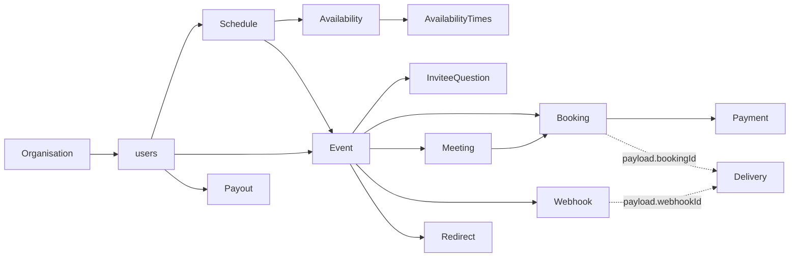
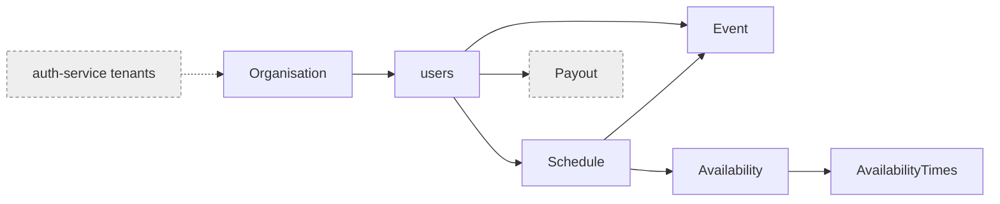
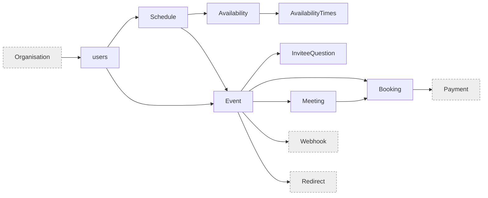
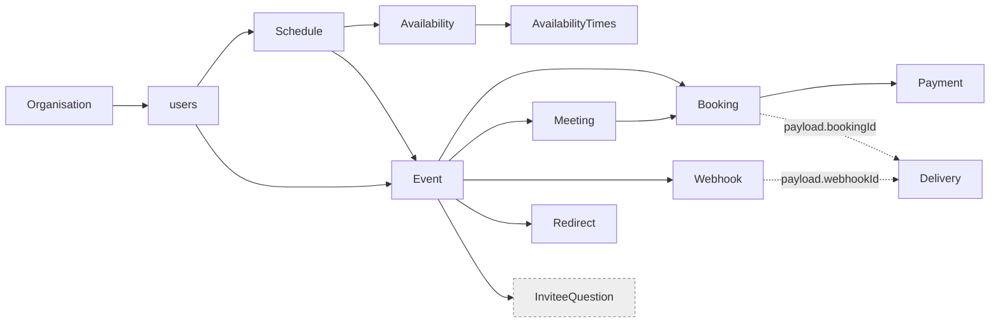
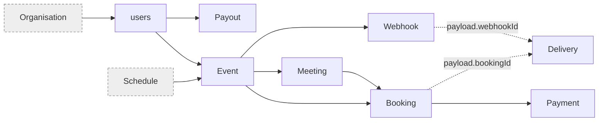
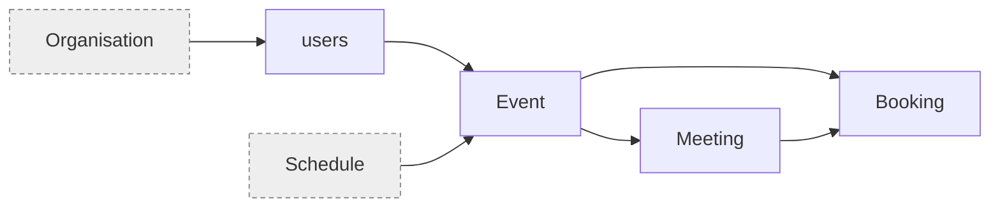
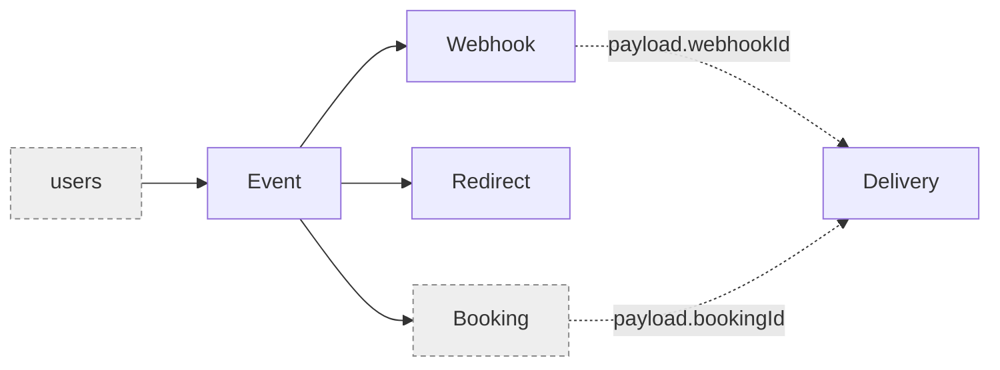
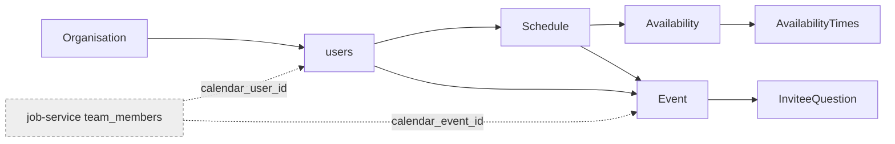
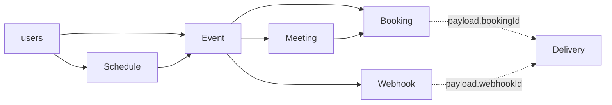

# calendar-schedular-backend - Existing Database Architecture

## 1. Document Metadata

| Item | Value |
|---|---|
| Configured service name | `calendar-schedular-backend` |
| Resolved repository | `/Users/akshay/Development/autoscal/main-autoscal-repos/calendar-scheduler-backend` (the folder is spelled `scheduler`; no `calendar-schedular-backend` folder exists, and this file uses the configured spelling as instructed) |
| Branch and commit analysed | `dev` at `b930157` (2026-10-14), working tree clean for `prisma/` and `app/` |
| Analysis date | 2026-10-14 |
| Scope | Prisma schema, all 78 migration folders, Prisma client and query extensions, every route, controller, validator, helper, service, mailer and middleware under `app/`, `utils/`, `config/`, `prisma/seed.js`, test factories, repo skill references, and a name search of the other active Autoscal repos |
| Out of scope | Application code changes, schema changes, live data. `node_modules/`, `coverage/`, `temp/` (contains audit notes only, no DB code) |
| Live database access | None. No production, UAT or demo database was queried |
| Schema reconstruction | All 78 migrations were replayed into a throwaway `postgres:15-alpine` container (since removed), then `prisma migrate diff --from-url <throwaway> --to-schema-datamodel prisma/schema.prisma` reported **an empty migration** (no drift between migration history and `schema.prisma` on `dev`) |

**Important limitations**

- Nothing in this document is confirmed against a live database. "Exists" means "declared in `schema.prisma` and produced by replaying the migration chain".
- Deploy branches carry different migration sets (see [R1](#r1-deploy-branches-carry-different-migration-sets)). The baseline below is the `dev` branch.
- `.env` and `.envSample` could not be read (blocked by the `autoscal-core` hook), so database names, hosts and pool settings per environment are not documented.
- PostgreSQL behaviour was tested on PG 15. The production PostgreSQL version is not known.

## 2. Service Overview

**Responsibilities.** Scheduling service: hosts publish events backed by availability schedules, invitees book slots on public pages, bookings create Zoom or Google Meet meetings, paid events go through Stripe Checkout, hosts receive payouts via Stripe Connect transfers, and organisations integrate through a signed `v1` API plus per-event outbound webhooks and redirects. Booking mails and tenant webhooks are queued in a database outbox and retried by an in-process worker.

**Database role.** The service owns one PostgreSQL database, accessed only by this service. No other active Autoscal repo references its tables by name (search in Section 5.3). Other services hold IDs from it as unenforced cross-service references ([R11](#r11-cross-service-logical-references-into-this-database)).

| Aspect | Verified value | Evidence |
|---|---|---|
| Engine | PostgreSQL | `prisma/schema.prisma:9-12`, `prisma/migrations/migration_lock.toml` |
| ORM | Prisma 4.16.2 (`prisma-client-js`, preview `fullTextSearch`) | `package.json`, `npx prisma --version`, `prisma/schema.prisma:4-7` |
| Schema organisation | Single `public` schema, 14 tables, 14 enum types | replayed DB catalogue |
| Naming | PascalCase table names except `users` (`@@map("users")`), camelCase columns, `created_at` / `updated_at` mapped | `prisma/schema.prisma:96-128` |
| Primary keys | `uuid` on every table, generated by the Prisma client (`@default(uuid())`), **no database default** | replayed columns |
| Migration tooling | Prisma Migrate. `entrypoint.sh` runs `prisma migrate deploy` on every container start | repo `CLAUDE.md` Safety section |
| Data access | Two clients: base `prisma` (`app/models/prismaClient.js`) and extended `xprisma` exported as `User`, `Event`, ... (`app/models/index.js:13-40`). Query hooks in `app/models/<model>.js` run only through the extended client | `app/models/index.js:13-24` |
| Raw SQL | 2 statements: advisory lock (`app/models/booking.js:22`), outbox claim (`app/helpers/delivery/worker.js:10-18`) | grep for `$queryRaw` / `$executeRaw` |
| Other stores | Redis for API signature replay protection (`app/helpers/signatureReplay.helper.js`), S3 for uploads (`utils/aws.js`). Not relational, not counted | source |

**Sources used to determine the schema.** `prisma/schema.prisma` (authoritative for `dev`), the 78 `prisma/migrations/*/migration.sql` files (history and exact DDL), the replayed catalogue (types, defaults, constraint and index names), and `.claude/skills/calendar-conventions/references/*.md` (team notes, used only as corroboration).

### 2.1 Service-Level Metrics

Counting rules are in [Section 5.1](#51-counting-rules).

| Metric | Value | Notes |
|---|---:|---|
| Runtime application modules | 8 | Sections 3.1 to 3.8. `prisma/seed.js` is a non-runtime consumer, listed separately |
| Distinct tables declared in schema or migrations (current) | 14 | `_prisma_migrations` (Prisma bookkeeping) excluded |
| Distinct tables referenced by application code | 14 | every declared table |
| Tables referenced in code but missing from schema | 0 | |
| Tables confirmed in a live database | 0 | no live access |
| Tables reconstructed by migration replay | 14 | throwaway container |
| Tables referenced by runtime application code | 14 | |
| Tables with no runtime-code reference found | 0 | |
| Deprecated or legacy tables (current schema) | 0 | 3 historical tables were dropped by migrations, see [2.2](#22-database-object-inventory) |
| Tables with uncertain classification | 0 | |
| Environment-level conflicts or unverified cases | 4 | C1 to C4 in [2.4](#24-migration-relevant-findings) |
| Tables with a declared primary key | 14 | |
| Tables with at least one outbound foreign key | 12 | all except `Organisation`, `Delivery` |
| Tables with at least one inbound foreign key | 7 | `Organisation`, `users`, `Schedule`, `Availability`, `Event`, `Meeting`, `Booking` |
| Declared foreign keys (relationships) | 14 | all `ON UPDATE CASCADE` |
| Inferred (application-level) relationships inside this DB | 2 | `Delivery.payload` to `Booking` and `Webhook` |
| Leaf tables | 6 | `AvailabilityTimes`, `InviteeQuestion`, `Payment`, `Payout`, `Webhook`, `Redirect` |
| Isolated tables (no declared FK either way) | 1 | `Delivery` (has 2 inferred links) |
| Root tables (inbound only) | 1 | `Organisation` |
| Self-references | 0 | |
| Cycles | 0 | FK graph is a DAG |
| Junction tables | 0 | no implicit `_AToB` tables, no many-to-many |
| Views / materialized views | 0 / 0 | |
| Functions / triggers / sequences | 0 / 0 / 0 | |
| Enum types | 14 | 13 used by columns, 1 unused (`WebhookEventType`) |
| Indexes (PK / unique / non-unique) | 14 / 17 / 11 | |

### 2.2 Database Object Inventory

**Tables (current, `dev`)**

| # | Table | Category | Runtime status | Owning module | Definition |
|---:|---|---|---|---|---|
| 1 | [`Organisation`](#table-organisation) | Declared + code-referenced | Active | 3.1 | `schema.prisma:89-99`, created `20230721075124_v21` |
| 2 | [`users`](#table-users) | Declared + code-referenced | Active | 3.1 | `schema.prisma:101-129`, created `20230711070417_v1` |
| 3 | [`Schedule`](#table-schedule) | Declared + code-referenced | Active | 3.2 | `schema.prisma:201-215`, created `20230713072436_v4` |
| 4 | [`Availability`](#table-availability) | Declared + code-referenced | Active | 3.2 | `schema.prisma:131-145`, created `20230712062905_v3` |
| 5 | [`AvailabilityTimes`](#table-availabilitytimes) | Declared + code-referenced | Active | 3.2 | `schema.prisma:147-157`, created `20230712062905_v3` |
| 6 | [`Event`](#table-event) | Declared + code-referenced | Active | 3.2 | `schema.prisma:159-199`, created `20230713072436_v4` |
| 7 | [`InviteeQuestion`](#table-inviteequestion) | Declared + code-referenced | Active | 3.2 | `schema.prisma:217-232`, created `20230717062556_v10` |
| 8 | [`Booking`](#table-booking) | Declared + code-referenced | Active | 3.3 | `schema.prisma:234-252`, created `20230720131920_v20` |
| 9 | [`Meeting`](#table-meeting) | Declared + code-referenced | Active | 3.3 | `schema.prisma:290-304`, created `20230809082103_v57` |
| 10 | [`Payment`](#table-payment) | Declared + code-referenced | Active | 3.4 | `schema.prisma:254-269`, created `20230730070858_v34` |
| 11 | [`Payout`](#table-payout) | Declared + code-referenced | Active | 3.4 | `schema.prisma:271-288`, created `20230801115223_v47` |
| 12 | [`Webhook`](#table-webhook) | Declared + code-referenced | Active | 3.6 | `schema.prisma:314-324`, created `20250917125605_v73` |
| 13 | [`Redirect`](#table-redirect) | Declared + code-referenced | Active | 3.6 | `schema.prisma:326-334`, created `20251003070736_v75` |
| 14 | [`Delivery`](#table-delivery) | Declared + code-referenced | Active | 3.8 | `schema.prisma:342-354`, created `20260924064153_delivery_outbox` |

Every table falls in categories 1 (declared) and 2 (code-referenced). None is in category 3 (live-confirmed). All 14 are in category 4 for live existence only: their presence in any real environment is unverified.

**Historical tables (dropped by migrations, not counted above)**

| Table | Created | Dropped | Replaced by | Code references today |
|---|---|---|---|---|
| `DateOverride` | `20230712062905_v3` | `20230719053637_v16` | `Availability` rows with `type = Date` | none |
| `ZoomMeeting` | `20230803134027_v52` | `20230809080959_v56` | `Meetings` | none |
| `Meetings` | `20230809080959_v56` | `20230809082103_v57` | `Meeting` | none |

**Other database objects**

| Object type | Count | Detail |
|---|---:|---|
| Enum types | 14 | `WeekDay`, `EventType`, `ScheduleType`, `DaysCountType`, `TimeUnits`, `AnswerType`, `AvailabilityType`, `OrganisationType`, `LocationType`, `PaymentStatus`, `BookingStatus`, `DestinationType`, `DeliveryStatus`, `WebhookEventType` |
| Enum types used by no column | 1 | `WebhookEventType` (created `20250917125605_v73`; no column and no code reference) |
| Unique indexes | 17 | listed per table |
| Non-unique indexes | 11 | 10 added by `20260924063550_tenant_fk_indexes`, 1 by `delivery_outbox` |
| Views, materialized views, functions, triggers, sequences, extensions | 0 | replayed catalogue |
| Prisma bookkeeping | 1 | `_prisma_migrations` exists wherever `prisma migrate deploy` ran; excluded from counts |

**Enum catalogue**

| Enum | Values | Used by |
|---|---|---|
| `WeekDay` | Sunday, Monday, Tuesday, Wednesday, Thursday, Friday, Saturday | `Availability.day` (recreated in `v18` to fix `Thrusday`) |
| `EventType` | OneOnOne, Group, OneOff | `Event.type` |
| `ScheduleType` | DaysCount, DateRange, Indefinite | `Event.scheduleType` |
| `DaysCountType` | CalendarDays, WeekDays | `Event.countType` |
| `TimeUnits` | hours, minutes, days | `Event.durationUnit`, `Event.minimumStartBufferUnit` |
| `AnswerType` | OneLine, MultipleLines, RadioButtons, Checkboxes, Dropdown, PhoneNumber | `InviteeQuestion.type` |
| `AvailabilityType` | WeekDay, Date | `Availability.type` |
| `OrganisationType` | Personal, Business | `Organisation.type` |
| `LocationType` | InPerson, Zoom, GoogleMeet | `Event.locationType`, `Meeting.locationType` |
| `PaymentStatus` | Pending, Failed, Success | `Payment.status`, `Payout.status` |
| `BookingStatus` | PendingPayment, Confirmed, Cancelled | `Booking.status` (`Cancelled` added by `ALTER TYPE ... ADD VALUE` in `v44`) |
| `DestinationType` | BankAccount, Card | `Payout.destinationType` |
| `DeliveryStatus` | Pending, Delivered, Failed | `Delivery.status` |
| `WebhookEventType` | BOOKING_CREATED, BOOKING_UPDATED, BOOKING_CONFIRMED, BOOKING_CANCELLED, PAYMENT_RECEIVED | none |

**Service-wide relationship diagram** (declared FKs solid, inferred dashed)



Legend: arrow goes from referenced parent to the child holding the reference. Solid = declared FK constraint. Dashed = application-level reference stored in JSONB, not enforced.

### 2.3 Module Summary

| Module | Purpose | Total Tables | Active | Deprecated/Legacy | Apparently Unused | Shared/Uncertain |
|---|---|---:|---:|---:|---:|---:|
| [3.1 Users and Organisations](#31-users-and-organisations) | Host accounts, login, organisations, API keys, auth middleware | 6 | 6 | 0 | 0 | 6 / 0 |
| [3.2 Events, Schedules and Invitee Questions](#32-events-schedules-and-invitee-questions) | Event types, availability schedules, questions, public profile pages | 8 | 8 | 0 | 0 | 8 / 0 |
| [3.3 Bookings and Slots](#33-bookings-and-slots) | Slot computation, booking create, update, cancel, delete, meeting rows | 12 | 12 | 0 | 0 | 12 / 0 |
| [3.4 Payments and Payouts](#34-payments-and-payouts) | Stripe checkout settlement, wallet credit, payouts, Stripe webhooks | 8 | 8 | 0 | 0 | 7 / 0 |
| [3.5 Calendar and Video Integrations](#35-calendar-and-video-integrations) | Google OAuth tokens, Google Calendar invites, Zoom meetings | 4 | 4 | 0 | 0 | 4 / 0 |
| [3.6 Tenant Webhooks and Redirects (CVT)](#36-tenant-webhooks-and-redirects-cvt) | Per-event outbound webhook and post-booking redirect config | 4 | 4 | 0 | 0 | 4 / 0 |
| [3.7 Job-Service Sync](#37-job-service-sync) | Provision a host, schedule and default event for a job-service team member | 7 | 7 | 0 | 0 | 7 / 0 |
| [3.8 Delivery Outbox](#38-delivery-outbox) | Durable queue and worker for booking mails and tenant webhooks | 7 | 7 | 0 | 0 | 7 / 0 |

Methodology: a table counts for a module when code reachable from that module's routes or worker reads or writes it, directly (`Model.op`, `prisma.model.op`, `tx.model.op`) or indirectly (nested `create`/`connect`/`update`, relation filters, `include`/`select`). "Active" means at least one such runtime reference exists. "Shared" counts tables also accessed by at least one other module. "Uncertain" counts tables whose access could not be traced; it is 0 for every module. **Module totals are non-exclusive**: a table appears in every module that touches it, so the column sums (56) are not a service total. The service total is 14.

### 2.4 Migration-Relevant Findings

Highest priority first. Details and verification steps in [Section 4](#4-migration-risks-and-unresolved-issues).

1. **C1, C2, C3: deploy branches carry different migration sets** ([R1](#r1-deploy-branches-carry-different-migration-sets)). `origin/dev` 78, `origin/prod` 77, `origin/uat` 75, `origin/demo` 74, `origin/production` 70, `origin/main` and `origin/staging` 0. Consequences by branch: `Organisation.apiKey` is `TEXT` only on `dev` (C1); `Delivery` and the `DeliveryStatus` enum are absent on `uat`, `demo`, `production` (C2); the 10 FK indexes are absent on `uat`, `demo`, `production` (C3).
2. **C4: no live database verified** ([R2](#r2-no-live-database-verification)). `_prisma_migrations` contents in each environment are unknown, including whether the missing numbers `v27` and `v66` were ever applied ([R15](#r15-migration-folder-irregularities)).
3. **RESTRICT foreign keys block cascading deletes** ([R3](#r3-restrict-foreign-keys-block-cascading-deletes)). Verified on the replay: deleting an `Event`, `users` row or `Organisation` fails once any of its bookings has a `Payment`. `Payout` also blocks user deletion.
4. **Orphan-prone data** ([R4](#r4-orphan-prone-data)): `Meeting.eventId` is `SET NULL` on event delete, `Personal` organisations survive user deletion, `Delivery.payload` references are unenforced.
5. **Money stored as `double precision`** in 5 columns ([R5](#r5-money-stored-as-double-precision)).
6. **PostgreSQL-specific behaviour** the target must keep: 14 enum types, `timetz`, `varchar[]`, `jsonb`, advisory locks, `FOR UPDATE SKIP LOCKED` ([R7](#r7-postgresql-enum-types), [R8](#r8-postgresql-specific-sql-and-types)).
7. **Every table is shared** except `Payout`, and `Event` is touched by all 8 modules: no table can be moved independently of the booking flow.
8. **Cross-service references** from auth-service (`tenants.calendar_organisation_id`) and job-service (`team_members.calendar_user_id`, `calendar_event_id`) must keep UUIDs stable ([R11](#r11-cross-service-logical-references-into-this-database)).

## 3. Module Documentation

Modules follow the route groups mounted in `app/routes/api.routes.js:12-29`, the worker started from `config/express.js`, and the helper folders behind them. Every table has exactly one canonical definition, placed under its owning module. Ownership was clear for all 14 tables, so no Shared Tables or Unassigned Tables section is needed; shared use is listed in each table's overview.

Column types, nullability and defaults below are from the replayed catalogue and match `schema.prisma`. "App default" means the value is generated by the Prisma client, not by the database. `updated_at` has a database default of `CURRENT_TIMESTAMP` on insert and is bumped by the Prisma client (`@updatedAt`) on update; there are no triggers, so raw SQL updates do not change it.

### 3.1 Users and Organisations

**Purpose:** Host accounts and their organisations. Email/password sign-up and login (`app/controllers/users.controller.js`), Google login (`app/controllers/googleSessions.controller.js`), organisation CRUD and RSA API key rotation (`app/controllers/organisations.controller.js`), the auth-service provisioning endpoint (`app/routes/authService/organisations.route.js:9-10`), the signed `v1` API for organisations (`app/routes/v1/index.js:3-5`), S3 upload (`app/controllers/upload.controller.js`, no DB access) and the JWT and API-key middleware (`app/middleware/authentication.js:19`, `:68`). Creating a user also creates a default `Working Hours` schedule with 7 availabilities (`app/models/user.js:19-52`) and, if no organisation is given, a `Personal` organisation (`app/models/user.js:54-62`).

**Module metrics:** 6 tables. Active 6, deprecated/legacy 0, apparently unused 0, shared 6, uncertain 0. Indirect only: `Schedule`, `Availability`, `AvailabilityTimes` (nested create and include), `Event` (include in profile reads).

**Tables used:**

| Table | Usage status | Definition |
|---|---|---|
| `Organisation` | Active, owned | [Table: Organisation](#table-organisation) |
| `users` | Active, owned | [Table: users](#table-users) |
| `Schedule` | Active, indirect write (nested create) | [Table: Schedule](#table-schedule) |
| `Availability` | Active, indirect write (nested create) | [Table: Availability](#table-availability) |
| `AvailabilityTimes` | Active, indirect write (nested create) | [Table: AvailabilityTimes](#table-availabilitytimes) |
| `Event` | Active, indirect read | [Table: Event](#table-event) |

#### Table: Organisation

**Overview**

- Canonical name: `public."Organisation"`.
- Purpose: tenant boundary for hosts. `Personal` organisations are auto-created per user; `Business` organisations are created by auth-service and may hold an API public key for the signed `v1` API.
- Accessed by: 3.1 (owner, CRUD), 3.3 (read via `event.user.organisation` in `app/models/booking.js:42` and `app/controllers/public/bookings.controller.js:40`), 3.7 (create in `app/helpers/jobService/user.helper.js:43`).
- Usage: Active. `Organisation.create` `organisations.controller.js:46`, `update` `:71`, `findUnique` `:94`, `:127`, `updateMany` `:133`; API key lookup `app/middleware/authentication.js:68`; `prisma.organisation.create` `app/models/user.js:55`.
- Definition: `prisma/schema.prisma:89-99`. Created `20230721075124_v21`; `apiSecret` dropped in `v25`; `apiKey` widened to `VARCHAR(250)` in `v24` and to `TEXT` in `20261013000000_widen_organisation_api_key` (dev only, see C1).

**Attributes**

| Column | Database Type | Nullable | Default | Key/Constraint | Description |
|---|---|---|---|---|---|
| `id` | `uuid` | NO | app default `uuid()` | PK `Organisation_pkey` | Organisation id. Also stored by auth-service as `tenants.calendar_organisation_id` (inferred, [R11](#r11-cross-service-logical-references-into-this-database)) |
| `name` | `varchar(250)` | YES | | | Display name |
| `logoUrl` | `varchar(250)` | YES | | | Logo URL, used as the Stripe checkout product image (`app/models/booking.js:193`) |
| `apiSupported` | `boolean` | NO | `false` | | Whether the organisation may use the signed `v1` API; checked on public booking (`public/bookings.controller.js:40`) |
| `apiKey` | `text` (dev) / `varchar(250)` (prod branch) | YES | | UNIQUE `Organisation_apiKey_key` | Hex DER SPKI RSA public key used to verify request signatures (`authentication.js:80-87`). The private key is returned once and not stored |
| `type` | `"OrganisationType"` | NO | `'Personal'` | | Personal or Business |
| `created_at` | `timestamptz(3)` | NO | `CURRENT_TIMESTAMP` | | Creation time |
| `updated_at` | `timestamptz(3)` | NO | `CURRENT_TIMESTAMP` | app `@updatedAt` | Last update |

**Relationships**

| Direction | Related table | Columns | Cardinality | Enforcement | On delete | Modules |
|---|---|---|---|---|---|---|
| Inbound | `users` | `users.organisationId` to `Organisation.id` | 1 : N | FK `users_organisationId_fkey` | CASCADE | 3.1, 3.3, 3.7 |
| External inbound | auth-service `tenants` | `calendar_organisation_id`, `calendar_api_key` | 1 : 0..1 (inferred) | not enforced | n/a | cross-service |

**Additional details**

- Deleting an organisation cascades to `users`, then to `Event`, `Schedule`, and so on; it is blocked by any `Payout` or `Payment` underneath ([R3](#r3-restrict-foreign-keys-block-cascading-deletes)).
- No code deletes organisations. A user delete leaves its `Personal` organisation behind ([R4](#r4-orphan-prone-data)).
- Unique `apiKey` allows many NULLs (PostgreSQL treats NULLs as distinct).

#### Table: users

**Overview**

- Canonical name: `public.users` (Prisma model `User`, `@@map("users")`).
- Purpose: host account. Holds login credentials, public link, OAuth refresh tokens, Stripe Connect id, wallet balance and payout commission.
- Accessed by: 3.1 (owner), 3.2, 3.3, 3.4, 3.5, 3.7, 3.8.
- Usage: Active. `User.create` `users.controller.js:35`, `update` `:53`, `findUnique` `:83`, `delete` `:96`; `User.findFirst` `authentication.js:19`; Google login `googleSessions.controller.js:56,67,80`; token writes `zoom.controller.js:21`, `googleCalendar.controller.js:88`, `stripe.controller.js:24`; wallet credit `app/models/payment.js:63`, debit `app/models/payout.js:63`; upsert `app/helpers/jobService/user.helper.js:51`.
- Definition: `prisma/schema.prisma:101-129`. Created `20230711070417_v1`. Notable changes: `link` unique `v13`, `stripeId` unique `v51`, `googleId` unique `v68`, `firstName`/`lastName` nullable `v72`, DML rewrite of `profilePicture` in `20260909040000_strip_bucket_url_from_user_profile_picture`, index on `organisationId` in `20260924063550_tenant_fk_indexes`.

**Attributes**

| Column | Database Type | Nullable | Default | Key/Constraint | Description |
|---|---|---|---|---|---|
| `id` | `uuid` | NO | app default `uuid()` | PK `users_pkey` | Host id. Also stored by job-service as `team_members.calendar_user_id` (inferred) |
| `profilePicture` | `varchar(1500)` | YES | | | S3 object key since the 2026-09 DML migration; Google avatar URLs stay absolute. Composed into a URL on read and reduced to a key on write by the client extension (`app/models/prismaClient.js:15-40`) |
| `firstName` | `varchar(50)` | YES | | | First name |
| `lastName` | `varchar(50)` | YES | | | Last name |
| `email` | `varchar(100)` | NO | | UNIQUE `users_email_key` | Login email; upsert key for job-service sync |
| `rgbIcon` | `varchar(50)` | NO | | | Avatar colour (random colour set at sign-up) |
| `password` | `varchar(255)` | YES | | | bcrypt hash (`utils/password.js`); NULL for Google-only or job-service users |
| `created_at` | `timestamptz(3)` | NO | `CURRENT_TIMESTAMP` | | Creation time |
| `updated_at` | `timestamptz(3)` | NO | `CURRENT_TIMESTAMP` | app `@updatedAt` | Last update |
| `logoUrl` | `varchar(250)` | YES | | | Host logo URL |
| `link` | `varchar(250)` | NO | | UNIQUE `users_link_key` | Public profile slug (`/public/users/:link`); defaults to the email local part (`app/models/user.js:40`) |
| `zoomRefreshToken` | `varchar(2500)` | YES | | | Zoom OAuth refresh token (secret; encryption at rest not verified) |
| `googleRefreshToken` | `varchar(2500)` | YES | | | Google OAuth refresh token (secret; encryption at rest not verified) |
| `currency` | `text` | NO | `'INR'` | | Wallet currency; changing it converts `walletAmount` (`app/models/user.js:74-76`) |
| `walletAmount` | `double precision` | NO | `0` | | Earnings balance, credited on payment success, debited on payout success |
| `stripeId` | `varchar(150)` | YES | | UNIQUE `users_stripeId_key` | Stripe Connect account id; copied to `Payout.destinationId` |
| `organisationId` | `uuid` | NO | | FK to `Organisation.id`, INDEX `users_organisationId_idx` | Owning organisation |
| `isActive` | `boolean` | NO | `true` | | Inactive users fail JWT auth (`authentication.js:19-24`) and public lookups |
| `payoutCommisionPercent` | `integer` | NO | `30` | | Platform commission deducted from payouts (`app/models/payout.js:15`). Column name misspelled in source |
| `googleId` | `varchar(50)` | YES | | UNIQUE `users_googleId_key` | Google account subject id for Google login |

**Relationships**

| Direction | Related table | Columns | Cardinality | Enforcement | On delete | Modules |
|---|---|---|---|---|---|---|
| Outbound | `Organisation` | `organisationId` to `Organisation.id` | N : 1 | FK `users_organisationId_fkey` | CASCADE | 3.1, 3.3, 3.7 |
| Inbound | `Schedule` | `Schedule.userId` | 1 : N | FK `Schedule_userId_fkey` | CASCADE | 3.1, 3.2, 3.7 |
| Inbound | `Event` | `Event.userId` | 1 : N | FK `Event_userId_fkey` | CASCADE | all |
| Inbound | `Payout` | `Payout.userId` | 1 : N | FK `Payout_userId_fkey` | RESTRICT | 3.4 |
| Logical | `Payout` | `stripeId` copied to `Payout.destinationId` | value copy | not enforced | n/a | 3.4 |
| External inbound | job-service `team_members` | `calendar_user_id` | 1 : 0..1 (inferred) | not enforced | n/a | cross-service |

**Additional details**

- Secrets in the row (`password`, both refresh tokens, `stripeId`, `walletAmount`) must be stripped by `serializeUser` before responses (repo `CLAUDE.md` rule 4).
- `User.delete` (`users.controller.js:96`) fails if the user has any `Payout` or any booking with a `Payment` ([R3](#r3-restrict-foreign-keys-block-cascading-deletes)).
- Wallet updates use `increment`/`decrement` (atomic in SQL) but run on a float column ([R5](#r5-money-stored-as-double-precision)).
- `user.create` creates the `Organisation` before the user insert, outside a transaction (`app/models/user.js:54-64`), so a failed insert leaves an orphan organisation ([R10](#r10-multi-step-writes-outside-transactions)).

#### Module relationship diagram: 3.1 Users and Organisations



Legend: solid arrow = declared FK, parent to child. Dashed arrow = inferred reference. Grey dashed box = outside this module (`Payout`) or outside this database (auth-service).

### 3.2 Events, Schedules and Invitee Questions

**Purpose:** Hosts define event types (`app/controllers/events.controller.js`), reusable or per-event custom availability schedules (`app/controllers/schedules.controller.js`, `app/models/schedule.js`, `app/models/event.js`) and invitee questions (`app/controllers/inviteeQuestions.controller.js`). Includes the `v1` equivalents (`app/routes/v1/index.js:6-8`), the public profile and event pages (`app/routes/public/index.js:3-4`, `app/validators/public/users.validator.js`, `app/validators/public/events.validator.js`), and the calendar overview that lists events with their meetings and bookings (`events.controller.js:190-215`). Hands slot computation to 3.3.

**Module metrics:** 8 tables. Active 8, deprecated/legacy 0, apparently unused 0, shared 8, uncertain 0. Indirect only: `Meeting`, `Booking` (include in `eventsAndMeetings`).

**Tables used:**

| Table | Usage status | Definition |
|---|---|---|
| `Event` | Active, owned | [Table: Event](#table-event) |
| `Schedule` | Active, owned | [Table: Schedule](#table-schedule) |
| `Availability` | Active, owned | [Table: Availability](#table-availability) |
| `AvailabilityTimes` | Active, owned | [Table: AvailabilityTimes](#table-availabilitytimes) |
| `InviteeQuestion` | Active, owned | [Table: InviteeQuestion](#table-inviteequestion) |
| `users` | Active, read (relation filters, public lookups) | [Table: users](#table-users) |
| `Meeting` | Active, indirect read | [Table: Meeting](#table-meeting) |
| `Booking` | Active, indirect read | [Table: Booking](#table-booking) |

#### Table: Schedule

**Overview**

- Canonical name: `public."Schedule"`.
- Purpose: a named availability set with an IANA time zone. One per user is `isDefault`; `isCustom` schedules are private to a single event and deleted when the event moves to another schedule.
- Accessed by: 3.2 (owner), 3.1 (nested create at sign-up), 3.3 (read via `event.schedule` for slots and Stripe text), 3.7 (create `Autoscal-Schedule`), 3.8 (read in booking mails). Non-runtime: `prisma/seed.js:7`.
- Usage: Active. `Schedule.create` `schedules.controller.js:8`, `update` `:38`, `findMany` `:75`, `findFirst` `:100`, `:122`, `delete` `:127`; hooks `app/models/schedule.js:8,52,67,77,90`; `app/models/event.js:57,70,92`; validators `schedules.validator.js:19,119`, `events.validator.js:178`.
- Definition: `prisma/schema.prisma:201-215`. Created `20230713072436_v4`; `timezone` added in `v64` (as `TEXT`, now `varchar(50)`); `Schedule_userId_idx` in `20260924063550_tenant_fk_indexes`.

**Attributes**

| Column | Database Type | Nullable | Default | Key/Constraint | Description |
|---|---|---|---|---|---|
| `id` | `uuid` | NO | app default `uuid()` | PK `Schedule_pkey` | Schedule id |
| `name` | `varchar(255)` | NO | `'Custom'` | | Display name. `Working Hours` (sign-up default), `Autoscal-Schedule` (job-service sync, used as a lookup key in `user.helper.js:32,57`), `Custom` |
| `userId` | `uuid` | NO | | FK to `users.id`, INDEX `Schedule_userId_idx` | Owner |
| `isDefault` | `boolean` | NO | `false` | | User's default schedule; on delete another schedule is promoted (`app/models/schedule.js:66-85`). Uniqueness of one default per user is not enforced |
| `isCustom` | `boolean` | NO | `true` (DB) / `false` (create hook) | | Per-event private schedule. DB default `true`, but `schedule.create` sets `false` when not given (`app/models/schedule.js:30`) |
| `created_at` | `timestamptz(3)` | NO | `CURRENT_TIMESTAMP` | | Creation time |
| `updated_at` | `timestamptz(3)` | NO | `CURRENT_TIMESTAMP` | app `@updatedAt` | Last update |
| `timezone` | `varchar(50)` | NO | `'UTC'` | | IANA zone for interpreting availabilities |

**Relationships**

| Direction | Related table | Columns | Cardinality | Enforcement | On delete | Modules |
|---|---|---|---|---|---|---|
| Outbound | `users` | `userId` to `users.id` | N : 1 | FK `Schedule_userId_fkey` | CASCADE | 3.1, 3.2, 3.7 |
| Inbound | `Availability` | `Availability.scheduleId` | 1 : N | FK `Availability_scheduleId_fkey` | CASCADE | 3.1, 3.2, 3.3, 3.7 |
| Inbound | `Event` | `Event.scheduleId` | 1 : N | FK `Event_scheduleId_fkey` | RESTRICT | all |

**Additional details**

- `Event_scheduleId_fkey` is RESTRICT: a schedule still used by an event cannot be deleted (verified on replay). The delete hook first clones the schedule into a new `Custom` schedule per event and repoints each event (`app/models/schedule.js:87-110`), using `Promise.all` outside a transaction ([R10](#r10-multi-step-writes-outside-transactions)).
- Deleting a user works despite the RESTRICT because both `Schedule` and `Event` cascade from `users` in the same statement (verified on replay).
- Update replaces all availabilities: `availability.deleteMany` then nested `create` (`app/models/schedule.js:36-46`), not in one transaction.

#### Table: Availability

**Overview**

- Canonical name: `public."Availability"`.
- Purpose: one row per weekday (`type = WeekDay`, `day` set) or per date override (`type = Date`, `date` set) within a schedule. A weekday row without times means unavailable that day.
- Accessed by: 3.2 (owner), 3.1, 3.3 (slot computation), 3.7.
- Usage: Active. `Availability.findUnique` `app/helpers/slots.js:57,60` (by compound unique keys); `prisma.availability.deleteMany` `app/models/schedule.js:37`; nested creates in `app/models/user.js:47`, `app/models/event.js:97`, `app/models/schedule.js:25-27,43-45,94-96`, `user.helper.js:72`.
- Definition: `prisma/schema.prisma:131-145`. Created `20230712062905_v3` with `userId`; moved to `scheduleId` in `v4`; `type` and `date` added with the `DateOverride` merge in `v16` (`date` first as `DATE NOT NULL`, later altered to nullable `timestamptz`); `isUnavailable` dropped `v19`; (`date`, `scheduleId`) unique added `v20`.

**Attributes**

| Column | Database Type | Nullable | Default | Key/Constraint | Description |
|---|---|---|---|---|---|
| `id` | `uuid` | NO | app default `uuid()` | PK `Availability_pkey` | Availability id |
| `type` | `"AvailabilityType"` | NO | | | `WeekDay` or `Date` |
| `day` | `"WeekDay"` | YES | | UNIQUE (`day`, `scheduleId`) `Availability_day_scheduleId_key` | Weekday for recurring rows; NULL for date rows |
| `date` | `timestamptz` (precision 6) | YES | | UNIQUE (`date`, `scheduleId`) `Availability_date_scheduleId_key` | Override date; NULL for weekday rows. Unlike most timestamps here it has no `(3)` precision |
| `scheduleId` | `uuid` | NO | | FK to `Schedule.id`, INDEX `Availability_scheduleId_idx` | Parent schedule |
| `created_at` | `timestamptz(3)` | NO | `CURRENT_TIMESTAMP` | | Creation time |
| `updated_at` | `timestamptz(3)` | NO | `CURRENT_TIMESTAMP` | app `@updatedAt` | Last update |

**Relationships**

| Direction | Related table | Columns | Cardinality | Enforcement | On delete | Modules |
|---|---|---|---|---|---|---|
| Outbound | `Schedule` | `scheduleId` to `Schedule.id` | N : 1 | FK `Availability_scheduleId_fkey` | CASCADE | 3.1, 3.2, 3.3, 3.7 |
| Inbound | `AvailabilityTimes` | `AvailabilityTimes.availabilityId` | 1 : N | FK `AvailabilityTimes_availabilityId_fkey` | CASCADE | 3.1, 3.2, 3.3, 3.7 |

**Additional details**

- Both unique indexes rely on NULLs being distinct: a weekday row has `date` NULL and a date row has `day` NULL ([R14](#r14-unique-indexes-on-nullable-columns)).
- No check constraint ties `type` to which of `day` / `date` is set; the rule is enforced in validators only.
- `availabilitiesData(availabilities)` in `app/models/schedule.js:116-117` declares one parameter and maps with `(availability, timezone)`, so `timezone` is the array index, not the schedule zone. Date and time values written through this path may have been parsed in the wrong zone ([R6](#r6-time-types-and-time-zone-handling)). Observed in code, effect on stored data not verified.

#### Table: AvailabilityTimes

**Overview**

- Canonical name: `public."AvailabilityTimes"`.
- Purpose: start and end time windows within an availability row.
- Accessed by: 3.2 (owner), 3.1, 3.3, 3.7.
- Usage: Active. `prisma.availabilityTimes.findMany` `app/helpers/slots.js:65`; nested creates in `app/models/user.js:29`, `app/models/event.js:83`, `app/models/schedule.js:128-134`, `user.helper.js:13`; includes in `events.controller.js:12-16` and others.
- Definition: `prisma/schema.prisma:147-157`. Created `20230712062905_v3`; `dateOverrideId` and its FK dropped in `v16`.

**Attributes**

| Column | Database Type | Nullable | Default | Key/Constraint | Description |
|---|---|---|---|---|---|
| `id` | `uuid` | NO | app default `uuid()` | PK `AvailabilityTimes_pkey` | Time window id |
| `startTime` | `time(3) with time zone` | NO | | | Window start (Prisma `DateTime @db.Timetz(3)`) |
| `endTime` | `time(3) with time zone` | NO | | | Window end |
| `availabilityId` | `uuid` | YES | | FK to `Availability.id`, INDEX `AvailabilityTimes_availabilityId_idx` | Parent availability. Nullable, a leftover from when a row could belong to `DateOverride` instead |
| `created_at` | `timestamptz(3)` | NO | `CURRENT_TIMESTAMP` | | Creation time |
| `updated_at` | `timestamptz(3)` | NO | `CURRENT_TIMESTAMP` | app `@updatedAt` | Last update |

**Relationships**

| Direction | Related table | Columns | Cardinality | Enforcement | On delete | Modules |
|---|---|---|---|---|---|---|
| Outbound | `Availability` | `availabilityId` to `Availability.id` | N : 0..1 | FK `AvailabilityTimes_availabilityId_fkey` | CASCADE | 3.1, 3.2, 3.3, 3.7 |

**Additional details**

- Leaf table. Rows with `availabilityId IS NULL` would be orphans from the `DateOverride` era (dropped in `v16`, which deleted the `dateOverrideId` column but kept the rows). Count not verified.
- `timetz` stores a fixed UTC offset, not an IANA zone; seeded defaults are built in `Asia/Kolkata` (`app/models/user.js:31-32`) ([R6](#r6-time-types-and-time-zone-handling)).

#### Table: Event

**Overview**

- Canonical name: `public."Event"`.
- Purpose: a bookable event type owned by a host: duration, buffers, booking window, capacity, location, price, visibility.
- Accessed by: every module (3.1 to 3.8). Owner 3.2.
- Usage: Active. `Event.create` `events.controller.js:6`, `update` `:68`, `findMany` `:117,192`, `findFirst` `:144,174`, `delete` `:179`; `Event.update` `inviteeQuestions.controller.js:5`; `Event.updateMany`/`findUnique` `app/helpers/schedules.js:5,25`; `Event.findFirst` `public/slots.controller.js:9`; `prisma.event.findUnique` `app/models/booking.js:38`, `app/models/event.js:44`; `tx.event.create` `user.helper.js:113`; validators `events.validator.js:61,282,299`, `public/events.validator.js:5`.
- Definition: `prisma/schema.prisma:159-199`. Created `20230713072436_v4`. Repeated churn in 2023: `link` unique changed to (`link`, `userId`) in `v7`; buffer columns renamed and dropped across `v8`, `v22`, `v23`, `v63`; `zoomUrl`/`googleMeetUrl` dropped `v32`; indexes on `userId`, `scheduleId` in `20260924063550_tenant_fk_indexes`.

**Attributes**

| Column | Database Type | Nullable | Default | Key/Constraint | Description |
|---|---|---|---|---|---|
| `id` | `uuid` | NO | app default `uuid()` | PK `Event_pkey` | Event id. Also stored by job-service as `team_members.calendar_event_id` (inferred) |
| `type` | `"EventType"` | NO | | | OneOnOne, Group, OneOff |
| `name` | `varchar(255)` | NO | | | Title |
| `description` | `text` | NO | | | Description, also sent to Stripe |
| `link` | `varchar(50)` | NO | | UNIQUE (`link`, `userId`) `Event_link_userId_key` | Public slug under the host link |
| `color` | `text` | YES | | | UI colour |
| `scheduleType` | `"ScheduleType"` | NO | `'DaysCount'` | | Booking window mode |
| `startDate` | `timestamptz` (precision 6) | YES | | | Window start for `DateRange`; seconds zeroed by hook (`app/models/event.js:7`) |
| `endDate` | `timestamptz` (precision 6) | YES | | | Window end for `DateRange` |
| `daysCount` | `integer` | YES | `60` | | Window length for `DaysCount` |
| `countType` | `"DaysCountType"` | YES | `'CalendarDays'` | | Calendar or week days |
| `duration` | `integer` | NO | `30` | | Meeting length |
| `durationUnit` | `"TimeUnits"` | NO | `'minutes'` | | Unit of `duration` |
| `inbetweenBufferDuration` | `integer` | NO | `0` | | Gap between slots, added to the event duration in `app/helpers/slots.js:77` (unit inferred as minutes, not verified) |
| `minimumStartBuffer` | `integer` | YES | `4` | | Minimum notice before a slot |
| `minimumStartBufferUnit` | `"TimeUnits"` | YES | `'hours'` | | Unit of notice |
| `maxBookingCount` | `integer` | YES | `1` | | Seats per slot, enforced in `reserveSlot` (`app/models/booking.js:23-26`) |
| `isSecret` | `boolean` | NO | `false` | | Hidden from the public profile listing (`public/users.validator.js:17-21`) |
| `isActive` | `boolean` | NO | `true` | | Bookable flag |
| `locationType` | `"LocationType"` | NO | `'InPerson'` | | InPerson, Zoom, GoogleMeet |
| `location` | `varchar(1500)` | YES | | | Address or note for in-person |
| `isPayable` | `boolean` | NO | `false` | | Paid event; booking starts as `PendingPayment` |
| `amount` | `double precision` | YES | | | Price in major units (`unit_amount: event.amount * 100`, `app/models/booking.js:195`) |
| `currency` | `text` | NO | `'INR'` | | Price currency |
| `userId` | `uuid` | NO | | FK to `users.id`, INDEX `Event_userId_idx` | Host |
| `scheduleId` | `uuid` | NO | | FK to `Schedule.id`, INDEX `Event_scheduleId_idx` | Availability schedule |
| `created_at` | `timestamptz(3)` | NO | `CURRENT_TIMESTAMP` | | Creation time |
| `updated_at` | `timestamptz(3)` | NO | `CURRENT_TIMESTAMP` | app `@updatedAt` | Last update |

**Relationships**

| Direction | Related table | Columns | Cardinality | Enforcement | On delete | Modules |
|---|---|---|---|---|---|---|
| Outbound | `users` | `userId` to `users.id` | N : 1 | FK `Event_userId_fkey` | CASCADE | all |
| Outbound | `Schedule` | `scheduleId` to `Schedule.id` | N : 1 | FK `Event_scheduleId_fkey` | RESTRICT | 3.2, 3.3, 3.7, 3.8 |
| Inbound | `InviteeQuestion` | `InviteeQuestion.eventId` | 1 : N | FK `InviteeQuestion_eventId_fkey` | CASCADE | 3.2, 3.7 |
| Inbound | `Booking` | `Booking.eventId` | 1 : N | FK `Booking_eventId_fkey` | CASCADE | 3.2, 3.3, 3.4, 3.5, 3.8 |
| Inbound | `Meeting` | `Meeting.eventId` | 1 : N | FK `Meeting_eventId_fkey` | SET NULL | 3.2, 3.3, 3.4, 3.5, 3.8 |
| Inbound | `Webhook` | `Webhook.eventId` (unique) | 1 : 0..1 | FK `Webhook_eventId_fkey` | CASCADE | 3.3, 3.4, 3.6, 3.8 |
| Inbound | `Redirect` | `Redirect.eventId` (unique) | 1 : 0..1 | FK `Redirect_eventId_fkey` | CASCADE | 3.3, 3.6 |
| External inbound | job-service `team_members` | `calendar_event_id`, `calendar_event_link` | 1 : 0..1 (inferred) | not enforced | n/a | cross-service |

**Additional details**

- `Event.delete` (`events.controller.js:179`) fails with a FK error once any booking of the event has a `Payment` row (verified on replay). It also leaves `Meeting` rows with `eventId = NULL` and does not clean Zoom or Google artifacts ([R3](#r3-restrict-foreign-keys-block-cascading-deletes), [R4](#r4-orphan-prone-data)).
- Questions are replaced on update with nested `deleteMany` plus `create` (`app/models/event.js:34-41`).
- Changing the schedule deletes the previous custom schedule after the update commits (`app/models/event.js:54-61`).
- Search uses `contains` with `mode: 'insensitive'` (ILIKE), `events.controller.js:107-110`. The `fullTextSearch` preview is enabled but no `search` operator is used.

#### Table: InviteeQuestion

**Overview**

- Canonical name: `public."InviteeQuestion"`.
- Purpose: custom questions shown on the booking form; answers are stored in `Booking.inviteeResponse`.
- Accessed by: 3.2 (owner), 3.7 (nested create). Non-runtime: `prisma/seed.js:17,22`.
- Usage: Active. `InviteeQuestion.findMany` `inviteeQuestions.controller.js:10,32`; nested writes `app/models/event.js:17-23,34-41`, `user.helper.js:99-109`.
- Definition: `prisma/schema.prisma:217-232`. Created `20230717062556_v10`; `placeholder`, `defaultValue` added in `v46` (as `NOT NULL`, now nullable); `InviteeQuestion_eventId_idx` in `20260924063550_tenant_fk_indexes`.

**Attributes**

| Column | Database Type | Nullable | Default | Key/Constraint | Description |
|---|---|---|---|---|---|
| `id` | `uuid` | NO | app default `uuid()` | PK `InviteeQuestion_pkey` | Question id |
| `question` | `text` | NO | | | Prompt text |
| `type` | `"AnswerType"` | NO | `'OneLine'` | | Answer widget |
| `options` | `varchar(255)[]` | YES | | | Choices for radio, checkbox, dropdown. PostgreSQL array |
| `isActive` | `boolean` | NO | `true` | | Shown on form |
| `isRequired` | `boolean` | NO | `false` | | Required answer |
| `placeholder` | `text` | YES | | | Input placeholder |
| `defaultValue` | `text` | YES | | | Prefilled answer |
| `eventId` | `uuid` | NO | | FK to `Event.id`, INDEX `InviteeQuestion_eventId_idx` | Parent event |
| `created_at` | `timestamptz(3)` | NO | `CURRENT_TIMESTAMP` | | Creation time |
| `updated_at` | `timestamptz(3)` | NO | `CURRENT_TIMESTAMP` | app `@updatedAt` | Last update |

**Relationships**

| Direction | Related table | Columns | Cardinality | Enforcement | On delete | Modules |
|---|---|---|---|---|---|---|
| Outbound | `Event` | `eventId` to `Event.id` | N : 1 | FK `InviteeQuestion_eventId_fkey` | CASCADE | 3.2, 3.7 |
| Logical | `Booking` | answers in `Booking.inviteeResponse` JSONB | n/a | not enforced, not keyed by question id (not verified) | n/a | 3.3 |

**Additional details**

- Leaf table. Question rows are deleted and recreated on every event update that sends `questions`, so question ids are not stable.
- `options` is a nullable PostgreSQL array, so both NULL and `{}` may exist ([R8](#r8-postgresql-specific-sql-and-types)).

#### Module relationship diagram: 3.2 Events, Schedules and Invitee Questions



Legend: solid arrow = declared FK, parent to child. Grey dashed box = table outside this module, shown to explain boundaries.

### 3.3 Bookings and Slots

**Purpose:** Computes free slots (`app/helpers/slots.js`, `app/controllers/public/slots.controller.js`), creates bookings from public pages and the `v1` API (`app/controllers/public/bookings.controller.js:21,67`), lets invitees cancel or confirm via signed codes (`public/updateBookings.route.js`, `public/bookings.controller.js:134-136`), and lets hosts list and delete bookings (`app/controllers/bookings.controller.js:33,57,84,90`). The `booking` query hook (`app/models/booking.js`) holds the core write path: per-slot advisory lock and capacity check (`reserveSlot`, lines 19-28), meeting upsert (lines 126-158), mail enqueue (lines 55-58), Stripe checkout and `Payment` row for paid events (lines 60-63, 214-227), payment cleanup on delete (line 94). Calls 3.4 (payment confirmation), 3.5 (Zoom, Google), 3.6 (tenant webhook) and 3.8 (outbox).

**Module metrics:** 12 tables. Active 12, deprecated/legacy 0, apparently unused 0, shared 12, uncertain 0. Indirect only: `Organisation`, `Schedule`, `Redirect` (include), `Webhook` (select), `Delivery` (via mailer and webhook helper).

**Tables used:**

| Table | Usage status | Definition |
|---|---|---|
| `Booking` | Active, owned | [Table: Booking](#table-booking) |
| `Meeting` | Active, owned | [Table: Meeting](#table-meeting) |
| `Event` | Active, read | [Table: Event](#table-event) |
| `Schedule` | Active, indirect read | [Table: Schedule](#table-schedule) |
| `Availability` | Active, read | [Table: Availability](#table-availability) |
| `AvailabilityTimes` | Active, read | [Table: AvailabilityTimes](#table-availabilitytimes) |
| `users` | Active, read | [Table: users](#table-users) |
| `Organisation` | Active, indirect read | [Table: Organisation](#table-organisation) |
| `Payment` | Active, write (create, delete, nested update) | [Table: Payment](#table-payment) |
| `Webhook` | Active, indirect read | [Table: Webhook](#table-webhook) |
| `Redirect` | Active, indirect read | [Table: Redirect](#table-redirect) |
| `Delivery` | Active, indirect write (enqueue) | [Table: Delivery](#table-delivery) |

#### Table: Booking

**Overview**

- Canonical name: `public."Booking"`.
- Purpose: one invitee's reservation of one slot of an event, with answers, status and optional meeting and payment.
- Accessed by: 3.3 (owner), 3.2 (include), 3.4 (status changes in payment settlement), 3.5 (include for attendees), 3.8 (mail rendering).
- Usage: Active. `Booking.create` `public/bookings.controller.js:21,67`, `findUnique`/`update` `:134,136`; `Booking.findMany` `bookings.controller.js:33`, `findFirst` `:57,84`, `delete` `:90`; `tx.booking.count`/`create` `app/models/booking.js:23,27`; `Booking.count` `app/helpers/slots.js:95`; `tx.booking.update` `app/helpers/bookings/failCheckout.js:15`; `prisma.booking.findUnique` `app/mailers/bookings.js:32`, `confirmPaidBooking.js:13,18`; validators `bookings.validator.js:8`, `public/bookings.validator.js:20,68`.
- Definition: `prisma/schema.prisma:234-252`. Created `20230720131920_v20`. Columns moved out over 2023: `checkoutId`/`checkoutUrl` to `Payment` (`v36`), `zoomUrl`, `zoomMeetingId`, `googleCalendarId`, `googleMeetUrl` to `Meeting` (`v52`, `v62`), `location`/`locationType` dropped (`v71`). Composite index in `20260924063550_tenant_fk_indexes`.

**Attributes**

| Column | Database Type | Nullable | Default | Key/Constraint | Description |
|---|---|---|---|---|---|
| `id` | `uuid` | NO | app default `uuid()` | PK `Booking_pkey` | Booking id; sent to tenants as `bookingId` |
| `eventId` | `uuid` | NO | | FK to `Event.id`, INDEX (`eventId`, `slotTime`, `status`) `Booking_eventId_slotTime_status_idx` | Booked event |
| `slotTime` | `timestamptz` (precision 6) | NO | | part of composite index | Slot start instant (UTC) |
| `inviteeResponse` | `jsonb` | NO | | | Answers to invitee questions |
| `status` | `"BookingStatus"` | NO | `'Confirmed'` | part of composite index | Confirmed, PendingPayment, Cancelled. Direct writes of `Confirmed` are rejected by the hook (`app/models/booking.js:75-77`) |
| `customerEmail` | `varchar(255)` | NO | | | Invitee email |
| `customerName` | `varchar(255)` | NO | | | Invitee name |
| `created_at` | `timestamptz(3)` | NO | `CURRENT_TIMESTAMP` | | Creation time |
| `updated_at` | `timestamptz(3)` | NO | `CURRENT_TIMESTAMP` | app `@updatedAt` | Last update |
| `meetingId` | `uuid` | YES | | FK to `Meeting.id`, INDEX `Booking_meetingId_idx` | Shared meeting for the slot (several bookings of a Group event share one) |
| `timezone` | `varchar(50)` | NO | | | Invitee IANA zone, used in mails |

**Relationships**

| Direction | Related table | Columns | Cardinality | Enforcement | On delete | Modules |
|---|---|---|---|---|---|---|
| Outbound | `Event` | `eventId` to `Event.id` | N : 1 | FK `Booking_eventId_fkey` | CASCADE | 3.2, 3.3, 3.4, 3.5, 3.8 |
| Outbound | `Meeting` | `meetingId` to `Meeting.id` | N : 0..1 | FK `Booking_meetingId_fkey` | SET NULL | 3.3, 3.4, 3.5, 3.8 |
| Inbound | `Payment` | `Payment.bookingId` (unique) | 1 : 0..1 | FK `Payment_bookingId_fkey` | RESTRICT | 3.3, 3.4 |
| Inferred inbound | `Delivery` | `Delivery.payload->>'bookingId'` (type `bookingMail`) | 1 : N | not enforced | n/a | 3.3, 3.4, 3.8 |
| Logical | `Meeting` | `Booking.eventId` should equal `Meeting.eventId` | n/a | not enforced | n/a | 3.3 |

**Additional details**

- Capacity: `reserveSlot` takes `pg_advisory_xact_lock(hashtext('<eventId>:<slotISO>'))` and counts non-cancelled bookings in the same transaction (`app/models/booking.js:19-28`). The composite index serves that count and `app/helpers/slots.js:95`.
- Delete removes the payment and booking in one transaction (`app/models/booking.js:94`), then releases the meeting outside it (`:96`, `:102-124`).
- Cancel sets `payment.status = Failed` through a nested update (`app/models/booking.js:79-81`).
- External calls (Zoom, Google, Stripe) happen after the insert and outside the transaction; a failure leaves the booking without meeting or payment rows ([R10](#r10-multi-step-writes-outside-transactions)).

#### Table: Meeting

**Overview**

- Canonical name: `public."Meeting"`.
- Purpose: the conference or location record for one event slot and location type; shared by all bookings in that slot. Holds Zoom and Google Calendar ids and URLs.
- Accessed by: 3.3 (owner), 3.2 (include), 3.4 (via `addMeeting` after payment), 3.5 (reads for Zoom and Google), 3.8 (mail rendering).
- Usage: Active. `prisma.meeting.upsert`/`update`/`findUnique`/`delete` `app/models/booking.js:128,149,106,120`; `prisma.meeting.findUnique` `app/helpers/googleCalendar.js:92,124`, `app/services/zoom/createMeeting.js:7`, `updateMeeting.js:7`, `deleteMeeting.js:6`.
- Definition: `prisma/schema.prisma:290-304`. Created `20230809082103_v57` (after `ZoomMeeting` in `v52` and `Meetings` in `v56` were created and dropped). Unique changed to (`eventId`, `slotTime`, `locationType`) in `v71`.

**Attributes**

| Column | Database Type | Nullable | Default | Key/Constraint | Description |
|---|---|---|---|---|---|
| `id` | `uuid` | NO | app default `uuid()` | PK `Meeting_pkey` | Meeting id |
| `slotTime` | `timestamptz` (precision 6) | NO | | UNIQUE (`eventId`, `slotTime`, `locationType`) `Meeting_eventId_slotTime_locationType_key` | Slot start |
| `zoomUrl` | `varchar(255)` | YES | | | Zoom join URL |
| `zoomId` | `varchar(150)` | YES | | | Zoom meeting id |
| `googleEventId` | `varchar(255)` | YES | | | Google Calendar event id |
| `eventId` | `uuid` | YES | | FK to `Event.id`, leading column of the unique index | Event. Nullable; set to NULL when the event is deleted |
| `googleMeetUrl` | `varchar(255)` | YES | | | Google Meet link |
| `location` | `varchar(1500)` | YES | | | Copied from `Event.location` at creation |
| `locationType` | `"LocationType"` | NO | `'InPerson'` | part of unique index | Copied from `Event.locationType` |

**Relationships**

| Direction | Related table | Columns | Cardinality | Enforcement | On delete | Modules |
|---|---|---|---|---|---|---|
| Outbound | `Event` | `eventId` to `Event.id` | N : 0..1 | FK `Meeting_eventId_fkey` | SET NULL | 3.2, 3.3, 3.4, 3.5, 3.8 |
| Inbound | `Booking` | `Booking.meetingId` | 1 : N | FK `Booking_meetingId_fkey` | SET NULL | 3.3, 3.4, 3.5, 3.8 |

**Additional details**

- The only table without `created_at` / `updated_at`.
- `addMeeting` upserts on the compound unique key, then updates it with Zoom and Google ids (`app/models/booking.js:128-152`); errors are logged and swallowed (`:155-157`).
- After an event delete, meetings remain with `eventId` NULL; the unique index then no longer prevents duplicates among those rows ([R4](#r4-orphan-prone-data), [R16](#r16-booking-and-meeting-consistency-is-not-enforced)).

#### Module relationship diagram: 3.3 Bookings and Slots



Legend: solid arrow = declared FK, parent to child. Dashed arrow = reference stored in `Delivery.payload` JSONB, not enforced. Grey dashed box = outside this module.

### 3.4 Payments and Payouts

**Purpose:** Settles Stripe Checkout payments and pays hosts. Stripe webhooks mount before `express.json()` (`app/routes/webhook/index.js:3-4`); `checkout.session.*` events go to `app/controllers/webhook/payments.controller.js`, `transfer.*` to `app/controllers/webhook/payouts.controller.js`. `settlePayment` (`app/models/payment.js:24-76`) claims the payment with a conditional `updateMany`, sets `Booking.status = Confirmed` through a nested write, and credits `users.walletAmount`, all in one transaction. `confirmPaidBooking` (`app/helpers/bookings/confirmPaidBooking.js`) then runs meeting, mail and tenant webhook side effects. `failCheckout` cancels the booking. Payouts (`app/controllers/payouts.controller.js`, `app/models/payout.js`) create a Stripe transfer and debit the wallet on success. `app/controllers/stripe.controller.js:24` stores the Connect account id.

**Module metrics:** 8 tables. Active 8, deprecated/legacy 0, apparently unused 0, shared 7 (`Payout` is used only here), uncertain 0. Indirect only: `Meeting`, `Webhook`, `Delivery` (via confirmation side effects).

**Tables used:**

| Table | Usage status | Definition |
|---|---|---|
| `Payment` | Active, owned | [Table: Payment](#table-payment) |
| `Payout` | Active, owned, not shared | [Table: Payout](#table-payout) |
| `Booking` | Active, write (status) | [Table: Booking](#table-booking) |
| `Event` | Active, indirect read | [Table: Event](#table-event) |
| `users` | Active, write (wallet, stripeId) | [Table: users](#table-users) |
| `Meeting` | Active, indirect write | [Table: Meeting](#table-meeting) |
| `Webhook` | Active, indirect read | [Table: Webhook](#table-webhook) |
| `Delivery` | Active, indirect write | [Table: Delivery](#table-delivery) |

#### Table: Payment

**Overview**

- Canonical name: `public."Payment"`.
- Purpose: the Stripe Checkout session and its outcome for one paid booking.
- Accessed by: 3.4 (owner), 3.3 (create on booking, delete with booking, read in validators).
- Usage: Active. `Payment.findUnique` `webhook/payments.controller.js:21`; `prisma.payment.findFirst` `app/models/payment.js:25`, `tx.payment.updateMany`/`update` `:54,62`; `tx.payment.updateMany` `failCheckout.js:9`; `prisma.payment.create` `app/models/booking.js:215`, `deleteMany` `:94`; `prisma.payment.findUnique` `bookings.validator.js:35`, `public/bookings.validator.js:105`.
- Definition: `prisma/schema.prisma:254-269`. Created `20230730070858_v34`. Unique indexes added `v38`, `v39`, `v43` (checkoutId re-added after drop in `v40`), `v45` (bookingId).

**Attributes**

| Column | Database Type | Nullable | Default | Key/Constraint | Description |
|---|---|---|---|---|---|
| `id` | `uuid` | NO | app default `uuid()` | PK `Payment_pkey` | Payment id |
| `stripeId` | `varchar(150)` | YES | | UNIQUE `Payment_stripeId_key` | Stripe PaymentIntent id, backfilled on settlement |
| `amount` | `double precision` | NO | | | Amount in major units, copied from `Event.amount` |
| `status` | `"PaymentStatus"` | NO | `'Pending'` | | Pending, Failed, Success. Success is claimed once (`app/models/payment.js:54-57`) |
| `bookingId` | `uuid` | NO | | FK to `Booking.id`, UNIQUE `Payment_bookingId_key` | Paid booking (one payment per booking) |
| `checkoutUrl` | `varchar(500)` | NO | | UNIQUE `Payment_checkoutUrl_key` | Stripe Checkout URL |
| `created_at` | `timestamptz(3)` | NO | `CURRENT_TIMESTAMP` | | Creation time |
| `paymentTime` | `timestamptz(3)` | YES | | | Time the outcome was recorded |
| `updated_at` | `timestamptz(3)` | NO | `CURRENT_TIMESTAMP` | app `@updatedAt` | Last update |
| `invoiceId` | `varchar(150)` | YES | | UNIQUE `Payment_invoiceId_key` | Stripe invoice id |
| `checkoutId` | `varchar(150)` | NO | | UNIQUE `Payment_checkoutId_key` | Stripe Checkout session id; webhook lookup key |
| `referenceNumber` | `varchar(15)` | NO | | | `CH-` plus 12 hex chars (`app/models/booking.js:221`, `app/models/payment.js:8`). Not unique |
| `currency` | `text` | NO | `'INR'` | | Payment currency |

**Relationships**

| Direction | Related table | Columns | Cardinality | Enforcement | On delete | Modules |
|---|---|---|---|---|---|---|
| Outbound | `Booking` | `bookingId` to `Booking.id` | 0..1 : 1 | FK `Payment_bookingId_fkey` | RESTRICT | 3.3, 3.4 |

**Additional details**

- Leaf table. The RESTRICT FK blocks any cascading delete from `Event`, `users` or `Organisation` (verified). Only `booking.delete` removes payments first.
- Settlement is idempotent through the conditional claim; late duplicates may only backfill `invoiceId`, `stripeId`, `paymentTime` (`app/models/payment.js:81-87`).
- Unique nullable `stripeId` and `invoiceId` rely on NULL-distinct semantics.

#### Table: Payout

**Overview**

- Canonical name: `public."Payout"`.
- Purpose: a Stripe Connect transfer from the platform to a host, net of commission.
- Accessed by: 3.4 only.
- Usage: Active. `Payout.findMany` `payouts.controller.js:37`, `findFirst` `:53`, `create` `:73`; `Payout.update` `webhook/payouts.controller.js:25`; hooks `app/models/payout.js:39,46`; validators `payouts.validator.js:17,52`.
- Definition: `prisma/schema.prisma:271-288`. Created `20230801115223_v47`; `destinationType` and enum added `v48`; `invoiceId` dropped `v50`; `Payout_userId_idx` in `20260924063550_tenant_fk_indexes`.

**Attributes**

| Column | Database Type | Nullable | Default | Key/Constraint | Description |
|---|---|---|---|---|---|
| `id` | `uuid` | NO | app default `uuid()` | PK `Payout_pkey` | Payout id; used as Stripe idempotency key (`app/models/payout.js:36`) |
| `stripeId` | `varchar(150)` | YES | | UNIQUE `Payout_stripeId_key` | Stripe transfer id; webhook lookup key |
| `amount` | `double precision` | NO | | | Requested amount in major units |
| `status` | `"PaymentStatus"` | NO | `'Pending'` | | Pending, Failed, Success |
| `completionTime` | `timestamptz(3)` | YES | | | Time of `transfer.created` / `transfer.reversed` |
| `userId` | `uuid` | NO | | FK to `users.id`, INDEX `Payout_userId_idx` | Host |
| `created_at` | `timestamptz(3)` | NO | `CURRENT_TIMESTAMP` | | Creation time |
| `updated_at` | `timestamptz(3)` | NO | `CURRENT_TIMESTAMP` | app `@updatedAt` | Last update |
| `currency` | `text` | NO | `'INR'` | | Transfer currency |
| `destinationId` | `varchar(150)` | NO | | | Copy of `users.stripeId` at creation |
| `destinationType` | `"DestinationType"` | NO | `'BankAccount'` | | BankAccount or Card. Never set by code (DB default only) |
| `referenceNumber` | `varchar(15)` | NO | | | `PY-` plus 12 hex chars. Not unique |
| `netPayableAmount` | `double precision` | NO | | | `amount * 100 * (1 - commission/100)`, so stored in **minor units** while `amount` is in major units (`app/models/payout.js:15`) |

**Relationships**

| Direction | Related table | Columns | Cardinality | Enforcement | On delete | Modules |
|---|---|---|---|---|---|---|
| Outbound | `users` | `userId` to `users.id` | N : 1 | FK `Payout_userId_fkey` | RESTRICT | 3.4 |
| Logical | `users` | `destinationId` copies `users.stripeId` | value copy | not enforced | n/a | 3.4 |

**Additional details**

- Leaf table. RESTRICT blocks user deletion once a payout exists.
- Unit mismatch between `amount` (major) and `netPayableAmount` (minor) inside one row is a migration and reporting hazard ([R5](#r5-money-stored-as-double-precision)).
- The DB row is written before the Stripe transfer and updated after (`app/models/payout.js:28-42`), outside a transaction.

#### Module relationship diagram: 3.4 Payments and Payouts



Legend: solid arrow = declared FK, parent to child. Dashed arrow = reference stored in `Delivery.payload` JSONB. Grey dashed box = outside this module.

### 3.5 Calendar and Video Integrations

**Purpose:** Google OAuth for calendar access (`app/controllers/googleCalendar.controller.js`, `v1` mount `app/routes/v1/index.js:9`), Zoom OAuth (`app/controllers/zoom.controller.js`), and the helpers called from 3.3 and 3.4 that create, update and delete Google Calendar events (`app/helpers/googleCalendar.js`) and Zoom meetings (`app/services/zoom/*.js`). It stores refresh tokens on `users` and reads `Meeting` with its event, host and bookings to build invites. It owns no table. Google login lives in 3.1.

**Module metrics:** 4 tables. Active 4, deprecated/legacy 0, apparently unused 0, shared 4, uncertain 0. Indirect only: `Event`, `Booking` (include).

**Tables used:**

| Table | Usage status | Definition |
|---|---|---|
| `users` | Active, write (refresh tokens) | [Table: users](#table-users) |
| `Meeting` | Active, read | [Table: Meeting](#table-meeting) |
| `Event` | Active, indirect read | [Table: Event](#table-event) |
| `Booking` | Active, indirect read | [Table: Booking](#table-booking) |

Evidence: `User.update` `googleCalendar.controller.js:88`, `zoom.controller.js:21`; `prisma.meeting.findUnique` with `include: { event: { include: { user } }, bookings }` in `app/helpers/googleCalendar.js:92-103,124` and `app/services/zoom/createMeeting.js:7-14`.

#### Module relationship diagram: 3.5 Calendar and Video Integrations



Legend: solid arrow = declared FK, parent to child. Grey dashed box = outside this module.

### 3.6 Tenant Webhooks and Redirects (CVT)

**Purpose:** Hosts configure, per event, an outbound webhook (URL plus HMAC secret) and a post-booking redirect URL (`app/routes/cvt/webhooks.route.js`, `app/routes/cvt/redirect.route.js`, mounted at `api.routes.js:24-25`). Ownership is checked by `eventIdRule` (`app/validators/events.validator.js:282-299`). `sendWebhookNotification` (`app/helpers/cvt/webhook.helper.js:6-36`) builds the payload and enqueues a `tenantWebhook` delivery; `deliverTenantWebhook` (`:38-44`) runs from the 3.8 worker.

**Module metrics:** 4 tables. Active 4, deprecated/legacy 0, apparently unused 0, shared 4, uncertain 0. Indirect only: `Delivery` (enqueue).

**Tables used:**

| Table | Usage status | Definition |
|---|---|---|
| `Webhook` | Active, owned | [Table: Webhook](#table-webhook) |
| `Redirect` | Active, owned | [Table: Redirect](#table-redirect) |
| `Event` | Active, read (ownership check) | [Table: Event](#table-event) |
| `Delivery` | Active, indirect write | [Table: Delivery](#table-delivery) |

#### Table: Webhook

**Overview**

- Canonical name: `public."Webhook"`.
- Purpose: one outbound webhook endpoint per event, called when a booking is confirmed.
- Accessed by: 3.6 (owner), 3.3 and 3.4 (select `id`, `isActive` via event), 3.8 (read on delivery).
- Usage: Active. `Webhook.upsert` `cvt/webhook.controller.js:7`, `findFirst` `:35`; hook `app/models/cvt/webhook.js:10`; `Webhook.findFirst` `app/helpers/cvt/webhook.helper.js:39`; selects `public/bookings.controller.js:36,116`, `confirmPaidBooking.js:20`.
- Definition: `prisma/schema.prisma:314-324`. Created `20250917125605_v73`; `successUrl` added `v74` and dropped `v75` (moved to `Redirect`).

**Attributes**

| Column | Database Type | Nullable | Default | Key/Constraint | Description |
|---|---|---|---|---|---|
| `id` | `uuid` | NO | app default `uuid()` | PK `Webhook_pkey` | Webhook id; stored in `Delivery.payload.webhookId` |
| `url` | `varchar(1000)` | NO | | | Target URL |
| `secret` | `varchar(255)` | NO | | | HMAC signing secret (`app/helpers/cvt/webhook.helper.js:42`). Stored in plain text (inferred from direct use) |
| `description` | `text` | YES | | | Free text |
| `isActive` | `boolean` | NO | `true` | | Delivery is skipped when false |
| `eventId` | `uuid` | NO | | FK to `Event.id`, UNIQUE `Webhook_eventId_key` | Event (one webhook per event) |
| `created_at` | `timestamptz(3)` | NO | `CURRENT_TIMESTAMP` | | Creation time |
| `updated_at` | `timestamptz(3)` | NO | `CURRENT_TIMESTAMP` | app `@updatedAt` | Last update |

**Relationships**

| Direction | Related table | Columns | Cardinality | Enforcement | On delete | Modules |
|---|---|---|---|---|---|---|
| Outbound | `Event` | `eventId` to `Event.id` | 0..1 : 1 | FK `Webhook_eventId_fkey` | CASCADE | 3.3, 3.4, 3.6, 3.8 |
| Inferred inbound | `Delivery` | `Delivery.payload->>'webhookId'` (type `tenantWebhook`) | 1 : N | not enforced | n/a | 3.6, 3.8 |

**Additional details**

- Leaf table by declared FKs. The `WebhookEventType` enum created alongside it is used by no column; event type strings are built in code (`webhook.helper.js:14`).
- Deleting a webhook or its event leaves pending `Delivery` rows that resolve to "no webhook" and finish as `Delivered` without sending (`webhook.helper.js:39-40`).

#### Table: Redirect

**Overview**

- Canonical name: `public."Redirect"`.
- Purpose: optional URL the invitee is sent to after booking.
- Accessed by: 3.6 (owner), 3.3 (`include: { redirect: true }` in public booking responses, `public/bookings.controller.js:35,115`).
- Usage: Active. `Redirect.upsert` `cvt/redirect.controller.js:8`, `findFirst` `:36`; hook `app/models/cvt/redirect.js:9`; validator `cvt/redirect.validator.js:41`.
- Definition: `prisma/schema.prisma:326-334`. Created `20251003070736_v75`; `url` made nullable `v76`.

**Attributes**

| Column | Database Type | Nullable | Default | Key/Constraint | Description |
|---|---|---|---|---|---|
| `id` | `uuid` | NO | app default `uuid()` | PK `Redirect_pkey` | Redirect id |
| `eventId` | `uuid` | NO | | FK to `Event.id`, UNIQUE `Redirect_eventId_key` | Event (one redirect per event) |
| `url` | `varchar(1000)` | YES | | | Redirect target; NULL clears it |
| `isActive` | `boolean` | NO | `true` | | Enabled flag |
| `created_at` | `timestamptz(3)` | NO | `CURRENT_TIMESTAMP` | | Creation time |
| `updated_at` | `timestamptz(3)` | NO | `CURRENT_TIMESTAMP` | app `@updatedAt` | Last update |

**Relationships**

| Direction | Related table | Columns | Cardinality | Enforcement | On delete | Modules |
|---|---|---|---|---|---|---|
| Outbound | `Event` | `eventId` to `Event.id` | 0..1 : 1 | FK `Redirect_eventId_fkey` | CASCADE | 3.3, 3.6 |

**Additional details**

- Leaf table. Writes go through upsert keyed on `eventId` (`app/models/cvt/redirect.js:8-19`).

#### Module relationship diagram: 3.6 Tenant Webhooks and Redirects (CVT)



Legend: solid arrow = declared FK, parent to child. Dashed arrow = reference stored in `Delivery.payload` JSONB. Grey dashed box = outside this module.

### 3.7 Job-Service Sync

**Purpose:** job-service provisions a scheduling account for a team member through `POST /api/job-service/users` (`app/routes/jobService/user.route.js`, controller `app/controllers/jobService/user.controller.js`). `createUserAndSchedulesWithEvent` (`app/helpers/jobService/user.helper.js:6-128`) runs one interactive transaction: find user by email, create a `Personal` organisation if needed, upsert the user, find or create the `Autoscal-Schedule` with 7 availabilities, and create a default `meetings` event with one `Requirements` question. It returns `userId`, `eventId`, `eventLink`, which job-service stores. Uses the base client and `tx.*`, so the query hooks in `app/models/` do not run, except the base `profilePicture` conversion.

**Module metrics:** 7 tables. Active 7, deprecated/legacy 0, apparently unused 0, shared 7, uncertain 0. Indirect only: `Availability`, `AvailabilityTimes`, `InviteeQuestion` (nested create).

**Tables used:**

| Table | Usage status | Definition |
|---|---|---|
| `users` | Active, upsert | [Table: users](#table-users) |
| `Organisation` | Active, create and read | [Table: Organisation](#table-organisation) |
| `Schedule` | Active, find and create | [Table: Schedule](#table-schedule) |
| `Availability` | Active, indirect write | [Table: Availability](#table-availability) |
| `AvailabilityTimes` | Active, indirect write | [Table: AvailabilityTimes](#table-availabilitytimes) |
| `Event` | Active, find and create | [Table: Event](#table-event) |
| `InviteeQuestion` | Active, indirect write | [Table: InviteeQuestion](#table-inviteequestion) |

#### Module relationship diagram: 3.7 Job-Service Sync



Legend: solid arrow = declared FK, parent to child. Dashed arrow = cross-service reference, inferred and not enforced. Grey dashed box = outside this database.

### 3.8 Delivery Outbox

**Purpose:** Durable queue for side effects that must survive failures. Producers: `confirmBookingMail` / `confirmBookingInviteeMail` (`app/mailers/bookings.js:48-49`) and `sendWebhookNotification` (`app/helpers/cvt/webhook.helper.js:32`), all via `enqueueDelivery` (`app/helpers/delivery/queue.js:3`). Consumer: `startDeliveryWorker` (`app/helpers/delivery/worker.js:43-57`), started with the server, polls every 10 s, claims up to 20 due rows with a raw `UPDATE ... FOR UPDATE SKIP LOCKED` lease (lines 10-18), dispatches by `type` through `app/helpers/delivery/handlers.js`, and retries with exponential backoff up to 6 attempts. The `bookingMail` handler reloads the booking with meeting, event, schedule and host (`app/mailers/bookings.js:31-46`); the `tenantWebhook` handler reloads the webhook.

**Module metrics:** 7 tables. Active 7, deprecated/legacy 0, apparently unused 0, shared 7, uncertain 0. Indirect only: `Meeting`, `Event`, `Schedule`, `users` (include in mail rendering).

**Tables used:**

| Table | Usage status | Definition |
|---|---|---|
| `Delivery` | Active, owned | [Table: Delivery](#table-delivery) |
| `Booking` | Active, read | [Table: Booking](#table-booking) |
| `Meeting` | Active, indirect read | [Table: Meeting](#table-meeting) |
| `Event` | Active, indirect read | [Table: Event](#table-event) |
| `Schedule` | Active, indirect read | [Table: Schedule](#table-schedule) |
| `users` | Active, indirect read | [Table: users](#table-users) |
| `Webhook` | Active, read | [Table: Webhook](#table-webhook) |

#### Table: Delivery

**Overview**

- Canonical name: `public."Delivery"`.
- Purpose: outbox row for one booking mail or one tenant webhook call.
- Accessed by: 3.8 (owner), 3.3, 3.4, 3.6 (enqueue).
- Usage: Active. `prisma.delivery.create` `app/helpers/delivery/queue.js:3`; raw claim `worker.js:10-18`; `prisma.delivery.update` `worker.js:23,28`. Not exposed through `app/models/index.js` (base client only).
- Definition: `prisma/schema.prisma:336-354`. Created `20260924064153_delivery_outbox`. Present on `origin/dev` and `origin/prod`, absent on `origin/uat`, `origin/demo`, `origin/production` (C2).

**Attributes**

| Column | Database Type | Nullable | Default | Key/Constraint | Description |
|---|---|---|---|---|---|
| `id` | `uuid` | NO | app default `uuid()` | PK `Delivery_pkey` | Delivery id |
| `type` | `varchar(50)` | NO | | | Handler key: `bookingMail` or `tenantWebhook` (`handlers.js:4-7`). Not an enum |
| `payload` | `jsonb` | NO | | | `{ mail, bookingId }` or `{ webhookId, webhookPayload }` |
| `status` | `"DeliveryStatus"` | NO | `'Pending'` | part of INDEX (`status`, `nextAttemptAt`) `Delivery_status_nextAttemptAt_idx` | Pending, Delivered, Failed |
| `attempts` | `integer` | NO | `0` | | Incremented on each claim |
| `nextAttemptAt` | `timestamptz(3)` | NO | `CURRENT_TIMESTAMP` | part of composite index | Due time; pushed 5 minutes out on claim as a lease, then set by backoff |
| `lastError` | `text` | YES | | | Last failure message |
| `created_at` | `timestamptz(3)` | NO | `CURRENT_TIMESTAMP` | | Enqueue time |
| `updated_at` | `timestamptz(3)` | NO | `CURRENT_TIMESTAMP` | app `@updatedAt` | Last Prisma update. Not bumped by the raw claim `UPDATE` |

**Relationships**

| Direction | Related table | Columns | Cardinality | Enforcement | On delete | Modules |
|---|---|---|---|---|---|---|
| Inferred outbound | `Booking` | `payload->>'bookingId'` when `type = 'bookingMail'` | N : 1 | not enforced | n/a | 3.3, 3.4, 3.8 |
| Inferred outbound | `Webhook` | `payload->>'webhookId'` when `type = 'tenantWebhook'` | N : 1 | not enforced | n/a | 3.6, 3.8 |

**Additional details**

- Isolated by declared FKs. No retention: `Delivered` and `Failed` rows are never purged (no delete found in code), so the table grows unbounded.
- The claim uses `FOR UPDATE SKIP LOCKED`, `now() + interval '5 minutes'` and `RETURNING *`, all PostgreSQL syntax ([R8](#r8-postgresql-specific-sql-and-types)).
- A `bookingMail` row whose booking was deleted fails on every attempt and ends `Failed` after 6 tries (inferred from `getBooking` returning NULL and the template reading `booking.event`).

#### Module relationship diagram: 3.8 Delivery Outbox



Legend: solid arrow = declared FK, parent to child. Dashed arrow = reference stored in `Delivery.payload` JSONB, not enforced. All nodes are used by this module.

### 3.9 Non-runtime consumer: prisma/seed.js

Not counted as a module. `prisma/seed.js:6-29` reads `Schedule` (name `Autoscal-Schedule`) and `Event`, and inserts `InviteeQuestion` rows from `prisma/inviteeQuestions.json` with `createMany`. It runs on `prisma migrate reset` and refuses to run when `NODE_ENV` is production (`prisma/seed.js:33-36`). Test factories (`tests/factories/`) build `users`, `Organisation`, `Schedule`, `Event`, `InviteeQuestion`.

## 4. Migration Risks and Unresolved Issues

Ordered by expected impact on migration planning. Read-only verification SQL is given where useful.

### R1. Deploy branches carry different migration sets

- **Evidence:** `git ls-tree` of `prisma/migrations/` per remote branch:

  | Branch | Migrations | Latest | Branch head date |
  |---|---:|---|---|
  | `origin/dev` | 78 | `20261013000000_widen_organisation_api_key` | 2026-10-14 |
  | `origin/prod` | 77 | `20260924064153_delivery_outbox` | 2026-10-05 |
  | `origin/uat` | 75 | `20260909040000_strip_bucket_url_from_user_profile_picture` | 2026-09-16 |
  | `origin/demo` | 74 | `20251006203359_v76` | 2026-07-30 |
  | `origin/production` | 70 | `20241018074138_v72` | 2025-03-06 |
  | `origin/main`, `origin/staging` | 0 | none | 2023-07-11 |

  C1: `Organisation.apiKey` is `TEXT` only with the dev-only migration, `VARCHAR(250)` elsewhere. C2: `Delivery` and `DeliveryStatus` exist only on `dev` and `prod`. C3: the 10 indexes from `20260924063550_tenant_fk_indexes` exist only on `dev` and `prod`. `origin/production` also lacks `Webhook`, `Redirect` and `WebhookEventType`.
- **Potential impact:** a single baseline does not describe every environment. Which branch deploys to which environment is not recorded in the repo; `origin/uat` being behind `origin/prod` is unusual.
- **Next verification step:** in each environment run `SELECT migration_name, finished_at, rolled_back_at FROM _prisma_migrations ORDER BY started_at;` and map environments to branches with DevOps.

### R2. No live database verification

- **Evidence:** no database credentials or access used; `.env*` reads are blocked by policy. Structure comes from replaying migrations on PG 15.
- **Potential impact:** manual hotfixes, out-of-band indexes, extensions or data drift would not appear here.
- **Next verification step:** `pg_dump --schema-only` from each environment and diff against a fresh replay of the matching branch; record the PostgreSQL server version.

### R3. RESTRICT foreign keys block cascading deletes

- **Evidence:** `Payment_bookingId_fkey` RESTRICT, `Payout_userId_fkey` RESTRICT, `Event_scheduleId_fkey` RESTRICT (`schema.prisma:186,263,282`). Tested on the replay: deleting a `Schedule` used by an event fails; deleting a user with schedule and event succeeds; deleting an `Event`, `users` row or `Organisation` fails once a booking has a `Payment`. `Event.delete` (`events.controller.js:179`) and `User.delete` (`users.controller.js:96`) do not remove payments or payouts first, so these requests return 422.
- **Potential impact:** data copy order and delete semantics must keep RESTRICT vs CASCADE exactly, or a migrated system will either lose financial rows or start failing different requests.
- **Next verification step:** `SELECT count(*) FROM "Payment"`, `SELECT count(DISTINCT "userId") FROM "Payout"`; decide whether the target keeps RESTRICT.

### R4. Orphan-prone data

- **Evidence:** `Meeting.eventId` SET NULL (`schema.prisma:300`); `user.create` makes a `Personal` organisation and user delete never removes it (`app/models/user.js:54-62`); `Delivery.payload` ids are unenforced; `AvailabilityTimes.availabilityId` is nullable since the `DateOverride` drop.
- **Potential impact:** orphan rows inflate copies and break NOT NULL or FK constraints if the target tightens them.
- **Next verification step:**
  ```sql
  SELECT count(*) FROM "Meeting" WHERE "eventId" IS NULL;
  SELECT count(*) FROM "Organisation" o WHERE NOT EXISTS (SELECT 1 FROM users u WHERE u."organisationId" = o.id);
  SELECT count(*) FROM "AvailabilityTimes" WHERE "availabilityId" IS NULL;
  SELECT count(*) FROM "Delivery" d WHERE d.type = 'bookingMail' AND NOT EXISTS (SELECT 1 FROM "Booking" b WHERE b.id::text = d.payload->>'bookingId');
  SELECT count(*) FROM "Delivery" d WHERE d.type = 'tenantWebhook' AND NOT EXISTS (SELECT 1 FROM "Webhook" w WHERE w.id::text = d.payload->>'webhookId');
  ```

### R5. Money stored as double precision

- **Evidence:** `users.walletAmount`, `Event.amount`, `Payment.amount`, `Payout.amount`, `Payout.netPayableAmount` are `double precision`. `netPayableAmount` is in minor units while `amount` is in major units (`app/models/payout.js:15`). Team note: `.claude/skills/calendar-conventions/references/inconsistencies.md` row 5.
- **Potential impact:** converting to `numeric` can expose rounding residue; mixed units in one table can be mis-mapped.
- **Next verification step:** `SELECT count(*) FROM "Payment" WHERE amount <> round(amount::numeric, 2);` and the same for the other four columns; confirm units with finance.

### R6. Time types and time zone handling

- **Evidence:** `AvailabilityTimes.startTime/endTime` are `time(3) with time zone`; `Availability.date`, `Event.startDate/endDate`, `Booking.slotTime`, `Meeting.slotTime` are `timestamptz` without `(3)`, other timestamps are `timestamptz(3)`. `availabilitiesData` in `app/models/schedule.js:116-117` passes the array index as `timezone`.
- **Potential impact:** `timetz` keeps a fixed offset, not a zone, and is unsupported or discouraged on several targets. Values written through `schedule.create/update` may carry the wrong offset.
- **Next verification step:** `SELECT DISTINCT extract(timezone FROM "startTime") FROM "AvailabilityTimes";` and compare with `Schedule.timezone` per schedule.

### R7. PostgreSQL enum types

- **Evidence:** 14 enum types; `WeekDay` recreated in `v18` (removing `Thrusday`); `BookingStatus` extended with `ALTER TYPE ... ADD VALUE` in `v44`; `WebhookEventType` unused.
- **Potential impact:** targets without native enums need lookup tables or check constraints; adding values in a transaction differs by engine version.
- **Next verification step:** `SELECT t.typname, e.enumlabel FROM pg_enum e JOIN pg_type t ON t.oid = e.enumtypid ORDER BY 1, e.enumsortorder;` per environment; decide whether to drop `WebhookEventType`.

### R8. PostgreSQL-specific SQL and types

- **Evidence:** `pg_advisory_xact_lock(hashtext(...))` (`app/models/booking.js:22`); `FOR UPDATE SKIP LOCKED`, `interval`, `RETURNING *` (`app/helpers/delivery/worker.js:10-18`); `jsonb` (`Booking.inviteeResponse`, `Delivery.payload`); `varchar(255)[]` (`InviteeQuestion.options`); case-insensitive `contains` (ILIKE) in `events.controller.js:107-110`, `schedules.controller.js:68-71`; `regexp_replace` in a DML migration.
- **Potential impact:** the booking capacity guarantee and the outbox lease depend on these features.
- **Next verification step:** confirm the target is PostgreSQL; if not, design replacements for the lock and the claim before moving data.

### R9. updated_at is maintained by the client, not the database

- **Evidence:** every `updated_at` has `DEFAULT CURRENT_TIMESTAMP` and Prisma `@updatedAt`; no triggers exist; the outbox claim updates rows with raw SQL and does not set `updated_at`.
- **Potential impact:** bulk copies or raw updates during migration will not maintain it; incremental sync keyed on `updated_at` would miss changes.
- **Next verification step:** do not use `updated_at` as a change-data-capture key without adding a trigger in the target.

### R10. Multi-step writes outside transactions

- **Evidence:** `user.create` creates the organisation first (`app/models/user.js:54-64`); `schedule.update` deletes availabilities then updates (`app/models/schedule.js:36-48`); `schedule.delete` reassigns events with `Promise.all` (`:87-112`); `event.update` deletes the old custom schedule after commit (`app/models/event.js:54-61`); `payout.create` writes, calls Stripe, then updates (`app/models/payout.js:28-42`); `booking.create` adds meeting and payment after commit (`app/models/booking.js:50-63`).
- **Potential impact:** partial states already in the data (organisations without users, schedules without availabilities, payouts without `stripeId`, paid bookings without `Payment`).
- **Next verification step:**
  ```sql
  SELECT count(*) FROM "Schedule" s WHERE NOT EXISTS (SELECT 1 FROM "Availability" a WHERE a."scheduleId" = s.id);
  SELECT count(*) FROM "Payout" WHERE "stripeId" IS NULL;
  SELECT count(*) FROM "Booking" b JOIN "Event" e ON e.id = b."eventId" WHERE e."isPayable" AND NOT EXISTS (SELECT 1 FROM "Payment" p WHERE p."bookingId" = b.id);
  ```

### R11. Cross-service logical references into this database

- **Evidence:** auth-service `tenants.calendar_organisation_id varchar(50)`, `calendar_api_key text`, `calendar_api_secret text` (`auth-service-node/prisma/schema.prisma:195-197`, model `Tenant`, `@@map("tenants")` at line 222). job-service `team_members.calendar_user_id`, `calendar_event_id`, `calendar_event_link` (`job-service-node/prisma/schema.prisma:637-639`, `@@map("team_members")` at line 869). The sync endpoint returns `userId`, `eventId`, `eventLink` (`app/helpers/jobService/user.helper.js:116-122`). Mapping is inferred from names and return values; the writing code in those services was not traced.
- **Potential impact:** UUIDs of `Organisation`, `users` and `Event` and the `Event.link` / `users.link` slugs must survive migration unchanged; the external columns are `varchar`, not `uuid`.
- **Next verification step:** trace the writers in auth-service and job-service; count external ids with no matching row here.

### R12. Secrets stored in rows

- **Evidence:** `users.password` (bcrypt), `users.zoomRefreshToken`, `users.googleRefreshToken`, `Webhook.secret`, `Organisation.apiKey` (public key, not secret), `users.stripeId`. Encryption at rest of the refresh tokens and webhook secret was not verified.
- **Potential impact:** data copies, dumps and staging restores carry live credentials.
- **Next verification step:** check whether token values are ciphertext (`utils/encrypt.js` format); restrict dump handling accordingly.

### R13. profilePicture semantics changed by a data migration

- **Evidence:** `20260909040000_strip_bucket_url_from_user_profile_picture` rewrites S3 URLs to object keys; Google avatar URLs stay absolute. Reads compose the URL in `app/models/prismaClient.js:35-39`.
- **Potential impact:** the column holds mixed content (keys and URLs); a migration that reads raw values must keep the composition rule.
- **Next verification step:** `SELECT count(*) FILTER (WHERE "profilePicture" ~* '^https?://'), count(*) FILTER (WHERE "profilePicture" !~* '^https?://') FROM users;`

### R14. Unique indexes on nullable columns

- **Evidence:** `Availability` (`day`, `scheduleId`) and (`date`, `scheduleId`); `users.stripeId`, `users.googleId`; `Payment.stripeId`, `Payment.invoiceId`; `Payout.stripeId`; `Organisation.apiKey`; `Meeting` (`eventId`, ...) with nullable `eventId`.
- **Potential impact:** correctness depends on NULLs being distinct. Engines or options that treat NULLs as equal would reject existing data.
- **Next verification step:** keep default NULL semantics in the target; confirm no index uses `NULLS NOT DISTINCT`.

### R15. Migration folder irregularities

- **Evidence:** version numbers `v27` and `v66` have no folder; the two latest timestamps are hand-written (`20260909040000`, `20261013000000`); `entrypoint.sh` applies migrations on every container start.
- **Potential impact:** if `v27` or `v66` were applied somewhere and later deleted, `migrate deploy` reports drift there.
- **Next verification step:** `SELECT migration_name FROM _prisma_migrations WHERE migration_name LIKE '%\_v27' OR migration_name LIKE '%\_v66';` per environment.

### R16. Booking and Meeting consistency is not enforced

- **Evidence:** `Booking.eventId` and `Meeting.eventId` are independent FKs; nothing forces a booking's meeting to belong to the same event. `Meeting` unique includes nullable `eventId`.
- **Potential impact:** mismatched rows would break a target that models meetings under events.
- **Next verification step:** `SELECT count(*) FROM "Booking" b JOIN "Meeting" m ON m.id = b."meetingId" WHERE m."eventId" IS DISTINCT FROM b."eventId";`

### R17. Shared tables across all modules

- **Evidence:** 13 of 14 tables are used by two or more modules; `Event` by all 8, `users` by 7 (Section 2.3).
- **Potential impact:** the database cannot be split by module; a migration has to move the schema as a unit.
- **Next verification step:** none in the database; confirm with the monorepo plan whether this service keeps its own database.

## 5. Evidence and Validation

### 5.1 Counting rules

- **Table inventory:** a table counts once if it is declared in `schema.prisma` on `dev` or produced by replaying `dev` migrations. Prisma's `_prisma_migrations` is excluded. Tables dropped by migrations are listed as historical and excluded from totals.
- **Code-referenced:** a table counts if any file under `app/`, `utils/` or `config/` calls a model method on it, writes it through a nested relation, filters by it, or includes or selects it. Comments do not count (`app/models/prismaClient.js:12` mentions `prisma.user.upsert` only in a comment).
- **Runtime-referenced:** as above, restricted to code reachable from a mounted route, middleware or the delivery worker. `prisma/seed.js` and `tests/` are not runtime.
- **Active / deprecated / unused / uncertain:** Active = runtime reference found. Deprecated or legacy = evidence in code, comments or docs that the table is being retired (none found). Apparently unused = no runtime reference (none). Uncertain = reference could not be traced (none).
- **Relationships:** one per declared FK constraint (14). Inferred relationships (2) are counted separately and only where code writes an id into a column or JSON field and reads it back as that table's key. Value copies (`Payout.destinationId`) and cross-service references are listed but not counted.
- **Leaf / isolated / root:** computed on declared FKs only. Self-references would count as both inbound and outbound (none exist). Inferred links do not change the classification, so `Delivery` is isolated.
- **Module totals:** non-exclusive; summing them double counts.

### 5.2 Reconciliation

| Check | Result |
|---|---|
| Tables in inventory = tables in `schema.prisma` = tables in replayed catalogue | 14 = 14 = 14 |
| Every table has one canonical definition and appears in at least one module index | yes (owners: 3.1 two, 3.2 five, 3.3 two, 3.4 two, 3.6 two, 3.8 one) |
| Columns documented = replayed columns | 157 = 157 (Organisation 8, users 20, Schedule 8, Availability 7, AvailabilityTimes 6, Event 28, InviteeQuestion 11, Booking 11, Meeting 9, Payment 13, Payout 13, Webhook 8, Redirect 6, Delivery 9) |
| Declared FKs in relationship tables (outbound side) | 14 |
| Leaf 6 + isolated 1 + root 1 + intermediate 6 (`users`, `Schedule`, `Availability`, `Event`, `Booking`, `Meeting`) | 14 |
| Unique indexes documented | 17 |
| Non-unique indexes documented | 11 |
| Diagram edges use only the 14 FKs and 2 inferred links, plus labelled cross-service links | yes |
| `prisma migrate diff` replay vs `schema.prisma` | empty |

### 5.3 Search scope and method

- Model access: regex over `app/`, `utils/`, `config/`, `index.js`, `prisma/seed.js` for `(prisma|tx|xprisma|models).<model>.<op>` and `<Model>.<op>`; 144 hits, reviewed per file. No dynamic access (`prisma[...]`) found.
- Nested and indirect access: regex for relation keys followed by `{ create | connect | include | select | where ... }`; each hit read in context.
- Raw SQL: `$queryRaw`, `$executeRaw`, `$queryRawUnsafe`, `$executeRawUnsafe`, `$transaction`.
- Dropped objects: `DateOverride`, `ZoomMeeting`, `Meetings`, `apiSecret`, `zoomMeetingId`, `googleCalendarId` in `app/`, `utils/`, `config/`, `tests/`, `docs/`: no references to dropped tables or columns (`apiSecret` appears only as a returned private key variable, never stored).
- Column and enum usage spot checks: `WebhookEventType` and `destinationType` have no code references.
- Other repos: `Attendence-management-service-django`, `autoscal-middleware`, `job-service-node`, `notification-service`, `auth-service-node`, `finance-service-node`, `spark-assist-ai`, `frontend-main-service` searched for `AvailabilityTimes|InviteeQuestion|"Delivery"|payoutCommisionPercent` in `.js`, `.ts`, `.py`, `.prisma`, `.sql`: no matches. Cross-service id columns found by searching the auth-service and job-service Prisma schemas for `calendar`.
- Replay: 78 migration files concatenated in timestamp order, applied with `psql -v ON_ERROR_STOP=1` on `postgres:15-alpine`, catalogue read from `pg_attribute`, `pg_constraint`, `pg_indexes`, `pg_type`, `pg_views`, `pg_proc`, `pg_trigger`. Cascade behaviour tested inside a rolled-back transaction. Container removed afterwards.

### 5.4 Checks not completed

- Live databases (all environments): not accessed.
- `.envSample` and `.env*`: not readable under the workspace policy, so connection settings per environment are unknown.
- Writers of cross-service columns in auth-service and job-service: not traced.
- Encryption at rest for refresh tokens and webhook secrets: not verified.
- Data-level claims (orphan counts, float residue, `timetz` offsets): verification SQL provided, not run.
- Mermaid diagrams: syntax reviewed by hand, not rendered.
