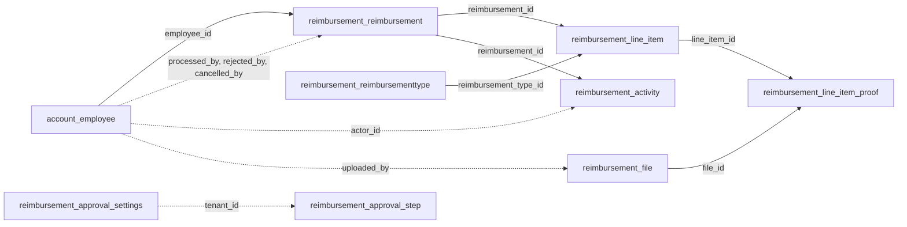
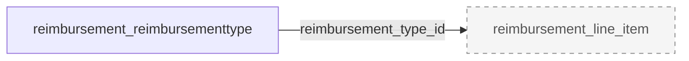
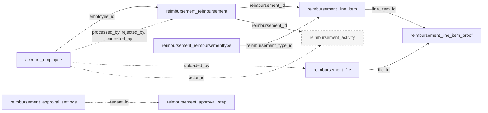
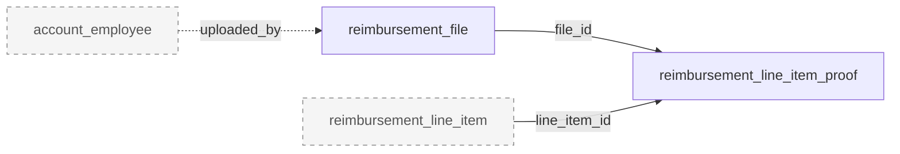
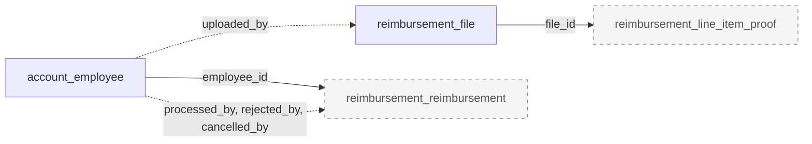
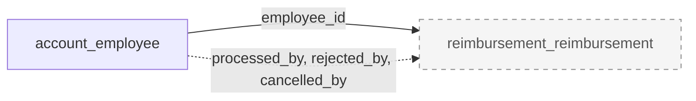
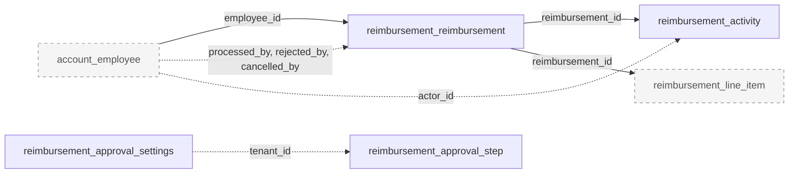
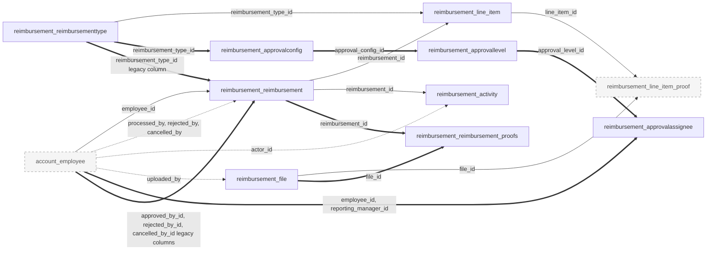

# finance-service-node - Existing Database Architecture

## 1. Document Metadata

| Item | Value |
|---|---|
| Service | `finance-service-node` |
| Repository path | `/Users/akshay/Development/autoscal/main-autoscal-repos/finance-service-node` |
| Branch / commit | `dev` @ `f2db503` (2026-10-13, "Merge pull request #99 from autoscal-SP18/chore/ai-skills-plugins") |
| Analysis date | 2026-10-14 |
| Scope | `prisma/schema.prisma`, all 10 folders under `prisma/migrations/` plus `migration_lock.toml`, `prisma/reshape/*.sql`, `prisma/seed.js`, runtime code (`index.js`, `config/`, `app/**`, `utils/`), ops code (`scripts/`), deploy files (`entrypoint.sh`, `Dockerfile`, `docker-compose-*.yml`, `check-env.sh`), tests (`tests/`), repo docs (`CLAUDE.md`, `.claude/skills/finance-service-conventions/`, `temp/multitenancy-audit/`), and read-only cross-checks in the active sibling repos. The deprecated `finance-service-backend` was read only to describe the legacy tables this service's cutover SQL drops |
| Method | Static analysis only. Migration SQL was read in full and replayed by hand. Prisma delegate calls were traced from routes through controllers, validators, helpers, services and the scheduler |
| Not done | No live database was queried (no authorised connection; `.env*` reads are blocked by repo hooks). `prisma migrate diff` and `prisma validate` were not run. Mermaid diagrams were checked structurally, not rendered |

**Important limitations**

- Every table, column and constraint below is what the schema and migrations declare. None of it is confirmed against a running database.
- Long-lived environments were not created by replaying the migrations. They are Django tables "evolved in place" (`prisma/schema.prisma:1-5`) by one-time SQL in `prisma/reshape/`, so live DDL may differ from the replayed baseline (see [R1](#r1-live-database-provenance-and-the-unrecorded-baseline)).
- "Referenced by runtime code" means a static reference was found. It does not prove the code path runs in production.
- `finance-service-backend` (deprecated) and `autoscal-claude-plugins` were excluded from feature analysis.

## 2. Service Overview

finance-service-node owns reimbursements for Autoscal: reimbursement types, requests with line items and proof files, a per-tenant approval chain backed by auth-service custom permissions, processing (manual and a monthly auto-process cron), super-admin and approver reports, and Excel export (`CLAUDE.md:3`). It replaces the reimbursement module of the Django `finance-service-backend` and kept that service's table names. It holds a local mirror of employees, pushed by auth-service, that its auth middleware depends on. No sibling service reads its database directly; consumers use HTTP (frontend, auth-service, attendance, spark-assist) or its Redis notification events (notification-service).

| Item | Verified value | Evidence |
|---|---|---|
| Engine | PostgreSQL (local dev image `postgres:14-alpine3.16`) | `prisma/schema.prisma:11-14`, `prisma/migrations/migration_lock.toml`, `docker-compose-dev.yml:4-23` |
| Connection | single datasource, env var `DATABASE_URL`; no `directUrl`, `shadowDatabaseUrl`, `schemas` or `relationMode` | `prisma/schema.prisma:11-14`, `.envSample:9` |
| ORM | Prisma 6 (`prisma` and `@prisma/client` `^6.18.0`), `prisma-client-js`, CommonJS, no preview features | `package.json:29,48`, `prisma/schema.prisma:7-9` |
| Schema organisation | implicit `public` schema; 9 models, 0 enums, in a 212-line `schema.prisma`. Django-era tables keep a `BIGSERIAL id` PK (Prisma field `internal_id`) plus a unique UUID business key that carries FKs and the public API; newer tables use a UUID PK | `prisma/schema.prisma:1-5`, `.claude/skills/finance-service-conventions/references/prisma-and-schema.md:17-18` |
| Migration tooling | Prisma Migrate, 10 folders (`20260714091630_initial_model` to `20260929120000_employee_tenant_team_member_unique`). `entrypoint.sh` runs `npm run migrate` (`prisma migrate deploy && prisma generate`) on every container start | `entrypoint.sh:4-7`, `package.json` `scripts.migrate`, `CLAUDE.md:40` |
| One-time cutover | `prisma/reshape/1_additive.sql`, `2_drop_legacy.sql`, `finance_dev_db2_reshape.sql` and `scripts/backfill-reimbursements.js` reshaped the Django tables before Prisma took over. Not wired to any script; documented as already run | `CLAUDE.md:41`, `prisma-and-schema.md:23` |
| Data access | One extended client (`app/models/prismaClient.js:5-16`) whose only hook throws when `where.tenant_id` is present but `undefined`; model aliases in `app/models/index.js:3-13`. 1 runtime raw SQL site (advisory lock), 7 runtime `$transaction` sites, all interactive | see [5.2 Evidence index](#52-evidence-index) |
| Seeds | `prisma/seed.js` is wired (`package.json:64-66`) but its `seed()` is empty | `prisma/seed.js:3` |
| Stores outside Postgres | S3 (proof files, `reimbursement_file.file_key`), Redis (notification publish only) | `app/helpers/upload.helper.js:68-82`, `app/helpers/reimbursementNotifications.helper.js:41` |

**Sources used to determine the schema**: `schema.prisma` (declared state) and the replayed migration SQL (historical and final DDL). They agree on every table, column type, nullability, default, index and FK (compared by hand). Legacy objects come from `prisma/reshape/*.sql`, `scripts/backfill-reimbursements.js` and the conditional block in `20260929110000_file_tenant_required`.

**Live database caveat**: no environment was inspected. Environments that started as the Django database (named in the repo: `finance_dev_db2` and "prod", `prisma/reshape/finance_dev_db2_reshape.sql:1`, `scripts/backfill-reimbursements.js:1-14`) cannot have run `initial_model` as written, because it uses plain `CREATE TABLE` on tables the reshape already created. Every finding that depends on deployed DDL or data has a verification step in [4. Migration Risks and Unresolved Issues](#4-migration-risks-and-unresolved-issues).

### 2.1 Service-Level Metrics

Counting rules are defined in [5.1 Counting rules](#51-counting-rules).

| Metric | Value |
|---|---:|
| Application modules identified | 13 (12 runtime, 1 ops: One-time cutover). 11 runtime modules access the database; Notifications does not |
| Distinct tables (declared or referenced) | 13 = 9 declared (schema and replayed migrations) + 4 legacy referenced only by cutover SQL, the backfill script and one conditional migration block |
| Tables declared in schema or migrations (final state) | 9 |
| Tables referenced by code but not declared in this repo | 4 (all legacy, none by runtime code) |
| Tables referenced by runtime application code | 9 |
| Tables with no runtime-code reference found | 4 (the legacy tables) |
| Tables confirmed in a live database | 0 (not verified, no access) |
| Status: Active / Deprecated or legacy / Apparently unused / Uncertain | 9 / 4 / 0 / 0 |
| Uncertain or conflicting cases (not table statuses) | 7: live DDL vs replay and the unrecorded `initial_model` baseline ([R1](#r1-live-database-provenance-and-the-unrecorded-baseline), 2 cases); legacy object existence ([R2](#r2-legacy-tables-and-columns-may-still-exist)); Django payroll sharing the database ([R3](#r3-django-payroll-may-share-or-shadow-these-tables)); `account_employee` read-only comment vs runtime writes ([R4](#r4-account_employee-ownership-and-shape)); file registration with no caller and the stale backfill script ([R13](#r13-stale-one-time-and-uncalled-code-paths), 2 cases) |
| Tables with a declared primary key | 9 of 9 declared (legacy: Django `BigAutoField` `id` per the Django models, not declared in this repo) |
| Declared FK relationships (schema `@relation` and migration SQL, matched 1:1) | 6 current; 1 historical (dropped by `20260727181516`) |
| Tables with at least one outbound FK / inbound FK | 4 / 5 |
| Inferred intra-database relationships (no FK) | 6 (5 actor columns to `account_employee`, 1 `tenant_id` pairing of approval settings and steps) |
| Legacy relationships (Django model declarations, live presence unverified) | 8 table-pair edges, drawn only in [3.13](#313-one-time-cutover-ops); plus `reimbursement_approvalassignee.role_id` to a Django table outside this inventory |
| Cross-service id columns with no FK | 6 `tenant_id` columns plus 5 permission-key columns (targets in auth-service) |
| Leaf tables | 2 (`reimbursement_activity`, `reimbursement_line_item_proof`) |
| Isolated tables (declared FKs) | 2 (`reimbursement_approval_step`, `reimbursement_approval_settings`) |
| Root-only tables (inbound FKs, no outbound) | 3 (`account_employee`, `reimbursement_reimbursementtype`, `reimbursement_file`) |
| Declared self-references / FK cycles | 0 / 0 |
| Junction tables | 1 current explicit (`reimbursement_line_item_proof`); 1 legacy (`reimbursement_reimbursement_proofs`) |
| Tables used by more than one module | 9 (every declared table); 0 legacy |
| Columns documented (declared tables) | 104 |
| Views / materialized views | 0 / 0 |
| Other database objects | 0 enum types; 9 primary keys; 19 secondary indexes (9 unique, 10 non-unique, 2 of them GIN); 3 `BIGSERIAL` sequences; 0 CHECK constraints, functions, triggers or extensions; Prisma's `_prisma_migrations` (tooling, not counted) |
| Tables created / dropped in Prisma history | 9 / 0 (4 legacy tables dropped outside Prisma by `prisma/reshape/2_drop_legacy.sql:8-11`) |

- Tables are counted once. Views and enums are never counted as tables.
- Legacy relationships come from Django model declarations in the deprecated repo, so they are excluded from leaf, isolated, root and cycle counts. The 4 legacy tables are excluded from those counts too.
- The 6 inferred relationships do not change the counts above. If enforced, the approval step and settings tables would stop being isolated, and `reimbursement_file` would gain an outbound edge (so it would no longer be root-only).
- Cross-service id columns are documented per table but do not count toward relationship metrics, because their targets are in other databases.

### 2.2 Database Object Inventory

Status is exclusive: each table has exactly one. Evidence for each table is in its canonical definition.

| Status | Count | Basis | Tables |
|---|---:|---|---|
| Active | 9 | Runtime Prisma delegate call or nested relation read/write found, and a consumer found (frontend, auth-service, attendance, spark-assist or the in-process cron) | [`account_employee`](#table-account_employee), [`reimbursement_reimbursementtype`](#table-reimbursement_reimbursementtype), [`reimbursement_reimbursement`](#table-reimbursement_reimbursement), [`reimbursement_line_item`](#table-reimbursement_line_item), [`reimbursement_line_item_proof`](#table-reimbursement_line_item_proof), [`reimbursement_activity`](#table-reimbursement_activity), [`reimbursement_approval_step`](#table-reimbursement_approval_step), [`reimbursement_approval_settings`](#table-reimbursement_approval_settings), [`reimbursement_file`](#table-reimbursement_file) |
| Deprecated / legacy | 4 | Dropped by the cutover (`prisma/reshape/2_drop_legacy.sql:7-11`, "replaced by RBAC"); still expected in at least one environment (`20260929110000_file_tenant_required/migration.sql:12`) | [`reimbursement_approvalconfig`](#table-reimbursement_approvalconfig), [`reimbursement_approvallevel`](#table-reimbursement_approvallevel), [`reimbursement_approvalassignee`](#table-reimbursement_approvalassignee), [`reimbursement_reimbursement_proofs`](#table-reimbursement_reimbursement_proofs) |
| Apparently unused | 0 | Every declared table has a runtime reference | none |
| Uncertain | 0 | No table lacks a consumer | none |

**By source category**

| Category | Count | Notes |
|---|---:|---|
| 1. Declared in schema or migration files | 9 | The 9 Prisma models; `CREATE TABLE` in `20260714091630_initial_model` (6), `20260715073401_approval_chain_rework` (2), `20260727181516_line_item_multi_proof` (1) |
| 2. Referenced by application code | 13 | 9 by runtime code; 4 legacy only by ops code (`prisma/reshape/*.sql`, `scripts/backfill-reimbursements.js:43-64`) and by the conditional `DO` block in `20260929110000_file_tenant_required/migration.sql:13-22` |
| 3. Confirmed in a live database | 0 | Not verified |
| 4. Existence or runtime use cannot be verified | 4 existence cases | The 4 legacy tables exist only where `2_drop_legacy.sql` never ran. Existence of the 9 declared tables in any environment is also unverified until category 3 is checked |

**Views and other objects (not counted as tables)**

| Object | Count | Source |
|---|---:|---|
| Views / materialized views | 0 | No `CREATE VIEW` in migrations or reshape SQL; no `view` block in the schema |
| Enum types | 0 | No `enum` block, no `CREATE TYPE`. Status columns are `VARCHAR` with values in app code (`prisma-and-schema.md:28`) |
| Primary keys | 9 | One per declared table |
| Secondary indexes | 19 | 9 unique (all `CREATE UNIQUE INDEX`, none as table constraints), 10 non-unique (2 GIN). No partial or expression indexes |
| Sequences | 3 | Implicit `BIGSERIAL` sequences on `reimbursement_reimbursementtype.id`, `reimbursement_reimbursement.id`, `reimbursement_file.id` (`20260714091630_initial_model/migration.sql:22,40,106`) |
| CHECK constraints, functions, triggers, extensions, generated columns | 0 | grep of all migration and reshape SQL |
| Advisory locks (runtime, not persisted) | 1 site | `app/controllers/approvalSettings.controller.js:67` |
| Prisma migration bookkeeping | 1 | `_prisma_migrations`, created by Prisma Migrate |

### 2.3 Module Summary

| Module | Purpose | Total Tables | Active | Deprecated/Legacy | Apparently Unused | Shared/Uncertain |
|---|---|---:|---:|---:|---:|---:|
| [Reimbursements](#31-reimbursements) | Employee request lifecycle: create, draft, edit, submit, cancel, duplicate, list, show | 9 | 7 | 0 | 0 | 2 |
| [Approvals workflow](#32-approvals-workflow) | Approve, reject, process, reverse over the chain snapshot | 9 | 7 | 0 | 0 | 2 |
| [Reimbursement types](#33-reimbursement-types) | Tenant expense categories, archive, soft delete | 1 | 1 | 0 | 0 | 0 |
| [Approval settings](#34-approval-settings) | Approval steps, processing key, auto-process config | 2 | 2 | 0 | 0 | 0 |
| [Tenant reports and approver queue](#35-tenant-reports-and-approver-queue) | Approver and super-admin lists, stats, export, pending count | 8 | 6 | 0 | 0 | 2 |
| [Files](#36-files) | Presigned upload and delete of proof files | 2 | 2 | 0 | 0 | 0 |
| [File registration (internal)](#37-file-registration-internal) | Adopt AI chat attachments as proof files | 2 | 0 | 0 | 0 | 2 |
| [Employee sync (internal)](#38-employee-sync-internal) | Upsert employee mirror pushed by auth-service | 1 | 1 | 0 | 0 | 0 |
| [Auth middleware](#39-auth-middleware) | Resolve JWT caller to local employee row | 1 | 1 | 0 | 0 | 0 |
| [Auto-process scheduler](#310-auto-process-scheduler) | Monthly auto-processing of approved requests | 4 | 2 | 0 | 0 | 2 |
| [Django import (internal)](#311-django-import-internal) | One-time ingest of the Django export | 9 | 7 | 0 | 0 | 2 |
| [Notifications](#312-notifications) | Redis events to notification-service (no DB access) | 0 | 0 | 0 | 0 | 0 |
| [One-time cutover (ops)](#313-one-time-cutover-ops) | Reshape SQL and backfill script (not runtime) | 9 | 5 | 4 | 0 | 0 |

- Total = Active + Deprecated/Legacy + Apparently Unused + Shared/Uncertain.
- **Active**: the table's status is Active, the module's own files (route, controller, validator, module-named helper or service) query it, including nested `include`/`select`, relation filters and nested writes, and the module has a known caller or trigger.
- **Shared/Uncertain**: the module reaches the table only through another module's code (mostly `loadChainConfig`/`buildSubmissionState` in `app/helpers/approvalChain.helper.js:4-13,34` and `applyAction` in `app/helpers/approvalWorkflow.helper.js:39-72`), or the module has no caller found in the workspace (File registration).
- For the ops module, Active counts tables whose status is Active even though the code is not runtime.
- Module totals are non-exclusive: `account_employee` appears in 7 modules and `reimbursement_reimbursement` in 6. Do not add module totals; the service total is 13.

### 2.4 Migration-Relevant Findings

1. **Live DDL is not the replayed DDL.** Django-origin environments were reshaped in place and `initial_model` must have been marked applied without running; nothing in the repo records how. Django-era defaults, timestamp precision, FK names, `unique_together` constraints and extra `account_employee` columns may differ per environment ([R1](#r1-live-database-provenance-and-the-unrecorded-baseline)).
2. **Legacy objects may still exist.** 4 tables and 7 columns are dropped only by `2_drop_legacy.sql`, and `20260929110000` codes for an environment where they were never dropped ([R2](#r2-legacy-tables-and-columns-may-still-exist)).
3. **Possible second writer from Django payroll.** The deprecated Django service still runs payroll, which writes reimbursement status and has an FK to its reimbursement model. Whether it shares this database is unverified ([R3](#r3-django-payroll-may-share-or-shadow-these-tables)).
4. **`account_employee` is a written mirror, documented as read-only.** auth-service pushes it, the Django import writes it, migrations add uniques to it, and the schema comment says "NOT modified by this service" ([R4](#r4-account_employee-ownership-and-shape)).
5. **Relationships live in the app.** 6 FKs total; actor columns, tenant consistency across FK edges, permission keys and the approval chain JSON are enforced only in code ([R5](#r5-cross-service-ids-and-unenforced-relationships), [R6](#r6-invariants-not-enforced-by-the-database), [R12](#r12-denormalised-approval-state)).
6. **Dual keys and client-side defaults.** FKs reference unique non-PK UUID columns, UUIDs and `@updatedAt` have no DB default, and 3 sequences need resetting after any copy ([R7](#r7-dual-keys-client-side-defaults-and-sequences)).
7. **Stale or one-time code.** The backfill script writes a dropped column, the Django import endpoint is still mounted, and the file registration endpoint has no caller ([R13](#r13-stale-one-time-and-uncalled-code-paths)).
8. **Postgres-specific behaviour** the next data layer must keep: JSONB, `VARCHAR[]` with GIN and `hasSome`, transaction-scoped advisory locks, optimistic compare-and-set updates ([R10](#r10-postgres-specific-features), [R11](#r11-concurrency-control-in-application-code)).
9. **Not verified against a live database.** All findings come from the repository.

## 3. Module Documentation

Modules follow the route groups mounted in `app/routes/api.routes.js:3-11` (cross-checked with the repo `CLAUDE.md` domain map, `CLAUDE.md:54-64`), plus the cron, the auth middleware, notifications and the ops cutover code. Each table has exactly one canonical definition, placed under the module that writes it through its own files; legacy tables sit under the cutover module.

**Diagram conventions (all modules)**: Mermaid flowcharts. Arrows run from the referenced parent table to the child table that holds the reference, labelled with the child column. Solid arrow (`-->`): FK declared in `schema.prisma` and present in migration SQL. Dotted arrow (`-.->`): relationship inferred from application code, no FK. Thick arrow (`==>`): legacy relationship declared in the Django models of the deprecated repo, live presence unverified (cutover diagram only). Dashed grey box: table outside the module, shown when it is a direct declared-FK neighbour of a module table. Inferred edges are drawn only when both ends are on the diagram. Cross-service references are not drawn. No relationship is inferred from naming alone.

### 3.1 Reimbursements

**Purpose:** The employee-facing request lifecycle under `/api/reimbursements` (`app/routes/reimbursement.route.js:30-42`): create and submit, save draft, list own requests, show, batch lookup, edit or submit a draft, cancel, duplicate, and the approver-status probe (handled by `approvalSettings.controller.js:92`). Entry: `app/controllers/reimbursement.controller.js`, `app/helpers/reimbursement.helper.js`, `app/validators/`. Creates the request header, its line items, proofs and activity rows in one transaction and marks attached files uploaded. Interacts with Reimbursement types (reads active types), Files (attaches and garbage-collects proof files), Approval settings (chain snapshot at submission via `buildSubmissionState`), Notifications (submit events) and Approvals workflow (shares `REQUEST_INCLUDE`).

**Module metrics:** 9 distinct tables: 7 active (direct), 0 deprecated/legacy, 0 apparently unused, 2 shared/uncertain (both reached via `app/helpers/approvalChain.helper.js`). 9 of 9 are also used by other modules.

**Tables used**

| Table | Usage status | Definition |
|---|---|---|
| `reimbursement_reimbursement` | Active (direct) | [reimbursement_reimbursement](#table-reimbursement_reimbursement) (here) |
| `reimbursement_line_item` | Active (direct) | [reimbursement_line_item](#table-reimbursement_line_item) (here) |
| `reimbursement_line_item_proof` | Active (direct) | [reimbursement_line_item_proof](#table-reimbursement_line_item_proof) (here) |
| `reimbursement_activity` | Active (direct) | [reimbursement_activity](#table-reimbursement_activity) (here) |
| `reimbursement_file` | Active (direct) | [reimbursement_file](#table-reimbursement_file) (under Files) |
| `reimbursement_reimbursementtype` | Active (direct) | [reimbursement_reimbursementtype](#table-reimbursement_reimbursementtype) (under Reimbursement types) |
| `account_employee` | Active (direct, `include`) | [account_employee](#table-account_employee) (under Employee sync) |
| `reimbursement_approval_step` | Active (via shared code) | [reimbursement_approval_step](#table-reimbursement_approval_step) (under Approval settings) |
| `reimbursement_approval_settings` | Active (via shared code) | [reimbursement_approval_settings](#table-reimbursement_approval_settings) (under Approval settings) |

**Key database operations**

| Endpoint | Operations | Evidence |
|---|---|---|
| `POST /`, `POST /draft` | read active types and attachable files; `$transaction`: chain snapshot read (submit only), `reimbursement.create` with nested `line_items.create` and `proofs.create`, `file.updateMany` to `UPLOADED`, `reimbursementActivity.create`; re-read with `REQUEST_INCLUDE` | `reimbursement.controller.js:31,70-79,106-154,156` |
| `GET /` | `count` + `findMany` scoped by `tenant_id` and `employee_id`, include employee and line items with proofs, files and types | `reimbursement.controller.js:215-226` |
| `GET /batch`, `GET /:id` | `findMany`/`findFirst` by business id and tenant, then `loadChainConfig` | `reimbursement.controller.js:261,268,293,302` |
| `PUT /:id` | `$transaction`: read proofs, `reimbursementLineItem.deleteMany` (proofs cascade), `reimbursement.update` with nested line item and proof creates, `file.updateMany`, global "still referenced" proof check, `file.findMany` + `file.deleteMany` for orphans, activity create; S3 delete after commit | `reimbursement.controller.js:386-475,479-483` |
| `PUT /:id/cancel` | `$transaction`: `reimbursement.update` to `CANCELLED`, activity create | `reimbursement.controller.js:526-547` |
| `POST /:id/duplicate` | `$transaction`: create `DRAFT` copy with nested line items and proofs, activity with `new_entity.duplicated_from` | `reimbursement.controller.js:592-628` |

#### Table details

#### Table: reimbursement_reimbursement

**Table overview**

- Canonical name: `public.reimbursement_reimbursement` (model `Reimbursement`, `prisma/schema.prisma:58-108`).
- Purpose: one row per reimbursement request (header): claimant, claimed and approved amounts, lifecycle status, the approval chain snapshot taken at submission, and who processed, rejected or cancelled it.
- Accessed by: Reimbursements, Approvals workflow, Tenant reports, Auto-process scheduler, Django import, One-time cutover (6 modules).
- Classification: **Active**. Evidence: nested create in a transaction (`reimbursement.controller.js:116`), compare-and-set `updateMany` (`approvalWorkflow.helper.js:48`), `groupBy` for stats (`reimbursementReport.controller.js:184`), cron sweep (`autoProcess.service.js:21`). Consumers: frontend `src/pages/reimbursement/api.ts`, spark-assist `api_rag/services/finance.py:131-432`.
- Definition source: Django table (pre-existing columns inferred from what the reshape did not add), reshaped by `prisma/reshape/1_additive.sql:7-22,32-36` and `2_drop_legacy.sql:14-21`; declared by `20260714091630_initial_model/migration.sql:39-69`, altered by `20260715073401_approval_chain_rework` (drop 4, add 4 columns) and `20260924100000_reimbursement_passed_permission_keys`.

**Attributes** (physical column order after replay)

| Column | Database Type | Nullable | Default | Key/Constraint | Description |
|---|---|---|---|---|---|
| id | bigserial (bigint) | No | `nextval` | PK `reimbursement_reimbursement_pkey`; Prisma field `internal_id` | Internal Django-era key; never returned by the API (`prisma-and-schema.md:18`); export cursor (`reimbursementReport.controller.js:290-296`) |
| reimbursement_id | uuid | No | Prisma `uuid()` (client-side, no DB default) | UNIQUE `reimbursement_reimbursement_reimbursement_id_key`; FK target | Public request id; preserved from Django on import |
| tenant_id | varchar | No | | Leading column of 3 indexes | auth-service tenant UUID stored as text (cross-service, no FK) |
| employee_id | uuid | No | | FK `reimbursement_reimbursement_employee_id_fkey` to `account_employee.employee_id`, ON DELETE RESTRICT, ON UPDATE CASCADE | Claimant |
| amount | decimal(10,2) | No | `0` | | Claimed total |
| approved_amount | decimal(10,2) | Yes | | | Amount approved by the workflow (written in `approvalWorkflow.helper.js`) |
| date | date | No | | | Request date |
| note | text | Yes | | | Free-text note from the claimant |
| currency_code | varchar(3) | No | `'INR'` | | ISO currency code |
| details | jsonb | No | `'{}'` | | Free-form request details; no DB validation |
| status | varchar(20) | No | `'DRAFT'` | No CHECK | `DRAFT`, `SUBMITTED`, `IN_APPROVAL`, `APPROVED`, `PROCESSED`, `REJECTED`, `CANCELLED`; transitions in `approvalWorkflow.helper.js:9-17` |
| submitted_at | timestamptz(3) | Yes | | | Submission time |
| processed_by | uuid | Yes | | No FK (inferred to `account_employee.employee_id`) | Processor; `NULL` when the cron processes (`approvalWorkflow.helper.js:156,178`) |
| processed_at | timestamptz(3) | Yes | | | Processing time |
| rejected_by | uuid | Yes | | No FK (inferred to `account_employee.employee_id`) | Rejecting approver (`approvalWorkflow.helper.js:141`) |
| rejected_at | timestamptz(3) | Yes | | | Rejection time |
| rejection_reason | text | Yes | | | Reason given on reject |
| cancelled_by | uuid | Yes | | No FK (inferred to `account_employee.employee_id`) | Claimant who cancelled (`reimbursement.controller.js:531`) |
| cancelled_at | timestamptz(3) | Yes | | | Cancellation time |
| cancellation_note | text | Yes | | | Note on cancel |
| approval_comment | varchar(300) | Yes | | | Approver comment |
| created | timestamptz(3) | No | `CURRENT_TIMESTAMP` | | Creation time (Django `TimeStampedModel` name); exposed as `created_at` |
| modified | timestamptz(3) | No | `CURRENT_TIMESTAMP` | Prisma `@updatedAt` only, no trigger | Last update |
| approval_chain | jsonb | No | `'[]'` | | Snapshot of the chain at submission: steps with `permission_key`, `status` (`PENDING`/`APPROVED`), `approved_by`, `approved_by_snapshot` (`schema.prisma:71-75`, `approvalWorkflow.helper.js:97-106`) |
| chain_permission_keys | varchar(100)[] | Yes in DB (Prisma treats as required) | `ARRAY[]::VARCHAR(100)[]` | GIN index | All step permission keys of the chain; drives the approver queue |
| current_step | integer | Yes | | | 0-based index awaiting action while `SUBMITTED`/`IN_APPROVAL`; kept on `REJECTED`; null otherwise |
| current_step_permission_key | varchar(100) | Yes | | In index with `tenant_id` | Permission key of the step awaiting action |
| passed_permission_keys | varchar(100)[] | Yes in DB | `ARRAY[]::VARCHAR(100)[]` | GIN index | Keys of steps already approved; keeps the request in those approvers' history. Backfilled from `approval_chain` by `20260924100000:5-16` |

Dropped columns: `account_approved_at`, `account_approved_by`, `admin_approved_at`, `admin_approved_by` (added by `1_additive.sql:7-19` and `initial_model:52-55`, dropped by `20260715073401:11-14`). Legacy Django columns dropped outside Prisma: see [R2](#r2-legacy-tables-and-columns-may-still-exist).

**Relationships**

| Direction | Related table | Columns | Cardinality | Enforcement | Modules |
|---|---|---|---|---|---|
| Out | [`account_employee`](#table-account_employee) | `employee_id` to `account_employee.employee_id` | many to 1 (required) | Declared FK, RESTRICT | Reimbursements, Reports (relation filter), Import |
| Out | [`account_employee`](#table-account_employee) | `processed_by`, `rejected_by`, `cancelled_by` to `account_employee.employee_id` | many to 0..1 each | Inferred: values come from `req.current_team_member.id`, which is `employee_id` (`app/middleware/authentication.js:78`) | Approvals workflow, Reimbursements |
| In | [`reimbursement_line_item`](#table-reimbursement_line_item) | `reimbursement_line_item.reimbursement_id` to `reimbursement_id` | 1 to many | Declared FK, CASCADE | all request modules |
| In | [`reimbursement_activity`](#table-reimbursement_activity) | `reimbursement_activity.reimbursement_id` to `reimbursement_id` | 1 to many | Declared FK, CASCADE | all request modules |
| Logical | [`reimbursement_approval_step`](#table-reimbursement_approval_step) | `approval_chain[].permission_key`, `chain_permission_keys`, `current_step_permission_key`, `passed_permission_keys` copy `permission_key` values | snapshot, not a reference | None; copied at submission (`approvalChain.helper.js:34-57`) | Approvals workflow, Reports |
| Legacy in | [`reimbursement_reimbursement_proofs`](#table-reimbursement_reimbursement_proofs) | `reimbursement_id` to `id` (bigint) | 1 to many | Django M2M, only where not dropped | One-time cutover |
| Cross-service | auth-service tenants and custom permissions | `tenant_id`, permission-key columns | | None | all |

**Additional details**

- No soft delete and no delete endpoint; `CANCELLED` is the end state for withdrawn requests. Rows can still disappear only if an employee were deleted, which RESTRICT blocks.
- Every status change goes through `applyAction` with an optimistic compare-and-set on `(reimbursement_id, status, current_step)` (`approvalWorkflow.helper.js:48`); a zero count returns 422. See [R11](#r11-concurrency-control-in-application-code).
- Queries: approver queue uses `chain_permission_keys hasSome`, `passed_permission_keys hasSome / isEmpty` and `current_step_permission_key in` (`reimbursementReport.controller.js:118-171`); search uses `employee.full_name contains insensitive` (`:131`), which no index supports.
- Possible external inbound FK from Django payroll (`PayslipEarning`) if the Django service shares this database ([R3](#r3-django-payroll-may-share-or-shadow-these-tables)).
- Migration risks: dual key ([R7](#r7-dual-keys-client-side-defaults-and-sequences)), nullable array columns ([R6](#r6-invariants-not-enforced-by-the-database)), denormalised chain columns ([R12](#r12-denormalised-approval-state)).

#### Table: reimbursement_line_item

**Table overview**

- Canonical name: `public.reimbursement_line_item` (model `ReimbursementLineItem`, `prisma/schema.prisma:143-161`).
- Purpose: one expense line of a request, with its type, amount, date and type-specific details.
- Accessed by: Reimbursements, Approvals workflow, Tenant reports, Django import, One-time cutover (5 modules).
- Classification: **Active**. Evidence: nested create (`reimbursement.controller.js:116,419`), `deleteMany` on edit (`:397`), `findMany` (`:372`), import create (`reimbursementImport.service.js:329`).
- Definition source: created by `1_additive.sql:38-51` on reshaped DBs and by `initial_model:72-86`; `proof_id` moved out by `20260727181516`; `description` widened to `TEXT` by `20260728114231`.

**Attributes**

| Column | Database Type | Nullable | Default | Key/Constraint | Description |
|---|---|---|---|---|---|
| id | uuid | No | Prisma `uuid()` (client-side) | PK `reimbursement_line_item_pkey` | Line item id; regenerated on every edit (see below) |
| reimbursement_id | uuid | No | | FK `reimbursement_line_item_reimbursement_id_fkey` to `reimbursement_reimbursement.reimbursement_id`, ON DELETE CASCADE, ON UPDATE CASCADE; index `reimbursement_line_item_reimbursement_id_idx` | Parent request |
| reimbursement_type_id | uuid | No | | FK `reimbursement_line_item_reimbursement_type_id_fkey` to `reimbursement_reimbursementtype.reimbursement_type_id`, ON DELETE RESTRICT, ON UPDATE CASCADE; no index | Expense type |
| description | text | No | | | Line description (was `varchar(255)` until `20260728114231`) |
| amount | decimal(10,2) | No | | | Line amount |
| expense_date | date | Yes | | | Date of the expense |
| details | jsonb | No | `'{}'` | | Values for the type's `supporting_fields`, validated in `reimbursement.helper.js:12-23` |
| order | integer | No | `0` | Reserved word, quoted in SQL | Display order |
| created_at | timestamptz(3) | No | `CURRENT_TIMESTAMP` | | Creation time |
| updated_at | timestamptz(3) | No | `CURRENT_TIMESTAMP` | Prisma `@updatedAt` only | Last update |

Dropped column: `proof_id uuid` with FK `reimbursement_line_item_proof_id_fkey` to `reimbursement_file.file_id` (SET NULL), migrated into `reimbursement_line_item_proof` and dropped by `20260727181516:25-32`.

**Relationships**

| Direction | Related table | Columns | Cardinality | Enforcement | Modules |
|---|---|---|---|---|---|
| Out | [`reimbursement_reimbursement`](#table-reimbursement_reimbursement) | `reimbursement_id` | many to 1 | Declared FK, CASCADE | Reimbursements, Import |
| Out | [`reimbursement_reimbursementtype`](#table-reimbursement_reimbursementtype) | `reimbursement_type_id` | many to 1 | Declared FK, RESTRICT | Reimbursements, Types, Import |
| In | [`reimbursement_line_item_proof`](#table-reimbursement_line_item_proof) | `line_item_id` to `id` | 1 to many | Declared FK, CASCADE | Reimbursements, Files |

**Additional details**

- No `tenant_id`; tenant isolation comes only through the parent request.
- Edit replaces all line items: `deleteMany` then nested create in one transaction (`reimbursement.controller.js:397,419`), so line item ids are not stable across edits and proofs are recreated.
- Same-tenant consistency of the type is checked in code only (`loadTypes`, `reimbursement.controller.js:31-38`).
- Type FK has no index, so the RESTRICT check on a type delete scans this table (types are soft-deleted in practice).

#### Table: reimbursement_line_item_proof

**Table overview**

- Canonical name: `public.reimbursement_line_item_proof` (model `ReimbursementLineItemProof`, `prisma/schema.prisma:163-176`).
- Purpose: junction between line items and proof files (multi-proof per line).
- Accessed by: Reimbursements, Approvals workflow, Tenant reports, Files, Django import (5 modules).
- Classification: **Active**. Evidence: nested create (`reimbursement.controller.js:116,419`), reference checks (`:391,444`), `count` before file delete (`file.controller.js:95`).
- Definition source: `20260727181516_line_item_multi_proof/migration.sql:2-22`, with a data backfill from `reimbursement_line_item.proof_id` (`:25-28`, uses `gen_random_uuid()`).

**Attributes**

| Column | Database Type | Nullable | Default | Key/Constraint | Description |
|---|---|---|---|---|---|
| id | uuid | No | Prisma `uuid()` (client-side) | PK `reimbursement_line_item_proof_pkey` | Row id |
| line_item_id | uuid | No | | FK `reimbursement_line_item_proof_line_item_id_fkey` to `reimbursement_line_item.id`, ON DELETE CASCADE, ON UPDATE CASCADE; index `reimbursement_line_item_proof_line_item_id_idx`; UNIQUE `(line_item_id, file_id)` | Owning line item |
| file_id | uuid | No | | FK `reimbursement_line_item_proof_file_id_fkey` to `reimbursement_file.file_id`, ON DELETE RESTRICT, ON UPDATE CASCADE; second column of the unique index, no own index | Proof file |
| order | integer | No | `0` | Reserved word | Display order |
| created_at | timestamptz(3) | No | `CURRENT_TIMESTAMP` | | Creation time; no update column |

**Relationships**

| Direction | Related table | Columns | Cardinality | Enforcement | Modules |
|---|---|---|---|---|---|
| Out | [`reimbursement_line_item`](#table-reimbursement_line_item) | `line_item_id` | many to 1 | Declared FK, CASCADE | Reimbursements |
| Out | [`reimbursement_file`](#table-reimbursement_file) | `file_id` | many to 1 | Declared FK, RESTRICT | Reimbursements, Files |

**Additional details**

- Explicit M:N junction, unique per `(line_item_id, file_id)`. A file is not unique across line items, so one file can be attached to several line items or requests.
- Rows are never deleted directly; they go with their line item (CASCADE). `file.controller.js:95` refuses to delete an attached file because of RESTRICT.
- The "still referenced" check at `reimbursement.controller.js:444` is deliberately not tenant-scoped.
- `reimbursement_line_item_proof_line_item_id_idx` is redundant with the unique index's leading column; `file_id` has no index, so file deletes scan this table.
- Not listed in the test truncate set (`tests/helpers/db.js:7-16`); cleared only by CASCADE.

#### Table: reimbursement_activity

**Table overview**

- Canonical name: `public.reimbursement_activity` (model `ReimbursementActivity`, `prisma/schema.prisma:178-194`).
- Purpose: append-only audit log of request events with before and after snapshots.
- Accessed by: Reimbursements, Approvals workflow, Auto-process scheduler, Django import, One-time cutover (5 modules). Tenant reports does not read it (see [3.5](#35-tenant-reports-and-approver-queue)).
- Classification: **Active**. Evidence: create in every mutating transaction (`reimbursement.controller.js:142,463,536,613`, `approvalWorkflow.helper.js:57`, `reimbursementImport.service.js:348`).
- Definition source: `1_additive.sql:54-66` and `initial_model:89-102`; never altered.

**Attributes**

| Column | Database Type | Nullable | Default | Key/Constraint | Description |
|---|---|---|---|---|---|
| id | uuid | No | Prisma `uuid()` (client-side) | PK `reimbursement_activity_pkey` | Event id |
| reimbursement_id | uuid | No | | FK `reimbursement_activity_reimbursement_id_fkey` to `reimbursement_reimbursement.reimbursement_id`, ON DELETE CASCADE, ON UPDATE CASCADE; index `reimbursement_activity_reimbursement_id_idx` | Request |
| event_type | varchar(40) | No | | No CHECK | `CREATED`, `SUBMITTED`, `AUTO_APPROVED`, `UPDATED`, `CANCELLED`, `STEP_APPROVED`, `REJECTED`, `PROCESSED`, `REVERSED_STEP_APPROVAL`, `REVERSED_REJECTION`, `REVERSED_PROCESSING`, `MIGRATED` |
| actor_id | uuid | Yes | | No FK (inferred to `account_employee.employee_id`) | Acting employee; `NULL` for the cron's system actor (`approvalWorkflow.helper.js:61,164-180`) |
| actor_snapshot | jsonb | Yes | | | `{id, full_name, email}` at event time (`reimbursement.helper.js:85-92`) |
| amount | decimal(10,2) | Yes | | | Amount relevant to the event |
| reason | text | Yes | | | Reason or comment |
| old_entity | jsonb | Yes | | | State before (status, amount, actor ids; `reimbursement.helper.js:71-83`) |
| new_entity | jsonb | Yes | | | State after; `duplicated_from` holds a `reimbursement_id` on duplicates (`reimbursement.controller.js:623`) |
| created_at | timestamptz(3) | No | `CURRENT_TIMESTAMP` | | Event time; no update column |

**Relationships**

| Direction | Related table | Columns | Cardinality | Enforcement | Modules |
|---|---|---|---|---|---|
| Out | [`reimbursement_reimbursement`](#table-reimbursement_reimbursement) | `reimbursement_id` | many to 1 | Declared FK, CASCADE | all request modules |
| Out | [`account_employee`](#table-account_employee) | `actor_id` to `employee_id` | many to 0..1 | Inferred (actor is `req.current_team_member`, `approvalWorkflow.helper.js:61`) | Approvals workflow, Reimbursements |

**Additional details**

- Written in the same transaction as every request mutation; never updated or deleted by code. Grows without bound.
- Contains JSON snapshots with employee names and emails (personal data copied out of `account_employee`).
- The backfill script wrote `MIGRATED` rows with `migrated_from: 'django'` (`scripts/backfill-reimbursements.js:85-113`).

**Module relationship diagram**

### 3.2 Approvals workflow

**Purpose:** The per-step approval state machine: `PUT /api/reimbursements/:id/approve|reject|process` and `POST /:id/reverse` (`app/routes/reimbursement.route.js:45-48`) through `app/controllers/reimbursementApproval.controller.js` and `applyAction` in `app/helpers/approvalWorkflow.helper.js:39-72`. Each action is one interactive transaction: read the request, read the chain config, compare-and-set update, activity insert. The controller then re-reads the full request with `REQUEST_INCLUDE` (`reimbursementApproval.controller.js:9-10`) and triggers notifications. The cron reuses `applyAction` for system processing (`approvalWorkflow.helper.js:165-180`).

**Module metrics:** 9 distinct tables: 7 active (direct), 0 deprecated/legacy, 0 apparently unused, 2 shared/uncertain (approval step and settings via `loadChainConfig`). 9 of 9 are also used by other modules.

**Tables used**

| Table | Usage status | Definition |
|---|---|---|
| `reimbursement_reimbursement` | Active (direct) | [reimbursement_reimbursement](#table-reimbursement_reimbursement) (under Reimbursements) |
| `reimbursement_activity` | Active (direct) | [reimbursement_activity](#table-reimbursement_activity) (under Reimbursements) |
| `reimbursement_line_item` | Active (direct, `include`) | [reimbursement_line_item](#table-reimbursement_line_item) (under Reimbursements) |
| `reimbursement_line_item_proof` | Active (direct, `include`) | [reimbursement_line_item_proof](#table-reimbursement_line_item_proof) (under Reimbursements) |
| `reimbursement_file` | Active (direct, `include`) | [reimbursement_file](#table-reimbursement_file) (under Files) |
| `reimbursement_reimbursementtype` | Active (direct, `include`) | [reimbursement_reimbursementtype](#table-reimbursement_reimbursementtype) (under Reimbursement types) |
| `account_employee` | Active (direct, `include`) | [account_employee](#table-account_employee) (under Employee sync) |
| `reimbursement_approval_step` | Active (via shared code) | [reimbursement_approval_step](#table-reimbursement_approval_step) (under Approval settings) |
| `reimbursement_approval_settings` | Active (via shared code) | [reimbursement_approval_settings](#table-reimbursement_approval_settings) (under Approval settings) |

Writes on `reimbursement_reimbursement`: `status`, `approval_chain`, `approved_amount`, `current_step`, `current_step_permission_key`, `chain_permission_keys`, `passed_permission_keys` (recomputed by `denormFor`, `approvalWorkflow.helper.js:28-33`), `rejected_by/at`, `rejection_reason`, `processed_by/at`, `approval_comment`.

No canonical table definitions here.

**Module relationship diagram**

### 3.3 Reimbursement types

**Purpose:** Tenant CRUD and archive of expense categories under `/api/reimbursement-types` (`app/routes/reimbursementType.route.js:21-29`): create, list, get, update, archive. Entry: `app/controllers/reimbursementType.controller.js`, `app/validators/reimbursementType.validator.js` (validators query the table). Reimbursements and Import read types; line items reference them.

**Module metrics:** 1 distinct table: 1 active (direct), 0 deprecated/legacy, 0 apparently unused, 0 shared/uncertain. 1 of 1 is also used by other modules.

**Tables used**

| Table | Usage status | Definition |
|---|---|---|
| `reimbursement_reimbursementtype` | Active (direct) | [reimbursement_reimbursementtype](#table-reimbursement_reimbursementtype) (here) |

#### Table details

#### Table: reimbursement_reimbursementtype

**Table overview**

- Canonical name: `public.reimbursement_reimbursementtype` (model `ReimbursementType`, `prisma/schema.prisma:39-56`).
- Purpose: a tenant's expense category with a per-request cap, proof requirement and a JSON definition of extra fields line items must carry.
- Accessed by: Reimbursement types, Reimbursements, Approvals workflow, Tenant reports, Django import, One-time cutover (6 modules).
- Classification: **Active**. Evidence: `ReimbursementType.create/findMany/findFirst/update` (`reimbursementType.controller.js:8,36,54,80,98`), validator lookups (`reimbursementType.validator.js:40,63,95`), `loadTypes` (`reimbursement.controller.js:31`).
- Definition source: Django table; `supporting_fields` added by `1_additive.sql:24-25`; declared by `initial_model:21-36`; never altered by Prisma migrations.

**Attributes**

| Column | Database Type | Nullable | Default | Key/Constraint | Description |
|---|---|---|---|---|---|
| id | bigserial (bigint) | No | `nextval` | PK `reimbursement_reimbursementtype_pkey`; Prisma field `internal_id` | Internal Django-era key; Django FKs (legacy `reimbursement_reimbursement.reimbursement_type_id`, `reimbursement_approvalconfig`) pointed here |
| reimbursement_type_id | uuid | No | Prisma `uuid()` (client-side) | UNIQUE `reimbursement_reimbursementtype_reimbursement_type_id_key`; FK target | Public type id |
| tenant_id | varchar | No | | No index | auth-service tenant UUID as text |
| name | varchar(100) | No | | No DB unique | Type name; per-tenant case-insensitive uniqueness among non-deleted rows is checked in the validator only (`reimbursementType.validator.js:40,63`) |
| description | text | Yes | | | Description |
| is_proof_required | boolean | No | `true` | | Whether line items of this type need proof |
| max_amount_per_reimbursement | decimal(10,2) | No | `20000` | | Cap per request |
| supporting_fields | jsonb | No | `'[]'` | | Extra field definitions; keys validated against `line_item.details` (`reimbursement.helper.js:12-23`) |
| is_active | boolean | No | `true` | | Archive flag (`PATCH /:id/archive`, `reimbursementType.controller.js:98-100`) |
| is_deleted | boolean | No | `false` | | Soft delete; filtered on reads; no runtime path sets it true (only the Django import copies it, `reimbursementImport.service.js:120`) |
| created | timestamptz(3) | No | `CURRENT_TIMESTAMP` | | Creation time |
| modified | timestamptz(3) | No | `CURRENT_TIMESTAMP` | Prisma `@updatedAt` only | Last update |

**Relationships**

| Direction | Related table | Columns | Cardinality | Enforcement | Modules |
|---|---|---|---|---|---|
| In | [`reimbursement_line_item`](#table-reimbursement_line_item) | `reimbursement_line_item.reimbursement_type_id` to `reimbursement_type_id` | 1 to many | Declared FK, RESTRICT | Reimbursements, Import |
| Legacy in | [`reimbursement_approvalconfig`](#table-reimbursement_approvalconfig) | `reimbursement_type_id` to `id` | 1 to 0..1 | Django OneToOne, only where not dropped | One-time cutover |
| Legacy in | [`reimbursement_reimbursement`](#table-reimbursement_reimbursement) | dropped column `reimbursement_type_id` to `id` | many to 1 | Django FK, dropped by `2_drop_legacy.sql:15` | One-time cutover |
| Cross-service | auth-service tenants | `tenant_id` | | None | all |

**Additional details**

- The only table with soft delete (`prisma-and-schema.md:31`). Reads filter `is_deleted: false` by hand (`reimbursementType.controller.js:33,55`, validator `:44,67,96`, `reimbursement.controller.js:35`); line item `include`s do not, so history keeps deleted types.
- `update` and archive `where` clauses do not include `is_deleted`; they rely on the validator's `idRule`.
- Django migrations `0017_alter_reimbursementtype_unique_together` and `0018_alter_reimbursementtype_unique_together_and_more` in the deprecated repo changed a unique constraint on this table. Whether it survives on reshaped databases is unverified ([R1](#r1-live-database-provenance-and-the-unrecorded-baseline)).

**Module relationship diagram**

### 3.4 Approval settings

**Purpose:** Tenant admin configuration under `/api/reimbursement-approval-settings` (`app/routes/approvalSettings.route.js:14-16`): read the chain, replace the ordered approval steps (which mints and syncs custom permission keys in auth-service first, `approvalSettings.controller.js:61`), and configure monthly auto-process. Entry: `app/controllers/approvalSettings.controller.js`, `app/helpers/approvalChain.helper.js` (`loadChainConfig`, `buildSubmissionState`, also used by 5 other modules), `app/services/authService/customPermissions.js:14`.

**Module metrics:** 2 distinct tables: 2 active (direct), 0 deprecated/legacy, 0 apparently unused, 0 shared/uncertain. 2 of 2 are also used by other modules.

**Tables used**

| Table | Usage status | Definition |
|---|---|---|
| `reimbursement_approval_step` | Active (direct) | [reimbursement_approval_step](#table-reimbursement_approval_step) (here) |
| `reimbursement_approval_settings` | Active (direct) | [reimbursement_approval_settings](#table-reimbursement_approval_settings) (here) |

#### Table details

#### Table: reimbursement_approval_step

**Table overview**

- Canonical name: `public.reimbursement_approval_step` (model `ReimbursementApprovalStep`, `prisma/schema.prisma:110-123`).
- Purpose: one ordered approval step per row for a tenant, each tied to an auth-service custom permission key.
- Accessed by: Approval settings, plus reads via `loadChainConfig` in Reimbursements, Approvals workflow, Tenant reports, Auto-process scheduler, Django import (6 modules).
- Classification: **Active**. Evidence: `findMany`, `deleteMany`, `createMany` (`approvalSettings.controller.js:47,68,70`), `findMany` in `approvalChain.helper.js:6`.
- Definition source: `20260715073401_approval_chain_rework/migration.sql:21-31,45-51`. Not part of the Django schema; replaces the legacy `reimbursement_approval*` tables.

**Attributes**

| Column | Database Type | Nullable | Default | Key/Constraint | Description |
|---|---|---|---|---|---|
| id | uuid | No | Prisma `uuid()` (client-side) | PK `reimbursement_approval_step_pkey` | Step id; reused by id on replace (`approvalSettings.controller.js:52`) |
| tenant_id | varchar | No | | Index `reimbursement_approval_step_tenant_id_idx`; leading column of both uniques | auth-service tenant UUID as text |
| step_order | integer | No | | UNIQUE `(tenant_id, step_order)` | 0-based position of the step in the chain (array index on replace, `approvalSettings.controller.js:53`) |
| name | varchar(100) | No | | | Display name |
| permission_key | varchar(100) | No | | UNIQUE `(tenant_id, permission_key)` | auth-service custom permission key that grants this step |
| created | timestamptz(3) | No | `CURRENT_TIMESTAMP` | | Creation time |
| modified | timestamptz(3) | No | `CURRENT_TIMESTAMP` | Prisma `@updatedAt` only | Last update |

**Relationships**

| Direction | Related table | Columns | Cardinality | Enforcement | Modules |
|---|---|---|---|---|---|
| Logical | [`reimbursement_approval_settings`](#table-reimbursement_approval_settings) | same `tenant_id` | 1 settings row to many steps | Inferred: read together by tenant in `loadChainConfig` (`approvalChain.helper.js:4-13`); no Prisma relation | Approval settings, all chain readers |
| Logical | [`reimbursement_reimbursement`](#table-reimbursement_reimbursement) | `permission_key` copied into chain columns | snapshot | None | Reimbursements, Approvals workflow |
| Cross-service | auth-service custom permissions | `permission_key`, `tenant_id` | | None; synced by HTTP before the local write (`approvalSettings.controller.js:61`) | Approval settings |

**Additional details**

- Replace-all: inside one transaction, `pg_advisory_xact_lock(hashtext('reimbursement_approval_settings:'||tenant), hashtext(tenant))`, `deleteMany` by tenant, `createMany`, settings `upsert` (`approvalSettings.controller.js:63-79`). Hard delete.
- Auth-service sync runs before the transaction; if the local transaction then fails, auth-service holds keys that the local table does not.
- `reimbursement_approval_step_tenant_id_idx` is redundant with both unique indexes.

#### Table: reimbursement_approval_settings

**Table overview**

- Canonical name: `public.reimbursement_approval_settings` (model `ReimbursementApprovalSettings`, `prisma/schema.prisma:125-141`).
- Purpose: one row per tenant with the processing permission key and the monthly auto-process configuration and claim marker.
- Accessed by: Approval settings, Auto-process scheduler, plus reads via `loadChainConfig` in Reimbursements, Approvals workflow, Tenant reports, Django import (6 modules).
- Classification: **Active**. Evidence: `upsert` (`approvalSettings.controller.js:74,122`), cron `findMany`/`updateMany`/`update` (`autoProcess.service.js:63,98,108`), `findFirst` (`approvalChain.helper.js:10`).
- Definition source: `20260715073401:34-42,54`; `20260724100327_add_auto_process_settings` added 3 columns and an index; `20260727073021_auto_process_day_of_month` dropped `auto_process_start_date` and added `auto_process_day_of_month`.

**Attributes**

| Column | Database Type | Nullable | Default | Key/Constraint | Description |
|---|---|---|---|---|---|
| id | uuid | No | Prisma `uuid()` (client-side) | PK `reimbursement_approval_settings_pkey` | Row id |
| tenant_id | varchar | No | | UNIQUE `reimbursement_approval_settings_tenant_id_key` | One row per tenant |
| processing_permission_key | varchar(100) | Yes | | | Permission key for the final processing step (`constants/policies.js:19` `REIMBURSEMENT_PROCESSING`) |
| created | timestamptz(3) | No | `CURRENT_TIMESTAMP` | | Creation time |
| modified | timestamptz(3) | No | `CURRENT_TIMESTAMP` | Prisma `@updatedAt` only | Last update |
| auto_process_enabled | boolean | No | `false` | Index `reimbursement_approval_settings_auto_process_enabled_idx` | Monthly auto-process switch |
| auto_process_last_run_on | date | Yes | | | Last sweep date; compare-and-set claim marker against double runs (`autoProcess.service.js:98`) |
| auto_process_day_of_month | integer | Yes | | No CHECK | Day 1 to 31, clamped to month end; range enforced in app only (`schema.prisma:129-132`) |

Dropped column: `auto_process_start_date date` (`20260724100327:4`, dropped `20260727073021:8`).

**Relationships**

| Direction | Related table | Columns | Cardinality | Enforcement | Modules |
|---|---|---|---|---|---|
| Logical | [`reimbursement_approval_step`](#table-reimbursement_approval_step) | same `tenant_id` | 1 to many | Inferred, no Prisma relation | Approval settings, chain readers |
| Cross-service | auth-service tenants and custom permissions | `tenant_id`, `processing_permission_key` | | None | Approval settings, Auto-process |

**Additional details**

- The cron reads it across all tenants on purpose (no `tenant_id` filter, `autoProcess.service.js:63`), claims per tenant with `updateMany where auto_process_last_run_on = old`, and restores the old value if the sweep throws (`:108`).
- `auto_process_enabled` index is on a low-cardinality boolean.

**Module relationship diagram**

### 3.5 Tenant reports and approver queue

**Purpose:** Approver, processor, admin and super-admin views: `GET /api/tenants/:tenant_id/reimbursements` (list), `/stats`, `/export` (`app/routes/tenantReimbursement.route.js:16-18`) and `GET /api/tenants/:tenant_id/pending-approval-requests-count` (`app/routes/tenantApprovalCount.route.js:11`). Entry: `app/controllers/reimbursementReport.controller.js`, `app/helpers/reimbursementExcel.helper.js`. Non-super callers' `:tenant_id` is ignored in favour of their own (`reimbursementReport.controller.js:33-36`). Callers: frontend (`ReimbursementsDrawer.tsx:52`, `src/pages/index.tsx:425`), attendance (`core/utils/finance_service_requests.py:8-24`), spark-assist (`api_rag/services/finance.py`). Does not read `reimbursement_activity`.

**Module metrics:** 8 distinct tables: 6 active (direct), 0 deprecated/legacy, 0 apparently unused, 2 shared/uncertain (approval step and settings via `loadChainConfig` in `ensureApprovalAccess`, `:41`). 8 of 8 are also used by other modules.

**Tables used**

| Table | Usage status | Definition |
|---|---|---|
| `reimbursement_reimbursement` | Active (direct) | [reimbursement_reimbursement](#table-reimbursement_reimbursement) (under Reimbursements) |
| `account_employee` | Active (direct, `include` and relation filter) | [account_employee](#table-account_employee) (under Employee sync) |
| `reimbursement_line_item` | Active (direct, `include`) | [reimbursement_line_item](#table-reimbursement_line_item) (under Reimbursements) |
| `reimbursement_line_item_proof` | Active (direct, `include`) | [reimbursement_line_item_proof](#table-reimbursement_line_item_proof) (under Reimbursements) |
| `reimbursement_file` | Active (direct, `include`) | [reimbursement_file](#table-reimbursement_file) (under Files) |
| `reimbursement_reimbursementtype` | Active (direct, `include`) | [reimbursement_reimbursementtype](#table-reimbursement_reimbursementtype) (under Reimbursement types) |
| `reimbursement_approval_step` | Active (via shared code) | [reimbursement_approval_step](#table-reimbursement_approval_step) (under Approval settings) |
| `reimbursement_approval_settings` | Active (via shared code) | [reimbursement_approval_settings](#table-reimbursement_approval_settings) (under Approval settings) |

**Key database operations**: `groupBy status` with `_count` and `_sum` (`:184`); `count` + `findMany` with `buildWhere` array and relation filters (`:118-171,246-257`); export capped at 10,000 rows with a cursor on `internal_id`, 500 per page (`:278,290-296`); 3 `count` variants for the pending badge (`:339,347,352`). No transactions; reads only.

No canonical table definitions here.

**Module relationship diagram**

### 3.6 Files

**Purpose:** Proof file uploads under `/api/files` (`app/routes/file.route.js:14-19`): `POST /presigned-url` creates a `reimbursement_file` row and returns an S3 presigned POST; `DELETE /:id` deletes an unattached file and its S3 object. Entry: `app/controllers/file.controller.js`, `app/helpers/upload.helper.js`. Callers: frontend `src/pages/reimbursement/api.ts:25`, spark-assist `api/views/v1/attachment.py:16,53`. Reimbursements attaches files and deletes orphans on edit.

**Module metrics:** 2 distinct tables: 2 active (direct), 0 deprecated/legacy, 0 apparently unused, 0 shared/uncertain. 2 of 2 are also used by other modules.

**Tables used**

| Table | Usage status | Definition |
|---|---|---|
| `reimbursement_file` | Active (direct) | [reimbursement_file](#table-reimbursement_file) (here) |
| `reimbursement_line_item_proof` | Active (direct, `count`) | [reimbursement_line_item_proof](#table-reimbursement_line_item_proof) (under Reimbursements) |

#### Table details

#### Table: reimbursement_file

**Table overview**

- Canonical name: `public.reimbursement_file` (model `File`, `prisma/schema.prisma:196-212`).
- Purpose: metadata for a proof file stored in S3 (name, size, MIME type, S3 key, uploader, upload status).
- Accessed by: Files, File registration, Reimbursements, Approvals workflow, Tenant reports, Django import, One-time cutover (7 modules).
- Classification: **Active**. Evidence: `File.create/update/delete` (`file.controller.js:19,33,104`), `file.updateMany`/`deleteMany` in request transactions (`reimbursement.controller.js:136,455`), `fileRegistration.controller.js:65,80,84`.
- Definition source: Django table; `file_key`, `tenant_id`, `uploaded_by` added by `1_additive.sql:27-30`; declared by `initial_model:105-119`; `tenant_id` backfilled and made NOT NULL by `20260929110000_file_tenant_required`.

**Attributes**

| Column | Database Type | Nullable | Default | Key/Constraint | Description |
|---|---|---|---|---|---|
| id | bigserial (bigint) | No | `nextval` | PK `reimbursement_file_pkey`; Prisma field `internal_id` | Internal Django-era key; legacy `reimbursement_reimbursement_proofs.file_id` pointed here |
| file_id | uuid | No | Prisma `uuid()` (client-side) | UNIQUE `reimbursement_file_file_id_key`; FK target | Public file id |
| file_name | varchar(255) | No | | | Original file name |
| file_size | integer | No | | | Size in bytes (int4, max about 2 GB) |
| file_type | varchar(100) | No | | | MIME type |
| file_key | varchar(1000) | Yes | | | S3 key `autoscal/tenant-<tenant>/team-member-<employee_id>/reimbursement-proofs/<file_id>-<name>` (`upload.helper.js:68-82`); null between create and the follow-up update |
| tenant_id | varchar | No | | No index | auth-service tenant UUID as text; NOT NULL since `20260929110000:29` |
| uploaded_by | uuid | Yes | | No FK (inferred to `account_employee.employee_id`) | Uploader; null on imported or legacy rows (`reimbursement.controller.js:64`); used for attach and delete authorization (`:75`, `file.controller.js:88`) |
| upload_status | varchar(20) | No | `'PENDING'` | No CHECK | `PENDING` on create, `UPLOADED` once attached (`reimbursement.controller.js:136-138,437-439`); never filtered on |
| created | timestamptz(3) | No | `CURRENT_TIMESTAMP` | | Creation time |
| modified | timestamptz(3) | No | `CURRENT_TIMESTAMP` | Prisma `@updatedAt` only | Last update |

**Relationships**

| Direction | Related table | Columns | Cardinality | Enforcement | Modules |
|---|---|---|---|---|---|
| In | [`reimbursement_line_item_proof`](#table-reimbursement_line_item_proof) | `reimbursement_line_item_proof.file_id` to `file_id` | 1 to many | Declared FK, RESTRICT | Reimbursements, Files |
| Out | [`account_employee`](#table-account_employee) | `uploaded_by` to `employee_id` | many to 0..1 | Inferred (`file.controller.js:10,25`, `fileRegistration.controller.js:71`) | Files, File registration |
| Legacy in | [`reimbursement_reimbursement_proofs`](#table-reimbursement_reimbursement_proofs) | `file_id` to `id` (bigint) | 1 to many | Django M2M, only where not dropped | One-time cutover |
| Historical in | `reimbursement_line_item.proof_id` | to `file_id` | | Dropped FK `reimbursement_line_item_proof_id_fkey` (`20260727181516:31`) | none |
| Cross-service | S3 object; auth-service tenant | `file_key`, `tenant_id` | 1 to 1 | None | Files, Reimbursements |

**Additional details**

- Hard deletes: `File.delete` (`file.controller.js:104`), `file.deleteMany` for orphans on request edit (`reimbursement.controller.js:455`), cleanup on S3 copy failure (`fileRegistration.controller.js:80`). S3 objects are deleted after commit, so DB and S3 can diverge.
- `POST /presigned-url` creates the row and then sets `file_key` in a second, non-transactional write (`file.controller.js:19,33`). Files that are never attached stay `PENDING`; no cleanup job exists.
- `tenant_id` was derived in `20260929110000` from proofs, then from the legacy Django proof table, then by regex from `file_key`; rows that matched none would have failed the NOT NULL step.
- `tenant_id` has no index although every lookup filters on it.

**Module relationship diagram**

### 3.7 File registration (internal)

**Purpose:** `POST /api/internal/files/register` (`app/routes/fileRegistration.route.js:11`, API-key auth with `FINANCE_SERVICE_API_KEY` or `AUTOSCAL_MIDDLEWARE_API_KEY`) copies an AI chat attachment from the `ai/chat-attachments/tenant-<id>/` prefix into this service's S3 prefix and registers it as a `reimbursement_file` row (`app/controllers/fileRegistration.controller.js:32-84`). Looks up the employee by `(tenant_id, team_member_id)`. No transaction. **No caller was found** in the active workspace repos; spark-assist is the presumed intended caller (inferred from the Swagger description), so both tables are counted as uncertain for this module.

**Module metrics:** 2 distinct tables: 0 active, 0 deprecated/legacy, 0 apparently unused, 2 shared/uncertain (module has no caller found). 2 of 2 are also used by other modules.

**Tables used**

| Table | Usage status | Definition |
|---|---|---|
| `account_employee` | Uncertain (code reads it; no caller) | [account_employee](#table-account_employee) (under Employee sync) |
| `reimbursement_file` | Uncertain (code writes it; no caller) | [reimbursement_file](#table-reimbursement_file) (under Files) |

No canonical table definitions here.

**Module relationship diagram**

### 3.8 Employee sync (internal)

**Purpose:** `POST /api/account/employees` (`app/routes/employee.route.js:12`, API-key auth; path mirrors the Django endpoint) upserts the local employee mirror from auth-service (`app/controllers/employee.controller.js:18-78`). Match by `(tenant_id, team_member_id)`, then `(tenant_id, email)`; an existing row keeps its `employee_id`, a new row takes the supplied one; `is_tenant_admin` is create-only and a null `status` never overwrites. auth-service is the source of truth: it pushes on user create and update (`auth-service-node/services/financeService/employee.js:52`, callers in `app/controllers/users.controller.js`, `app/helpers/users.helper.js`, `app/models/tenant.js:148`) and from two crons (`auth-service-node/config/scheduler.js:5,12`). Finance never pulls.

**Module metrics:** 1 distinct table: 1 active (direct), 0 deprecated/legacy, 0 apparently unused, 0 shared/uncertain. 1 of 1 is also used by other modules.

**Tables used**

| Table | Usage status | Definition |
|---|---|---|
| `account_employee` | Active (direct) | [account_employee](#table-account_employee) (here) |

#### Table details

#### Table: account_employee

**Table overview**

- Canonical name: `public.account_employee` (model `Employee`, `prisma/schema.prisma:17-37`).
- Purpose: local mirror of auth-service team members for this service: identity, contact, role label, status and tenant-admin flag. The auth middleware rejects callers with no row here.
- Accessed by: Employee sync, Auth middleware, Reimbursements, Approvals workflow, Tenant reports, File registration, Django import (7 modules).
- Classification: **Active**. Evidence: `Employee.findFirst` on every JWT request (`app/middleware/authentication.js:54-59`), upsert (`employee.controller.js:18,21,67,75`), import writes (`reimbursementImport.service.js:60,64,75`).
- Definition source: Django `account.Employee` table (`finance-service-backend/account/models.py:7`); the reshape deliberately does not touch it (`finance_dev_db2_reshape.sql:3-4`); declared by `initial_model:2-18`; uniques added by `20260929100000_employee_tenant_email_unique` and `20260929120000_employee_tenant_team_member_unique` (the latter also blanks empty `team_member_id` to NULL, `:6`).
- Conflict: the schema comment says "Read-only mirror of the shared Django employees table. NOT modified by this service" (`schema.prisma:16`); runtime code writes it. See [R4](#r4-account_employee-ownership-and-shape).

**Attributes**

| Column | Database Type | Nullable | Default | Key/Constraint | Description |
|---|---|---|---|---|---|
| employee_id | uuid | No | none (supplied by the sync) | PK `account_employee_pkey` | Employee id shared with auth-service (`users.finance_employee_id` there) and the Django service |
| team_member_id | varchar | Yes | | UNIQUE `(tenant_id, team_member_id)` | auth/job-service team member id; primary lookup key of the auth middleware |
| full_name | varchar | Yes | | | Display name; searched case-insensitively by reports |
| email | varchar | Yes | | UNIQUE `(tenant_id, email)` (case-sensitive) | Email; fallback lookup key |
| profile_picture | varchar(200) | Yes | | | Full S3 or external URL, converted to a key for presigning (`upload.helper.js:91-99`) |
| rgb_icon_hex | varchar(7) | Yes | | | Avatar colour |
| role | varchar | Yes | | | Role label; stored only, not read at runtime |
| tenant_id | varchar | Yes | | Part of both uniques | auth-service tenant UUID as text; nullable here unlike every other table |
| reporting_manager_id | varchar | Yes | | No FK | Reporting manager id as sent by auth-service; stored only, not read at runtime; target id space not verified |
| is_tenant_admin | boolean | No | `false` | | Tenant admin flag; create-only in the sync (`employee.controller.js:58-59,76`) |
| status | varchar | Yes | | No CHECK | auth-service team member status; `Exited`, `Deactivated` are refused at login (`authentication.js:5,61`) |
| created | timestamptz(3) | No | `CURRENT_TIMESTAMP` | | Creation time |
| modified | timestamptz(3) | No | `CURRENT_TIMESTAMP` | Prisma `@updatedAt` only | Last update |

**Relationships**

| Direction | Related table | Columns | Cardinality | Enforcement | Modules |
|---|---|---|---|---|---|
| In | [`reimbursement_reimbursement`](#table-reimbursement_reimbursement) | `employee_id` | 1 to many | Declared FK, RESTRICT | Reimbursements, Reports, Import |
| In | [`reimbursement_reimbursement`](#table-reimbursement_reimbursement) | `processed_by`, `rejected_by`, `cancelled_by` | 1 to many each | Inferred | Approvals workflow |
| In | [`reimbursement_activity`](#table-reimbursement_activity) | `actor_id` | 1 to many | Inferred | Approvals workflow, Reimbursements |
| In | [`reimbursement_file`](#table-reimbursement_file) | `uploaded_by` | 1 to many | Inferred | Files, File registration |
| Legacy in | [`reimbursement_approvalassignee`](#table-reimbursement_approvalassignee) | `employee_id`, `reporting_manager_id` | 1 to many | Django FK, only where not dropped | One-time cutover |
| Cross-service | auth-service users and tenants | `employee_id`, `team_member_id`, `tenant_id`, `reporting_manager_id` | 1 to 1 (inferred) | None | Employee sync |

**Additional details**

- Two writers: the auth-service sync and the one-time Django import (which matches by `(tenant_id, email)` only, `reimbursementImport.service.js:51-90`).
- Both uniques include a nullable column; Postgres treats NULLs as distinct, so rows with `tenant_id` NULL are not deduplicated.
- `is_tenant_admin` drift from auth-service is a known consequence of the create-only rule (`frontend-main-service/src/utils/approver-status.ts:35`).
- Name collision: Attendence-management-service-django has its own `account_employee` table (Django `account.Employee`, `account/models.py:34`) in its own database, with a different shape. A merged database cannot hold both under the same name.

**Module relationship diagram**

### 3.9 Auth middleware

**Purpose:** `authentication` (`app/middleware/authentication.js`) runs on every JWT route (types, approval settings, reimbursements, tenant reports, files). It verifies the token with auth-service (`GET /api/auth/verify-token`, `app/services/authService/auth.js:6`), then loads the caller's `account_employee` row by `(tenant_id, team_member_id)` or email (`:54-59`) and exposes `req.current_team_member.id = employee_id` (`:78`). A missing row, or status `Exited`/`Deactivated`, returns 401. Super-admin requests skip the lookup and take `tenant_id` from the path (`:21-41`). `apiKeyAuth` (`:87-104`) does not touch the database.

**Module metrics:** 1 distinct table: 1 active (direct), 0 deprecated/legacy, 0 apparently unused, 0 shared/uncertain. 1 of 1 is also used by other modules.

**Tables used**

| Table | Usage status | Definition |
|---|---|---|
| `account_employee` | Active (direct) | [account_employee](#table-account_employee) (under Employee sync) |

No canonical table definitions here.

**Module relationship diagram**

### 3.10 Auto-process scheduler

**Purpose:** Daily `node-cron` job (`app/scheduler/autoProcess.scheduler.js:30-44`, started from `config/express.js:10` only when `AUTO_PROCESS_ENABLED=true`; schedule `AUTO_PROCESS_CRON`, default `0 2 * * *`, time zone `AUTO_PROCESS_TZ`, default UTC). For each tenant whose `auto_process_day_of_month` is due (clamped to month end) and that auth-service reports Active (`app/services/authService/tenants.js:15`), it claims the day with a compare-and-set on `auto_process_last_run_on`, then processes every `APPROVED` request through `applyAction` as a system actor (`app/services/autoProcess.service.js:21,63-108`). Every replica runs it; the claim prevents double processing. Whether it is enabled in any environment is unknown (env values not read).

**Module metrics:** 4 distinct tables: 2 active (direct), 0 deprecated/legacy, 0 apparently unused, 2 shared/uncertain (`reimbursement_activity` and `reimbursement_approval_step` via `applyAction`). 4 of 4 are also used by other modules.

**Tables used**

| Table | Usage status | Definition |
|---|---|---|
| `reimbursement_approval_settings` | Active (direct) | [reimbursement_approval_settings](#table-reimbursement_approval_settings) (under Approval settings) |
| `reimbursement_reimbursement` | Active (direct) | [reimbursement_reimbursement](#table-reimbursement_reimbursement) (under Reimbursements) |
| `reimbursement_activity` | Active (via shared code) | [reimbursement_activity](#table-reimbursement_activity) (under Reimbursements) |
| `reimbursement_approval_step` | Active (via shared code) | [reimbursement_approval_step](#table-reimbursement_approval_step) (under Approval settings) |

No canonical table definitions here.

**Module relationship diagram**

### 3.11 Django import (internal)

**Purpose:** `POST /api/internal/reimbursement/import` (`app/routes/reimbursementImport.route.js:9-11`, API-key auth; `?dry_run=true` previews) ingests the Django finance export idempotently by business UUID, in FK-safe order: employees, types, files, then each request header with its line items, proofs and a `MIGRATED` activity in one transaction per header (`app/services/reimbursementImport.service.js:1-8,51-361`). Phases are deliberately not one transaction (`:421-427`). Caller: the deprecated `finance-service-backend` export view (`reimbursement/views/export_views.py:205-210`). Submitted requests get a chain snapshot via `buildSubmissionState` (`:291`).

**Module metrics:** 9 distinct tables: 7 active (direct), 0 deprecated/legacy, 0 apparently unused, 2 shared/uncertain (approval step and settings via `buildSubmissionState`). 9 of 9 are also used by other modules.

**Tables used**

| Table | Usage status | Definition |
|---|---|---|
| `account_employee` | Active (direct) | [account_employee](#table-account_employee) (under Employee sync) |
| `reimbursement_reimbursementtype` | Active (direct) | [reimbursement_reimbursementtype](#table-reimbursement_reimbursementtype) (under Reimbursement types) |
| `reimbursement_file` | Active (direct) | [reimbursement_file](#table-reimbursement_file) (under Files) |
| `reimbursement_reimbursement` | Active (direct) | [reimbursement_reimbursement](#table-reimbursement_reimbursement) (under Reimbursements) |
| `reimbursement_line_item` | Active (direct) | [reimbursement_line_item](#table-reimbursement_line_item) (under Reimbursements) |
| `reimbursement_line_item_proof` | Active (direct, nested create) | [reimbursement_line_item_proof](#table-reimbursement_line_item_proof) (under Reimbursements) |
| `reimbursement_activity` | Active (direct) | [reimbursement_activity](#table-reimbursement_activity) (under Reimbursements) |
| `reimbursement_approval_step` | Active (via shared code) | [reimbursement_approval_step](#table-reimbursement_approval_step) (under Approval settings) |
| `reimbursement_approval_settings` | Active (via shared code) | [reimbursement_approval_settings](#table-reimbursement_approval_settings) (under Approval settings) |

No canonical table definitions here.

**Module relationship diagram**

### 3.12 Notifications

**Purpose:** Publishes signed Redis events on `notifications:${tenantId}:${email}` to notification-service after submit, approve and reject (`app/helpers/reimbursementNotifications.helper.js:41`, `app/helpers/notificationSigning.helper.js`). Called from `reimbursement.controller.js:168,497` and `reimbursementApproval.controller.js:37,47`. Uses rows already loaded by the caller and resolves approver emails through auth-service (`app/services/authService/permissionMembers.js:11`). `app/mailers/sendMail.js` has no database access.

**Module metrics:** 0 distinct tables. No relationship diagram, because the module accesses no tables.

### 3.13 One-time cutover (ops)

**Purpose:** The pre-Prisma conversion of the Django reimbursement tables, not runtime code: `prisma/reshape/1_additive.sql`, then `scripts/backfill-reimbursements.js`, then `prisma/reshape/2_drop_legacy.sql`, or the combined `finance_dev_db2_reshape.sql` for the dev database (headers of each file; `scripts/backfill-reimbursements.js:4-7`). All are idempotent and transactional. None is wired to npm scripts, the entrypoint, compose files or CI; `Dockerfile:26` removes `scripts/` from the image but `prisma/reshape/` ships in it. Documented as already run, never to rerun (`CLAUDE.md:41`, `prisma-and-schema.md:23`). The backfill script is stale: it writes `proof_id` (`:94`), which `20260727181516` dropped. This module is the only place the 4 legacy tables are referenced, together with the conditional block in `20260929110000:13-22`.

**Module metrics:** 9 distinct tables: 5 active-status (ops code), 4 deprecated/legacy, 0 apparently unused, 0 shared/uncertain. 5 of 9 are also used by other modules; the 4 legacy tables are not.

**Tables used**

| Table | Usage status | Definition |
|---|---|---|
| `reimbursement_reimbursement` | Active (altered by reshape; read and updated by backfill) | [reimbursement_reimbursement](#table-reimbursement_reimbursement) (under Reimbursements) |
| `reimbursement_reimbursementtype` | Active (altered by reshape; read by backfill) | [reimbursement_reimbursementtype](#table-reimbursement_reimbursementtype) (under Reimbursement types) |
| `reimbursement_file` | Active (altered by reshape; read by backfill) | [reimbursement_file](#table-reimbursement_file) (under Files) |
| `reimbursement_line_item` | Active (created by reshape; written by backfill) | [reimbursement_line_item](#table-reimbursement_line_item) (under Reimbursements) |
| `reimbursement_activity` | Active (created by reshape; written by backfill) | [reimbursement_activity](#table-reimbursement_activity) (under Reimbursements) |
| `reimbursement_approvalconfig` | Legacy (dropped) | [reimbursement_approvalconfig](#table-reimbursement_approvalconfig) (here) |
| `reimbursement_approvallevel` | Legacy (dropped) | [reimbursement_approvallevel](#table-reimbursement_approvallevel) (here) |
| `reimbursement_approvalassignee` | Legacy (dropped) | [reimbursement_approvalassignee](#table-reimbursement_approvalassignee) (here) |
| `reimbursement_reimbursement_proofs` | Legacy (read by backfill and `20260929110000`, then dropped) | [reimbursement_reimbursement_proofs](#table-reimbursement_reimbursement_proofs) (here) |

#### Table details

The four legacy tables are not declared anywhere in this repository. Their columns below come from the Django model declarations in the deprecated `finance-service-backend` (`reimbursement/models.py`), with physical names derived from Django conventions (FK field plus `_id`; `created`/`modified` from `django_extensions` `TimeStampedModel`; `id` from `DEFAULT_AUTO_FIELD = BigAutoField`, `finance_service_django/settings.py:129`). Exact types, defaults and constraint names in any live database are unverified. Only the columns marked "used here" are referenced by this repository's code.

#### Table: reimbursement_approvalconfig

**Table overview**

- Canonical name: `public.reimbursement_approvalconfig` (Django `ApprovalConfig`, `finance-service-backend/reimbursement/models.py:200`).
- Purpose: per-type approval configuration of the old configurable approver model.
- Accessed by: One-time cutover only (`DROP TABLE IF EXISTS ... CASCADE`, `prisma/reshape/2_drop_legacy.sql:10`, `finance_dev_db2_reshape.sql:10-24`).
- Classification: **Deprecated / legacy**. Evidence: dropped as "Configurable-approval tables (replaced by RBAC)" (`2_drop_legacy.sql:7`); replaced by `reimbursement_approval_step` and `reimbursement_approval_settings`. No runtime reference.
- Definition source: Django model only.

**Attributes** (Django declaration)

| Column | Database Type | Nullable | Default | Key/Constraint | Description |
|---|---|---|---|---|---|
| id | bigint (Django `BigAutoField`, unverified) | No | auto | PK | Row id |
| created | timestamp with time zone (Django) | No | set by Django | | Creation time |
| modified | timestamp with time zone (Django) | No | set by Django | | Last update |
| reimbursement_type_id | bigint | No | | Django `OneToOneField` to `reimbursement_reimbursementtype.id` (unique FK) | Type configured |
| requires_approval | boolean | No | `False` (Django-side) | | Whether requests of the type need approval |
| auto_approve_if_missing | boolean | No | `False` (Django-side) | | Auto-approve when no approver is found |
| suppress_approver_notifications | boolean | No | `False` (Django-side) | | Mute approver notifications |

**Relationships**

| Direction | Related table | Columns | Cardinality | Enforcement | Modules |
|---|---|---|---|---|---|
| Out | [`reimbursement_reimbursementtype`](#table-reimbursement_reimbursementtype) | `reimbursement_type_id` to `id` | 1 to 1 | Django FK (live presence unverified) | One-time cutover |
| In | [`reimbursement_approvallevel`](#table-reimbursement_approvallevel) | `approval_config_id` | 1 to many | Django FK | One-time cutover |

**Additional details**: `DROP ... CASCADE` also removes FKs that point at it. No data is carried forward into the new step tables by any script in this repo; the old per-type configuration is lost on drop.

#### Table: reimbursement_approvallevel

**Table overview**

- Canonical name: `public.reimbursement_approvallevel` (Django `ApprovalLevel`, `models.py:219`).
- Purpose: ordered approval levels with amount thresholds under an approval config.
- Accessed by: One-time cutover only (`2_drop_legacy.sql:9`).
- Classification: **Deprecated / legacy**. Same evidence as `reimbursement_approvalconfig`.
- Definition source: Django model only.

**Attributes** (Django declaration)

| Column | Database Type | Nullable | Default | Key/Constraint | Description |
|---|---|---|---|---|---|
| id | bigint (unverified) | No | auto | PK | Row id |
| created | timestamp with time zone (Django) | No | set by Django | | Creation time |
| modified | timestamp with time zone (Django) | No | set by Django | | Last update |
| approval_config_id | bigint | Yes | | Django FK to `reimbursement_approvalconfig.id` | Parent config |
| level | smallint (Django `PositiveSmallIntegerField`, may carry a `>= 0` CHECK) | No | | | Level order |
| max_amount | double precision (Django `FloatField`) | No | | | Amount threshold (Django validator `>= 0`) |
| skip_if_no_action_days | smallint (positive) | Yes | | | Escalation delay in days |

**Relationships**

| Direction | Related table | Columns | Cardinality | Enforcement | Modules |
|---|---|---|---|---|---|
| Out | [`reimbursement_approvalconfig`](#table-reimbursement_approvalconfig) | `approval_config_id` | many to 0..1 | Django FK | One-time cutover |
| In | [`reimbursement_approvalassignee`](#table-reimbursement_approvalassignee) | `approval_level_id` | 1 to many | Django FK | One-time cutover |

**Additional details**: Django `PositiveSmallIntegerField` creates CHECK constraints on PostgreSQL; this is the only possible CHECK in the database and is unverified.

#### Table: reimbursement_approvalassignee

**Table overview**

- Canonical name: `public.reimbursement_approvalassignee` (Django `ApprovalAssignee`, `models.py:240`).
- Purpose: who approves at a level: a role, a specific employee, or the reporting manager.
- Accessed by: One-time cutover only (`2_drop_legacy.sql:8`).
- Classification: **Deprecated / legacy**. Same evidence as `reimbursement_approvalconfig`.
- Definition source: Django model only.

**Attributes** (Django declaration)

| Column | Database Type | Nullable | Default | Key/Constraint | Description |
|---|---|---|---|---|---|
| id | bigint (unverified) | No | auto | PK | Row id |
| created | timestamp with time zone (Django) | No | set by Django | | Creation time |
| modified | timestamp with time zone (Django) | No | set by Django | | Last update |
| approval_level_id | bigint | No | | Django FK to `reimbursement_approvallevel.id` | Parent level |
| assignee_type | varchar(20) | No | | Django choices `role`, `employee`, `reporting_manager` (no DB CHECK) | Assignee kind |
| role_id | unverified | Yes | | Django FK to `account.Role` (a Django table not referenced by this repo) | Role assignee |
| employee_id | uuid (if it references `account_employee.employee_id`; unverified) | Yes | | Django FK to `account_employee` | Employee assignee |
| reporting_manager_id | uuid (unverified) | Yes | | Django FK to `account_employee` | Reporting manager assignee |

**Relationships**

| Direction | Related table | Columns | Cardinality | Enforcement | Modules |
|---|---|---|---|---|---|
| Out | [`reimbursement_approvallevel`](#table-reimbursement_approvallevel) | `approval_level_id` | many to 1 | Django FK | One-time cutover |
| Out | [`account_employee`](#table-account_employee) | `employee_id`, `reporting_manager_id` | many to 0..1 | Django FK | One-time cutover |
| Out | Django `account.Role` table (not in this inventory) | `role_id` | many to 0..1 | Django FK | none in this repo |

**Additional details**: if this table still exists, its FKs into `account_employee` would block or cascade employee changes that this service does not expect.

#### Table: reimbursement_reimbursement_proofs

**Table overview**

- Canonical name: `public.reimbursement_reimbursement_proofs` (Django auto M2M table for `Reimbursement.proofs`, `models.py:67`).
- Purpose: legacy request-level proof attachments (one request, many files), replaced by `reimbursement_line_item_proof`.
- Accessed by: One-time cutover (`scripts/backfill-reimbursements.js:51-64` reads `p.id`, `p.reimbursement_id`, `p.file_id`; dropped by `2_drop_legacy.sql:11`), and the Prisma migration `20260929110000_file_tenant_required/migration.sql:13-22`, which reads it only `IF to_regclass('public.reimbursement_reimbursement_proofs') IS NOT NULL`.
- Classification: **Deprecated / legacy**. Evidence: dropped by the cutover; the migration comment "Django's proof table only exists where the legacy schema was never dropped" (`:12`) implies at least one environment still had it on 2026-09-29.
- Definition source: Django M2M (no explicit model).

**Attributes** (columns used here; Django M2M convention)

| Column | Database Type | Nullable | Default | Key/Constraint | Description |
|---|---|---|---|---|---|
| id | bigint (unverified) | No | auto | PK | Row id; used for ordering (`backfill-reimbursements.js:62`) |
| reimbursement_id | bigint | No | | Django FK to `reimbursement_reimbursement.id`; Django adds UNIQUE `(reimbursement_id, file_id)` | Request (joined on `r.id`, `20260929110000:19`) |
| file_id | bigint | No | | Django FK to `reimbursement_file.id` | File (joined on `f.id`, `:20`) |

**Relationships**

| Direction | Related table | Columns | Cardinality | Enforcement | Modules |
|---|---|---|---|---|---|
| Out | [`reimbursement_reimbursement`](#table-reimbursement_reimbursement) | `reimbursement_id` to `id` | many to 1 | Django FK | One-time cutover |
| Out | [`reimbursement_file`](#table-reimbursement_file) | `file_id` to `id` | many to 1 | Django FK | One-time cutover |

**Additional details**: junction table. The backfill copied only the first proof per legacy request into `line_item.proof_id` (`backfill-reimbursements.js:50`); `20260727181516` then moved `proof_id` into `reimbursement_line_item_proof`. Any additional legacy proofs per request were not carried forward by that path; the Django import endpoint carries files and line item proofs separately.

**Module relationship diagram**

Thick arrows are Django model declarations (see conventions). The legacy columns `reimbursement_reimbursement.reimbursement_type_id`, `approved_by_id`, `rejected_by_id`, `cancelled_by_id` are dropped by `2_drop_legacy.sql:14-21`.

## 4. Migration Risks and Unresolved Issues

Ordered by migration impact. None of these were verified against a live database. A table with no apparent consumer is not safe to drop on that basis alone.

### 4.1 Schema, history and live DDL

#### R1. Live database provenance and the unrecorded baseline

1. **Evidence:** `schema.prisma:1-5` says the models map "onto the EXISTING Django tables in finance_dev_db2 (evolved in place)". `20260714091630_initial_model/migration.sql:2-105` uses plain `CREATE TABLE` for 6 tables that `prisma/reshape/1_additive.sql` creates or expects, so on a reshaped database it can only have been marked applied (`prisma migrate resolve`). No document or script in the repo records that. The reshape adds only some columns; every other column (for example `currency_code`, `status`, `created`, `modified`, `is_active`, `is_deleted`, `upload_status`, `is_tenant_admin`) came from Django, which creates no database defaults and uses its own FK names and `DEFERRABLE INITIALLY DEFERRED` FKs. The reshape never creates `reimbursement_reimbursement_employee_id_fkey`. Django migrations `0017`/`0018_alter_reimbursementtype_unique_together*` changed a unique constraint on `reimbursement_reimbursementtype`. The existence of the Django export and `/internal/reimbursement/import` path suggests some environments (inferred: uat and prod) instead started empty with a full migration replay and were filled by the import.
2. **Potential impact:** Per environment, live DDL may lack DB defaults the schema declares (raw or ETL inserts would fail on NOT NULL), use different timestamp precision, carry Django FK names, deferrable FKs or extra uniques, or miss the employee FK entirely. A schema-generated baseline would not match. Two provenance paths mean two possible DDL shapes for the same service.
3. **Next verification step:** In each environment, read-only: `SELECT migration_name, started_at, finished_at, applied_steps_count, logs FROM _prisma_migrations ORDER BY started_at`; `prisma migrate diff --from-url <env> --to-schema-datamodel prisma/schema.prisma --script`; `SELECT conname, contype, condeferrable, pg_get_constraintdef(oid) FROM pg_constraint WHERE conrelid::regclass::text LIKE 'reimbursement%' OR conrelid::regclass::text = 'account_employee'`; `SELECT table_name, column_name, column_default, data_type, datetime_precision FROM information_schema.columns WHERE table_schema='public'`.

#### R2. Legacy tables and columns may still exist

1. **Evidence:** `2_drop_legacy.sql:8-21` drops `reimbursement_approvalassignee`, `reimbursement_approvallevel`, `reimbursement_approvalconfig`, `reimbursement_reimbursement_proofs` and the columns `reimbursement_reimbursement.reimbursement_type_id`, `notified_to_level`, `people_to_notify`, `approved_at`, `approved_by_id`, `rejected_by_id`, `cancelled_by_id`. It is run by hand. `20260929110000:12-22` codes for an environment where the proof table still exists. Django system tables (`django_migrations`, `auth_*`, `django_content_type`) and other Django app tables (for example `account_role`) are plausible in Django-origin databases but are not referenced anywhere in this repo.
2. **Potential impact:** A legacy NOT NULL column such as `reimbursement_type_id` (Django FK without `null=True`, `models.py:60`) would make every Prisma insert into `reimbursement_reimbursement` fail, so its presence alongside working creates would itself be a signal. Legacy FKs into `account_employee` and `reimbursement_reimbursementtype` would block deletes or migrations. Copying the whole database would carry dead tables.
3. **Next verification step:** `SELECT to_regclass('public.reimbursement_approvalconfig'), to_regclass('public.reimbursement_approvallevel'), to_regclass('public.reimbursement_approvalassignee'), to_regclass('public.reimbursement_reimbursement_proofs')`; `SELECT column_name FROM information_schema.columns WHERE table_name='reimbursement_reimbursement' AND column_name IN ('reimbursement_type_id','notified_to_level','people_to_notify','approved_at','approved_by_id','rejected_by_id','cancelled_by_id')`; list all tables with `\dt` and diff against this inventory.

#### R3. Django payroll may share or shadow these tables

1. **Evidence:** The deprecated Django service still runs payroll (`spark-assist-ai/api_rag/services/finance.py:4`) and still uses its `Reimbursement` ORM model: `payroll_management/helpers/run_payroll.py:30-35,82,143` writes reimbursement status, and `payroll_management/models/payslip.py:84` declares `PayslipEarning` with an FK to `reimbursement.Reimbursement`. auth-service says the Django finance service is retired for employee sync (`auth-service-node/services/financeService/connection.js:3-4`). Django's DB env names are `DB_HOST`, `DB_NAME` and related (`finance_service_django/settings.py:226-235`); values not read.
2. **Potential impact:** If Django and finance-service-node point at the same database: a second writer of `status` that bypasses `applyAction` (no activity row, no chain columns), an external FK from a payroll table into `reimbursement_reimbursement.id`, and a Django ORM that expects the dropped columns. If they are separate: payroll reads a frozen Django copy that diverges from this service.
3. **Next verification step:** Compare the hosts and database names of both services per environment (ops, without exposing credentials). In the finance database: `SELECT conrelid::regclass, conname FROM pg_constraint WHERE confrelid = 'reimbursement_reimbursement'::regclass`. Confirm with the payroll owner which reimbursement statuses payroll reads and writes.

#### R4. account_employee ownership and shape

1. **Evidence:** `schema.prisma:16` says "Read-only mirror ... NOT modified by this service". Writers: `employee.controller.js:67,75`, `reimbursementImport.service.js:64,75`; migrations `20260929100000` and `20260929120000` add uniques and update rows. `tenant_id` is nullable (`schema.prisma:25`) and part of both uniques. The Django model has columns the Prisma model does not (`user_id`, `current_ctc`, `is_active`, per `finance-service-backend/account/models.py:7`), which may still be in reshaped databases (`finance_dev_db2_reshape.sql:3-4`). Attendance has its own `account_employee`.
2. **Potential impact:** The table is the service's authorization gate (no row means 401), fed only by auth-service pushes and crons. In a merged platform database it duplicates auth-service user data and collides by name with attendance's table. Extra Django columns may be NOT NULL without defaults, breaking Prisma creates in those environments. Duplicate detection does not cover rows with NULL `tenant_id`, and email uniqueness is case-sensitive.
3. **Next verification step:** `\d account_employee` per environment; `SELECT count(*) FILTER (WHERE tenant_id IS NULL), count(*) FILTER (WHERE team_member_id IS NULL) FROM account_employee`; `SELECT tenant_id, lower(email), count(*) FROM account_employee GROUP BY 1,2 HAVING count(*) > 1`; compare `employee_id` set against auth-service `users.finance_employee_id`.

### 4.2 Relationships and integrity

#### R5. Cross-service ids and unenforced relationships

1. **Evidence:** 6 declared FKs only (`initial_model:143-155`, `20260727181516:19-22`). No FK on `processed_by`, `rejected_by`, `cancelled_by`, `reimbursement_activity.actor_id`, `reimbursement_file.uploaded_by` (all `employee_id` values, `authentication.js:78`). `tenant_id` is `varchar` on all 6 tables that carry it (auth tenant UUIDs as text; format check only, `app/constants/tenant.js:5`). `reimbursement_line_item`, `reimbursement_line_item_proof` and `reimbursement_activity` have no `tenant_id`. Same-tenant consistency across FK edges (request, employee, type, file) is enforced in code only (`reimbursement.controller.js:31-38,66-81`, `reimbursementImport.service.js:106,159-160,265,274`). Approval step and settings are paired by `tenant_id` only. Permission keys point at auth-service custom permissions. No RLS or tenant-scoped DB role (`temp/multitenancy-audit/db-findings.md:44-59`).
2. **Potential impact:** Orphan actor ids and cross-tenant edges may exist and would block new FK or composite-FK constraints. Converting `tenant_id` to `uuid` needs every value to parse. Child tables need a join to scope by tenant.
3. **Next verification step:** Orphan checks, for example `SELECT count(*) FROM reimbursement_reimbursement r WHERE processed_by IS NOT NULL AND NOT EXISTS (SELECT 1 FROM account_employee e WHERE e.employee_id = r.processed_by)` (repeat for each actor column); cross-tenant checks joining line item type and proof file tenants to the request tenant; `SELECT count(*) FROM <table> WHERE tenant_id !~ '^[0-9a-f-]{36}$'` per table.

#### R6. Invariants not enforced by the database

1. **Evidence:** `status`, `event_type`, `upload_status`, `account_employee.status` are `varchar` with no CHECK (`prisma-and-schema.md:28`). `auto_process_day_of_month` 1 to 31 is app-only (`schema.prisma:129-132`). `chain_permission_keys` and `passed_permission_keys` are nullable in SQL although Prisma treats them as required (`20260715073401:16`, `20260924100000:2`). Type name uniqueness per tenant is validator-only (`reimbursementType.validator.js:40,63`). JSON shapes (`details`, `supporting_fields`, `approval_chain`) are validated in helpers only. A file may be attached to several line items.
2. **Potential impact:** Unknown status values or NULL arrays written by Django payroll, scripts or ETL would break app logic (`hasSome` on NULL never matches). Adding constraints during migration may fail on existing data.
3. **Next verification step:** `SELECT status, count(*) FROM reimbursement_reimbursement GROUP BY 1`; same for `event_type`, `upload_status`; `SELECT count(*) FROM reimbursement_reimbursement WHERE chain_permission_keys IS NULL OR passed_permission_keys IS NULL`; duplicate type names per tenant among `is_deleted = false`; `SELECT file_id, count(*) FROM reimbursement_line_item_proof GROUP BY 1 HAVING count(*) > 1`.

#### R7. Dual keys, client-side defaults and sequences

1. **Evidence:** Three Django-era tables have a `BIGSERIAL id` PK plus a unique UUID business key, and 4 of the 6 FKs reference those unique non-PK UUID columns (`initial_model:146-149`, `20260727181516:22`). All 9 `@default(uuid())` columns have no DB default; all 9 `@updatedAt` columns have no trigger. The 3 sequences (`initial_model:22,40,106`) may be IDENTITY on Django-origin databases.
2. **Potential impact:** Any copy must create the unique indexes before the FKs, supply UUIDs and `modified`/`updated_at` values, and reset sequences (`setval`) after loading. A target design that collapses to UUID PKs must rewrite the 3 legacy bigint references (if R2 objects survive) and the export cursor (`reimbursementReport.controller.js:290-296`).
3. **Next verification step:** `SELECT pg_get_serial_sequence('reimbursement_reimbursement','id')` and `attidentity` per table; `SELECT max(id) FROM` each table versus sequence `last_value`.

#### R8. Missing and redundant indexes

1. **Evidence:** No index on `reimbursement_reimbursementtype.tenant_id`, `reimbursement_file.tenant_id`, `reimbursement_line_item.reimbursement_type_id` (FK, RESTRICT) or `reimbursement_line_item_proof.file_id` alone (FK, RESTRICT). Redundant: `reimbursement_approval_step_tenant_id_idx`, `reimbursement_line_item_proof_line_item_id_idx`. Case-insensitive `full_name contains` search (`reimbursementReport.controller.js:131`) and type name `equals insensitive` (`reimbursementType.validator.js:40`) have no supporting index. One index name is truncated to 63 characters (`reimbursement_reimbursement_tenant_id_current_step_permissi_idx`, `20260715073401:57`).
2. **Potential impact:** Performance baseline for the target database; FK checks on file or type deletes scan child tables; a different migration tool will generate different index names, so name-based diffs show false drift.
3. **Next verification step:** `SELECT indexrelid::regclass, idx_scan FROM pg_stat_user_indexes WHERE schemaname='public'` per environment; compare live index list with section 2.2.

### 4.3 Application behaviour that affects data

#### R9. Hard deletes and non-atomic S3 lifecycle

1. **Evidence:** Line items are deleted and recreated on every edit (`reimbursement.controller.js:397,419`); orphan files are hard-deleted in the transaction and their S3 objects after commit (`:455,479-483`); `file.controller.js:104` and `fileRegistration.controller.js:80` hard-delete files; approval steps are replaced wholesale (`approvalSettings.controller.js:68-70`). File create and `file_key` update are two writes (`file.controller.js:19,33`). `PENDING` files never attached are never cleaned up.
2. **Potential impact:** Line item and proof ids are not stable references for any external system. DB rows and S3 objects can diverge either way. Orphan `PENDING` rows and rows with NULL `file_key` accumulate and would be copied.
3. **Next verification step:** `SELECT upload_status, count(*), count(*) FILTER (WHERE file_key IS NULL) FROM reimbursement_file GROUP BY 1`; files not referenced by any proof; sample-check S3 keys against `file_key`.

#### R10. Postgres-specific features

1. **Evidence:** JSONB columns (5 tables); `VARCHAR(100)[]` with GIN indexes and Prisma `hasSome`/`isEmpty` filters (`reimbursementReport.controller.js:118-171`); `pg_advisory_xact_lock(hashtext(...), hashtext(...))` (`approvalSettings.controller.js:67`); `jsonb_array_elements`/`ARRAY_AGG` backfill (`20260924100000:5-16`); POSIX regex and `substring FROM` (`20260929110000:24-26`); `gen_random_uuid()` (`20260727181516:26`, core from PG 13); quoted reserved column `"order"` on 2 tables; `TRUNCATE ... RESTART IDENTITY CASCADE` in tests (`tests/helpers/db.js:65`).
2. **Potential impact:** Any target other than PostgreSQL 13+ needs rewrites; the advisory lock is transaction-scoped, so it is safe behind transaction pooling but must be kept for the replace-all endpoint.
3. **Next verification step:** Confirm the target engine and version per environment (`SELECT version()`).

#### R11. Concurrency control in application code

1. **Evidence:** Optimistic compare-and-set on `(status, current_step)` for every workflow action (`approvalWorkflow.helper.js:48`); per-tenant claim on `auto_process_last_run_on` (`autoProcess.service.js:98`) with restore on failure (`:108`); advisory lock for step replacement. All 7 runtime transactions are interactive with default isolation (READ COMMITTED) and the Prisma default timeout; none sets `isolationLevel`, `maxWait` or `timeout`.
2. **Potential impact:** These guarantees exist only in this code. A merged service, a second writer (R3) or an ETL during cutover bypasses them. The cron runs on every replica and relies on the claim.
3. **Next verification step:** Keep the same statements (or equivalent constraints) in the target data layer; freeze writes or disable `AUTO_PROCESS_ENABLED` during data copy.

#### R12. Denormalised approval state

1. **Evidence:** `approval_chain` (JSONB) is the source of truth; `current_step`, `current_step_permission_key`, `chain_permission_keys`, `passed_permission_keys` are recomputed in the same transaction by every mutation (`schema.prisma:71-82`, `approvalWorkflow.helper.js:28-33`, `approvalChain.helper.js:50-57`). `passed_permission_keys` was backfilled from JSON (`20260924100000:5-16`). The chain snapshots `permission_key` values from steps that are later hard-deleted and recreated.
2. **Potential impact:** Any writer that bypasses `applyAction` (R3, scripts, ETL) leaves the queue columns stale, so requests vanish from or wrongly appear in approver queues. Steps removed from settings remain in old chains.
3. **Next verification step:** Consistency query comparing `chain_permission_keys` with `ARRAY(SELECT jsonb_array_elements(approval_chain)->>'permission_key')` and `passed_permission_keys` with approved steps, per row.

#### R13. Stale, one-time and uncalled code paths

1. **Evidence:** `scripts/backfill-reimbursements.js:94` writes `proof_id`, dropped by `20260727181516`. `prisma/reshape/` ships in the Docker image (`Dockerfile` removes only `scripts/`, `:26`). `/api/internal/reimbursement/import` is still mounted for a one-time migration (`reimbursementImport.route.js:9`). `/api/internal/files/register` has no caller in the workspace. `AUTOSCAL_MIDDLEWARE_API_KEY` is accepted (`authentication.js:93`) but no middleware caller exists. Doc drift: `schema.prisma:16` (read-only claim), `employee.controller.js:3-4` (still mentions the Django write path), `CLAUDE.md:59,62` (domain map lists fewer models than the Reports and Import modules use), `temp/multitenancy-audit/db-findings.md:58-59` (predates the tenant guard).
2. **Potential impact:** Rerunning the cutover is unsafe and the backfill would fail. Internal endpoints that write several tables remain reachable with an API key.
3. **Next verification step:** Check access logs for the two internal endpoints; decide whether to retire them before migration; do not carry the cutover SQL into the monorepo as runnable code.

#### R14. Unbounded append-only data and personal data copies

1. **Evidence:** `reimbursement_activity` is insert-only with JSON snapshots that include employee names and emails (`reimbursement.helper.js:71-92`); `approval_chain[].approved_by_snapshot` copies approver identity (`approvalWorkflow.helper.js:97-106`).
2. **Potential impact:** Table size and copy time grow with every action; personal data is duplicated outside `account_employee` and will not follow identity updates or deletions.
3. **Next verification step:** `SELECT count(*), pg_size_pretty(pg_total_relation_size('reimbursement_activity')) FROM reimbursement_activity`; confirm retention requirements.

## 5. Evidence and Validation

### 5.1 Counting rules

- **Table universe:** every table that exists after replaying the 10 migration folders in order on an empty database (9), plus every other table name that code in this repository references (4 legacy names in `prisma/reshape/*.sql`, `scripts/backfill-reimbursements.js` and `20260929110000`). `_prisma_migrations`, sequences, indexes, enums and Django tables that this repo never names are not counted.
- **Runtime code:** `index.js`, `config/`, `app/`, `utils/`. `scripts/`, `prisma/reshape/` and `prisma/seed.js` are ops code; `tests/` is reported separately. Only runtime references make a table Active.
- **Reference:** a Prisma delegate call on `prisma`, a transaction client `tx`/`client`, or a model alias from `app/models/index.js`; a nested relation read or write (`include`, `select`, nested `create`, relation filters such as `line_item_proofs: { some: ... }`); or raw SQL naming the table. Grep patterns: `\b(prisma|tx|client)\.(employee|reimbursementType|reimbursement|reimbursementApprovalStep|reimbursementApprovalSettings|reimbursementLineItem|reimbursementLineItemProof|reimbursementActivity|file)\.` and `\b(Employee|ReimbursementType|File|ReimbursementLineItemProof)\.`; `\$transaction|\$queryRaw|\$executeRaw|Unsafe`; nested access verified by reading each hit file.
- **Status:** Active = runtime reference plus a consumer found. Deprecated/legacy = explicit evidence (dropped by the cutover SQL). Apparently unused and Uncertain = none found.
- **Module membership:** a table belongs to a module if code reachable from the module's entry files references it. Direct when the referencing file is the module's own route, controller, validator, module-named helper or service; otherwise via shared code (`approvalChain.helper.js` counts as shared for every module except Approval settings). A module with no caller found counts its tables as Shared/Uncertain.
- **Canonical owner:** the module that writes the table through its own files; legacy tables go to the cutover module.
- **Relationships:** declared FKs are counted once (schema `@relation` and migration SQL matched 1:1). Leaf = at least one outbound FK and no inbound FK. Isolated = no inbound or outbound declared FK. Root-only = inbound FKs and no outbound. Cycles = strongly connected groups of 2 or more tables (none; the FK graph is acyclic). There are no self-references. Inferred, legacy and cross-service relationships are listed separately and excluded from leaf, isolated, root and cycle counts. Inferred relationships are counted per column (5 actor columns) plus the settings-to-steps `tenant_id` pairing.
- **Columns documented:** physical columns of the 9 declared tables after replay; dropped columns are named in notes but not counted. Legacy table columns are Django declarations and not counted.

### 5.2 Evidence index

| Topic | Primary sources |
|---|---|
| Table structure | `prisma/schema.prisma` (line ranges in each table overview); final DDL from `prisma/migrations/*/migration.sql` |
| Client wiring and guard | `app/models/prismaClient.js:5-16`, `app/models/index.js:3-13` |
| Route mounting | `app/routes/index.js:4`, `app/routes/api.routes.js:3-11`, `app/routes/*.route.js` |
| Raw SQL | runtime: `app/controllers/approvalSettings.controller.js:67` only (pattern `\$queryRaw|\$executeRaw|Unsafe`); ops: `scripts/backfill-reimbursements.js:28,43,54,59`; tests: `tests/helpers/db.js:65` |
| Transactions (runtime, 7) | `reimbursement.controller.js:106,386,526,592`, `approvalWorkflow.helper.js:40`, `approvalSettings.controller.js:63`, `reimbursementImport.service.js:254`; ops: `scripts/backfill-reimbursements.js:85` |
| Cron | `config/express.js:10`, `app/scheduler/autoProcess.scheduler.js:5-44`, `app/services/autoProcess.service.js:21-108` |
| Cutover | `prisma/reshape/1_additive.sql`, `2_drop_legacy.sql`, `finance_dev_db2_reshape.sql`, `scripts/backfill-reimbursements.js`, `CLAUDE.md:41`, `prisma-and-schema.md:23` |
| Legacy table shapes | `finance-service-backend/reimbursement/models.py:55-95,200-275`, `finance_service_django/settings.py:129` |
| Cross-service callers | auth-service `services/financeService/{connection,employee}.js`; frontend `src/api/api.ts:18-20`, `src/pages/reimbursement/api.ts`; attendance `core/utils/finance_service_requests.py:8-24`; spark-assist `api_rag/http_executor.py:26`, `api_rag/services/finance.py`, `api/views/v1/attachment.py`; deprecated finance-service-backend `reimbursement/views/export_views.py:205-210` |
| Direct DB access by siblings | none found (grep of active repos for `account_employee`, `reimbursement_*` table names in `*.prisma`, `*.py`, `*.sql`; hits in attendance are its own `account_employee`, hits in spark-assist are in prompt and tool files, not database access) |
| Tests | `tests/helpers/{db,setup,factories,assertTestDatabase}.js`; real Postgres, no Prisma mocks; no test references a table or column absent from the schema |

**Verified facts vs inferences:** column types, constraints, FKs, indexes and migration history are facts from the repository. Descriptions marked "inferred", the actor-column relationships (backed by `authentication.js:78`), the baseline path of Django-origin databases, the environment split between reshaped and imported databases, and legacy table column types are inferences and are labelled as such.

### 5.3 Validation performed

| Check | Result |
|---|---|
| Internal links resolve to headings | 148 links, 40 distinct targets, 0 broken (heading slugs generated GitHub-style by script) |
| Every table has exactly one canonical definition | 13 definitions for 13 tables |
| Attribute inventories match `schema.prisma` physical column names | 104 columns documented for 104 schema fields (`internal_id` mapped to `id`) |
| Relationship docs list both directions of every declared FK | 6 FKs, each listed as Out on the child and In on the parent |
| Diagram edges exist in the relationship inventory | 12 diagrams, 76 edges, 0 unknown, 0 edges to undeclared nodes; every edge is one of the 6 declared FKs, 4 inferred edge groups (6 inferred relationships) or 8 legacy relationships |
| Module totals = Active + Deprecated + Unused + Shared/Uncertain | holds for all 13 modules |
| Service totals reconcile with inventory | 9 Active + 4 Legacy + 0 + 0 = 13; every table in at least one module |
| Leaf / isolated / root counts recomputed from the FK list | outbound 4, inbound 5, leaf 2, isolated 2, root-only 3 |
| Line references sampled against source | 38 runtime line references re-read; all matched |
| No em or en dashes or double hyphens in prose | 0 found |

### 5.4 Checks not completed

- No live database access: nothing in category 3 (live-confirmed) was checked; live DDL, legacy object presence, row counts and `_prisma_migrations` state are unknown.
- `prisma migrate diff` and `prisma validate` were not run; schema and migration SQL were reconciled by hand.
- Mermaid diagrams were checked structurally (nodes and edges against the relationship lists) but not rendered.
- Consumer search covered the active workspace repos only; external clients and actual production traffic were not checked.
- Legacy table column types come from Django model declarations, not from DDL; Django migrations in the deprecated repo were not replayed.
- Environment values (`DATABASE_URL`, `AUTO_PROCESS_ENABLED`, Django `DB_*`) were not read, so whether Django and this service share a database, and whether the cron is enabled, is unknown.
