# job-service-node: existing database architecture

Repo `job-service-node`, branch `dev`, commit `7bde2f58`. PostgreSQL via Prisma 6.18, single `public` schema. Exported from the existing-db-arch docs artifact on 2026-10-14. Static analysis of schema, migrations and code only: no live DB introspection.

## Service summary

job-service-node is the Express/Prisma service behind recruitment, people and org, onboarding, projects, timesheets, shifts, assets, feedback, gems, todos and related HR features. It owns one PostgreSQL database (`DATABASE_URL`, `prisma/schema.prisma:8`) and is the only writer found for every Prisma model.

| Item | Evidence |
|---|---|
| Engine | PostgreSQL (`datasource db`, schema.prisma:8-11) |
| ORM | Prisma 6 (`@prisma/client` and `prisma` ^6.18.0 in package.json), prisma-client-js generator, CommonJS |
| Schema organisation | One schema, `public`; 148 models and 70 enums in a single 3,997-line schema.prisma |
| Migration tooling | Prisma Migrate: 115 migration folders; `entrypoint.sh:3` runs `prisma migrate deploy` on every container start |
| Baseline | `0_init` (prod-introspected, 91 CREATE TABLE) + `1_init` + `20260701000000_init`, squashed 2026-07-03/06 (docs/engineering-profiles-tdd.md:13, :32, :280) |
| Data access | Prisma delegates via an extended client (`app/models/index.js`: tenantGuard + per-model query hooks; `app/models/prismaClient.js`: S3 key result/query extensions) plus 21 raw SQL call sites |
| Other stores in the same DB | pg-boss creates and owns a `pgboss` schema at runtime (`config/queue.js:3`); not modelled in Prisma |
| Stores outside Postgres | Redis (feedback drafts, `app/services/feedback/draft.js`; notification channel), S3 (files referenced by `*_key` columns) |

**Service-wide metrics** (rules in Counting rules below)

| Metric                                            |                                                                                                                         Value |
| ------------------------------------------------- | ----------------------------------------------------------------------------------------------------------------------------: |
| Application modules                               |                                                                                                                            20 |
| Distinct tables (current, after migration replay) |                                                                                                                           167 |
| Prisma models                                     |                                                                                                                           148 |
| Implicit many-to-many join tables                 |                                                                                                                             5 |
| Migration-SQL-only tables (no model)              |                                                                                                                            14 |
| Tables referenced by runtime code                 |                                                                           148 (143 direct, 5 join tables via relation fields) |
| Tables with no runtime reference found            |                                                                                                                            19 |
| Active / Legacy / Apparently unused / Uncertain   |                                                                                                              148 / 14 / 2 / 3 |
| Tables with a primary key                         |                                                                        165 (missing: PipelineStage, available_health_metrics) |
| Tables with outbound FK / inbound FK              |                                                                                                                      116 / 62 |
| Leaf tables / isolated tables                     |                                                                                                                       78 / 27 |
| Self-referencing tables / FK cycles               |                                                                                              2 (team_members, form_tasks) / 0 |
| FK relationships                                  | 228 declared in schema (227 also in SQL, 1 schema-only) + 2 SQL-only on model tables + 10 implicit join + 16 on legacy tables |
| Junction tables                                   |                                                                                                      17 explicit + 5 implicit |
| Views / materialized views                        |                                                                                                                             0 |
| Other objects                                     |           70 enum types, extension pg_trgm, 7 partial unique indexes and 5 CHECK constraints that exist only in migration SQL |
| Tables dropped in migration history               |                                                      7 (clients, policies, roles, tenants, tokens, users, onboarding_domains) |

**Key findings**

- The migration chain starts from a prod-introspected baseline that still contains 11 Django framework tables, auditlog_logentry and 3 domain tables with no Prisma model; `prisma migrate dev` would try to drop all 14.
- schema.prisma and the migration SQL disagree on 147 column types in 61 tables (mostly `text` in schema vs `uuid` in SQL), on 124 FK referential actions, and on 3 FK constraints.
- Tenant isolation is application-only: `tenant_id` has no FK anywhere, 48 models have no `tenant_id` column, and the only guard is `app/models/tenantGuard.js` refusing undefined tenant filters.
- team_members is the hub: 74 tables reference it, and 17 of 20 modules query it directly.

## Module summary

Modules follow the route groups mounted in `app/routes/api.routes.js` (grouped as in the repo's CLAUDE.md domain map), plus background jobs and platform code. Counts are per module and overlap, so they do not add up to the service total.

| Module                                       | Purpose                                                | Total tables | Active | Deprecated/legacy | Apparently unused | Shared/uncertain |
| -------------------------------------------- | ------------------------------------------------------ | -----------: | -----: | ----------------: | ----------------: | ---------------: |
| People and org                               | Employees, departments, positions, org structure       |           69 |     33 |                 0 |                 0 |               36 |
| Recruitment (ATS)                            | ATS: candidates, pipelines, requisitions               |           26 |     24 |                 0 |                 0 |                2 |
| Referral desk                                | Referral intake, AI evaluation, outreach (flagged)     |           13 |      7 |                 0 |                 0 |                6 |
| Onboarding and documents                     | Induction content, steps, uploads, documents (flagged) |           41 |     23 |                 0 |                 0 |               18 |
| Projects, clients and dev integrations       | Projects, clients, allocation, Git, Jira               |           45 |     18 |                 0 |                 0 |               27 |
| Timesheets                                   | Timesheets, adjustments, settings                      |           13 |     13 |                 0 |                 0 |                0 |
| Shift planner                                | Shift templates, rosters, rotations, swaps (flagged)   |           18 |      9 |                 0 |                 0 |                9 |
| Assets                                       | Assets, requests, grievances, tags                     |           16 |     14 |                 0 |                 0 |                2 |
| Feedback and performance                     | Feedback, probation, PIP, PA, praise                   |           30 |     21 |                 0 |                 1 |                8 |
| Engineering profiles                         | Engineering profiles, bulk resume upload (flagged)     |           11 |      9 |                 0 |                 0 |                2 |
| Gems and social feed                         | Gem rules, wallets, social feed                        |           14 |     13 |                 0 |                 0 |                1 |
| Todos, goals and wellness                    | Todos, Jira tasks, goals, wellness trackers            |           34 |     17 |                 0 |                 1 |               16 |
| Calendar integrations                        | Google/Outlook calendar integration                    |            9 |      2 |                 0 |                 0 |                7 |
| Forms                                        | Form builder and responses                             |           34 |     14 |                 0 |                 0 |               20 |
| Attendance and exit settings                 | Attendance-admin and exit settings                     |            4 |      4 |                 0 |                 0 |                0 |
| Search and analytics                         | Employee search, analytics                             |            6 |      6 |                 0 |                 0 |                0 |
| Issue history, email events, scheduler API   | Issue history, email events, scheduler API             |           11 |      4 |                 0 |                 0 |                7 |
| Uploads, billing, realtime                   | Uploads, Razorpay, SSE realtime                        |           23 |      0 |                 0 |                 0 |               23 |
| Background jobs (cron, queue, workers)       | Cron, pg-boss queue, workers                           |           66 |      3 |                 0 |                 0 |               63 |
| Platform core (auth middleware, model hooks) | Auth middleware, Prisma model hooks                    |            7 |      7 |                 0 |                 0 |                0 |

- Total = Active + Deprecated/legacy + Apparently unused + Shared/uncertain.
- Active: queried directly from the module's own files (controllers, helpers, services, validators named for the module).
- Apparently unused: schema tables with no reference, assigned to a module by schema placement and FKs (time_logs to Todos, pa_role_weightages to Feedback). The 3 uncertain Jira tables are assigned to Projects and counted under Shared/uncertain.
- Shared/uncertain: reached only through files owned by another module or by shared helpers, found by following `require` chains from the module's route files; plus tables whose status is Uncertain.
- No legacy table is reached by any module, so that column is 0 everywhere.

## Table inventory

Status is exclusive: each of the 167 tables has exactly one. "No reference found" means none in app/, config/, utils/ or index.js; it does not prove the table is unused in production.

| Status | Count | Basis | Tables |
|---|---:|---|---|
| Active | 148 | Evidence: Prisma delegate call, model alias, raw SQL or nested relation write in runtime code (implicit join tables: their relation fields are used) | `CandidateStage`, `PipelineStage`, `_ComplimentToPraise`, `_DepartmentToPosition`, `_DepartmentToPositionLevel`, `_InterviewerToTeamMember`, `_PositionToPositionLevel`, `activity_logs`, `address`, `ai_call_logs`, `app_client`, `asset_categories`, `asset_grievance_history`, `asset_grievances`, `asset_history`, `asset_lifecycle_statuses`, `asset_request_history`, `asset_requests`, `asset_requests_tags`, `asset_tags`, `assets`, `assets_tags`, `attendance_admin_setting`, `available_health_metrics`, `badges`, `benefits`, `bulk_upload_batches`, `bulk_upload_jobs`, `candidates`, `client_billing_addresses`, `client_documents`, `client_history`, `comments`, `companies`, `compliments`, `conditional_comments`, `contacts`, `daily_health_trackers`, `degrees`, `department_heads`, `departments`, `documents`, `domains`, `educations`, `engineering_profile_custom_projects`, `engineering_profiles`, `exit_settings`, `feedback`, `feedback_audit_trail`, `feedback_management_projects`, `feedback_request_receivers`, `feedback_request_submitters`, `feedback_requests`, `feedback_schedules`, `feedback_template_logs`, `feedback_templates`, `form`, `form_response`, `form_tasks`, `gem_activities`, `gem_settings`, `gem_transactions`, `gem_wallets`, `gems_disabled_tenants`, `git_handles`, `git_settings`, `goal_logs`, `goals`, `integration_team_members`, `integrations`, `interviewers`, `issue_history`, `jira_account_link_sites`, `jira_account_links`, `live_health_trackers`, `msa_expiry_alerts`, `onboarding_acknowledgements`, `onboarding_asset_selections`, `onboarding_audit_trail`, `onboarding_content`, `onboarding_custom_field_values`, `onboarding_custom_fields`, `onboarding_flow_settings`, `onboarding_profile_field_configs`, `onboarding_step_configs`, `onboarding_uploads`, `organisations`, `pa_calculations`, `past_experiences`, `pip_settings`, `pipelines`, `position`, `position_heads`, `position_level`, `position_level_heads`, `post_comments`, `post_likes`, `posts`, `praises`, `probation_settings`, `profile_audit_logs`, `project_jira_connections`, `project_jira_status_mappings`, `project_repositories`, `project_repository_audit_logs`, `project_timesheet_config`, `projects`, `referral_audit_logs`, `referral_candidates`, `referral_evaluations`, `referral_jobs`, `referral_outreach`, `referral_settings`, `reported_posts`, `requirements`, `requisition_categories`, `requisitions`, `search_settings`, `shift_rosters`, `shift_rotation_employees`, `shift_rotation_pattern_items`, `shift_rotations`, `shift_swap_requests`, `shift_template_employees`, `shift_templates`, `skills`, `skills_evaluations`, `specialization`, `squad`, `squad_settings`, `stages`, `tagged_users`, `team_member_badges`, `team_member_onboarding_domains`, `team_member_pips`, `team_member_projects`, `team_member_view_preferences`, `team_members`, `timesheet_adjustment_comments`, `timesheet_adjustment_requests`, `timesheet_audit_logs`, `timesheet_entries`, `timesheet_settings`, `timesheets`, `todo`, `todo_status_history`, `todo_streaks`, `universities` |
| Legacy | 14 | Evidence: exist after replaying migration SQL (all from 0_init), no Prisma model, no reference in this service or the workspace's Python repos | `auditlog_logentry`, `auth_group`, `auth_group_permissions`, `auth_permission`, `auth_user`, `auth_user_groups`, `auth_user_user_permissions`, `django_admin_log`, `django_content_type`, `django_migrations`, `django_session`, `feedback_schedulers`, `project_history`, `team_member_project_history` |
| Apparently unused | 2 | Evidence: Prisma model with no runtime reference; time_logs is commented as a stub (schema.prisma:2643) | `pa_role_weightages`, `time_logs` |
| Uncertain | 3 | Inference: no reference, and created in 20260701000000_init next to the project-scoped Jira tables that replaced the same concepts; may be superseded | `jira_config`, `jira_project_scopes`, `jira_status_mappings` |

**Views and other objects (not counted as tables)**

| Object | Count | Source |
|---|---:|---|
| Views / materialized views | 0 | No CREATE VIEW in any migration; schema has no `view` blocks |
| Enum types | 70 | schema.prisma enums, created by migrations |
| Extension | 1 | `pg_trgm` (20260825000000_add_search_trgm_indexes) |
| Partial unique indexes (SQL only) | 7 | `one_active_pip_per_member` on team_member_pips, `UQ_timesheet_project_period` on timesheets, `UQ_timesheet_nonproject_period` on timesheets, `todo_connection_jira_task_id_active_key` on todo, `feedback_templates_tenant_reserved_key_key` on feedback_templates, `onboarding_audit_completed_notified_once` on onboarding_audit_trail, `one_pending_swap_request_per_roster_cell` on shift_swap_requests |
| CHECK constraints (SQL only) | 5 | `CHK_timesheets_period` on timesheets, `CHK_timesheet_entries_hours` on timesheet_entries, `assets_asset_type_check` on assets, `asset_requests_asset_type_check` on asset_requests, `asset_requests_request_type_check` on asset_requests |
| pg-boss schema | unknown | Created by pg-boss at runtime in schema `pgboss` (config/queue.js:3); contents not inspected |
| Dropped tables (history only) | 7 | `clients` (create 1_init, drop 20260701000000_init); `policies` (create 1_init, drop 20260701000000_init); `roles` (create 1_init, drop 20260701000000_init); `tenants` (create 1_init, drop 20260701000000_init); `tokens` (create 1_init, drop 20260701000000_init); `users` (create 1_init, drop 20260701000000_init); `onboarding_domains` (create 20260724063606_add_onboarding_admin_module, drop 20260724073915_repoint_onboarding_domain_to_existing_domain) |

## Module table index

Each table name is followed by a link to the tab that holds its single canonical definition; each of those tabs opens with a linked list of its tables.

- **People and org** (69): [`_DepartmentToPosition`](#_departmenttoposition), [`_DepartmentToPositionLevel`](#_departmenttopositionlevel), [`_PositionToPositionLevel`](#_positiontopositionlevel), [`activity_logs`](#activity_logs), [`address`](#address), [`asset_history`](#asset_history), [`asset_lifecycle_statuses`](#asset_lifecycle_statuses), [`assets`](#assets-1), [`companies`](#companies), [`contacts`](#contacts), [`daily_health_trackers`](#daily_health_trackers), [`degrees`](#degrees), [`department_heads`](#department_heads), [`departments`](#departments), [`documents`](#documents), [`domains`](#domains), [`educations`](#educations), [`exit_settings`](#exit_settings), [`feedback`](#feedback), [`feedback_requests`](#feedback_requests), [`feedback_schedules`](#feedback_schedules), [`feedback_templates`](#feedback_templates), [`form`](#form), [`form_response`](#form_response), [`form_tasks`](#form_tasks), [`gem_activities`](#gem_activities), [`gem_settings`](#gem_settings), [`gem_transactions`](#gem_transactions), [`gem_wallets`](#gem_wallets), [`gems_disabled_tenants`](#gems_disabled_tenants), [`git_handles`](#git_handles), [`git_settings`](#git_settings), [`goal_logs`](#goal_logs), [`goals`](#goals), [`integrations`](#integrations), [`issue_history`](#issue_history), [`onboarding_acknowledgements`](#onboarding_acknowledgements), [`onboarding_asset_selections`](#onboarding_asset_selections), [`onboarding_audit_trail`](#onboarding_audit_trail), [`onboarding_content`](#onboarding_content), [`onboarding_custom_field_values`](#onboarding_custom_field_values), [`onboarding_custom_fields`](#onboarding_custom_fields), [`onboarding_profile_field_configs`](#onboarding_profile_field_configs), [`onboarding_step_configs`](#onboarding_step_configs), [`organisations`](#organisations), [`pip_settings`](#pip_settings), [`position`](#position), [`position_heads`](#position_heads), [`position_level`](#position_level), [`position_level_heads`](#position_level_heads), [`project_timesheet_config`](#project_timesheet_config), [`projects`](#projects), [`shift_rosters`](#shift_rosters), [`shift_swap_requests`](#shift_swap_requests), [`shift_templates`](#shift_templates), [`skills`](#skills), [`specialization`](#specialization), [`squad`](#squad), [`squad_settings`](#squad_settings), [`team_member_pips`](#team_member_pips), [`team_member_projects`](#team_member_projects), [`team_member_view_preferences`](#team_member_view_preferences), [`team_members`](#team_members), [`timesheet_adjustment_requests`](#timesheet_adjustment_requests), [`timesheet_audit_logs`](#timesheet_audit_logs), [`timesheet_entries`](#timesheet_entries), [`timesheet_settings`](#timesheet_settings), [`timesheets`](#timesheets-1), [`universities`](#universities)
- **Recruitment (ATS)** (26): [`CandidateStage`](#candidatestage), [`PipelineStage`](#pipelinestage), [`_InterviewerToTeamMember`](#_interviewertoteammember), [`address`](#address), [`benefits`](#benefits), [`candidates`](#candidates), [`comments`](#comments), [`companies`](#companies), [`degrees`](#degrees), [`departments`](#departments), [`interviewers`](#interviewers), [`organisations`](#organisations), [`pipelines`](#pipelines), [`position`](#position), [`position_level`](#position_level), [`requirements`](#requirements), [`requisition_categories`](#requisition_categories), [`requisitions`](#requisitions), [`skills`](#skills), [`skills_evaluations`](#skills_evaluations), [`specialization`](#specialization), [`squad`](#squad), [`stages`](#stages), [`team_member_projects`](#team_member_projects), [`team_members`](#team_members), [`universities`](#universities)
- **Referral desk** (13): [`ai_call_logs`](#ai_call_logs), [`bulk_upload_batches`](#bulk_upload_batches), [`bulk_upload_jobs`](#bulk_upload_jobs), [`engineering_profiles`](#engineering_profiles), [`profile_audit_logs`](#profile_audit_logs), [`referral_audit_logs`](#referral_audit_logs), [`referral_candidates`](#referral_candidates), [`referral_evaluations`](#referral_evaluations), [`referral_jobs`](#referral_jobs), [`referral_outreach`](#referral_outreach), [`referral_settings`](#referral_settings), [`team_member_projects`](#team_member_projects), [`team_members`](#team_members)
- **Onboarding and documents** (41): [`address`](#address), [`app_client`](#app_client), [`asset_history`](#asset_history), [`asset_lifecycle_statuses`](#asset_lifecycle_statuses), [`assets`](#assets-1), [`contacts`](#contacts), [`documents`](#documents), [`domains`](#domains), [`exit_settings`](#exit_settings), [`feedback`](#feedback), [`feedback_requests`](#feedback_requests), [`feedback_schedules`](#feedback_schedules), [`feedback_templates`](#feedback_templates), [`form`](#form), [`form_response`](#form_response), [`form_tasks`](#form_tasks), [`gem_activities`](#gem_activities), [`gem_settings`](#gem_settings), [`gem_transactions`](#gem_transactions), [`gem_wallets`](#gem_wallets), [`gems_disabled_tenants`](#gems_disabled_tenants), [`git_handles`](#git_handles), [`git_settings`](#git_settings), [`issue_history`](#issue_history), [`onboarding_acknowledgements`](#onboarding_acknowledgements), [`onboarding_asset_selections`](#onboarding_asset_selections), [`onboarding_audit_trail`](#onboarding_audit_trail), [`onboarding_content`](#onboarding_content), [`onboarding_custom_field_values`](#onboarding_custom_field_values), [`onboarding_custom_fields`](#onboarding_custom_fields), [`onboarding_flow_settings`](#onboarding_flow_settings), [`onboarding_profile_field_configs`](#onboarding_profile_field_configs), [`onboarding_step_configs`](#onboarding_step_configs), [`onboarding_uploads`](#onboarding_uploads), [`organisations`](#organisations), [`pip_settings`](#pip_settings), [`squad`](#squad), [`team_member_onboarding_domains`](#team_member_onboarding_domains), [`team_member_pips`](#team_member_pips), [`team_member_projects`](#team_member_projects), [`team_members`](#team_members)
- **Projects, clients and dev integrations** (45): [`app_client`](#app_client), [`client_billing_addresses`](#client_billing_addresses), [`client_documents`](#client_documents), [`client_history`](#client_history), [`department_heads`](#department_heads), [`domains`](#domains), [`exit_settings`](#exit_settings), [`feedback`](#feedback), [`feedback_requests`](#feedback_requests), [`feedback_schedules`](#feedback_schedules), [`feedback_templates`](#feedback_templates), [`form_response`](#form_response), [`gem_activities`](#gem_activities), [`gem_settings`](#gem_settings), [`gem_transactions`](#gem_transactions), [`gem_wallets`](#gem_wallets), [`gems_disabled_tenants`](#gems_disabled_tenants), [`git_handles`](#git_handles), [`git_settings`](#git_settings), [`jira_account_link_sites`](#jira_account_link_sites), [`jira_account_links`](#jira_account_links), [`jira_config`](#jira_config), [`jira_project_scopes`](#jira_project_scopes), [`jira_status_mappings`](#jira_status_mappings), [`organisations`](#organisations), [`pip_settings`](#pip_settings), [`position_heads`](#position_heads), [`position_level_heads`](#position_level_heads), [`profile_audit_logs`](#profile_audit_logs), [`project_jira_connections`](#project_jira_connections), [`project_jira_status_mappings`](#project_jira_status_mappings), [`project_repositories`](#project_repositories), [`project_repository_audit_logs`](#project_repository_audit_logs), [`project_timesheet_config`](#project_timesheet_config), [`projects`](#projects), [`squad`](#squad), [`team_member_pips`](#team_member_pips), [`team_member_projects`](#team_member_projects), [`team_members`](#team_members), [`timesheet_adjustment_requests`](#timesheet_adjustment_requests), [`timesheet_audit_logs`](#timesheet_audit_logs), [`timesheet_entries`](#timesheet_entries), [`timesheet_settings`](#timesheet_settings), [`timesheets`](#timesheets-1), [`todo`](#todo)
- **Timesheets** (13): [`department_heads`](#department_heads), [`position_heads`](#position_heads), [`position_level_heads`](#position_level_heads), [`project_timesheet_config`](#project_timesheet_config), [`projects`](#projects), [`team_member_projects`](#team_member_projects), [`team_members`](#team_members), [`timesheet_adjustment_comments`](#timesheet_adjustment_comments), [`timesheet_adjustment_requests`](#timesheet_adjustment_requests), [`timesheet_audit_logs`](#timesheet_audit_logs), [`timesheet_entries`](#timesheet_entries), [`timesheet_settings`](#timesheet_settings), [`timesheets`](#timesheets-1)
- **Shift planner** (18): [`department_heads`](#department_heads), [`position_heads`](#position_heads), [`position_level_heads`](#position_level_heads), [`project_timesheet_config`](#project_timesheet_config), [`shift_rosters`](#shift_rosters), [`shift_rotation_employees`](#shift_rotation_employees), [`shift_rotation_pattern_items`](#shift_rotation_pattern_items), [`shift_rotations`](#shift_rotations), [`shift_swap_requests`](#shift_swap_requests), [`shift_template_employees`](#shift_template_employees), [`shift_templates`](#shift_templates), [`team_member_projects`](#team_member_projects), [`team_members`](#team_members), [`timesheet_adjustment_requests`](#timesheet_adjustment_requests), [`timesheet_audit_logs`](#timesheet_audit_logs), [`timesheet_entries`](#timesheet_entries), [`timesheet_settings`](#timesheet_settings), [`timesheets`](#timesheets-1)
- **Assets** (16): [`asset_categories`](#asset_categories), [`asset_grievance_history`](#asset_grievance_history), [`asset_grievances`](#asset_grievances), [`asset_history`](#asset_history), [`asset_lifecycle_statuses`](#asset_lifecycle_statuses), [`asset_request_history`](#asset_request_history), [`asset_requests`](#asset_requests), [`asset_requests_tags`](#asset_requests_tags), [`asset_tags`](#asset_tags), [`assets`](#assets-1), [`assets_tags`](#assets_tags), [`conditional_comments`](#conditional_comments), [`issue_history`](#issue_history), [`squad`](#squad), [`team_member_projects`](#team_member_projects), [`team_members`](#team_members)
- **Feedback and performance** (30): [`_ComplimentToPraise`](#_complimenttopraise), [`compliments`](#compliments), [`exit_settings`](#exit_settings), [`feedback`](#feedback), [`feedback_audit_trail`](#feedback_audit_trail), [`feedback_management_projects`](#feedback_management_projects), [`feedback_request_receivers`](#feedback_request_receivers), [`feedback_request_submitters`](#feedback_request_submitters), [`feedback_requests`](#feedback_requests), [`feedback_schedules`](#feedback_schedules), [`feedback_template_logs`](#feedback_template_logs), [`feedback_templates`](#feedback_templates), [`form_response`](#form_response), [`gem_activities`](#gem_activities), [`gem_settings`](#gem_settings), [`gem_transactions`](#gem_transactions), [`gem_wallets`](#gem_wallets), [`gems_disabled_tenants`](#gems_disabled_tenants), [`organisations`](#organisations), [`pa_calculations`](#pa_calculations), [`pa_role_weightages`](#pa_role_weightages), [`pip_settings`](#pip_settings), [`position`](#position), [`praises`](#praises), [`probation_settings`](#probation_settings), [`projects`](#projects), [`squad`](#squad), [`team_member_pips`](#team_member_pips), [`team_member_projects`](#team_member_projects), [`team_members`](#team_members)
- **Engineering profiles** (11): [`bulk_upload_batches`](#bulk_upload_batches), [`bulk_upload_jobs`](#bulk_upload_jobs), [`engineering_profile_custom_projects`](#engineering_profile_custom_projects), [`engineering_profiles`](#engineering_profiles), [`past_experiences`](#past_experiences), [`profile_audit_logs`](#profile_audit_logs), [`referral_outreach`](#referral_outreach), [`referral_settings`](#referral_settings), [`skills_evaluations`](#skills_evaluations), [`team_member_projects`](#team_member_projects), [`team_members`](#team_members)
- **Gems and social feed** (14): [`gem_activities`](#gem_activities), [`gem_settings`](#gem_settings), [`gem_transactions`](#gem_transactions), [`gem_wallets`](#gem_wallets), [`gems_disabled_tenants`](#gems_disabled_tenants), [`organisations`](#organisations), [`post_comments`](#post_comments), [`post_likes`](#post_likes), [`posts`](#posts), [`reported_posts`](#reported_posts), [`squad`](#squad), [`tagged_users`](#tagged_users), [`team_member_projects`](#team_member_projects), [`team_members`](#team_members)
- **Todos, goals and wellness** (34): [`activity_logs`](#activity_logs), [`available_health_metrics`](#available_health_metrics), [`badges`](#badges), [`daily_health_trackers`](#daily_health_trackers), [`department_heads`](#department_heads), [`gem_activities`](#gem_activities), [`gem_settings`](#gem_settings), [`gem_transactions`](#gem_transactions), [`gem_wallets`](#gem_wallets), [`gems_disabled_tenants`](#gems_disabled_tenants), [`goal_logs`](#goal_logs), [`goals`](#goals), [`jira_account_link_sites`](#jira_account_link_sites), [`jira_account_links`](#jira_account_links), [`live_health_trackers`](#live_health_trackers), [`organisations`](#organisations), [`position_heads`](#position_heads), [`position_level_heads`](#position_level_heads), [`project_jira_connections`](#project_jira_connections), [`project_timesheet_config`](#project_timesheet_config), [`projects`](#projects), [`squad`](#squad), [`team_member_badges`](#team_member_badges), [`team_member_projects`](#team_member_projects), [`team_members`](#team_members), [`time_logs`](#time_logs), [`timesheet_adjustment_requests`](#timesheet_adjustment_requests), [`timesheet_audit_logs`](#timesheet_audit_logs), [`timesheet_entries`](#timesheet_entries), [`timesheet_settings`](#timesheet_settings), [`timesheets`](#timesheets-1), [`todo`](#todo), [`todo_status_history`](#todo_status_history), [`todo_streaks`](#todo_streaks)
- **Calendar integrations** (9): [`gem_activities`](#gem_activities), [`gem_settings`](#gem_settings), [`gem_transactions`](#gem_transactions), [`gem_wallets`](#gem_wallets), [`gems_disabled_tenants`](#gems_disabled_tenants), [`integration_team_members`](#integration_team_members), [`squad`](#squad), [`team_member_projects`](#team_member_projects), [`team_members`](#team_members)
- **Forms** (34): [`address`](#address), [`asset_history`](#asset_history), [`asset_lifecycle_statuses`](#asset_lifecycle_statuses), [`assets`](#assets-1), [`candidates`](#candidates), [`contacts`](#contacts), [`documents`](#documents), [`educations`](#educations), [`form`](#form), [`form_response`](#form_response), [`form_tasks`](#form_tasks), [`gem_activities`](#gem_activities), [`gem_settings`](#gem_settings), [`gem_transactions`](#gem_transactions), [`gem_wallets`](#gem_wallets), [`gems_disabled_tenants`](#gems_disabled_tenants), [`git_handles`](#git_handles), [`git_settings`](#git_settings), [`issue_history`](#issue_history), [`onboarding_acknowledgements`](#onboarding_acknowledgements), [`onboarding_asset_selections`](#onboarding_asset_selections), [`onboarding_audit_trail`](#onboarding_audit_trail), [`onboarding_content`](#onboarding_content), [`onboarding_custom_field_values`](#onboarding_custom_field_values), [`onboarding_custom_fields`](#onboarding_custom_fields), [`onboarding_profile_field_configs`](#onboarding_profile_field_configs), [`onboarding_step_configs`](#onboarding_step_configs), [`organisations`](#organisations), [`requisitions`](#requisitions), [`skills_evaluations`](#skills_evaluations), [`squad`](#squad), [`stages`](#stages), [`team_member_projects`](#team_member_projects), [`team_members`](#team_members)
- **Attendance and exit settings** (4): [`attendance_admin_setting`](#attendance_admin_setting), [`exit_settings`](#exit_settings), [`form`](#form), [`organisations`](#organisations)
- **Search and analytics** (6): [`address`](#address), [`departments`](#departments), [`position`](#position), [`position_level`](#position_level), [`search_settings`](#search_settings), [`team_members`](#team_members)
- **Issue history, email events, scheduler API** (11): [`assets`](#assets-1), [`gem_activities`](#gem_activities), [`gem_settings`](#gem_settings), [`gem_transactions`](#gem_transactions), [`gem_wallets`](#gem_wallets), [`gems_disabled_tenants`](#gems_disabled_tenants), [`issue_history`](#issue_history), [`organisations`](#organisations), [`squad`](#squad), [`team_member_projects`](#team_member_projects), [`team_members`](#team_members)
- **Uploads, billing, realtime** (23): [`department_heads`](#department_heads), [`gem_activities`](#gem_activities), [`gem_settings`](#gem_settings), [`gem_transactions`](#gem_transactions), [`gem_wallets`](#gem_wallets), [`gems_disabled_tenants`](#gems_disabled_tenants), [`jira_account_link_sites`](#jira_account_link_sites), [`jira_account_links`](#jira_account_links), [`position_heads`](#position_heads), [`position_level_heads`](#position_level_heads), [`project_jira_connections`](#project_jira_connections), [`project_timesheet_config`](#project_timesheet_config), [`squad`](#squad), [`team_member_projects`](#team_member_projects), [`team_members`](#team_members), [`timesheet_adjustment_requests`](#timesheet_adjustment_requests), [`timesheet_audit_logs`](#timesheet_audit_logs), [`timesheet_entries`](#timesheet_entries), [`timesheet_settings`](#timesheet_settings), [`timesheets`](#timesheets-1), [`todo`](#todo), [`todo_status_history`](#todo_status_history), [`todo_streaks`](#todo_streaks)
- **Background jobs (cron, queue, workers)** (66): [`activity_logs`](#activity_logs), [`address`](#address), [`app_client`](#app_client), [`asset_history`](#asset_history), [`asset_lifecycle_statuses`](#asset_lifecycle_statuses), [`assets`](#assets-1), [`badges`](#badges), [`bulk_upload_batches`](#bulk_upload_batches), [`bulk_upload_jobs`](#bulk_upload_jobs), [`client_documents`](#client_documents), [`client_history`](#client_history), [`contacts`](#contacts), [`daily_health_trackers`](#daily_health_trackers), [`documents`](#documents), [`engineering_profiles`](#engineering_profiles), [`exit_settings`](#exit_settings), [`feedback`](#feedback), [`feedback_requests`](#feedback_requests), [`feedback_schedules`](#feedback_schedules), [`feedback_templates`](#feedback_templates), [`form`](#form), [`form_response`](#form_response), [`form_tasks`](#form_tasks), [`gem_activities`](#gem_activities), [`gem_settings`](#gem_settings), [`gem_transactions`](#gem_transactions), [`gem_wallets`](#gem_wallets), [`gems_disabled_tenants`](#gems_disabled_tenants), [`git_handles`](#git_handles), [`git_settings`](#git_settings), [`goal_logs`](#goal_logs), [`goals`](#goals), [`issue_history`](#issue_history), [`live_health_trackers`](#live_health_trackers), [`msa_expiry_alerts`](#msa_expiry_alerts), [`onboarding_acknowledgements`](#onboarding_acknowledgements), [`onboarding_asset_selections`](#onboarding_asset_selections), [`onboarding_audit_trail`](#onboarding_audit_trail), [`onboarding_content`](#onboarding_content), [`onboarding_custom_field_values`](#onboarding_custom_field_values), [`onboarding_custom_fields`](#onboarding_custom_fields), [`onboarding_flow_settings`](#onboarding_flow_settings), [`onboarding_profile_field_configs`](#onboarding_profile_field_configs), [`onboarding_step_configs`](#onboarding_step_configs), [`organisations`](#organisations), [`pip_settings`](#pip_settings), [`profile_audit_logs`](#profile_audit_logs), [`projects`](#projects), [`referral_outreach`](#referral_outreach), [`referral_settings`](#referral_settings), [`shift_rosters`](#shift_rosters), [`shift_rotation_employees`](#shift_rotation_employees), [`shift_rotation_pattern_items`](#shift_rotation_pattern_items), [`shift_rotations`](#shift_rotations), [`shift_swap_requests`](#shift_swap_requests), [`shift_template_employees`](#shift_template_employees), [`shift_templates`](#shift_templates), [`squad`](#squad), [`team_member_badges`](#team_member_badges), [`team_member_pips`](#team_member_pips), [`team_member_projects`](#team_member_projects), [`team_members`](#team_members), [`timesheet_settings`](#timesheet_settings), [`timesheets`](#timesheets-1), [`todo`](#todo), [`todo_streaks`](#todo_streaks)
- **Platform core (auth middleware, model hooks)** (7): [`candidates`](#candidates), [`goal_logs`](#goal_logs), [`integrations`](#integrations), [`requisitions`](#requisitions), [`team_member_badges`](#team_member_badges), [`team_member_projects`](#team_member_projects), [`team_members`](#team_members)

## Migration-relevant findings

1. **Schema and migrations are not in sync.** 147 column type differences, 124 FK onDelete differences, 1 schema-only FK (asset_history.asset_id), 2 SQL-only FKs (feedback_template_logs), 3 SQL-only columns on team_member_projects. Details under Migration risks.
2. **Legacy baseline tables.** 14 tables exist only in 0_init: Django auth/admin/session tables, auditlog_logentry, feedback_schedulers, project_history, team_member_project_history. They carry 16 FK constraints, some into live tables.
3. **Shared hub tables.** team_members (17 modules direct), projects, assets, form, form_tasks, form_response and the gem tables are written from several modules; ownership splits along module lines will cut through them.
4. **Logic in the database that Prisma does not model.** 7 partial unique indexes and 5 CHECK constraints enforce business rules (one active PIP per member, one pending swap per roster cell, one timesheet per period, Jira task uniqueness).
5. **Application-level tenancy.** No tenant table or FK; 48 models rely on parent rows for tenant scope; tenant_id is text in 7 models and nullable in 8.
6. **Client-generated ids.** 140 primary keys default to Prisma's `uuid()`, generated in Node rather than by the database; a non-Prisma writer must supply ids.
7. **Unused and uncertain tables.** jira_config, jira_status_mappings, jira_project_scopes, time_logs, pa_role_weightages: verify row counts before planning to drop or skip them.
8. **Unverified against a live database.** All findings come from the repository; no database was queried.

## Modules

One section per module: purpose, counts and every table it touches. Access "direct" means the module's own files query the table; "via shared code" means it is reached only through another module's or a shared helper.

### People and org

Employee master data and org structure: team members, departments, positions and levels, organisations, squads, domains, department/position heads, view preferences.

Entry points: 15 files, e.g. `app/routes/teamMember.route.js`, `app/routes/employees.route.js`, `app/routes/department.routes.js`; 176 files reachable through `require`.

Tables: 69 total, 33 active, 0 legacy, 0 apparently unused, 36 shared/uncertain; 64 also used by other modules. Diagrams: [People and org: relationship diagram](#people-and-org-relationship-diagram).

| Table | Status | Access | Canonical owner | Other modules (direct) | First evidence | Definition |
|---|---|---|---|---:|---|---|
| `_DepartmentToPosition` | Active | direct | this module | 0 | relation fields | [definition](#_departmenttoposition) |
| `_DepartmentToPositionLevel` | Active | direct | this module | 0 | relation fields | [definition](#_departmenttopositionlevel) |
| `_PositionToPositionLevel` | Active | direct | this module | 0 | relation fields | [definition](#_positiontopositionlevel) |
| `address` | Active | direct | Recruitment (ATS) | 4 | `app/controllers/teamMember.controller.js:272` | [definition](#address) |
| `assets` | Active | direct | Assets | 4 | `app/validators/employeeSetup.rules.js:55` | [definition](#assets-1) |
| `companies` | Active | direct | Recruitment (ATS) | 1 | `app/validators/teamMember.validator.js:458` | [definition](#companies) |
| `degrees` | Active | direct | Recruitment (ATS) | 1 | `app/validators/teamMember.validator.js:802` | [definition](#degrees) |
| `department_heads` | Active | direct | this module | 1 | `app/controllers/departmentHeads.controller.js:56` | [definition](#department_heads) |
| `departments` | Active | direct | this module | 2 | `app/validators/organisations.validator.js:147` | [definition](#departments) |
| `domains` | Active | direct | Onboarding and documents | 2 | `app/helpers/domains.helper.js:19` | [definition](#domains) |
| `educations` | Active | direct | Forms | 1 | `app/validators/teamMember.validator.js:843` | [definition](#educations) |
| `exit_settings` | Active | direct | Attendance and exit settings | 1 | `app/helpers/teamMember.helper.js:519` | [definition](#exit_settings) |
| `feedback_templates` | Active | direct | Feedback and performance | 1 | `app/controllers/teamMember.controller.js:325` | [definition](#feedback_templates) |
| `form` | Active | direct | Forms | 3 | `app/controllers/public/tenants.controller.js:60` | [definition](#form) |
| `form_response` | Active | direct | Onboarding and documents | 2 | `app/helpers/teamMember.helper.js:467` | [definition](#form_response) |
| `form_tasks` | Active | direct | Onboarding and documents | 2 | `app/controllers/public/tenants.controller.js:95` | [definition](#form_tasks) |
| `gem_transactions` | Active | direct | Gems and social feed | 1 | `app/helpers/teamMember.helper.js:444` | [definition](#gem_transactions) |
| `gem_wallets` | Active | direct | Gems and social feed | 2 | `app/helpers/squads.helper.js:13` | [definition](#gem_wallets) |
| `integrations` | Active | direct | this module | 1 | `app/controllers/public/tenants.controller.js:28` | [definition](#integrations) |
| `organisations` | Active | direct | this module | 7 | `app/validators/public/tenants.validator.js:15` | [definition](#organisations) |
| `position` | Active | direct | this module | 3 | `app/validators/positionLevel.validator.js:201` | [definition](#position) |
| `position_heads` | Active | direct | this module | 1 | `app/controllers/positionHeads.controller.js:68` | [definition](#position_heads) |
| `position_level` | Active | direct | this module | 2 | `app/controllers/public/positionLevel.controller.js:10` | [definition](#position_level) |
| `position_level_heads` | Active | direct | this module | 1 | `app/controllers/positionLevelHeads.controller.js:71` | [definition](#position_level_heads) |
| `projects` | Active | direct | Projects, clients and dev integrations | 4 | `app/validators/teamMember.validator.js:976` | [definition](#projects) |
| `skills` | Active | direct | Recruitment (ATS) | 1 | `app/validators/teamMember.validator.js:480` | [definition](#skills) |
| `specialization` | Active | direct | Recruitment (ATS) | 1 | `app/validators/teamMember.validator.js:818` | [definition](#specialization) |
| `squad` | Active | direct | this module | 1 | `app/helpers/teamMember.helper.js:380` | [definition](#squad) |
| `squad_settings` | Active | direct | this module | 0 | `app/controllers/squadSettings.controller.js:12` | [definition](#squad_settings) |
| `team_member_projects` | Active | direct | Projects, clients and dev integrations | 8 | `app/helpers/teamMember.helper.js:89` | [definition](#team_member_projects) |
| `team_member_view_preferences` | Active | direct | this module | 0 | `app/controllers/teamMemberViewPreference.controller.js:8` | [definition](#team_member_view_preferences) |
| `team_members` | Active | direct | this module | 16 | `app/controllers/public/tenants.controller.js:24` | [definition](#team_members) |
| `universities` | Active | direct | Recruitment (ATS) | 1 | `app/validators/teamMember.validator.js:786` | [definition](#universities) |
| `activity_logs` | Active | via shared code | Todos, goals and wellness | 1 | `app/helpers/goals.helper.js:192` | [definition](#activity_logs) |
| `asset_history` | Active | via shared code | Assets | 1 | `app/helpers/assetHistory.helper.js:39` | [definition](#asset_history) |
| `asset_lifecycle_statuses` | Active | via shared code | Assets | 1 | `app/helpers/assetAssignment.helper.js:49` | [definition](#asset_lifecycle_statuses) |
| `contacts` | Active | via shared code | Onboarding and documents | 1 | `app/helpers/onboarding/personalDetails.helper.js:298` | [definition](#contacts) |
| `daily_health_trackers` | Active | via shared code | Todos, goals and wellness | 1 | `app/helpers/goals.helper.js:143` | [definition](#daily_health_trackers) |
| `documents` | Active | via shared code | Onboarding and documents | 1 | `app/helpers/onboarding/personalDetails.helper.js:365` | [definition](#documents) |
| `feedback` | Active | via shared code | Feedback and performance | 1 | `app/helpers/pip/index.helper.js:174` | [definition](#feedback) |
| `feedback_requests` | Active | via shared code | Feedback and performance | 1 | `app/helpers/pip/index.helper.js:167` | [definition](#feedback_requests) |
| `feedback_schedules` | Active | via shared code | Feedback and performance | 1 | `app/helpers/feedback/schedule.helper.js:152` | [definition](#feedback_schedules) |
| `gem_activities` | Active | via shared code | Gems and social feed | 1 | `app/helpers/gemActivity.helper.js:9` | [definition](#gem_activities) |
| `gem_settings` | Active | via shared code | Gems and social feed | 1 | `app/helpers/gemWallet.helper.js:245` | [definition](#gem_settings) |
| `gems_disabled_tenants` | Active | via shared code | Gems and social feed | 1 | `app/helpers/gemWallet.helper.js:315` | [definition](#gems_disabled_tenants) |
| `git_handles` | Active | via shared code | Projects, clients and dev integrations | 2 | `app/helpers/onboarding/personalDetails.helper.js:341` | [definition](#git_handles) |
| `git_settings` | Active | via shared code | Projects, clients and dev integrations | 2 | `app/helpers/onboarding/personalDetails.helper.js:138` | [definition](#git_settings) |
| `goal_logs` | Active | via shared code | Todos, goals and wellness | 2 | `app/helpers/goals.helper.js:41` | [definition](#goal_logs) |
| `goals` | Active | via shared code | Todos, goals and wellness | 1 | `app/helpers/goals.helper.js:22` | [definition](#goals) |
| `issue_history` | Active | via shared code | Issue history, email events, scheduler API | 3 | `app/helpers/assetAssignment.helper.js:162` | [definition](#issue_history) |
| `onboarding_acknowledgements` | Active | via shared code | Onboarding and documents | 1 | `app/helpers/onboarding/drilldown.helper.js:106` | [definition](#onboarding_acknowledgements) |
| `onboarding_asset_selections` | Active | via shared code | Onboarding and documents | 1 | `app/helpers/onboarding/drilldown.helper.js:64` | [definition](#onboarding_asset_selections) |
| `onboarding_audit_trail` | Active | via shared code | Onboarding and documents | 1 | `app/helpers/onboarding/completion.helper.js:99` | [definition](#onboarding_audit_trail) |
| `onboarding_content` | Active | via shared code | Onboarding and documents | 1 | `app/helpers/onboarding/drilldown.helper.js:60` | [definition](#onboarding_content) |
| `onboarding_custom_field_values` | Active | via shared code | Onboarding and documents | 1 | `app/helpers/onboarding/customFields.helper.js:228` | [definition](#onboarding_custom_field_values) |
| `onboarding_custom_fields` | Active | via shared code | Onboarding and documents | 1 | `app/helpers/onboarding/customFields.helper.js:80` | [definition](#onboarding_custom_fields) |
| `onboarding_profile_field_configs` | Active | via shared code | Onboarding and documents | 1 | `app/helpers/onboarding/personalDetails.helper.js:137` | [definition](#onboarding_profile_field_configs) |
| `onboarding_step_configs` | Active | via shared code | Onboarding and documents | 1 | `app/helpers/onboardingStepConfig.helper.js:9` | [definition](#onboarding_step_configs) |
| `pip_settings` | Active | via shared code | Feedback and performance | 1 | `app/helpers/pip/index.helper.js:93` | [definition](#pip_settings) |
| `project_timesheet_config` | Active | via shared code | Timesheets | 2 | `app/services/timesheetService/timesheet.js:50` | [definition](#project_timesheet_config) |
| `shift_rosters` | Active | via shared code | Shift planner | 1 | `app/services/myShiftsService/myShifts.js:49` | [definition](#shift_rosters) |
| `shift_swap_requests` | Active | via shared code | Shift planner | 1 | `app/services/myShiftsService/myShifts.js:98` | [definition](#shift_swap_requests) |
| `shift_templates` | Active | via shared code | Shift planner | 1 | `app/services/shiftSwapRequestService/shiftSwapRequest.js:178` | [definition](#shift_templates) |
| `team_member_pips` | Active | via shared code | Feedback and performance | 1 | `app/helpers/pip/index.helper.js:121` | [definition](#team_member_pips) |
| `timesheet_adjustment_requests` | Active | via shared code | Timesheets | 1 | `app/services/timesheetService/timesheet.js:459` | [definition](#timesheet_adjustment_requests) |
| `timesheet_audit_logs` | Active | via shared code | Timesheets | 1 | `app/services/timesheetService/timesheet.js:571` | [definition](#timesheet_audit_logs) |
| `timesheet_entries` | Active | via shared code | Timesheets | 1 | `app/services/timesheetService/timesheet.js:469` | [definition](#timesheet_entries) |
| `timesheet_settings` | Active | via shared code | Timesheets | 1 | `app/services/timesheetService/timesheet.js:32` | [definition](#timesheet_settings) |
| `timesheets` | Active | via shared code | Timesheets | 1 | `app/services/timesheetService/timesheet.js:453` | [definition](#timesheets-1) |

### Recruitment (ATS)

Applicant tracking: candidates, pipelines and stages, requisitions and categories, interviewers, skill evaluations, comments, plus university/degree/company reference data.

Entry points: 29 files, e.g. `app/routes/candidates.route.js`, `app/routes/candidateStage.route.js`, `app/routes/pipelines.route.js`; 119 files reachable through `require`.

Tables: 26 total, 24 active, 0 legacy, 0 apparently unused, 2 shared/uncertain; 17 also used by other modules. Diagrams: [Recruitment (ATS): relationship diagram](#recruitment-ats-relationship-diagram).

| Table | Status | Access | Canonical owner | Other modules (direct) | First evidence | Definition |
|---|---|---|---|---:|---|---|
| `CandidateStage` | Active | direct | this module | 0 | `app/controllers/public/candidates.controller.js:40` | [definition](#candidatestage) |
| `PipelineStage` | Active | direct | this module | 0 | `app/controllers/public/candidates.controller.js:60` | [definition](#pipelinestage) |
| `_InterviewerToTeamMember` | Active | direct | this module | 0 | relation fields | [definition](#_interviewertoteammember) |
| `address` | Active | direct | this module | 4 | `app/controllers/address.controller.js:10` | [definition](#address) |
| `benefits` | Active | direct | this module | 0 | `app/controllers/public/benefits.controller.js:11` | [definition](#benefits) |
| `candidates` | Active | direct | this module | 2 | `app/controllers/public/candidates.controller.js:83` | [definition](#candidates) |
| `comments` | Active | direct | this module | 0 | `app/controllers/comments.controller.js:12` | [definition](#comments) |
| `companies` | Active | direct | this module | 1 | `app/controllers/public/companies.controller.js:5` | [definition](#companies) |
| `degrees` | Active | direct | this module | 1 | `app/validators/superadmin/specialization.validator.js:64` | [definition](#degrees) |
| `departments` | Active | direct | People and org | 2 | `app/validators/requisitions.validator.js:82` | [definition](#departments) |
| `interviewers` | Active | direct | this module | 0 | `app/controllers/public/candidates.controller.js:182` | [definition](#interviewers) |
| `organisations` | Active | direct | People and org | 7 | `app/validators/public/benefits.validator.js:15` | [definition](#organisations) |
| `pipelines` | Active | direct | this module | 0 | `app/controllers/public/pipelines.controller.js:9` | [definition](#pipelines) |
| `position` | Active | direct | People and org | 3 | `app/validators/requisitions.validator.js:484` | [definition](#position) |
| `position_level` | Active | direct | People and org | 2 | `app/validators/requisitions.validator.js:453` | [definition](#position_level) |
| `requirements` | Active | direct | this module | 0 | `app/controllers/requirements.controller.js:11` | [definition](#requirements) |
| `requisition_categories` | Active | direct | this module | 0 | `app/validators/requisitions.validator.js:364` | [definition](#requisition_categories) |
| `requisitions` | Active | direct | this module | 2 | `app/validators/interviewer.validator.js:66` | [definition](#requisitions) |
| `skills` | Active | direct | this module | 1 | `app/validators/public/skills.validator.js:34` | [definition](#skills) |
| `skills_evaluations` | Active | direct | this module | 2 | `app/controllers/skillsEvaluations.controller.js:17` | [definition](#skills_evaluations) |
| `specialization` | Active | direct | this module | 1 | `app/controllers/superadmin/specialization.controller.js:8` | [definition](#specialization) |
| `stages` | Active | direct | this module | 1 | `app/controllers/public/stages.controller.js:38` | [definition](#stages) |
| `team_members` | Active | direct | People and org | 16 | `app/validators/comments.validator.js:78` | [definition](#team_members) |
| `universities` | Active | direct | this module | 1 | `app/validators/superadmin/specialization.validator.js:82` | [definition](#universities) |
| `squad` | Active | via shared code | People and org | 2 | `app/helpers/index.helper.js:86` | [definition](#squad) |
| `team_member_projects` | Active | via shared code | Projects, clients and dev integrations | 9 | `app/helpers/notifications.helper.js:63` | [definition](#team_member_projects) |

### Referral desk

Referral desk (mounted only when isReferralDeskEnabled()): referral jobs and candidates, AI evaluations, outreach, audit log, AI call cost log.

Entry points: 7 files, e.g. `app/routes/referralCandidate.route.js`, `app/routes/referralIntake.route.js`, `app/routes/referralJob.route.js`; 87 files reachable through `require`.

Tables: 13 total, 7 active, 0 legacy, 0 apparently unused, 6 shared/uncertain; 8 also used by other modules. Diagrams: [Referral desk: relationship diagram](#referral-desk-relationship-diagram).

| Table | Status | Access | Canonical owner | Other modules (direct) | First evidence | Definition |
|---|---|---|---|---:|---|---|
| `ai_call_logs` | Active | direct | this module | 0 | `app/controllers/aiCostTracking.controller.js:23` | [definition](#ai_call_logs) |
| `referral_audit_logs` | Active | direct | this module | 0 | `app/services/referralDesk/auditLog.js:9` | [definition](#referral_audit_logs) |
| `referral_candidates` | Active | direct | this module | 0 | `app/controllers/referralJob.controller.js:152` | [definition](#referral_candidates) |
| `referral_evaluations` | Active | direct | this module | 0 | `app/services/referralDesk/evaluate.js:188` | [definition](#referral_evaluations) |
| `referral_jobs` | Active | direct | this module | 0 | `app/controllers/referralJob.controller.js:15` | [definition](#referral_jobs) |
| `referral_outreach` | Active | direct | this module | 0 | `app/controllers/referralOutreach.controller.js:13` | [definition](#referral_outreach) |
| `referral_settings` | Active | direct | this module | 0 | `app/validators/referralSettings.validator.js:51` | [definition](#referral_settings) |
| `bulk_upload_batches` | Active | via shared code | Engineering profiles | 1 | `app/workers/bulkResumeParse.worker.js:141` | [definition](#bulk_upload_batches) |
| `bulk_upload_jobs` | Active | via shared code | Engineering profiles | 1 | `app/workers/bulkResumeParse.worker.js:91` | [definition](#bulk_upload_jobs) |
| `engineering_profiles` | Active | via shared code | Engineering profiles | 1 | `app/workers/bulkResumeParse.worker.js:113` | [definition](#engineering_profiles) |
| `profile_audit_logs` | Active | via shared code | Engineering profiles | 1 | `app/helpers/engineeringProfile/audit.helper.js:24` | [definition](#profile_audit_logs) |
| `team_member_projects` | Active | via shared code | Projects, clients and dev integrations | 9 | `app/helpers/notifications.helper.js:63` | [definition](#team_member_projects) |
| `team_members` | Active | via shared code | People and org | 17 | `app/workers/bulkResumeParse.worker.js:107` | [definition](#team_members) |

### Onboarding and documents

Induction and onboarding (mounted only when isInductionOnboardingEnabled()): onboarding content, step/field/flow config, acknowledgements, uploads, custom fields, documents, form tasks.

Entry points: 6 files, e.g. `app/routes/onboarding.route.js`, `app/routes/onboardingContent.route.js`, `app/routes/onboardingSettings.route.js`; 122 files reachable through `require`.

Tables: 41 total, 23 active, 0 legacy, 0 apparently unused, 18 shared/uncertain; 39 also used by other modules. Diagrams: [Onboarding and documents: relationship diagram](#onboarding-and-documents-relationship-diagram).

| Table | Status | Access | Canonical owner | Other modules (direct) | First evidence | Definition |
|---|---|---|---|---:|---|---|
| `address` | Active | direct | Recruitment (ATS) | 4 | `app/helpers/onboarding/personalDetails.helper.js:274` | [definition](#address) |
| `app_client` | Active | direct | Projects, clients and dev integrations | 1 | `app/validators/onboardingContent.validator.js:187` | [definition](#app_client) |
| `assets` | Active | direct | Assets | 4 | `app/helpers/onboarding/employeeSetup.helper.js:185` | [definition](#assets-1) |
| `contacts` | Active | direct | this module | 0 | `app/helpers/onboarding/personalDetails.helper.js:298` | [definition](#contacts) |
| `documents` | Active | direct | this module | 0 | `app/controllers/documents.controller.js:23` | [definition](#documents) |
| `domains` | Active | direct | this module | 2 | `app/validators/onboardingContent.validator.js:177` | [definition](#domains) |
| `form` | Active | direct | Forms | 3 | `app/validators/formTasks.validator.js:59` | [definition](#form) |
| `form_response` | Active | direct | this module | 2 | `app/helpers/onboarding/initiation.helper.js:117` | [definition](#form_response) |
| `form_tasks` | Active | direct | this module | 2 | `app/controllers/public/formTasks.controller.js:10` | [definition](#form_tasks) |
| `git_handles` | Active | direct | Projects, clients and dev integrations | 1 | `app/helpers/onboarding/personalDetails.helper.js:341` | [definition](#git_handles) |
| `git_settings` | Active | direct | Projects, clients and dev integrations | 1 | `app/helpers/onboarding/profileFieldSettings.helper.js:101` | [definition](#git_settings) |
| `onboarding_acknowledgements` | Active | direct | this module | 0 | `app/helpers/onboarding/drilldown.helper.js:106` | [definition](#onboarding_acknowledgements) |
| `onboarding_asset_selections` | Active | direct | this module | 0 | `app/helpers/onboarding/drilldown.helper.js:64` | [definition](#onboarding_asset_selections) |
| `onboarding_audit_trail` | Active | direct | this module | 0 | `app/helpers/onboarding/customFields.helper.js:86` | [definition](#onboarding_audit_trail) |
| `onboarding_content` | Active | direct | this module | 0 | `app/helpers/onboarding/drilldown.helper.js:60` | [definition](#onboarding_content) |
| `onboarding_custom_field_values` | Active | direct | this module | 0 | `app/helpers/onboarding/customFields.helper.js:228` | [definition](#onboarding_custom_field_values) |
| `onboarding_custom_fields` | Active | direct | this module | 0 | `app/helpers/onboarding/customFields.helper.js:80` | [definition](#onboarding_custom_fields) |
| `onboarding_flow_settings` | Active | direct | this module | 0 | `app/controllers/onboardingSettings.controller.js:76` | [definition](#onboarding_flow_settings) |
| `onboarding_profile_field_configs` | Active | direct | this module | 0 | `app/helpers/onboarding/profileFieldSettings.helper.js:182` | [definition](#onboarding_profile_field_configs) |
| `onboarding_step_configs` | Active | direct | this module | 0 | `app/controllers/onboardingSettings.controller.js:23` | [definition](#onboarding_step_configs) |
| `onboarding_uploads` | Active | direct | this module | 0 | `app/services/onboarding/uploadReview.js:60` | [definition](#onboarding_uploads) |
| `team_member_onboarding_domains` | Active | direct | this module | 0 | `app/controllers/onboarding.controller.js:141` | [definition](#team_member_onboarding_domains) |
| `team_members` | Active | direct | People and org | 16 | `app/validators/documents.validator.js:18` | [definition](#team_members) |
| `asset_history` | Active | via shared code | Assets | 1 | `app/helpers/assetHistory.helper.js:39` | [definition](#asset_history) |
| `asset_lifecycle_statuses` | Active | via shared code | Assets | 1 | `app/helpers/assetAssignment.helper.js:49` | [definition](#asset_lifecycle_statuses) |
| `exit_settings` | Active | via shared code | Attendance and exit settings | 2 | `app/helpers/teamMember.helper.js:519` | [definition](#exit_settings) |
| `feedback` | Active | via shared code | Feedback and performance | 1 | `app/helpers/pip/index.helper.js:174` | [definition](#feedback) |
| `feedback_requests` | Active | via shared code | Feedback and performance | 1 | `app/helpers/pip/index.helper.js:167` | [definition](#feedback_requests) |
| `feedback_schedules` | Active | via shared code | Feedback and performance | 1 | `app/helpers/feedback/schedule.helper.js:152` | [definition](#feedback_schedules) |
| `feedback_templates` | Active | via shared code | Feedback and performance | 2 | `app/helpers/pip/index.helper.js:85` | [definition](#feedback_templates) |
| `gem_activities` | Active | via shared code | Gems and social feed | 1 | `app/helpers/gemWallet.helper.js:175` | [definition](#gem_activities) |
| `gem_settings` | Active | via shared code | Gems and social feed | 1 | `app/helpers/gemWallet.helper.js:245` | [definition](#gem_settings) |
| `gem_transactions` | Active | via shared code | Gems and social feed | 2 | `app/helpers/teamMember.helper.js:444` | [definition](#gem_transactions) |
| `gem_wallets` | Active | via shared code | Gems and social feed | 3 | `app/helpers/gemWallet.helper.js:206` | [definition](#gem_wallets) |
| `gems_disabled_tenants` | Active | via shared code | Gems and social feed | 1 | `app/helpers/gemWallet.helper.js:315` | [definition](#gems_disabled_tenants) |
| `issue_history` | Active | via shared code | Issue history, email events, scheduler API | 3 | `app/helpers/assetAssignment.helper.js:162` | [definition](#issue_history) |
| `organisations` | Active | via shared code | People and org | 8 | `app/helpers/teamMember.helper.js:251` | [definition](#organisations) |
| `pip_settings` | Active | via shared code | Feedback and performance | 1 | `app/helpers/pip/index.helper.js:93` | [definition](#pip_settings) |
| `squad` | Active | via shared code | People and org | 2 | `app/helpers/teamMember.helper.js:380` | [definition](#squad) |
| `team_member_pips` | Active | via shared code | Feedback and performance | 1 | `app/helpers/pip/index.helper.js:121` | [definition](#team_member_pips) |
| `team_member_projects` | Active | via shared code | Projects, clients and dev integrations | 9 | `app/helpers/teamMember.helper.js:89` | [definition](#team_member_projects) |

### Projects, clients and dev integrations

Projects and clients, project allocation, client documents and MSA expiry, Git repositories and handles, Jira connections, account links and status mappings.

Entry points: 11 files, e.g. `app/routes/projects.route.js`, `app/routes/clients.route.js`, `app/routes/clientBillingAddress.route.js`; 141 files reachable through `require`.

Tables: 45 total, 18 active, 0 legacy, 0 apparently unused, 27 shared/uncertain; 38 also used by other modules. Diagrams: [Projects, clients and dev integrations: relationship diagram](#projects-clients-and-dev-integrations-relationship-diagram).

| Table | Status | Access | Canonical owner | Other modules (direct) | First evidence | Definition |
|---|---|---|---|---:|---|---|
| `app_client` | Active | direct | this module | 1 | `app/validators/clientDocument.validator.js:25` | [definition](#app_client) |
| `client_billing_addresses` | Active | direct | this module | 0 | `app/controllers/clientBillingAddress.controller.js:14` | [definition](#client_billing_addresses) |
| `client_documents` | Active | direct | this module | 0 | `app/controllers/clientDocument.controller.js:68` | [definition](#client_documents) |
| `client_history` | Active | direct | this module | 0 | `app/controllers/clients.controller.js:267` | [definition](#client_history) |
| `domains` | Active | direct | Onboarding and documents | 2 | `app/validators/projects.validator.js:193` | [definition](#domains) |
| `git_handles` | Active | direct | this module | 1 | `app/helpers/gitHandles.helper.js:132` | [definition](#git_handles) |
| `git_settings` | Active | direct | this module | 1 | `app/helpers/gitSettings.helper.js:31` | [definition](#git_settings) |
| `jira_account_link_sites` | Active | direct | this module | 0 | `app/controllers/public/jira.controller.js:31` | [definition](#jira_account_link_sites) |
| `jira_account_links` | Active | direct | this module | 1 | `app/controllers/public/jira.controller.js:25` | [definition](#jira_account_links) |
| `project_jira_connections` | Active | direct | this module | 1 | `app/controllers/public/jira.controller.js:16` | [definition](#project_jira_connections) |
| `project_jira_status_mappings` | Active | direct | this module | 0 | `app/controllers/jira.controller.js:618` | [definition](#project_jira_status_mappings) |
| `project_repositories` | Active | direct | this module | 0 | `app/helpers/projectRepositories.helper.js:244` | [definition](#project_repositories) |
| `project_repository_audit_logs` | Active | direct | this module | 0 | `app/helpers/projectRepositories.helper.js:245` | [definition](#project_repository_audit_logs) |
| `project_timesheet_config` | Active | direct | Timesheets | 1 | `app/controllers/projectTimesheetConfig.controller.js:19` | [definition](#project_timesheet_config) |
| `projects` | Active | direct | this module | 4 | `app/controllers/jira.controller.js:410` | [definition](#projects) |
| `team_member_projects` | Active | direct | this module | 8 | `app/controllers/jira.controller.js:199` | [definition](#team_member_projects) |
| `team_members` | Active | direct | People and org | 16 | `app/controllers/public/jira.controller.js:36` | [definition](#team_members) |
| `todo` | Active | direct | Todos, goals and wellness | 2 | `app/controllers/jira.controller.js:751` | [definition](#todo) |
| `jira_config` | Uncertain | assigned, no reference | this module | 0 | none | [definition](#jira_config) |
| `jira_status_mappings` | Uncertain | assigned, no reference | this module | 0 | none | [definition](#jira_status_mappings) |
| `jira_project_scopes` | Uncertain | assigned, no reference | this module | 0 | none | [definition](#jira_project_scopes) |
| `department_heads` | Active | via shared code | People and org | 2 | `app/services/timesheetService/timesheet.js:114` | [definition](#department_heads) |
| `exit_settings` | Active | via shared code | Attendance and exit settings | 2 | `app/helpers/teamMember.helper.js:519` | [definition](#exit_settings) |
| `feedback` | Active | via shared code | Feedback and performance | 1 | `app/helpers/pip/index.helper.js:174` | [definition](#feedback) |
| `feedback_requests` | Active | via shared code | Feedback and performance | 1 | `app/helpers/pip/index.helper.js:167` | [definition](#feedback_requests) |
| `feedback_schedules` | Active | via shared code | Feedback and performance | 1 | `app/helpers/feedback/schedule.helper.js:152` | [definition](#feedback_schedules) |
| `feedback_templates` | Active | via shared code | Feedback and performance | 2 | `app/helpers/pip/index.helper.js:85` | [definition](#feedback_templates) |
| `form_response` | Active | via shared code | Onboarding and documents | 3 | `app/helpers/teamMember.helper.js:467` | [definition](#form_response) |
| `gem_activities` | Active | via shared code | Gems and social feed | 1 | `app/helpers/gemWallet.helper.js:175` | [definition](#gem_activities) |
| `gem_settings` | Active | via shared code | Gems and social feed | 1 | `app/helpers/gemWallet.helper.js:245` | [definition](#gem_settings) |
| `gem_transactions` | Active | via shared code | Gems and social feed | 2 | `app/helpers/gemWallet.helper.js:386` | [definition](#gem_transactions) |
| `gem_wallets` | Active | via shared code | Gems and social feed | 3 | `app/helpers/gemWallet.helper.js:206` | [definition](#gem_wallets) |
| `gems_disabled_tenants` | Active | via shared code | Gems and social feed | 1 | `app/helpers/gemWallet.helper.js:315` | [definition](#gems_disabled_tenants) |
| `organisations` | Active | via shared code | People and org | 8 | `app/helpers/teamMember.helper.js:251` | [definition](#organisations) |
| `pip_settings` | Active | via shared code | Feedback and performance | 1 | `app/helpers/pip/index.helper.js:93` | [definition](#pip_settings) |
| `position_heads` | Active | via shared code | People and org | 2 | `app/services/timesheetService/timesheet.js:105` | [definition](#position_heads) |
| `position_level_heads` | Active | via shared code | People and org | 2 | `app/services/timesheetService/timesheet.js:98` | [definition](#position_level_heads) |
| `profile_audit_logs` | Active | via shared code | Engineering profiles | 1 | `app/helpers/engineeringProfile/audit.helper.js:24` | [definition](#profile_audit_logs) |
| `squad` | Active | via shared code | People and org | 2 | `app/helpers/gemWallet.helper.js:409` | [definition](#squad) |
| `team_member_pips` | Active | via shared code | Feedback and performance | 1 | `app/helpers/pip/index.helper.js:121` | [definition](#team_member_pips) |
| `timesheet_adjustment_requests` | Active | via shared code | Timesheets | 1 | `app/services/timesheetService/timesheet.js:459` | [definition](#timesheet_adjustment_requests) |
| `timesheet_audit_logs` | Active | via shared code | Timesheets | 1 | `app/services/timesheetService/timesheet.js:571` | [definition](#timesheet_audit_logs) |
| `timesheet_entries` | Active | via shared code | Timesheets | 1 | `app/services/timesheetService/timesheet.js:469` | [definition](#timesheet_entries) |
| `timesheet_settings` | Active | via shared code | Timesheets | 1 | `app/services/timesheetService/timesheet.js:32` | [definition](#timesheet_settings) |
| `timesheets` | Active | via shared code | Timesheets | 1 | `app/services/timesheetService/timesheet.js:453` | [definition](#timesheets-1) |

### Timesheets

Timesheets and entries, adjustment requests and comments, tenant settings, per-project config, audit log.

Entry points: 2 files, e.g. `app/routes/timesheets.route.js`, `app/routes/timesheetSettings.route.js`; 37 files reachable through `require`.

Tables: 13 total, 13 active, 0 legacy, 0 apparently unused, 0 shared/uncertain; 12 also used by other modules. Diagrams: [Timesheets: relationship diagram](#timesheets-relationship-diagram).

| Table | Status | Access | Canonical owner | Other modules (direct) | First evidence | Definition |
|---|---|---|---|---:|---|---|
| `department_heads` | Active | direct | People and org | 1 | `app/services/timesheetService/timesheet.js:114` | [definition](#department_heads) |
| `position_heads` | Active | direct | People and org | 1 | `app/services/timesheetService/timesheet.js:105` | [definition](#position_heads) |
| `position_level_heads` | Active | direct | People and org | 1 | `app/services/timesheetService/timesheet.js:98` | [definition](#position_level_heads) |
| `project_timesheet_config` | Active | direct | this module | 1 | `app/services/timesheetService/timesheet.js:50` | [definition](#project_timesheet_config) |
| `projects` | Active | direct | Projects, clients and dev integrations | 4 | `app/controllers/timesheets.controller.js:162` | [definition](#projects) |
| `team_member_projects` | Active | direct | Projects, clients and dev integrations | 8 | `app/services/timesheetService/timesheet.js:89` | [definition](#team_member_projects) |
| `team_members` | Active | direct | People and org | 16 | `app/services/timesheetService/timesheet.js:82` | [definition](#team_members) |
| `timesheet_adjustment_comments` | Active | direct | this module | 0 | `app/controllers/timesheets.controller.js:973` | [definition](#timesheet_adjustment_comments) |
| `timesheet_adjustment_requests` | Active | direct | this module | 0 | `app/services/timesheetService/timesheet.js:459` | [definition](#timesheet_adjustment_requests) |
| `timesheet_audit_logs` | Active | direct | this module | 0 | `app/services/timesheetService/timesheet.js:571` | [definition](#timesheet_audit_logs) |
| `timesheet_entries` | Active | direct | this module | 0 | `app/services/timesheetService/timesheet.js:469` | [definition](#timesheet_entries) |
| `timesheet_settings` | Active | direct | this module | 0 | `app/controllers/timesheetSettings.controller.js:56` | [definition](#timesheet_settings) |
| `timesheets` | Active | direct | this module | 0 | `app/services/timesheetService/timesheet.js:453` | [definition](#timesheets-1) |

### Shift planner

Shift planner (mounted only when isShiftPlannerEnabled()): templates, rosters, rotations, pattern items, swap requests.

Entry points: 6 files, e.g. `app/routes/shiftRoster.route.js`, `app/routes/shiftRotation.route.js`, `app/routes/shiftSwapRequests.route.js`; 69 files reachable through `require`.

Tables: 18 total, 9 active, 0 legacy, 0 apparently unused, 9 shared/uncertain; 18 also used by other modules. Diagrams: [Shift planner: relationship diagram](#shift-planner-relationship-diagram).

| Table | Status | Access | Canonical owner | Other modules (direct) | First evidence | Definition |
|---|---|---|---|---:|---|---|
| `shift_rosters` | Active | direct | this module | 0 | `app/services/myShiftsService/myShifts.js:49` | [definition](#shift_rosters) |
| `shift_rotation_employees` | Active | direct | this module | 0 | `app/services/shiftTemplateService/shiftTemplate.js:131` | [definition](#shift_rotation_employees) |
| `shift_rotation_pattern_items` | Active | direct | this module | 0 | `app/services/shiftTemplateService/shiftTemplate.js:190` | [definition](#shift_rotation_pattern_items) |
| `shift_rotations` | Active | direct | this module | 0 | `app/services/shiftTemplateService/shiftTemplate.js:213` | [definition](#shift_rotations) |
| `shift_swap_requests` | Active | direct | this module | 0 | `app/services/myShiftsService/myShifts.js:98` | [definition](#shift_swap_requests) |
| `shift_template_employees` | Active | direct | this module | 0 | `app/services/shiftTemplateService/shiftTemplate.js:29` | [definition](#shift_template_employees) |
| `shift_templates` | Active | direct | this module | 0 | `app/controllers/shiftTemplates.controller.js:91` | [definition](#shift_templates) |
| `team_member_projects` | Active | direct | Projects, clients and dev integrations | 8 | `app/services/shiftSwapRequestService/shiftSwapRequest.js:37` | [definition](#team_member_projects) |
| `team_members` | Active | direct | People and org | 16 | `app/services/shiftTemplateService/shiftTemplate.js:50` | [definition](#team_members) |
| `department_heads` | Active | via shared code | People and org | 2 | `app/services/timesheetService/timesheet.js:114` | [definition](#department_heads) |
| `position_heads` | Active | via shared code | People and org | 2 | `app/services/timesheetService/timesheet.js:105` | [definition](#position_heads) |
| `position_level_heads` | Active | via shared code | People and org | 2 | `app/services/timesheetService/timesheet.js:98` | [definition](#position_level_heads) |
| `project_timesheet_config` | Active | via shared code | Timesheets | 2 | `app/services/timesheetService/timesheet.js:50` | [definition](#project_timesheet_config) |
| `timesheet_adjustment_requests` | Active | via shared code | Timesheets | 1 | `app/services/timesheetService/timesheet.js:459` | [definition](#timesheet_adjustment_requests) |
| `timesheet_audit_logs` | Active | via shared code | Timesheets | 1 | `app/services/timesheetService/timesheet.js:571` | [definition](#timesheet_audit_logs) |
| `timesheet_entries` | Active | via shared code | Timesheets | 1 | `app/services/timesheetService/timesheet.js:469` | [definition](#timesheet_entries) |
| `timesheet_settings` | Active | via shared code | Timesheets | 1 | `app/services/timesheetService/timesheet.js:32` | [definition](#timesheet_settings) |
| `timesheets` | Active | via shared code | Timesheets | 1 | `app/services/timesheetService/timesheet.js:453` | [definition](#timesheets-1) |

### Assets

Asset inventory, categories, lifecycle statuses, requests and approvals, grievances, tags, history, conditional comments.

Entry points: 6 files, e.g. `app/routes/assets.route.js`, `app/routes/assetSettings.route.js`, `app/routes/assetRequests.route.js`; 57 files reachable through `require`.

Tables: 16 total, 14 active, 0 legacy, 0 apparently unused, 2 shared/uncertain; 7 also used by other modules. Diagrams: [Assets: relationship diagram](#assets-relationship-diagram).

| Table | Status | Access | Canonical owner | Other modules (direct) | First evidence | Definition |
|---|---|---|---|---:|---|---|
| `asset_categories` | Active | direct | this module | 0 | `app/controllers/assetRequests.controller.js:266` | [definition](#asset_categories) |
| `asset_grievance_history` | Active | direct | this module | 0 | `app/helpers/assetGrievanceHistory.helper.js:23` | [definition](#asset_grievance_history) |
| `asset_grievances` | Active | direct | this module | 0 | `app/controllers/assetGrievances.controller.js:217` | [definition](#asset_grievances) |
| `asset_history` | Active | direct | this module | 0 | `app/helpers/assetHistory.helper.js:39` | [definition](#asset_history) |
| `asset_lifecycle_statuses` | Active | direct | this module | 0 | `app/controllers/assetGrievances.controller.js:315` | [definition](#asset_lifecycle_statuses) |
| `asset_request_history` | Active | direct | this module | 0 | `app/helpers/assetRequestHistory.helper.js:26` | [definition](#asset_request_history) |
| `asset_requests` | Active | direct | this module | 0 | `app/controllers/assetRequests.controller.js:284` | [definition](#asset_requests) |
| `asset_requests_tags` | Active | direct | this module | 0 | `app/controllers/assetRequests.controller.js:305` | [definition](#asset_requests_tags) |
| `asset_tags` | Active | direct | this module | 0 | `app/helpers/assetTags.helper.js:9` | [definition](#asset_tags) |
| `assets` | Active | direct | this module | 4 | `app/controllers/assetGrievances.controller.js:313` | [definition](#assets-1) |
| `assets_tags` | Active | direct | this module | 0 | `app/controllers/assets.controller.js:361` | [definition](#assets_tags) |
| `conditional_comments` | Active | direct | this module | 0 | `app/controllers/assets.controller.js:464` | [definition](#conditional_comments) |
| `issue_history` | Active | direct | Issue history, email events, scheduler API | 2 | `app/controllers/assets.controller.js:365` | [definition](#issue_history) |
| `team_members` | Active | direct | People and org | 16 | `app/helpers/assetGrievanceNotifications.helper.js:20` | [definition](#team_members) |
| `squad` | Active | via shared code | People and org | 2 | `app/helpers/index.helper.js:86` | [definition](#squad) |
| `team_member_projects` | Active | via shared code | Projects, clients and dev integrations | 9 | `app/helpers/notifications.helper.js:63` | [definition](#team_member_projects) |

### Feedback and performance

Team feedback (templates, requests, schedules, audit trail), consolidated feedback, probation, PIPs, PA calculation, praise and compliments.

Entry points: 13 files, e.g. `app/routes/feedback.route.js`, `app/routes/consolidatedFeedback.route.js`, `app/routes/probationFeedback.route.js`; 116 files reachable through `require`.

Tables: 30 total, 21 active, 0 legacy, 1 apparently unused, 8 shared/uncertain; 19 also used by other modules. Diagrams: [Feedback and performance: relationship diagram](#feedback-and-performance-relationship-diagram).

| Table | Status | Access | Canonical owner | Other modules (direct) | First evidence | Definition |
|---|---|---|---|---:|---|---|
| `_ComplimentToPraise` | Active | direct | this module | 0 | relation fields | [definition](#_complimenttopraise) |
| `compliments` | Active | direct | this module | 0 | `app/controllers/public/compliments.controller.js:6` | [definition](#compliments) |
| `feedback` | Active | direct | this module | 0 | `app/helpers/feedback/index.helper.js:60` | [definition](#feedback) |
| `feedback_audit_trail` | Active | direct | this module | 0 | `app/controllers/feedback/index.controller.js:321` | [definition](#feedback_audit_trail) |
| `feedback_management_projects` | Active | direct | this module | 0 | `app/controllers/feedback/management-project.controller.js:8` | [definition](#feedback_management_projects) |
| `feedback_request_receivers` | Active | direct | this module | 0 | `app/controllers/feedback/request.controller.js:944` | [definition](#feedback_request_receivers) |
| `feedback_request_submitters` | Active | direct | this module | 0 | `app/controllers/feedback/request.controller.js:886` | [definition](#feedback_request_submitters) |
| `feedback_requests` | Active | direct | this module | 0 | `app/controllers/paCalculation.controller.js:139` | [definition](#feedback_requests) |
| `feedback_schedules` | Active | direct | this module | 0 | `app/helpers/pip/index.helper.js:212` | [definition](#feedback_schedules) |
| `feedback_template_logs` | Active | direct | this module | 0 | `app/controllers/feedback/template.controller.js:11` | [definition](#feedback_template_logs) |
| `feedback_templates` | Active | direct | this module | 1 | `app/helpers/pip/index.helper.js:85` | [definition](#feedback_templates) |
| `organisations` | Active | direct | People and org | 7 | `app/validators/public/compliments.validator.js:15` | [definition](#organisations) |
| `pa_calculations` | Active | direct | this module | 0 | `app/controllers/paCalculation.controller.js:66` | [definition](#pa_calculations) |
| `pip_settings` | Active | direct | this module | 0 | `app/helpers/pip/index.helper.js:93` | [definition](#pip_settings) |
| `position` | Active | direct | People and org | 3 | `app/controllers/consolidatedFeedback.controller.js:220` | [definition](#position) |
| `praises` | Active | direct | this module | 0 | `app/controllers/public/praise.controller.js:8` | [definition](#praises) |
| `probation_settings` | Active | direct | this module | 0 | `app/validators/probationSettings.validator.js:10` | [definition](#probation_settings) |
| `projects` | Active | direct | Projects, clients and dev integrations | 4 | `app/controllers/feedback/index.controller.js:403` | [definition](#projects) |
| `team_member_pips` | Active | direct | this module | 0 | `app/helpers/pip/index.helper.js:121` | [definition](#team_member_pips) |
| `team_member_projects` | Active | direct | Projects, clients and dev integrations | 8 | `app/controllers/feedback/request.controller.js:1284` | [definition](#team_member_projects) |
| `team_members` | Active | direct | People and org | 16 | `app/validators/public/praise.vaildatro.js:16` | [definition](#team_members) |
| `pa_role_weightages` | Apparently unused | assigned, no reference | this module | 0 | none | [definition](#pa_role_weightages) |
| `exit_settings` | Active | via shared code | Attendance and exit settings | 2 | `app/helpers/teamMember.helper.js:519` | [definition](#exit_settings) |
| `form_response` | Active | via shared code | Onboarding and documents | 3 | `app/helpers/teamMember.helper.js:467` | [definition](#form_response) |
| `gem_activities` | Active | via shared code | Gems and social feed | 1 | `app/helpers/gemWallet.helper.js:175` | [definition](#gem_activities) |
| `gem_settings` | Active | via shared code | Gems and social feed | 1 | `app/helpers/gemWallet.helper.js:245` | [definition](#gem_settings) |
| `gem_transactions` | Active | via shared code | Gems and social feed | 2 | `app/helpers/gemWallet.helper.js:386` | [definition](#gem_transactions) |
| `gem_wallets` | Active | via shared code | Gems and social feed | 3 | `app/helpers/gemWallet.helper.js:206` | [definition](#gem_wallets) |
| `gems_disabled_tenants` | Active | via shared code | Gems and social feed | 1 | `app/helpers/gemWallet.helper.js:315` | [definition](#gems_disabled_tenants) |
| `squad` | Active | via shared code | People and org | 2 | `app/helpers/gemWallet.helper.js:409` | [definition](#squad) |

### Engineering profiles

Engineering profiles (mounted only when FEATURE_ENGINEERING_PROFILES=true): profiles, past experience, custom projects, bulk resume upload batches/jobs, audit log.

Entry points: 1 files, e.g. `app/routes/engineeringProfiles.route.js`; 60 files reachable through `require`.

Tables: 11 total, 9 active, 0 legacy, 0 apparently unused, 2 shared/uncertain; 9 also used by other modules. Diagrams: [Engineering profiles: relationship diagram](#engineering-profiles-relationship-diagram).

| Table | Status | Access | Canonical owner | Other modules (direct) | First evidence | Definition |
|---|---|---|---|---:|---|---|
| `bulk_upload_batches` | Active | direct | this module | 0 | `app/helpers/engineeringProfile/bulkUpload.helper.js:135` | [definition](#bulk_upload_batches) |
| `bulk_upload_jobs` | Active | direct | this module | 0 | `app/helpers/engineeringProfile/bulkUpload.helper.js:141` | [definition](#bulk_upload_jobs) |
| `engineering_profile_custom_projects` | Active | direct | this module | 0 | `app/helpers/engineeringProfile/customProject.helper.js:36` | [definition](#engineering_profile_custom_projects) |
| `engineering_profiles` | Active | direct | this module | 0 | `app/workers/bulkResumeParse.worker.js:113` | [definition](#engineering_profiles) |
| `past_experiences` | Active | direct | this module | 0 | `app/services/engineeringProfile/assemble.js:88` | [definition](#past_experiences) |
| `profile_audit_logs` | Active | direct | this module | 0 | `app/helpers/engineeringProfile/audit.helper.js:24` | [definition](#profile_audit_logs) |
| `skills_evaluations` | Active | direct | Recruitment (ATS) | 2 | `app/helpers/engineeringProfile/profile.helper.js:123` | [definition](#skills_evaluations) |
| `team_member_projects` | Active | direct | Projects, clients and dev integrations | 8 | `app/services/engineeringProfile/assemble.js:80` | [definition](#team_member_projects) |
| `team_members` | Active | direct | People and org | 16 | `app/helpers/engineeringProfile/access.helper.js:47` | [definition](#team_members) |
| `referral_outreach` | Active | via shared code | Referral desk | 1 | `app/workers/referralOutreachSend.worker.js:10` | [definition](#referral_outreach) |
| `referral_settings` | Active | via shared code | Referral desk | 1 | `app/services/referralDesk/settings.js:8` | [definition](#referral_settings) |

### Gems and social feed

Gem economy (activities/rules, wallets, transactions, settings, disabled tenants) and the social feed (posts, comments, likes, tags, reports).

Entry points: 8 files, e.g. `app/routes/gemActivities.route.js`, `app/routes/gemRules.route.js`, `app/routes/gemSettings.route.js`; 62 files reachable through `require`.

Tables: 14 total, 13 active, 0 legacy, 0 apparently unused, 1 shared/uncertain; 9 also used by other modules. Diagrams: [Gems and social feed: relationship diagram](#gems-and-social-feed-relationship-diagram).

| Table | Status | Access | Canonical owner | Other modules (direct) | First evidence | Definition |
|---|---|---|---|---:|---|---|
| `gem_activities` | Active | direct | this module | 0 | `app/controllers/public/gemActivities.controller.js:9` | [definition](#gem_activities) |
| `gem_settings` | Active | direct | this module | 0 | `app/helpers/gemWallet.helper.js:245` | [definition](#gem_settings) |
| `gem_transactions` | Active | direct | this module | 1 | `app/helpers/gemWallet.helper.js:386` | [definition](#gem_transactions) |
| `gem_wallets` | Active | direct | this module | 2 | `app/helpers/gemWallet.helper.js:206` | [definition](#gem_wallets) |
| `gems_disabled_tenants` | Active | direct | this module | 0 | `app/helpers/gemWallet.helper.js:315` | [definition](#gems_disabled_tenants) |
| `organisations` | Active | direct | People and org | 7 | `app/validators/public/gemActivities.validator.js:15` | [definition](#organisations) |
| `post_comments` | Active | direct | this module | 0 | `app/validators/postComments.validators.js:35` | [definition](#post_comments) |
| `post_likes` | Active | direct | this module | 0 | `app/validators/postlikes.validators.js:26` | [definition](#post_likes) |
| `posts` | Active | direct | this module | 0 | `app/validators/postlikes.validators.js:16` | [definition](#posts) |
| `reported_posts` | Active | direct | this module | 0 | `app/controllers/posts.controller.js:119` | [definition](#reported_posts) |
| `squad` | Active | direct | People and org | 1 | `app/helpers/gemWallet.helper.js:409` | [definition](#squad) |
| `tagged_users` | Active | direct | this module | 0 | `app/controllers/posts.controller.js:48` | [definition](#tagged_users) |
| `team_members` | Active | direct | People and org | 16 | `app/helpers/postLikeGems.helper.js:57` | [definition](#team_members) |
| `team_member_projects` | Active | via shared code | Projects, clients and dev integrations | 9 | `app/helpers/notifications.helper.js:63` | [definition](#team_member_projects) |

### Todos, goals and wellness

Todos and Jira-synced tasks, status history, streaks, wellness goals and goal logs, badges, daily/live health and Fitbit activity trackers.

Entry points: 5 files, e.g. `app/routes/todos.route.js`, `app/routes/healthMetrics.route.js`, `app/routes/fitBitData.route.js`; 89 files reachable through `require`.

Tables: 34 total, 17 active, 0 legacy, 1 apparently unused, 16 shared/uncertain; 32 also used by other modules. Diagrams: [Todos, goals and wellness: relationship diagram](#todos-goals-and-wellness-relationship-diagram).

| Table | Status | Access | Canonical owner | Other modules (direct) | First evidence | Definition |
|---|---|---|---|---:|---|---|
| `activity_logs` | Active | direct | this module | 0 | `app/helpers/goals.helper.js:192` | [definition](#activity_logs) |
| `available_health_metrics` | Active | direct | this module | 0 | `app/controllers/fitBitData.controller.js:32` | [definition](#available_health_metrics) |
| `badges` | Active | direct | this module | 0 | `app/helpers/badges.helper.js:6` | [definition](#badges) |
| `daily_health_trackers` | Active | direct | this module | 0 | `app/helpers/goals.helper.js:143` | [definition](#daily_health_trackers) |
| `goal_logs` | Active | direct | this module | 1 | `app/controllers/goalLogs.controller.js:37` | [definition](#goal_logs) |
| `goals` | Active | direct | this module | 0 | `app/validators/goalLogs.validator.js:19` | [definition](#goals) |
| `jira_account_links` | Active | direct | Projects, clients and dev integrations | 1 | `app/controllers/todos.controller.js:990` | [definition](#jira_account_links) |
| `live_health_trackers` | Active | direct | this module | 0 | `app/controllers/fitBitData.controller.js:119` | [definition](#live_health_trackers) |
| `organisations` | Active | direct | People and org | 7 | `app/validators/public/badges.validator.js:15` | [definition](#organisations) |
| `project_jira_connections` | Active | direct | Projects, clients and dev integrations | 1 | `app/controllers/todos.controller.js:116` | [definition](#project_jira_connections) |
| `projects` | Active | direct | Projects, clients and dev integrations | 4 | `app/validators/todos.validator.js:93` | [definition](#projects) |
| `team_member_badges` | Active | direct | this module | 1 | `app/helpers/fitBitData.helper.js:347` | [definition](#team_member_badges) |
| `team_member_projects` | Active | direct | Projects, clients and dev integrations | 8 | `app/controllers/todos.controller.js:376` | [definition](#team_member_projects) |
| `team_members` | Active | direct | People and org | 16 | `app/helpers/goals.helper.js:112` | [definition](#team_members) |
| `todo` | Active | direct | this module | 2 | `app/validators/todos.validator.js:182` | [definition](#todo) |
| `todo_status_history` | Active | direct | this module | 0 | `app/helpers/todoStatusHistory.helper.js:89` | [definition](#todo_status_history) |
| `todo_streaks` | Active | direct | this module | 0 | `app/helpers/todoStreak.helper.js:64` | [definition](#todo_streaks) |
| `time_logs` | Apparently unused | assigned, no reference | this module | 0 | none | [definition](#time_logs) |
| `department_heads` | Active | via shared code | People and org | 2 | `app/services/timesheetService/timesheet.js:114` | [definition](#department_heads) |
| `gem_activities` | Active | via shared code | Gems and social feed | 1 | `app/helpers/gemWallet.helper.js:175` | [definition](#gem_activities) |
| `gem_settings` | Active | via shared code | Gems and social feed | 1 | `app/helpers/gemWallet.helper.js:245` | [definition](#gem_settings) |
| `gem_transactions` | Active | via shared code | Gems and social feed | 2 | `app/helpers/gemWallet.helper.js:386` | [definition](#gem_transactions) |
| `gem_wallets` | Active | via shared code | Gems and social feed | 3 | `app/helpers/gemWallet.helper.js:206` | [definition](#gem_wallets) |
| `gems_disabled_tenants` | Active | via shared code | Gems and social feed | 1 | `app/helpers/gemWallet.helper.js:315` | [definition](#gems_disabled_tenants) |
| `jira_account_link_sites` | Active | via shared code | Projects, clients and dev integrations | 1 | `app/services/jira/refreshJiraLinkToken.js:14` | [definition](#jira_account_link_sites) |
| `position_heads` | Active | via shared code | People and org | 2 | `app/services/timesheetService/timesheet.js:105` | [definition](#position_heads) |
| `position_level_heads` | Active | via shared code | People and org | 2 | `app/services/timesheetService/timesheet.js:98` | [definition](#position_level_heads) |
| `project_timesheet_config` | Active | via shared code | Timesheets | 2 | `app/services/timesheetService/timesheet.js:50` | [definition](#project_timesheet_config) |
| `squad` | Active | via shared code | People and org | 2 | `app/helpers/index.helper.js:86` | [definition](#squad) |
| `timesheet_adjustment_requests` | Active | via shared code | Timesheets | 1 | `app/services/timesheetService/timesheet.js:459` | [definition](#timesheet_adjustment_requests) |
| `timesheet_audit_logs` | Active | via shared code | Timesheets | 1 | `app/services/timesheetService/timesheet.js:571` | [definition](#timesheet_audit_logs) |
| `timesheet_entries` | Active | via shared code | Timesheets | 1 | `app/services/timesheetService/timesheet.js:469` | [definition](#timesheet_entries) |
| `timesheet_settings` | Active | via shared code | Timesheets | 1 | `app/services/timesheetService/timesheet.js:32` | [definition](#timesheet_settings) |
| `timesheets` | Active | via shared code | Timesheets | 1 | `app/services/timesheetService/timesheet.js:453` | [definition](#timesheets-1) |

### Calendar integrations

Google/Outlook calendar sessions and events, scheduling, bookings, per-member integrations.

Entry points: 10 files, e.g. `app/routes/calendar/events.route.js`, `app/routes/calendar/googleCalendar.route.js`, `app/routes/calendar/schedule.route.js`; 72 files reachable through `require`.

Tables: 9 total, 2 active, 0 legacy, 0 apparently unused, 7 shared/uncertain; 8 also used by other modules. Diagrams: [Calendar integrations: relationship diagram](#calendar-integrations-relationship-diagram).

| Table | Status | Access | Canonical owner | Other modules (direct) | First evidence | Definition |
|---|---|---|---|---:|---|---|
| `integration_team_members` | Active | direct | this module | 0 | `app/validators/teamMemberIntegrations.validator.js:21` | [definition](#integration_team_members) |
| `team_members` | Active | direct | People and org | 16 | `app/validators/bookings.validator.js:14` | [definition](#team_members) |
| `gem_activities` | Active | via shared code | Gems and social feed | 1 | `app/helpers/gemWallet.helper.js:175` | [definition](#gem_activities) |
| `gem_settings` | Active | via shared code | Gems and social feed | 1 | `app/helpers/gemWallet.helper.js:245` | [definition](#gem_settings) |
| `gem_transactions` | Active | via shared code | Gems and social feed | 2 | `app/helpers/gemWallet.helper.js:386` | [definition](#gem_transactions) |
| `gem_wallets` | Active | via shared code | Gems and social feed | 3 | `app/helpers/gemWallet.helper.js:206` | [definition](#gem_wallets) |
| `gems_disabled_tenants` | Active | via shared code | Gems and social feed | 1 | `app/helpers/gemWallet.helper.js:315` | [definition](#gems_disabled_tenants) |
| `squad` | Active | via shared code | People and org | 2 | `app/helpers/gemWallet.helper.js:409` | [definition](#squad) |
| `team_member_projects` | Active | via shared code | Projects, clients and dev integrations | 9 | `app/helpers/notifications.helper.js:63` | [definition](#team_member_projects) |

### Forms

Form builder, form responses and the response index.

Entry points: 4 files, e.g. `app/routes/form.route.js`, `app/routes/formResponse.route.js`, `app/routes/formResponseIndex.route.js`; 79 files reachable through `require`.

Tables: 34 total, 14 active, 0 legacy, 0 apparently unused, 20 shared/uncertain; 34 also used by other modules. Diagrams: [Forms: relationship diagram](#forms-relationship-diagram).

| Table | Status | Access | Canonical owner | Other modules (direct) | First evidence | Definition |
|---|---|---|---|---:|---|---|
| `address` | Active | direct | Recruitment (ATS) | 4 | `app/helpers/formResponse.helper.js:198` | [definition](#address) |
| `assets` | Active | direct | Assets | 4 | `app/helpers/formResponse.helper.js:256` | [definition](#assets-1) |
| `candidates` | Active | direct | Recruitment (ATS) | 2 | `app/helpers/formResponse.helper.js:76` | [definition](#candidates) |
| `educations` | Active | direct | this module | 1 | `app/helpers/formResponse.helper.js:207` | [definition](#educations) |
| `form` | Active | direct | this module | 3 | `app/controllers/public/form.controller.js:10` | [definition](#form) |
| `form_response` | Active | direct | Onboarding and documents | 2 | `app/controllers/formResponse.controller.js:20` | [definition](#form_response) |
| `form_tasks` | Active | direct | Onboarding and documents | 2 | `app/helpers/form.helper.js:8` | [definition](#form_tasks) |
| `gem_wallets` | Active | direct | Gems and social feed | 2 | `app/controllers/formResponse.controller.js:130` | [definition](#gem_wallets) |
| `issue_history` | Active | direct | Issue history, email events, scheduler API | 2 | `app/helpers/formResponse.helper.js:245` | [definition](#issue_history) |
| `organisations` | Active | direct | People and org | 7 | `app/validators/public/form.validator.js:15` | [definition](#organisations) |
| `requisitions` | Active | direct | Recruitment (ATS) | 2 | `app/helpers/formResponse.helper.js:122` | [definition](#requisitions) |
| `skills_evaluations` | Active | direct | Recruitment (ATS) | 2 | `app/helpers/formResponse.helper.js:216` | [definition](#skills_evaluations) |
| `stages` | Active | direct | Recruitment (ATS) | 1 | `app/validators/form.validator.js:76` | [definition](#stages) |
| `team_members` | Active | direct | People and org | 16 | `app/controllers/formResponse.controller.js:109` | [definition](#team_members) |
| `asset_history` | Active | via shared code | Assets | 1 | `app/helpers/assetHistory.helper.js:39` | [definition](#asset_history) |
| `asset_lifecycle_statuses` | Active | via shared code | Assets | 1 | `app/helpers/assetAssignment.helper.js:49` | [definition](#asset_lifecycle_statuses) |
| `contacts` | Active | via shared code | Onboarding and documents | 1 | `app/helpers/onboarding/personalDetails.helper.js:298` | [definition](#contacts) |
| `documents` | Active | via shared code | Onboarding and documents | 1 | `app/helpers/onboarding/personalDetails.helper.js:365` | [definition](#documents) |
| `gem_activities` | Active | via shared code | Gems and social feed | 1 | `app/helpers/gemWallet.helper.js:175` | [definition](#gem_activities) |
| `gem_settings` | Active | via shared code | Gems and social feed | 1 | `app/helpers/gemWallet.helper.js:245` | [definition](#gem_settings) |
| `gem_transactions` | Active | via shared code | Gems and social feed | 2 | `app/helpers/gemWallet.helper.js:386` | [definition](#gem_transactions) |
| `gems_disabled_tenants` | Active | via shared code | Gems and social feed | 1 | `app/helpers/gemWallet.helper.js:315` | [definition](#gems_disabled_tenants) |
| `git_handles` | Active | via shared code | Projects, clients and dev integrations | 2 | `app/helpers/onboarding/personalDetails.helper.js:341` | [definition](#git_handles) |
| `git_settings` | Active | via shared code | Projects, clients and dev integrations | 2 | `app/helpers/onboarding/personalDetails.helper.js:138` | [definition](#git_settings) |
| `onboarding_acknowledgements` | Active | via shared code | Onboarding and documents | 1 | `app/helpers/onboarding/drilldown.helper.js:106` | [definition](#onboarding_acknowledgements) |
| `onboarding_asset_selections` | Active | via shared code | Onboarding and documents | 1 | `app/helpers/onboarding/drilldown.helper.js:64` | [definition](#onboarding_asset_selections) |
| `onboarding_audit_trail` | Active | via shared code | Onboarding and documents | 1 | `app/helpers/onboarding/completion.helper.js:99` | [definition](#onboarding_audit_trail) |
| `onboarding_content` | Active | via shared code | Onboarding and documents | 1 | `app/helpers/onboarding/drilldown.helper.js:60` | [definition](#onboarding_content) |
| `onboarding_custom_field_values` | Active | via shared code | Onboarding and documents | 1 | `app/helpers/onboarding/customFields.helper.js:228` | [definition](#onboarding_custom_field_values) |
| `onboarding_custom_fields` | Active | via shared code | Onboarding and documents | 1 | `app/helpers/onboarding/customFields.helper.js:80` | [definition](#onboarding_custom_fields) |
| `onboarding_profile_field_configs` | Active | via shared code | Onboarding and documents | 1 | `app/helpers/onboarding/personalDetails.helper.js:137` | [definition](#onboarding_profile_field_configs) |
| `onboarding_step_configs` | Active | via shared code | Onboarding and documents | 1 | `app/helpers/onboarding/content.helper.js:149` | [definition](#onboarding_step_configs) |
| `squad` | Active | via shared code | People and org | 2 | `app/helpers/index.helper.js:86` | [definition](#squad) |
| `team_member_projects` | Active | via shared code | Projects, clients and dev integrations | 9 | `app/helpers/notifications.helper.js:63` | [definition](#team_member_projects) |

### Attendance and exit settings

Tenant attendance-admin and exit settings.

Entry points: 3 files, e.g. `app/routes/attendanceSettings.route.js`, `app/routes/exitSettings.route.js`, `app/routes/public/exitSettings.route.js`; 33 files reachable through `require`.

Tables: 4 total, 4 active, 0 legacy, 0 apparently unused, 0 shared/uncertain; 3 also used by other modules. Diagrams: [Attendance and exit settings: relationship diagram](#attendance-and-exit-settings-relationship-diagram).

| Table | Status | Access | Canonical owner | Other modules (direct) | First evidence | Definition |
|---|---|---|---|---:|---|---|
| `attendance_admin_setting` | Active | direct | this module | 0 | `app/validators/attendanceSettings.validator.js:36` | [definition](#attendance_admin_setting) |
| `exit_settings` | Active | direct | this module | 1 | `app/controllers/public/exitSettings.controller.js:18` | [definition](#exit_settings) |
| `form` | Active | direct | Forms | 3 | `app/controllers/exitSettings.controller.js:57` | [definition](#form) |
| `organisations` | Active | direct | People and org | 7 | `app/validators/public/exitSettings.validator.js:15` | [definition](#organisations) |

### Search and analytics

Global employee search (trigram raw SQL), search settings, analytics.

Entry points: 3 files, e.g. `app/routes/search.route.js`, `app/routes/searchSettings.route.js`, `app/routes/analytics.route.js`; 18 files reachable through `require`.

Tables: 6 total, 6 active, 0 legacy, 0 apparently unused, 0 shared/uncertain; 5 also used by other modules. Diagrams: [Search and analytics: relationship diagram](#search-and-analytics-relationship-diagram).

| Table | Status | Access | Canonical owner | Other modules (direct) | First evidence | Definition |
|---|---|---|---|---:|---|---|
| `address` | Active | direct | Recruitment (ATS) | 4 | `app/services/search/providers/employee.provider.js:94` | [definition](#address) |
| `departments` | Active | direct | People and org | 2 | `app/controllers/analytics.controller.js:75` | [definition](#departments) |
| `position` | Active | direct | People and org | 3 | `app/helpers/analytics.helper.js:175` | [definition](#position) |
| `position_level` | Active | direct | People and org | 2 | `app/helpers/analytics.helper.js:166` | [definition](#position_level) |
| `search_settings` | Active | direct | this module | 0 | `app/controllers/searchSettings.controller.js:9` | [definition](#search_settings) |
| `team_members` | Active | direct | People and org | 16 | `app/controllers/analytics.controller.js:113` | [definition](#team_members) |

### Issue history, email events, scheduler API

Issue history API, email events webhook and the scheduler API.

Entry points: 3 files, e.g. `app/routes/issueHistory.route.js`, `app/routes/emailEvents.route.js`, `app/routes/scheduler.route.js`; 55 files reachable through `require`.

Tables: 11 total, 4 active, 0 legacy, 0 apparently unused, 7 shared/uncertain; 11 also used by other modules. Diagrams: [Issue history, email events, scheduler API: relationship diagram](#issue-history-email-events-scheduler-api-relationship-diagram).

| Table | Status | Access | Canonical owner | Other modules (direct) | First evidence | Definition |
|---|---|---|---|---:|---|---|
| `assets` | Active | direct | Assets | 4 | `app/helpers/issueHistory.helper.js:23` | [definition](#assets-1) |
| `issue_history` | Active | direct | this module | 2 | `app/controllers/issueHistory.controller.js:14` | [definition](#issue_history) |
| `organisations` | Active | direct | People and org | 7 | `app/validators/emailEvents.validator.js:22` | [definition](#organisations) |
| `team_members` | Active | direct | People and org | 16 | `app/validators/emailEvents.validator.js:58` | [definition](#team_members) |
| `gem_activities` | Active | via shared code | Gems and social feed | 1 | `app/helpers/gemWallet.helper.js:175` | [definition](#gem_activities) |
| `gem_settings` | Active | via shared code | Gems and social feed | 1 | `app/helpers/gemWallet.helper.js:245` | [definition](#gem_settings) |
| `gem_transactions` | Active | via shared code | Gems and social feed | 2 | `app/helpers/gemWallet.helper.js:386` | [definition](#gem_transactions) |
| `gem_wallets` | Active | via shared code | Gems and social feed | 3 | `app/helpers/gemWallet.helper.js:206` | [definition](#gem_wallets) |
| `gems_disabled_tenants` | Active | via shared code | Gems and social feed | 1 | `app/helpers/gemWallet.helper.js:315` | [definition](#gems_disabled_tenants) |
| `squad` | Active | via shared code | People and org | 2 | `app/helpers/gemWallet.helper.js:409` | [definition](#squad) |
| `team_member_projects` | Active | via shared code | Projects, clients and dev integrations | 9 | `app/helpers/notifications.helper.js:63` | [definition](#team_member_projects) |

### Uploads, billing, realtime

File uploads, Razorpay billing, SSE realtime. No direct Prisma calls in owned files; tables are reached only through shared helpers.

Entry points: 4 files, e.g. `app/routes/upload.route.js`, `app/routes/razorPay.routes.js`, `app/routes/realtime.route.js`; 77 files reachable through `require`.

Tables: 23 total, 0 active, 0 legacy, 0 apparently unused, 23 shared/uncertain; 23 also used by other modules. Diagrams: [Uploads, billing, realtime: relationship diagram](#uploads-billing-realtime-relationship-diagram).

| Table | Status | Access | Canonical owner | Other modules (direct) | First evidence | Definition |
|---|---|---|---|---:|---|---|
| `department_heads` | Active | via shared code | People and org | 2 | `app/services/timesheetService/timesheet.js:114` | [definition](#department_heads) |
| `gem_activities` | Active | via shared code | Gems and social feed | 1 | `app/helpers/gemWallet.helper.js:175` | [definition](#gem_activities) |
| `gem_settings` | Active | via shared code | Gems and social feed | 1 | `app/helpers/gemWallet.helper.js:245` | [definition](#gem_settings) |
| `gem_transactions` | Active | via shared code | Gems and social feed | 2 | `app/helpers/gemWallet.helper.js:386` | [definition](#gem_transactions) |
| `gem_wallets` | Active | via shared code | Gems and social feed | 3 | `app/helpers/gemWallet.helper.js:206` | [definition](#gem_wallets) |
| `gems_disabled_tenants` | Active | via shared code | Gems and social feed | 1 | `app/helpers/gemWallet.helper.js:315` | [definition](#gems_disabled_tenants) |
| `jira_account_link_sites` | Active | via shared code | Projects, clients and dev integrations | 1 | `app/services/jira/refreshJiraLinkToken.js:14` | [definition](#jira_account_link_sites) |
| `jira_account_links` | Active | via shared code | Projects, clients and dev integrations | 2 | `app/controllers/todos.controller.js:990` | [definition](#jira_account_links) |
| `position_heads` | Active | via shared code | People and org | 2 | `app/services/timesheetService/timesheet.js:105` | [definition](#position_heads) |
| `position_level_heads` | Active | via shared code | People and org | 2 | `app/services/timesheetService/timesheet.js:98` | [definition](#position_level_heads) |
| `project_jira_connections` | Active | via shared code | Projects, clients and dev integrations | 2 | `app/controllers/todos.controller.js:116` | [definition](#project_jira_connections) |
| `project_timesheet_config` | Active | via shared code | Timesheets | 2 | `app/services/timesheetService/timesheet.js:50` | [definition](#project_timesheet_config) |
| `squad` | Active | via shared code | People and org | 2 | `app/helpers/gemWallet.helper.js:409` | [definition](#squad) |
| `team_member_projects` | Active | via shared code | Projects, clients and dev integrations | 9 | `app/controllers/todos.controller.js:376` | [definition](#team_member_projects) |
| `team_members` | Active | via shared code | People and org | 17 | `app/controllers/todos.controller.js:103` | [definition](#team_members) |
| `timesheet_adjustment_requests` | Active | via shared code | Timesheets | 1 | `app/services/timesheetService/timesheet.js:459` | [definition](#timesheet_adjustment_requests) |
| `timesheet_audit_logs` | Active | via shared code | Timesheets | 1 | `app/services/timesheetService/timesheet.js:571` | [definition](#timesheet_audit_logs) |
| `timesheet_entries` | Active | via shared code | Timesheets | 1 | `app/services/timesheetService/timesheet.js:469` | [definition](#timesheet_entries) |
| `timesheet_settings` | Active | via shared code | Timesheets | 1 | `app/services/timesheetService/timesheet.js:32` | [definition](#timesheet_settings) |
| `timesheets` | Active | via shared code | Timesheets | 1 | `app/services/timesheetService/timesheet.js:453` | [definition](#timesheets-1) |
| `todo` | Active | via shared code | Todos, goals and wellness | 3 | `app/controllers/todos.controller.js:163` | [definition](#todo) |
| `todo_status_history` | Active | via shared code | Todos, goals and wellness | 1 | `app/helpers/todoStatusHistory.helper.js:89` | [definition](#todo_status_history) |
| `todo_streaks` | Active | via shared code | Todos, goals and wellness | 1 | `app/helpers/todoStreak.helper.js:64` | [definition](#todo_streaks) |

### Background jobs (cron, queue, workers)

Cron scheduler (config/scheduler.js), pg-boss queue (config/queue.js) and workers (app/workers/). Entry files hold few direct queries; most work runs through domain helpers.

Entry points: 4 files, e.g. `config/scheduler.js`, `config/queue.js`, `app/workers/bulkResumeParse.worker.js`; 142 files reachable through `require`.

Tables: 66 total, 3 active, 0 legacy, 0 apparently unused, 63 shared/uncertain; 65 also used by other modules. Diagrams: [Background jobs (cron, queue, workers): relationship diagram](#background-jobs-cron-queue-workers-relationship-diagram).

| Table | Status | Access | Canonical owner | Other modules (direct) | First evidence | Definition |
|---|---|---|---|---:|---|---|
| `team_member_projects` | Active | direct | Projects, clients and dev integrations | 8 | `config/scheduler.js:311` | [definition](#team_member_projects) |
| `team_members` | Active | direct | People and org | 16 | `config/scheduler.js:317` | [definition](#team_members) |
| `todo` | Active | direct | Todos, goals and wellness | 2 | `config/scheduler.js:235` | [definition](#todo) |
| `activity_logs` | Active | via shared code | Todos, goals and wellness | 1 | `app/helpers/goals.helper.js:192` | [definition](#activity_logs) |
| `address` | Active | via shared code | Recruitment (ATS) | 5 | `app/helpers/onboarding/personalDetails.helper.js:274` | [definition](#address) |
| `app_client` | Active | via shared code | Projects, clients and dev integrations | 2 | `app/helpers/clientExpiry.helper.js:36` | [definition](#app_client) |
| `asset_history` | Active | via shared code | Assets | 1 | `app/helpers/assetHistory.helper.js:39` | [definition](#asset_history) |
| `asset_lifecycle_statuses` | Active | via shared code | Assets | 1 | `app/helpers/assetAssignment.helper.js:49` | [definition](#asset_lifecycle_statuses) |
| `assets` | Active | via shared code | Assets | 5 | `app/helpers/onboarding/employeeSetup.helper.js:185` | [definition](#assets-1) |
| `badges` | Active | via shared code | Todos, goals and wellness | 1 | `app/helpers/fitBitData.helper.js:378` | [definition](#badges) |
| `bulk_upload_batches` | Active | via shared code | Engineering profiles | 1 | `app/workers/bulkResumeParse.worker.js:141` | [definition](#bulk_upload_batches) |
| `bulk_upload_jobs` | Active | via shared code | Engineering profiles | 1 | `app/workers/bulkResumeParse.worker.js:91` | [definition](#bulk_upload_jobs) |
| `client_documents` | Active | via shared code | Projects, clients and dev integrations | 1 | `app/helpers/clientExpiry.helper.js:119` | [definition](#client_documents) |
| `client_history` | Active | via shared code | Projects, clients and dev integrations | 1 | `app/helpers/clientExpiry.helper.js:49` | [definition](#client_history) |
| `contacts` | Active | via shared code | Onboarding and documents | 1 | `app/helpers/onboarding/personalDetails.helper.js:298` | [definition](#contacts) |
| `daily_health_trackers` | Active | via shared code | Todos, goals and wellness | 1 | `app/helpers/goals.helper.js:143` | [definition](#daily_health_trackers) |
| `documents` | Active | via shared code | Onboarding and documents | 1 | `app/helpers/onboarding/personalDetails.helper.js:365` | [definition](#documents) |
| `engineering_profiles` | Active | via shared code | Engineering profiles | 1 | `app/workers/bulkResumeParse.worker.js:113` | [definition](#engineering_profiles) |
| `exit_settings` | Active | via shared code | Attendance and exit settings | 2 | `app/helpers/teamMember.helper.js:519` | [definition](#exit_settings) |
| `feedback` | Active | via shared code | Feedback and performance | 1 | `app/helpers/feedback/index.helper.js:60` | [definition](#feedback) |
| `feedback_requests` | Active | via shared code | Feedback and performance | 1 | `app/helpers/probationFeedback/index.helper.js:33` | [definition](#feedback_requests) |
| `feedback_schedules` | Active | via shared code | Feedback and performance | 1 | `app/helpers/probationFeedback/index.helper.js:97` | [definition](#feedback_schedules) |
| `feedback_templates` | Active | via shared code | Feedback and performance | 2 | `app/helpers/pip/index.helper.js:85` | [definition](#feedback_templates) |
| `form` | Active | via shared code | Forms | 4 | `app/helpers/onboarding/drilldown.helper.js:81` | [definition](#form) |
| `form_response` | Active | via shared code | Onboarding and documents | 3 | `app/helpers/onboarding/reminderSweep.helper.js:293` | [definition](#form_response) |
| `form_tasks` | Active | via shared code | Onboarding and documents | 3 | `app/helpers/onboarding/employeeSetup.helper.js:272` | [definition](#form_tasks) |
| `gem_activities` | Active | via shared code | Gems and social feed | 1 | `app/helpers/gemWallet.helper.js:175` | [definition](#gem_activities) |
| `gem_settings` | Active | via shared code | Gems and social feed | 1 | `app/helpers/gemWallet.helper.js:245` | [definition](#gem_settings) |
| `gem_transactions` | Active | via shared code | Gems and social feed | 2 | `app/helpers/teamMember.helper.js:444` | [definition](#gem_transactions) |
| `gem_wallets` | Active | via shared code | Gems and social feed | 3 | `app/helpers/gemWallet.helper.js:206` | [definition](#gem_wallets) |
| `gems_disabled_tenants` | Active | via shared code | Gems and social feed | 1 | `app/services/gemsService/subscriptionSync.js:12` | [definition](#gems_disabled_tenants) |
| `git_handles` | Active | via shared code | Projects, clients and dev integrations | 2 | `app/helpers/onboarding/personalDetails.helper.js:341` | [definition](#git_handles) |
| `git_settings` | Active | via shared code | Projects, clients and dev integrations | 2 | `app/helpers/onboarding/personalDetails.helper.js:138` | [definition](#git_settings) |
| `goal_logs` | Active | via shared code | Todos, goals and wellness | 2 | `app/helpers/goals.helper.js:41` | [definition](#goal_logs) |
| `goals` | Active | via shared code | Todos, goals and wellness | 1 | `app/helpers/goals.helper.js:22` | [definition](#goals) |
| `issue_history` | Active | via shared code | Issue history, email events, scheduler API | 3 | `app/helpers/assetAssignment.helper.js:162` | [definition](#issue_history) |
| `live_health_trackers` | Active | via shared code | Todos, goals and wellness | 1 | `app/helpers/fitBitData.helper.js:303` | [definition](#live_health_trackers) |
| `msa_expiry_alerts` | Active | via shared code | Projects, clients and dev integrations | 0 | `app/helpers/clientExpiry.helper.js:145` | [definition](#msa_expiry_alerts) |
| `onboarding_acknowledgements` | Active | via shared code | Onboarding and documents | 1 | `app/helpers/onboarding/drilldown.helper.js:106` | [definition](#onboarding_acknowledgements) |
| `onboarding_asset_selections` | Active | via shared code | Onboarding and documents | 1 | `app/helpers/onboarding/drilldown.helper.js:64` | [definition](#onboarding_asset_selections) |
| `onboarding_audit_trail` | Active | via shared code | Onboarding and documents | 1 | `app/helpers/onboarding/reminderSweep.helper.js:123` | [definition](#onboarding_audit_trail) |
| `onboarding_content` | Active | via shared code | Onboarding and documents | 1 | `app/helpers/onboarding/drilldown.helper.js:60` | [definition](#onboarding_content) |
| `onboarding_custom_field_values` | Active | via shared code | Onboarding and documents | 1 | `app/helpers/onboarding/customFields.helper.js:228` | [definition](#onboarding_custom_field_values) |
| `onboarding_custom_fields` | Active | via shared code | Onboarding and documents | 1 | `app/helpers/onboarding/customFields.helper.js:80` | [definition](#onboarding_custom_fields) |
| `onboarding_flow_settings` | Active | via shared code | Onboarding and documents | 1 | `app/helpers/onboarding/reminderSweep.helper.js:43` | [definition](#onboarding_flow_settings) |
| `onboarding_profile_field_configs` | Active | via shared code | Onboarding and documents | 1 | `app/helpers/onboarding/personalDetails.helper.js:137` | [definition](#onboarding_profile_field_configs) |
| `onboarding_step_configs` | Active | via shared code | Onboarding and documents | 1 | `app/helpers/onboarding/content.helper.js:149` | [definition](#onboarding_step_configs) |
| `organisations` | Active | via shared code | People and org | 8 | `app/helpers/teamMember.helper.js:251` | [definition](#organisations) |
| `pip_settings` | Active | via shared code | Feedback and performance | 1 | `app/helpers/pip/index.helper.js:93` | [definition](#pip_settings) |
| `profile_audit_logs` | Active | via shared code | Engineering profiles | 1 | `app/helpers/engineeringProfile/audit.helper.js:24` | [definition](#profile_audit_logs) |
| `projects` | Active | via shared code | Projects, clients and dev integrations | 5 | `app/helpers/clientProjectCascade.helper.js:34` | [definition](#projects) |
| `referral_outreach` | Active | via shared code | Referral desk | 1 | `app/workers/referralOutreachSend.worker.js:10` | [definition](#referral_outreach) |
| `referral_settings` | Active | via shared code | Referral desk | 1 | `app/services/referralDesk/settings.js:8` | [definition](#referral_settings) |
| `shift_rosters` | Active | via shared code | Shift planner | 1 | `app/services/shiftRotationService/shiftRotation.js:69` | [definition](#shift_rosters) |
| `shift_rotation_employees` | Active | via shared code | Shift planner | 1 | `app/services/shiftRotationService/shiftRotation.js:112` | [definition](#shift_rotation_employees) |
| `shift_rotation_pattern_items` | Active | via shared code | Shift planner | 1 | `app/services/shiftRotationService/shiftRotation.js:257` | [definition](#shift_rotation_pattern_items) |
| `shift_rotations` | Active | via shared code | Shift planner | 1 | `app/services/shiftRotationService/shiftRotation.js:240` | [definition](#shift_rotations) |
| `shift_swap_requests` | Active | via shared code | Shift planner | 1 | `app/services/shiftRotationService/shiftRotation.js:416` | [definition](#shift_swap_requests) |
| `shift_template_employees` | Active | via shared code | Shift planner | 1 | `app/services/shiftTemplateService/shiftTemplate.js:29` | [definition](#shift_template_employees) |
| `shift_templates` | Active | via shared code | Shift planner | 1 | `app/services/shiftRotationService/shiftRotation.js:131` | [definition](#shift_templates) |
| `squad` | Active | via shared code | People and org | 2 | `app/helpers/index.helper.js:86` | [definition](#squad) |
| `team_member_badges` | Active | via shared code | Todos, goals and wellness | 2 | `app/helpers/fitBitData.helper.js:347` | [definition](#team_member_badges) |
| `team_member_pips` | Active | via shared code | Feedback and performance | 1 | `app/helpers/pip/index.helper.js:121` | [definition](#team_member_pips) |
| `timesheet_settings` | Active | via shared code | Timesheets | 1 | `app/services/timesheetService/submissionReminder.js:368` | [definition](#timesheet_settings) |
| `timesheets` | Active | via shared code | Timesheets | 1 | `app/services/timesheetService/submissionReminder.js:219` | [definition](#timesheets-1) |
| `todo_streaks` | Active | via shared code | Todos, goals and wellness | 1 | `app/helpers/todoStreak.helper.js:64` | [definition](#todo_streaks) |

### Platform core (auth middleware, model hooks)

Auth/tenant middleware (app/middleware/) and Prisma query/result extensions (app/models/) that run around every model call.

Entry points: 29 files, e.g. `app/middleware/authentication.js`, `app/middleware/paAccess.middleware.js`, `app/middleware/presignResponseFiles.js`; 29 files reachable through `require`.

Tables: 7 total, 7 active, 0 legacy, 0 apparently unused, 0 shared/uncertain; 7 also used by other modules. Diagrams: [Platform core (auth middleware, model hooks): relationship diagram](#platform-core-auth-middleware-model-hooks-relationship-diagram).

| Table | Status | Access | Canonical owner | Other modules (direct) | First evidence | Definition |
|---|---|---|---|---:|---|---|
| `candidates` | Active | direct | Recruitment (ATS) | 2 | `app/middleware/verifyToken.js:11` | [definition](#candidates) |
| `goal_logs` | Active | direct | Todos, goals and wellness | 1 | `app/models/goalLogs.js:6` | [definition](#goal_logs) |
| `integrations` | Active | direct | People and org | 1 | `app/models/teamMember.js:26` | [definition](#integrations) |
| `requisitions` | Active | direct | Recruitment (ATS) | 2 | `app/middleware/verifyToken.js:22` | [definition](#requisitions) |
| `team_member_badges` | Active | direct | Todos, goals and wellness | 1 | `app/models/goalLogs.js:22` | [definition](#team_member_badges) |
| `team_member_projects` | Active | direct | Projects, clients and dev integrations | 8 | `app/middleware/authentication.js:242` | [definition](#team_member_projects) |
| `team_members` | Active | direct | People and org | 16 | `app/models/teamMember.js:11` | [definition](#team_members) |

## Migration risks and unresolved issues

| # | Finding | Evidence | Migration implication | Verification step |
|---|---|---|---|---|
| R1 | Migration baseline differs per environment | 0_init is prod-introspected; docs/engineering-profiles-tdd.md:280 says prod applied the delta while staging marked both applied | Migration history cannot be trusted to describe every environment | Run `prisma migrate status` and compare `_prisma_migrations` per environment |
| R2 | 147 column types differ between schema and SQL (table below) | Replay of all migration SQL vs schema.prisma | Prisma reads uuid columns as text without casts; target types are ambiguous | `prisma migrate diff --from-url <db> --to-schema-datamodel prisma/schema.prisma` per environment |
| R3 | 124 FK referential actions differ | Each table's Relationships list shows "onDelete schema: X, DB: Y"; 8 are explicit schema Cascade/SetNull vs DB NO ACTION (specialization, msa_expiry_alerts, asset_request_history, asset_grievance_history, contacts, feedback_templates, feedback_request_receivers, feedback_request_submitters) | Deletes that Prisma expects to cascade fail in the DB | Query `pg_constraint.confdeltype` on the live DB |
| R4 | FK presence drift | asset_history.asset_id FK declared only in schema; feedback_template_logs has 2 FKs only in SQL | Orphan asset_history rows possible; `migrate dev` would drop the two FKs | Check orphans: `asset_history` rows whose asset_id is not in assets |
| R5 | 3 SQL-only columns | team_member_projects.total_hours, allocation_percent, allocated_hours (0_init, NOT NULL DEFAULT 0) | Columns not visible to Prisma; data may be stale or unused | Check values and other readers before mapping |
| R6 | 14 legacy tables | auditlog_logentry, auth_group, auth_group_permissions, auth_permission, auth_user, auth_user_groups, auth_user_user_permissions, django_admin_log, django_content_type, django_migrations, django_session, feedback_schedulers, project_history, team_member_project_history; 16 FK constraints | `migrate dev` would drop them; FKs into live tables block deletes | Row counts; confirm no other service (Python repos searched, no hit) reads them |
| R7 | Rules enforced only in SQL | 7 partial unique indexes, 5 CHECK constraints, pg_trgm extension (listed in Table inventory) | Lost if the target schema is generated from schema.prisma | Diff `pg_indexes` and `pg_constraint` after any rebuild |
| R8 | Unused and uncertain tables | jira_config, jira_status_mappings, jira_project_scopes (uncertain), time_logs, pa_role_weightages (unused); time_logs and pa_role_weightages have RESTRICT FKs | Rows would block parent deletes; data may be worth archiving | Row counts and last-write timestamps |
| R9 | Tenancy is application-only | No tenant FK; 48 models without tenant_id; tenant_id text in 7, nullable in 8; guard in app/models/tenantGuard.js | Splitting or sharding by tenant needs joins through parents | Per-tenant row counts for child tables via their parents |
| R10 | References without FKs | 46 id-like columns without FK, uuid arrays (feedback_schedules.submitter_ids, receiver_ids), polymorphic gem_transactions.reference_id/reference_type, denormalised timesheet_entries ids | Orphans possible; FK order cannot be derived from the schema alone | Orphan checks per column before migration |
| R11 | Client-side id generation | 140 primary keys default to Prisma `uuid()` with no DB default | Bulk loads or other writers must generate ids | Confirm no DB default via `information_schema.columns` |
| R12 | Data outside Prisma | pg-boss schema `pgboss` (config/queue.js:3), Redis feedback drafts, S3 keys in `*_key` columns | Must be migrated or drained separately | Inspect pgboss tables and Redis keyspace |
| R13 | Raw SQL depends on physical names | 21 raw call sites, e.g. app/services/timesheetService/analytics.js:55, app/services/search/providers/employee.provider.js:101, app/helpers/gemWallet.helper.js:214, advisory locks in profile.helper.js:71 and seedDefaultTemplates.helper.js:50 | Renames or type changes break these silently | Re-run their tests after any schema change |
| R14 | Model alias anomalies | app/models/index.js exposes `ExitDocument: xPrisma.exitDocument` (no such model; unused) and `GemActivity: xPrisma.GemActivity` (capitalised); fitBitSessions route is not mounted (api.routes.js) | Dead code paths may mislead a port | Remove or confirm during migration work |
| R15 | Secrets in columns | referral_settings.gmail_app_password, azure_api_key; prisma/seeds/encryptReferralSettingsSecrets.js | Must stay encrypted in transit and at rest | Confirm stored values are ciphertext |
| R16 | Natural-key FK | degrees.university_name references universities.name (ON DELETE SET NULL) | Renaming a university orphans or nulls degrees | Check ON UPDATE behaviour of the constraint |

**Type drift: schema.prisma vs migration SQL (147 columns)**

Nullability also differs on 18 array columns; all are Prisma scalar lists, which Prisma never declares NOT NULL, so they are expected.

| Table | Column | Schema implies | Migration SQL | Definition |
|---|---|---|---|---|
| `benefits` | id | text | uuid | [definition](#benefits) |
| `pipelines` | id | text | uuid | [definition](#pipelines) |
| `requirements` | id | text | uuid | [definition](#requirements) |
| `stages` | id | text | uuid | [definition](#stages) |
| `PipelineStage` | pipeline_id | text | uuid | [definition](#pipelinestage) |
| `PipelineStage` | stage_id | text | uuid | [definition](#pipelinestage) |
| `candidates` | id | text | uuid | [definition](#candidates) |
| `candidates` | expected_job_role | varchar(255) | uuid | [definition](#candidates) |
| `address` | id | text | uuid | [definition](#address) |
| `address` | candidate_id | text | uuid | [definition](#address) |
| `address` | teamMember_id | text | uuid | [definition](#address) |
| `companies` | id | text | uuid | [definition](#companies) |
| `requisitions` | id | text | uuid | [definition](#requisitions) |
| `requisitions` | pipeline_id | text | uuid | [definition](#requisitions) |
| `requisitions` | requisition_category_id | text | uuid | [definition](#requisitions) |
| `requisitions` | department_id | text | uuid | [definition](#requisitions) |
| `educations` | id | text | uuid | [definition](#educations) |
| `educations` | skill_evaluation_id | text | uuid | [definition](#educations) |
| `educations` | university_id | text | uuid | [definition](#educations) |
| `educations` | degree_id | text | uuid | [definition](#educations) |
| `educations` | specialisation_id | text | uuid | [definition](#educations) |
| `educations` | candidate_id | text | uuid | [definition](#educations) |
| `educations` | teamMember_id | text | uuid | [definition](#educations) |
| `skills_evaluations` | id | text | uuid | [definition](#skills_evaluations) |
| `skills_evaluations` | candidate_id | text | uuid | [definition](#skills_evaluations) |
| `skills_evaluations` | teamMember_id | text | uuid | [definition](#skills_evaluations) |
| `skills` | id | text | uuid | [definition](#skills) |
| `degrees` | id | text | uuid | [definition](#degrees) |
| `universities` | id | text | uuid | [definition](#universities) |
| `specialization` | id | text | uuid | [definition](#specialization) |
| `specialization` | degree_id | text | uuid | [definition](#specialization) |
| `team_members` | id | text | uuid | [definition](#team_members) |
| `team_members` | reporting_manager_id | text | uuid | [definition](#team_members) |
| `team_members` | candidateId | text | uuid | [definition](#team_members) |
| `team_members` | squad_id | text | uuid | [definition](#team_members) |
| `team_members` | department_id | text | uuid | [definition](#team_members) |
| `assets` | id | text | uuid | [definition](#assets-1) |
| `assets` | created_at | timestamptz(6) | timestamptz(3) | [definition](#assets-1) |
| `assets` | updated_at | timestamptz(6) | timestamptz(3) | [definition](#assets-1) |
| `assets` | team_member_id | text | uuid | [definition](#assets-1) |
| `issue_history` | id | text | uuid | [definition](#issue_history) |
| `issue_history` | assigned_on | timestamptz(6) | timestamptz(3) | [definition](#issue_history) |
| `issue_history` | revoked_on | timestamptz(6) | timestamptz(3) | [definition](#issue_history) |
| `issue_history` | created_at | timestamptz(6) | timestamptz(3) | [definition](#issue_history) |
| `issue_history` | updated_at | timestamptz(6) | timestamptz(3) | [definition](#issue_history) |
| `issue_history` | asset_id | text | uuid | [definition](#issue_history) |
| `issue_history` | team_member_id | text | uuid | [definition](#issue_history) |
| `contacts` | id | text | uuid | [definition](#contacts) |
| `contacts` | team_member_id | text | uuid | [definition](#contacts) |
| `contacts` | address_id | text | uuid | [definition](#contacts) |
| `compliments` | id | text | uuid | [definition](#compliments) |
| `praises` | id | text | uuid | [definition](#praises) |
| `praises` | team_member_id | text | uuid | [definition](#praises) |
| `praises` | praised_by_id | text | uuid | [definition](#praises) |
| `interviewers` | id | text | uuid | [definition](#interviewers) |
| `interviewers` | stage_id | text | uuid | [definition](#interviewers) |
| `interviewers` | requisition_id | text | uuid | [definition](#interviewers) |
| `form` | stage_id | text | uuid | [definition](#form) |
| `form_response` | team_member_id | text | uuid | [definition](#form_response) |
| `form_response` | candidate_id | text | uuid | [definition](#form_response) |
| `team_member_projects` | team_member_id | varchar(255) | uuid | [definition](#team_member_projects) |
| `comments` | candidate_id | varchar(255) | uuid | [definition](#comments) |
| `comments` | commenter_id | varchar(255) | uuid | [definition](#comments) |
| `CandidateStage` | candidate_id | varchar(255) | uuid | [definition](#candidatestage) |
| `CandidateStage` | stage_id | varchar(255) | uuid | [definition](#candidatestage) |
| `todo` | assigned_by_id | varchar(255) | uuid | [definition](#todo) |
| `todo` | assigned_to_id | varchar(255) | uuid | [definition](#todo) |
| `todo` | team_member_id | varchar(255) | uuid | [definition](#todo) |
| `todo_status_history` | actor_id | varchar(255) | uuid | [definition](#todo_status_history) |
| `conditional_comments` | created_at | timestamptz(6) | timestamptz(3) | [definition](#conditional_comments) |
| `conditional_comments` | updated_at | timestamptz(6) | timestamptz(3) | [definition](#conditional_comments) |
| `conditional_comments` | asset_id | text | uuid | [definition](#conditional_comments) |
| `conditional_comments` | issue_id | text | uuid | [definition](#conditional_comments) |
| `conditional_comments` | team_member_id | text | uuid | [definition](#conditional_comments) |
| `squad` | id | text | uuid | [definition](#squad) |
| `squad_settings` | id | text | uuid | [definition](#squad_settings) |
| `gem_activities` | tenant_id | text | uuid | [definition](#gem_activities) |
| `posts` | id | text | uuid | [definition](#posts) |
| `posts` | created_by_id | text | uuid | [definition](#posts) |
| `tagged_users` | id | text | uuid | [definition](#tagged_users) |
| `tagged_users` | tagged_user_id | text | uuid | [definition](#tagged_users) |
| `tagged_users` | post_id | text | uuid | [definition](#tagged_users) |
| `reported_posts` | id | text | uuid | [definition](#reported_posts) |
| `reported_posts` | reported_post_id | text | uuid | [definition](#reported_posts) |
| `reported_posts` | reported_by_id | text | uuid | [definition](#reported_posts) |
| `post_comments` | post_id | text | uuid | [definition](#post_comments) |
| `post_comments` | commenter_id | text | uuid | [definition](#post_comments) |
| `post_likes` | post_id | text | uuid | [definition](#post_likes) |
| `post_likes` | liked_by_id | text | uuid | [definition](#post_likes) |
| `exit_settings` | id | text | uuid | [definition](#exit_settings) |
| `available_health_metrics` | id | text | uuid | [definition](#available_health_metrics) |
| `goals` | id | text | uuid | [definition](#goals) |
| `goals` | teamMemberId | text | uuid | [definition](#goals) |
| `goal_logs` | id | text | uuid | [definition](#goal_logs) |
| `goal_logs` | goalId | text | uuid | [definition](#goal_logs) |
| `daily_health_trackers` | id | text | uuid | [definition](#daily_health_trackers) |
| `daily_health_trackers` | teamMemberId | text | uuid | [definition](#daily_health_trackers) |
| `activity_logs` | id | text | uuid | [definition](#activity_logs) |
| `activity_logs` | dailyHealthTrackerId | text | uuid | [definition](#activity_logs) |
| `badges` | id | text | uuid | [definition](#badges) |
| `team_member_badges` | id | text | uuid | [definition](#team_member_badges) |
| `team_member_badges` | teamMemberId | text | uuid | [definition](#team_member_badges) |
| `team_member_badges` | badge_id | text | uuid | [definition](#team_member_badges) |
| `live_health_trackers` | teamMemberId | text | uuid | [definition](#live_health_trackers) |
| `documents` | id | text | uuid | [definition](#documents) |
| `documents` | teamMemberId | text | uuid | [definition](#documents) |
| `integrations` | id | text | uuid | [definition](#integrations) |
| `integration_team_members` | id | text | uuid | [definition](#integration_team_members) |
| `integration_team_members` | integration_id | text | uuid | [definition](#integration_team_members) |
| `integration_team_members` | team_member_id | text | uuid | [definition](#integration_team_members) |
| `requisition_categories` | id | text | uuid | [definition](#requisition_categories) |
| `departments` | id | text | uuid | [definition](#departments) |
| `todo_streaks` | id | text | uuid | [definition](#todo_streaks) |
| `todo_streaks` | team_member_id | text | uuid | [definition](#todo_streaks) |
| `feedback_templates` | id | text | uuid | [definition](#feedback_templates) |
| `feedback_templates` | tenant_id | text | uuid | [definition](#feedback_templates) |
| `feedback_templates` | created_by_id | text | uuid | [definition](#feedback_templates) |
| `feedback_templates` | created_at | timestamptz(3) | timestamptz(6) | [definition](#feedback_templates) |
| `feedback_templates` | updated_at | timestamptz(3) | timestamptz(6) | [definition](#feedback_templates) |
| `feedback_templates` | deleted_at | timestamptz(3) | timestamptz(6) | [definition](#feedback_templates) |
| `feedback_template_logs` | id | text | uuid | [definition](#feedback_template_logs) |
| `feedback_requests` | id | text | uuid | [definition](#feedback_requests) |
| `feedback_requests` | requester_id | text | uuid | [definition](#feedback_requests) |
| `feedback_requests` | expiry_date | timestamptz(3) | timestamptz(6) | [definition](#feedback_requests) |
| `feedback_requests` | feedback_for_date | timestamptz(3) | timestamptz(6) | [definition](#feedback_requests) |
| `feedback_requests` | created_at | timestamptz(3) | timestamptz(6) | [definition](#feedback_requests) |
| `feedback_requests` | updated_at | timestamptz(3) | timestamptz(6) | [definition](#feedback_requests) |
| `feedback_requests` | deleted_at | timestamptz(3) | timestamptz(6) | [definition](#feedback_requests) |
| `feedback_request_receivers` | id | text | uuid | [definition](#feedback_request_receivers) |
| `feedback_request_receivers` | team_member_id | text | uuid | [definition](#feedback_request_receivers) |
| `feedback_request_submitters` | id | text | uuid | [definition](#feedback_request_submitters) |
| `feedback_request_submitters` | team_member_id | text | uuid | [definition](#feedback_request_submitters) |
| `feedback` | id | text | uuid | [definition](#feedback) |
| `feedback` | sender_id | text | uuid | [definition](#feedback) |
| `feedback` | receiver_id | text | uuid | [definition](#feedback) |
| `feedback` | created_at | timestamptz(3) | timestamptz(6) | [definition](#feedback) |
| `feedback` | updated_at | timestamptz(3) | timestamptz(6) | [definition](#feedback) |
| `feedback` | deleted_at | timestamptz(3) | timestamptz(6) | [definition](#feedback) |
| `feedback_audit_trail` | id | text | uuid | [definition](#feedback_audit_trail) |
| `feedback_audit_trail` | submitted_by | text | uuid | [definition](#feedback_audit_trail) |
| `feedback_audit_trail` | submitted_date | timestamptz(3) | timestamptz(6) | [definition](#feedback_audit_trail) |
| `feedback_audit_trail` | created_at | timestamptz(3) | timestamptz(6) | [definition](#feedback_audit_trail) |
| `feedback_audit_trail` | updated_at | timestamptz(3) | timestamptz(6) | [definition](#feedback_audit_trail) |
| `feedback_audit_trail` | deleted_at | timestamptz(3) | timestamptz(6) | [definition](#feedback_audit_trail) |
| `feedback_management_projects` | created_at | timestamptz(3) | timestamptz(6) | [definition](#feedback_management_projects) |
| `feedback_management_projects` | updated_at | timestamptz(3) | timestamptz(6) | [definition](#feedback_management_projects) |
| `feedback_management_projects` | deleted_at | timestamptz(3) | timestamptz(6) | [definition](#feedback_management_projects) |

## Counting rules, conventions and validation

**Counting rules**

- Table universe: every table that exists after replaying all 115 migration folders in order (CREATE, DROP, RENAME), which includes all 148 Prisma models. Implicit join tables count as tables. Views, enums, the pgboss schema and dropped tables are not counted.
- Runtime code: app/ (excluding __tests__), config/, utils/, index.js. scripts/ and prisma/seed* are ops code; tests are reported separately; neither makes a table Active.
- Reference: a Prisma delegate call (`prisma.x.findMany`, `tx.x`, model aliases from app/models/index.js), raw SQL naming the table, or a verified nested relation write/include (tagged_users, activity_logs). Nested include/select of other relations was not exhaustively traced.
- Module membership: tables referenced by files reachable through `require` from the module's route files (app/models and app/middleware excluded, counted under Platform core). "Direct" when the referencing file belongs to the module by name or folder; otherwise "via shared code". Function-level call paths were not traced.
- Canonical owner: the module whose own files reference the table from the most files; legacy tables are unassigned.
- Leaf: at least one outbound FK and no inbound FK from another table. Isolated: no inbound or outbound FK and no self-reference. Self-references do not make a table non-leaf. Cycles: strongly connected groups of 2+ tables; none found.
- Relationship counts include schema-declared FKs, SQL-only FKs, implicit join FKs and FKs on legacy tables, each counted once.

**Diagram conventions**

Mermaid flowcharts, one per module part (direct tables, then tables reached through shared code). Arrows run from the referenced parent to the child holding the FK. Solid arrows: FK declared in schema and present in SQL (implicit join FKs included). Dotted arrows: discrepancy, either declared in schema with no SQL constraint or present in SQL only. Dashed boxes: tables outside the module, shown only as FK parents. Inbound FKs from other modules are listed in each table's Relationships, not drawn. No relationship is inferred from naming.

**Validation performed**

| Check | Result |
|---|---|
| Every table has one status and one canonical definition | 167 statuses; 167 definitions across the two definition tabs |
| Schema columns vs migration SQL column names | 147 of 148 models match; team_member_projects has 3 SQL-only columns |
| Schema FKs vs SQL FK constraints | 227 of 228 match; 1 schema-only, 2 SQL-only |
| Column types vs SQL | 147 differences listed under Risks |
| Module totals = active + legacy + unused + shared/uncertain | Holds for all 20 modules |
| Service totals reconcile | 148 active + 14 legacy + 2 unused + 3 uncertain = 167 |
| Diagram edges vs relationship records | Diagrams generated from the same edge list as the Relationships lists |

**Not completed**

- No live database access: the session had no authorised connection, and reading .env files is blocked by the repo's hooks. Nothing was confirmed against a running database.
- `prisma migrate diff` was not run: it needs a shadow or live database.
- Mermaid blocks are stored as `mermaid` code blocks; their rendering was not visually checked.
- Column descriptions marked "Inferred" come from column names, not documentation.
- SQL parsing is regex-based; a statement form it does not recognise would be missed. Spot checks were done by hand for every reported discrepancy.

Source: repository job-service-node, branch dev, commit 7bde2f58 (2026-10-13).

## Table definitions: People and org

### People and org: canonical table definitions (15)

#### _DepartmentToPosition
Status: Active · Object: Prisma implicit many-to-many join table · Created in: 0_init · Later migrations touching it: 1

Join rows for Department.positions ↔ Position.departments. Columns A/B hold the ids of Department/Position (alphabetical model order). Structure: references departments, position.

Accessed by (direct): People and org
Evidence: No direct query (Prisma manages join rows). Relation fields used in code: Department.positions yes, Position.departments yes.

| Column | Database type | Nullable | Default | Key/constraint | Description |
|---|---|---|---|---|---|
| A | uuid/text (matches referenced id) | no |  | FK → departments.id, UQ(A,B) | Id on the `Department` side |
| B | uuid/text (matches referenced id) | no |  | FK → position.id, IDX(B) | Id on the `Position` side |

**Relationships**

- Out: `A` → `departments`.`id`; many-to-many; implicit m2m join FK; onDelete Cascade
- Out: `B` → `position`.`id`; many-to-many; implicit m2m join FK; onDelete Cascade

#### _DepartmentToPositionLevel
Status: Active · Object: Prisma implicit many-to-many join table · Created in: 0_init · Later migrations touching it: 1

Join rows for Department.position_levels ↔ PositionLevel.departments. Columns A/B hold the ids of Department/PositionLevel (alphabetical model order). Structure: references departments, position_level.

Accessed by (direct): People and org
Evidence: No direct query (Prisma manages join rows). Relation fields used in code: Department.position_levels yes, PositionLevel.departments yes.

| Column | Database type | Nullable | Default | Key/constraint | Description |
|---|---|---|---|---|---|
| A | uuid/text (matches referenced id) | no |  | FK → departments.id, UQ(A,B) | Id on the `Department` side |
| B | uuid/text (matches referenced id) | no |  | FK → position_level.id, IDX(B) | Id on the `PositionLevel` side |

**Relationships**

- Out: `A` → `departments`.`id`; many-to-many; implicit m2m join FK; onDelete Cascade
- Out: `B` → `position_level`.`id`; many-to-many; implicit m2m join FK; onDelete Cascade

#### _PositionToPositionLevel
Status: Active · Object: Prisma implicit many-to-many join table · Created in: 0_init · Later migrations touching it: 1

Join rows for Position.position_levels ↔ PositionLevel.positions. Columns A/B hold the ids of Position/PositionLevel (alphabetical model order). Structure: references position, position_level.

Accessed by (direct): People and org
Evidence: No direct query (Prisma manages join rows). Relation fields used in code: Position.position_levels yes, PositionLevel.positions yes.

| Column | Database type | Nullable | Default | Key/constraint | Description |
|---|---|---|---|---|---|
| A | uuid/text (matches referenced id) | no |  | FK → position.id, UQ(A,B) | Id on the `Position` side |
| B | uuid/text (matches referenced id) | no |  | FK → position_level.id, IDX(B) | Id on the `PositionLevel` side |

**Relationships**

- Out: `A` → `position`.`id`; many-to-many; implicit m2m join FK; onDelete Cascade
- Out: `B` → `position_level`.`id`; many-to-many; implicit m2m join FK; onDelete Cascade

#### department_heads
Status: Active · Model: DepartmentHead (schema.prisma:3341) · Created in: 20260709000000_add_timesheet_module

Schema comment: "A department can have multiple heads ("Vertical Leads"); each may approve the department's non-project timesheets.".

Structure: references departments, team_members; junction table (composite key over two FKs).

Accessed by (direct): People and org, Timesheets · via shared code only: Projects, clients and dev integrations, Shift planner, Todos, goals and wellness, Uploads, billing, realtime
Evidence: Runtime refs: 7 call sites in 2 files, e.g. app/controllers/departmentHeads.controller.js:25, app/services/timesheetService/timesheet.js:114. Ops scripts/seeds: scripts/timesheetRoutingTransitionReport.js:30.

| Column | Database type | Nullable | Default | Key/constraint | Description |
|---|---|---|---|---|---|
| id | uuid | no | uuid() | PK | Primary key |
| tenant_id | uuid | no |  | UQ(composite) | Tenant scope; no FK (tenant data lives outside this DB) |
| department_id | uuid | no |  | FK → departments.id, UQ(composite) | References departments |
| team_member_id | uuid | no |  | FK → team_members.id, UQ(composite) | References team_members |
| created_at | timestamptz(3) | no | now() |  | Row creation time |
| updated_at | timestamptz(3) | no | now() | @updatedAt | Last update time |

**Relationships**

- Out: `department_id` → `departments`.`id`; many → 1; FK constraint `department_heads_department_id_fkey`; onDelete schema: Cascade, DB: CASCADE
- Out: `team_member_id` → `team_members`.`id`; many → 1; FK constraint `department_heads_team_member_id_fkey`; onDelete schema: Cascade, DB: CASCADE

**Additional details**

- Unique: `([tenant_id, department_id, team_member_id])`

#### departments
Status: Active · Model: Department (schema.prisma:2125) · Created in: 0_init · Later migrations touching it: 6

Structure: referenced by 9 table(s).

Accessed by (direct): People and org, Recruitment (ATS), Search and analytics
Evidence: Runtime refs: 22 call sites in 14 files, e.g. app/controllers/analytics.controller.js:75, app/controllers/department.controller.js:8, app/controllers/departmentHeads.controller.js:34 (+11 more files). Tests: 6 files.

| Column | Database type | Nullable | Default | Key/constraint | Description |
|---|---|---|---|---|---|
| id | text | no | uuid() | PK | Primary key |
| name | varchar(255) | no |  | UQ(composite) | Inferred: name |
| tenant_id | uuid | yes |  | UQ(composite) | Tenant scope; no FK (tenant data lives outside this DB) |
| is_active | boolean | no | true |  | Inferred: flag, is active |
| is_tech | boolean | no | false |  | Marks the engineering side of the org. Drives whether an employee in this department sees the git handle field, so it is a tenant-set flag rather than a hardcoded name match. |
| created_at | timestamptz(3) | no | now() |  | Row creation time |
| updated_at | timestamptz(3) | no | now() | @updatedAt | Last update time |

**Relationships**

- In: `requisitions`.`department_id` (Recruitment (ATS)); 1 → many; FK constraint `requisitions_department_id_5ae978e6_fk`
- In: `team_members`.`department_id`; 1 → many; FK constraint `team_members_department_id_fb040c64_fk`
- In: `pa_role_weightages`.`department_id` (Feedback and performance); 1 → many; FK constraint `pa_role_weightages_department_id_fkey`
- In: `department_heads`.`department_id`; 1 → many; FK constraint `department_heads_department_id_fkey`
- In: `position_heads`.`department_id`; 1 → many; FK constraint `position_heads_department_id_fkey`
- In: `position_level_heads`.`department_id`; 1 → many; FK constraint `position_level_heads_department_id_fkey`
- In: `shift_templates`.`department_id` (Shift planner); 1 → many; FK constraint `shift_templates_department_id_fkey`
- In: `_DepartmentToPosition`.`A`; many-to-many; implicit m2m join FK
- In: `_DepartmentToPositionLevel`.`A`; many-to-many; implicit m2m join FK

**Additional details**

- Unique: `([name, tenant_id])`

#### integrations
Status: Active · Model: Integrations (schema.prisma:2079) · Created in: 0_init

Structure: referenced by 1 table(s).

Accessed by (direct): People and org, Platform core (auth middleware, model hooks)
Evidence: Runtime refs: 6 call sites in 3 files, e.g. app/controllers/organisations.controller.js:63, app/controllers/public/tenants.controller.js:28, app/models/teamMember.js:26. Tests: 1 files.

| Column | Database type | Nullable | Default | Key/constraint | Description |
|---|---|---|---|---|---|
| id | text | no | uuid() | PK | Primary key |
| tenant_id | uuid | no |  |  | Tenant scope; no FK (tenant data lives outside this DB) |
| type | enum IntegrationType | no |  |  | Enum `IntegrationType`: Slack |
| name | varchar(255) | no |  |  | Inferred: name |
| workspace_url | varchar(255) | yes |  |  | Inferred: workspace url |
| description | text | no |  |  | Inferred: description |
| is_active | boolean | no | false |  | Inferred: flag, is active |
| created_at | timestamptz(3) | no | now() |  | Row creation time |
| updated_at | timestamptz(3) | no | now() | @updatedAt | Last update time |

**Relationships**

- In: `integration_team_members`.`integration_id` (Calendar integrations); 1 → many; FK constraint `integration_team_members_integration_id_7d0fa1e6_fk`

#### organisations
Status: Active · Model: Organisation (schema.prisma:1523) · Created in: 0_init

Structure: referenced by 1 table(s).

Accessed by (direct): People and org, Recruitment (ATS), Feedback and performance, Gems and social feed, Todos, goals and wellness, Forms, Attendance and exit settings, Issue history, email events, scheduler API · via shared code only: Onboarding and documents, Projects, clients and dev integrations, Background jobs (cron, queue, workers)
Evidence: Runtime refs: 31 call sites in 23 files, e.g. app/controllers/organisations.controller.js:8, app/controllers/public/organisations.controller.js:8, app/controllers/public/tenants.controller.js:25 (+20 more files). Tests: 7 files.

| Column | Database type | Nullable | Default | Key/constraint | Description |
|---|---|---|---|---|---|
| id | uuid | no | uuid() | PK | Primary key |
| tenant_id | varchar(255) | no |  | UQ | Tenant scope; no FK (tenant data lives outside this DB) |
| name | varchar(1500) | no |  |  | Inferred: name |
| type | varchar(1500) | yes |  |  | Inferred: type |
| phone_number | varchar(255) | yes |  |  | Inferred: phone number |
| pan_number | varchar(255) | yes |  |  | Inferred: pan number |
| tan_number | varchar(255) | yes |  |  | Inferred: tan number |
| gst_number | varchar(255) | yes |  |  | Inferred: gst number |
| website_url | varchar(1000) | yes |  |  | Inferred: website url |
| additional_website | varchar(1000) | yes |  |  | Inferred: additional website |
| linkedin_url | varchar(1000) | yes |  |  | Inferred: linkedin url |
| instagram_url | varchar(1000) | yes |  |  | Inferred: instagram url |
| twitter_url | varchar(1000) | yes |  |  | Inferred: twitter url |
| facebook_url | varchar(1000) | yes |  |  | Inferred: facebook url |
| discord_url | varchar(1000) | yes |  |  | Inferred: discord url |
| department_id | uuid | yes |  |  | Inferred: id of department; no FK declared |
| slack_workspace_url | varchar(2000) | yes |  |  | Inferred: slack workspace url |
| created_at | timestamptz(3) | no | now() |  | Row creation time |
| updated_at | timestamptz(3) | no | now() | @updatedAt | Last update time |

**Relationships**

- In: `address`.`organisation_id` (Recruitment (ATS)); 1 → many; FK constraint `address_organisation_id_f9f62925_fk`

**Additional details**

- `tenant_id` stored as VarChar(255) (not uuid)

#### position
Status: Active · Model: Position (schema.prisma:1553) · Created in: 0_init · Later migrations touching it: 2

Structure: referenced by 6 table(s).

Accessed by (direct): People and org, Recruitment (ATS), Feedback and performance, Search and analytics
Evidence: Runtime refs: 18 call sites in 11 files, e.g. app/controllers/consolidatedFeedback.controller.js:220, app/controllers/position.controller.js:10, app/controllers/positionHeads.controller.js:36 (+8 more files). Tests: 2 files.

| Column | Database type | Nullable | Default | Key/constraint | Description |
|---|---|---|---|---|---|
| id | uuid | no | uuid() | PK | Primary key |
| name | varchar(500) | no |  |  | Inferred: name |
| status | enum PositionStatus | no | Active |  | Enum `PositionStatus`: Active, In_Active |
| tenant_id | uuid | no |  |  | Tenant scope; no FK (tenant data lives outside this DB) |
| created_at | timestamptz(3) | no | now() |  | Row creation time |
| updated_at | timestamptz(3) | no | now() | @updatedAt | Last update time |

**Relationships**

- In: `requisitions`.`position_id` (Recruitment (ATS)); 1 → many; FK constraint `requisitions_position_id_418e4f71_fk`
- In: `team_members`.`current_position`; 1 → many; FK constraint `team_members_current_position_89d5f0b1_fk`
- In: `position_heads`.`position_id`; 1 → many; FK constraint `position_heads_position_id_fkey`
- In: `position_level_heads`.`position_id`; 1 → many; FK constraint `position_level_heads_position_id_fkey`
- In: `_PositionToPositionLevel`.`A`; many-to-many; implicit m2m join FK
- In: `_DepartmentToPosition`.`B`; many-to-many; implicit m2m join FK

#### position_heads
Status: Active · Model: PositionHead (schema.prisma:3360) · Created in: 20260724090000_add_position_level_heads

Schema comment: "Position-level ("Sub-Lead") approvers. Per-department scoped: a Position is shared across departments (M2M), so the lead is keyed by the full path (department + position). Non-project timesheet routing prefers a Position Lead over the Department head; see resolveApproverIds.".

Structure: references departments, position, team_members; junction table (composite key over two FKs).

Accessed by (direct): People and org, Timesheets · via shared code only: Projects, clients and dev integrations, Shift planner, Todos, goals and wellness, Uploads, billing, realtime
Evidence: Runtime refs: 8 call sites in 2 files, e.g. app/controllers/positionHeads.controller.js:25, app/services/timesheetService/timesheet.js:105.

| Column | Database type | Nullable | Default | Key/constraint | Description |
|---|---|---|---|---|---|
| id | uuid | no | uuid() | PK | Primary key |
| tenant_id | uuid | no |  | UQ(composite), IDX | Tenant scope; no FK (tenant data lives outside this DB) |
| department_id | uuid | no |  | FK → departments.id, UQ(composite), IDX | References departments |
| position_id | uuid | no |  | FK → position.id, UQ(composite), IDX | References position |
| team_member_id | uuid | no |  | FK → team_members.id, UQ(composite) | References team_members |
| created_at | timestamptz(3) | no | now() |  | Row creation time |
| updated_at | timestamptz(3) | no | now() | @updatedAt | Last update time |

**Relationships**

- Out: `department_id` → `departments`.`id`; many → 1; FK constraint `position_heads_department_id_fkey`; onDelete schema: Cascade, DB: CASCADE
- Out: `position_id` → `position`.`id`; many → 1; FK constraint `position_heads_position_id_fkey`; onDelete schema: Cascade, DB: CASCADE
- Out: `team_member_id` → `team_members`.`id`; many → 1; FK constraint `position_heads_team_member_id_fkey`; onDelete schema: Cascade, DB: CASCADE

**Additional details**

- Unique: `([tenant_id, department_id, position_id, team_member_id])`
- Indexes: `([tenant_id, department_id, position_id])`

#### position_level
Status: Active · Model: PositionLevel (schema.prisma:1579) · Created in: 0_init · Later migrations touching it: 3

Structure: referenced by 6 table(s).

Accessed by (direct): People and org, Recruitment (ATS), Search and analytics
Evidence: Runtime refs: 17 call sites in 10 files, e.g. app/controllers/positionLevel.controller.js:11, app/controllers/positionLevelHeads.controller.js:37, app/controllers/public/positionLevel.controller.js:10 (+7 more files). Tests: 2 files.

| Column | Database type | Nullable | Default | Key/constraint | Description |
|---|---|---|---|---|---|
| id | uuid | no | uuid() | PK | Primary key |
| name | varchar(500) | no |  |  | Inferred: name |
| status | enum LevelStatus | no | Active |  | Enum `LevelStatus`: Active, In_Active |
| tenant_id | uuid | no |  |  | Tenant scope; no FK (tenant data lives outside this DB) |
| created_at | timestamptz(3) | no | now() |  | Row creation time |
| updated_at | timestamptz(3) | no | now() | @updatedAt | Last update time |

**Relationships**

- In: `requisitions`.`position_level_id` (Recruitment (ATS)); 1 → many; FK constraint `requisitions_position_level_id_e6718be9_fk`
- In: `team_members`.`position_level_id`; 1 → many; FK constraint `team_members_position_level_id_737d1cb7_fk`
- In: `pa_role_weightages`.`position_level_id` (Feedback and performance); 1 → many; FK constraint `pa_role_weightages_position_level_id_fkey`
- In: `position_level_heads`.`position_level_id`; 1 → many; FK constraint `position_level_heads_position_level_id_fkey`
- In: `_PositionToPositionLevel`.`B`; many-to-many; implicit m2m join FK
- In: `_DepartmentToPositionLevel`.`B`; many-to-many; implicit m2m join FK

#### position_level_heads
Status: Active · Model: PositionLevelHead (schema.prisma:3381) · Created in: 20260724090000_add_position_level_heads

Schema comment: "Position-level-level ("Sub-Sub-Lead") approvers. Keyed by the full tree path (department + position + level) since a PositionLevel is M2M-shared. Most specific routing target for a non-project timesheet.".

Structure: references departments, position, position_level, team_members; junction table (composite key over two FKs).

Accessed by (direct): People and org, Timesheets · via shared code only: Projects, clients and dev integrations, Shift planner, Todos, goals and wellness, Uploads, billing, realtime
Evidence: Runtime refs: 8 call sites in 2 files, e.g. app/controllers/positionLevelHeads.controller.js:25, app/services/timesheetService/timesheet.js:98.

| Column | Database type | Nullable | Default | Key/constraint | Description |
|---|---|---|---|---|---|
| id | uuid | no | uuid() | PK | Primary key |
| tenant_id | uuid | no |  | UQ(composite), IDX | Tenant scope; no FK (tenant data lives outside this DB) |
| department_id | uuid | no |  | FK → departments.id, UQ(composite), IDX | References departments |
| position_id | uuid | no |  | FK → position.id, UQ(composite), IDX | References position |
| position_level_id | uuid | no |  | FK → position_level.id, UQ(composite), IDX | References position_level |
| team_member_id | uuid | no |  | FK → team_members.id, UQ(composite) | References team_members |
| created_at | timestamptz(3) | no | now() |  | Row creation time |
| updated_at | timestamptz(3) | no | now() | @updatedAt | Last update time |

**Relationships**

- Out: `department_id` → `departments`.`id`; many → 1; FK constraint `position_level_heads_department_id_fkey`; onDelete schema: Cascade, DB: CASCADE
- Out: `position_id` → `position`.`id`; many → 1; FK constraint `position_level_heads_position_id_fkey`; onDelete schema: Cascade, DB: CASCADE
- Out: `position_level_id` → `position_level`.`id`; many → 1; FK constraint `position_level_heads_position_level_id_fkey`; onDelete schema: Cascade, DB: CASCADE
- Out: `team_member_id` → `team_members`.`id`; many → 1; FK constraint `position_level_heads_team_member_id_fkey`; onDelete schema: Cascade, DB: CASCADE

**Additional details**

- Unique: `([tenant_id, department_id, position_id, position_level_id, team_member_id])`
- Indexes: `([tenant_id, department_id, position_id, position_level_id])`

#### squad
Status: Active · Model: Squad (schema.prisma:1622) · Created in: 0_init

Structure: referenced by 1 table(s).

Accessed by (direct): People and org, Gems and social feed · via shared code only: Recruitment (ATS), Onboarding and documents, Projects, clients and dev integrations, Assets, Feedback and performance, Todos, goals and wellness, Calendar integrations, Forms, Issue history, email events, scheduler API, Uploads, billing, realtime, Background jobs (cron, queue, workers)
Evidence: Runtime refs: 20 call sites in 9 files, e.g. app/controllers/squads.controller.js:22, app/helpers/gemWallet.helper.js:409, app/helpers/index.helper.js:86 (+6 more files). Ops scripts/seeds: prisma/seeds/fixNegativeGemBalances.js:81.

| Column | Database type | Nullable | Default | Key/constraint | Description |
|---|---|---|---|---|---|
| id | text | no | uuid() | PK | Primary key |
| name | varchar(500) | no |  |  | Inferred: name |
| tenant_id | uuid | no |  |  | Tenant scope; no FK (tenant data lives outside this DB) |
| score | double precision | yes | 0 |  | Inferred: score |
| created_at | timestamptz(3) | no | now() |  | Row creation time |
| updated_at | timestamptz(3) | no | now() | @updatedAt | Last update time |

**Relationships**

- In: `team_members`.`squad_id`; 1 → many; FK constraint `team_members_squad_id_ae62cbb2_fk`

#### squad_settings
Status: Active · Model: squadSettings (schema.prisma:1647) · Created in: 0_init

Accessed by (direct): People and org
Evidence: Runtime refs: 6 call sites in 3 files, e.g. app/controllers/squadSettings.controller.js:12, app/controllers/squads.controller.js:91, app/helpers/squads.helper.js:31.

| Column | Database type | Nullable | Default | Key/constraint | Description |
|---|---|---|---|---|---|
| id | text | no | uuid() | PK | Primary key |
| refresh_interval | enum RefreshInterval | yes |  |  | Enum `RefreshInterval`: ONE_MONTH, THREE_MONTHS, SIX_MONTHS, TWELVE_MONTHS |
| theme_type | enum ThemeType | yes |  |  | Enum `ThemeType`: CUSTOM_NAMES, THEMED_NAMES |
| theme_name | varchar(500) | yes |  |  | Inferred: theme name |
| shuffle_after_interval | boolean | yes | false |  | Inferred: shuffle after interval |
| last_shuffled_at | timestamptz(3) | yes |  |  | Inferred: last shuffled at |
| tenant_id | uuid | no |  |  | Tenant scope; no FK (tenant data lives outside this DB) |
| created_at | timestamptz(3) | no | now() |  | Row creation time |
| updated_at | timestamptz(3) | no | now() | @updatedAt | Last update time |

**Relationships:** none identified.

#### team_member_view_preferences
Status: Active · Model: TeamMemberViewPreference (schema.prisma:2175) · Created in: 20260803000000_add_team_member_view_preference

Structure: references team_members.

Accessed by (direct): People and org
Evidence: Runtime refs: 2 call sites in 1 files, e.g. app/controllers/teamMemberViewPreference.controller.js:8.

| Column | Database type | Nullable | Default | Key/constraint | Description |
|---|---|---|---|---|---|
| id | uuid | no | uuid() | PK | Primary key |
| tenant_id | uuid | no |  | UQ(composite) | Tenant scope; no FK (tenant data lives outside this DB) |
| team_member_id | uuid | no |  | FK → team_members.id, UQ(composite) | References team_members |
| view_key | varchar(255) | no |  | UQ(composite) | Inferred: view key |
| state | jsonb | no |  |  | Inferred: state |
| created_at | timestamptz(3) | no | now() |  | Row creation time |
| updated_at | timestamptz(3) | no | now() | @updatedAt | Last update time |

**Relationships**

- Out: `team_member_id` → `team_members`.`id`; many → 1; FK constraint `team_member_view_preferences_team_member_id_fkey`; onDelete schema: default, DB: RESTRICT

**Additional details**

- Unique: `([tenant_id, team_member_id, view_key], map: "unique_view_preference_per_member")`

#### team_members
Status: Active · Model: TeamMember (schema.prisma:597) · Created in: 0_init · Later migrations touching it: 33

Structure: references position, position_level, form, candidates, squad, departments; referenced by 74 table(s).

Accessed by (direct): People and org, Recruitment (ATS), Onboarding and documents, Projects, clients and dev integrations, Timesheets, Shift planner, Assets, Feedback and performance, Engineering profiles, Gems and social feed, Todos, goals and wellness, Calendar integrations, Forms, Search and analytics, Issue history, email events, scheduler API, Background jobs (cron, queue, workers), Platform core (auth middleware, model hooks) · via shared code only: Referral desk, Uploads, billing, realtime
Evidence: Runtime refs: 300 call sites in 115 files, e.g. app/controllers/analytics.controller.js:75, app/controllers/assets.controller.js:320, app/controllers/calendar/googleCalendar.controller.js:46 (+112 more files). Ops scripts/seeds: scripts/timesheetRoutingTransitionReport.js:16, prisma/seeds/diagnose-calendar-team-member.js:27 (+3 more files). Tests: 34 files.

| Column | Database type | Nullable | Default | Key/constraint | Description |
|---|---|---|---|---|---|
| id | text | no | uuid() | PK | Primary key |
| profile_pic (field profile_pic_key) | varchar(1500) | yes |  |  | S3 object key; URL composed on read and omitted from responses (app/models/prismaClient.js) |
| cover_image (field cover_image_key) | varchar(1000) | yes |  |  | S3 object key; URL composed on read and omitted from responses (app/models/prismaClient.js) |
| employee_id | varchar(255) | yes |  | IDX | Inferred: id of employee; no FK declared |
| full_name | varchar(255) | yes |  | IDX | Inferred: full name |
| first_name | varchar(255) | yes |  | IDX | Inferred: first name |
| last_name | varchar(255) | yes |  | IDX | Inferred: last name |
| rgb_icon | varchar(255) | yes |  |  | Inferred: rgb icon |
| email | varchar(255) | no |  | UQ(composite), IDX | Inferred: email |
| role_id | varchar(255) | yes |  |  | Inferred: id of role; no FK declared |
| official_email | varchar(255) | yes |  | UQ(composite), IDX | Inferred: official email |
| reporting_manager_id | text | yes |  | FK → team_members.id, IDX | References team_members |
| mobile_no | varchar(255) | yes |  | UQ(composite), IDX | Inferred: mobile no |
| resume (field resume_key) | varchar(1000) | yes |  |  | S3 object key; URL composed on read and omitted from responses (app/models/prismaClient.js) |
| current_position | uuid | yes |  | FK → position.id, IDX | References position |
| engagement_type | enum EngagementType | yes |  |  | Enum `EngagementType`: Full_Time, Part_Time, Contract |
| company | varchar(255) | yes |  |  | Inferred: company |
| job_title | varchar(255) | yes |  | IDX | Inferred: job title |
| last_ctc | double precision | no | 0 |  | Inferred: last ctc |
| current_ctc | double precision | no | 0 |  | Inferred: current ctc |
| experience | varchar(255) | yes |  |  | Inferred: experience |
| date_of_joining | timestamp(3) | yes |  |  | Inferred: date of joining |
| monthly_remuneration | varchar(255) | yes |  |  | Inferred: monthly remuneration |
| length_of_engagement | varchar(255) | yes |  |  | Inferred: length of engagement |
| vendor_company | varchar(255) | yes |  |  | Inferred: vendor company |
| source | varchar(255) | yes |  |  | Inferred: source |
| other_source | varchar(255) | yes |  |  | Inferred: other source |
| contract_type | enum ContractType | yes |  |  | Enum `ContractType`: Full_Time, Part_Time |
| work_type | varchar(255) | yes |  |  | Inferred: work type |
| employment_startdate | varchar(255) | yes |  |  | Inferred: employment startdate |
| employment_enddate | varchar(255) | yes |  |  | Inferred: employment enddate |
| payment_type | enum PaymentType | yes |  |  | Enum `PaymentType`: Retainer, OTP |
| work_hours | varchar(255) | yes |  |  | Inferred: work hours |
| total_working_hours | double precision | yes |  |  | Inferred: total working hours |
| total_allocation_hours | double precision | no | 0 |  | Inferred: total allocation hours |
| offer_date | varchar(255) | yes |  |  | Inferred: offer date |
| mentor | varchar(255) | yes |  |  | Inferred: mentor |
| buddy | varchar(255) | yes |  |  | Inferred: buddy |
| reporting_manager | varchar(255) | yes |  |  | Inferred: reporting manager |
| calendar_user_id | varchar(255) | yes |  |  | Inferred: id of calendar user; no FK declared |
| calendar_event_id | varchar(255) | yes |  |  | Inferred: id of calendar event; no FK declared |
| calendar_event_link (field calendar_event_path) | varchar(255) | yes |  |  | Inferred: calendar event path |
| not_joined | boolean | no | false |  | Inferred: not joined |
| invited_at | varchar(255) | yes |  |  | Inferred: invited at |
| is_active | boolean | no | true |  | Inferred: flag, is active |
| is_interviewer | boolean | no | false |  | Inferred: flag, is interviewer |
| is_zoom_registered | boolean | no | false |  | Inferred: flag, is zoom registered |
| status | enum MemberStatus | no | onboarding |  | Enum `MemberStatus`: onboarding, onboarded, PreClearance, Clearance, InExit, Exited, … (10 values) |
| tenant_id | uuid | yes |  | UQ(composite), IDX | Tenant scope; no FK (tenant data lives outside this DB) |
| formCompletion | integer | no | 0 |  | Inferred: form completion |
| interests | varchar(1500) | yes |  |  | Inferred: interests |
| favourite_music | varchar(1500) | yes |  |  | Inferred: favourite music |
| favourite_shows | varchar(1500) | yes |  |  | Inferred: favourite shows |
| marital_status | enum MaritalStatus | yes |  |  | Enum `MaritalStatus`: Single, Married, Divorced, Widowed |
| date_of_birth | date | yes |  |  | Inferred: date of birth |
| nationality | varchar(255) | yes |  |  | Inferred: nationality |
| gender | enum Gender | yes |  |  | Enum `Gender`: Male, Female, Other, Non_Binary, Prefer_Not_To_Say |
| workMode | enum WorkMode | yes |  |  | Enum `WorkMode`: Remote, InOffice, Hybrid |
| blood_group | varchar(255) | yes |  |  | Inferred: blood group |
| is_verified | boolean | no | false |  | Inferred: flag, is verified |
| jiraAccessToken | text | yes |  |  | Inferred: jira access token |
| jiraRefreshToken | text | yes |  |  | Inferred: jira refresh token |
| jiraAccountId | varchar(250) | yes |  |  | Inferred: jira account id |
| jiraCloudId | varchar(250) | yes |  |  | Inferred: jira cloud id |
| leaving_reason | varchar(255) | yes |  |  | Inferred: leaving reason |
| termination_request_date | timestamp(3) | yes |  |  | Inferred: termination request date |
| exit_date | timestamp(3) | yes |  |  | Inferred: exit date |
| exit_date_type | enum ExitDateType | yes |  |  | Enum `ExitDateType`: NoticePeriod, Custom |
| exit_comments | text | yes |  |  | Inferred: exit comments |
| rehire_approval | boolean | no | false |  | Inferred: rehire approval |
| departure_type | enum DepartureType | yes |  |  | Enum `DepartureType`: Resignation, Termination, Retirement |
| exit_supporting_documents (field exit_supporting_document_keys) | text[] | no | [] |  | S3 object key; URL composed on read and omitted from responses (app/models/prismaClient.js) |
| date_of_status_change | date | yes |  |  | Inferred: date of status change |
| availability_scheduled_Id | uuid | yes |  |  | Inferred: availability scheduled id |
| early_exit_reason | text | yes |  |  | Inferred: early exit reason |
| exited_immediately | boolean | no | false |  | Inferred: exited immediately |
| confirm_exit_details | boolean | no | false |  | Inferred: confirm exit details |
| gem_count | double precision | no | 0 |  | Inferred: gem count |
| google_id | varchar(555) | yes |  |  | Inferred: id of google; no FK declared |
| google_email | varchar(555) | yes |  |  | Inferred: google email |
| google_refresh_token | text | yes |  |  | Inferred: google refresh token |
| microsoft_id | varchar(555) | yes |  |  | Inferred: id of microsoft; no FK declared |
| microsoft_email | varchar(555) | yes |  |  | Inferred: microsoft email |
| microsoft_refresh_token | text | yes |  |  | Inferred: microsoft refresh token |
| fitbit_id | varchar(555) | yes |  |  | Inferred: id of fitbit; no FK declared |
| fitbit_refresh_token | text | yes |  |  | Inferred: fitbit refresh token |
| gem_milestone | integer | no | 0 |  | Inferred: gem milestone |
| milestone_date | date | yes |  |  | Inferred: milestone date |
| exit_entrance_date | date | yes |  |  | Inferred: exit entrance date |
| onboarding_date | date | yes |  |  | Inferred: onboarding date |
| bank_ifsc_code | varchar(255) | yes |  |  | Inferred: bank ifsc code |
| bank_name | varchar(255) | yes |  |  | Inferred: bank name |
| bank_branch | varchar(255) | yes |  |  | Inferred: bank branch |
| bank_account_number | varchar(255) | yes |  |  | Inferred: bank account number |
| about_me | text | yes |  |  | Inferred: about me |
| linkedin_url | varchar(1000) | yes |  |  | Full LinkedIn profile URL, stored as typed. Open to every employee, so it is not gated by the tenant git switch or by department is_tech. Same width as Organisation.linkedin_url, which holds the company profile. |
| isTenantAdmin | boolean | no | false |  | Inferred: is tenant admin |
| exit_initiated_by | varchar(255) | yes |  |  | Inferred: exit initiated by |
| old_status | enum MemberStatus | yes |  |  | Enum `MemberStatus`: onboarding, onboarded, PreClearance, Clearance, InExit, Exited, … (10 values) |
| is_serving_notice_period | boolean | no | false |  | Inferred: flag, is serving notice period |
| notice_period_start_date | date | yes |  |  | Inferred: notice period start date |
| notice_period_end_date | date | yes |  |  | Inferred: notice period end date |
| is_under_probation | boolean | no | false |  | Inferred: flag, is under probation |
| is_under_pip | boolean | no | false |  | Inferred: flag, is under pip |
| probation_start_date | date | yes |  |  | Inferred: probation start date |
| probation_end_date | date | yes |  |  | Inferred: probation end date |
| probation_period_in_days | integer | no | 0 |  | Inferred: probation period in days |
| is_probation_confirmed | boolean | no | false |  | Inferred: flag, is probation confirmed |
| probation_confirmation_pending | boolean | no | false |  | Inferred: probation confirmation pending |
| probation_confirmed_at | timestamptz(3) | yes |  |  | Inferred: probation confirmed at |
| probation_confirmed_by_id | uuid | yes |  |  | Inferred: id of probation confirmed by; no FK declared |
| probation_feedback_schedule_id | uuid | yes |  |  | Inferred: id of probation feedback schedule; no FK declared |
| position_level_id | uuid | yes |  | FK → position_level.id, IDX | References position_level |
| exit_form_id | uuid | yes |  | FK → form.id | References form |
| onboarding_form_id | uuid | yes |  | FK → form.id | References form |
| buddy_id | uuid | yes |  | FK → team_members.id | References team_members |
| mentor_id | uuid | yes |  | FK → team_members.id | References team_members |
| candidateId | text | yes |  | FK → candidates.id, UQ | References candidates |
| squad_id | text | yes |  | FK → squad.id | References squad |
| created_at (field createdAt) | timestamptz(3) | no | now() |  | Row creation time |
| updated_at (field updatedAt) | timestamptz(3) | no | now() | @updatedAt | Last update time |
| department_id | text | yes |  | FK → departments.id, IDX | References departments |

**Relationships**

- Out: `current_position` → `position`.`id`; many → 0..1; FK constraint `team_members_current_position_89d5f0b1_fk`; onDelete schema: default, DB: NO ACTION
- Out: `position_level_id` → `position_level`.`id`; many → 0..1; FK constraint `team_members_position_level_id_737d1cb7_fk`; onDelete schema: default, DB: NO ACTION
- Out: `exit_form_id` → `form`.`id` (Forms); many → 0..1; FK constraint `team_members_exit_form_id_c1e27090_fk`; onDelete schema: default, DB: NO ACTION
- Out: `onboarding_form_id` → `form`.`id` (Forms); many → 0..1; FK constraint `team_members_onboarding_form_id_bd37ef07_fk`; onDelete schema: default, DB: NO ACTION
- Out: `buddy_id` → `team_members`.`id`; many → 0..1; FK constraint `team_members_buddy_id_fkey`; onDelete schema: default, DB: SET NULL
- Out: `mentor_id` → `team_members`.`id`; many → 0..1; FK constraint `team_members_mentor_id_fkey`; onDelete schema: default, DB: SET NULL
- Out: `candidateId` → `candidates`.`id` (Recruitment (ATS)); 1 → 0..1; FK constraint `team_members_candidateId_6df113f8_fk`; onDelete schema: default, DB: NO ACTION
- Out: `squad_id` → `squad`.`id`; many → 0..1; FK constraint `team_members_squad_id_ae62cbb2_fk`; onDelete schema: default, DB: NO ACTION
- Out: `reporting_manager_id` → `team_members`.`id`; many → 0..1; FK constraint `team_members_reporting_manager_id_508a52b6_fk`; onDelete schema: default, DB: NO ACTION
- Out: `department_id` → `departments`.`id`; many → 0..1; FK constraint `team_members_department_id_fb040c64_fk`; onDelete schema: default, DB: NO ACTION
- In: `address`.`teamMember_id` (Recruitment (ATS)); 1 → many; FK constraint `address_teamMember_id_22d01fca_fk`
- In: `educations`.`teamMember_id` (Forms); 1 → many; FK constraint `educations_teamMember_id_c4b8a980_fk`
- In: `skills_evaluations`.`teamMember_id` (Recruitment (ATS)); 1 → many; FK constraint `skills_evaluations_teamMember_id_fb5c1baf_fk`
- In: `team_members`.`buddy_id`; 1 → many; FK constraint `team_members_buddy_id_fkey`
- In: `team_members`.`mentor_id`; 1 → many; FK constraint `team_members_mentor_id_fkey`
- In: `team_members`.`reporting_manager_id`; 1 → many; FK constraint `team_members_reporting_manager_id_508a52b6_fk`
- In: `assets`.`team_member_id` (Assets); 1 → many; FK constraint `assets_team_member_id_994b8840_fk`
- In: `assets`.`current_assignee_id` (Assets); 1 → many; FK constraint `assets_current_assignee_id_4129157e_fk_team_members_id`
- In: `asset_history`.`assignee_id` (Assets); 1 → many; FK constraint `asset_history_assignee_id_7deaa139_fk_team_members_id`
- In: `asset_history`.`changed_by_id` (Assets); 1 → many; FK constraint `asset_history_changed_by_id_72dfef66_fk_team_members_id`
- In: `asset_requests`.`team_member_id` (Assets); 1 → many; FK constraint `asset_requests_team_member_id_1a349948_fk_team_members_id`
- In: `asset_requests`.`approved_by_id` (Assets); 1 → many; FK constraint `asset_requests_approved_by_id_4213001e_fk_team_members_id`
- In: `asset_requests`.`rejected_by_id` (Assets); 1 → many; FK constraint `asset_requests_rejected_by_id_e27aa31d_fk_team_members_id`
- In: `asset_requests`.`allotted_by_id` (Assets); 1 → many; FK constraint `asset_requests_allotted_by_id_25ea31e7_fk_team_members_id`
- In: `asset_requests`.`cancelled_by_id` (Assets); 1 → many; FK constraint `asset_requests_cancelled_by_id_2d14c5cc_fk_team_members_id`
- In: `asset_request_history`.`actor_id` (Assets); 1 → many; FK constraint `asset_request_history_actor_id_00ddd580_fk_team_members_id`
- In: `asset_grievances`.`team_member_id` (Assets); 1 → many; FK constraint `asset_grievances_team_member_id_c9ae6750_fk_team_members_id`
- In: `asset_grievances`.`in_progress_by_id` (Assets); 1 → many; FK constraint `asset_grievances_in_progress_by_id_fdd6a77d_fk_team_members_id`
- In: `asset_grievances`.`resolved_by_id` (Assets); 1 → many; FK constraint `asset_grievances_resolved_by_id_09e5cf17_fk_team_members_id`
- In: `asset_grievances`.`rejected_by_id` (Assets); 1 → many; FK constraint `asset_grievances_rejected_by_id_922cd022_fk_team_members_id`
- In: `asset_grievances`.`cancelled_by_id` (Assets); 1 → many; FK constraint `asset_grievances_cancelled_by_id_8d9e65d2_fk_team_members_id`
- In: `asset_grievance_history`.`actor_id` (Assets); 1 → many; FK constraint `asset_grievance_history_actor_id_89db3b0a_fk_team_members_id`
- In: `issue_history`.`team_member_id` (Issue history, email events, scheduler API); 1 → many; FK constraint `issue_history_team_member_id_9b187d8d_fk`
- In: `contacts`.`team_member_id` (Onboarding and documents); 1 → many; FK constraint `contacts_team_member_id_57b04eaa_fk`
- In: `praises`.`team_member_id` (Feedback and performance); 1 → many; FK constraint `praises_team_member_id_440f158f_fk`
- In: `praises`.`praised_by_id` (Feedback and performance); 1 → many; FK constraint `praises_praised_by_id_ad839711_fk`
- In: `form_response`.`team_member_id` (Onboarding and documents); 1 → many; FK constraint `form_response_team_member_id_ad745e05_fk`
- In: `form_response`.`completed_by_admin_id` (Onboarding and documents); 1 → many; FK constraint `form_response_completed_by_admin_id_fkey`
- In: `team_member_projects`.`team_member_id` (Projects, clients and dev integrations); 1 → many; FK constraint `team_member_projects_team_member_id_bbb2687d_fk`
- In: `comments`.`commenter_id` (Recruitment (ATS)); 1 → many; FK constraint `comments_commenter_id_a0f0883b_fk`
- In: `todo`.`assigned_by_id` (Todos, goals and wellness); 1 → many; FK constraint `todo_assigned_by_id_675cfb72_fk`
- In: `todo`.`assigned_to_id` (Todos, goals and wellness); 1 → many; FK constraint `todo_assigned_to_id_b885f3bc_fk`
- In: `todo`.`team_member_id` (Todos, goals and wellness); 1 → many; FK constraint `todo_team_member_id_58ead8c0_fk`
- In: `todo_status_history`.`actor_id` (Todos, goals and wellness); 1 → many; FK constraint `todo_status_history_actor_id_1247db82_fk`
- In: `conditional_comments`.`team_member_id` (Assets); 1 → many; FK constraint `conditional_comments_team_member_id_0ad92fe3_fk`
- In: `gem_wallets`.`team_member_id` (Gems and social feed); 1 → 0..1; FK constraint `gem_wallets_team_member_id_fkey`
- In: `gem_transactions`.`adjusted_by` (Gems and social feed); 1 → many; FK constraint `gem_transactions_adjusted_by_fkey`
- In: `posts`.`created_by_id` (Gems and social feed); 1 → many; FK constraint `posts_created_by_id_d25c0d44_fk`
- In: `tagged_users`.`tagged_user_id` (Gems and social feed); 1 → many; FK constraint `tagged_users_tagged_user_id_1e9ac71d_fk`
- In: `reported_posts`.`reported_by_id` (Gems and social feed); 1 → many; FK constraint `reported_posts_reported_by_id_f4918149_fk`
- In: `post_comments`.`commenter_id` (Gems and social feed); 1 → many; FK constraint `post_comments_commenter_id_504f557a_fk`
- In: `post_likes`.`liked_by_id` (Gems and social feed); 1 → many; FK constraint `post_likes_liked_by_id_87ccbb1b_fk`
- In: `available_health_metrics`.`id` (Todos, goals and wellness); 1 → 0..1; FK constraint `available_health_metrics_id_a500022a_fk`
- In: `goals`.`teamMemberId` (Todos, goals and wellness); 1 → many; FK constraint `goals_teamMemberId_b06617f0_fk`
- In: `daily_health_trackers`.`teamMemberId` (Todos, goals and wellness); 1 → many; FK constraint `daily_health_trackers_teamMemberId_56215e34_fk`
- In: `team_member_badges`.`teamMemberId` (Todos, goals and wellness); 1 → many; FK constraint `team_member_badges_teamMemberId_3b112e06_fk`
- In: `live_health_trackers`.`teamMemberId` (Todos, goals and wellness); 1 → many; FK constraint `live_health_trackers_teamMemberId_f4895eb1_fk`
- In: `documents`.`teamMemberId` (Onboarding and documents); 1 → many; FK constraint `documents_teamMemberId_f88898d8_fk`
- In: `integration_team_members`.`team_member_id` (Calendar integrations); 1 → many; FK constraint `integration_team_members_team_member_id_9ea1cbcd_fk`
- In: `todo_streaks`.`team_member_id` (Todos, goals and wellness); 1 → 0..1; FK constraint `todo_streaks_team_member_id_92b85f10_fk`
- In: `team_member_view_preferences`.`team_member_id`; 1 → many; FK constraint `team_member_view_preferences_team_member_id_fkey`
- In: `feedback_templates`.`created_by_id` (Feedback and performance); 1 → many; FK constraint `feedback_templates_created_by_id_fe8c2434_fk_team_members_id`
- In: `feedback_requests`.`requester_id` (Feedback and performance); 1 → many; FK constraint `feedback_requests_requester_id_8813084c_fk_team_members_id`
- In: `feedback_request_receivers`.`team_member_id` (Feedback and performance); 1 → many; FK constraint `feedback_request_rec_team_member_id_90d80056_fk_team_memb`
- In: `feedback_request_submitters`.`team_member_id` (Feedback and performance); 1 → many; FK constraint `feedback_request_sub_team_member_id_98ab6bc8_fk_team_memb`
- In: `feedback`.`sender_id` (Feedback and performance); 1 → many; FK constraint `feedback_sender_id_fd40e932_fk_team_members_id`
- In: `feedback`.`receiver_id` (Feedback and performance); 1 → many; FK constraint `feedback_receiver_id_ecd0d57f_fk_team_members_id`
- In: `feedback`.`delegate_id` (Feedback and performance); 1 → many; FK constraint `feedback_delegate_id_fkey`
- In: `feedback_audit_trail`.`submitted_by` (Feedback and performance); 1 → many; FK constraint `feedback_audit_trail_submitted_by_112f275f_fk_team_members_id`
- In: `engineering_profiles`.`team_member_id` (Engineering profiles); 1 → 0..1; FK constraint `engineering_profiles_team_member_id_fkey`
- In: `past_experiences`.`team_member_id` (Engineering profiles); 1 → many; FK constraint `past_experiences_team_member_id_fkey`
- In: `engineering_profile_custom_projects`.`team_member_id` (Engineering profiles); 1 → many; FK constraint `engineering_profile_custom_projects_team_member_id_fkey`
- In: `jira_account_links`.`team_member_id` (Projects, clients and dev integrations); 1 → many; FK constraint `jira_account_links_team_member_id_fkey`
- In: `time_logs`.`team_member_id` (Todos, goals and wellness); 1 → many; FK constraint `time_logs_team_member_id_fkey`
- In: `project_jira_connections`.`connected_by_id` (Projects, clients and dev integrations); 1 → many; FK constraint `project_jira_connections_connected_by_id_fkey`
- In: `feedback_schedules`.`created_by_id` (Feedback and performance); 1 → many; FK constraint `feedback_schedules_created_by_id_fkey`
- In: `team_member_pips`.`team_member_id` (Feedback and performance); 1 → many; FK constraint `team_member_pips_team_member_id_fkey`
- In: `team_member_pips`.`initiated_by_id` (Feedback and performance); 1 → many; FK constraint `team_member_pips_initiated_by_id_fkey`
- In: `pa_calculations`.`team_member_id` (Feedback and performance); 1 → many; FK constraint `pa_calculations_team_member_id_fkey`
- In: `onboarding_content`.`uploaded_by_id` (Onboarding and documents); 1 → many; FK constraint `onboarding_content_uploaded_by_id_fkey`
- In: `team_member_onboarding_domains`.`team_member_id` (Onboarding and documents); 1 → many; FK constraint `team_member_onboarding_domains_team_member_id_fkey`
- In: `onboarding_acknowledgements`.`team_member_id` (Onboarding and documents); 1 → many; FK constraint `onboarding_acknowledgements_team_member_id_fkey`
- In: `onboarding_acknowledgements`.`recorded_by_id` (Onboarding and documents); 1 → many; FK constraint `onboarding_acknowledgements_recorded_by_id_fkey`
- In: `onboarding_uploads`.`team_member_id` (Onboarding and documents); 1 → many; FK constraint `onboarding_uploads_team_member_id_fkey`
- In: `onboarding_uploads`.`reviewed_by_id` (Onboarding and documents); 1 → many; FK constraint `onboarding_uploads_reviewed_by_id_fkey`
- In: `onboarding_uploads`.`uploaded_by_id` (Onboarding and documents); 1 → many; FK constraint `onboarding_uploads_uploaded_by_id_fkey`
- In: `onboarding_audit_trail`.`team_member_id` (Onboarding and documents); 1 → many; FK constraint `onboarding_audit_trail_team_member_id_fkey`
- In: `onboarding_audit_trail`.`actor_id` (Onboarding and documents); 1 → many; FK constraint `onboarding_audit_trail_actor_id_fkey`
- In: `onboarding_asset_selections`.`team_member_id` (Onboarding and documents); 1 → many; FK constraint `onboarding_asset_selections_team_member_id_fkey`
- In: `onboarding_asset_selections`.`selected_by_id` (Onboarding and documents); 1 → many; FK constraint `onboarding_asset_selections_selected_by_id_fkey`
- In: `onboarding_custom_field_values`.`team_member_id` (Onboarding and documents); 1 → many; FK constraint `onboarding_custom_field_values_team_member_id_fkey`
- In: `timesheets`.`team_member_id` (Timesheets); 1 → many; FK constraint `timesheets_team_member_id_fkey`
- In: `timesheets`.`approver_id` (Timesheets); 1 → many; FK constraint `timesheets_approver_id_fkey`
- In: `timesheets`.`cancelled_by_id` (Timesheets); 1 → many; FK constraint `timesheets_cancelled_by_id_fkey`
- In: `timesheet_adjustment_requests`.`raised_by_id` (Timesheets); 1 → many; FK constraint `timesheet_adjustment_requests_raised_by_id_fkey`
- In: `timesheet_adjustment_requests`.`resolved_by_id` (Timesheets); 1 → many; FK constraint `timesheet_adjustment_requests_resolved_by_id_fkey`
- In: `timesheet_adjustment_comments`.`author_id` (Timesheets); 1 → many; FK constraint `timesheet_adjustment_comments_author_id_fkey`
- In: `department_heads`.`team_member_id`; 1 → many; FK constraint `department_heads_team_member_id_fkey`
- In: `position_heads`.`team_member_id`; 1 → many; FK constraint `position_heads_team_member_id_fkey`
- In: `position_level_heads`.`team_member_id`; 1 → many; FK constraint `position_level_heads_team_member_id_fkey`
- In: `timesheet_audit_logs`.`actor_team_member_id` (Timesheets); 1 → many; FK constraint `timesheet_audit_logs_actor_team_member_id_fkey`
- In: `git_handles`.`team_member_id` (Projects, clients and dev integrations); 1 → many; FK constraint `git_handles_team_member_id_fkey`
- In: `project_repository_audit_logs`.`actor_team_member_id` (Projects, clients and dev integrations); 1 → many; FK constraint `project_repository_audit_logs_actor_team_member_id_fkey`
- In: `shift_templates`.`swap_approver_employee_id` (Shift planner); 1 → many; FK constraint `shift_templates_swap_approver_employee_id_fkey`
- In: `shift_template_employees`.`team_member_id` (Shift planner); 1 → many; FK constraint `shift_template_employees_team_member_id_fkey`
- In: `shift_rosters`.`team_member_id` (Shift planner); 1 → many; FK constraint `shift_rosters_team_member_id_fkey`
- In: `shift_rotations`.`created_by` (Shift planner); 1 → many; FK constraint `shift_rotations_created_by_fkey`
- In: `shift_rotation_employees`.`team_member_id` (Shift planner); 1 → many; FK constraint `shift_rotation_employees_team_member_id_fkey`
- In: `shift_swap_requests`.`requested_by` (Shift planner); 1 → many; FK constraint `shift_swap_requests_requested_by_fkey`
- In: `shift_swap_requests`.`suggested_employee_id` (Shift planner); 1 → many; FK constraint `shift_swap_requests_suggested_employee_id_fkey`
- In: `shift_swap_requests`.`resolved_approver_id` (Shift planner); 1 → many; FK constraint `shift_swap_requests_resolved_approver_id_fkey`
- In: `shift_swap_requests`.`acted_by` (Shift planner); 1 → many; FK constraint `shift_swap_requests_acted_by_fkey`
- In: `_InterviewerToTeamMember`.`B` (Recruitment (ATS)); many-to-many; implicit m2m join FK
- In: `feedback_schedulers`.`configured_by_id` (Unassigned / legacy (migration-only)); 1 → many; FK in migration SQL only (`feedback_schedulers_configured_by_id_ea1d44b1_fk_team_memb`)
- In: `feedback_template_logs`.`changed_by_id` (Feedback and performance); 1 → many; FK constraint `feedback_template_logs_changed_by_fk` in migration SQL, not declared in schema.prisma

**Additional details**

- Unique: `([official_email, tenant_id])`, `([mobile_no, tenant_id])`, `([email, tenant_id])`
- Indexes: `([tenant_id])`, `([department_id])`, `([current_position])`, `([position_level_id])`, `([reporting_manager_id])`, `([full_name(ops: raw("gin_trgm_ops"))], map: "team_members_full_name_trgm_idx", type: Gin)`, `([first_name(ops: raw("gin_trgm_ops"))], map: "team_members_first_name_trgm_idx", type: Gin)`, `([last_name(ops: raw("gin_trgm_ops"))], map: "team_members_last_name_trgm_idx", type: Gin)`, `([employee_id(ops: raw("gin_trgm_ops"))], map: "team_members_employee_id_trgm_idx", type: Gin)`, `([email(ops: raw("gin_trgm_ops"))], map: "team_members_email_trgm_idx", type: Gin)`, `([official_email(ops: raw("gin_trgm_ops"))], map: "team_members_official_email_trgm_idx", type: Gin)`, `([mobile_no(ops: raw("gin_trgm_ops"))], map: "team_members_mobile_no_trgm_idx", type: Gin)`, `([job_title(ops: raw("gin_trgm_ops"))], map: "team_members_job_title_trgm_idx", type: Gin)`
- Self-reference (3)

### People and org: relationship diagram

Arrows run parent → child (FK holder). Solid = FK in schema and migration SQL; dotted = schema vs SQL discrepancy; dashed boxes = tables outside this module. Full conventions under Counting rules.

**Diagram people-1: tables accessed directly (33), external FK parents shown dashed**

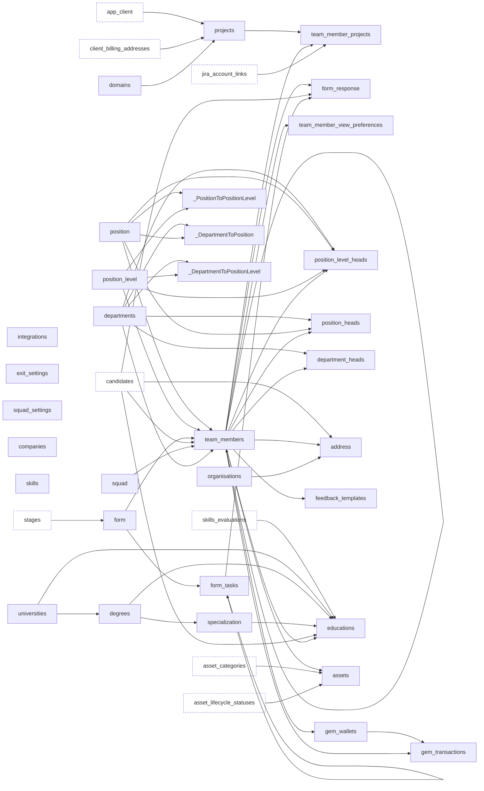

**Diagram people-2: tables reached only through shared code (36)**

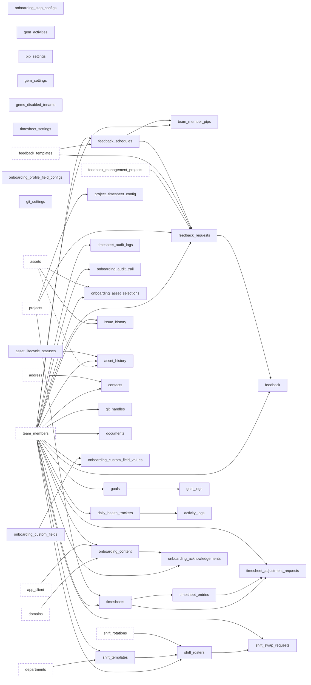

## Table definitions: Recruitment (ATS)

### Recruitment (ATS): canonical table definitions (19)

#### CandidateStage
Status: Active · Model: CandidateStage (schema.prisma:1398) · Created in: 0_init

Structure: references candidates, stages.

Accessed by (direct): Recruitment (ATS)
Evidence: Runtime refs: 8 call sites in 3 files, e.g. app/controllers/candidateStage.controller.js:11, app/controllers/candidates.controller.js:125, app/controllers/public/candidates.controller.js:40. Tests: 1 files.

| Column | Database type | Nullable | Default | Key/constraint | Description |
|---|---|---|---|---|---|
| id | uuid | no | uuid() | PK | Primary key |
| candidate_id | varchar(255) | no |  | FK → candidates.id | References candidates |
| stage_id | varchar(255) | no |  | FK → stages.id | References stages |
| is_current | boolean | no | true |  | Inferred: flag, is current |
| is_interview_scheduled | boolean | no | false |  | Inferred: flag, is interview scheduled |
| zoom_interview_link | varchar(1500) | yes |  |  | Inferred: zoom interview link |
| google_interview_link | varchar(1500) | yes |  |  | Inferred: google interview link |
| interview_time | timestamptz(3) | yes |  |  | Inferred: interview time |
| is_rejected | boolean | no | false |  | Inferred: flag, is rejected |
| created_at | timestamptz(3) | no | now() |  | Row creation time |
| updated_at | timestamptz(3) | no | now() | @updatedAt | Last update time |

**Relationships**

- Out: `candidate_id` → `candidates`.`id`; many → 1; FK constraint `CandidateStage_candidate_id_25b9f69e_fk`; onDelete schema: default, DB: NO ACTION
- Out: `stage_id` → `stages`.`id`; many → 1; FK constraint `CandidateStage_stage_id_2d949536_fk`; onDelete schema: default, DB: NO ACTION

**Additional details**

- No `tenant_id` column: tenant scope is only reachable through parent rows

#### PipelineStage
Status: Active · Model: PipelineStage (schema.prisma:89) · Created in: 0_init

Structure: references pipelines, stages; junction table (composite key over two FKs).

Accessed by (direct): Recruitment (ATS)
Evidence: Runtime refs: 2 call sites in 1 files, e.g. app/controllers/public/candidates.controller.js:60.

| Column | Database type | Nullable | Default | Key/constraint | Description |
|---|---|---|---|---|---|
| pipeline_id | text | no |  | FK → pipelines.id, UQ(composite) | References pipelines |
| stage_id | text | no |  | FK → stages.id, UQ(composite) | References stages |
| order | integer | no |  | UQ(composite) | Inferred: order |

**Relationships**

- Out: `pipeline_id` → `pipelines`.`id`; many → 1; FK constraint `PipelineStage_pipeline_id_3687fa34_fk`; onDelete schema: default, DB: NO ACTION
- Out: `stage_id` → `stages`.`id`; many → 1; FK constraint `PipelineStage_stage_id_760766ba_fk`; onDelete schema: default, DB: NO ACTION

**Additional details**

- Unique: `([pipeline_id, stage_id, order])`
- No `tenant_id` column: tenant scope is only reachable through parent rows

#### _InterviewerToTeamMember
Status: Active · Object: Prisma implicit many-to-many join table · Created in: 0_init · Later migrations touching it: 1

Join rows for Interviewer.team_members ↔ TeamMember.interviewer. Columns A/B hold the ids of Interviewer/TeamMember (alphabetical model order). Structure: references interviewers, team_members.

Accessed by (direct): Recruitment (ATS)
Evidence: No direct query (Prisma manages join rows). Relation fields used in code: Interviewer.team_members yes, TeamMember.interviewer yes.

| Column | Database type | Nullable | Default | Key/constraint | Description |
|---|---|---|---|---|---|
| A | uuid/text (matches referenced id) | no |  | FK → interviewers.id, UQ(A,B) | Id on the `Interviewer` side |
| B | uuid/text (matches referenced id) | no |  | FK → team_members.id, IDX(B) | Id on the `TeamMember` side |

**Relationships**

- Out: `A` → `interviewers`.`id`; many-to-many; implicit m2m join FK; onDelete Cascade
- Out: `B` → `team_members`.`id` (People and org); many-to-many; implicit m2m join FK; onDelete Cascade

#### address
Status: Active · Model: Address (schema.prisma:187) · Created in: 0_init · Later migrations touching it: 3

Schema comment: "address-model".

Structure: references candidates, team_members, organisations; referenced by 1 table(s).

Accessed by (direct): People and org, Recruitment (ATS), Onboarding and documents, Forms, Search and analytics · via shared code only: Background jobs (cron, queue, workers)
Evidence: Runtime refs: 11 call sites in 6 files, e.g. app/controllers/address.controller.js:10, app/controllers/teamMember.controller.js:272, app/helpers/formResponse.helper.js:198 (+3 more files). Tests: 3 files.

| Column | Database type | Nullable | Default | Key/constraint | Description |
|---|---|---|---|---|---|
| id | text | no | uuid() | PK | Primary key |
| name | varchar(500) | no |  | IDX | Inferred: name |
| address_line | varchar(500) | yes |  |  | Inferred: address line |
| city | varchar(500) | yes |  | IDX | Inferred: city |
| state | varchar(500) | yes |  | IDX | Inferred: state |
| country | varchar(500) | yes |  | IDX | Inferred: country |
| zip_code | varchar(500) | yes |  |  | Inferred: zip code |
| created_at | timestamptz(3) | no | now() |  | Row creation time |
| updated_at | timestamptz(3) | no | now() | @updatedAt | Last update time |
| candidate_id | text | yes |  | FK → candidates.id | References candidates |
| teamMember_id | text | yes |  | FK → team_members.id, IDX | References team_members |
| organisation_id | uuid | yes |  | FK → organisations.id | References organisations |

**Relationships**

- Out: `candidate_id` → `candidates`.`id`; many → 0..1; FK constraint `address_candidate_id_11db88f7_fk`; onDelete schema: default, DB: NO ACTION
- Out: `teamMember_id` → `team_members`.`id` (People and org); many → 0..1; FK constraint `address_teamMember_id_22d01fca_fk`; onDelete schema: default, DB: NO ACTION
- Out: `organisation_id` → `organisations`.`id` (People and org); many → 0..1; FK constraint `address_organisation_id_f9f62925_fk`; onDelete schema: default, DB: NO ACTION
- In: `contacts`.`address_id` (Onboarding and documents); 1 → 0..1; FK constraint `contacts_address_id_a265fe71_fk`

**Additional details**

- Indexes: `([teamMember_id, name])`, `([city(ops: raw("gin_trgm_ops"))], map: "address_city_trgm_idx", type: Gin)`, `([state(ops: raw("gin_trgm_ops"))], map: "address_state_trgm_idx", type: Gin)`, `([country(ops: raw("gin_trgm_ops"))], map: "address_country_trgm_idx", type: Gin)`
- No `tenant_id` column: tenant scope is only reachable through parent rows

#### benefits
Status: Active · Model: Benefit (schema.prisma:14) · Created in: 0_init

Schema comment: "benefits-model".

Accessed by (direct): Recruitment (ATS)
Evidence: Runtime refs: 12 call sites in 3 files, e.g. app/controllers/benefits.controller.js:15, app/controllers/public/benefits.controller.js:11, app/validators/requisitions.validator.js:216. Tests: 1 files.

| Column | Database type | Nullable | Default | Key/constraint | Description |
|---|---|---|---|---|---|
| id | text | no | uuid() | PK | Primary key |
| name | varchar | yes |  | UQ(composite) | Inferred: name |
| is_suggested | boolean | no | false |  | Inferred: flag, is suggested |
| tenant_id | uuid | no |  | UQ(composite) | Tenant scope; no FK (tenant data lives outside this DB) |
| is_active | boolean | no | true |  | Inferred: flag, is active |
| created_at | timestamptz(3) | no | now() |  | Row creation time |
| updated_at | timestamptz(3) | no | now() | @updatedAt | Last update time |

**Relationships:** none identified.

**Additional details**

- Unique: `([name, tenant_id])`

#### candidates
Status: Active · Model: Candidate (schema.prisma:135) · Created in: 0_init · Later migrations touching it: 1

Structure: references requisitions; referenced by 7 table(s).

Accessed by (direct): Recruitment (ATS), Forms, Platform core (auth middleware, model hooks)
Evidence: Runtime refs: 18 call sites in 9 files, e.g. app/controllers/candidates.controller.js:16, app/controllers/public/candidates.controller.js:83, app/helpers/formResponse.helper.js:76 (+6 more files). Tests: 2 files.

| Column | Database type | Nullable | Default | Key/constraint | Description |
|---|---|---|---|---|---|
| id | text | no | uuid() | PK | Primary key |
| profile_picture | varchar(1000) | yes |  |  | Inferred: profile picture |
| full_name | varchar(255) | yes |  |  | Inferred: full name |
| first_name | varchar(255) | no |  |  | Inferred: first name |
| last_name | varchar(255) | no |  |  | Inferred: last name |
| email | varchar(255) | no |  | UQ(composite) | Inferred: email |
| title | varchar(255) | yes |  |  | Inferred: title |
| phone_number | varchar(255) | no |  | UQ(composite) | Inferred: phone number |
| rgb_icon | varchar(255) | no |  |  | Inferred: rgb icon |
| resume (field resume_key) | varchar(1000) | yes |  |  | S3 object key; URL composed on read and omitted from responses (app/models/prismaClient.js) |
| employment_type | enum EmploymentType | no |  |  | Enum `EmploymentType`: full_time, part_time, contract |
| company | varchar(255) | yes |  |  | Inferred: company |
| expected_job_role | varchar(255) | yes |  | FK → requisitions.id | References requisitions |
| experience | text | yes |  |  | Inferred: experience |
| current_ctc | double precision | no | 0 |  | Inferred: current ctc |
| expected_ctc | double precision | no | 0 |  | Inferred: expected ctc |
| notice_period | enum NoticePeriod | no |  |  | Enum `NoticePeriod`: fifteen_days, thirty_days, fortyfive_days, sixty_days, seventyfive_days, ninety_days, immediate_joiner, on_notice_period |
| n_period_negotiable | boolean | no | false |  | Inferred: n period negotiable |
| l_working_day | text | yes |  |  | Inferred: l working day |
| expected_joining_date | text | yes |  |  | Inferred: expected joining date |
| change_reason | varchar(255) | yes |  |  | Inferred: change reason |
| source | enum AllowedSource | no |  |  | Enum `AllowedSource`: Google, LinkedIn, Naukri, Monster, Facebook, Indeed, CompanyWebsite, Other |
| other_source | text | yes |  |  | Inferred: other source |
| tenant_id | uuid | no |  | UQ(composite) | Tenant scope; no FK (tenant data lives outside this DB) |
| confirmed | boolean | no | false |  | Inferred: confirmed |
| token | varchar(500) | yes |  | UQ | Inferred: token |
| tokenExpTime | timestamp(3) | yes |  |  | Inferred: token exp time |
| is_active | boolean | no | true |  | Inferred: flag, is active |
| is_used | boolean | yes | false |  | Inferred: flag, is used |
| is_rejected | boolean | yes | false |  | Inferred: flag, is rejected |
| offer_letter_status | enum OfferLetterStatus | no | Pending |  | Enum `OfferLetterStatus`: Pending, Awaiting, Accepted, Declined |
| created_at | timestamptz(3) | no | now() |  | Row creation time |
| updated_at | timestamptz(3) | no | now() | @updatedAt | Last update time |

**Relationships**

- Out: `expected_job_role` → `requisitions`.`id`; many → 0..1; FK constraint `candidates_expected_job_role_e74e6adf_fk`; onDelete schema: default, DB: NO ACTION
- In: `address`.`candidate_id`; 1 → many; FK constraint `address_candidate_id_11db88f7_fk`
- In: `educations`.`candidate_id` (Forms); 1 → many; FK constraint `educations_candidate_id_03a2c4fd_fk`
- In: `skills_evaluations`.`candidate_id`; 1 → many; FK constraint `skills_evaluations_candidate_id_40d32815_fk`
- In: `team_members`.`candidateId` (People and org); 1 → 0..1; FK constraint `team_members_candidateId_6df113f8_fk`
- In: `form_response`.`candidate_id` (Onboarding and documents); 1 → many; FK constraint `form_response_candidate_id_7db5927e_fk`
- In: `comments`.`candidate_id`; 1 → many; FK constraint `comments_candidate_id_0cd4b6c0_fk`
- In: `CandidateStage`.`candidate_id`; 1 → many; FK constraint `CandidateStage_candidate_id_25b9f69e_fk`

**Additional details**

- Unique: `([email, tenant_id])`, `([phone_number, tenant_id])`

#### comments
Status: Active · Model: Comment (schema.prisma:1384) · Created in: 0_init

Structure: references candidates, team_members.

Accessed by (direct): Recruitment (ATS)
Evidence: Runtime refs: 5 call sites in 2 files, e.g. app/controllers/comments.controller.js:12, app/validators/comments.validator.js:61.

| Column | Database type | Nullable | Default | Key/constraint | Description |
|---|---|---|---|---|---|
| id | uuid | no | uuid() | PK | Primary key |
| candidate_id | varchar(255) | no |  | FK → candidates.id | References candidates |
| commenter_id | varchar(255) | no |  | FK → team_members.id | References team_members |
| description | text | yes |  |  | Inferred: description |
| attachments | varchar(1500)[] | no |  |  | Inferred: attachments |
| created_at | timestamptz(3) | no | now() |  | Row creation time |
| updated_at | timestamptz(3) | no | now() | @updatedAt | Last update time |

**Relationships**

- Out: `candidate_id` → `candidates`.`id`; many → 1; FK constraint `comments_candidate_id_0cd4b6c0_fk`; onDelete schema: default, DB: NO ACTION
- Out: `commenter_id` → `team_members`.`id` (People and org); many → 1; FK constraint `comments_commenter_id_a0f0883b_fk`; onDelete schema: default, DB: NO ACTION

**Additional details**

- No `tenant_id` column: tenant scope is only reachable through parent rows

#### companies
Status: Active · Model: Company (schema.prisma:218) · Created in: 0_init

Schema comment: "companies-model".

Accessed by (direct): People and org, Recruitment (ATS)
Evidence: Runtime refs: 13 call sites in 3 files, e.g. app/controllers/companies.controller.js:14, app/controllers/public/companies.controller.js:5, app/validators/teamMember.validator.js:458. Tests: 1 files.

| Column | Database type | Nullable | Default | Key/constraint | Description |
|---|---|---|---|---|---|
| id | text | no | uuid() | PK | Primary key |
| name | varchar(500) | no |  | UQ(composite) | Inferred: name |
| created_at | timestamptz(3) | no | now() |  | Row creation time |
| updated_at | timestamptz(3) | no | now() | @updatedAt | Last update time |

**Relationships:** none identified.

**Additional details**

- Unique: `([name])`
- No `tenant_id` column: tenant scope is only reachable through parent rows

#### degrees
Status: Active · Model: Degree (schema.prisma:358) · Created in: 0_init

Schema comment: "degree-model".

Structure: references universities; referenced by 2 table(s).

Accessed by (direct): People and org, Recruitment (ATS)
Evidence: Runtime refs: 22 call sites in 10 files, e.g. app/controllers/degree.controller.js:8, app/controllers/public/degree.controller.js:8, app/controllers/superadmin/degree.controller.js:8 (+7 more files).

| Column | Database type | Nullable | Default | Key/constraint | Description |
|---|---|---|---|---|---|
| id | text | no | uuid() | PK | Primary key |
| name | varchar(255) | no |  | UQ(composite) | Inferred: name |
| created_at | timestamptz(3) | no | now() |  | Row creation time |
| updated_at | timestamptz(3) | no | now() | @updatedAt | Last update time |
| university_name | text | yes |  | FK → universities.name, UQ(composite) | References universities |

**Relationships**

- Out: `university_name` → `universities`.`name`; many → 0..1; FK constraint `degrees_university_name_fkey`; onDelete schema: default, DB: SET NULL
- In: `educations`.`degree_id` (Forms); 1 → many; FK constraint `educations_degree_id_237ee0a0_fk`
- In: `specialization`.`degree_id`; 1 → many; FK constraint `specialization_degree_id_8f5bf91c_fk`

**Additional details**

- Unique: `([name, university_name])`
- No `tenant_id` column: tenant scope is only reachable through parent rows

#### interviewers
Status: Active · Model: Interviewer (schema.prisma:1222) · Created in: 0_init · Later migrations touching it: 1

Structure: references stages, requisitions; referenced by 1 table(s).

Accessed by (direct): Recruitment (ATS)
Evidence: Runtime refs: 3 call sites in 2 files, e.g. app/controllers/interviewer.controller.js:19, app/controllers/public/candidates.controller.js:182.

| Column | Database type | Nullable | Default | Key/constraint | Description |
|---|---|---|---|---|---|
| id | text | no | uuid() | PK | Primary key |
| external_emails | text[] | no |  |  | Inferred: external emails |
| created_at (field createdAt) | timestamptz(3) | no | now() |  | Row creation time |
| updated_at (field updatedAt) | timestamptz(3) | no | now() | @updatedAt | Last update time |
| stage_id | text | yes |  | FK → stages.id | References stages |
| requisition_id | text | yes |  | FK → requisitions.id | References requisitions |

**Relationships**

- Out: `stage_id` → `stages`.`id`; many → 0..1; FK constraint `interviewers_stage_id_7464fbb5_fk`; onDelete schema: default, DB: NO ACTION
- Out: `requisition_id` → `requisitions`.`id`; many → 0..1; FK constraint `interviewers_requisition_id_c79d0edf_fk`; onDelete schema: default, DB: NO ACTION
- In: `_InterviewerToTeamMember`.`A`; many-to-many; implicit m2m join FK

**Additional details**

- No `tenant_id` column: tenant scope is only reachable through parent rows

#### pipelines
Status: Active · Model: Pipeline (schema.prisma:28) · Created in: 0_init

Schema comment: "pipeline-model".

Structure: referenced by 2 table(s).

Accessed by (direct): Recruitment (ATS)
Evidence: Runtime refs: 12 call sites in 4 files, e.g. app/controllers/pipelines.controller.js:14, app/controllers/public/pipelines.controller.js:9, app/validators/pipelines.validator.js:17 (+1 more files). Tests: 1 files.

| Column | Database type | Nullable | Default | Key/constraint | Description |
|---|---|---|---|---|---|
| id | text | no | uuid() | PK | Primary key |
| name | varchar(500) | no |  | UQ(composite) | Inferred: name |
| tenant_id | uuid | no |  | UQ(composite) | Tenant scope; no FK (tenant data lives outside this DB) |
| created_at | timestamptz(3) | no | now() |  | Row creation time |
| updated_at | timestamptz(3) | no | now() | @updatedAt | Last update time |

**Relationships**

- In: `PipelineStage`.`pipeline_id`; 1 → many; FK constraint `PipelineStage_pipeline_id_3687fa34_fk`
- In: `requisitions`.`pipeline_id`; 1 → many; FK constraint `requisitions_pipeline_id_f1e2850f_fk`

**Additional details**

- Unique: `([name, tenant_id])`

#### requirements
Status: Active · Model: Requirement (schema.prisma:43) · Created in: 0_init

Schema comment: "requirements-model".

Accessed by (direct): Recruitment (ATS)
Evidence: Runtime refs: 8 call sites in 2 files, e.g. app/controllers/requirements.controller.js:11, app/validators/requirements.validator.js:17.

| Column | Database type | Nullable | Default | Key/constraint | Description |
|---|---|---|---|---|---|
| id | text | no | uuid() | PK | Primary key |
| name | varchar(100) | no |  | UQ(composite) | Inferred: name |
| tenant_id | uuid | no |  | UQ(composite) | Tenant scope; no FK (tenant data lives outside this DB) |
| created_at | timestamptz(3) | no | now() |  | Row creation time |
| updated_at | timestamptz(3) | no | now() | @updatedAt | Last update time |

**Relationships:** none identified.

**Additional details**

- Unique: `([name, tenant_id])`

#### requisition_categories
Status: Active · Model: RequisitionCategory (schema.prisma:2110) · Created in: 0_init

Structure: referenced by 1 table(s).

Accessed by (direct): Recruitment (ATS)
Evidence: Runtime refs: 10 call sites in 3 files, e.g. app/controllers/requsitionCategory.controller.js:8, app/validators/requisitions.validator.js:364, app/validators/requistionCategory,validator.js:24. Tests: 1 files.

| Column | Database type | Nullable | Default | Key/constraint | Description |
|---|---|---|---|---|---|
| id | text | no | uuid() | PK | Primary key |
| rgb_colour | varchar(500) | yes |  |  | Inferred: rgb colour |
| title | varchar(255) | no |  | UQ(composite) | Inferred: title |
| tenant_id | uuid | no |  | UQ(composite) | Tenant scope; no FK (tenant data lives outside this DB) |
| is_active | boolean | no | true |  | Inferred: flag, is active |
| created_at | timestamptz(3) | no | now() |  | Row creation time |
| updated_at | timestamptz(3) | no | now() | @updatedAt | Last update time |

**Relationships**

- In: `requisitions`.`requisition_category_id`; 1 → many; FK constraint `requisitions_requisition_category_id_11716649_fk`

**Additional details**

- Unique: `([title, tenant_id])`

#### requisitions
Status: Active · Model: Requisition (schema.prisma:246) · Created in: 0_init

Structure: references pipelines, requisition_categories, departments, position_level, position; referenced by 2 table(s).

Accessed by (direct): Recruitment (ATS), Forms, Platform core (auth middleware, model hooks)
Evidence: Runtime refs: 15 call sites in 7 files, e.g. app/controllers/requisitions.controller.js:13, app/helpers/formResponse.helper.js:122, app/helpers/requisition.helper.js:34 (+4 more files).

| Column | Database type | Nullable | Default | Key/constraint | Description |
|---|---|---|---|---|---|
| id | text | no | uuid() | PK | Primary key |
| identifier | varchar(255) | yes |  | UQ(composite) | Inferred: identifier |
| title | varchar(255) | yes |  |  | Inferred: title |
| employment_type | enum EmploymentType | yes |  |  | Enum `EmploymentType`: full_time, part_time, contract |
| workplace | enum Workplace | yes |  |  | Enum `Workplace`: On_Site, Remote |
| orientation_requirement | boolean | no | true |  | Inferred: orientation requirement |
| travel_expenses | boolean | no | true |  | Inferred: travel expenses |
| country | varchar(255) | yes |  |  | Inferred: country |
| location | varchar(255) | yes |  |  | Inferred: location |
| location_benefits | enum LocationBenefits[] | no |  |  | Enum `LocationBenefits`: work_from_home_allowed, relocation_assistance, visa_sponsorship |
| description | text | yes |  |  | Inferred: description |
| essential_skills | varchar(255)[] | no |  |  | Inferred: essential skills |
| non_essential_skills | varchar(255)[] | no |  |  | Inferred: non essential skills |
| benefits | varchar(255)[] | no |  |  | Inferred: benefits |
| is_published | boolean | no | false |  | Inferred: flag, is published |
| status | enum Status | no | active |  | Enum `Status`: active, completed, archive |
| tenant_id | uuid | no |  | UQ(composite) | Tenant scope; no FK (tenant data lives outside this DB) |
| is_fresher_allowed | boolean | no | false |  | Inferred: flag, is fresher allowed |
| created_at | timestamptz(3) | no | now() |  | Row creation time |
| updated_at | timestamptz(3) | no | now() | @updatedAt | Last update time |
| pipeline_id | text | yes |  | FK → pipelines.id | References pipelines |
| requisition_category_id | text | yes |  | FK → requisition_categories.id | References requisition_categories |
| department_id | text | yes |  | FK → departments.id | References departments |
| position_level_id | uuid | yes |  | FK → position_level.id | References position_level |
| position_id | uuid | yes |  | FK → position.id | References position |

**Relationships**

- Out: `pipeline_id` → `pipelines`.`id`; many → 0..1; FK constraint `requisitions_pipeline_id_f1e2850f_fk`; onDelete schema: default, DB: NO ACTION
- Out: `requisition_category_id` → `requisition_categories`.`id`; many → 0..1; FK constraint `requisitions_requisition_category_id_11716649_fk`; onDelete schema: default, DB: NO ACTION
- Out: `department_id` → `departments`.`id` (People and org); many → 0..1; FK constraint `requisitions_department_id_5ae978e6_fk`; onDelete schema: default, DB: NO ACTION
- Out: `position_level_id` → `position_level`.`id` (People and org); many → 0..1; FK constraint `requisitions_position_level_id_e6718be9_fk`; onDelete schema: default, DB: NO ACTION
- Out: `position_id` → `position`.`id` (People and org); many → 0..1; FK constraint `requisitions_position_id_418e4f71_fk`; onDelete schema: default, DB: NO ACTION
- In: `candidates`.`expected_job_role`; 1 → many; FK constraint `candidates_expected_job_role_e74e6adf_fk`
- In: `interviewers`.`requisition_id`; 1 → many; FK constraint `interviewers_requisition_id_c79d0edf_fk`

**Additional details**

- Unique: `([identifier, tenant_id])`

#### skills
Status: Active · Model: Skill (schema.prisma:345) · Created in: 0_init · Later migrations touching it: 1

Schema comment: "skill-model".

Accessed by (direct): People and org, Recruitment (ATS)
Evidence: Runtime refs: 16 call sites in 5 files, e.g. app/controllers/public/skills.controller.js:24, app/controllers/skills.controller.js:17, app/validators/public/skills.validator.js:34 (+2 more files). Tests: 1 files.

| Column | Database type | Nullable | Default | Key/constraint | Description |
|---|---|---|---|---|---|
| id | text | no | uuid() | PK | Primary key |
| name | varchar(255) | no |  | UQ(composite) | Inferred: name |
| tenant_id | uuid | yes |  | UQ(composite) | Tenant scope; no FK (tenant data lives outside this DB) |
| is_active | boolean | no | true |  | Inferred: flag, is active |
| created_at | timestamptz(3) | no | now() |  | Row creation time |
| updated_at | timestamptz(3) | no | now() | @updatedAt | Last update time |

**Relationships:** none identified.

**Additional details**

- Unique: `([name, tenant_id])`

#### skills_evaluations
Status: Active · Model: Skills_Evaluation (schema.prisma:327) · Created in: 0_init

Structure: references candidates, team_members; referenced by 1 table(s).

Accessed by (direct): Recruitment (ATS), Engineering profiles, Forms
Evidence: Runtime refs: 5 call sites in 3 files, e.g. app/controllers/skillsEvaluations.controller.js:17, app/helpers/engineeringProfile/profile.helper.js:123, app/helpers/formResponse.helper.js:216.

| Column | Database type | Nullable | Default | Key/constraint | Description |
|---|---|---|---|---|---|
| id | text | no | uuid() | PK | Primary key |
| skills | varchar(255) | yes |  |  | Inferred: skills |
| evaluate | enum SkillChoice | yes |  |  | Enum `SkillChoice`: Excellent, Very_Good, Good, Fair, Poor |
| created_at | timestamptz(3) | no | now() |  | Row creation time |
| updated_at | timestamptz(3) | no | now() | @updatedAt | Last update time |
| candidate_id | text | yes |  | FK → candidates.id | References candidates |
| teamMember_id | text | yes |  | FK → team_members.id | References team_members |

**Relationships**

- Out: `candidate_id` → `candidates`.`id`; many → 0..1; FK constraint `skills_evaluations_candidate_id_40d32815_fk`; onDelete schema: default, DB: NO ACTION
- Out: `teamMember_id` → `team_members`.`id` (People and org); many → 0..1; FK constraint `skills_evaluations_teamMember_id_fb5c1baf_fk`; onDelete schema: default, DB: NO ACTION
- In: `educations`.`skill_evaluation_id` (Forms); 1 → many; FK constraint `educations_skill_evaluation_id_43a0a0f1_fk`

**Additional details**

- No `tenant_id` column: tenant scope is only reachable through parent rows

#### specialization
Status: Active · Model: Specialization (schema.prisma:386) · Created in: 0_init

Schema comment: "specialization-model".

Structure: references degrees; referenced by 1 table(s).

Accessed by (direct): People and org, Recruitment (ATS)
Evidence: Runtime refs: 19 call sites in 7 files, e.g. app/controllers/public/specialization.controller.js:8, app/controllers/specialization.controller.js:8, app/controllers/superadmin/specialization.controller.js:8 (+4 more files).

| Column | Database type | Nullable | Default | Key/constraint | Description |
|---|---|---|---|---|---|
| id | text | no | uuid() | PK | Primary key |
| name | varchar(255) | no |  |  | Inferred: name |
| created_at | timestamptz(3) | no | now() |  | Row creation time |
| updated_at | timestamptz(3) | no | now() | @updatedAt | Last update time |
| degree_id | text | yes |  | FK → degrees.id | References degrees |

**Relationships**

- Out: `degree_id` → `degrees`.`id`; many → 0..1; FK constraint `specialization_degree_id_8f5bf91c_fk`; onDelete schema: Cascade, DB: NO ACTION
- In: `educations`.`specialisation_id` (Forms); 1 → many; FK constraint `educations_specialisation_id_41215b0a_fk`

**Additional details**

- No `tenant_id` column: tenant scope is only reachable through parent rows

#### stages
Status: Active · Model: Stage (schema.prisma:69) · Created in: 0_init

Structure: referenced by 4 table(s).

Accessed by (direct): Recruitment (ATS), Forms
Evidence: Runtime refs: 17 call sites in 8 files, e.g. app/controllers/candidates.controller.js:140, app/controllers/public/stages.controller.js:38, app/controllers/stages.controller.js:12 (+5 more files). Tests: 2 files.

| Column | Database type | Nullable | Default | Key/constraint | Description |
|---|---|---|---|---|---|
| id | text | no | uuid() | PK | Primary key |
| name | varchar(500) | no |  | UQ(composite) | Inferred: name |
| key | varchar(500) | yes |  |  | Inferred: key |
| has_interviewer | boolean | no | false |  | Inferred: flag, has interviewer |
| tenant_id | uuid | no |  | UQ(composite) | Tenant scope; no FK (tenant data lives outside this DB) |
| schedule_type | enum ScheduleType | no | Automated |  | Enum `ScheduleType`: Automated, Manual |
| created_at | timestamptz(3) | no | now() |  | Row creation time |
| updated_at | timestamptz(3) | no | now() | @updatedAt | Last update time |

**Relationships**

- In: `PipelineStage`.`stage_id`; 1 → many; FK constraint `PipelineStage_stage_id_760766ba_fk`
- In: `interviewers`.`stage_id`; 1 → many; FK constraint `interviewers_stage_id_7464fbb5_fk`
- In: `form`.`stage_id` (Forms); 1 → many; FK constraint `form_stage_id_effbe797_fk`
- In: `CandidateStage`.`stage_id`; 1 → many; FK constraint `CandidateStage_stage_id_2d949536_fk`

**Additional details**

- Unique: `([name, tenant_id])`

#### universities
Status: Active · Model: University (schema.prisma:374) · Created in: 0_init

Schema comment: "university-model".

Structure: referenced by 2 table(s).

Accessed by (direct): People and org, Recruitment (ATS)
Evidence: Runtime refs: 31 call sites in 13 files, e.g. app/controllers/public/universities.controller.js:7, app/controllers/superadmin/universities.controller.js:7, app/controllers/universities.controller.js:7 (+10 more files).

| Column | Database type | Nullable | Default | Key/constraint | Description |
|---|---|---|---|---|---|
| id | text | no | uuid() | PK | Primary key |
| name | varchar(255) | no |  | UQ | Inferred: name |
| created_at | timestamptz(3) | no | now() |  | Row creation time |
| updated_at | timestamptz(3) | no | now() | @updatedAt | Last update time |

**Relationships**

- In: `educations`.`university_id` (Forms); 1 → many; FK constraint `educations_university_id_95f1cf7e_fk`
- In: `degrees`.`university_name`; 1 → many; FK constraint `degrees_university_name_fkey`

**Additional details**

- No `tenant_id` column: tenant scope is only reachable through parent rows

### Recruitment (ATS): relationship diagram

Arrows run parent → child (FK holder). Solid = FK in schema and migration SQL; dotted = schema vs SQL discrepancy; dashed boxes = tables outside this module. Full conventions under Counting rules.

**Diagram recruitment-1: tables accessed directly (24), external FK parents shown dashed**

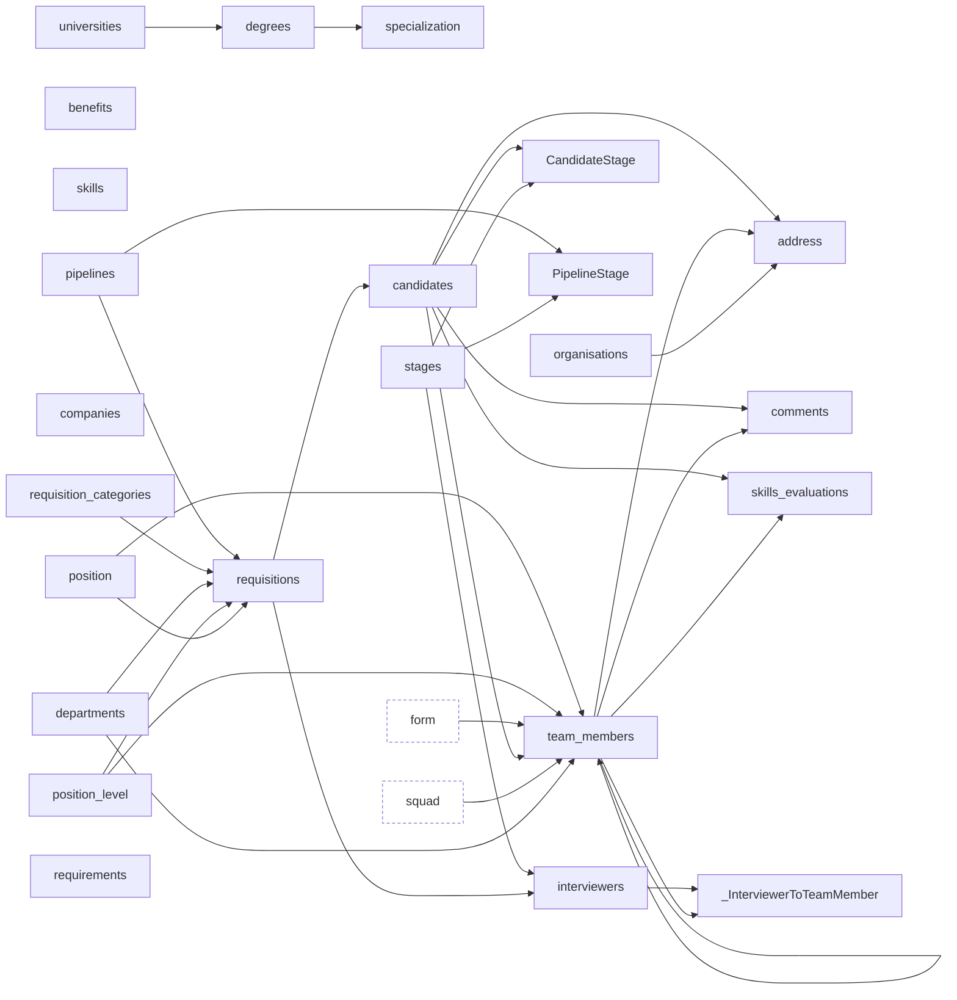

**Diagram recruitment-2: tables reached only through shared code (2)**

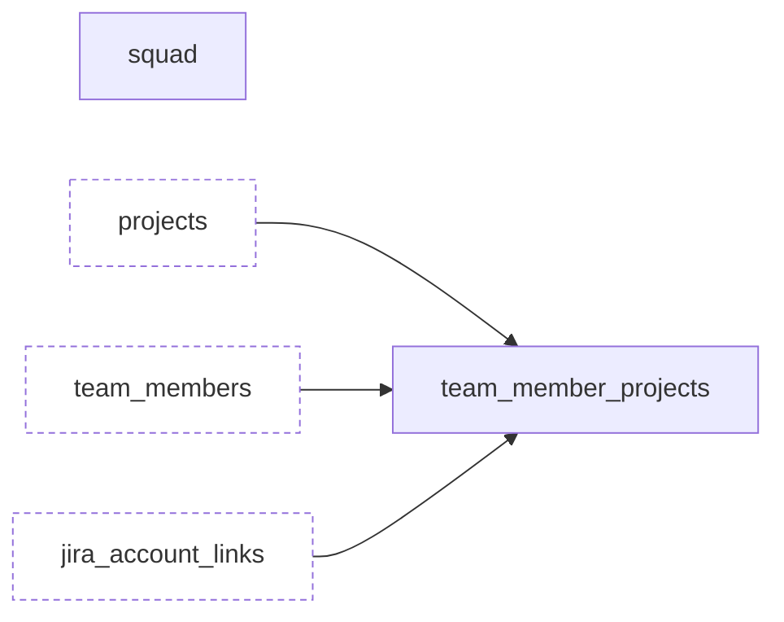

## Table definitions: Referral desk

### Referral desk: canonical table definitions (7)

#### ai_call_logs
Status: Active · Model: AiCallLog (schema.prisma:3974) · Created in: 20261005100000_add_ai_call_log

Schema comment: "Feature-agnostic AI call log — not referral-desk-specific by design, so any future AI-calling feature can log through the same table/wrapper instead of building its own. Referral Desk's evaluate/timeline/JD-parse calls (the only AI calls in the codebase today) are its first users. One row per actual provider call: a schema-mode call that falls back to json_object mode is still ONE row here, using whichever attempt actually succeeded (or the last attempt's failure).".

Accessed by (direct): Referral desk
Evidence: Runtime refs: 6 call sites in 2 files, e.g. app/controllers/aiCostTracking.controller.js:23, app/services/aiCostTracking/logger.js:11. Ops scripts/seeds: scripts/ai-cost-local-run.js:130.

| Column | Database type | Nullable | Default | Key/constraint | Description |
|---|---|---|---|---|---|
| id | uuid | no | uuid() | PK | Primary key |
| tenant_id | uuid | no |  | IDX | Tenant scope; no FK (tenant data lives outside this DB) |
| feature | varchar(100) | no |  | IDX | Dot-namespaced call-site label, e.g. "referral_desk.evaluate" / "referral_desk.timeline" / "referral_desk.jd_parse" — lets a dashboard group/filter by feature without a join. |
| provider | varchar(50) | no |  |  | Inferred: provider |
| model | varchar(255) | no |  |  | Inferred: model |
| prompt_tokens | integer | no |  |  | Inferred: prompt tokens |
| completion_tokens | integer | no |  |  | Inferred: completion tokens |
| total_tokens | integer | no |  |  | Inferred: total tokens |
| cost | double precision | no |  |  | Estimated from a hardcoded pricing table (see app/services/aiCostTracking/pricing.js) — not a live read of the provider's billing API. Source of truth for what's actually owed remains the provider's own invoice. |
| duration_ms | integer | no |  |  | Inferred: duration ms |
| status | varchar(20) | no |  |  | Inferred: status |
| error_message | text | yes |  |  | Inferred: error message |
| created_at | timestamptz(3) | no | now() | IDX | Row creation time |

**Relationships:** none identified.

**Additional details**

- Indexes: `([tenant_id, created_at])`, `([feature])`

#### referral_audit_logs
Status: Active · Model: ReferralAuditLog (schema.prisma:3952) · Created in: 20260916000000_add_referral_audit_log

Schema comment: "One row per candidate-affecting change, scoped to the job_code the candidate was against at that moment — e.g. re-assigning job_code, making/clearing a decision, running an evaluation. actor_team_member_id is null for system-driven events (mailbox intake parsing a job_code from the subject); populated when a person took the action via the API.".

Structure: references referral_candidates.

Accessed by (direct): Referral desk
Evidence: Runtime refs: 1 call sites in 1 files, e.g. app/services/referralDesk/auditLog.js:9. Tests: 6 files.

| Column | Database type | Nullable | Default | Key/constraint | Description |
|---|---|---|---|---|---|
| id | uuid | no | uuid() | PK | Primary key |
| tenant_id | uuid | no |  | IDX | Tenant scope; no FK (tenant data lives outside this DB) |
| candidate_id | uuid | no |  | FK → referral_candidates.id, IDX | References referral_candidates |
| job_code | varchar(50) | yes |  | IDX | Inferred: job code |
| action | enum ReferralAuditAction | no |  |  | Enum `ReferralAuditAction`: job_code_assigned, decision_made, decision_cleared, evaluated, resume_updated_via_reply |
| actor_team_member_id | uuid | yes |  |  | Inferred: id of actor team member; no FK declared |
| field | varchar(255) | yes |  |  | Inferred: field |
| old_value | jsonb | yes |  |  | Inferred: old value |
| new_value | jsonb | yes |  |  | Inferred: new value |
| created_at | timestamptz(3) | no | now() |  | Row creation time |

**Relationships**

- Out: `candidate_id` → `referral_candidates`.`id`; many → 1; FK constraint `referral_audit_logs_candidate_id_fkey`; onDelete schema: default, DB: RESTRICT

**Additional details**

- Indexes: `([tenant_id, candidate_id, job_code])`

#### referral_candidates
Status: Active · Model: ReferralCandidate (schema.prisma:3846) · Created in: 20260909000000_add_referral_desk · Later migrations touching it: 10

Structure: referenced by 3 table(s).

Accessed by (direct): Referral desk
Evidence: Runtime refs: 19 call sites in 8 files, e.g. app/controllers/referralCandidate.controller.js:42, app/controllers/referralDecision.controller.js:26, app/controllers/referralEvaluate.controller.js:39 (+5 more files). Ops scripts/seeds: scripts/ai-cost-local-run.js:105. Tests: 10 files.

| Column | Database type | Nullable | Default | Key/constraint | Description |
|---|---|---|---|---|---|
| id | uuid | no | uuid() | PK | Primary key |
| tenant_id | uuid | no |  | UQ(composite) | Tenant scope; no FK (tenant data lives outside this DB) |
| name | varchar(255) | yes |  |  | Inferred: name |
| email | varchar(255) | yes |  |  | Inferred: email |
| phone | varchar(50) | yes |  |  | Inferred: phone |
| referrer_name | varchar(255) | yes |  |  | Inferred: referrer name |
| referrer_email | varchar(255) | yes |  |  | Inferred: referrer email |
| current_job_title | varchar(255) | yes |  |  | Inferred: current job title |
| current_employer | varchar(255) | yes |  |  | Inferred: current employer |
| relationship | varchar(255) | yes |  |  | Inferred: relationship |
| known_period | varchar(255) | yes |  |  | Inferred: known period |
| referrer_notes | text | yes |  |  | Inferred: referrer notes |
| job_code | varchar(50) | yes |  |  | Inferred: job code |
| resume_filename | varchar(500) | yes |  |  | Inferred: resume filename |
| resume_path | varchar(1000) | yes |  |  | Inferred: resume path |
| resume_text | text | no |  |  | Inferred: resume text |
| academic_score | jsonb | yes |  |  | Every CGPA/GPA/percentage entry found, labeled by degree where identifiable - see academicDetails.helper.js. |
| education_text | text | yes |  |  | Inferred: education text |
| decision | enum ReferralDecision | yes |  |  | Enum `ReferralDecision`: approved, rejected |
| decided_at | timestamptz(3) | yes |  |  | Inferred: decided at |
| academic_rejection_reason | text | yes |  |  | Frozen at the moment of an automatic reject; null for a human decision or no decision yet. |
| source | enum ReferralSource | no |  |  | Enum `ReferralSource`: email_referral, manual |
| source_subject | text | yes |  |  | Inferred: source subject |
| source_message_id | varchar(998) | yes |  |  | Inferred: id of source message; no FK declared |
| last_reply_message_id | varchar(998) | yes |  |  | Inferred: id of last reply message; no FK declared |
| parse_notes | jsonb | no | "[]" |  | Inferred: parse notes |
| message_uid | varchar(255) | yes |  | UQ(composite) | Inferred: message uid |
| received_at | timestamptz(3) | yes |  |  | Inferred: received at |
| replied_at | timestamptz(3) | yes |  |  | Inferred: replied at |
| created_at | timestamptz(3) | no | now() |  | Row creation time |
| deleted_at | timestamptz(3) | yes |  |  | Soft-delete timestamp (NULL = live) |

**Relationships**

- In: `referral_evaluations`.`candidate_id`; 1 → many; FK constraint `referral_evaluations_candidate_id_fkey`
- In: `referral_outreach`.`candidate_id`; 1 → many; FK constraint `referral_outreach_candidate_id_fkey`
- In: `referral_audit_logs`.`candidate_id`; 1 → many; FK constraint `referral_audit_logs_candidate_id_fkey`

**Additional details**

- Unique: `([tenant_id, message_uid])`
- Soft delete via `deleted_at`

#### referral_evaluations
Status: Active · Model: ReferralEvaluation (schema.prisma:3889) · Created in: 20260909000000_add_referral_desk · Later migrations touching it: 3

Structure: references referral_candidates.

Accessed by (direct): Referral desk
Evidence: Runtime refs: 4 call sites in 2 files, e.g. app/controllers/referralCandidate.controller.js:27, app/services/referralDesk/evaluate.js:188. Tests: 6 files.

| Column | Database type | Nullable | Default | Key/constraint | Description |
|---|---|---|---|---|---|
| id | uuid | no | uuid() | PK | Primary key |
| tenant_id | uuid | no |  |  | Tenant scope; no FK (tenant data lives outside this DB) |
| candidate_id | uuid | no |  | FK → referral_candidates.id, IDX | References referral_candidates |
| job_id | uuid | no |  |  | Inferred: id of job; no FK declared |
| overall_fit | varchar(50) | no |  |  | Inferred: overall fit |
| stability_score | double precision | no |  |  | Inferred: stability score |
| stability_reason | text | no |  |  | Inferred: stability reason |
| technical_score | double precision | no |  |  | Inferred: technical score |
| strengths | jsonb | no | "[]" |  | Inferred: strengths |
| gaps | jsonb | no | "[]" |  | Inferred: gaps |
| hr_score | double precision | no |  |  | Inferred: hr score |
| hr_observations | jsonb | no | "[]" |  | Inferred: hr observations |
| domain_expertise | jsonb | no | "[]" |  | Inferred: domain expertise |
| measurable_evidence | jsonb | no | "[]" |  | Inferred: measurable evidence |
| checklist | jsonb | no | "[]" |  | Inferred: checklist |
| risks | jsonb | no | "[]" |  | Inferred: risks |
| career_gaps | jsonb | no | "[]" |  | Inferred: career gaps |
| final_score | double precision | no |  |  | Inferred: final score |
| stability_max | integer | no | 10 |  | Inferred: stability max |
| technical_max | integer | no | 10 |  | Inferred: technical max |
| hr_max | integer | no | 10 |  | Inferred: hr max |
| final_score_max | integer | no | 10 |  | Inferred: final score max |
| recommendation | text | no |  |  | Inferred: recommendation |
| summary | text | no |  |  | Inferred: summary |
| model | varchar(255) | no |  |  | Inferred: model |
| created_at | timestamptz(3) | no | now() |  | Row creation time |
| extra_outputs | jsonb | no | "{}" |  | Inferred: extra outputs |

**Relationships**

- Out: `candidate_id` → `referral_candidates`.`id`; many → 1; FK constraint `referral_evaluations_candidate_id_fkey`; onDelete schema: default, DB: RESTRICT

**Additional details**

- Indexes: `([candidate_id])`

#### referral_jobs
Status: Active · Model: ReferralJob (schema.prisma:3827) · Created in: 20260909000000_add_referral_desk · Later migrations touching it: 7

Accessed by (direct): Referral desk
Evidence: Runtime refs: 15 call sites in 5 files, e.g. app/controllers/referralCandidate.controller.js:182, app/controllers/referralDecision.controller.js:20, app/controllers/referralEvaluate.controller.js:20 (+2 more files). Ops scripts/seeds: scripts/ai-cost-local-run.js:100. Tests: 6 files.

| Column | Database type | Nullable | Default | Key/constraint | Description |
|---|---|---|---|---|---|
| id | uuid | no | uuid() | PK | Primary key |
| tenant_id | uuid | no |  | UQ(composite) | Tenant scope; no FK (tenant data lives outside this DB) |
| code | varchar(50) | no |  | UQ(composite) | Inferred: code |
| title | varchar(255) | no |  |  | Inferred: title |
| description | text | no |  |  | Inferred: description |
| essential_skills | jsonb | no | "[]" |  | Inferred: essential skills |
| nice_skills | jsonb | no | "[]" |  | Inferred: nice skills |
| max_scores | jsonb | yes |  |  | Inferred: max scores |
| custom_evaluation_fields | jsonb | yes |  |  | Inferred: custom evaluation fields |
| property_prompt_overrides | jsonb | yes |  |  | Inferred: property prompt overrides |
| is_active | boolean | no | true |  | Inferred: flag, is active |
| created_at | timestamptz(3) | no | now() |  | Row creation time |
| updated_at | timestamptz(3) | no |  | @updatedAt | Last update time |

**Relationships:** none identified.

**Additional details**

- Unique: `([tenant_id, code])`

#### referral_outreach
Status: Active · Model: ReferralOutreach (schema.prisma:3923) · Created in: 20260909000000_add_referral_desk · Later migrations touching it: 4

Structure: references referral_candidates.

Accessed by (direct): Referral desk · via shared code only: Engineering profiles, Background jobs (cron, queue, workers)
Evidence: Runtime refs: 17 call sites in 8 files, e.g. app/controllers/referralCandidate.controller.js:77, app/controllers/referralEvaluate.controller.js:87, app/controllers/referralIntake.controller.js:45 (+5 more files). Tests: 7 files.

| Column | Database type | Nullable | Default | Key/constraint | Description |
|---|---|---|---|---|---|
| id | uuid | no | uuid() | PK | Primary key |
| tenant_id | uuid | no |  | IDX | Tenant scope; no FK (tenant data lives outside this DB) |
| candidate_id | uuid | no |  | FK → referral_candidates.id, IDX | References referral_candidates |
| audience | varchar(20) | no |  |  | Inferred: audience |
| kind | varchar(40) | no |  |  | Inferred: kind |
| to_email | varchar(255) | no |  |  | Inferred: to email |
| subject | varchar(500) | no |  |  | Inferred: subject |
| body | text | no |  |  | Inferred: body |
| body_html | text | yes |  |  | Inferred: body html |
| status | enum ReferralOutreachStatus | no | preview | IDX | Enum `ReferralOutreachStatus`: preview, queued, sent, failed |
| error | text | yes |  |  | Inferred: error |
| message_id | varchar(998) | yes |  |  | Inferred: id of message; no FK declared |
| in_reply_to | varchar(998) | yes |  |  | Inferred: in reply to |
| references_header | varchar(2000) | yes |  |  | Inferred: references header |
| sent_at | timestamptz(3) | yes |  | IDX | Inferred: sent at |
| failed_at | timestamptz(3) | yes |  |  | Inferred: failed at |
| created_at | timestamptz(3) | no | now() |  | Row creation time |

**Relationships**

- Out: `candidate_id` → `referral_candidates`.`id`; many → 1; FK constraint `referral_outreach_candidate_id_fkey`; onDelete schema: default, DB: RESTRICT

**Additional details**

- Indexes: `([candidate_id])`, `([tenant_id, status, sent_at])`

#### referral_settings
Status: Active · Model: ReferralSettings (schema.prisma:3789) · Created in: 20260909000000_add_referral_desk · Later migrations touching it: 7

Accessed by (direct): Referral desk · via shared code only: Engineering profiles, Background jobs (cron, queue, workers)
Evidence: Runtime refs: 6 call sites in 2 files, e.g. app/services/referralDesk/settings.js:8, app/validators/referralSettings.validator.js:51. Ops scripts/seeds: scripts/ai-cost-local-run.js:94, prisma/seeds/encryptReferralSettingsSecrets.js:10. Tests: 10 files.

| Column | Database type | Nullable | Default | Key/constraint | Description |
|---|---|---|---|---|---|
| id | uuid | no | uuid() | PK | Primary key |
| tenant_id | uuid | no |  | UQ | Tenant scope; no FK (tenant data lives outside this DB) |
| imap_host | varchar(255) | yes |  |  | Inferred: imap host |
| imap_port | varchar(10) | yes |  |  | Inferred: imap port |
| smtp_host | varchar(255) | yes |  |  | Inferred: smtp host |
| smtp_port | varchar(10) | yes |  |  | Inferred: smtp port |
| mail_provider | varchar(20) | no | "gmail" |  | Inferred: mail provider |
| zoho_region | varchar(10) | yes |  |  | Inferred: zoho region |
| zoho_account_type | varchar(20) | yes |  |  | Inferred: zoho account type |
| gmail_user | varchar(255) | yes |  |  | Inferred: gmail user |
| gmail_app_password | varchar(500) | yes |  |  | Inferred: gmail app password |
| mailbox | varchar(255) | yes |  |  | Inferred: mailbox |
| lookback_days | integer | no | 7 |  | Inferred: lookback days |
| subject_prefix | varchar(50) | no | "REFERRAL" |  | Inferred: subject prefix |
| shortlist_threshold | double precision | no | 7 |  | Inferred: shortlist threshold |
| min_academic_score | double precision | yes |  |  | Inferred: min academic score |
| min_academic_score_type | varchar(20) | yes |  |  | Inferred: min academic score type |
| min_cgpa | double precision | yes |  |  | Inferred: min cgpa |
| min_percentage | double precision | yes |  |  | Inferred: min percentage |
| send_live | boolean | no | false |  | Inferred: send live |
| azure_endpoint | varchar(500) | yes |  |  | Inferred: azure endpoint |
| azure_deployment | varchar(255) | yes |  |  | Inferred: azure deployment |
| azure_api_version | varchar(50) | yes |  |  | Inferred: azure api version |
| azure_api_key | varchar(500) | yes |  |  | Inferred: azure api key |
| extra_to_email | varchar(1000) | yes |  |  | Inferred: extra to email |
| cc_email | varchar(1000) | yes |  |  | Inferred: cc email |
| bcc_email | varchar(1000) | yes |  |  | Inferred: bcc email |
| reply_to_email | varchar(1000) | yes |  |  | Inferred: reply to email |
| email_signature | text | yes |  |  | Inferred: email signature |
| evaluation_prompt | text | yes |  |  | Inferred: evaluation prompt |
| evaluation_sections | jsonb | no | "[\"stability\",\"technical\",\"hr\",\"domain_expertise\",\"measurable_evidence\",\"checklist\",\"risks\"]" |  | Inferred: evaluation sections |
| created_at | timestamptz(3) | no | now() |  | Row creation time |
| updated_at | timestamptz(3) | no |  | @updatedAt | Last update time |

**Relationships:** none identified.

### Referral desk: relationship diagram

Arrows run parent → child (FK holder). Solid = FK in schema and migration SQL; dotted = schema vs SQL discrepancy; dashed boxes = tables outside this module. Full conventions under Counting rules.

**Diagram referral-1: tables accessed directly (7), external FK parents shown dashed**

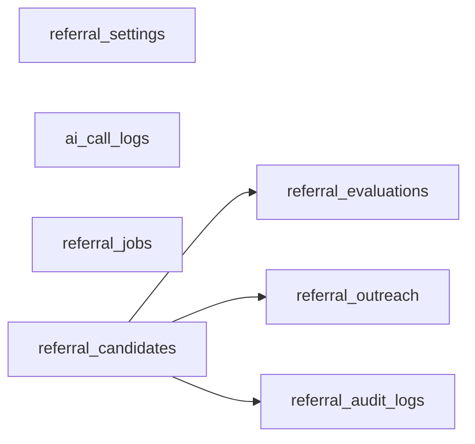

**Diagram referral-2: tables reached only through shared code (6)**

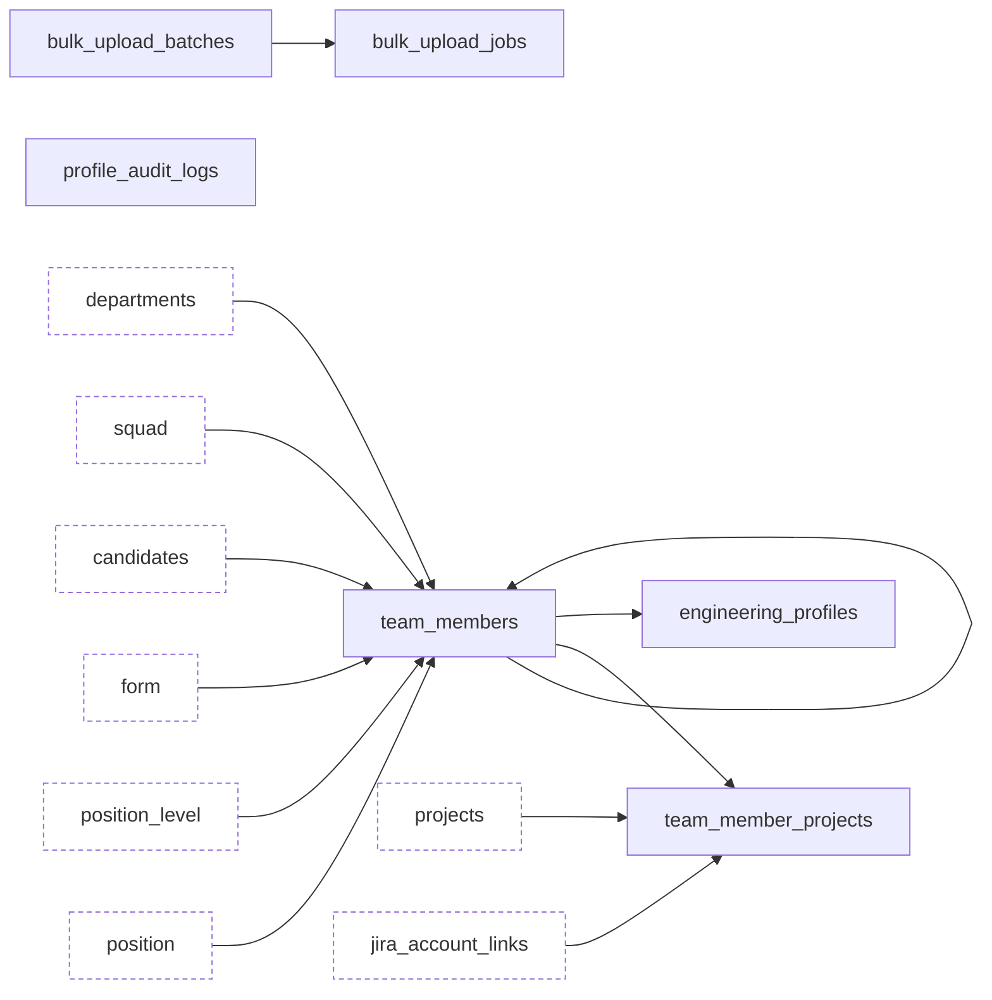

## Table definitions: Onboarding and documents

### Onboarding and documents: canonical table definitions (16)

#### contacts
Status: Active · Model: Contact (schema.prisma:1174) · Created in: 0_init · Later migrations touching it: 1

Structure: references team_members, address.

Accessed by (direct): Onboarding and documents · via shared code only: People and org, Forms, Background jobs (cron, queue, workers)
Evidence: Runtime refs: 2 call sites in 1 files, e.g. app/helpers/onboarding/personalDetails.helper.js:298. Tests: 1 files.

| Column | Database type | Nullable | Default | Key/constraint | Description |
|---|---|---|---|---|---|
| id | text | no | uuid() | PK | Primary key |
| team_member_id | text | no |  | FK → team_members.id, IDX | References team_members |
| is_emergency | boolean | no | true | IDX | Inferred: flag, is emergency |
| name | varchar(255) | no |  |  | Inferred: name |
| email | varchar(255) | yes |  |  | Inferred: email |
| phone_number | varchar(255) | yes |  |  | Inferred: phone number |
| relation | varchar(255) | no |  |  | Inferred: relation |
| address_id | text | yes |  | FK → address.id, UQ | References address |
| created_at | timestamptz(3) | no | now() |  | Row creation time |
| updated_at | timestamptz(3) | no | now() | @updatedAt | Last update time |

**Relationships**

- Out: `team_member_id` → `team_members`.`id` (People and org); many → 1; FK constraint `contacts_team_member_id_57b04eaa_fk`; onDelete schema: default, DB: NO ACTION
- Out: `address_id` → `address`.`id` (Recruitment (ATS)); 1 → 0..1; FK constraint `contacts_address_id_a265fe71_fk`; onDelete schema: Cascade, DB: NO ACTION

**Additional details**

- Indexes: `([team_member_id, is_emergency])`
- No `tenant_id` column: tenant scope is only reachable through parent rows

#### documents
Status: Active · Model: Documents (schema.prisma:2057) · Created in: 0_init · Later migrations touching it: 2

Structure: references team_members.

Accessed by (direct): Onboarding and documents · via shared code only: People and org, Forms, Background jobs (cron, queue, workers)
Evidence: Runtime refs: 6 call sites in 3 files, e.g. app/controllers/documents.controller.js:23, app/helpers/documents.helper.js:11, app/helpers/onboarding/personalDetails.helper.js:365.

| Column | Database type | Nullable | Default | Key/constraint | Description |
|---|---|---|---|---|---|
| id | text | no | uuid() | PK | Primary key |
| name | varchar(255) | no |  | UQ(composite) | Inferred: name |
| url (field url_key) | varchar(2000) | no |  |  | The S3 object key. `url` is composed from it on read, so consumers still see the full URL the frontend's secure-link hook expects, without the bucket being frozen into the row. 2000 rather than 255 because a Personal Details document's key carries a tenant and a team-member uuid and a slug, and did not fit; matches the cap onboarding_content.file_url is validated against. |
| created_at | timestamptz(3) | no | now() |  | Row creation time |
| updated_at | timestamptz(3) | no | now() | @updatedAt | Last update time |
| teamMemberId | text | no |  | FK → team_members.id, UQ(composite) | References team_members |

**Relationships**

- Out: `teamMemberId` → `team_members`.`id` (People and org); many → 1; FK constraint `documents_teamMemberId_f88898d8_fk`; onDelete schema: default, DB: NO ACTION

**Additional details**

- Unique: `([teamMemberId, name])`
- No `tenant_id` column: tenant scope is only reachable through parent rows

#### domains
Status: Active · Model: Domain (schema.prisma:2391) · Created in: 20260713000000_add_engineering_profiles_schema · Later migrations touching it: 2

Schema comment: "── Engineering Profiles (TDD: docs/engineering-profiles-tdd.md) ─────".

Structure: referenced by 3 table(s).

Accessed by (direct): People and org, Onboarding and documents, Projects, clients and dev integrations
Evidence: Runtime refs: 11 call sites in 4 files, e.g. app/helpers/domains.helper.js:19, app/validators/onboarding.validator.js:282, app/validators/onboardingContent.validator.js:177 (+1 more files). Tests: 3 files.

| Column | Database type | Nullable | Default | Key/constraint | Description |
|---|---|---|---|---|---|
| id | uuid | no | uuid() | PK | Primary key |
| name | varchar(255) | no |  | UQ(composite) | Inferred: name |
| tenant_id | uuid | no |  | UQ(composite), IDX | Tenant scope; no FK (tenant data lives outside this DB) |
| is_active | boolean | no | true |  | Inferred: flag, is active |
| created_at | timestamptz(3) | no | now() |  | Row creation time |
| updated_at | timestamptz(3) | no | now() | @updatedAt | Last update time |

**Relationships**

- In: `projects`.`domain_id` (Projects, clients and dev integrations); 1 → many; FK constraint `projects_domain_id_fkey`
- In: `onboarding_content`.`domain_id`; 1 → many; FK constraint `onboarding_content_domain_id_fkey`
- In: `team_member_onboarding_domains`.`domain_id`; 1 → many; FK constraint `team_member_onboarding_domains_domain_id_fkey`

**Additional details**

- Unique: `([name, tenant_id])`
- Indexes: `([tenant_id])`

#### form_response
Status: Active · Model: FormResponse (schema.prisma:1330) · Created in: 0_init · Later migrations touching it: 1

Schema comment: "formResponse-model".

Structure: references team_members, candidates, form_tasks.

Accessed by (direct): People and org, Onboarding and documents, Forms · via shared code only: Projects, clients and dev integrations, Feedback and performance, Background jobs (cron, queue, workers)
Evidence: Runtime refs: 31 call sites in 13 files, e.g. app/controllers/formResponse.controller.js:20, app/controllers/onboarding.controller.js:189, app/helpers/formResponse.helper.js:31 (+10 more files). Tests: 9 files.

| Column | Database type | Nullable | Default | Key/constraint | Description |
|---|---|---|---|---|---|
| id | uuid | no | uuid() | PK | Primary key |
| task_response | text | yes |  |  | Inferred: task response |
| is_skipped | boolean | no | false |  | Inferred: flag, is skipped |
| team_member_id | text | yes |  | FK → team_members.id | References team_members |
| candidate_id | text | yes |  | FK → candidates.id | References candidates |
| task_id | uuid | no |  | FK → form_tasks.id | References form_tasks |
| admin_note | varchar(1500) | yes |  |  | Inferred: admin note |
| completed_by_admin_id | uuid | yes |  | FK → team_members.id | References team_members |
| created_at (field createdAt) | timestamptz(3) | no | now() |  | Row creation time |
| updated_at (field updatedAt) | timestamptz(3) | no | now() | @updatedAt | Last update time |

**Relationships**

- Out: `team_member_id` → `team_members`.`id` (People and org); many → 0..1; FK constraint `form_response_team_member_id_ad745e05_fk`; onDelete schema: default, DB: NO ACTION
- Out: `candidate_id` → `candidates`.`id` (Recruitment (ATS)); many → 0..1; FK constraint `form_response_candidate_id_7db5927e_fk`; onDelete schema: default, DB: NO ACTION
- Out: `task_id` → `form_tasks`.`id`; many → 1; FK constraint `form_response_task_id_84a1611d_fk`; onDelete schema: default, DB: NO ACTION
- Out: `completed_by_admin_id` → `team_members`.`id` (People and org); many → 0..1; FK constraint `form_response_completed_by_admin_id_fkey`; onDelete schema: default, DB: SET NULL

**Additional details**

- No `tenant_id` column: tenant scope is only reachable through parent rows

#### form_tasks
Status: Active · Model: FormTask (schema.prisma:1293) · Created in: 0_init · Later migrations touching it: 1

Schema comment: "formTask-model".

Structure: references form; referenced by 1 table(s).

Accessed by (direct): People and org, Onboarding and documents, Forms · via shared code only: Background jobs (cron, queue, workers)
Evidence: Runtime refs: 22 call sites in 12 files, e.g. app/controllers/form.controller.js:189, app/controllers/formTasks.controller.js:11, app/controllers/onboarding.controller.js:177 (+9 more files). Ops scripts/seeds: scripts/backfillPastExperienceOnboardingTask.js:17. Tests: 10 files.

| Column | Database type | Nullable | Default | Key/constraint | Description |
|---|---|---|---|---|---|
| id | uuid | no | uuid() | PK | Primary key |
| is_completed | boolean | no | false |  | Inferred: flag, is completed |
| unique_identifier | varchar(255) | yes |  |  | Inferred: unique identifier |
| task_description | varchar(1000) | yes |  |  | Inferred: task description |
| title | varchar(1000) | yes |  |  | Inferred: title |
| description | varchar(1000) | yes |  |  | Inferred: description |
| label | varchar(500) | yes |  |  | Inferred: label |
| placeholder | varchar(500) | yes |  |  | Inferred: placeholder |
| default_value | varchar(500) | yes |  |  | Inferred: default value |
| type | enum Type | yes |  |  | Enum `Type`: radio, checkbox, select, one_line, multi_line, parent_questions, … (15 values) |
| template_file (field template_file_key) | varchar(1000) | yes |  |  | S3 object key; URL composed on read and omitted from responses (app/models/prismaClient.js) |
| options | json[] | no |  |  | Inferred: options |
| order | varchar(255) | yes |  |  | Inferred: order |
| model | enum Model | yes |  |  | Enum `Model`: TEAM, ONBOARDING, ASSET |
| parent_task_id | uuid | yes |  | FK → form_tasks.id | References form_tasks |
| required_message | varchar(1500) | yes |  |  | Inferred: required message |
| is_mandatory | boolean | yes | false |  | Inferred: flag, is mandatory |
| is_archived | boolean | yes | false |  | Inferred: flag, is archived |
| is_multiple | boolean | yes | false |  | Inferred: flag, is multiple |
| is_hidden | boolean | yes | false |  | Inferred: flag, is hidden |
| is_disabled | boolean | yes | false |  | Inferred: flag, is disabled |
| created_at (field createdAt) | timestamptz(3) | no | now() |  | Row creation time |
| updated_at (field updatedAt) | timestamptz(3) | no | now() | @updatedAt | Last update time |
| form_id | uuid | yes |  | FK → form.id | References form |

**Relationships**

- Out: `form_id` → `form`.`id` (Forms); many → 0..1; FK constraint `form_tasks_form_id_986ae891_fk`; onDelete schema: default, DB: NO ACTION
- Out: `parent_task_id` → `form_tasks`.`id`; many → 0..1; FK constraint `form_tasks_parent_task_id_e4d9b073_fk`; onDelete schema: default, DB: NO ACTION
- In: `form_tasks`.`parent_task_id`; 1 → many; FK constraint `form_tasks_parent_task_id_e4d9b073_fk`
- In: `form_response`.`task_id`; 1 → many; FK constraint `form_response_task_id_84a1611d_fk`

**Additional details**

- No `tenant_id` column: tenant scope is only reachable through parent rows
- Self-reference (1)

#### onboarding_acknowledgements
Status: Active · Model: OnboardingAcknowledgement (schema.prisma:2941) · Created in: 20260724063606_add_onboarding_admin_module

Structure: references team_members, onboarding_content; junction table (composite key over two FKs).

Accessed by (direct): Onboarding and documents · via shared code only: People and org, Forms, Background jobs (cron, queue, workers)
Evidence: Runtime refs: 8 call sites in 4 files, e.g. app/helpers/onboarding/acknowledgement.helper.js:28, app/helpers/onboarding/drilldown.helper.js:106, app/helpers/onboarding/welcomeKit.helper.js:52 (+1 more files). Tests: 4 files.

| Column | Database type | Nullable | Default | Key/constraint | Description |
|---|---|---|---|---|---|
| id | uuid | no | uuid() | PK | Primary key |
| team_member_id | uuid | no |  | FK → team_members.id, UQ(composite) | References team_members |
| content_id | uuid | no |  | FK → onboarding_content.id, UQ(composite) | References onboarding_content |
| content_version | integer | no |  | UQ(composite) | Inferred: content version |
| acknowledged_at | timestamp(3) | no | now() |  | Inferred: acknowledged at |
| is_admin_recorded | boolean | no | false |  | Inferred: flag, is admin recorded |
| recorded_by_id | uuid | no |  | FK → team_members.id | References team_members |
| ip_address | varchar(64) | yes |  |  | Inferred: ip address |

**Relationships**

- Out: `team_member_id` → `team_members`.`id` (People and org); many → 1; FK constraint `onboarding_acknowledgements_team_member_id_fkey`; onDelete schema: default, DB: RESTRICT
- Out: `content_id` → `onboarding_content`.`id`; many → 1; FK constraint `onboarding_acknowledgements_content_id_fkey`; onDelete schema: default, DB: RESTRICT
- Out: `recorded_by_id` → `team_members`.`id` (People and org); many → 1; FK constraint `onboarding_acknowledgements_recorded_by_id_fkey`; onDelete schema: default, DB: RESTRICT

**Additional details**

- Unique: `([team_member_id, content_id, content_version])`
- No `tenant_id` column: tenant scope is only reachable through parent rows

#### onboarding_asset_selections
Status: Active · Model: OnboardingAssetSelection (schema.prisma:3074) · Created in: 20260825000000_add_onboarding_asset_selections

Schema comment: "Assets an admin picked for a joiner, at activation or later from the Employee setup editor. Onboarding only ever takes back an asset recorded here — anything Asset Management handed out separately is left alone. assigned_at holds when the hand-over actually landed, so a selection whose assignment failed is still distinguishable from one that went through.  Nothing here is hardware-specific: which types are offerable is ONBOARDING_ASSIGNABLE_ASSET_TYPES, and the unique key is per (member, asset), so one shared software licence can carry a row per joiner once assignment learns to count seats.".

Structure: references team_members, assets; junction table (composite key over two FKs).

Accessed by (direct): Onboarding and documents · via shared code only: People and org, Forms, Background jobs (cron, queue, workers)
Evidence: Runtime refs: 7 call sites in 2 files, e.g. app/helpers/onboarding/drilldown.helper.js:64, app/helpers/onboarding/employeeSetup.helper.js:60. Tests: 2 files.

| Column | Database type | Nullable | Default | Key/constraint | Description |
|---|---|---|---|---|---|
| id | uuid | no | uuid() | PK | Primary key |
| tenant_id | uuid | no |  | IDX | Tenant scope; no FK (tenant data lives outside this DB) |
| team_member_id | uuid | no |  | FK → team_members.id, UQ(composite), IDX | References team_members |
| asset_id | uuid | no |  | FK → assets.id, UQ(composite), IDX | References assets |
| selected_by_id | uuid | yes |  | FK → team_members.id | References team_members |
| assigned_at | timestamp(3) | yes |  |  | Inferred: assigned at |
| created_at | timestamp(3) | no | now() |  | Row creation time |
| updated_at | timestamp(3) | no |  | @updatedAt | Last update time |

**Relationships**

- Out: `team_member_id` → `team_members`.`id` (People and org); many → 1; FK constraint `onboarding_asset_selections_team_member_id_fkey`; onDelete schema: default, DB: RESTRICT
- Out: `asset_id` → `assets`.`id` (Assets); many → 1; FK constraint `onboarding_asset_selections_asset_id_fkey`; onDelete schema: Cascade, DB: CASCADE
- Out: `selected_by_id` → `team_members`.`id` (People and org); many → 0..1; FK constraint `onboarding_asset_selections_selected_by_id_fkey`; onDelete schema: default, DB: SET NULL

**Additional details**

- Unique: `([team_member_id, asset_id])`
- Indexes: `([tenant_id, team_member_id])`, `([asset_id])`

#### onboarding_audit_trail
Status: Active · Model: OnboardingAuditTrail (schema.prisma:3044) · Created in: 20260724063606_add_onboarding_admin_module · Later migrations touching it: 1

Structure: references team_members.

Accessed by (direct): Onboarding and documents · via shared code only: People and org, Forms, Background jobs (cron, queue, workers)
Evidence: Runtime refs: 24 call sites in 10 files, e.g. app/controllers/onboarding.controller.js:207, app/helpers/onboarding/completion.helper.js:99, app/helpers/onboarding/customFields.helper.js:86 (+7 more files). Tests: 8 files.

| Column | Database type | Nullable | Default | Key/constraint | Description |
|---|---|---|---|---|---|
| id | uuid | no | uuid() | PK | Primary key |
| tenant_id | uuid | no |  | IDX | Tenant scope; no FK (tenant data lives outside this DB) |
| team_member_id | uuid | yes |  | FK → team_members.id, IDX | References team_members |
| event_type | varchar(60) | no |  |  | Inferred: event type |
| actor_id | uuid | yes |  | FK → team_members.id | References team_members |
| old_value | text | yes |  |  | Inferred: old value |
| new_value | text | yes |  |  | Inferred: new value |
| remark | text | yes |  |  | Inferred: remark |
| occurred_at | timestamp(3) | no | now() |  | Inferred: occurred at |

**Relationships**

- Out: `team_member_id` → `team_members`.`id` (People and org); many → 0..1; FK constraint `onboarding_audit_trail_team_member_id_fkey`; onDelete schema: default, DB: SET NULL
- Out: `actor_id` → `team_members`.`id` (People and org); many → 0..1; FK constraint `onboarding_audit_trail_actor_id_fkey`; onDelete schema: default, DB: SET NULL

**Additional details**

- Indexes: `([tenant_id, team_member_id])`
- Partial unique index `onboarding_audit_completed_notified_once`  ("team_member_id") WHERE "event_type" = 'ONBOARDING_COMPLETED_NOTIFIED' from `20260831072402_onboarding_completed_notified_once`, not represented in schema.prisma

#### onboarding_content
Status: Active · Model: OnboardingContent (schema.prisma:2879) · Created in: 20260724063606_add_onboarding_admin_module · Later migrations touching it: 5

Structure: references domains, app_client, team_members; referenced by 2 table(s).

Accessed by (direct): Onboarding and documents · via shared code only: People and org, Forms, Background jobs (cron, queue, workers)
Evidence: Runtime refs: 21 call sites in 10 files, e.g. app/controllers/onboarding.controller.js:452, app/controllers/onboardingContent.controller.js:73, app/helpers/onboarding/acknowledgement.helper.js:25 (+7 more files). Tests: 5 files.

| Column | Database type | Nullable | Default | Key/constraint | Description |
|---|---|---|---|---|---|
| id | uuid | no | uuid() | PK | Primary key |
| tenant_id | uuid | no |  | IDX | Tenant scope; no FK (tenant data lives outside this DB) |
| category | enum OnboardingContentCategory | no |  | IDX | Enum `OnboardingContentCategory`: POLICY, CULTURE, DOMAIN, CLIENT, WELCOME_KIT |
| title | varchar(255) | no |  |  | Inferred: title |
| description | varchar(1000) | yes |  |  | Inferred: description |
| body | text | yes |  |  | A WELCOME_KIT row is either a message (body, no file) or a document (file, no body); every other category is document-only, which is why file_url/file_type are nullable at the schema level but still required by the validator outside WELCOME_KIT. |
| file_url (field file_url_key) | varchar(2000) | yes |  |  | S3 object key; URL composed on read and omitted from responses (app/models/prismaClient.js) |
| file_type | varchar(100) | yes |  |  | Inferred: file type |
| ack_requirement | enum AckRequirement | no | NONE |  | Enum `AckRequirement`: MANDATORY, OPTIONAL, NONE |
| requires_signed_upload | boolean | no | false |  | The employee has to send a filled, signed copy of this document back, and only an admin's approval of that copy records their acknowledgement. Acknowledgement still drives step progression — what changes is who may write it, not what it means. |
| allowed_upload_types | jsonb | yes |  |  | Extension keys the employee may upload, e.g. ["pdf", "docx"]. Null when no signed copy is wanted. Json rather than String[] to match onboarding_custom_fields.options, and validated against app/constants/onboarding/uploads.js so the accepted set needs no migration. |
| domain_id | uuid | yes |  | FK → domains.id | References domains |
| client_id | uuid | yes |  | FK → app_client.id | References app_client |
| group_key | uuid | no |  |  | S3 object key; URL composed on read and omitted from responses (app/models/prismaClient.js) |
| version | integer | no | 1 |  | Inferred: version |
| is_latest | boolean | no | true | IDX | Inferred: flag, is latest |
| is_published | boolean | no | false |  | Inferred: flag, is published |
| uploaded_by_id | uuid | no |  | FK → team_members.id | References team_members |
| created_at | timestamp(3) | no | now() |  | Row creation time |
| updated_at | timestamp(3) | no |  | @updatedAt | Last update time |

**Relationships**

- Out: `domain_id` → `domains`.`id`; many → 0..1; FK constraint `onboarding_content_domain_id_fkey`; onDelete schema: default, DB: SET NULL
- Out: `client_id` → `app_client`.`id` (Projects, clients and dev integrations); many → 0..1; FK constraint `onboarding_content_client_id_fkey`; onDelete schema: default, DB: SET NULL
- Out: `uploaded_by_id` → `team_members`.`id` (People and org); many → 1; FK constraint `onboarding_content_uploaded_by_id_fkey`; onDelete schema: default, DB: RESTRICT
- In: `onboarding_acknowledgements`.`content_id`; 1 → many; FK constraint `onboarding_acknowledgements_content_id_fkey`
- In: `onboarding_uploads`.`content_id`; 1 → many; FK constraint `onboarding_uploads_content_id_fkey`

**Additional details**

- Indexes: `([tenant_id, category, is_latest])`

#### onboarding_custom_field_values
Status: Active · Model: OnboardingCustomFieldValue (schema.prisma:3128) · Created in: 20260825000001_add_onboarding_custom_fields

Schema comment: "One employee's answer to one custom question. value is text whatever the field_type is: the type governs the input and the validation, and storing a date or a number in its own column would mean a column per type for data nothing aggregates over.".

Structure: references team_members, onboarding_custom_fields; junction table (composite key over two FKs).

Accessed by (direct): Onboarding and documents · via shared code only: People and org, Forms, Background jobs (cron, queue, workers)
Evidence: Runtime refs: 4 call sites in 1 files, e.g. app/helpers/onboarding/customFields.helper.js:228. Tests: 1 files.

| Column | Database type | Nullable | Default | Key/constraint | Description |
|---|---|---|---|---|---|
| id | uuid | no | uuid() | PK | Primary key |
| tenant_id | uuid | no |  | IDX | Tenant scope; no FK (tenant data lives outside this DB) |
| team_member_id | uuid | no |  | FK → team_members.id, UQ(composite), IDX | References team_members |
| field_id | uuid | no |  | FK → onboarding_custom_fields.id, UQ(composite) | References onboarding_custom_fields |
| value | text | yes |  |  | Inferred: value |
| created_at | timestamp(3) | no | now() |  | Row creation time |
| updated_at | timestamp(3) | no |  | @updatedAt | Last update time |

**Relationships**

- Out: `team_member_id` → `team_members`.`id` (People and org); many → 1; FK constraint `onboarding_custom_field_values_team_member_id_fkey`; onDelete schema: default, DB: RESTRICT
- Out: `field_id` → `onboarding_custom_fields`.`id`; many → 1; FK constraint `onboarding_custom_field_values_field_id_fkey`; onDelete schema: Cascade, DB: CASCADE

**Additional details**

- Unique: `([team_member_id, field_id])`
- Indexes: `([tenant_id, team_member_id])`

#### onboarding_custom_fields
Status: Active · Model: OnboardingCustomField (schema.prisma:3100) · Created in: 20260825000001_add_onboarding_custom_fields · Later migrations touching it: 1

Schema comment: "Extra questions a tenant adds to the PERSONAL_DETAILS step, beyond the code-owned profile catalog (app/constants/onboarding/personalDetailsFields.js). Those map onto real profile columns; these have nowhere to land, so their answers live in onboarding_custom_field_values below.  field_type is a varchar rather than an enum for the same reason the asset columns are: the accepted set is owned by app/constants/onboarding/customFields.js, and a type added there must not need a migration. options carries the choice list for an ENUM field and is null for every other type.".

Structure: referenced by 1 table(s).

Accessed by (direct): Onboarding and documents · via shared code only: People and org, Forms, Background jobs (cron, queue, workers)
Evidence: Runtime refs: 12 call sites in 1 files, e.g. app/helpers/onboarding/customFields.helper.js:80. Tests: 1 files.

| Column | Database type | Nullable | Default | Key/constraint | Description |
|---|---|---|---|---|---|
| id | uuid | no | uuid() | PK | Primary key |
| tenant_id | uuid | no |  | UQ(composite), IDX | Tenant scope; no FK (tenant data lives outside this DB) |
| label | varchar(255) | no |  | UQ(composite) | Inferred: label |
| field_type | varchar(20) | no |  |  | Inferred: field type |
| options | jsonb | yes |  |  | Inferred: options |
| allowed_file_types | jsonb | yes |  |  | Extension keys a FILE question accepts, and null for every other type — the same rule options follows, so a list cannot outlive the type that justified it. |
| is_required | boolean | no | false |  | Inferred: flag, is required |
| order | integer | no |  |  | Inferred: order |
| is_active | boolean | no | true | IDX | Retired rather than deleted: an answer already given must keep the question it answered, so the step stops asking while the trail stays readable. |
| created_at | timestamp(3) | no | now() |  | Row creation time |
| updated_at | timestamp(3) | no |  | @updatedAt | Last update time |

**Relationships**

- In: `onboarding_custom_field_values`.`field_id`; 1 → many; FK constraint `onboarding_custom_field_values_field_id_fkey`

**Additional details**

- Unique: `([tenant_id, label])`
- Indexes: `([tenant_id, is_active])`

#### onboarding_flow_settings
Status: Active · Model: OnboardingFlowSettings (schema.prisma:3032) · Created in: 20260724063606_add_onboarding_admin_module

Accessed by (direct): Onboarding and documents · via shared code only: Background jobs (cron, queue, workers)
Evidence: Runtime refs: 3 call sites in 2 files, e.g. app/controllers/onboardingSettings.controller.js:76, app/helpers/onboarding/reminderSweep.helper.js:43. Tests: 5 files.

| Column | Database type | Nullable | Default | Key/constraint | Description |
|---|---|---|---|---|---|
| id | uuid | no | uuid() | PK | Primary key |
| tenant_id | uuid | no |  | UQ | Tenant scope; no FK (tenant data lives outside this DB) |
| completion_deadline_days | integer | no | 7 |  | Inferred: completion deadline days |
| reminder_interval_days | integer | no | 2 |  | Inferred: reminder interval days |
| abandonment_threshold_days | integer | no | 5 |  | Inferred: abandonment threshold days |
| created_at | timestamp(3) | no | now() |  | Row creation time |
| updated_at | timestamp(3) | no |  | @updatedAt | Last update time |

**Relationships:** none identified.

#### onboarding_profile_field_configs
Status: Active · Model: OnboardingProfileFieldConfig (schema.prisma:3019) · Created in: 20260810000000_onboarding_profile_field_config

Schema comment: "Which profile fields the PERSONAL_DETAILS step collects, per tenant. field_key points at an entry in app/constants/onboarding/personalDetailsFields.js rather than an enum: the catalog is code-owned and grows with the profile, and an enum would force a migration per field added. A row whose key has left that registry is ignored on read, never a crash.".

Accessed by (direct): Onboarding and documents · via shared code only: People and org, Forms, Background jobs (cron, queue, workers)
Evidence: Runtime refs: 5 call sites in 2 files, e.g. app/helpers/onboarding/personalDetails.helper.js:137, app/helpers/onboarding/profileFieldSettings.helper.js:78. Tests: 2 files.

| Column | Database type | Nullable | Default | Key/constraint | Description |
|---|---|---|---|---|---|
| id | uuid | no | uuid() | PK | Primary key |
| tenant_id | uuid | no |  | UQ(composite) | Tenant scope; no FK (tenant data lives outside this DB) |
| field_key | varchar(100) | no |  | UQ(composite) | Inferred: field key |
| is_required | boolean | no | false |  | Inferred: flag, is required |
| order | integer | no |  |  | Inferred: order |
| created_at | timestamp(3) | no | now() |  | Row creation time |
| updated_at | timestamp(3) | no |  | @updatedAt | Last update time |

**Relationships:** none identified.

**Additional details**

- Unique: `([tenant_id, field_key])`

#### onboarding_step_configs
Status: Active · Model: OnboardingStepConfig (schema.prisma:3001) · Created in: 20260724063606_add_onboarding_admin_module · Later migrations touching it: 1

Accessed by (direct): Onboarding and documents · via shared code only: People and org, Forms, Background jobs (cron, queue, workers)
Evidence: Runtime refs: 9 call sites in 5 files, e.g. app/controllers/onboardingSettings.controller.js:23, app/helpers/onboarding/content.helper.js:149, app/helpers/onboarding/initiation.helper.js:44 (+2 more files). Ops scripts/seeds: prisma/seeds/seedOnboardingStepConfigBackfill.js:57. Tests: 8 files.

| Column | Database type | Nullable | Default | Key/constraint | Description |
|---|---|---|---|---|---|
| id | uuid | no | uuid() | PK | Primary key |
| tenant_id | uuid | no |  | UQ(composite) | Tenant scope; no FK (tenant data lives outside this DB) |
| step_key | enum OnboardingStepKey | no |  | UQ(composite) | Enum `OnboardingStepKey`: PERSONAL_DETAILS, WELCOME_KIT, COMPANY_POLICIES, COMPANY_CULTURE, TECHNICAL_DOMAINS, CLIENT_OVERVIEW, … (9 values) |
| order | integer | no |  |  | Inferred: order |
| is_enabled | boolean | no | true |  | Inferred: flag, is enabled |
| is_blocking | boolean | no | true |  | Inferred: flag, is blocking |
| created_at | timestamp(3) | no | now() |  | Row creation time |
| updated_at | timestamp(3) | no |  | @updatedAt | Last update time |

**Relationships:** none identified.

**Additional details**

- Unique: `([tenant_id, step_key])`

#### onboarding_uploads
Status: Active · Model: OnboardingUpload (schema.prisma:2965) · Created in: 20260831090001_add_onboarding_uploads

Schema comment: "One signed copy: the document an employee downloaded, filled in and sent back for one version of one content item. Replaced in place on re-upload — who uploaded what and when lives in onboarding_audit_trail, so a row here is always "the current signed copy".  review_status is a varchar for the same reason onboarding_custom_fields.field_type is: the accepted set is owned by app/constants/onboarding/uploads.js and a state added there must not need a migration.".

Structure: references team_members, onboarding_content; junction table (composite key over two FKs).

Accessed by (direct): Onboarding and documents
Evidence: Runtime refs: 5 call sites in 3 files, e.g. app/services/onboarding/signedUploads.js:33, app/services/onboarding/uploadReview.js:60, app/validators/onboardingUploads.validator.js:111. Tests: 1 files.

| Column | Database type | Nullable | Default | Key/constraint | Description |
|---|---|---|---|---|---|
| id | uuid | no | uuid() | PK | Primary key |
| tenant_id | uuid | no |  | IDX | Tenant scope; no FK (tenant data lives outside this DB) |
| team_member_id | uuid | no |  | FK → team_members.id, UQ(composite), IDX | References team_members |
| content_id | uuid | no |  | FK → onboarding_content.id, UQ(composite), IDX | References onboarding_content |
| content_version | integer | no |  | UQ(composite) | The version the signature applies to. A newly published version needs a fresh signed copy — the same rule re-acknowledgement already follows. |
| s3_key | varchar(2000) | no |  |  | Inferred: s3 key |
| file_name | varchar(255) | no |  |  | Inferred: file name |
| file_type | varchar(100) | no |  |  | Inferred: file type |
| file_size | integer | no |  |  | Inferred: file size |
| review_status | varchar(20) | no | "PENDING" | IDX | Inferred: review status |
| review_note | text | yes |  |  | Inferred: review note |
| reviewed_by_id | uuid | yes |  | FK → team_members.id | References team_members |
| reviewed_at | timestamp(3) | yes |  |  | Inferred: reviewed at |
| uploaded_by_id | uuid | no |  | FK → team_members.id | Not always the employee: an admin may upload a copy that reached them by email. Kept separate from team_member_id so the trail says who actually sent the file. |
| created_at | timestamp(3) | no | now() |  | Row creation time |
| updated_at | timestamp(3) | no |  | @updatedAt | Last update time |

**Relationships**

- Out: `team_member_id` → `team_members`.`id` (People and org); many → 1; FK constraint `onboarding_uploads_team_member_id_fkey`; onDelete schema: default, DB: RESTRICT
- Out: `content_id` → `onboarding_content`.`id`; many → 1; FK constraint `onboarding_uploads_content_id_fkey`; onDelete schema: default, DB: RESTRICT
- Out: `reviewed_by_id` → `team_members`.`id` (People and org); many → 0..1; FK constraint `onboarding_uploads_reviewed_by_id_fkey`; onDelete schema: default, DB: SET NULL
- Out: `uploaded_by_id` → `team_members`.`id` (People and org); many → 1; FK constraint `onboarding_uploads_uploaded_by_id_fkey`; onDelete schema: default, DB: RESTRICT

**Additional details**

- Unique: `([team_member_id, content_id, content_version])`
- Indexes: `([tenant_id, team_member_id])`, `([content_id, review_status])`

#### team_member_onboarding_domains
Status: Active · Model: TeamMemberOnboardingDomain (schema.prisma:2929) · Created in: 20260724063606_add_onboarding_admin_module · Later migrations touching it: 1

Schema comment: "Technical Work Domains (PRD FR-5) reuse the existing per-tenant Domain lookup (already used by Projects, CRUD at /domains) rather than a parallel model — same "practice area" concept, no need for a second one.".

Structure: references team_members, domains; junction table (composite key over two FKs).

Accessed by (direct): Onboarding and documents
Evidence: Runtime refs: 4 call sites in 1 files, e.g. app/controllers/onboarding.controller.js:141. Tests: 1 files.

| Column | Database type | Nullable | Default | Key/constraint | Description |
|---|---|---|---|---|---|
| id | uuid | no | uuid() | PK | Primary key |
| team_member_id | uuid | no |  | FK → team_members.id, UQ(composite) | References team_members |
| domain_id | uuid | no |  | FK → domains.id, UQ(composite) | References domains |
| created_at | timestamp(3) | no | now() |  | Row creation time |

**Relationships**

- Out: `team_member_id` → `team_members`.`id` (People and org); many → 1; FK constraint `team_member_onboarding_domains_team_member_id_fkey`; onDelete schema: default, DB: RESTRICT
- Out: `domain_id` → `domains`.`id`; many → 1; FK constraint `team_member_onboarding_domains_domain_id_fkey`; onDelete schema: default, DB: RESTRICT

**Additional details**

- Unique: `([team_member_id, domain_id])`
- No `tenant_id` column: tenant scope is only reachable through parent rows

### Onboarding and documents: relationship diagram

Arrows run parent → child (FK holder). Solid = FK in schema and migration SQL; dotted = schema vs SQL discrepancy; dashed boxes = tables outside this module. Full conventions under Counting rules.

**Diagram onboarding-1: tables accessed directly (23), external FK parents shown dashed**

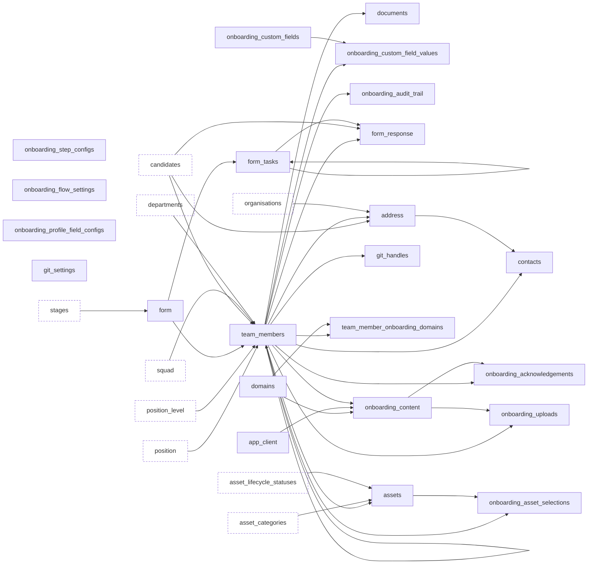

**Diagram onboarding-2: tables reached only through shared code (18)**

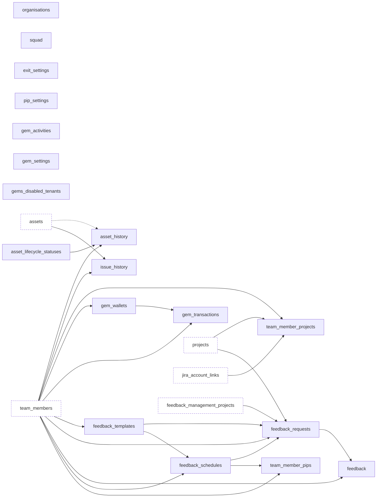

## Table definitions: Projects, clients and dev integrations

### Projects, clients and dev integrations: canonical table definitions (18)

#### app_client
Status: Active · Model: Client (schema.prisma:449) · Created in: 0_init · Later migrations touching it: 2

Structure: referenced by 5 table(s).

Accessed by (direct): Onboarding and documents, Projects, clients and dev integrations · via shared code only: Background jobs (cron, queue, workers)
Evidence: Runtime refs: 26 call sites in 8 files, e.g. app/controllers/clients.controller.js:85, app/controllers/projects.controller.js:365, app/helpers/clientExpiry.helper.js:36 (+5 more files). Tests: 1 files.

| Column | Database type | Nullable | Default | Key/constraint | Description |
|---|---|---|---|---|---|
| id | uuid | no | uuid() | PK | Primary key |
| code | varchar(50) | no |  | UQ(composite) | Inferred: code |
| name | varchar(255) | no |  |  | Inferred: name |
| email | varchar(254) | no |  | UQ(composite) | Inferred: email |
| phone | varchar(20) | yes |  |  | Inferred: phone |
| status | varchar(20) | no | "active" |  | Inferred: status |
| tenant_id | uuid | no |  | UQ(composite) | Tenant scope; no FK (tenant data lives outside this DB) |
| activation_date | date | yes |  |  | Inferred: activation date |
| expiry_date | date | yes |  |  | Inferred: expiry date |
| is_archived | boolean | no | false |  | Inferred: flag, is archived |
| created_at | timestamptz(6) | no | now() |  | Row creation time |
| updated_at | timestamptz(6) | no | now() | @updatedAt | Last update time |

**Relationships**

- In: `projects`.`client_id`; 1 → many; FK constraint `projects_client_id_a93b0b3a_fk_app_client_id`
- In: `client_billing_addresses`.`client_id`; 1 → many; FK constraint `client_billing_addresses_client_id_c5e020d9_fk_app_client_id`
- In: `client_documents`.`client_id`; 1 → many; FK constraint `client_documents_client_id_d520829b_fk_app_client_id`
- In: `client_history`.`client_id`; 1 → many; FK constraint `client_history_client_id_640eac8e_fk_app_client_id`
- In: `onboarding_content`.`client_id` (Onboarding and documents); 1 → many; FK constraint `onboarding_content_client_id_fkey`

**Additional details**

- Unique: `([tenant_id, code], map: "unique_client_code_per_tenant")`, `([tenant_id, email], map: "unique_client_email_per_tenant")`

#### client_billing_addresses
Status: Active · Model: ClientBillingAddress (schema.prisma:474) · Created in: 0_init · Later migrations touching it: 1

Structure: references app_client; referenced by 1 table(s).

Accessed by (direct): Projects, clients and dev integrations
Evidence: Runtime refs: 13 call sites in 3 files, e.g. app/controllers/clientBillingAddress.controller.js:14, app/controllers/clients.controller.js:90, app/validators/projects.validator.js:65.

| Column | Database type | Nullable | Default | Key/constraint | Description |
|---|---|---|---|---|---|
| id | uuid | no | uuid() | PK | Primary key |
| billing_address | text | yes |  |  | Inferred: billing address |
| billing_email | varchar(254) | yes |  |  | Inferred: billing email |
| billing_phone | varchar(20) | yes |  |  | Inferred: billing phone |
| is_active | boolean | no | true |  | Inferred: flag, is active |
| created_at | timestamptz(6) | no | now() |  | Row creation time |
| updated_at | timestamptz(6) | no | now() | @updatedAt | Last update time |
| client_id | uuid | no |  | FK → app_client.id | References app_client |

**Relationships**

- Out: `client_id` → `app_client`.`id`; many → 1; FK constraint `client_billing_addresses_client_id_c5e020d9_fk_app_client_id`; onDelete schema: default, DB: NO ACTION
- In: `projects`.`billing_address_id`; 1 → many; FK constraint `projects_billing_address_id_6f87c24f_fk_client_bi`

**Additional details**

- No `tenant_id` column: tenant scope is only reachable through parent rows

#### client_documents
Status: Active · Model: ClientDocument (schema.prisma:490) · Created in: 0_init · Later migrations touching it: 1

Structure: references app_client; referenced by 1 table(s).

Accessed by (direct): Projects, clients and dev integrations · via shared code only: Background jobs (cron, queue, workers)
Evidence: Runtime refs: 8 call sites in 3 files, e.g. app/controllers/clientDocument.controller.js:68, app/controllers/clients.controller.js:349, app/helpers/clientExpiry.helper.js:119.

| Column | Database type | Nullable | Default | Key/constraint | Description |
|---|---|---|---|---|---|
| id | uuid | no | uuid() | PK | Primary key |
| document_type | varchar(20) | no |  |  | Inferred: document type |
| file_name | varchar(255) | no |  |  | Inferred: file name |
| s3_key | varchar(1024) | no |  |  | Inferred: s3 key |
| file_size | integer | no |  |  | Inferred: file size |
| uploaded_by | varchar(255) | no |  |  | Inferred: uploaded by |
| msa_expiry_date | date | yes |  |  | Inferred: msa expiry date |
| is_active | boolean | no | true |  | Inferred: flag, is active |
| deactivated_by | varchar(255) | yes |  |  | Inferred: deactivated by |
| created_at | timestamptz(6) | no | now() |  | Row creation time |
| updated_at | timestamptz(6) | no | now() | @updatedAt | Last update time |
| client_id | uuid | no |  | FK → app_client.id | References app_client |

**Relationships**

- Out: `client_id` → `app_client`.`id`; many → 1; FK constraint `client_documents_client_id_d520829b_fk_app_client_id`; onDelete schema: default, DB: NO ACTION
- In: `msa_expiry_alerts`.`client_document_id`; 1 → many; FK constraint `msa_expiry_alerts_client_document_id_76c06723_fk_client_do`

**Additional details**

- No `tenant_id` column: tenant scope is only reachable through parent rows

#### client_history
Status: Active · Model: ClientHistory (schema.prisma:522) · Created in: 0_init · Later migrations touching it: 1

Structure: references app_client.

Accessed by (direct): Projects, clients and dev integrations · via shared code only: Background jobs (cron, queue, workers)
Evidence: Runtime refs: 4 call sites in 2 files, e.g. app/controllers/clients.controller.js:267, app/helpers/clientExpiry.helper.js:49.

| Column | Database type | Nullable | Default | Key/constraint | Description |
|---|---|---|---|---|---|
| id | uuid | no | uuid() | PK | Primary key |
| old_status | varchar(20) | no |  |  | Inferred: old status |
| new_status | varchar(20) | no |  |  | Inferred: new status |
| changed_by | varchar(255) | no |  |  | Inferred: changed by |
| changed_at | timestamptz(6) | no | now() |  | Inferred: changed at |
| client_id | uuid | no |  | FK → app_client.id | References app_client |

**Relationships**

- Out: `client_id` → `app_client`.`id`; many → 1; FK constraint `client_history_client_id_640eac8e_fk_app_client_id`; onDelete schema: default, DB: NO ACTION

**Additional details**

- No `tenant_id` column: tenant scope is only reachable through parent rows

#### git_handles
Status: Active · Model: GitHandle (schema.prisma:3471) · Created in: 20260820000002_add_git_handles

Schema comment: "One handle per row: an employee can hold a client-org account and an SP18 account at the same time. Each row has its own id and is created, edited and deleted on its own, so a later sync job can hang commits and PRs off a stable handle id. Replacing the whole list on every profile save would destroy that identity and clobber anything the job had written.  The handle is stored, never the URL. The link is built at display time, so the data stays clean and a host domain change is a code fix rather than a data fix.  Visibility is gated by GitSettings.handle_enabled plus the employee's department is_tech, both checked on the server rather than only hidden in the UI.  No audit table here: a handle is public information, and the change trail is only needed on project repositories.".

Structure: references team_members.

Accessed by (direct): Onboarding and documents, Projects, clients and dev integrations · via shared code only: People and org, Forms, Background jobs (cron, queue, workers)
Evidence: Runtime refs: 8 call sites in 2 files, e.g. app/helpers/gitHandles.helper.js:132, app/helpers/onboarding/personalDetails.helper.js:341.

| Column | Database type | Nullable | Default | Key/constraint | Description |
|---|---|---|---|---|---|
| id | uuid | no | uuid() | PK | Primary key |
| team_member_id | uuid | no |  | FK → team_members.id, UQ(composite) | References team_members |
| tenant_id | uuid | no |  | IDX | Tenant scope; no FK (tenant data lives outside this DB) |
| provider | enum GitProvider | no | GITHUB | UQ(composite) | Enum `GitProvider`: GITHUB |
| handle | varchar(255) | no |  | UQ(composite) | Inferred: handle |
| created_at | timestamptz(3) | no | now() |  | Row creation time |
| updated_at | timestamptz(3) | no | now() | @updatedAt | Last update time |

**Relationships**

- Out: `team_member_id` → `team_members`.`id` (People and org); many → 1; FK constraint `git_handles_team_member_id_fkey`; onDelete schema: NoAction, DB: NO ACTION

**Additional details**

- Unique: `([team_member_id, provider, handle])`
- Indexes: `([tenant_id])`

#### git_settings
Status: Active · Model: GitSettings (schema.prisma:3432) · Created in: 20260820000000_add_git_settings

Schema comment: "Tenant-wide switches for the git-linking features, one row per tenant.  Named git_ rather than github_ to stay consistent with GitHandle.provider: the switches gate the feature, not a specific host. Distinct from the unrelated `integrations` table, which is a catalog of connectable accounts (Slack) rather than feature visibility.  This phase stores handles and repo links only. Nothing is fetched from any host, so these flags gate visibility, not credentials or sync behaviour. They are read on the employee profile, the onboarding step, and the project details page.  All three default to false and no rows are seeded, so existing tenants see no change until an admin opts in.".

Accessed by (direct): Onboarding and documents, Projects, clients and dev integrations · via shared code only: People and org, Forms, Background jobs (cron, queue, workers)
Evidence: Runtime refs: 8 call sites in 5 files, e.g. app/helpers/gitHandles.helper.js:112, app/helpers/gitSettings.helper.js:31, app/helpers/onboarding/personalDetails.helper.js:138 (+2 more files).

| Column | Database type | Nullable | Default | Key/constraint | Description |
|---|---|---|---|---|---|
| id | uuid | no | uuid() | PK | Primary key |
| tenant_id | uuid | no |  | UQ | Tenant scope; no FK (tenant data lives outside this DB) |
| handle_enabled | boolean | no | false |  | Whether the git handle field exists at all for this tenant. |
| handle_required_in_onboarding | boolean | no | false |  | Whether the onboarding flow asks for a handle. Tenant-level, NOT a per-employee requirement. Existing employees are never blocked or chased for a missing handle. |
| repos_enabled | boolean | no | false |  | Whether the Repositories section appears on projects. Narrowed further per project by Project.is_tech. |
| created_at | timestamptz(3) | no | now() |  | Row creation time |
| updated_at | timestamptz(3) | no | now() | @updatedAt | Last update time |

**Relationships:** none identified.

#### jira_account_link_sites
Status: Active · Model: JiraAccountLinkSite (schema.prisma:2581) · Created in: 20260710091920_jira_multi_account_linking · Later migrations touching it: 1

Structure: references jira_account_links.

Accessed by (direct): Projects, clients and dev integrations · via shared code only: Todos, goals and wellness, Uploads, billing, realtime
Evidence: Runtime refs: 17 call sites in 4 files, e.g. app/controllers/jira.controller.js:171, app/controllers/public/jira.controller.js:31, app/services/jira/ensureJiraProjectMember.js:25 (+1 more files).

| Column | Database type | Nullable | Default | Key/constraint | Description |
|---|---|---|---|---|---|
| id | uuid | no | uuid() | PK | Primary key |
| link_id | uuid | no |  | FK → jira_account_links.id, UQ(composite) | References jira_account_links |
| cloud_id | varchar(255) | no |  | UQ(composite) | Inferred: id of cloud; no FK declared |
| site_name | varchar(255) | yes |  |  | Inferred: site name |
| site_url | varchar(500) | yes |  |  | Inferred: site url |
| access_token | text | yes |  |  | Each site is granted through its own separate Atlassian OAuth consent — a token issued for one site is not valid for another, even under the same linked email — so the token lives here, per site, not on JiraAccountLink. Nullable: a site can exist (picked in the UI) before its own consent round has completed. |
| refresh_token | text | yes |  |  | Inferred: refresh token |
| last_synced_at | timestamptz(3) | yes |  |  | Inferred: last synced at |
| created_at | timestamptz(3) | no | now() |  | Row creation time |

**Relationships**

- Out: `link_id` → `jira_account_links`.`id`; many → 1; FK constraint `jira_account_link_sites_link_id_fkey`; onDelete schema: Cascade, DB: CASCADE

**Additional details**

- Unique: `([link_id, cloud_id])`
- No `tenant_id` column: tenant scope is only reachable through parent rows

#### jira_account_links
Status: Active · Model: JiraAccountLink (schema.prisma:2557) · Created in: 20260710091920_jira_multi_account_linking

Schema comment: "── Jira Integration ──────────────────────────────────────────".

Structure: references team_members; referenced by 4 table(s).

Accessed by (direct): Projects, clients and dev integrations, Todos, goals and wellness · via shared code only: Uploads, billing, realtime
Evidence: Runtime refs: 17 call sites in 4 files, e.g. app/controllers/jira.controller.js:42, app/controllers/public/jira.controller.js:25, app/controllers/todos.controller.js:990 (+1 more files).

| Column | Database type | Nullable | Default | Key/constraint | Description |
|---|---|---|---|---|---|
| id | uuid | no | uuid() | PK | Primary key |
| team_member_id | uuid | no |  | FK → team_members.id, UQ(composite) | References team_members |
| jira_account_id | varchar(250) | no |  | UQ(composite) | Inferred: id of jira account; no FK declared |
| email | varchar(255) | yes |  |  | Inferred: email |
| display_name | varchar(255) | yes |  |  | Inferred: display name |
| access_token | text | no |  |  | Inferred: access token |
| refresh_token | text | yes |  |  | Inferred: refresh token |
| is_active | boolean | no | true |  | Inferred: flag, is active |
| is_default | boolean | no | false |  | Inferred: flag, is default |
| last_synced_at | timestamptz(3) | yes |  |  | Inferred: last synced at |
| created_at | timestamptz(3) | no | now() |  | Row creation time |
| updated_at | timestamptz(3) | no | now() | @updatedAt | Last update time |

**Relationships**

- Out: `team_member_id` → `team_members`.`id` (People and org); many → 1; FK constraint `jira_account_links_team_member_id_fkey`; onDelete schema: default, DB: RESTRICT
- In: `team_member_projects`.`synced_via_link_id`; 1 → many; FK constraint `team_member_projects_synced_via_link_id_fkey`
- In: `todo`.`jira_account_link_id` (Todos, goals and wellness); 1 → many; FK constraint `todo_jira_account_link_id_fkey`
- In: `jira_account_link_sites`.`link_id`; 1 → many; FK constraint `jira_account_link_sites_link_id_fkey`
- In: `project_jira_connections`.`jira_account_link_id`; 1 → many; FK constraint `project_jira_connections_jira_account_link_id_fkey`

**Additional details**

- Unique: `([team_member_id, jira_account_id])`
- No `tenant_id` column: tenant scope is only reachable through parent rows

#### jira_config
Status: Uncertain · Model: JiraConfig (schema.prisma:2607) · Created in: 20260701000000_init

Accessed by (direct): none
Evidence: No runtime reference found in app/, config/, utils/, index.js (delegate calls, model aliases, raw SQL, nested relation writes).

| Column | Database type | Nullable | Default | Key/constraint | Description |
|---|---|---|---|---|---|
| id | uuid | no | uuid() | PK | Primary key |
| tenant_id | uuid | no |  | UQ | Tenant scope; no FK (tenant data lives outside this DB) |
| sync_scope | enum JiraSyncScope | no | SELF_TASKS |  | Enum `JiraSyncScope`: ALL_TASKS, SELF_TASKS |
| is_active | boolean | no | true |  | Inferred: flag, is active |
| created_at | timestamptz(3) | no | now() |  | Row creation time |
| updated_at | timestamptz(3) | no | now() | @updatedAt | Last update time |

**Relationships:** none identified.

#### jira_project_scopes
Status: Uncertain · Model: JiraProjectScope (schema.prisma:2630) · Created in: 20260701000000_init

Accessed by (direct): none
Evidence: No runtime reference found in app/, config/, utils/, index.js (delegate calls, model aliases, raw SQL, nested relation writes).

| Column | Database type | Nullable | Default | Key/constraint | Description |
|---|---|---|---|---|---|
| id | uuid | no | uuid() | PK | Primary key |
| tenant_id | uuid | no |  | UQ(composite) | Tenant scope; no FK (tenant data lives outside this DB) |
| jira_project_key | varchar(50) | no |  | UQ(composite) | Inferred: jira project key |
| jira_project_name | varchar(255) | no |  |  | Inferred: jira project name |
| is_active | boolean | no | true |  | Inferred: flag, is active |
| created_at | timestamptz(3) | no | now() |  | Row creation time |
| updated_at | timestamptz(3) | no | now() | @updatedAt | Last update time |

**Relationships:** none identified.

**Additional details**

- Unique: `([tenant_id, jira_project_key])`

#### jira_status_mappings
Status: Uncertain · Model: JiraStatusMapping (schema.prisma:2618) · Created in: 20260701000000_init

Accessed by (direct): none
Evidence: No runtime reference found in app/, config/, utils/, index.js (delegate calls, model aliases, raw SQL, nested relation writes).

| Column | Database type | Nullable | Default | Key/constraint | Description |
|---|---|---|---|---|---|
| id | uuid | no | uuid() | PK | Primary key |
| tenant_id | uuid | no |  | UQ(composite) | Tenant scope; no FK (tenant data lives outside this DB) |
| jira_status | varchar(255) | no |  | UQ(composite) | Inferred: jira status |
| autoscal_status | enum TodoStatus | no | To_Do |  | Enum `TodoStatus`: To_Do, Started, Blocked, In_Progress, Completed, Cancelled, On_Hold |
| created_at | timestamptz(3) | no | now() |  | Row creation time |
| updated_at | timestamptz(3) | no | now() | @updatedAt | Last update time |

**Relationships:** none identified.

**Additional details**

- Unique: `([tenant_id, jira_status])`

#### msa_expiry_alerts
Status: Active · Model: MsaExpiryAlert (schema.prisma:510) · Created in: 0_init · Later migrations touching it: 1

Structure: references client_documents.

Accessed by (direct): none · via shared code only: Background jobs (cron, queue, workers)
Evidence: Runtime refs: 1 call sites in 1 files, e.g. app/helpers/clientExpiry.helper.js:145.

| Column | Database type | Nullable | Default | Key/constraint | Description |
|---|---|---|---|---|---|
| id | uuid | no | uuid() | PK | Primary key |
| threshold_days | integer | no |  | UQ(composite) | Inferred: threshold days |
| alerted_at | timestamptz(6) | no | now() |  | Inferred: alerted at |
| client_document_id | uuid | no |  | FK → client_documents.id, UQ(composite) | References client_documents |

**Relationships**

- Out: `client_document_id` → `client_documents`.`id`; many → 1; FK constraint `msa_expiry_alerts_client_document_id_76c06723_fk_client_do`; onDelete schema: Cascade, DB: NO ACTION

**Additional details**

- Unique: `([client_document_id, threshold_days], map: "unique_alert_per_document_threshold")`
- No `tenant_id` column: tenant scope is only reachable through parent rows

#### project_jira_connections
Status: Active · Model: ProjectJiraConnection (schema.prisma:2664) · Created in: 20260701000002_jira_integration · Later migrations touching it: 3

Structure: references projects, team_members, jira_account_links; referenced by 2 table(s).

Accessed by (direct): Projects, clients and dev integrations, Todos, goals and wellness · via shared code only: Uploads, billing, realtime
Evidence: Runtime refs: 34 call sites in 8 files, e.g. app/controllers/jira.controller.js:149, app/controllers/public/jira.controller.js:16, app/controllers/teamMemberProjects.controller.js:124 (+5 more files).

| Column | Database type | Nullable | Default | Key/constraint | Description |
|---|---|---|---|---|---|
| id | uuid | no | uuid() | PK | Primary key |
| tenant_id | uuid | no |  |  | Tenant scope; no FK (tenant data lives outside this DB) |
| autoscal_project_id | uuid | no |  | FK → projects.id | References projects |
| jira_cloud_id | varchar(255) | no |  |  | Inferred: id of jira cloud; no FK declared |
| jira_project_key | varchar(50) | no |  |  | Inferred: jira project key |
| jira_project_id | varchar(255) | no |  |  | Inferred: id of jira project; no FK declared |
| jira_project_name | varchar(255) | no |  |  | Inferred: jira project name |
| jira_project_avatar | varchar(1000) | yes |  |  | Inferred: jira project avatar |
| is_active | boolean | no | true |  | Inferred: flag, is active |
| show_all_tasks | boolean | no | false |  | Inferred: show all tasks |
| status_mapping_stale | boolean | no | false |  | Inferred: status mapping stale |
| connected_by_id | uuid | no |  | FK → team_members.id | References team_members |
| jira_account_link_id | uuid | yes |  | FK → jira_account_links.id | References jira_account_links |
| webhook_id | varchar(255) | yes |  |  | Inferred: id of webhook; no FK declared |
| created_at | timestamptz(3) | no | now() |  | Row creation time |
| updated_at | timestamptz(3) | no | now() | @updatedAt | Last update time |

**Relationships**

- Out: `autoscal_project_id` → `projects`.`id`; many → 1; FK constraint `project_jira_connections_autoscal_project_id_fkey`; onDelete schema: NoAction, DB: NO ACTION
- Out: `connected_by_id` → `team_members`.`id` (People and org); many → 1; FK constraint `project_jira_connections_connected_by_id_fkey`; onDelete schema: NoAction, DB: NO ACTION
- Out: `jira_account_link_id` → `jira_account_links`.`id`; many → 0..1; FK constraint `project_jira_connections_jira_account_link_id_fkey`; onDelete schema: SetNull, DB: SET NULL
- In: `todo`.`connection_id` (Todos, goals and wellness); 1 → many; FK constraint `todo_connection_id_fkey`
- In: `project_jira_status_mappings`.`connection_id`; 1 → many; FK constraint `project_jira_status_mappings_connection_id_fkey`

#### project_jira_status_mappings
Status: Active · Model: ProjectJiraStatusMapping (schema.prisma:2691) · Created in: 20260701000002_jira_integration

Structure: references project_jira_connections.

Accessed by (direct): Projects, clients and dev integrations
Evidence: Runtime refs: 5 call sites in 1 files, e.g. app/controllers/jira.controller.js:618.

| Column | Database type | Nullable | Default | Key/constraint | Description |
|---|---|---|---|---|---|
| id | uuid | no | uuid() | PK | Primary key |
| connection_id | uuid | no |  | FK → project_jira_connections.id, UQ(composite) | References project_jira_connections |
| jira_status_id | varchar(255) | no |  | UQ(composite) | Inferred: id of jira status; no FK declared |
| jira_status_name | varchar(255) | no |  |  | Inferred: jira status name |
| jira_status_category | varchar(100) | yes |  |  | Inferred: jira status category |
| autoscal_status | enum TodoStatus | no | To_Do |  | Enum `TodoStatus`: To_Do, Started, Blocked, In_Progress, Completed, Cancelled, On_Hold |
| created_at | timestamptz(3) | no | now() |  | Row creation time |
| updated_at | timestamptz(3) | no | now() | @updatedAt | Last update time |

**Relationships**

- Out: `connection_id` → `project_jira_connections`.`id`; many → 1; FK constraint `project_jira_status_mappings_connection_id_fkey`; onDelete schema: Cascade, DB: CASCADE

**Additional details**

- Unique: `([connection_id, jira_status_id])`
- No `tenant_id` column: tenant scope is only reachable through parent rows

#### project_repositories
Status: Active · Model: ProjectRepository (schema.prisma:3500) · Created in: 20260821000000_add_project_repositories

Schema comment: "One repository link per row, hanging off a project. Rows are added, edited and deleted on their own, so a link keeps its id and the audit trail below stays attached to the same repository across an edit.  The full URL is stored, not an owner/name pair: a repository can be renamed or transferred at the host and the link the team pasted keeps working, whereas rebuilt URLs would rot. The display name is derived from the URL at render time for the same reason.  Visibility is gated by GitSettings.repos_enabled plus the project's is_tech, both checked on the server rather than only hidden in the UI.".

Structure: references projects.

Accessed by (direct): Projects, clients and dev integrations
Evidence: Runtime refs: 6 call sites in 1 files, e.g. app/helpers/projectRepositories.helper.js:172.

| Column | Database type | Nullable | Default | Key/constraint | Description |
|---|---|---|---|---|---|
| id | uuid | no | uuid() | PK | Primary key |
| project_id | uuid | no |  | FK → projects.id, UQ(composite) | References projects |
| tenant_id | uuid | no |  | IDX | Tenant scope; no FK (tenant data lives outside this DB) |
| provider | enum GitProvider | no | GITHUB |  | Enum `GitProvider`: GITHUB |
| url | varchar(1000) | no |  | UQ(composite) | Inferred: url |
| created_at | timestamptz(3) | no | now() |  | Row creation time |
| updated_at | timestamptz(3) | no | now() | @updatedAt | Last update time |

**Relationships**

- Out: `project_id` → `projects`.`id`; many → 1; FK constraint `project_repositories_project_id_fkey`; onDelete schema: NoAction, DB: NO ACTION

**Additional details**

- Unique: `([project_id, url])`
- Indexes: `([tenant_id])`

#### project_repository_audit_logs
Status: Active · Model: ProjectRepositoryAuditLog (schema.prisma:3535) · Created in: 20260821000000_add_project_repositories

Schema comment: "Who changed which repository link on a project, and what it was before. Unlike the handle table, a repository link is shared team infrastructure: when one goes missing the team needs to see who removed it, so every write leaves a row here.  repository_id is nullable and carries no foreign key, the same way TimesheetAuditLog holds its timesheet_id: a removal has to outlive the row it describes, and a cascade would erase exactly the entry someone is looking for. The url lives in old_value/new_value for the same reason.".

Structure: references team_members.

Accessed by (direct): Projects, clients and dev integrations
Evidence: Runtime refs: 4 call sites in 1 files, e.g. app/helpers/projectRepositories.helper.js:245.

| Column | Database type | Nullable | Default | Key/constraint | Description |
|---|---|---|---|---|---|
| id | uuid | no | uuid() | PK | Primary key |
| tenant_id | uuid | no |  | IDX | Tenant scope; no FK (tenant data lives outside this DB) |
| project_id | uuid | no |  | IDX | Inferred: id of project; no FK declared |
| repository_id | uuid | yes |  |  | Inferred: id of repository; no FK declared |
| actor_team_member_id | uuid | no |  | FK → team_members.id | References team_members |
| action | enum ProjectRepositoryAuditAction | no |  |  | Enum `ProjectRepositoryAuditAction`: added, updated, removed |
| old_value | jsonb | yes |  |  | Inferred: old value |
| new_value | jsonb | yes |  |  | Inferred: new value |
| created_at | timestamptz(3) | no | now() | IDX | Row creation time |

**Relationships**

- Out: `actor_team_member_id` → `team_members`.`id` (People and org); many → 1; FK constraint `project_repository_audit_logs_actor_team_member_id_fkey`; onDelete schema: NoAction, DB: NO ACTION

**Additional details**

- Indexes: `([tenant_id, project_id, created_at])`

#### projects
Status: Active · Model: Project (schema.prisma:405) · Created in: 0_init · Later migrations touching it: 6

Schema comment: "project-model".

Structure: references app_client, client_billing_addresses, domains; referenced by 9 table(s).

Accessed by (direct): People and org, Projects, clients and dev integrations, Timesheets, Feedback and performance, Todos, goals and wellness · via shared code only: Background jobs (cron, queue, workers)
Evidence: Runtime refs: 51 call sites in 18 files, e.g. app/controllers/clients.controller.js:87, app/controllers/feedback/index.controller.js:403, app/controllers/feedback/request.controller.js:305 (+15 more files). Tests: 1 files.

| Column | Database type | Nullable | Default | Key/constraint | Description |
|---|---|---|---|---|---|
| id | uuid | no | uuid() | PK | Primary key |
| project_name | varchar(250) | no |  | UQ(composite) | Inferred: project name |
| project_description | text | yes |  |  | Inferred: project description |
| client_id | uuid | yes |  | FK → app_client.id, UQ(composite) | References app_client |
| billing_address_id | uuid | yes |  | FK → client_billing_addresses.id | References client_billing_addresses |
| tenant_id | uuid | no |  | UQ(composite) | Tenant scope; no FK (tenant data lives outside this DB) |
| project_type | varchar(20) | no | "PROJECT" |  | Inferred: project type |
| project_category | varchar(50) | yes |  |  | Inferred: project category |
| is_tech | boolean | no | false |  | Whether this project shows the Repositories section. Separate from project_type, which is free text with no fixed list, so it cannot be derived from it. |
| status | varchar(20) | no | "Planned" |  | Inferred: status |
| priority | varchar(20) | no | "Low" |  | Inferred: priority |
| contact_name | varchar(255) | yes |  |  | Inferred: contact name |
| contact_email | varchar(254) | yes |  |  | Inferred: contact email |
| contact_phone | varchar(20) | yes |  |  | Inferred: contact phone |
| total_hours_per_month | double precision | no | 160 |  | Inferred: total hours per month |
| start_date | date | yes |  |  | Inferred: start date |
| end_date | date | yes |  |  | Inferred: end date |
| created_at | timestamptz(3) | no | now() |  | Row creation time |
| updated_at | timestamptz(3) | no | now() | @updatedAt | Last update time |
| domain_id | uuid | yes |  | FK → domains.id | FR-8 (TDD §4.2) — must match Domain.id type (@db.Uuid) |
| tech_stack | text[] | no | [] |  | Inferred: tech stack |
| project_size | varchar(100) | yes |  |  | Inferred: project size |
| responsibilities | text | yes |  |  | Inferred: responsibilities |

**Relationships**

- Out: `client_id` → `app_client`.`id`; many → 0..1; FK constraint `projects_client_id_a93b0b3a_fk_app_client_id`; onDelete schema: default, DB: NO ACTION
- Out: `billing_address_id` → `client_billing_addresses`.`id`; many → 0..1; FK constraint `projects_billing_address_id_6f87c24f_fk_client_bi`; onDelete schema: default, DB: NO ACTION
- Out: `domain_id` → `domains`.`id` (Onboarding and documents); many → 0..1; FK constraint `projects_domain_id_fkey`; onDelete schema: NoAction, DB: NO ACTION
- In: `team_member_projects`.`project_id`; 1 → many; FK constraint `team_member_projects_project_id_6c9994f8_fk`
- In: `todo`.`project_id` (Todos, goals and wellness); 1 → many; FK constraint `todo_project_id_fkey`
- In: `feedback_requests`.`project_id` (Feedback and performance); 1 → many; FK constraint `feedback_requests_project_id_05ee5341_fk_projects_id`
- In: `project_jira_connections`.`autoscal_project_id`; 1 → many; FK constraint `project_jira_connections_autoscal_project_id_fkey`
- In: `timesheets`.`project_id` (Timesheets); 1 → many; FK constraint `timesheets_project_id_fkey`
- In: `project_timesheet_config`.`project_id` (Timesheets); 1 → 0..1; FK constraint `project_timesheet_config_project_id_fkey`
- In: `project_repositories`.`project_id`; 1 → many; FK constraint `project_repositories_project_id_fkey`
- In: `feedback_schedulers`.`project_id` (Unassigned / legacy (migration-only)); 1 → many; FK in migration SQL only (`feedback_schedulers_project_id_47e75a0a_fk_projects_id`)
- In: `project_history`.`project_id` (Unassigned / legacy (migration-only)); 1 → many; FK in migration SQL only (`project_history_project_id_6e896221_fk_projects_id`)

**Additional details**

- Unique: `([project_name, tenant_id, client_id], map: "unique_project_per_client")`

#### team_member_projects
Status: Active · Model: TeamMemberProject (schema.prisma:1354) · Created in: 0_init · Later migrations touching it: 4

Structure: references projects, team_members, jira_account_links; referenced by 1 table(s).

Accessed by (direct): People and org, Projects, clients and dev integrations, Timesheets, Shift planner, Feedback and performance, Engineering profiles, Todos, goals and wellness, Background jobs (cron, queue, workers), Platform core (auth middleware, model hooks) · via shared code only: Recruitment (ATS), Referral desk, Onboarding and documents, Assets, Gems and social feed, Calendar integrations, Forms, Issue history, email events, scheduler API, Uploads, billing, realtime
Evidence: Runtime refs: 59 call sites in 23 files, e.g. app/controllers/feedback/request.controller.js:1284, app/controllers/jira.controller.js:199, app/controllers/projects.controller.js:223 (+20 more files). Ops scripts/seeds: scripts/timesheetRoutingTransitionReport.js:23. Tests: 1 files.

| Column | Database type | Nullable | Default | Key/constraint | Description |
|---|---|---|---|---|---|
| id | uuid | no | uuid() | PK | Primary key |
| start_date | date | no | now() |  | Inferred: start date |
| end_date | date | yes |  |  | Inferred: end date |
| isWorking | boolean | no | true |  | Inferred: is working |
| is_inactive | boolean | no | false |  | Inferred: flag, is inactive |
| current_position | varchar(500) | yes |  |  | Inferred: current position |
| is_project_manager | boolean | no | false |  | Inferred: flag, is project manager |
| billable_hours_per_month | double precision | no | 0 |  | Inferred: billable hours per month |
| billable_utilization_percent | double precision | no | 0 |  | Inferred: billable utilization percent |
| skills | text[] | no | [] |  | FR-9 (TDD §4.2) — employee-editable, project-specific |
| responsibilities | text | yes |  |  | Inferred: responsibilities |
| project_id | uuid | no |  | FK → projects.id | References projects |
| team_member_id | varchar(255) | no |  | FK → team_members.id | References team_members |
| jira_synced | boolean | no | false |  | Inferred: jira synced |
| synced_via_link_id | uuid | yes |  | FK → jira_account_links.id | References jira_account_links |
| created_at | timestamptz(3) | no | now() |  | Row creation time |
| updated_at | timestamptz(3) | no | now() | @updatedAt | Last update time |

**Relationships**

- Out: `project_id` → `projects`.`id`; many → 0..1; FK constraint `team_member_projects_project_id_6c9994f8_fk`; onDelete schema: default, DB: NO ACTION
- Out: `team_member_id` → `team_members`.`id` (People and org); many → 0..1; FK constraint `team_member_projects_team_member_id_bbb2687d_fk`; onDelete schema: default, DB: NO ACTION
- Out: `synced_via_link_id` → `jira_account_links`.`id`; many → 0..1; FK constraint `team_member_projects_synced_via_link_id_fkey`; onDelete schema: SetNull, DB: SET NULL
- In: `team_member_project_history`.`team_member_project_id` (Unassigned / legacy (migration-only)); 1 → many; FK in migration SQL only (`team_member_project__team_member_project__e262ed9d_fk_team_memb`)

**Additional details**

- No `tenant_id` column: tenant scope is only reachable through parent rows
- Column drift: in migration SQL but not schema: total_hours, allocation_percent, allocated_hours

### Projects, clients and dev integrations: relationship diagram

Arrows run parent → child (FK holder). Solid = FK in schema and migration SQL; dotted = schema vs SQL discrepancy; dashed boxes = tables outside this module. Full conventions under Counting rules.

**Diagram projects-1: tables accessed directly (21), external FK parents shown dashed**

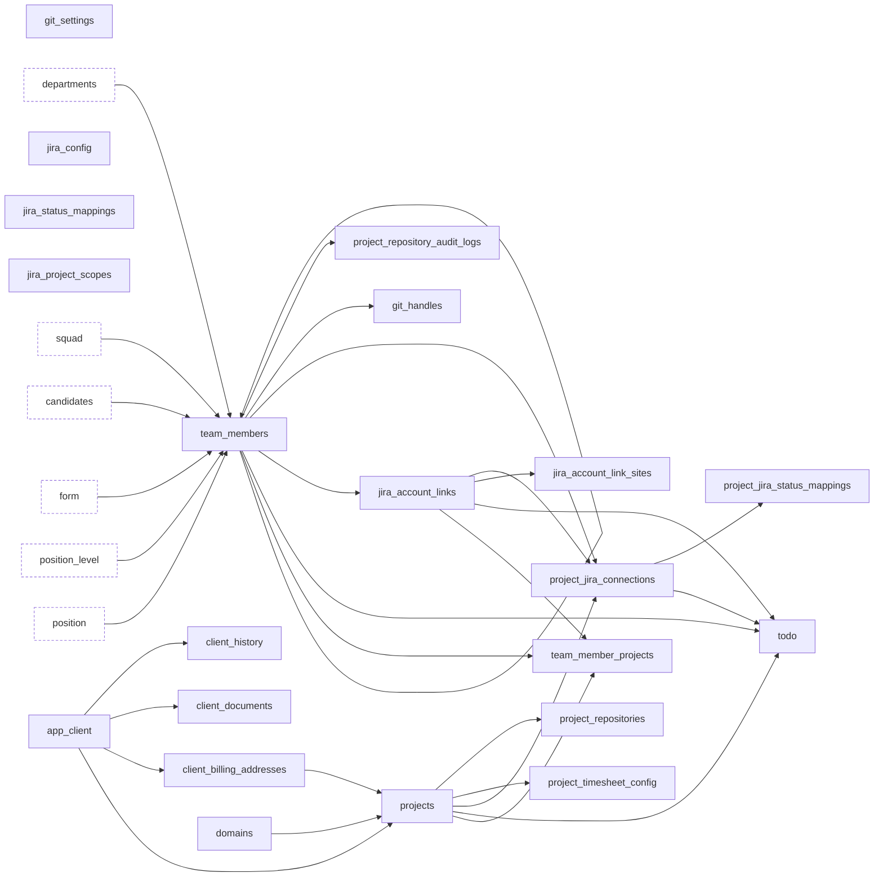

**Diagram projects-2: tables reached only through shared code (24)**

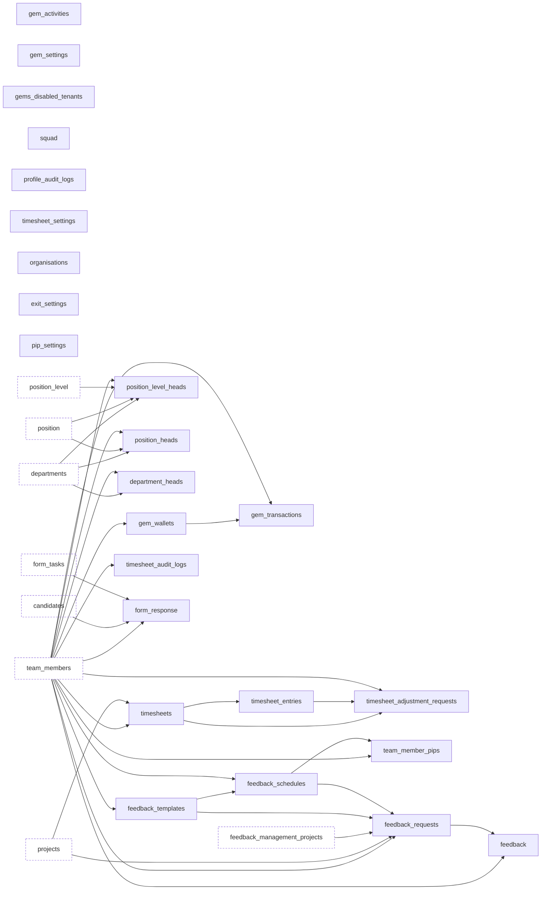

## Table definitions: Timesheets

### Timesheets: canonical table definitions (7)

#### project_timesheet_config
Status: Active · Model: ProjectTimesheetConfig (schema.prisma:3325) · Created in: 20260709000000_add_timesheet_module

Schema comment: "Per-project timesheet config (1:1, lazy). approval_required NULL means "inherit TimesheetSettings.approval_required".".

Structure: references projects.

Accessed by (direct): Projects, clients and dev integrations, Timesheets · via shared code only: People and org, Shift planner, Todos, goals and wellness, Uploads, billing, realtime
Evidence: Runtime refs: 4 call sites in 3 files, e.g. app/controllers/projectTimesheetConfig.controller.js:19, app/controllers/timesheets.controller.js:220, app/services/timesheetService/timesheet.js:50.

| Column | Database type | Nullable | Default | Key/constraint | Description |
|---|---|---|---|---|---|
| id | uuid | no | uuid() | PK | Primary key |
| tenant_id | uuid | no |  |  | Tenant scope; no FK (tenant data lives outside this DB) |
| project_id | uuid | no |  | FK → projects.id, UQ | References projects |
| timesheet_required | boolean | no | true |  | Inferred: timesheet required |
| approval_required | boolean | yes |  |  | Inferred: approval required |
| created_at | timestamptz(3) | no | now() |  | Row creation time |
| updated_at | timestamptz(3) | no | now() | @updatedAt | Last update time |

**Relationships**

- Out: `project_id` → `projects`.`id` (Projects, clients and dev integrations); 1 → 1; FK constraint `project_timesheet_config_project_id_fkey`; onDelete schema: Cascade, DB: CASCADE

#### timesheet_adjustment_comments
Status: Active · Model: TimesheetAdjustmentComment (schema.prisma:3272) · Created in: 20260709000000_add_timesheet_module

Schema comment: "A remark in an adjustment request's discussion thread.".

Structure: references timesheet_adjustment_requests, team_members.

Accessed by (direct): Timesheets
Evidence: Runtime refs: 2 call sites in 1 files, e.g. app/controllers/timesheets.controller.js:973.

| Column | Database type | Nullable | Default | Key/constraint | Description |
|---|---|---|---|---|---|
| id | uuid | no | uuid() | PK | Primary key |
| tenant_id | uuid | no |  | IDX | Tenant scope; no FK (tenant data lives outside this DB) |
| adjustment_request_id | uuid | no |  | FK → timesheet_adjustment_requests.id, IDX | References timesheet_adjustment_requests |
| author_id | uuid | no |  | FK → team_members.id | References team_members |
| content | text | no |  |  | Inferred: content |
| created_at | timestamptz(3) | no | now() |  | Row creation time |

**Relationships**

- Out: `adjustment_request_id` → `timesheet_adjustment_requests`.`id`; many → 1; FK constraint `timesheet_adjustment_comments_adjustment_request_id_fkey`; onDelete schema: Cascade, DB: CASCADE
- Out: `author_id` → `team_members`.`id` (People and org); many → 1; FK constraint `timesheet_adjustment_comments_author_id_fkey`; onDelete schema: Cascade, DB: CASCADE

**Additional details**

- Indexes: `([tenant_id, adjustment_request_id])`

#### timesheet_adjustment_requests
Status: Active · Model: TimesheetAdjustmentRequest (schema.prisma:3243) · Created in: 20260709000000_add_timesheet_module · Later migrations touching it: 1

Schema comment: "An approver-raised request to fix a specific entry. Approval of the parent timesheet is blocked while any request is OPEN.".

Structure: references timesheets, timesheet_entries, team_members; referenced by 1 table(s).

Accessed by (direct): Timesheets · via shared code only: People and org, Projects, clients and dev integrations, Shift planner, Todos, goals and wellness, Uploads, billing, realtime
Evidence: Runtime refs: 11 call sites in 2 files, e.g. app/controllers/timesheets.controller.js:135, app/services/timesheetService/timesheet.js:459.

| Column | Database type | Nullable | Default | Key/constraint | Description |
|---|---|---|---|---|---|
| id | uuid | no | uuid() | PK | Primary key |
| tenant_id | uuid | no |  | IDX | Tenant scope; no FK (tenant data lives outside this DB) |
| timesheet_id | uuid | no |  | FK → timesheets.id, IDX | References timesheets |
| entry_id | uuid | no |  | FK → timesheet_entries.id | References timesheet_entries |
| raised_by_id | uuid | no |  | FK → team_members.id | References team_members |
| status | enum TimesheetAdjustmentStatus | no | OPEN |  | Enum `TimesheetAdjustmentStatus`: OPEN, RESOLVED |
| suggested_hours | decimal(5, 2) | yes |  |  | Optional GitHub-style suggested edit to the entry. NULL columns = a comment-only request; the owner Accepts (applies to the entry) or Declines. |
| suggested_task_description | text | yes |  |  | Inferred: suggested task description |
| applied | boolean | no | false |  | Inferred: applied |
| resolved_by_id | uuid | yes |  | FK → team_members.id | References team_members |
| resolved_at | timestamptz(3) | yes |  |  | Inferred: resolved at |
| created_at | timestamptz(3) | no | now() |  | Row creation time |
| updated_at | timestamptz(3) | no | now() | @updatedAt | Last update time |

**Relationships**

- Out: `timesheet_id` → `timesheets`.`id`; many → 1; FK constraint `timesheet_adjustment_requests_timesheet_id_fkey`; onDelete schema: Cascade, DB: CASCADE
- Out: `entry_id` → `timesheet_entries`.`id`; many → 1; FK constraint `timesheet_adjustment_requests_entry_id_fkey`; onDelete schema: Cascade, DB: CASCADE
- Out: `raised_by_id` → `team_members`.`id` (People and org); many → 1; FK constraint `timesheet_adjustment_requests_raised_by_id_fkey`; onDelete schema: Cascade, DB: CASCADE
- Out: `resolved_by_id` → `team_members`.`id` (People and org); many → 0..1; FK constraint `timesheet_adjustment_requests_resolved_by_id_fkey`; onDelete schema: default, DB: SET NULL
- In: `timesheet_adjustment_comments`.`adjustment_request_id`; 1 → many; FK constraint `timesheet_adjustment_comments_adjustment_request_id_fkey`

**Additional details**

- Indexes: `([tenant_id, timesheet_id])`

#### timesheet_audit_logs
Status: Active · Model: TimesheetAuditLog (schema.prisma:3403) · Created in: 20260709000000_add_timesheet_module

Schema comment: "Module-specific audit trail (autoscal has no shared audit table; mirrors the AssetGrievanceHistory precedent).".

Structure: references team_members.

Accessed by (direct): Timesheets · via shared code only: People and org, Projects, clients and dev integrations, Shift planner, Todos, goals and wellness, Uploads, billing, realtime
Evidence: Runtime refs: 3 call sites in 2 files, e.g. app/controllers/timesheets.controller.js:580, app/services/timesheetService/timesheet.js:571. Tests: 2 files.

| Column | Database type | Nullable | Default | Key/constraint | Description |
|---|---|---|---|---|---|
| id | uuid | no | uuid() | PK | Primary key |
| tenant_id | uuid | no |  | IDX | Tenant scope; no FK (tenant data lives outside this DB) |
| actor_team_member_id | uuid | no |  | FK → team_members.id | References team_members |
| timesheet_id | uuid | yes |  | IDX | Inferred: id of timesheet; no FK declared |
| entry_id | uuid | yes |  |  | Inferred: id of entry; no FK declared |
| action | enum TimesheetAuditAction | no |  |  | Enum `TimesheetAuditAction`: created, submitted, edited_after_submit, approved, rejected, cancelled, … (11 values) |
| old_value | jsonb | yes |  |  | Inferred: old value |
| new_value | jsonb | yes |  |  | Inferred: new value |
| created_at | timestamptz(3) | no | now() | IDX | Row creation time |

**Relationships**

- Out: `actor_team_member_id` → `team_members`.`id` (People and org); many → 1; FK constraint `timesheet_audit_logs_actor_team_member_id_fkey`; onDelete schema: Cascade, DB: CASCADE

**Additional details**

- Indexes: `([tenant_id, timesheet_id, created_at])`

#### timesheet_entries
Status: Active · Model: TimesheetEntry (schema.prisma:3218) · Created in: 20260709000000_add_timesheet_module · Later migrations touching it: 1

Schema comment: "A single day's work line. team_member_id/project_id are denormalized from the parent so per-employee / per-date queries don't need a join.".

Structure: references timesheets; referenced by 1 table(s).

Accessed by (direct): Timesheets · via shared code only: People and org, Projects, clients and dev integrations, Shift planner, Todos, goals and wellness, Uploads, billing, realtime
Evidence: Runtime refs: 17 call sites in 3 files, e.g. app/controllers/timesheets.controller.js:168, app/services/timesheetService/analytics.js:55, app/services/timesheetService/timesheet.js:469. Tests: 1 files.

| Column | Database type | Nullable | Default | Key/constraint | Description |
|---|---|---|---|---|---|
| id | uuid | no | uuid() | PK | Primary key |
| tenant_id | uuid | no |  | IDX | Tenant scope; no FK (tenant data lives outside this DB) |
| timesheet_id | uuid | no |  | FK → timesheets.id, IDX | References timesheets |
| team_member_id | uuid | no |  | IDX | Inferred: id of team member; no FK declared |
| project_id | uuid | yes |  |  | Inferred: id of project; no FK declared |
| work_date | date | no |  | IDX | Inferred: work date |
| task_description | text | no |  |  | Inferred: task description |
| hours | decimal(5, 2) | no |  |  | Inferred: hours |
| created_at | timestamptz(3) | no | now() |  | Row creation time |
| updated_at | timestamptz(3) | no | now() | @updatedAt | Last update time |

**Relationships**

- Out: `timesheet_id` → `timesheets`.`id`; many → 1; FK constraint `timesheet_entries_timesheet_id_fkey`; onDelete schema: Cascade, DB: CASCADE
- In: `timesheet_adjustment_requests`.`entry_id`; 1 → many; FK constraint `timesheet_adjustment_requests_entry_id_fkey`

**Additional details**

- Indexes: `([tenant_id, timesheet_id])`, `([tenant_id, team_member_id, work_date])`, `([tenant_id, work_date])`
- CHECK `CHK_timesheet_entries_hours` ("hours" > 0 AND "hours" <= 24)) from `20260709000000_add_timesheet_module`, not expressible in schema.prisma

#### timesheet_settings
Status: Active · Model: TimesheetSettings (schema.prisma:3290) · Created in: 20260709000000_add_timesheet_module · Later migrations touching it: 3

Schema comment: "Per-tenant timesheet configuration (singleton: one row per tenant), lazy-created on first access. Submission day: 0=Sunday … 6=Saturday (JS Date.getDay() convention); default 5 = Friday.".

Accessed by (direct): Timesheets · via shared code only: People and org, Projects, clients and dev integrations, Shift planner, Todos, goals and wellness, Uploads, billing, realtime, Background jobs (cron, queue, workers)
Evidence: Runtime refs: 5 call sites in 3 files, e.g. app/controllers/timesheetSettings.controller.js:56, app/services/timesheetService/submissionReminder.js:368, app/services/timesheetService/timesheet.js:32. Tests: 2 files.

| Column | Database type | Nullable | Default | Key/constraint | Description |
|---|---|---|---|---|---|
| id | uuid | no | uuid() | PK | Primary key |
| tenant_id | uuid | no |  | UQ | Tenant scope; no FK (tenant data lives outside this DB) |
| period_type | enum TimesheetPeriodType | no | WEEKLY |  | Enum `TimesheetPeriodType`: WEEKLY, MONTHLY |
| default_submission_day_of_week | smallint | no | 5 |  | Weekly cadence anchor (0=Sunday … 6=Saturday); meaningless for monthly but kept so a tenant can switch back to weekly without losing its configured day. |
| start_day_of_month | smallint | yes |  |  | Monthly cadence anchor (1..31), required when period_type = MONTHLY, null for weekly. |
| approval_required | boolean | no | true |  | Inferred: approval required |
| enforce_clocked_hours_cap | boolean | no | false |  | When on, a day's logged hours may not exceed the hours the member actually clocked in the attendance service that day. Off by default: a tenant that does not use the clock would otherwise have every entry rejected. |
| reminder_time | time | no | dbgenerated("'10:30:00'::time") |  | Reminder schedule, per tenant. Stored and compared in UTC — there is no per-tenant timezone field in this codebase, so the browser converts to and from the admin's local offset and the server only ever sees UTC. |
| lead_days | smallint | no | 2 |  | Working days before the deadline that the lead reminder fires. Per tenant since this replaced a single app-wide constant. |
| monthly_reminder_enabled | boolean | no | false |  | WEEKLY tenants only: an extra reminder for the whole month cycle, on top of the per-week one. Meaningless for MONTHLY tenants, whose own cycle already produces the deadline reminder. |
| month_cycle_end_day | smallint | no | 31 |  | WEEKLY tenants only: the day the month cycle ends, clamped down to the month's last day so 31 lands on Feb 28/29 rather than overflowing. |
| created_at | timestamptz(3) | no | now() |  | Row creation time |
| updated_at | timestamptz(3) | no | now() | @updatedAt | Last update time |

**Relationships:** none identified.

#### timesheets
Status: Active · Model: Timesheet (schema.prisma:3184) · Created in: 20260709000000_add_timesheet_module · Later migrations touching it: 1

Structure: references team_members, projects; referenced by 2 table(s).

Accessed by (direct): Timesheets · via shared code only: People and org, Projects, clients and dev integrations, Shift planner, Todos, goals and wellness, Uploads, billing, realtime, Background jobs (cron, queue, workers)
Evidence: Runtime refs: 33 call sites in 4 files, e.g. app/controllers/timesheets.controller.js:134, app/services/timesheetService/analytics.js:55, app/services/timesheetService/submissionReminder.js:219 (+1 more files). Ops scripts/seeds: scripts/timesheetRoutingTransitionReport.js:42. Tests: 2 files.

| Column | Database type | Nullable | Default | Key/constraint | Description |
|---|---|---|---|---|---|
| id | uuid | no | uuid() | PK | Primary key |
| tenant_id | uuid | no |  | IDX | Tenant scope; no FK (tenant data lives outside this DB) |
| team_member_id | uuid | no |  | FK → team_members.id, IDX | References team_members |
| project_id | uuid | yes |  | FK → projects.id, IDX | References projects |
| period_type | enum TimesheetPeriodType | no | WEEKLY |  | Enum `TimesheetPeriodType`: WEEKLY, MONTHLY |
| period_start | date | no |  |  | Inferred: period start |
| period_end | date | no |  |  | Inferred: period end |
| status | enum TimesheetStatus | no | DRAFT | IDX | Enum `TimesheetStatus`: DRAFT, SUBMITTED, APPROVED, REJECTED |
| total_hours | decimal(6, 2) | no | 0 |  | Inferred: total hours |
| submitted_at | timestamptz(3) | yes |  |  | Inferred: submitted at |
| approver_id | uuid | yes |  | FK → team_members.id | References team_members |
| approval_note | text | yes |  |  | Inferred: approval note |
| rejection_reason | text | yes |  |  | Inferred: rejection reason |
| cancelled_by_id | uuid | yes |  | FK → team_members.id | References team_members |
| cancellation_reason | text | yes |  |  | Inferred: cancellation reason |
| created_at | timestamptz(3) | no | now() |  | Row creation time |
| updated_at | timestamptz(3) | no | now() | @updatedAt | Last update time |

**Relationships**

- Out: `team_member_id` → `team_members`.`id` (People and org); many → 1; FK constraint `timesheets_team_member_id_fkey`; onDelete schema: Cascade, DB: CASCADE
- Out: `project_id` → `projects`.`id` (Projects, clients and dev integrations); many → 0..1; FK constraint `timesheets_project_id_fkey`; onDelete schema: Cascade, DB: CASCADE
- Out: `approver_id` → `team_members`.`id` (People and org); many → 0..1; FK constraint `timesheets_approver_id_fkey`; onDelete schema: default, DB: SET NULL
- Out: `cancelled_by_id` → `team_members`.`id` (People and org); many → 0..1; FK constraint `timesheets_cancelled_by_id_fkey`; onDelete schema: default, DB: SET NULL
- In: `timesheet_entries`.`timesheet_id`; 1 → many; FK constraint `timesheet_entries_timesheet_id_fkey`
- In: `timesheet_adjustment_requests`.`timesheet_id`; 1 → many; FK constraint `timesheet_adjustment_requests_timesheet_id_fkey`

**Additional details**

- Indexes: `([tenant_id, team_member_id, status])`, `([tenant_id, project_id, status])`
- Partial unique index `UQ_timesheet_project_period`  ("tenant_id", "team_member_id", "project_id", "period_start") WHERE "project_id" IS NOT NULL from `20260709000000_add_timesheet_module`, not represented in schema.prisma
- Partial unique index `UQ_timesheet_nonproject_period`  ("tenant_id", "team_member_id", "period_start") WHERE "project_id" IS NULL from `20260709000000_add_timesheet_module`, not represented in schema.prisma
- CHECK `CHK_timesheets_period` ("period_end" >= "period_start")) from `20260709000000_add_timesheet_module`, not expressible in schema.prisma

### Timesheets: relationship diagram

Arrows run parent → child (FK holder). Solid = FK in schema and migration SQL; dotted = schema vs SQL discrepancy; dashed boxes = tables outside this module. Full conventions under Counting rules.

**Diagram timesheets-1: tables accessed directly (13), external FK parents shown dashed**

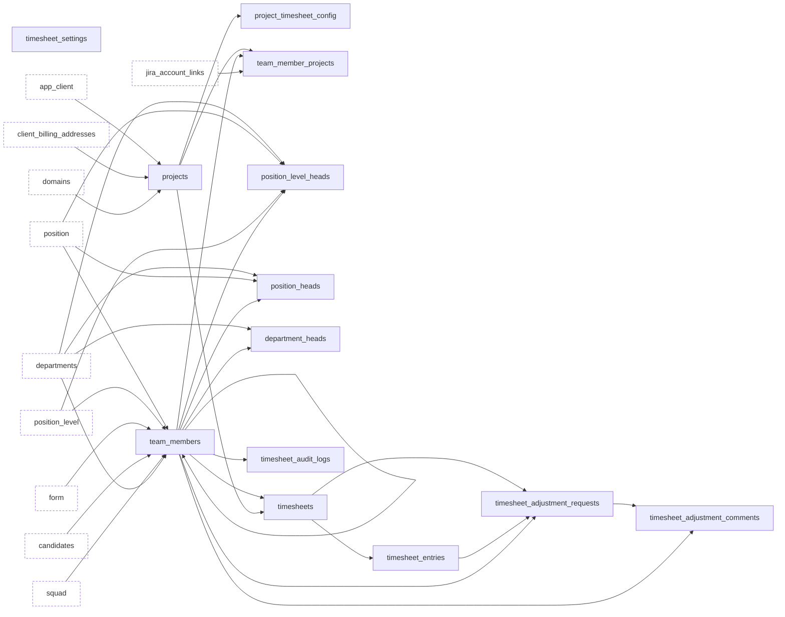

## Table definitions: Shift planner

### Shift planner: canonical table definitions (7)

#### shift_rosters
Status: Active · Model: ShiftRoster (schema.prisma:3639) · Created in: 20260907130000_shift_planner_schema · Later migrations touching it: 1

Schema comment: "One row per (person, date), never more than one - enforced by the unique constraint below. source/rotation_id record provenance: a manager hand-editing a rotation-generated day flips source to MANUAL and clears rotation_id, so a later edit to that rotation knows not to regenerate over it again.".

Structure: references team_members, shift_templates, shift_rotations; referenced by 1 table(s).

Accessed by (direct): Shift planner · via shared code only: People and org, Background jobs (cron, queue, workers)
Evidence: Runtime refs: 34 call sites in 6 files, e.g. app/controllers/shiftRoster.controller.js:43, app/services/myShiftsService/myShifts.js:49, app/services/shiftRosterService/shiftRoster.js:115 (+3 more files).

| Column | Database type | Nullable | Default | Key/constraint | Description |
|---|---|---|---|---|---|
| id | uuid | no | uuid() | PK | Primary key |
| tenant_id | uuid | no |  | UQ(composite), IDX | Tenant scope; no FK (tenant data lives outside this DB) |
| team_member_id | uuid | no |  | FK → team_members.id, UQ(composite) | References team_members |
| date | date | no |  | UQ(composite), IDX | Inferred: date |
| shift_template_id | uuid | yes |  | FK → shift_templates.id, IDX | References shift_templates |
| source | enum ShiftRosterSource | no | MANUAL |  | Enum `ShiftRosterSource`: MANUAL, ROTATION, BULK, AUTO |
| is_off | boolean | no | false |  | Inferred: flag, is off |
| rotation_id | uuid | yes |  | FK → shift_rotations.id | References shift_rotations |
| created_at | timestamptz(3) | no | now() |  | Row creation time |
| updated_at | timestamptz(3) | no | now() | @updatedAt | Last update time |

**Relationships**

- Out: `team_member_id` → `team_members`.`id` (People and org); many → 1; FK constraint `shift_rosters_team_member_id_fkey`; onDelete schema: Cascade, DB: CASCADE
- Out: `shift_template_id` → `shift_templates`.`id`; many → 0..1; FK constraint `shift_rosters_shift_template_id_fkey`; onDelete schema: default, DB: SET NULL
- Out: `rotation_id` → `shift_rotations`.`id`; many → 0..1; FK constraint `shift_rosters_rotation_id_fkey`; onDelete schema: default, DB: SET NULL
- In: `shift_swap_requests`.`shift_roster_id`; 1 → many; FK constraint `shift_swap_requests_shift_roster_id_fkey`

**Additional details**

- Unique: `([tenant_id, team_member_id, date])`
- Indexes: `([tenant_id, date, shift_template_id])`

#### shift_rotation_employees
Status: Active · Model: ShiftRotationEmployee (schema.prisma:3692) · Created in: 20260907130000_shift_planner_schema

Structure: references shift_rotations, team_members; junction table (composite key over two FKs).

Accessed by (direct): Shift planner · via shared code only: Background jobs (cron, queue, workers)
Evidence: Runtime refs: 7 call sites in 2 files, e.g. app/services/shiftRotationService/shiftRotation.js:112, app/services/shiftTemplateService/shiftTemplate.js:131.

| Column | Database type | Nullable | Default | Key/constraint | Description |
|---|---|---|---|---|---|
| id | uuid | no | uuid() | PK | Primary key |
| tenant_id | uuid | no |  | IDX | Tenant scope; no FK (tenant data lives outside this DB) |
| rotation_id | uuid | no |  | FK → shift_rotations.id, UQ(composite) | References shift_rotations |
| team_member_id | uuid | no |  | FK → team_members.id, UQ(composite), IDX | References team_members |
| created_at | timestamptz(3) | no | now() |  | Row creation time |

**Relationships**

- Out: `rotation_id` → `shift_rotations`.`id`; many → 1; FK constraint `shift_rotation_employees_rotation_id_fkey`; onDelete schema: Cascade, DB: CASCADE
- Out: `team_member_id` → `team_members`.`id` (People and org); many → 1; FK constraint `shift_rotation_employees_team_member_id_fkey`; onDelete schema: Cascade, DB: CASCADE

**Additional details**

- Unique: `([rotation_id, team_member_id])`
- Indexes: `([tenant_id, team_member_id])`

#### shift_rotation_pattern_items
Status: Active · Model: ShiftRotationPatternItem (schema.prisma:3709) · Created in: 20260907130000_shift_planner_schema

Schema comment: "Ordered sequence of templates the rotation cycles through - week_index 0 is the first week, and the pattern repeats from week_index 0 again once it reaches the last entry.".

Structure: references shift_rotations, shift_templates.

Accessed by (direct): Shift planner · via shared code only: Background jobs (cron, queue, workers)
Evidence: Runtime refs: 8 call sites in 2 files, e.g. app/services/shiftRotationService/shiftRotation.js:257, app/services/shiftTemplateService/shiftTemplate.js:190.

| Column | Database type | Nullable | Default | Key/constraint | Description |
|---|---|---|---|---|---|
| id | uuid | no | uuid() | PK | Primary key |
| tenant_id | uuid | no |  |  | Tenant scope; no FK (tenant data lives outside this DB) |
| rotation_id | uuid | no |  | FK → shift_rotations.id, UQ(composite) | References shift_rotations |
| week_index | integer | no |  | UQ(composite) | Inferred: week index |
| shift_template_id | uuid | no |  | FK → shift_templates.id | References shift_templates |

**Relationships**

- Out: `rotation_id` → `shift_rotations`.`id`; many → 1; FK constraint `shift_rotation_pattern_items_rotation_id_fkey`; onDelete schema: Cascade, DB: CASCADE
- Out: `shift_template_id` → `shift_templates`.`id`; many → 1; FK constraint `shift_rotation_pattern_items_shift_template_id_fkey`; onDelete schema: default, DB: RESTRICT

**Additional details**

- Unique: `([rotation_id, week_index])`

#### shift_rotations
Status: Active · Model: ShiftRotation (schema.prisma:3665) · Created in: 20260907130000_shift_planner_schema · Later migrations touching it: 4

Schema comment: "Books a person/group's full schedule upfront through end_date, in one transaction, at creation time - there is no background job that materializes future weeks incrementally, so every conflict is caught interactively with an admin present to resolve it, not on an unattended run.".

Structure: references team_members; referenced by 3 table(s).

Accessed by (direct): Shift planner · via shared code only: Background jobs (cron, queue, workers)
Evidence: Runtime refs: 15 call sites in 3 files, e.g. app/services/shiftRotationService/shiftRotation.js:240, app/services/shiftTemplateService/shiftTemplate.js:213, app/validators/shiftRotation.validator.js:122.

| Column | Database type | Nullable | Default | Key/constraint | Description |
|---|---|---|---|---|---|
| id | uuid | no | uuid() | PK | Primary key |
| tenant_id | uuid | no |  | IDX | Tenant scope; no FK (tenant data lives outside this DB) |
| name | varchar(255) | no |  |  | Inferred: name |
| start_date | date | no |  | IDX | Inferred: start date |
| end_date | date | no |  | IDX | Inferred: end date |
| repeat_type | enum ShiftRotationRepeatType | no | WEEKLY |  | Enum `ShiftRotationRepeatType`: WEEKLY, BIWEEKLY |
| is_active | boolean | no | true | IDX | Inferred: flag, is active |
| effective_after_days | integer | no | 0 |  | Inferred: effective after days |
| effective_from | date | no |  |  | Inferred: effective from |
| pending_config | jsonb | yes |  |  | Inferred: pending config |
| pending_effective_from | date | yes |  |  | Inferred: pending effective from |
| created_by | uuid | no |  | FK → team_members.id | References team_members |
| created_at | timestamptz(3) | no | now() |  | Row creation time |
| updated_at | timestamptz(3) | no | now() | @updatedAt | Last update time |

**Relationships**

- Out: `created_by` → `team_members`.`id` (People and org); many → 1; FK constraint `shift_rotations_created_by_fkey`; onDelete schema: default, DB: RESTRICT
- In: `shift_rosters`.`rotation_id`; 1 → many; FK constraint `shift_rosters_rotation_id_fkey`
- In: `shift_rotation_employees`.`rotation_id`; 1 → many; FK constraint `shift_rotation_employees_rotation_id_fkey`
- In: `shift_rotation_pattern_items`.`rotation_id`; 1 → many; FK constraint `shift_rotation_pattern_items_rotation_id_fkey`

**Additional details**

- Indexes: `([tenant_id, start_date, end_date])`, `([tenant_id, is_active])`

#### shift_swap_requests
Status: Active · Model: ShiftSwapRequest (schema.prisma:3727) · Created in: 20260907130000_shift_planner_schema · Later migrations touching it: 3

Schema comment: "requested_by/created_at + acted_by/acted_at is the entire audit trail for swaps (confirmed scope: nothing else in Shift Planner gets a dedicated one). suggested_employee_id is informational only - approving never auto-assigns them, a manager still does that by hand on the Roster.".

Structure: references shift_rosters, team_members.

Accessed by (direct): Shift planner · via shared code only: People and org, Background jobs (cron, queue, workers)
Evidence: Runtime refs: 25 call sites in 5 files, e.g. app/controllers/shiftSwapRequests.controller.js:69, app/services/myShiftsService/myShifts.js:98, app/services/shiftRotationService/shiftRotation.js:416 (+2 more files).

| Column | Database type | Nullable | Default | Key/constraint | Description |
|---|---|---|---|---|---|
| id | uuid | no | uuid() | PK | Primary key |
| tenant_id | uuid | no |  | IDX | Tenant scope; no FK (tenant data lives outside this DB) |
| shift_roster_id | uuid | no |  | FK → shift_rosters.id, IDX | References shift_rosters |
| requested_by | uuid | no |  | FK → team_members.id | References team_members |
| suggested_employee_id | uuid | yes |  | FK → team_members.id | References team_members |
| reason | text | no |  |  | Inferred: reason |
| status | enum ShiftSwapRequestStatus | no | PENDING | IDX | Enum `ShiftSwapRequestStatus`: PENDING, APPROVED, REJECTED, CANCELLED, EXPIRED |
| resolved_approver_id | uuid | yes |  | FK → team_members.id | Snapshotted at creation time from the shift template's swap_approver_type/employee config (§7) - never re-derived on read. Null means the configured approver type didn't resolve to exactly one person (no reporting manager set, or zero/multiple project managers) - the request still gets created, but only whoever holds APPROVALS_SHIFT_SWAP (Admin, by default) can act on it, same as every other unresolved-approver fallback in this module. |
| acted_by | uuid | yes |  | FK → team_members.id | References team_members |
| acted_at | timestamptz(3) | yes |  |  | Inferred: acted at |
| restored_shift_template_id | uuid | yes |  |  | Snapshot of the roster cell taken right before approveSwapRequest clears it, so a later cancel-approval can restore it. |
| restored_source | enum ShiftRosterSource | yes |  |  | Enum `ShiftRosterSource`: MANUAL, ROTATION, BULK, AUTO |
| restored_rotation_id | uuid | yes |  |  | Inferred: id of restored rotation; no FK declared |
| cancellation_note | text | yes |  |  | Optional note from the approver explaining why an approved request was cancelled. |
| created_at | timestamptz(3) | no | now() |  | Row creation time |
| updated_at | timestamptz(3) | no | now() | @updatedAt | Last update time |

**Relationships**

- Out: `shift_roster_id` → `shift_rosters`.`id`; many → 1; FK constraint `shift_swap_requests_shift_roster_id_fkey`; onDelete schema: Cascade, DB: CASCADE
- Out: `requested_by` → `team_members`.`id` (People and org); many → 1; FK constraint `shift_swap_requests_requested_by_fkey`; onDelete schema: default, DB: RESTRICT
- Out: `suggested_employee_id` → `team_members`.`id` (People and org); many → 0..1; FK constraint `shift_swap_requests_suggested_employee_id_fkey`; onDelete schema: default, DB: SET NULL
- Out: `resolved_approver_id` → `team_members`.`id` (People and org); many → 0..1; FK constraint `shift_swap_requests_resolved_approver_id_fkey`; onDelete schema: default, DB: SET NULL
- Out: `acted_by` → `team_members`.`id` (People and org); many → 0..1; FK constraint `shift_swap_requests_acted_by_fkey`; onDelete schema: default, DB: SET NULL

**Additional details**

- Indexes: `([tenant_id, shift_roster_id])`, `([tenant_id, status])`
- Partial unique index `one_pending_swap_request_per_roster_cell`  ("shift_roster_id") WHERE "status" = 'PENDING' from `20260911180000_add_one_pending_swap_request_per_cell_index`, not represented in schema.prisma

#### shift_template_employees
Status: Active · Model: ShiftTemplateEmployee (schema.prisma:3620) · Created in: 20260907130000_shift_planner_schema

Schema comment: "Who's eligible for a template - a real restriction, unlike the template's own department_id (that one is a search filter only). The Roster's assignment picker for a given template only offers people listed here.".

Structure: references shift_templates, team_members; junction table (composite key over two FKs).

Accessed by (direct): Shift planner · via shared code only: Background jobs (cron, queue, workers)
Evidence: Runtime refs: 7 call sites in 1 files, e.g. app/services/shiftTemplateService/shiftTemplate.js:29.

| Column | Database type | Nullable | Default | Key/constraint | Description |
|---|---|---|---|---|---|
| id | uuid | no | uuid() | PK | Primary key |
| tenant_id | uuid | no |  | IDX | Tenant scope; no FK (tenant data lives outside this DB) |
| shift_template_id | uuid | no |  | FK → shift_templates.id, UQ(composite) | References shift_templates |
| team_member_id | uuid | no |  | FK → team_members.id, UQ(composite), IDX | References team_members |
| created_at | timestamptz(3) | no | now() |  | Row creation time |

**Relationships**

- Out: `shift_template_id` → `shift_templates`.`id`; many → 1; FK constraint `shift_template_employees_shift_template_id_fkey`; onDelete schema: Cascade, DB: CASCADE
- Out: `team_member_id` → `team_members`.`id` (People and org); many → 1; FK constraint `shift_template_employees_team_member_id_fkey`; onDelete schema: Cascade, DB: CASCADE

**Additional details**

- Unique: `([shift_template_id, team_member_id])`
- Indexes: `([tenant_id, team_member_id])`

#### shift_templates
Status: Active · Model: ShiftTemplate (schema.prisma:3579) · Created in: 20260907130000_shift_planner_schema · Later migrations touching it: 3

Structure: references departments, team_members; referenced by 3 table(s).

Accessed by (direct): Shift planner · via shared code only: People and org, Background jobs (cron, queue, workers)
Evidence: Runtime refs: 28 call sites in 7 files, e.g. app/controllers/shiftTemplates.controller.js:54, app/services/shiftRosterService/shiftRoster.js:66, app/services/shiftRotationService/shiftRotation.js:131 (+4 more files).

| Column | Database type | Nullable | Default | Key/constraint | Description |
|---|---|---|---|---|---|
| id | uuid | no | uuid() | PK | Primary key |
| tenant_id | uuid | no |  | IDX | Tenant scope; no FK (tenant data lives outside this DB) |
| name | varchar(255) | no |  |  | Inferred: name |
| start_time | time | no |  |  | Inferred: start time |
| end_time | time | no |  |  | Inferred: end time |
| break_minutes | integer | no | 0 |  | Inferred: break minutes |
| break_paid | boolean | no | false |  | Inferred: break paid |
| min_headcount | integer | no | 1 |  | Inferred: min headcount |
| applicable_days | integer[] | no |  |  | Inferred: applicable days |
| color | varchar(7) | no |  |  | Inferred: color |
| grace_period_minutes | integer | no | 0 |  | Inferred: grace period minutes |
| department_id | uuid | yes |  | FK → departments.id | References departments |
| is_active | boolean | no | true | IDX | Inferred: flag, is active |
| allow_swap_requests | boolean | no | false |  | Inferred: allow swap requests |
| swap_approver_type | enum ShiftSwapApproverType | yes |  |  | Enum `ShiftSwapApproverType`: REPORTING_MANAGER, PROJECT_MANAGER, EMPLOYEE |
| swap_approver_employee_id | uuid | yes |  | FK → team_members.id | References team_members |
| swap_min_notice_days | integer | no | 0 |  | Inferred: swap min notice days |
| swap_notify_by_email | boolean | no | false |  | Inferred: swap notify by email |
| effective_after_days | integer | no | 0 |  | Inferred: effective after days |
| effective_from | date | no |  |  | Persisted at apply time (see applyTemplateEdit), not derived from created_at on every read. |
| pending_config | jsonb | yes |  |  | Inferred: pending config |
| pending_effective_from | date | yes |  |  | Inferred: pending effective from |
| created_at | timestamptz(3) | no | now() |  | Row creation time |
| updated_at | timestamptz(3) | no | now() | @updatedAt | Last update time |

**Relationships**

- Out: `department_id` → `departments`.`id` (People and org); many → 0..1; FK constraint `shift_templates_department_id_fkey`; onDelete schema: default, DB: SET NULL
- Out: `swap_approver_employee_id` → `team_members`.`id` (People and org); many → 0..1; FK constraint `shift_templates_swap_approver_employee_id_fkey`; onDelete schema: default, DB: SET NULL
- In: `shift_template_employees`.`shift_template_id`; 1 → many; FK constraint `shift_template_employees_shift_template_id_fkey`
- In: `shift_rosters`.`shift_template_id`; 1 → many; FK constraint `shift_rosters_shift_template_id_fkey`
- In: `shift_rotation_pattern_items`.`shift_template_id`; 1 → many; FK constraint `shift_rotation_pattern_items_shift_template_id_fkey`

**Additional details**

- Indexes: `([tenant_id, is_active])`

### Shift planner: relationship diagram

Arrows run parent → child (FK holder). Solid = FK in schema and migration SQL; dotted = schema vs SQL discrepancy; dashed boxes = tables outside this module. Full conventions under Counting rules.

**Diagram shifts-1: tables accessed directly (9), external FK parents shown dashed**

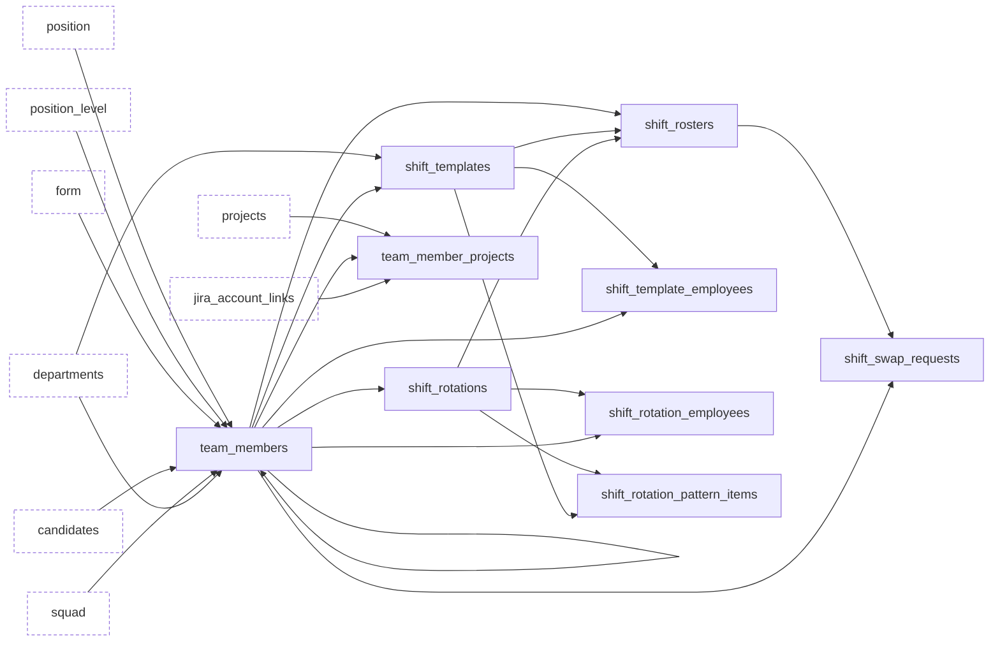

**Diagram shifts-2: tables reached only through shared code (9)**

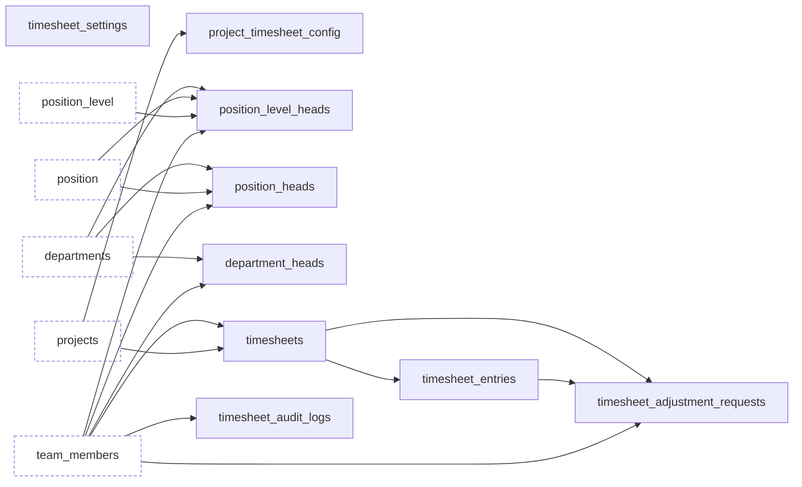

## Table definitions: Assets

### Assets: canonical table definitions (12)

#### asset_categories
Status: Active · Model: AssetCategoryModel (schema.prisma:942) · Created in: 1_init

Structure: referenced by 2 table(s).

Accessed by (direct): Assets
Evidence: Runtime refs: 12 call sites in 6 files, e.g. app/controllers/assetRequests.controller.js:266, app/controllers/assetSettings.controller.js:40, app/controllers/assets.controller.js:490 (+3 more files).

| Column | Database type | Nullable | Default | Key/constraint | Description |
|---|---|---|---|---|---|
| id | uuid | no | uuid() | PK | Primary key |
| name | varchar(100) | no |  | UQ(composite) | Inferred: name |
| tenant_id | uuid | no |  | UQ(composite) | Tenant scope; no FK (tenant data lives outside this DB) |
| is_active | boolean | no | true |  | Inferred: flag, is active |
| created_at | timestamptz(6) | no | now() |  | Row creation time |
| updated_at | timestamptz(6) | no | now() | @updatedAt | Last update time |

**Relationships**

- In: `assets`.`category_id`; 1 → many; FK constraint `assets_category_id_ada4d39c_fk_asset_categories_id`
- In: `asset_requests`.`category_id`; 1 → many; FK constraint `asset_requests_category_id_4a06a7a7_fk_asset_categories_id`

**Additional details**

- Unique: `([name, tenant_id])`

#### asset_grievance_history
Status: Active · Model: AssetGrievanceHistory (schema.prisma:1099) · Created in: 1_init

Structure: references asset_grievances, team_members.

Accessed by (direct): Assets
Evidence: Runtime refs: 1 call sites in 1 files, e.g. app/helpers/assetGrievanceHistory.helper.js:23.

| Column | Database type | Nullable | Default | Key/constraint | Description |
|---|---|---|---|---|---|
| id | uuid | no | uuid() | PK | Primary key |
| tenant_id | uuid | no |  |  | Tenant scope; no FK (tenant data lives outside this DB) |
| event_type | varchar(40) | no |  |  | Inferred: event type |
| from_status | varchar(20) | yes |  |  | Inferred: from status |
| to_status | varchar(20) | yes |  |  | Inferred: to status |
| field_name | varchar(50) | yes |  |  | Inferred: field name |
| old_value | text | yes |  |  | Inferred: old value |
| new_value | text | yes |  |  | Inferred: new value |
| comment | text | yes |  |  | Inferred: comment |
| occurred_at | timestamptz(6) | no |  |  | Inferred: occurred at |
| created_at | timestamptz(6) | no | now() |  | Row creation time |
| actor_id | uuid | yes |  | FK → team_members.id | References team_members |
| grievance_id | uuid | no |  | FK → asset_grievances.id | References asset_grievances |

**Relationships**

- Out: `grievance_id` → `asset_grievances`.`id`; many → 1; FK constraint `asset_grievance_hist_grievance_id_73a9124a_fk_asset_gri`; onDelete schema: Cascade, DB: NO ACTION
- Out: `actor_id` → `team_members`.`id` (People and org); many → 0..1; FK constraint `asset_grievance_history_actor_id_89db3b0a_fk_team_members_id`; onDelete schema: default, DB: NO ACTION

#### asset_grievances
Status: Active · Model: AssetGrievance (schema.prisma:1067) · Created in: 1_init

Structure: references team_members, assets; referenced by 1 table(s).

Accessed by (direct): Assets
Evidence: Runtime refs: 16 call sites in 1 files, e.g. app/controllers/assetGrievances.controller.js:168.

| Column | Database type | Nullable | Default | Key/constraint | Description |
|---|---|---|---|---|---|
| id | uuid | no | uuid() | PK | Primary key |
| tenant_id | uuid | no |  |  | Tenant scope; no FK (tenant data lives outside this DB) |
| grievance_category | varchar(30) | no |  |  | Inferred: grievance category |
| description | text | no |  |  | Inferred: description |
| remarks | text | yes |  |  | Inferred: remarks |
| resolution_remarks | text | yes |  |  | Inferred: resolution remarks |
| status | varchar(20) | no |  |  | Inferred: status |
| in_progress_at | timestamptz(6) | yes |  |  | Inferred: in progress at |
| resolved_at | timestamptz(6) | yes |  |  | Inferred: resolved at |
| rejected_at | timestamptz(6) | yes |  |  | Inferred: rejected at |
| cancelled_at | timestamptz(6) | yes |  |  | Inferred: cancelled at |
| created_at | timestamptz(6) | no | now() |  | Row creation time |
| updated_at | timestamptz(6) | no | now() | @updatedAt | Last update time |
| asset_id | uuid | no |  | FK → assets.id | References assets |
| cancelled_by_id | uuid | yes |  | FK → team_members.id | References team_members |
| in_progress_by_id | uuid | yes |  | FK → team_members.id | References team_members |
| rejected_by_id | uuid | yes |  | FK → team_members.id | References team_members |
| resolved_by_id | uuid | yes |  | FK → team_members.id | References team_members |
| team_member_id | uuid | no |  | FK → team_members.id | References team_members |

**Relationships**

- Out: `team_member_id` → `team_members`.`id` (People and org); many → 1; FK constraint `asset_grievances_team_member_id_c9ae6750_fk_team_members_id`; onDelete schema: default, DB: NO ACTION
- Out: `asset_id` → `assets`.`id`; many → 1; FK constraint `asset_grievances_asset_id_2307505d_fk_assets_id`; onDelete schema: default, DB: NO ACTION
- Out: `in_progress_by_id` → `team_members`.`id` (People and org); many → 0..1; FK constraint `asset_grievances_in_progress_by_id_fdd6a77d_fk_team_members_id`; onDelete schema: default, DB: NO ACTION
- Out: `resolved_by_id` → `team_members`.`id` (People and org); many → 0..1; FK constraint `asset_grievances_resolved_by_id_09e5cf17_fk_team_members_id`; onDelete schema: default, DB: NO ACTION
- Out: `rejected_by_id` → `team_members`.`id` (People and org); many → 0..1; FK constraint `asset_grievances_rejected_by_id_922cd022_fk_team_members_id`; onDelete schema: default, DB: NO ACTION
- Out: `cancelled_by_id` → `team_members`.`id` (People and org); many → 0..1; FK constraint `asset_grievances_cancelled_by_id_8d9e65d2_fk_team_members_id`; onDelete schema: default, DB: NO ACTION
- In: `asset_grievance_history`.`grievance_id`; 1 → many; FK constraint `asset_grievance_hist_grievance_id_73a9124a_fk_asset_gri`

#### asset_history
Status: Active · Model: AssetHistory (schema.prisma:974) · Created in: 1_init

Structure: references assets, team_members, asset_lifecycle_statuses.

Accessed by (direct): Assets · via shared code only: People and org, Onboarding and documents, Forms, Background jobs (cron, queue, workers)
Evidence: Runtime refs: 4 call sites in 2 files, e.g. app/controllers/assets.controller.js:552, app/helpers/assetHistory.helper.js:39. Tests: 1 files.

| Column | Database type | Nullable | Default | Key/constraint | Description |
|---|---|---|---|---|---|
| id | uuid | no | uuid() | PK | Primary key |
| tenant_id | uuid | no |  |  | Tenant scope; no FK (tenant data lives outside this DB) |
| event_type | varchar(40) | no |  |  | Inferred: event type |
| field_name | varchar(50) | yes |  |  | Inferred: field name |
| old_value | text | yes |  |  | Inferred: old value |
| new_value | text | yes |  |  | Inferred: new value |
| remark | text | yes |  |  | Inferred: remark |
| occurred_at | timestamptz(6) | no |  |  | Inferred: occurred at |
| created_at | timestamptz(6) | no | now() |  | Row creation time |
| asset_id | uuid | no |  | FK → assets.id | References assets |
| assignee_id | uuid | yes |  | FK → team_members.id | References team_members |
| changed_by_id | uuid | yes |  | FK → team_members.id | References team_members |
| new_status_id | uuid | yes |  | FK → asset_lifecycle_statuses.id | References asset_lifecycle_statuses |
| old_status_id | uuid | yes |  | FK → asset_lifecycle_statuses.id | References asset_lifecycle_statuses |

**Relationships**

- Out: `asset_id` → `assets`.`id`; many → 1; declared in schema; no FK constraint found in migration SQL; onDelete schema: default
- Out: `assignee_id` → `team_members`.`id` (People and org); many → 0..1; FK constraint `asset_history_assignee_id_7deaa139_fk_team_members_id`; onDelete schema: default, DB: NO ACTION
- Out: `changed_by_id` → `team_members`.`id` (People and org); many → 0..1; FK constraint `asset_history_changed_by_id_72dfef66_fk_team_members_id`; onDelete schema: default, DB: NO ACTION
- Out: `new_status_id` → `asset_lifecycle_statuses`.`id`; many → 0..1; FK constraint `asset_history_new_status_id_77ed1164_fk_asset_lif`; onDelete schema: default, DB: NO ACTION
- Out: `old_status_id` → `asset_lifecycle_statuses`.`id`; many → 0..1; FK constraint `asset_history_old_status_id_326a43d6_fk_asset_lif`; onDelete schema: default, DB: NO ACTION

#### asset_lifecycle_statuses
Status: Active · Model: AssetLifecycleStatus (schema.prisma:957) · Created in: 1_init

Structure: referenced by 2 table(s).

Accessed by (direct): Assets · via shared code only: People and org, Onboarding and documents, Forms, Background jobs (cron, queue, workers)
Evidence: Runtime refs: 24 call sites in 9 files, e.g. app/controllers/assetGrievances.controller.js:315, app/controllers/assetRequests.controller.js:571, app/controllers/assetSettings.controller.js:98 (+6 more files). Ops scripts/seeds: prisma/seeds/seedSoftwareLifecycleStatusesBackfill.js:25. Tests: 1 files.

| Column | Database type | Nullable | Default | Key/constraint | Description |
|---|---|---|---|---|---|
| id | uuid | no | uuid() | PK | Primary key |
| name | varchar(100) | no |  | UQ(composite) | Inferred: name |
| type | varchar(20) | no |  |  | Inferred: type |
| tenant_id | uuid | no |  | UQ(composite) | Tenant scope; no FK (tenant data lives outside this DB) |
| is_active | boolean | no | true |  | Inferred: flag, is active |
| created_at | timestamptz(6) | no | now() |  | Row creation time |
| updated_at | timestamptz(6) | no | now() | @updatedAt | Last update time |

**Relationships**

- In: `assets`.`status_id`; 1 → many; FK constraint `assets_status_id_2ca68367_fk_asset_lifecycle_statuses_id`
- In: `asset_history`.`new_status_id`; 1 → many; FK constraint `asset_history_new_status_id_77ed1164_fk_asset_lif`
- In: `asset_history`.`old_status_id`; 1 → many; FK constraint `asset_history_old_status_id_326a43d6_fk_asset_lif`

**Additional details**

- Unique: `([name, tenant_id])`

#### asset_request_history
Status: Active · Model: AssetRequestHistory (schema.prisma:1044) · Created in: 1_init

Structure: references asset_requests, team_members, assets.

Accessed by (direct): Assets
Evidence: Runtime refs: 1 call sites in 1 files, e.g. app/helpers/assetRequestHistory.helper.js:26.

| Column | Database type | Nullable | Default | Key/constraint | Description |
|---|---|---|---|---|---|
| id | uuid | no | uuid() | PK | Primary key |
| tenant_id | uuid | no |  |  | Tenant scope; no FK (tenant data lives outside this DB) |
| event_type | varchar(40) | no |  |  | Inferred: event type |
| from_status | varchar(20) | yes |  |  | Inferred: from status |
| to_status | varchar(20) | yes |  |  | Inferred: to status |
| field_name | varchar(50) | yes |  |  | Inferred: field name |
| old_value | text | yes |  |  | Inferred: old value |
| new_value | text | yes |  |  | Inferred: new value |
| comment | text | yes |  |  | Inferred: comment |
| occurred_at | timestamptz(6) | no |  |  | Inferred: occurred at |
| created_at | timestamptz(6) | no | now() |  | Row creation time |
| actor_id | uuid | yes |  | FK → team_members.id | References team_members |
| allocated_asset_id | uuid | yes |  | FK → assets.id | References assets |
| request_id | uuid | no |  | FK → asset_requests.id | References asset_requests |

**Relationships**

- Out: `request_id` → `asset_requests`.`id`; many → 1; FK constraint `asset_request_history_request_id_ae086b6f_fk_asset_requests_id`; onDelete schema: Cascade, DB: NO ACTION
- Out: `actor_id` → `team_members`.`id` (People and org); many → 0..1; FK constraint `asset_request_history_actor_id_00ddd580_fk_team_members_id`; onDelete schema: default, DB: NO ACTION
- Out: `allocated_asset_id` → `assets`.`id`; many → 0..1; FK constraint `asset_request_history_allocated_asset_id_f53fab48_fk_assets_id`; onDelete schema: default, DB: NO ACTION

#### asset_requests
Status: Active · Model: AssetRequest (schema.prisma:999) · Created in: 1_init · Later migrations touching it: 3

Structure: references team_members, asset_categories, assets; referenced by 2 table(s).

Accessed by (direct): Assets
Evidence: Runtime refs: 20 call sites in 2 files, e.g. app/controllers/assetRequests.controller.js:223, app/controllers/assets.controller.js:534.

| Column | Database type | Nullable | Default | Key/constraint | Description |
|---|---|---|---|---|---|
| id | uuid | no | uuid() | PK | Primary key |
| tenant_id | uuid | no |  |  | Tenant scope; no FK (tenant data lives outside this DB) |
| description | text | yes |  |  | Inferred: description |
| priority | varchar(20) | no |  |  | Inferred: priority |
| reason | text | no |  |  | Inferred: reason |
| remarks | text | yes |  |  | Inferred: remarks |
| status | varchar(20) | no |  |  | Inferred: status |
| approved_at | timestamptz(6) | yes |  |  | Inferred: approved at |
| rejected_at | timestamptz(6) | yes |  |  | Inferred: rejected at |
| allotted_at | timestamptz(6) | yes |  |  | Inferred: allotted at |
| cancelled_at | timestamptz(6) | yes |  |  | Inferred: cancelled at |
| created_at | timestamptz(6) | no | now() |  | Row creation time |
| updated_at | timestamptz(6) | no | now() | @updatedAt | Last update time |
| allocated_asset_id | uuid | yes |  | FK → assets.id | References assets |
| allotted_by_id | uuid | yes |  | FK → team_members.id | References team_members |
| approved_by_id | uuid | yes |  | FK → team_members.id | References team_members |
| cancelled_by_id | uuid | yes |  | FK → team_members.id | References team_members |
| category_id | uuid | yes |  | FK → asset_categories.id | References asset_categories |
| rejected_by_id | uuid | yes |  | FK → team_members.id | References team_members |
| requested_asset_id | uuid | yes |  | FK → assets.id | References assets |
| team_member_id | uuid | no |  | FK → team_members.id | References team_members |
| asset_type | varchar(20) | no | "HARDWARE" |  | Software Asset Requests: asset_type drives which extra fields apply (independent of category); request_type distinguishes a fresh request from a renewal/additional seat. |
| request_type | varchar(20) | no | "NEW" |  | Inferred: request type |
| software_name | varchar(255) | yes |  |  | Inferred: software name |
| license_type | varchar(50) | yes |  |  | Inferred: license type |
| duration_months | integer | yes |  |  | Inferred: duration months |

**Relationships**

- Out: `team_member_id` → `team_members`.`id` (People and org); many → 1; FK constraint `asset_requests_team_member_id_1a349948_fk_team_members_id`; onDelete schema: default, DB: NO ACTION
- Out: `category_id` → `asset_categories`.`id`; many → 0..1; FK constraint `asset_requests_category_id_4a06a7a7_fk_asset_categories_id`; onDelete schema: default, DB: NO ACTION
- Out: `requested_asset_id` → `assets`.`id`; many → 0..1; FK constraint `asset_requests_requested_asset_id_1a645bae_fk_assets_id`; onDelete schema: default, DB: NO ACTION
- Out: `allocated_asset_id` → `assets`.`id`; many → 0..1; FK constraint `asset_requests_allocated_asset_id_5c9401c9_fk_assets_id`; onDelete schema: default, DB: NO ACTION
- Out: `approved_by_id` → `team_members`.`id` (People and org); many → 0..1; FK constraint `asset_requests_approved_by_id_4213001e_fk_team_members_id`; onDelete schema: default, DB: NO ACTION
- Out: `rejected_by_id` → `team_members`.`id` (People and org); many → 0..1; FK constraint `asset_requests_rejected_by_id_e27aa31d_fk_team_members_id`; onDelete schema: default, DB: NO ACTION
- Out: `allotted_by_id` → `team_members`.`id` (People and org); many → 0..1; FK constraint `asset_requests_allotted_by_id_25ea31e7_fk_team_members_id`; onDelete schema: default, DB: NO ACTION
- Out: `cancelled_by_id` → `team_members`.`id` (People and org); many → 0..1; FK constraint `asset_requests_cancelled_by_id_2d14c5cc_fk_team_members_id`; onDelete schema: default, DB: NO ACTION
- In: `asset_request_history`.`request_id`; 1 → many; FK constraint `asset_request_history_request_id_ae086b6f_fk_asset_requests_id`
- In: `asset_requests_tags`.`asset_request_id`; 1 → many; FK constraint `asset_requests_tags_asset_request_id_fkey`

**Additional details**

- CHECK `asset_requests_asset_type_check` ("asset_type" IN ('HARDWARE', 'SOFTWARE')) from `20260824000000_asset_type_check_constraints`, not expressible in schema.prisma
- CHECK `asset_requests_request_type_check` ("request_type" IN ('NEW', 'RENEWAL', 'ADDITIONAL_SEAT')) from `20260824000000_asset_type_check_constraints`, not expressible in schema.prisma

#### asset_requests_tags
Status: Active · Model: AssetTagOnAssetRequest (schema.prisma:1145) · Created in: 20260721000000_add_asset_tags

Structure: references asset_requests, asset_tags; junction table (composite key over two FKs).

Accessed by (direct): Assets
Evidence: Runtime refs: 3 call sites in 1 files, e.g. app/controllers/assetRequests.controller.js:305.

| Column | Database type | Nullable | Default | Key/constraint | Description |
|---|---|---|---|---|---|
| asset_request_id | uuid | no |  | PK(composite), FK → asset_requests.id | References asset_requests |
| asset_tag_id | uuid | no |  | PK(composite), FK → asset_tags.id | References asset_tags |

**Relationships**

- Out: `asset_request_id` → `asset_requests`.`id`; many → 1; FK constraint `asset_requests_tags_asset_request_id_fkey`; onDelete schema: Cascade, DB: CASCADE
- Out: `asset_tag_id` → `asset_tags`.`id`; many → 1; FK constraint `asset_requests_tags_asset_tag_id_fkey`; onDelete schema: Cascade, DB: CASCADE

**Additional details**

- Composite PK (asset_request_id, asset_tag_id)
- No `tenant_id` column: tenant scope is only reachable through parent rows

#### asset_tags
Status: Active · Model: AssetTag (schema.prisma:1120) · Created in: 20260721000000_add_asset_tags

Structure: referenced by 2 table(s).

Accessed by (direct): Assets
Evidence: Runtime refs: 3 call sites in 2 files, e.g. app/controllers/assets.controller.js:899, app/helpers/assetTags.helper.js:9.

| Column | Database type | Nullable | Default | Key/constraint | Description |
|---|---|---|---|---|---|
| id | uuid | no | uuid() | PK | Primary key |
| name | varchar(100) | no |  | UQ(composite) | Inferred: name |
| tenant_id | uuid | no |  | UQ(composite) | Tenant scope; no FK (tenant data lives outside this DB) |
| created_at | timestamptz(6) | no | now() |  | Row creation time |
| updated_at | timestamptz(6) | no | now() | @updatedAt | Last update time |

**Relationships**

- In: `assets_tags`.`asset_tag_id`; 1 → many; FK constraint `assets_tags_asset_tag_id_fkey`
- In: `asset_requests_tags`.`asset_tag_id`; 1 → many; FK constraint `asset_requests_tags_asset_tag_id_fkey`

**Additional details**

- Unique: `([tenant_id, name])`

#### assets
Status: Active · Model: Asset (schema.prisma:895) · Created in: 0_init · Later migrations touching it: 6

Structure: references team_members, asset_categories, asset_lifecycle_statuses; referenced by 8 table(s).

Accessed by (direct): People and org, Onboarding and documents, Assets, Forms, Issue history, email events, scheduler API · via shared code only: Background jobs (cron, queue, workers)
Evidence: Runtime refs: 52 call sites in 13 files, e.g. app/controllers/assetGrievances.controller.js:203, app/controllers/assetRequests.controller.js:270, app/controllers/assetSettings.controller.js:77 (+10 more files). Tests: 3 files.

| Column | Database type | Nullable | Default | Key/constraint | Description |
|---|---|---|---|---|---|
| id | text | no | uuid() | PK | Primary key |
| serial_number | varchar(255) | yes |  |  | Inferred: serial number |
| device_description | text | yes |  |  | Inferred: device description |
| asset_name | varchar(255) | no |  |  | Inferred: asset name |
| asset_category | enum AssetCategory | yes |  |  | Enum `AssetCategory`: Laptop, Desktop, Mobile, Tablet, Monitor, Keyboard, … (9 values) |
| location | varchar(255) | yes |  |  | Inferred: location |
| purchase_date | date | yes |  |  | Inferred: purchase date |
| warranty_date | date | yes |  |  | Inferred: warranty date |
| vendor | varchar(255) | yes |  |  | Inferred: vendor |
| asset_ownership | enum AssetOwnership | yes |  |  | Enum `AssetOwnership`: Owned, Leased, Rental |
| tenant_id | uuid | no |  |  | Tenant scope; no FK (tenant data lives outside this DB) |
| asset_status | enum AssetStatus | yes | Not_Assigned |  | Enum `AssetStatus`: Assigned, Not_Assigned |
| created_at | timestamptz(6) | no | now() |  | Row creation time |
| updated_at | timestamptz(6) | no | now() | @updatedAt | Last update time |
| team_member_id | text | no |  | FK → team_members.id | References team_members |
| category_id | uuid | yes |  | FK → asset_categories.id | FK-based category/status/assignee (Django parity); the asset_category/asset_status enum columns are retained for backward-compat but superseded by these. |
| status_id | uuid | yes |  | FK → asset_lifecycle_statuses.id | References asset_lifecycle_statuses |
| current_assignee_id | uuid | yes |  | FK → team_members.id | References team_members |
| asset_type | varchar(20) | no | "HARDWARE" |  | Software Asset Requests: asset_type is the discriminator for status-lifecycle and transitions (see ASSET_STATUS_TRANSITIONS in app/constants/asset.js) — independent of category, which stays a free-text tag. license_key/seats/expiry_date apply to SOFTWARE only. |
| license_key | text | yes |  |  | Inferred: license key |
| seats | integer | yes |  |  | Inferred: seats |
| expiry_date | date | yes |  |  | Inferred: expiry date |

**Relationships**

- Out: `team_member_id` → `team_members`.`id` (People and org); many → 1; FK constraint `assets_team_member_id_994b8840_fk`; onDelete schema: default, DB: NO ACTION
- Out: `category_id` → `asset_categories`.`id`; many → 0..1; FK constraint `assets_category_id_ada4d39c_fk_asset_categories_id`; onDelete schema: default, DB: NO ACTION
- Out: `status_id` → `asset_lifecycle_statuses`.`id`; many → 0..1; FK constraint `assets_status_id_2ca68367_fk_asset_lifecycle_statuses_id`; onDelete schema: default, DB: NO ACTION
- Out: `current_assignee_id` → `team_members`.`id` (People and org); many → 0..1; FK constraint `assets_current_assignee_id_4129157e_fk_team_members_id`; onDelete schema: default, DB: NO ACTION
- In: `asset_history`.`asset_id`; 1 → many; declared in schema; no FK constraint found in migration SQL
- In: `asset_requests`.`requested_asset_id`; 1 → many; FK constraint `asset_requests_requested_asset_id_1a645bae_fk_assets_id`
- In: `asset_requests`.`allocated_asset_id`; 1 → many; FK constraint `asset_requests_allocated_asset_id_5c9401c9_fk_assets_id`
- In: `asset_request_history`.`allocated_asset_id`; 1 → many; FK constraint `asset_request_history_allocated_asset_id_f53fab48_fk_assets_id`
- In: `asset_grievances`.`asset_id`; 1 → many; FK constraint `asset_grievances_asset_id_2307505d_fk_assets_id`
- In: `assets_tags`.`asset_id`; 1 → many; FK constraint `assets_tags_asset_id_fkey`
- In: `issue_history`.`asset_id` (Issue history, email events, scheduler API); 1 → many; FK constraint `issue_history_asset_id_501751a9_fk`
- In: `conditional_comments`.`asset_id`; 1 → many; FK constraint `conditional_comments_asset_id_d8184ccf_fk`
- In: `onboarding_asset_selections`.`asset_id` (Onboarding and documents); 1 → many; FK constraint `onboarding_asset_selections_asset_id_fkey`

**Additional details**

- CHECK `assets_asset_type_check` ("asset_type" IN ('HARDWARE', 'SOFTWARE')) from `20260824000000_asset_type_check_constraints`, not expressible in schema.prisma

#### assets_tags
Status: Active · Model: AssetTagOnAsset (schema.prisma:1134) · Created in: 20260721000000_add_asset_tags

Structure: references assets, asset_tags; junction table (composite key over two FKs).

Accessed by (direct): Assets
Evidence: Runtime refs: 3 call sites in 1 files, e.g. app/controllers/assets.controller.js:361.

| Column | Database type | Nullable | Default | Key/constraint | Description |
|---|---|---|---|---|---|
| asset_id | uuid | no |  | PK(composite), FK → assets.id | References assets |
| asset_tag_id | uuid | no |  | PK(composite), FK → asset_tags.id | References asset_tags |

**Relationships**

- Out: `asset_id` → `assets`.`id`; many → 1; FK constraint `assets_tags_asset_id_fkey`; onDelete schema: Cascade, DB: CASCADE
- Out: `asset_tag_id` → `asset_tags`.`id`; many → 1; FK constraint `assets_tags_asset_tag_id_fkey`; onDelete schema: Cascade, DB: CASCADE

**Additional details**

- Composite PK (asset_id, asset_tag_id)
- No `tenant_id` column: tenant scope is only reachable through parent rows

#### conditional_comments
Status: Active · Model: ConditionalComment (schema.prisma:1605) · Created in: 0_init

Structure: references assets, issue_history, team_members.

Accessed by (direct): Assets
Evidence: Runtime refs: 2 call sites in 1 files, e.g. app/controllers/assets.controller.js:464.

| Column | Database type | Nullable | Default | Key/constraint | Description |
|---|---|---|---|---|---|
| id | uuid | no | uuid() | PK | Primary key |
| comment | text | no |  |  | Inferred: comment |
| type | enum ConditionalCommentType | yes |  |  | Enum `ConditionalCommentType`: Creation, Assiging, Revoke |
| created_at | timestamptz(6) | no | now() |  | Row creation time |
| updated_at | timestamptz(6) | no | now() | @updatedAt | Last update time |
| asset_id | text | yes |  | FK → assets.id | References assets |
| issue_id | text | yes |  | FK → issue_history.id | References issue_history |
| team_member_id | text | yes |  | FK → team_members.id | References team_members |

**Relationships**

- Out: `asset_id` → `assets`.`id`; many → 0..1; FK constraint `conditional_comments_asset_id_d8184ccf_fk`; onDelete schema: default, DB: NO ACTION
- Out: `issue_id` → `issue_history`.`id` (Issue history, email events, scheduler API); many → 0..1; FK constraint `conditional_comments_issue_id_52a66126_fk`; onDelete schema: default, DB: NO ACTION
- Out: `team_member_id` → `team_members`.`id` (People and org); many → 0..1; FK constraint `conditional_comments_team_member_id_0ad92fe3_fk`; onDelete schema: default, DB: NO ACTION

**Additional details**

- No `tenant_id` column: tenant scope is only reachable through parent rows

### Assets: relationship diagram

Arrows run parent → child (FK holder). Solid = FK in schema and migration SQL; dotted = schema vs SQL discrepancy; dashed boxes = tables outside this module. Full conventions under Counting rules.

**Diagram assets-1: tables accessed directly (14), external FK parents shown dashed**

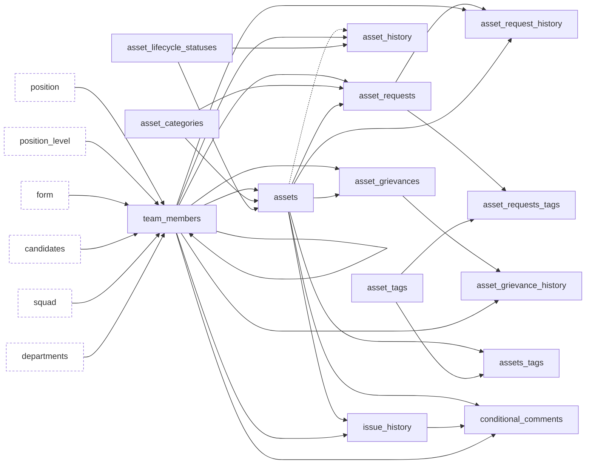

**Diagram assets-2: tables reached only through shared code (2)**


## Table definitions: Feedback and performance

### Feedback and performance: canonical table definitions (17)

#### _ComplimentToPraise
Status: Active · Object: Prisma implicit many-to-many join table · Created in: 0_init · Later migrations touching it: 1

Join rows for Compliment.praises ↔ Praise.compliments. Columns A/B hold the ids of Compliment/Praise (alphabetical model order). Structure: references compliments, praises.

Accessed by (direct): Feedback and performance
Evidence: No direct query (Prisma manages join rows). Relation fields used in code: Compliment.praises yes, Praise.compliments yes.

| Column | Database type | Nullable | Default | Key/constraint | Description |
|---|---|---|---|---|---|
| A | uuid/text (matches referenced id) | no |  | FK → compliments.id, UQ(A,B) | Id on the `Compliment` side |
| B | uuid/text (matches referenced id) | no |  | FK → praises.id, IDX(B) | Id on the `Praise` side |

**Relationships**

- Out: `A` → `compliments`.`id`; many-to-many; implicit m2m join FK; onDelete Cascade
- Out: `B` → `praises`.`id`; many-to-many; implicit m2m join FK; onDelete Cascade

#### compliments
Status: Active · Model: Compliment (schema.prisma:1192) · Created in: 0_init · Later migrations touching it: 1

Structure: referenced by 1 table(s).

Accessed by (direct): Feedback and performance
Evidence: Runtime refs: 16 call sites in 4 files, e.g. app/controllers/compliments.controller.js:19, app/controllers/public/compliments.controller.js:6, app/validators/praise.validator.js:65 (+1 more files). Tests: 1 files.

| Column | Database type | Nullable | Default | Key/constraint | Description |
|---|---|---|---|---|---|
| id | text | no | uuid() | PK | Primary key |
| name | varchar(255) | no |  | UQ(composite) | Inferred: name |
| icon | varchar(1000) | no |  |  | Inferred: icon |
| slug | varchar(255) | yes |  | UQ(composite) | Inferred: slug |
| tenant_id | uuid | yes |  | UQ(composite) | Tenant scope; no FK (tenant data lives outside this DB) |
| is_active | boolean | no | true |  | Inferred: flag, is active |
| created_at | timestamptz(3) | no | now() |  | Row creation time |
| updated_at | timestamptz(3) | no | now() | @updatedAt | Last update time |

**Relationships**

- In: `_ComplimentToPraise`.`A`; many-to-many; implicit m2m join FK

**Additional details**

- Unique: `([name, tenant_id])`, `([slug, tenant_id])`

#### feedback
Status: Active · Model: Feedback (schema.prisma:2333) · Created in: 0_init · Later migrations touching it: 2

Structure: references team_members, feedback_requests; referenced by 1 table(s).

Accessed by (direct): Feedback and performance · via shared code only: People and org, Onboarding and documents, Projects, clients and dev integrations, Background jobs (cron, queue, workers)
Evidence: Runtime refs: 63 call sites in 5 files, e.g. app/controllers/feedback/index.controller.js:29, app/controllers/feedback/request.controller.js:122, app/helpers/feedback/index.helper.js:60 (+2 more files).

| Column | Database type | Nullable | Default | Key/constraint | Description |
|---|---|---|---|---|---|
| id | text | no | uuid() | PK | Primary key |
| sender_id | text | no |  | FK → team_members.id | References team_members |
| receiver_id | text | no |  | FK → team_members.id | References team_members |
| feedback_req_id | uuid | no |  | FK → feedback_requests.id | References feedback_requests |
| status | enum FeedbackRequestStatus | no | requested |  | Enum `FeedbackRequestStatus`: requested, submitted, rolledOut, skipped, hold, cancelled, expired |
| form_fields | jsonb | yes |  |  | Inferred: form fields |
| receiver_type | text | no | "user" |  | Inferred: receiver type |
| delegate_id | uuid | yes |  | FK → team_members.id | References team_members |
| delegate_link_token | varchar(500) | yes |  | UQ | Inferred: delegate link token |
| delegate_link_exp | timestamptz(3) | yes |  |  | Inferred: delegate link exp |
| delegate_link_used | boolean | no | false |  | Inferred: delegate link used |
| created_at | timestamptz(3) | no | now() |  | Row creation time |
| updated_at | timestamptz(3) | no | now() | @updatedAt | Last update time |
| deleted_at | timestamptz(3) | yes |  |  | Soft-delete timestamp (NULL = live) |

**Relationships**

- Out: `sender_id` → `team_members`.`id` (People and org); many → 1; FK constraint `feedback_sender_id_fd40e932_fk_team_members_id`; onDelete schema: default, DB: NO ACTION
- Out: `receiver_id` → `team_members`.`id` (People and org); many → 1; FK constraint `feedback_receiver_id_ecd0d57f_fk_team_members_id`; onDelete schema: default, DB: NO ACTION
- Out: `delegate_id` → `team_members`.`id` (People and org); many → 0..1; FK constraint `feedback_delegate_id_fkey`; onDelete schema: NoAction, DB: NO ACTION
- Out: `feedback_req_id` → `feedback_requests`.`id`; many → 1; FK constraint `feedback_feedback_req_id_1f1e0d22_fk_feedback_requests_id`; onDelete schema: default, DB: NO ACTION
- In: `feedback_audit_trail`.`feedback_id`; 1 → many; FK constraint `feedback_audit_trail_feedback_id_609688d8_fk_feedback_id`

**Additional details**

- Soft delete via `deleted_at`
- No `tenant_id` column: tenant scope is only reachable through parent rows

#### feedback_audit_trail
Status: Active · Model: FeedbackAuditTrail (schema.prisma:2358) · Created in: 0_init · Later migrations touching it: 1

Structure: references team_members, feedback.

Accessed by (direct): Feedback and performance
Evidence: Runtime refs: 2 call sites in 2 files, e.g. app/controllers/feedback/index.controller.js:321, app/controllers/feedback/request.controller.js:871.

| Column | Database type | Nullable | Default | Key/constraint | Description |
|---|---|---|---|---|---|
| id | text | no | uuid() | PK | Primary key |
| submitted_by | text | no |  | FK → team_members.id | References team_members |
| feedback_id | uuid | no |  | FK → feedback.id | References feedback |
| response_data | jsonb | yes |  |  | Inferred: response data |
| submitted_date | timestamptz(3) | no |  |  | Inferred: submitted date |
| comment | text | yes |  |  | Inferred: comment |
| created_at | timestamptz(3) | no | now() |  | Row creation time |
| updated_at | timestamptz(3) | no | now() | @updatedAt | Last update time |
| deleted_at | timestamptz(3) | yes |  |  | Soft-delete timestamp (NULL = live) |

**Relationships**

- Out: `submitted_by` → `team_members`.`id` (People and org); many → 1; FK constraint `feedback_audit_trail_submitted_by_112f275f_fk_team_members_id`; onDelete schema: default, DB: NO ACTION
- Out: `feedback_id` → `feedback`.`id`; many → 1; FK constraint `feedback_audit_trail_feedback_id_609688d8_fk_feedback_id`; onDelete schema: default, DB: NO ACTION

**Additional details**

- Soft delete via `deleted_at`
- No `tenant_id` column: tenant scope is only reachable through parent rows

#### feedback_management_projects
Status: Active · Model: FeedbackManagementProject (schema.prisma:2375) · Created in: 0_init · Later migrations touching it: 1

Structure: referenced by 1 table(s).

Accessed by (direct): Feedback and performance
Evidence: Runtime refs: 5 call sites in 1 files, e.g. app/controllers/feedback/management-project.controller.js:8.

| Column | Database type | Nullable | Default | Key/constraint | Description |
|---|---|---|---|---|---|
| id | uuid | no | dbgenerated("gen_random_uuid()") | PK | Primary key |
| name | varchar(255) | no |  | UQ(composite) | Inferred: name |
| tenant_id | uuid | no |  | UQ(composite) | Tenant scope; no FK (tenant data lives outside this DB) |
| created_at | timestamptz(3) | no | now() |  | Row creation time |
| updated_at | timestamptz(3) | no |  | @updatedAt | Last update time |
| deleted_at | timestamptz(3) | yes |  |  | Soft-delete timestamp (NULL = live) |

**Relationships**

- In: `feedback_requests`.`management_project_id`; 1 → many; FK constraint `feedback_requests_management_project_i_0aa27c75_fk_feedback_`

**Additional details**

- Unique: `([name, tenant_id])`
- Soft delete via `deleted_at`

#### feedback_request_receivers
Status: Active · Model: FeedbackRequestReceiver (schema.prisma:2309) · Created in: 0_init

Structure: references feedback_requests, team_members; junction table (composite key over two FKs).

Accessed by (direct): Feedback and performance
Evidence: Runtime refs: 6 call sites in 1 files, e.g. app/controllers/feedback/request.controller.js:944. Tests: 1 files.

| Column | Database type | Nullable | Default | Key/constraint | Description |
|---|---|---|---|---|---|
| id | text | no | uuid() | PK | Primary key |
| feedback_request_id | uuid | no |  | FK → feedback_requests.id, UQ(composite) | References feedback_requests |
| team_member_id | text | no |  | FK → team_members.id, UQ(composite) | References team_members |

**Relationships**

- Out: `feedback_request_id` → `feedback_requests`.`id`; many → 1; FK constraint `feedback_request_rec_feedback_request_id_dddb6905_fk_feedback_`; onDelete schema: Cascade, DB: NO ACTION
- Out: `team_member_id` → `team_members`.`id` (People and org); many → 1; FK constraint `feedback_request_rec_team_member_id_90d80056_fk_team_memb`; onDelete schema: default, DB: NO ACTION

**Additional details**

- Unique: `([feedback_request_id, team_member_id])`
- No `tenant_id` column: tenant scope is only reachable through parent rows

#### feedback_request_submitters
Status: Active · Model: FeedbackRequestSubmitter (schema.prisma:2321) · Created in: 0_init

Structure: references feedback_requests, team_members; junction table (composite key over two FKs).

Accessed by (direct): Feedback and performance
Evidence: Runtime refs: 11 call sites in 1 files, e.g. app/controllers/feedback/request.controller.js:886. Tests: 1 files.

| Column | Database type | Nullable | Default | Key/constraint | Description |
|---|---|---|---|---|---|
| id | text | no | uuid() | PK | Primary key |
| feedback_request_id | uuid | no |  | FK → feedback_requests.id, UQ(composite) | References feedback_requests |
| team_member_id | text | no |  | FK → team_members.id, UQ(composite) | References team_members |

**Relationships**

- Out: `feedback_request_id` → `feedback_requests`.`id`; many → 1; FK constraint `feedback_request_sub_feedback_request_id_76c20b3b_fk_feedback_`; onDelete schema: Cascade, DB: NO ACTION
- Out: `team_member_id` → `team_members`.`id` (People and org); many → 1; FK constraint `feedback_request_sub_team_member_id_98ab6bc8_fk_team_memb`; onDelete schema: default, DB: NO ACTION

**Additional details**

- Unique: `([feedback_request_id, team_member_id])`
- No `tenant_id` column: tenant scope is only reachable through parent rows

#### feedback_requests
Status: Active · Model: FeedbackRequest (schema.prisma:2277) · Created in: 0_init · Later migrations touching it: 2

Structure: references team_members, projects, feedback_management_projects, feedback_templates, feedback_schedules; referenced by 3 table(s).

Accessed by (direct): Feedback and performance · via shared code only: People and org, Onboarding and documents, Projects, clients and dev integrations, Background jobs (cron, queue, workers)
Evidence: Runtime refs: 58 call sites in 14 files, e.g. app/controllers/consolidatedFeedback.controller.js:20, app/controllers/feedback/index.controller.js:24, app/controllers/feedback/management-project.controller.js:72 (+11 more files). Tests: 1 files.

| Column | Database type | Nullable | Default | Key/constraint | Description |
|---|---|---|---|---|---|
| id | text | no | uuid() | PK | Primary key |
| requester_id | text | no |  | FK → team_members.id | References team_members |
| project_id | uuid | yes |  | FK → projects.id | References projects |
| management_project_id | uuid | yes |  | FK → feedback_management_projects.id | References feedback_management_projects |
| feedback_template_id | uuid | no |  | FK → feedback_templates.id | References feedback_templates |
| form_fields | jsonb | yes |  |  | Inferred: form fields |
| category | enum FeedbackCategory | no | performance |  | Enum `FeedbackCategory`: performance, project, team, leadership, skills, behavior, client, general |
| status | enum FeedbackRequestStatus | no | requested |  | Enum `FeedbackRequestStatus`: requested, submitted, rolledOut, skipped, hold, cancelled, expired |
| expiry_date | timestamptz(3) | yes |  |  | Inferred: expiry date |
| feedback_for_date | timestamptz(3) | no |  |  | Inferred: feedback for date |
| auto_rollout | boolean | no | false |  | Inferred: auto rollout |
| submission_link | text | yes |  |  | Inferred: submission link |
| total_request | integer | yes |  |  | Inferred: total request |
| total_submission_count | integer | yes |  |  | Inferred: total submission count |
| schedule_id | uuid | yes |  | FK → feedback_schedules.id | References feedback_schedules |
| created_at | timestamptz(3) | no | now() |  | Row creation time |
| updated_at | timestamptz(3) | no | now() | @updatedAt | Last update time |
| deleted_at | timestamptz(3) | yes |  |  | Soft-delete timestamp (NULL = live) |

**Relationships**

- Out: `requester_id` → `team_members`.`id` (People and org); many → 1; FK constraint `feedback_requests_requester_id_8813084c_fk_team_members_id`; onDelete schema: default, DB: NO ACTION
- Out: `project_id` → `projects`.`id` (Projects, clients and dev integrations); many → 0..1; FK constraint `feedback_requests_project_id_05ee5341_fk_projects_id`; onDelete schema: default, DB: NO ACTION
- Out: `management_project_id` → `feedback_management_projects`.`id`; many → 0..1; FK constraint `feedback_requests_management_project_i_0aa27c75_fk_feedback_`; onDelete schema: default, DB: NO ACTION
- Out: `feedback_template_id` → `feedback_templates`.`id`; many → 1; FK constraint `feedback_requests_feedback_template_id_f1a12b91_fk_feedback_`; onDelete schema: default, DB: NO ACTION
- Out: `schedule_id` → `feedback_schedules`.`id`; many → 0..1; FK constraint `feedback_requests_schedule_id_fkey`; onDelete schema: NoAction, DB: NO ACTION
- In: `feedback_request_receivers`.`feedback_request_id`; 1 → many; FK constraint `feedback_request_rec_feedback_request_id_dddb6905_fk_feedback_`
- In: `feedback_request_submitters`.`feedback_request_id`; 1 → many; FK constraint `feedback_request_sub_feedback_request_id_76c20b3b_fk_feedback_`
- In: `feedback`.`feedback_req_id`; 1 → many; FK constraint `feedback_feedback_req_id_1f1e0d22_fk_feedback_requests_id`

**Additional details**

- Soft delete via `deleted_at`
- No `tenant_id` column: tenant scope is only reachable through parent rows

#### feedback_schedules
Status: Active · Model: FeedbackSchedule (schema.prisma:2734) · Created in: 20260707121236_add_feedback_schedules · Later migrations touching it: 2

Schema comment: "Generic scheduling mechanics (FEEDBACK module). Reusable by probation via `type`.".

Structure: references feedback_templates, team_members; referenced by 2 table(s).

Accessed by (direct): Feedback and performance · via shared code only: People and org, Onboarding and documents, Projects, clients and dev integrations, Background jobs (cron, queue, workers)
Evidence: Runtime refs: 11 call sites in 5 files, e.g. app/helpers/feedback/driver.helper.js:106, app/helpers/feedback/schedule.helper.js:152, app/helpers/pip/index.helper.js:212 (+2 more files).

| Column | Database type | Nullable | Default | Key/constraint | Description |
|---|---|---|---|---|---|
| id | uuid | no | uuid() | PK | Primary key |
| type | enum FeedbackScheduleType | no |  |  | Enum `FeedbackScheduleType`: pip, probation |
| template_id | uuid | no |  | FK → feedback_templates.id, IDX | References feedback_templates |
| submitter_ids | uuid[] | no |  |  | Inferred: submitter ids |
| receiver_ids | uuid[] | no |  |  | Inferred: receiver ids |
| interval_unit | enum ScheduleIntervalUnit | no |  |  | Enum `ScheduleIntervalUnit`: day, week, month |
| interval_count | integer | no |  |  | Inferred: interval count |
| next_run_date | date | yes |  |  | Inferred: next run date |
| last_run_date | date | yes |  |  | Inferred: last run date |
| is_active | boolean | no | true |  | Inferred: flag, is active |
| two_way | boolean | no | false |  | Inferred: two way |
| created_by_id | uuid | no |  | FK → team_members.id, IDX | References team_members |
| tenant_id | uuid | no |  | IDX | Tenant scope; no FK (tenant data lives outside this DB) |
| created_at | timestamptz(3) | no | now() |  | Row creation time |
| updated_at | timestamptz(3) | no | now() | @updatedAt | Last update time |
| deleted_at | timestamptz(3) | yes |  |  | Soft-delete timestamp (NULL = live) |

**Relationships**

- Out: `template_id` → `feedback_templates`.`id`; many → 1; FK constraint `feedback_schedules_template_id_fkey`; onDelete schema: NoAction, DB: NO ACTION
- Out: `created_by_id` → `team_members`.`id` (People and org); many → 1; FK constraint `feedback_schedules_created_by_id_fkey`; onDelete schema: NoAction, DB: NO ACTION
- In: `feedback_requests`.`schedule_id`; 1 → many; FK constraint `feedback_requests_schedule_id_fkey`
- In: `team_member_pips`.`feedback_schedule_id`; 1 → 0..1; FK constraint `team_member_pips_feedback_schedule_id_fkey`

**Additional details**

- Indexes: `([tenant_id])`, `([template_id])`, `([created_by_id])`
- Soft delete via `deleted_at`

#### feedback_template_logs
Status: Active · Model: FeedbackTemplateLog (schema.prisma:2264) · Created in: 20260826000000_add_feedback_template_logs

Schema comment: "Append-only change history for feedback templates. Stores only the DIFF of each create/update/ delete (with from+to per changed path, so it is invertible → powers the history view, in-grid highlight, and future revert). changed_by_id/tenant_id are bare scalar FKs (resolved in the controller) to avoid relation churn on TeamMember — same pattern as updated_by_id above.".

Structure: references feedback_templates, team_members.

Accessed by (direct): Feedback and performance
Evidence: Runtime refs: 2 call sites in 1 files, e.g. app/controllers/feedback/template.controller.js:11.

| Column | Database type | Nullable | Default | Key/constraint | Description |
|---|---|---|---|---|---|
| id | text | no | uuid() | PK | Primary key |
| feedback_template_id | uuid | no |  | IDX | Inferred: id of feedback template; no FK declared |
| tenant_id | uuid | yes |  |  | Tenant scope; no FK (tenant data lives outside this DB) |
| action | text | no |  |  | Inferred: action |
| changes | jsonb | no |  |  | Inferred: changes |
| changed_by_id | uuid | yes |  |  | Inferred: id of changed by; no FK declared |
| created_at | timestamptz(3) | no | now() |  | Row creation time |

**Relationships**

- Out: `feedback_template_id` → `feedback_templates`.`id`; many → 0..1; FK constraint `feedback_template_logs_template_fk` in migration SQL, not declared in schema.prisma; onDelete CASCADE
- Out: `changed_by_id` → `team_members`.`id` (People and org); many → 0..1; FK constraint `feedback_template_logs_changed_by_fk` in migration SQL, not declared in schema.prisma; onDelete SET NULL

**Additional details**

- Indexes: `([feedback_template_id])`

#### feedback_templates
Status: Active · Model: FeedbackTemplate (schema.prisma:2239) · Created in: 0_init · Later migrations touching it: 5

Structure: references team_members; referenced by 4 table(s).

Accessed by (direct): People and org, Feedback and performance · via shared code only: Onboarding and documents, Projects, clients and dev integrations, Background jobs (cron, queue, workers)
Evidence: Runtime refs: 15 call sites in 6 files, e.g. app/controllers/feedback/request.controller.js:236, app/controllers/feedback/template.controller.js:29, app/controllers/teamMember.controller.js:325 (+3 more files). Tests: 2 files.

| Column | Database type | Nullable | Default | Key/constraint | Description |
|---|---|---|---|---|---|
| id | text | no | uuid() | PK | Primary key |
| name | varchar(255) | no |  |  | Inferred: name |
| key | enum FeedbackTemplateKey | no | projectTeamFeedback |  | Enum `FeedbackTemplateKey`: projectTeamFeedback, projectClientFeedback, managementTeamFeedback, managementClientFeedback, trainingDevelopmentAndAdminFeedback, leadVerticalFeedback, … (9 values) |
| description | text | yes |  |  | Inferred: description |
| type | enum FeedbackType | no | individual |  | Enum `FeedbackType`: individual, group, client |
| form_fields | jsonb | no |  |  | Inferred: form fields |
| tenant_id | text | yes |  |  | Tenant scope; no FK (tenant data lives outside this DB) |
| created_by_id | text | yes |  | FK → team_members.id | References team_members |
| updated_by_id | text | yes |  |  | Inferred: id of updated by; no FK declared |
| created_at | timestamptz(3) | no | now() |  | Row creation time |
| updated_at | timestamptz(3) | no | now() | @updatedAt | Last update time |
| deleted_at | timestamptz(3) | yes |  |  | Soft-delete timestamp (NULL = live) |

**Relationships**

- Out: `created_by_id` → `team_members`.`id` (People and org); many → 0..1; FK constraint `feedback_templates_created_by_id_fe8c2434_fk_team_members_id`; onDelete schema: SetNull, DB: NO ACTION
- In: `feedback_requests`.`feedback_template_id`; 1 → many; FK constraint `feedback_requests_feedback_template_id_f1a12b91_fk_feedback_`
- In: `feedback_schedules`.`template_id`; 1 → many; FK constraint `feedback_schedules_template_id_fkey`
- In: `feedback_schedulers`.`feedback_template_id` (Unassigned / legacy (migration-only)); 1 → many; FK in migration SQL only (`feedback_schedulers_feedback_template_id_7b8406c8_fk_feedback_`)
- In: `feedback_template_logs`.`feedback_template_id`; 1 → many; FK constraint `feedback_template_logs_template_fk` in migration SQL, not declared in schema.prisma

**Additional details**

- Soft delete via `deleted_at`
- `tenant_id` stored as text (not uuid)
- Partial unique index `feedback_templates_tenant_reserved_key_key`  ("tenant_id", "key") WHERE "key" IN ('pipFeedback', 'probationFeedback') AND "deleted_at" IS NULL from `20260820000002_add_reserved_feedback_template_unique_index`, not represented in schema.prisma

#### pa_calculations
Status: Active · Model: PaCalculation (schema.prisma:2810) · Created in: 20260714000000_add_pa_calculation_models

Structure: references team_members.

Accessed by (direct): Feedback and performance
Evidence: Runtime refs: 7 call sites in 3 files, e.g. app/controllers/consolidatedFeedback.controller.js:173, app/controllers/paCalculation.controller.js:66, app/helpers/paCalculation.helper.js:336.

| Column | Database type | Nullable | Default | Key/constraint | Description |
|---|---|---|---|---|---|
| id | uuid | no | dbgenerated("gen_random_uuid()") | PK | Primary key |
| team_member_id | uuid | no |  | FK → team_members.id, UQ(composite) | References team_members |
| quarter | integer | no |  | UQ(composite) | Inferred: quarter |
| year | integer | no |  | UQ(composite) | Inferred: year |
| criteria | jsonb | yes |  |  | Inferred: criteria |
| scores | jsonb | yes |  |  | Inferred: scores |
| final_score | double precision | yes |  |  | Inferred: final score |
| calculation_date | timestamptz | yes |  |  | Inferred: calculation date |
| status | enum PaCalculationStatus | no | PENDING |  | Enum `PaCalculationStatus`: PENDING, CALCULATED, ERROR, NOT_CALCULATED, NOT_APPLICABLE |
| error_message | text | yes |  |  | Inferred: error message |
| tenant_id | uuid | no |  | UQ(composite) | Tenant scope; no FK (tenant data lives outside this DB) |
| created_at | timestamptz | no | now() |  | Row creation time |
| updated_at | timestamptz | no |  | @updatedAt | Last update time |
| deleted_at | timestamptz | yes |  |  | Soft-delete timestamp (NULL = live) |

**Relationships**

- Out: `team_member_id` → `team_members`.`id` (People and org); many → 1; FK constraint `pa_calculations_team_member_id_fkey`; onDelete schema: default, DB: RESTRICT

**Additional details**

- Unique: `([team_member_id, quarter, year, tenant_id])`
- Soft delete via `deleted_at`

#### pa_role_weightages
Status: Apparently unused · Model: PaRoleWeightage (schema.prisma:2832) · Created in: 20260714000000_add_pa_calculation_models

Structure: references departments, position_level.

Accessed by (direct): none
Evidence: No runtime reference found in app/, config/, utils/, index.js (delegate calls, model aliases, raw SQL, nested relation writes).

| Column | Database type | Nullable | Default | Key/constraint | Description |
|---|---|---|---|---|---|
| id | uuid | no | dbgenerated("gen_random_uuid()") | PK | Primary key |
| department_id | uuid | no |  | FK → departments.id | References departments |
| position_level_id | uuid | no |  | FK → position_level.id | References position_level |
| criteria | jsonb | no |  |  | Inferred: criteria |
| is_active | boolean | no | true |  | Inferred: flag, is active |
| effective_from | timestamptz | no |  |  | Inferred: effective from |
| effective_to | timestamptz | yes |  |  | Inferred: effective to |
| tenant_id | uuid | no |  |  | Tenant scope; no FK (tenant data lives outside this DB) |
| created_at | timestamptz | no | now() |  | Row creation time |
| updated_at | timestamptz | no |  | @updatedAt | Last update time |
| deleted_at | timestamptz | yes |  |  | Soft-delete timestamp (NULL = live) |

**Relationships**

- Out: `department_id` → `departments`.`id` (People and org); many → 1; FK constraint `pa_role_weightages_department_id_fkey`; onDelete schema: default, DB: RESTRICT
- Out: `position_level_id` → `position_level`.`id` (People and org); many → 1; FK constraint `pa_role_weightages_position_level_id_fkey`; onDelete schema: default, DB: RESTRICT

**Additional details**

- Soft delete via `deleted_at`

#### pip_settings
Status: Active · Model: PipSettings (schema.prisma:2790) · Created in: 20260707121237_add_pip_tables

Schema comment: "PIP settings — one row per tenant (mirrors ExitSettings + python probation_settings).".

Accessed by (direct): Feedback and performance · via shared code only: People and org, Onboarding and documents, Projects, clients and dev integrations, Background jobs (cron, queue, workers)
Evidence: Runtime refs: 6 call sites in 2 files, e.g. app/helpers/pip/index.helper.js:93, app/helpers/pipSettings.helper.js:13.

| Column | Database type | Nullable | Default | Key/constraint | Description |
|---|---|---|---|---|---|
| id | uuid | no | uuid() | PK | Primary key |
| duration_in_days | integer | no | 30 |  | Inferred: duration in days |
| tenant_id | uuid | no |  | UQ | Tenant scope; no FK (tenant data lives outside this DB) |
| created_at | timestamptz(3) | no | now() |  | Row creation time |
| updated_at | timestamptz(3) | no | now() | @updatedAt | Last update time |

**Relationships:** none identified.

#### praises
Status: Active · Model: Praise (schema.prisma:1208) · Created in: 0_init · Later migrations touching it: 1

Structure: references team_members; referenced by 1 table(s).

Accessed by (direct): Feedback and performance
Evidence: Runtime refs: 12 call sites in 4 files, e.g. app/controllers/compliments.controller.js:182, app/controllers/praise.controller.js:23, app/controllers/public/praise.controller.js:8 (+1 more files).

| Column | Database type | Nullable | Default | Key/constraint | Description |
|---|---|---|---|---|---|
| id | text | no | uuid() | PK | Primary key |
| team_member_id | text | no |  | FK → team_members.id | References team_members |
| praised_by_id | text | no |  | FK → team_members.id | References team_members |
| feedback | text | yes |  |  | Inferred: feedback |
| created_at | timestamptz(3) | no | now() |  | Row creation time |
| updated_at | timestamptz(3) | no | now() | @updatedAt | Last update time |

**Relationships**

- Out: `team_member_id` → `team_members`.`id` (People and org); many → 1; FK constraint `praises_team_member_id_440f158f_fk`; onDelete schema: default, DB: NO ACTION
- Out: `praised_by_id` → `team_members`.`id` (People and org); many → 1; FK constraint `praises_praised_by_id_ad839711_fk`; onDelete schema: default, DB: NO ACTION
- In: `_ComplimentToPraise`.`B`; many-to-many; implicit m2m join FK

**Additional details**

- No `tenant_id` column: tenant scope is only reachable through parent rows

#### probation_settings
Status: Active · Model: ProbationSettings (schema.prisma:2165) · Created in: 0_init · Later migrations touching it: 1

Accessed by (direct): Feedback and performance
Evidence: Runtime refs: 6 call sites in 2 files, e.g. app/controllers/probationSettings.controller.js:8, app/validators/probationSettings.validator.js:10.

| Column | Database type | Nullable | Default | Key/constraint | Description |
|---|---|---|---|---|---|
| id | uuid | no | uuid() | PK | Primary key |
| duration_in_days | integer | no | 90 |  | Inferred: duration in days |
| tenant_id | uuid | no |  |  | Tenant scope; no FK (tenant data lives outside this DB) |
| created_at | timestamptz(6) | no | now() |  | Row creation time |
| updated_at | timestamptz(6) | no | now() | @updatedAt | Last update time |

**Relationships:** none identified.

#### team_member_pips
Status: Active · Model: TeamMemberPip (schema.prisma:2764) · Created in: 20260707121237_add_pip_tables

Schema comment: "PIP record + history (PEOPLE domain). One row per PIP; rows per member = history.".

Structure: references team_members, feedback_schedules.

Accessed by (direct): Feedback and performance · via shared code only: People and org, Onboarding and documents, Projects, clients and dev integrations, Background jobs (cron, queue, workers)
Evidence: Runtime refs: 11 call sites in 1 files, e.g. app/helpers/pip/index.helper.js:80.

| Column | Database type | Nullable | Default | Key/constraint | Description |
|---|---|---|---|---|---|
| id | uuid | no | uuid() | PK | Primary key |
| team_member_id | uuid | no |  | FK → team_members.id, IDX | References team_members |
| feedback_schedule_id | uuid | no |  | FK → feedback_schedules.id, UQ | References feedback_schedules |
| start_date | date | no |  |  | Inferred: start date |
| end_date | date | no |  |  | Inferred: end date |
| reason | text | yes |  |  | Inferred: reason |
| status | enum PipStatus | no | active |  | Enum `PipStatus`: active, completed, cancelled |
| outcome | enum PipOutcome | yes |  |  | Enum `PipOutcome`: confirmed, failed |
| extension_count | integer | no | 0 |  | Inferred: extension count |
| initiated_by_id | uuid | no |  | FK → team_members.id | References team_members |
| tenant_id | uuid | no |  | IDX | Tenant scope; no FK (tenant data lives outside this DB) |
| created_at | timestamptz(3) | no | now() |  | Row creation time |
| updated_at | timestamptz(3) | no | now() | @updatedAt | Last update time |
| deleted_at | timestamptz(3) | yes |  |  | Soft-delete timestamp (NULL = live) |

**Relationships**

- Out: `team_member_id` → `team_members`.`id` (People and org); many → 1; FK constraint `team_member_pips_team_member_id_fkey`; onDelete schema: NoAction, DB: NO ACTION
- Out: `initiated_by_id` → `team_members`.`id` (People and org); many → 1; FK constraint `team_member_pips_initiated_by_id_fkey`; onDelete schema: NoAction, DB: NO ACTION
- Out: `feedback_schedule_id` → `feedback_schedules`.`id`; 1 → 1; FK constraint `team_member_pips_feedback_schedule_id_fkey`; onDelete schema: NoAction, DB: NO ACTION

**Additional details**

- Indexes: `([tenant_id])`, `([team_member_id])`
- Soft delete via `deleted_at`
- Partial unique index `one_active_pip_per_member`  ("team_member_id") WHERE "status" = 'active' AND "deleted_at" IS NULL from `20260707121237_add_pip_tables`, not represented in schema.prisma

### Feedback and performance: relationship diagram

Arrows run parent → child (FK holder). Solid = FK in schema and migration SQL; dotted = schema vs SQL discrepancy; dashed boxes = tables outside this module. Full conventions under Counting rules.

**Diagram feedback-1: tables accessed directly (22), external FK parents shown dashed**

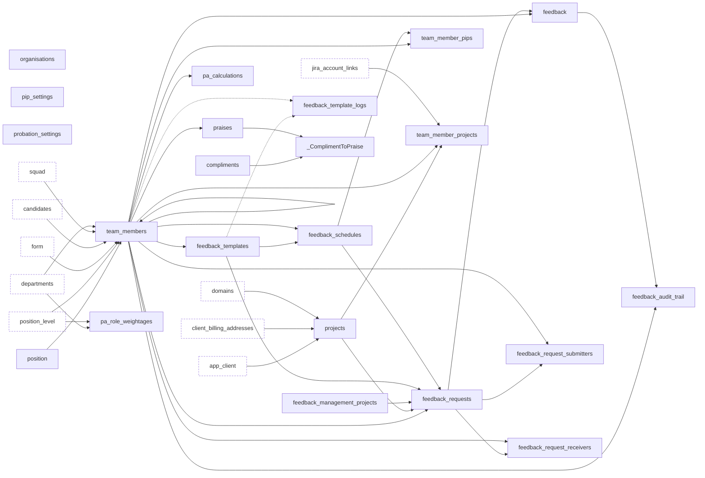

**Diagram feedback-2: tables reached only through shared code (8)**

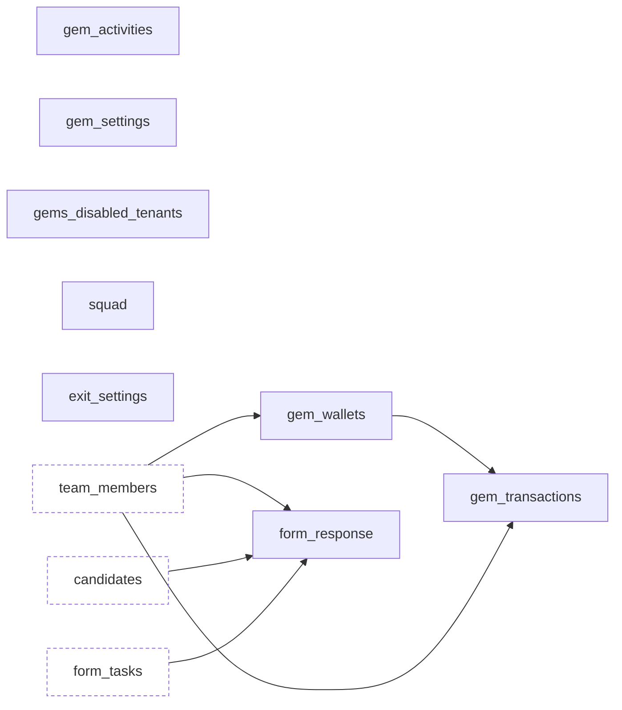

## Table definitions: Engineering profiles

### Engineering profiles: canonical table definitions (6)

#### bulk_upload_batches
Status: Active · Model: BulkUploadBatch (schema.prisma:2493) · Created in: 20260713000000_add_engineering_profiles_schema · Later migrations touching it: 1

Structure: referenced by 1 table(s).

Accessed by (direct): Engineering profiles · via shared code only: Referral desk, Background jobs (cron, queue, workers)
Evidence: Runtime refs: 6 call sites in 2 files, e.g. app/helpers/engineeringProfile/bulkUpload.helper.js:135, app/workers/bulkResumeParse.worker.js:141. Tests: 1 files.

| Column | Database type | Nullable | Default | Key/constraint | Description |
|---|---|---|---|---|---|
| id | text | no | uuid() | PK | Primary key |
| tenant_id | uuid | no |  | IDX | Tenant scope; no FK (tenant data lives outside this DB) |
| uploaded_by | uuid | no |  |  | Inferred: uploaded by |
| total | integer | no | 0 |  | Inferred: total |
| succeeded | integer | no | 0 |  | Inferred: succeeded |
| failed | integer | no | 0 |  | Inferred: failed |
| report_file_key | varchar(1000) | yes |  |  | Inferred: report file key |
| created_at | timestamptz(3) | no | now() |  | Row creation time |
| updated_at | timestamptz(3) | no | now() | @updatedAt | Last update time |

**Relationships**

- In: `bulk_upload_jobs`.`batch_id`; 1 → many; FK constraint `bulk_upload_jobs_batch_id_fkey`

**Additional details**

- Indexes: `([tenant_id])`

#### bulk_upload_jobs
Status: Active · Model: BulkUploadJob (schema.prisma:2509) · Created in: 20260713000000_add_engineering_profiles_schema · Later migrations touching it: 1

Structure: references bulk_upload_batches.

Accessed by (direct): Engineering profiles · via shared code only: Referral desk, Background jobs (cron, queue, workers)
Evidence: Runtime refs: 13 call sites in 3 files, e.g. app/helpers/engineeringProfile/bulkUpload.helper.js:141, app/helpers/engineeringProfile/bulkUploadReconcile.helper.js:19, app/workers/bulkResumeParse.worker.js:91. Tests: 1 files.

| Column | Database type | Nullable | Default | Key/constraint | Description |
|---|---|---|---|---|---|
| id | text | no | uuid() | PK | Primary key |
| batch_id | text | no |  | FK → bulk_upload_batches.id, IDX | References bulk_upload_batches |
| tenant_id | uuid | no |  | IDX | Tenant scope; no FK (tenant data lives outside this DB) |
| uploaded_by | uuid | no |  |  | Inferred: uploaded by |
| target_team_member_id | uuid | yes |  |  | Inferred: id of target team member; no FK declared |
| file_key | varchar(1000) | no |  |  | Inferred: file key |
| original_filename | varchar(500) | no |  |  | Inferred: original filename |
| status | enum BulkUploadJobStatus | no | queued | IDX | Enum `BulkUploadJobStatus`: queued, scanning, parsing, completed, failed, manual_review |
| failure_reason | text | yes |  |  | Inferred: failure reason |
| parsed_data | jsonb | yes |  |  | Inferred: parsed data |
| attempts | integer | no | 0 | IDX | Inferred: attempts |
| created_at | timestamptz(3) | no | now() | IDX | Row creation time |
| updated_at | timestamptz(3) | no | now() | @updatedAt | Last update time |

**Relationships**

- Out: `batch_id` → `bulk_upload_batches`.`id`; many → 1; FK constraint `bulk_upload_jobs_batch_id_fkey`; onDelete schema: NoAction, DB: NO ACTION

**Additional details**

- Indexes: `([batch_id])`, `([status, attempts, created_at])`, `([tenant_id])`

#### engineering_profile_custom_projects
Status: Active · Model: CustomProject (schema.prisma:2463) · Created in: 20260715120000_add_engineering_profile_custom_projects

Schema comment: "Manually-added engineering-profile project (FR-3-adjacent) — a real persisted entity, unlike parsed/allocation projects which only ever exist inside profile_data JSON. Merged into profile_data.projects at generate time with source: 'manual' (see assemble.js).".

Structure: references team_members.

Accessed by (direct): Engineering profiles
Evidence: Runtime refs: 8 call sites in 2 files, e.g. app/helpers/engineeringProfile/customProject.helper.js:36, app/services/engineeringProfile/assemble.js:90.

| Column | Database type | Nullable | Default | Key/constraint | Description |
|---|---|---|---|---|---|
| id | text | no | uuid() | PK | Primary key |
| team_member_id | uuid | no |  | FK → team_members.id, IDX | References team_members |
| tenant_id | uuid | no |  | IDX | Tenant scope; no FK (tenant data lives outside this DB) |
| name | varchar(255) | no |  |  | Inferred: name |
| domain | varchar(255) | yes |  |  | Inferred: domain |
| summary | text | yes |  |  | Inferred: summary |
| tech_stack | text[] | no | [] |  | Inferred: tech stack |
| responsibilities | text[] | no | [] |  | Inferred: responsibilities |
| project_size | varchar(255) | yes |  |  | Inferred: project size |
| start_date | date | yes |  |  | Inferred: start date |
| end_date | date | yes |  |  | Inferred: end date |
| created_at | timestamptz(3) | no | now() |  | Row creation time |
| updated_at | timestamptz(3) | no | now() | @updatedAt | Last update time |

**Relationships**

- Out: `team_member_id` → `team_members`.`id` (People and org); many → 1; FK constraint `engineering_profile_custom_projects_team_member_id_fkey`; onDelete schema: NoAction, DB: NO ACTION

**Additional details**

- Indexes: `([team_member_id])`, `([tenant_id])`

#### engineering_profiles
Status: Active · Model: EngineeringProfile (schema.prisma:2419) · Created in: 20260713000000_add_engineering_profiles_schema · Later migrations touching it: 2

Structure: references team_members.

Accessed by (direct): Engineering profiles · via shared code only: Referral desk, Background jobs (cron, queue, workers)
Evidence: Runtime refs: 10 call sites in 4 files, e.g. app/helpers/engineeringProfile/customProject.helper.js:31, app/helpers/engineeringProfile/profile.helper.js:37, app/services/engineeringProfile/pastExperience.js:45 (+1 more files). Tests: 1 files.

| Column | Database type | Nullable | Default | Key/constraint | Description |
|---|---|---|---|---|---|
| id | text | no | uuid() | PK | Primary key |
| team_member_id | uuid | no |  | FK → team_members.id, UQ | References team_members |
| tenant_id | uuid | no |  | IDX | Tenant scope; no FK (tenant data lives outside this DB) |
| status | enum EngineeringProfileStatus | no | draft |  | Enum `EngineeringProfileStatus`: draft, manual_review, ready |
| source | enum EngineeringProfileSource | no | auto |  | Enum `EngineeringProfileSource`: auto, bulk_upload |
| profile_data | jsonb | no |  |  | Inferred: profile data |
| content_updated_at | timestamptz(3) | yes |  |  | Inferred: content updated at |
| last_previewed_at | timestamptz(3) | yes |  |  | Inferred: last previewed at |
| last_generated_at | timestamptz(3) | yes |  |  | Inferred: last generated at |
| hrms_synced_at | timestamptz(3) | yes |  |  | Inferred: hrms synced at |
| generated_file_key | varchar(1000) | yes |  |  | Inferred: generated file key |
| created_at | timestamptz(3) | no | now() |  | Row creation time |
| updated_at | timestamptz(3) | no | now() | @updatedAt | Last update time |
| deleted_at | timestamptz(3) | yes |  |  | Soft-delete timestamp (NULL = live) |

**Relationships**

- Out: `team_member_id` → `team_members`.`id` (People and org); 1 → 1; FK constraint `engineering_profiles_team_member_id_fkey`; onDelete schema: NoAction, DB: NO ACTION

**Additional details**

- Indexes: `([tenant_id])`
- Soft delete via `deleted_at`

#### past_experiences
Status: Active · Model: PastExperience (schema.prisma:2440) · Created in: 20260713000000_add_engineering_profiles_schema · Later migrations touching it: 1

Structure: references team_members.

Accessed by (direct): Engineering profiles
Evidence: Runtime refs: 8 call sites in 2 files, e.g. app/services/engineeringProfile/assemble.js:88, app/services/engineeringProfile/pastExperience.js:27. Tests: 1 files.

| Column | Database type | Nullable | Default | Key/constraint | Description |
|---|---|---|---|---|---|
| id | text | no | uuid() | PK | Primary key |
| team_member_id | uuid | no |  | FK → team_members.id, IDX | References team_members |
| tenant_id | uuid | no |  | IDX | Tenant scope; no FK (tenant data lives outside this DB) |
| previous_company | varchar(255) | yes |  |  | Inferred: previous company |
| designation | varchar(255) | yes |  |  | Inferred: designation |
| start_date | date | yes |  |  | Inferred: start date |
| end_date | date | yes |  |  | Inferred: end date |
| duration_raw | varchar(255) | yes |  |  | Inferred: duration raw |
| responsibilities | text | yes |  |  | Inferred: responsibilities |
| tech_stack | text[] | no | [] |  | Inferred: tech stack |
| created_at | timestamptz(3) | no | now() |  | Row creation time |
| updated_at | timestamptz(3) | no | now() | @updatedAt | Last update time |

**Relationships**

- Out: `team_member_id` → `team_members`.`id` (People and org); many → 1; FK constraint `past_experiences_team_member_id_fkey`; onDelete schema: NoAction, DB: NO ACTION

**Additional details**

- Indexes: `([team_member_id])`, `([tenant_id])`

#### profile_audit_logs
Status: Active · Model: ProfileAuditLog (schema.prisma:2539) · Created in: 20260713000000_add_engineering_profiles_schema

Accessed by (direct): Engineering profiles · via shared code only: Referral desk, Projects, clients and dev integrations, Background jobs (cron, queue, workers)
Evidence: Runtime refs: 1 call sites in 1 files, e.g. app/helpers/engineeringProfile/audit.helper.js:24. Tests: 1 files.

| Column | Database type | Nullable | Default | Key/constraint | Description |
|---|---|---|---|---|---|
| id | text | no | uuid() | PK | Primary key |
| tenant_id | uuid | no |  | IDX | Tenant scope; no FK (tenant data lives outside this DB) |
| team_member_id | uuid | yes |  | IDX | Inferred: id of team member; no FK declared |
| actor_team_member_id | uuid | no |  |  | Inferred: id of actor team member; no FK declared |
| action | enum ProfileAuditAction | no |  |  | Enum `ProfileAuditAction`: generated, edited, downloaded, bulk_uploaded, date_edited |
| selected_sections | jsonb | yes |  |  | Inferred: selected sections |
| field | varchar(255) | yes |  |  | Inferred: field |
| old_value | jsonb | yes |  |  | Inferred: old value |
| new_value | jsonb | yes |  |  | Inferred: new value |
| created_at | timestamptz(3) | no | now() |  | Row creation time |

**Relationships:** none identified.

**Additional details**

- Indexes: `([tenant_id, team_member_id])`

### Engineering profiles: relationship diagram

Arrows run parent → child (FK holder). Solid = FK in schema and migration SQL; dotted = schema vs SQL discrepancy; dashed boxes = tables outside this module. Full conventions under Counting rules.

**Diagram engprofiles-1: tables accessed directly (9), external FK parents shown dashed**

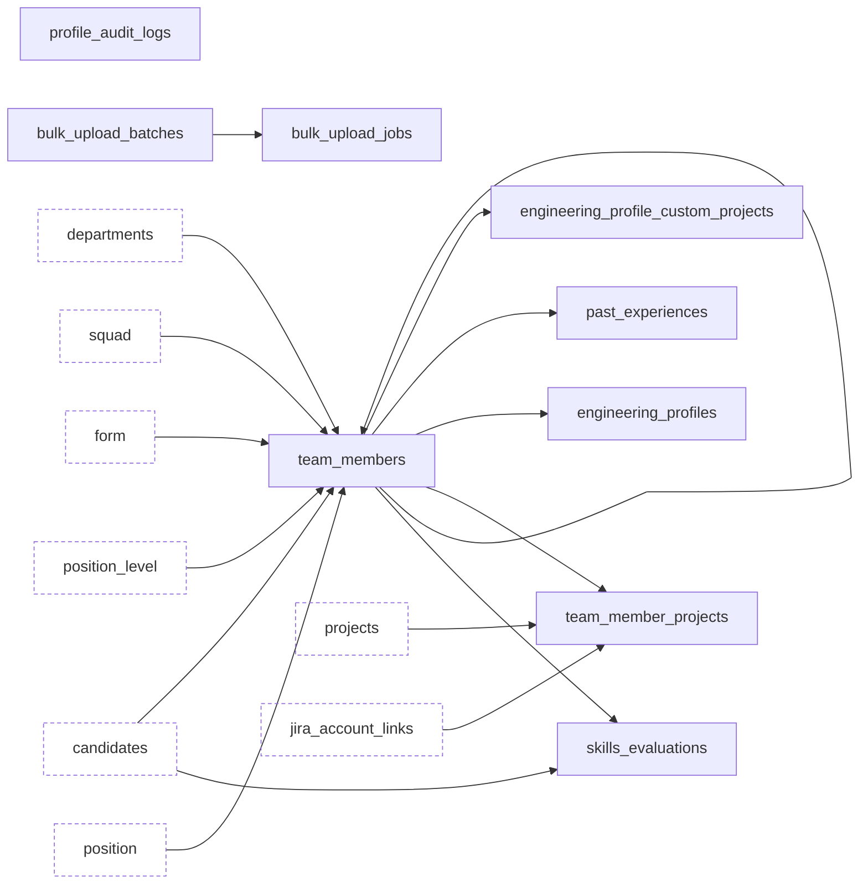

**Diagram engprofiles-2: tables reached only through shared code (2)**

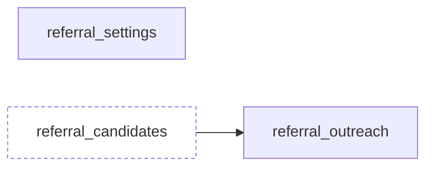

## Table definitions: Gems and posts

### Gems and social feed: canonical table definitions (10)

#### gem_activities
Status: Active · Model: GemActivity (schema.prisma:1704) · Created in: 0_init · Later migrations touching it: 6

Accessed by (direct): Gems and social feed · via shared code only: People and org, Onboarding and documents, Projects, clients and dev integrations, Feedback and performance, Todos, goals and wellness, Calendar integrations, Forms, Issue history, email events, scheduler API, Uploads, billing, realtime, Background jobs (cron, queue, workers)
Evidence: Runtime refs: 11 call sites in 7 files, e.g. app/controllers/gemActivities.controller.js:7, app/controllers/gemRules.controller.js:22, app/controllers/public/gemActivities.controller.js:9 (+4 more files). Ops scripts/seeds: prisma/seeds/cleanupStaleGemActivities.js:26. Tests: 1 files.

| Column | Database type | Nullable | Default | Key/constraint | Description |
|---|---|---|---|---|---|
| id | uuid | no | uuid() | PK | Primary key |
| name | text | no |  |  | Inferred: name |
| description | text | no |  |  | Inferred: description |
| icon | text | no |  |  | Inferred: icon |
| action_type | varchar(255) | no |  | UQ(composite) | Inferred: action type |
| is_active | boolean | no | true |  | Inferred: flag, is active |
| is_system | boolean | no | false |  | Inferred: flag, is system |
| gem_value | double precision | no |  |  | Inferred: gem value |
| daily_limit | double precision | yes |  |  | Per-user earning limits. NULL means "Unlimited" (no cap) for that dimension, which is the default so introducing this feature never retroactively caps a rule that HR has not explicitly configured. A limit must be >= 1; 0 is rejected at the validator, since a 0 cap would silently make an Active rule award nothing forever.  Daily windows reset at midnight and weekly windows on Monday midnight, both in TENANT_TIMEZONE - an app-wide constant ('Asia/Kolkata'), NOT a per-tenant setting. A tenant outside IST sees its daily cap reset mid-afternoon local time; fixing that needs a real per-tenant timezone field first. - daily_limit / weekly_limit cap the NET gems a single user can earn from   this rule within the period. - max_daily_triggers / max_weekly_triggers cap how many times the rule can   award that user within the period (independent of gem_value). |
| weekly_limit | double precision | yes |  |  | Inferred: weekly limit |
| max_daily_triggers | integer | yes |  |  | Inferred: max daily triggers |
| max_weekly_triggers | integer | yes |  |  | Inferred: max weekly triggers |
| tenant_id | text | no |  | UQ(composite) | Tenant scope; no FK (tenant data lives outside this DB) |
| created_at | timestamptz(3) | no | now() |  | Row creation time |
| updated_at | timestamptz(3) | no | now() | @updatedAt | Last update time |

**Relationships:** none identified.

**Additional details**

- Unique: `([tenant_id, action_type])`
- `tenant_id` stored as text (not uuid)

#### gem_settings
Status: Active · Model: GemSettings (schema.prisma:1666) · Created in: 20260803000002_add_gem_settings

Schema comment: "Tenant-wide gem settings. One row per tenant.  Exists because per-rule limits are silos: a user can max every rule in the same day and the total is unbounded, so "every rule is capped" still adds up to a large daily haul for trivial effort. This is the ceiling on the sum.".

Accessed by (direct): Gems and social feed · via shared code only: People and org, Onboarding and documents, Projects, clients and dev integrations, Feedback and performance, Todos, goals and wellness, Calendar integrations, Forms, Issue history, email events, scheduler API, Uploads, billing, realtime, Background jobs (cron, queue, workers)
Evidence: Runtime refs: 3 call sites in 2 files, e.g. app/controllers/gemSettings.controller.js:11, app/helpers/gemWallet.helper.js:245.

| Column | Database type | Nullable | Default | Key/constraint | Description |
|---|---|---|---|---|---|
| id | uuid | no | uuid() | PK | Primary key |
| max_daily_gems_per_user | integer | yes |  |  | Max gems a single user may EARN per day across every rule combined. NULL means no overall ceiling, which is the default so introducing this never retroactively throttles a tenant that has not opted in. Must be >= 1; 0 is rejected at the validator, since it would silently stop all earning while every rule still read as Active.  Applies to positive awards only - deductions are corrections, not earnings, and are never clipped. Manual adjustments bypass it, as they bypass every other limit. |
| tenant_id | uuid | no |  | UQ | Tenant scope; no FK (tenant data lives outside this DB) |
| created_at | timestamptz(3) | no | now() |  | Row creation time |
| updated_at | timestamptz(3) | no | now() | @updatedAt | Last update time |

**Relationships:** none identified.

#### gem_transactions
Status: Active · Model: GemTransaction (schema.prisma:1763) · Created in: 20260703080229_add_gem_wallet_and_transactions · Later migrations touching it: 2

Structure: references gem_wallets, team_members.

Accessed by (direct): People and org, Gems and social feed · via shared code only: Onboarding and documents, Projects, clients and dev integrations, Feedback and performance, Todos, goals and wellness, Calendar integrations, Forms, Issue history, email events, scheduler API, Uploads, billing, realtime, Background jobs (cron, queue, workers)
Evidence: Runtime refs: 12 call sites in 4 files, e.g. app/controllers/gemWallet.controller.js:126, app/helpers/gemLimits.helper.js:59, app/helpers/gemWallet.helper.js:386 (+1 more files). Ops scripts/seeds: prisma/seeds/fixNegativeGemBalances.js:68.

| Column | Database type | Nullable | Default | Key/constraint | Description |
|---|---|---|---|---|---|
| id | uuid | no | uuid() | PK | Primary key |
| wallet_id | uuid | no |  | FK → gem_wallets.id, IDX | References gem_wallets |
| amount | double precision | no |  |  | Inferred: amount |
| balance_after | double precision | no |  |  | Inferred: balance after |
| action_type | varchar(255) | no |  | IDX | Inferred: action type |
| reason | text | no |  |  | Inferred: reason |
| is_manual | boolean | no | false |  | Inferred: flag, is manual |
| adjusted_by | uuid | yes |  | FK → team_members.id | References team_members |
| reference_id | uuid | yes |  | IDX | Inferred: id of reference; no FK declared |
| reference_type | varchar(255) | yes |  | IDX | Inferred: reference type |
| is_reverted | boolean | no | false |  | Inferred: flag, is reverted |
| tenant_id | uuid | no |  |  | Tenant scope; no FK (tenant data lives outside this DB) |
| created_at | timestamptz(3) | no | now() | IDX | Row creation time |

**Relationships**

- Out: `wallet_id` → `gem_wallets`.`id`; many → 1; FK constraint `gem_transactions_wallet_id_fkey`; onDelete schema: default, DB: RESTRICT
- Out: `adjusted_by` → `team_members`.`id` (People and org); many → 0..1; FK constraint `gem_transactions_adjusted_by_fkey`; onDelete schema: default, DB: SET NULL

**Additional details**

- Indexes: `([wallet_id, action_type, created_at])`, `([reference_id, reference_type])`

#### gem_wallets
Status: Active · Model: GemWallet (schema.prisma:1741) · Created in: 20260703080229_add_gem_wallet_and_transactions · Later migrations touching it: 2

Structure: references team_members; referenced by 1 table(s).

Accessed by (direct): People and org, Gems and social feed, Forms · via shared code only: Onboarding and documents, Projects, clients and dev integrations, Feedback and performance, Todos, goals and wellness, Calendar integrations, Issue history, email events, scheduler API, Uploads, billing, realtime, Background jobs (cron, queue, workers)
Evidence: Runtime refs: 14 call sites in 5 files, e.g. app/controllers/formResponse.controller.js:130, app/controllers/gemWallet.controller.js:71, app/controllers/teamMember.controller.js:286 (+2 more files). Ops scripts/seeds: prisma/seeds/fixNegativeGemBalances.js:29.

| Column | Database type | Nullable | Default | Key/constraint | Description |
|---|---|---|---|---|---|
| id | uuid | no | uuid() | PK | Primary key |
| team_member_id | uuid | no |  | FK → team_members.id, UQ | References team_members |
| balance | double precision | no | 0 |  | Inferred: balance |
| squad_score_baseline | double precision | no | 0 |  | Inferred: squad score baseline |
| gem_milestone | double precision | no | 0 |  | Inferred: gem milestone |
| milestone_date | date | yes |  |  | Inferred: milestone date |
| min_balance | double precision | yes |  |  | Inferred: min balance |
| is_frozen | boolean | no | false |  | Inferred: flag, is frozen |
| gems_onboarding_awarded | boolean | no | false |  | Inferred: gems onboarding awarded |
| gems_profile_awarded | boolean | no | false |  | Inferred: gems profile awarded |
| gems_calendar_integrated_awarded | boolean | no | false |  | Inferred: gems calendar integrated awarded |
| tenant_id | uuid | no |  |  | Tenant scope; no FK (tenant data lives outside this DB) |
| created_at | timestamptz(3) | no | now() |  | Row creation time |
| updated_at | timestamptz(3) | no | now() | @updatedAt | Last update time |

**Relationships**

- Out: `team_member_id` → `team_members`.`id` (People and org); 1 → 1; FK constraint `gem_wallets_team_member_id_fkey`; onDelete schema: default, DB: RESTRICT
- In: `gem_transactions`.`wallet_id`; 1 → many; FK constraint `gem_transactions_wallet_id_fkey`

#### gems_disabled_tenants
Status: Active · Model: GemsDisabledTenant (schema.prisma:1791) · Created in: 20260918085312_add_gems_disabled_tenant

Accessed by (direct): Gems and social feed · via shared code only: People and org, Onboarding and documents, Projects, clients and dev integrations, Feedback and performance, Todos, goals and wellness, Calendar integrations, Forms, Issue history, email events, scheduler API, Uploads, billing, realtime, Background jobs (cron, queue, workers)
Evidence: Runtime refs: 6 call sites in 4 files, e.g. app/controllers/gemRules.controller.js:63, app/controllers/gemWallet.controller.js:37, app/helpers/gemWallet.helper.js:315 (+1 more files).

| Column | Database type | Nullable | Default | Key/constraint | Description |
|---|---|---|---|---|---|
| tenant_id | uuid | no |  | PK | Tenant scope; no FK (tenant data lives outside this DB) |
| updated_at | timestamptz(3) | no | now() | @updatedAt | Last update time |

**Relationships:** none identified.

#### post_comments
Status: Active · Model: PostComment (schema.prisma:1852) · Created in: 0_init

Structure: references team_members, posts.

Accessed by (direct): Gems and social feed
Evidence: Runtime refs: 9 call sites in 2 files, e.g. app/controllers/postComments.controller.js:16, app/validators/postComments.validators.js:35.

| Column | Database type | Nullable | Default | Key/constraint | Description |
|---|---|---|---|---|---|
| id | uuid | no | uuid() | PK | Primary key |
| comment | text | no |  |  | Inferred: comment |
| post_id | text | no |  | FK → posts.id | References posts |
| commenter_id | text | no |  | FK → team_members.id | References team_members |
| created_at | timestamptz(3) | no | now() |  | Row creation time |
| updated_at | timestamptz(3) | no | now() | @updatedAt | Last update time |

**Relationships**

- Out: `commenter_id` → `team_members`.`id` (People and org); many → 1; FK constraint `post_comments_commenter_id_504f557a_fk`; onDelete schema: default, DB: NO ACTION
- Out: `post_id` → `posts`.`id`; many → 1; FK constraint `post_comments_post_id_e17f8125_fk`; onDelete schema: default, DB: NO ACTION

**Additional details**

- No `tenant_id` column: tenant scope is only reachable through parent rows

#### post_likes
Status: Active · Model: PostLike (schema.prisma:1866) · Created in: 0_init

Structure: references team_members, posts; junction table (composite key over two FKs).

Accessed by (direct): Gems and social feed
Evidence: Runtime refs: 6 call sites in 3 files, e.g. app/controllers/postLikes.controller.js:25, app/helpers/postLikeGems.helper.js:58, app/validators/postlikes.validators.js:26.

| Column | Database type | Nullable | Default | Key/constraint | Description |
|---|---|---|---|---|---|
| id | uuid | no | uuid() | PK | Primary key |
| post_id | text | no |  | FK → posts.id, UQ(composite) | References posts |
| liked_by_id | text | no |  | FK → team_members.id, UQ(composite) | References team_members |
| created_at | timestamptz(3) | no | now() |  | Row creation time |
| updated_at | timestamptz(3) | no | now() | @updatedAt | Last update time |

**Relationships**

- Out: `liked_by_id` → `team_members`.`id` (People and org); many → 1; FK constraint `post_likes_liked_by_id_87ccbb1b_fk`; onDelete schema: default, DB: NO ACTION
- Out: `post_id` → `posts`.`id`; many → 1; FK constraint `post_likes_post_id_b7e609e3_fk`; onDelete schema: default, DB: NO ACTION

**Additional details**

- Unique: `([post_id, liked_by_id])`
- No `tenant_id` column: tenant scope is only reachable through parent rows

#### posts
Status: Active · Model: Post (schema.prisma:1805) · Created in: 0_init · Later migrations touching it: 1

Structure: references team_members; referenced by 4 table(s).

Accessed by (direct): Gems and social feed
Evidence: Runtime refs: 13 call sites in 7 files, e.g. app/controllers/postLikes.controller.js:104, app/controllers/posts.controller.js:41, app/helpers/post.helper.js:14 (+4 more files).

| Column | Database type | Nullable | Default | Key/constraint | Description |
|---|---|---|---|---|---|
| id | text | no | uuid() | PK | Primary key |
| message | text | yes |  |  | Inferred: message |
| attachments (field attachment_keys) | text[] | no |  |  | S3 object key; URL composed on read and omitted from responses (app/models/prismaClient.js) |
| post_status | enum PostStatus | no | Posted |  | Enum `PostStatus`: Posted, Reported, Archived, InActive |
| is_pinned | boolean | no | false |  | Inferred: flag, is pinned |
| created_by_id | text | no |  | FK → team_members.id | References team_members |
| tenant_id | uuid | no |  |  | Tenant scope; no FK (tenant data lives outside this DB) |
| created_at | timestamptz(3) | no | now() |  | Row creation time |
| updated_at | timestamptz(3) | no | now() | @updatedAt | Last update time |

**Relationships**

- Out: `created_by_id` → `team_members`.`id` (People and org); many → 1; FK constraint `posts_created_by_id_d25c0d44_fk`; onDelete schema: default, DB: NO ACTION
- In: `tagged_users`.`post_id`; 1 → many; FK constraint `tagged_users_post_id_1190f34b_fk`
- In: `reported_posts`.`reported_post_id`; 1 → many; FK constraint `reported_posts_reported_post_id_174df120_fk`
- In: `post_comments`.`post_id`; 1 → many; FK constraint `post_comments_post_id_e17f8125_fk`
- In: `post_likes`.`post_id`; 1 → many; FK constraint `post_likes_post_id_b7e609e3_fk`

#### reported_posts
Status: Active · Model: ReportedPost (schema.prisma:1838) · Created in: 0_init

Structure: references team_members, posts.

Accessed by (direct): Gems and social feed
Evidence: Runtime refs: 2 call sites in 1 files, e.g. app/controllers/posts.controller.js:119.

| Column | Database type | Nullable | Default | Key/constraint | Description |
|---|---|---|---|---|---|
| id | text | no | uuid() | PK | Primary key |
| reported_post_id | text | no |  | FK → posts.id | References posts |
| reported_by_id | text | no |  | FK → team_members.id | References team_members |
| comment | text | yes |  |  | Inferred: comment |
| created_at | timestamptz(3) | no | now() |  | Row creation time |
| updated_at | timestamptz(3) | no | now() | @updatedAt | Last update time |

**Relationships**

- Out: `reported_by_id` → `team_members`.`id` (People and org); many → 1; FK constraint `reported_posts_reported_by_id_f4918149_fk`; onDelete schema: default, DB: NO ACTION
- Out: `reported_post_id` → `posts`.`id`; many → 1; FK constraint `reported_posts_reported_post_id_174df120_fk`; onDelete schema: default, DB: NO ACTION

**Additional details**

- No `tenant_id` column: tenant scope is only reachable through parent rows

#### tagged_users
Status: Active · Model: PostTaggedUser (schema.prisma:1825) · Created in: 0_init

Structure: references team_members, posts.

Accessed by (direct): Gems and social feed
Evidence: Runtime refs: 2 call sites in 1 files, e.g. app/controllers/posts.controller.js:48.

| Column | Database type | Nullable | Default | Key/constraint | Description |
|---|---|---|---|---|---|
| id | text | no | uuid() | PK | Primary key |
| tagged_user_id | text | no |  | FK → team_members.id | References team_members |
| post_id | text | no |  | FK → posts.id | References posts |
| created_at | timestamptz(3) | no | now() |  | Row creation time |
| updated_at | timestamptz(3) | no | now() | @updatedAt | Last update time |

**Relationships**

- Out: `tagged_user_id` → `team_members`.`id` (People and org); many → 1; FK constraint `tagged_users_tagged_user_id_1e9ac71d_fk`; onDelete schema: default, DB: NO ACTION
- Out: `post_id` → `posts`.`id`; many → 1; FK constraint `tagged_users_post_id_1190f34b_fk`; onDelete schema: default, DB: NO ACTION

**Additional details**

- No `tenant_id` column: tenant scope is only reachable through parent rows

### Gems and social feed: relationship diagram

Arrows run parent → child (FK holder). Solid = FK in schema and migration SQL; dotted = schema vs SQL discrepancy; dashed boxes = tables outside this module. Full conventions under Counting rules.

**Diagram gems-1: tables accessed directly (13), external FK parents shown dashed**

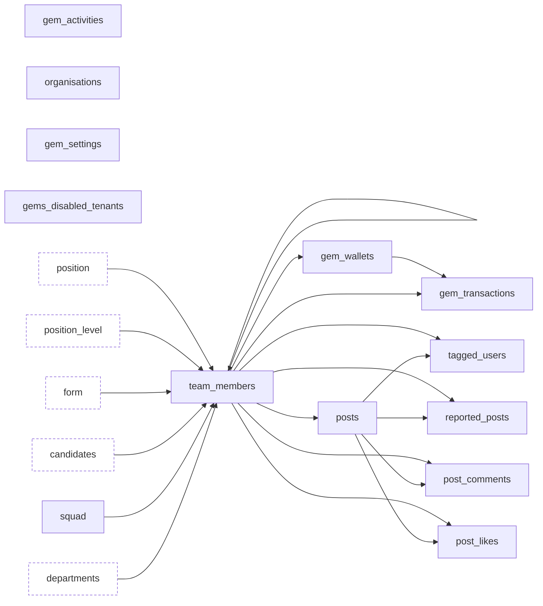

**Diagram gems-2: tables reached only through shared code (1)**

```mermaid
flowchart LR
  t_team_member_projects["team_member_projects"]
  t_projects["projects"]:::ext
  t_team_members["team_members"]:::ext
  t_jira_account_links["jira_account_links"]:::ext
  t_projects --> t_team_member_projects
  t_team_members --> t_team_member_projects
  t_jira_account_links --> t_team_member_projects
  classDef ext stroke-dasharray: 4 3,fill:none
```

## Table definitions: Todos and wellness

### Todos, goals and wellness: canonical table definitions (12)

#### activity_logs
Status: Active · Model: ActivityLog (schema.prisma:1981) · Created in: 0_init

Structure: references daily_health_trackers.

Accessed by (direct): Todos, goals and wellness · via shared code only: People and org, Background jobs (cron, queue, workers)
Evidence: Runtime refs: 3 call sites in 2 files, e.g. app/helpers/fitBitData.helper.js:197, app/helpers/goals.helper.js:192.

| Column | Database type | Nullable | Default | Key/constraint | Description |
|---|---|---|---|---|---|
| id | text | no | uuid() | PK | Primary key |
| name | varchar(255) | no |  |  | Inferred: name |
| calories | integer | yes | 0 |  | Inferred: calories |
| duration | integer | yes | 0 |  | Inferred: duration |
| dailyHealthTrackerId | text | yes |  | FK → daily_health_trackers.id | References daily_health_trackers |

**Relationships**

- Out: `dailyHealthTrackerId` → `daily_health_trackers`.`id`; many → 0..1; FK constraint `activity_logs_dailyHealthTrackerId_7981f997_fk`; onDelete schema: default, DB: NO ACTION

**Additional details**

- No `tenant_id` column: tenant scope is only reachable through parent rows

#### available_health_metrics
Status: Active · Model: AvailableHealthMetrics (schema.prisma:1899) · Created in: 0_init

Structure: references team_members.

Accessed by (direct): Todos, goals and wellness
Evidence: Runtime refs: 2 call sites in 2 files, e.g. app/controllers/availablehealthMetrics.controller.js:12, app/controllers/fitBitData.controller.js:32. Tests: 32 files.

| Column | Database type | Nullable | Default | Key/constraint | Description |
|---|---|---|---|---|---|
| id | text | no |  | FK → team_members.id, UQ | References team_members |
| steps | boolean | no | true |  | Inferred: steps |
| calories | boolean | no | true |  | Inferred: calories |
| distance | boolean | no | true |  | Inferred: distance |
| activity | boolean | no | true |  | Inferred: activity |
| sleep_duration | boolean | no | false |  | Inferred: sleep duration |
| active_zone_minutes | boolean | no | false |  | Inferred: active zone minutes |
| floors | boolean | no | false |  | Inferred: floors |
| heart | boolean | no | false |  | Inferred: heart |

**Relationships**

- Out: `id` → `team_members`.`id` (People and org); 1 → 1; FK constraint `available_health_metrics_id_a500022a_fk`; onDelete schema: default, DB: NO ACTION

**Additional details**

- No `tenant_id` column: tenant scope is only reachable through parent rows

#### badges
Status: Active · Model: Badge (schema.prisma:2005) · Created in: 0_init

Structure: referenced by 1 table(s).

Accessed by (direct): Todos, goals and wellness · via shared code only: Background jobs (cron, queue, workers)
Evidence: Runtime refs: 4 call sites in 2 files, e.g. app/helpers/badges.helper.js:6, app/helpers/fitBitData.helper.js:378.

| Column | Database type | Nullable | Default | Key/constraint | Description |
|---|---|---|---|---|---|
| id | text | no | uuid() | PK | Primary key |
| type | enum BadgeType | no |  | UQ(composite) | Enum `BadgeType`: Step_Streak, Step_Champion, Sleep_Superstar, Early_Bird, Hydration_Hero, Workout_Warrior, … (9 values) |
| tenant_id | text | no |  | UQ(composite) | Tenant scope; no FK (tenant data lives outside this DB) |

**Relationships**

- In: `team_member_badges`.`badge_id`; 1 → many; FK constraint `team_member_badges_badge_id_aa3275ae_fk`

**Additional details**

- Unique: `([type, tenant_id])`
- `tenant_id` stored as text (not uuid)

#### daily_health_trackers
Status: Active · Model: DailyHealthTracker (schema.prisma:1961) · Created in: 0_init

Structure: references team_members; referenced by 1 table(s).

Accessed by (direct): Todos, goals and wellness · via shared code only: People and org, Background jobs (cron, queue, workers)
Evidence: Runtime refs: 6 call sites in 2 files, e.g. app/helpers/fitBitData.helper.js:184, app/helpers/goals.helper.js:143.

| Column | Database type | Nullable | Default | Key/constraint | Description |
|---|---|---|---|---|---|
| id | text | no | uuid() | PK | Primary key |
| water_intake | double precision | yes | 0 |  | Inferred: water intake |
| sleep_duration | double precision | yes | 0 |  | Inferred: sleep duration |
| mindful_days | integer | yes | 0 |  | Inferred: mindful days |
| steps | integer | yes | 0 |  | Inferred: steps |
| waking_time | timestamptz(3) | yes |  |  | Inferred: waking time |
| workout_logged | boolean | yes | false |  | Inferred: workout logged |
| workout_duration | integer | yes | 0 |  | Inferred: workout duration |
| food_intake | boolean | yes | false |  | Inferred: food intake |
| distance | double precision | yes | 0 |  | Inferred: distance |
| target_heartrate_zone_reached | boolean | yes | false |  | Inferred: target heartrate zone reached |
| date | timestamp(3) | no | now() |  | Inferred: date |
| teamMemberId | text | no |  | FK → team_members.id | References team_members |

**Relationships**

- Out: `teamMemberId` → `team_members`.`id` (People and org); many → 1; FK constraint `daily_health_trackers_teamMemberId_56215e34_fk`; onDelete schema: default, DB: NO ACTION
- In: `activity_logs`.`dailyHealthTrackerId`; 1 → many; FK constraint `activity_logs_dailyHealthTrackerId_7981f997_fk`

**Additional details**

- No `tenant_id` column: tenant scope is only reachable through parent rows

#### goal_logs
Status: Active · Model: GoalLog (schema.prisma:1951) · Created in: 0_init

Structure: references goals.

Accessed by (direct): Todos, goals and wellness, Platform core (auth middleware, model hooks) · via shared code only: People and org, Background jobs (cron, queue, workers)
Evidence: Runtime refs: 6 call sites in 3 files, e.g. app/controllers/goalLogs.controller.js:37, app/helpers/goals.helper.js:41, app/models/goalLogs.js:6.

| Column | Database type | Nullable | Default | Key/constraint | Description |
|---|---|---|---|---|---|
| id | text | no | uuid() | PK | Primary key |
| goalId | text | no |  | FK → goals.id | References goals |
| eventType | enum GoalEventType | no |  |  | Enum `GoalEventType`: Started, Broken, Completed, Restarted |
| date | timestamptz(3) | no |  |  | Inferred: date |

**Relationships**

- Out: `goalId` → `goals`.`id`; many → 1; FK constraint `goal_logs_goalId_00ee683b_fk`; onDelete schema: default, DB: NO ACTION

**Additional details**

- No `tenant_id` column: tenant scope is only reachable through parent rows

#### goals
Status: Active · Model: Goal (schema.prisma:1929) · Created in: 0_init

Structure: references team_members; referenced by 1 table(s).

Accessed by (direct): Todos, goals and wellness · via shared code only: People and org, Background jobs (cron, queue, workers)
Evidence: Runtime refs: 12 call sites in 5 files, e.g. app/controllers/goals.controller.js:6, app/helpers/fitBitData.helper.js:631, app/helpers/goals.helper.js:22 (+2 more files).

| Column | Database type | Nullable | Default | Key/constraint | Description |
|---|---|---|---|---|---|
| id | text | no | uuid() | PK | Primary key |
| type | enum GoalType | no |  | UQ(composite) | Enum `GoalType`: Water, Sleep, Activity, Distance |
| amount | integer | no | 5 |  | Inferred: amount |
| gemReward | integer | no | 10 |  | Inferred: gem reward |
| teamMemberId | text | no |  | FK → team_members.id, UQ(composite) | References team_members |
| isStreakStarted | boolean | no | false |  | Inferred: is streak started |
| streakStartedAt | timestamptz(3) | yes |  |  | Inferred: streak started at |
| streak | integer | no | 0 |  | Inferred: streak |
| isStreakBroken | boolean | no | false |  | Inferred: is streak broken |
| streakBrokenAt | timestamptz(3) | yes |  |  | Inferred: streak broken at |
| isCompleted | boolean | no | false |  | Inferred: is completed |
| streakCompletedAt | timestamptz(3) | yes |  |  | Inferred: streak completed at |
| created_at | timestamptz(3) | no | now() |  | Row creation time |
| updated_at | timestamptz(3) | no | now() | @updatedAt | Last update time |

**Relationships**

- Out: `teamMemberId` → `team_members`.`id` (People and org); many → 1; FK constraint `goals_teamMemberId_b06617f0_fk`; onDelete schema: default, DB: NO ACTION
- In: `goal_logs`.`goalId`; 1 → many; FK constraint `goal_logs_goalId_00ee683b_fk`

**Additional details**

- Unique: `([teamMemberId, type])`
- No `tenant_id` column: tenant scope is only reachable through parent rows

#### live_health_trackers
Status: Active · Model: LiveHealthTracker (schema.prisma:2030) · Created in: 0_init

Structure: references team_members.

Accessed by (direct): Todos, goals and wellness · via shared code only: Background jobs (cron, queue, workers)
Evidence: Runtime refs: 4 call sites in 2 files, e.g. app/controllers/fitBitData.controller.js:119, app/helpers/fitBitData.helper.js:303.

| Column | Database type | Nullable | Default | Key/constraint | Description |
|---|---|---|---|---|---|
| id | uuid | no | uuid() | PK | Primary key |
| date | timestamptz(3) | no |  |  | Inferred: date |
| steps | integer | no | 0 |  | Inferred: steps |
| steps_goal | integer | no | 0 |  | Inferred: steps goal |
| calories | integer | no | 0 |  | Inferred: calories |
| calories_goal | integer | no | 0 |  | Inferred: calories goal |
| distance | double precision | no | 0 |  | Inferred: distance |
| distance_goal | double precision | no | 0 |  | Inferred: distance goal |
| activity | integer | no | 0 |  | Inferred: activity |
| activity_goal | integer | no | 0 |  | Inferred: activity goal |
| sleep_duration | integer | no | 0 |  | Inferred: sleep duration |
| sleep_goal | integer | no | 0 |  | Inferred: sleep goal |
| active_zone_minutes | integer | no | 0 |  | Inferred: active zone minutes |
| active_zone_minutes_goal | integer | no | 0 |  | Inferred: active zone minutes goal |
| floors | integer | no | 0 |  | Inferred: floors |
| floors_goal | integer | no | 0 |  | Inferred: floors goal |
| heart | integer | no | 0 |  | Inferred: heart |
| water_consumed | double precision | no | 0 |  | Inferred: water consumed |
| teamMemberId | text | no |  | FK → team_members.id | References team_members |
| createdAt | timestamp(3) | no | now() |  | Row creation time |
| updatedAt | timestamp(3) | no |  | @updatedAt | Last update time |

**Relationships**

- Out: `teamMemberId` → `team_members`.`id` (People and org); many → 1; FK constraint `live_health_trackers_teamMemberId_f4895eb1_fk`; onDelete schema: default, DB: NO ACTION

**Additional details**

- No `tenant_id` column: tenant scope is only reachable through parent rows

#### team_member_badges
Status: Active · Model: TeamMemberBadge (schema.prisma:2016) · Created in: 0_init

Structure: references team_members, badges.

Accessed by (direct): Todos, goals and wellness, Platform core (auth middleware, model hooks) · via shared code only: Background jobs (cron, queue, workers)
Evidence: Runtime refs: 4 call sites in 2 files, e.g. app/helpers/fitBitData.helper.js:347, app/models/goalLogs.js:22.

| Column | Database type | Nullable | Default | Key/constraint | Description |
|---|---|---|---|---|---|
| id | text | no | uuid() | PK | Primary key |
| teamMemberId | text | no |  | FK → team_members.id | References team_members |
| badge_id | text | no |  | FK → badges.id | References badges |
| tenant_id | text | no |  |  | Tenant scope; no FK (tenant data lives outside this DB) |
| assigned_at | timestamp(3) | no | now() |  | Inferred: assigned at |

**Relationships**

- Out: `teamMemberId` → `team_members`.`id` (People and org); many → 1; FK constraint `team_member_badges_teamMemberId_3b112e06_fk`; onDelete schema: default, DB: NO ACTION
- Out: `badge_id` → `badges`.`id`; many → 1; FK constraint `team_member_badges_badge_id_aa3275ae_fk`; onDelete schema: default, DB: NO ACTION

**Additional details**

- `tenant_id` stored as text (not uuid)

#### time_logs
Status: Apparently unused · Model: TimeLog (schema.prisma:2645) · Created in: 20260701000000_init

Schema comment: "── Time Logging (stub — no endpoints in Phase 1) ────────────".

Structure: references todo, team_members.

Accessed by (direct): none
Evidence: No runtime reference found in app/, config/, utils/, index.js (delegate calls, model aliases, raw SQL, nested relation writes).

| Column | Database type | Nullable | Default | Key/constraint | Description |
|---|---|---|---|---|---|
| id | uuid | no | uuid() | PK | Primary key |
| todo_id | uuid | no |  | FK → todo.id | References todo |
| team_member_id | uuid | no |  | FK → team_members.id | References team_members |
| tenant_id | uuid | no |  |  | Tenant scope; no FK (tenant data lives outside this DB) |
| log_date | date | no |  |  | Inferred: log date |
| hours_spent | decimal(5, 2) | no |  |  | Inferred: hours spent |
| description | varchar(500) | yes |  |  | Inferred: description |
| jira_worklog_id | varchar(255) | yes |  |  | Inferred: id of jira worklog; no FK declared |
| synced_to_jira | boolean | no | false |  | Inferred: synced to jira |
| created_at | timestamptz(3) | no | now() |  | Row creation time |
| updated_at | timestamptz(3) | no | now() | @updatedAt | Last update time |

**Relationships**

- Out: `todo_id` → `todo`.`id`; many → 1; FK constraint `time_logs_todo_id_fkey`; onDelete schema: default, DB: RESTRICT
- Out: `team_member_id` → `team_members`.`id` (People and org); many → 1; FK constraint `time_logs_team_member_id_fkey`; onDelete schema: default, DB: RESTRICT

#### todo
Status: Active · Model: Todo (schema.prisma:1436) · Created in: 0_init · Later migrations touching it: 8

Structure: references team_members, projects, project_jira_connections, jira_account_links; referenced by 2 table(s).

Accessed by (direct): Projects, clients and dev integrations, Todos, goals and wellness, Background jobs (cron, queue, workers) · via shared code only: Uploads, billing, realtime
Evidence: Runtime refs: 23 call sites in 6 files, e.g. app/controllers/jira.controller.js:751, app/controllers/todos.controller.js:163, app/helpers/todoStreak.helper.js:222 (+3 more files).

| Column | Database type | Nullable | Default | Key/constraint | Description |
|---|---|---|---|---|---|
| id | uuid | no | uuid() | PK | Primary key |
| task | text | no |  |  | Inferred: task |
| description | text | yes |  |  | Inferred: description |
| type | enum TodoType | no | AutoScal |  | Enum `TodoType`: AutoScal, Jira |
| priority | enum Priority | yes | Medium |  | Enum `Priority`: Low, Medium, High |
| jira_task_id | varchar(250) | yes |  | IDX | Inferred: id of jira task; no FK declared |
| jira_issue_key | varchar(50) | yes |  | IDX | Inferred: jira issue key |
| jira_project_id | varchar(255) | yes |  |  | Inferred: id of jira project; no FK declared |
| jira_project_key | varchar(255) | yes |  |  | Inferred: jira project key |
| jira_status_id | varchar(255) | yes |  | IDX | Inferred: id of jira status; no FK declared |
| jira_status_name | varchar(255) | yes |  |  | Inferred: jira status name |
| jira_created_at | timestamptz(3) | yes |  |  | Inferred: jira created at |
| completed_on | timestamptz(3) | yes |  |  | Inferred: completed on |
| completion_date | timestamptz(3) | yes |  |  | Inferred: completion date |
| is_completed | boolean | no | false |  | Inferred: flag, is completed |
| is_active | boolean | no | true |  | Inferred: flag, is active |
| status | enum TodoStatus | no | To_Do |  | Enum `TodoStatus`: To_Do, Started, Blocked, In_Progress, Completed, Cancelled, On_Hold |
| tenant_id | uuid | yes |  |  | Tenant scope; no FK (tenant data lives outside this DB) |
| project_id | uuid | yes |  | FK → projects.id | References projects |
| connection_id | uuid | yes |  | FK → project_jira_connections.id, IDX | References project_jira_connections |
| jira_account_link_id | uuid | yes |  | FK → jira_account_links.id | References jira_account_links |
| jira_assignee_account_id | varchar(255) | yes |  |  | Inferred: id of jira assignee account; no FK declared |
| jira_assignee_name | varchar(255) | yes |  |  | Inferred: jira assignee name |
| jira_reporter_account_id | varchar(255) | yes |  |  | Inferred: id of jira reporter account; no FK declared |
| jira_reporter_name | varchar(255) | yes |  |  | Inferred: jira reporter name |
| jira_creator_account_id | varchar(255) | yes |  |  | Inferred: id of jira creator account; no FK declared |
| jira_creator_name | varchar(255) | yes |  |  | Inferred: jira creator name |
| created_at | timestamptz(3) | no | now() |  | Row creation time |
| updated_at | timestamptz(3) | no | now() | @updatedAt | Last update time |
| assigned_by_id | varchar(255) | yes |  | FK → team_members.id | References team_members |
| assigned_to_id | varchar(255) | yes |  | FK → team_members.id | References team_members |
| team_member_id | varchar(255) | yes |  | FK → team_members.id | References team_members |

**Relationships**

- Out: `assigned_by_id` → `team_members`.`id` (People and org); many → 0..1; FK constraint `todo_assigned_by_id_675cfb72_fk`; onDelete schema: default, DB: NO ACTION
- Out: `assigned_to_id` → `team_members`.`id` (People and org); many → 0..1; FK constraint `todo_assigned_to_id_b885f3bc_fk`; onDelete schema: default, DB: NO ACTION
- Out: `team_member_id` → `team_members`.`id` (People and org); many → 0..1; FK constraint `todo_team_member_id_58ead8c0_fk`; onDelete schema: default, DB: NO ACTION
- Out: `project_id` → `projects`.`id` (Projects, clients and dev integrations); many → 0..1; FK constraint `todo_project_id_fkey`; onDelete schema: SetNull, DB: SET NULL
- Out: `connection_id` → `project_jira_connections`.`id` (Projects, clients and dev integrations); many → 0..1; FK constraint `todo_connection_id_fkey`; onDelete schema: SetNull, DB: SET NULL
- Out: `jira_account_link_id` → `jira_account_links`.`id` (Projects, clients and dev integrations); many → 0..1; FK constraint `todo_jira_account_link_id_fkey`; onDelete schema: SetNull, DB: SET NULL
- In: `todo_status_history`.`todo_id`; 1 → many; FK constraint `todo_status_history_todo_id_693154f2_fk`
- In: `time_logs`.`todo_id`; 1 → many; FK constraint `time_logs_todo_id_fkey`

**Additional details**

- Indexes: `([connection_id])`, `([jira_issue_key])`, `([jira_task_id])`, `([jira_status_id])`
- Partial unique index `todo_connection_jira_task_id_active_key`  ("connection_id", "jira_task_id") WHERE "jira_task_id" IS NOT NULL AND "is_active" = true from `20260803060000_todo_jira_task_id_unique_per_connection`, not represented in schema.prisma

#### todo_status_history
Status: Active · Model: TodoStatusHistory (schema.prisma:1498) · Created in: 0_init

Structure: references team_members, todo.

Accessed by (direct): Todos, goals and wellness · via shared code only: Uploads, billing, realtime
Evidence: Runtime refs: 6 call sites in 1 files, e.g. app/helpers/todoStatusHistory.helper.js:89.

| Column | Database type | Nullable | Default | Key/constraint | Description |
|---|---|---|---|---|---|
| id | uuid | no | uuid() | PK | Primary key |
| field_name | varchar(100) | no |  | IDX | Inferred: field name |
| from_status | enum TodoStatus | yes |  |  | Enum `TodoStatus`: To_Do, Started, Blocked, In_Progress, Completed, Cancelled, On_Hold |
| to_status | enum TodoStatus | yes |  |  | Enum `TodoStatus`: To_Do, Started, Blocked, In_Progress, Completed, Cancelled, On_Hold |
| old_value | json | yes |  |  | Inferred: old value |
| new_value | json | yes |  |  | Inferred: new value |
| action | varchar(50) | no | "update" |  | Inferred: action |
| actor_id | varchar(255) | yes |  | FK → team_members.id, IDX | References team_members |
| actor_name | varchar(255) | yes |  |  | Inferred: actor name |
| reason | text | yes |  |  | Inferred: reason |
| meta | jsonb | yes |  |  | Inferred: meta |
| created_at | timestamptz(3) | no | now() | IDX | Row creation time |
| updated_at | timestamptz(3) | no | now() | @updatedAt | Last update time |
| todo_id | uuid | no |  | FK → todo.id, IDX | References todo |

**Relationships**

- Out: `actor_id` → `team_members`.`id` (People and org); many → 0..1; FK constraint `todo_status_history_actor_id_1247db82_fk`; onDelete schema: default, DB: NO ACTION
- Out: `todo_id` → `todo`.`id`; many → 1; FK constraint `todo_status_history_todo_id_693154f2_fk`; onDelete schema: default, DB: NO ACTION

**Additional details**

- Indexes: `([todo_id, created_at])`, `([actor_id, created_at])`, `([field_name])`
- No `tenant_id` column: tenant scope is only reachable through parent rows

#### todo_streaks
Status: Active · Model: TodoStreak (schema.prisma:2150) · Created in: 0_init

Structure: references team_members.

Accessed by (direct): Todos, goals and wellness · via shared code only: Uploads, billing, realtime, Background jobs (cron, queue, workers)
Evidence: Runtime refs: 5 call sites in 1 files, e.g. app/helpers/todoStreak.helper.js:64.

| Column | Database type | Nullable | Default | Key/constraint | Description |
|---|---|---|---|---|---|
| id | text | no | uuid() | PK | Primary key |
| current_streak | integer | no | 0 |  | Inferred: current streak |
| longest_streak | integer | no | 0 |  | Inferred: longest streak |
| last_counted_date | timestamptz(3) | yes |  |  | Inferred: last counted date |
| last_rewarded_streak | integer | no | 0 |  | Inferred: last rewarded streak |
| created_at | timestamptz(3) | no | now() |  | Row creation time |
| updated_at | timestamptz(3) | no | now() | @updatedAt | Last update time |
| team_member_id | text | no |  | FK → team_members.id, UQ | References team_members |

**Relationships**

- Out: `team_member_id` → `team_members`.`id` (People and org); 1 → 1; FK constraint `todo_streaks_team_member_id_92b85f10_fk`; onDelete schema: default, DB: NO ACTION

**Additional details**

- No `tenant_id` column: tenant scope is only reachable through parent rows

### Todos, goals and wellness: relationship diagram

Arrows run parent → child (FK holder). Solid = FK in schema and migration SQL; dotted = schema vs SQL discrepancy; dashed boxes = tables outside this module. Full conventions under Counting rules.

**Diagram todos-1: tables accessed directly (18), external FK parents shown dashed**

```mermaid
flowchart LR
  t_organisations["organisations"]
  t_badges["badges"]
  t_goals["goals"]
  t_goal_logs["goal_logs"]
  t_team_members["team_members"]
  t_daily_health_trackers["daily_health_trackers"]
  t_activity_logs["activity_logs"]
  t_available_health_metrics["available_health_metrics"]
  t_live_health_trackers["live_health_trackers"]
  t_team_member_badges["team_member_badges"]
  t_projects["projects"]
  t_todo["todo"]
  t_project_jira_connections["project_jira_connections"]
  t_team_member_projects["team_member_projects"]
  t_jira_account_links["jira_account_links"]
  t_todo_streaks["todo_streaks"]
  t_todo_status_history["todo_status_history"]
  t_time_logs["time_logs"]
  t_app_client["app_client"]:::ext
  t_client_billing_addresses["client_billing_addresses"]:::ext
  t_domains["domains"]:::ext
  t_position["position"]:::ext
  t_position_level["position_level"]:::ext
  t_form["form"]:::ext
  t_candidates["candidates"]:::ext
  t_squad["squad"]:::ext
  t_departments["departments"]:::ext
  t_app_client --> t_projects
  t_client_billing_addresses --> t_projects
  t_domains --> t_projects
  t_position --> t_team_members
  t_position_level --> t_team_members
  t_form --> t_team_members
  t_team_members --> t_team_members
  t_candidates --> t_team_members
  t_squad --> t_team_members
  t_departments --> t_team_members
  t_projects --> t_team_member_projects
  t_team_members --> t_team_member_projects
  t_jira_account_links --> t_team_member_projects
  t_team_members --> t_todo
  t_projects --> t_todo
  t_project_jira_connections --> t_todo
  t_jira_account_links --> t_todo
  t_team_members --> t_todo_status_history
  t_todo --> t_todo_status_history
  t_team_members --> t_available_health_metrics
  t_team_members --> t_goals
  t_goals --> t_goal_logs
  t_team_members --> t_daily_health_trackers
  t_daily_health_trackers --> t_activity_logs
  t_team_members --> t_team_member_badges
  t_badges --> t_team_member_badges
  t_team_members --> t_live_health_trackers
  t_team_members --> t_todo_streaks
  t_team_members --> t_jira_account_links
  t_todo --> t_time_logs
  t_team_members --> t_time_logs
  t_projects --> t_project_jira_connections
  t_team_members --> t_project_jira_connections
  t_jira_account_links --> t_project_jira_connections
  classDef ext stroke-dasharray: 4 3,fill:none
```

**Diagram todos-2: tables reached only through shared code (16)**

```mermaid
flowchart LR
  t_squad["squad"]
  t_gem_activities["gem_activities"]
  t_gem_wallets["gem_wallets"]
  t_gem_settings["gem_settings"]
  t_gems_disabled_tenants["gems_disabled_tenants"]
  t_gem_transactions["gem_transactions"]
  t_jira_account_link_sites["jira_account_link_sites"]
  t_timesheet_settings["timesheet_settings"]
  t_project_timesheet_config["project_timesheet_config"]
  t_position_level_heads["position_level_heads"]
  t_position_heads["position_heads"]
  t_department_heads["department_heads"]
  t_timesheets["timesheets"]
  t_timesheet_adjustment_requests["timesheet_adjustment_requests"]
  t_timesheet_entries["timesheet_entries"]
  t_timesheet_audit_logs["timesheet_audit_logs"]
  t_team_members["team_members"]:::ext
  t_jira_account_links["jira_account_links"]:::ext
  t_projects["projects"]:::ext
  t_departments["departments"]:::ext
  t_position["position"]:::ext
  t_position_level["position_level"]:::ext
  t_team_members --> t_gem_wallets
  t_gem_wallets --> t_gem_transactions
  t_team_members --> t_gem_transactions
  t_jira_account_links --> t_jira_account_link_sites
  t_team_members --> t_timesheets
  t_projects --> t_timesheets
  t_timesheets --> t_timesheet_entries
  t_timesheets --> t_timesheet_adjustment_requests
  t_timesheet_entries --> t_timesheet_adjustment_requests
  t_team_members --> t_timesheet_adjustment_requests
  t_projects --> t_project_timesheet_config
  t_departments --> t_department_heads
  t_team_members --> t_department_heads
  t_departments --> t_position_heads
  t_position --> t_position_heads
  t_team_members --> t_position_heads
  t_departments --> t_position_level_heads
  t_position --> t_position_level_heads
  t_position_level --> t_position_level_heads
  t_team_members --> t_position_level_heads
  t_team_members --> t_timesheet_audit_logs
  classDef ext stroke-dasharray: 4 3,fill:none
```

## Table definitions: Calendar and integrations

### Calendar integrations: canonical table definitions (1)

#### integration_team_members
Status: Active · Model: IntegrationTeamMember (schema.prisma:2095) · Created in: 0_init

Structure: references integrations, team_members; junction table (composite key over two FKs).

Accessed by (direct): Calendar integrations
Evidence: Runtime refs: 4 call sites in 2 files, e.g. app/controllers/teamMemberIntegrations.controller.js:7, app/validators/teamMemberIntegrations.validator.js:21. Tests: 2 files.

| Column | Database type | Nullable | Default | Key/constraint | Description |
|---|---|---|---|---|---|
| id | text | no | uuid() | PK | Primary key |
| action_performed | boolean | no | false |  | Inferred: action performed |
| is_integrated | boolean | no | false |  | Inferred: flag, is integrated |
| data | jsonb | yes |  |  | Inferred: data |
| integration_id | text | no |  | FK → integrations.id, UQ(composite) | References integrations |
| team_member_id | text | no |  | FK → team_members.id, UQ(composite) | References team_members |

**Relationships**

- Out: `integration_id` → `integrations`.`id` (People and org); many → 1; FK constraint `integration_team_members_integration_id_7d0fa1e6_fk`; onDelete schema: default, DB: NO ACTION
- Out: `team_member_id` → `team_members`.`id` (People and org); many → 1; FK constraint `integration_team_members_team_member_id_9ea1cbcd_fk`; onDelete schema: default, DB: NO ACTION

**Additional details**

- Unique: `([team_member_id, integration_id])`
- No `tenant_id` column: tenant scope is only reachable through parent rows

### Calendar integrations: relationship diagram

Arrows run parent → child (FK holder). Solid = FK in schema and migration SQL; dotted = schema vs SQL discrepancy; dashed boxes = tables outside this module. Full conventions under Counting rules.

**Diagram calendar-1: tables accessed directly (2), external FK parents shown dashed**

```mermaid
flowchart LR
  t_team_members["team_members"]
  t_integration_team_members["integration_team_members"]
  t_position["position"]:::ext
  t_position_level["position_level"]:::ext
  t_form["form"]:::ext
  t_candidates["candidates"]:::ext
  t_squad["squad"]:::ext
  t_departments["departments"]:::ext
  t_integrations["integrations"]:::ext
  t_position --> t_team_members
  t_position_level --> t_team_members
  t_form --> t_team_members
  t_team_members --> t_team_members
  t_candidates --> t_team_members
  t_squad --> t_team_members
  t_departments --> t_team_members
  t_integrations --> t_integration_team_members
  t_team_members --> t_integration_team_members
  classDef ext stroke-dasharray: 4 3,fill:none
```

**Diagram calendar-2: tables reached only through shared code (7)**

```mermaid
flowchart LR
  t_gem_activities["gem_activities"]
  t_gem_wallets["gem_wallets"]
  t_gem_settings["gem_settings"]
  t_gems_disabled_tenants["gems_disabled_tenants"]
  t_gem_transactions["gem_transactions"]
  t_squad["squad"]
  t_team_member_projects["team_member_projects"]
  t_projects["projects"]:::ext
  t_team_members["team_members"]:::ext
  t_jira_account_links["jira_account_links"]:::ext
  t_projects --> t_team_member_projects
  t_team_members --> t_team_member_projects
  t_jira_account_links --> t_team_member_projects
  t_team_members --> t_gem_wallets
  t_gem_wallets --> t_gem_transactions
  t_team_members --> t_gem_transactions
  classDef ext stroke-dasharray: 4 3,fill:none
```

## Table definitions: Forms

### Forms: canonical table definitions (2)

#### educations
Status: Active · Model: Education (schema.prisma:289) · Created in: 0_init

Schema comment: "education-model".

Structure: references skills_evaluations, universities, degrees, specialization, candidates, team_members.

Accessed by (direct): People and org, Forms
Evidence: Runtime refs: 2 call sites in 2 files, e.g. app/helpers/formResponse.helper.js:207, app/validators/teamMember.validator.js:843.

| Column | Database type | Nullable | Default | Key/constraint | Description |
|---|---|---|---|---|---|
| id | text | no | uuid() | PK | Primary key |
| cgpa | text | no |  |  | Inferred: cgpa |
| joining_year | text | yes |  |  | Inferred: joining year |
| completion_year | text | yes |  |  | Inferred: completion year |
| created_at | timestamptz(3) | no | now() |  | Row creation time |
| updated_at | timestamptz(3) | no | now() | @updatedAt | Last update time |
| skill_evaluation_id | text | yes |  | FK → skills_evaluations.id | References skills_evaluations |
| university_id | text | yes |  | FK → universities.id | References universities |
| degree_id | text | yes |  | FK → degrees.id | References degrees |
| specialisation_id | text | yes |  | FK → specialization.id | References specialization |
| candidate_id | text | yes |  | FK → candidates.id | References candidates |
| teamMember_id | text | yes |  | FK → team_members.id | References team_members |

**Relationships**

- Out: `skill_evaluation_id` → `skills_evaluations`.`id` (Recruitment (ATS)); many → 0..1; FK constraint `educations_skill_evaluation_id_43a0a0f1_fk`; onDelete schema: default, DB: NO ACTION
- Out: `university_id` → `universities`.`id` (Recruitment (ATS)); many → 0..1; FK constraint `educations_university_id_95f1cf7e_fk`; onDelete schema: default, DB: NO ACTION
- Out: `degree_id` → `degrees`.`id` (Recruitment (ATS)); many → 0..1; FK constraint `educations_degree_id_237ee0a0_fk`; onDelete schema: default, DB: NO ACTION
- Out: `specialisation_id` → `specialization`.`id` (Recruitment (ATS)); many → 0..1; FK constraint `educations_specialisation_id_41215b0a_fk`; onDelete schema: default, DB: NO ACTION
- Out: `candidate_id` → `candidates`.`id` (Recruitment (ATS)); many → 0..1; FK constraint `educations_candidate_id_03a2c4fd_fk`; onDelete schema: default, DB: NO ACTION
- Out: `teamMember_id` → `team_members`.`id` (People and org); many → 0..1; FK constraint `educations_teamMember_id_c4b8a980_fk`; onDelete schema: default, DB: NO ACTION

**Additional details**

- No `tenant_id` column: tenant scope is only reachable through parent rows

#### form
Status: Active · Model: Form (schema.prisma:1247) · Created in: 0_init

Schema comment: "form-model".

Structure: references stages; referenced by 2 table(s).

Accessed by (direct): People and org, Onboarding and documents, Forms, Attendance and exit settings · via shared code only: Background jobs (cron, queue, workers)
Evidence: Runtime refs: 26 call sites in 12 files, e.g. app/controllers/exitSettings.controller.js:57, app/controllers/form.controller.js:15, app/controllers/public/form.controller.js:10 (+9 more files). Ops scripts/seeds: scripts/backfillPastExperienceOnboardingTask.js:11. Tests: 10 files.

| Column | Database type | Nullable | Default | Key/constraint | Description |
|---|---|---|---|---|---|
| id | uuid | no | uuid() | PK | Primary key |
| name | varchar(250) | yes |  | UQ(composite) | Inferred: name |
| description | varchar(250) | yes |  |  | Inferred: description |
| form_type | enum FormType | yes |  |  | Enum `FormType`: onboarding_process, requisition_stages, exit_checklist, new_onboarding_process |
| stage_id | text | yes |  | FK → stages.id | References stages |
| is_active | boolean | no | true |  | Inferred: flag, is active |
| tenant_id | uuid | yes |  | UQ(composite) | Tenant scope; no FK (tenant data lives outside this DB) |
| created_at (field createdAt) | timestamptz(3) | no | now() |  | Row creation time |
| updated_at (field updatedAt) | timestamptz(3) | no | now() | @updatedAt | Last update time |

**Relationships**

- Out: `stage_id` → `stages`.`id` (Recruitment (ATS)); many → 0..1; FK constraint `form_stage_id_effbe797_fk`; onDelete schema: default, DB: NO ACTION
- In: `team_members`.`exit_form_id` (People and org); 1 → many; FK constraint `team_members_exit_form_id_c1e27090_fk`
- In: `team_members`.`onboarding_form_id` (People and org); 1 → many; FK constraint `team_members_onboarding_form_id_bd37ef07_fk`
- In: `form_tasks`.`form_id` (Onboarding and documents); 1 → many; FK constraint `form_tasks_form_id_986ae891_fk`

**Additional details**

- Unique: `([name, tenant_id])`

### Forms: relationship diagram

Arrows run parent → child (FK holder). Solid = FK in schema and migration SQL; dotted = schema vs SQL discrepancy; dashed boxes = tables outside this module. Full conventions under Counting rules.

**Diagram forms-1: tables accessed directly (14), external FK parents shown dashed**

```mermaid
flowchart LR
  t_form["form"]
  t_form_tasks["form_tasks"]
  t_organisations["organisations"]
  t_form_response["form_response"]
  t_team_members["team_members"]
  t_gem_wallets["gem_wallets"]
  t_issue_history["issue_history"]
  t_assets["assets"]
  t_candidates["candidates"]
  t_requisitions["requisitions"]
  t_address["address"]
  t_educations["educations"]
  t_skills_evaluations["skills_evaluations"]
  t_stages["stages"]
  t_pipelines["pipelines"]:::ext
  t_requisition_categories["requisition_categories"]:::ext
  t_departments["departments"]:::ext
  t_position_level["position_level"]:::ext
  t_position["position"]:::ext
  t_universities["universities"]:::ext
  t_degrees["degrees"]:::ext
  t_specialization["specialization"]:::ext
  t_squad["squad"]:::ext
  t_asset_categories["asset_categories"]:::ext
  t_asset_lifecycle_statuses["asset_lifecycle_statuses"]:::ext
  t_requisitions --> t_candidates
  t_candidates --> t_address
  t_team_members --> t_address
  t_organisations --> t_address
  t_pipelines --> t_requisitions
  t_requisition_categories --> t_requisitions
  t_departments --> t_requisitions
  t_position_level --> t_requisitions
  t_position --> t_requisitions
  t_skills_evaluations --> t_educations
  t_universities --> t_educations
  t_degrees --> t_educations
  t_specialization --> t_educations
  t_candidates --> t_educations
  t_team_members --> t_educations
  t_candidates --> t_skills_evaluations
  t_team_members --> t_skills_evaluations
  t_position --> t_team_members
  t_position_level --> t_team_members
  t_form --> t_team_members
  t_team_members --> t_team_members
  t_candidates --> t_team_members
  t_squad --> t_team_members
  t_departments --> t_team_members
  t_team_members --> t_assets
  t_asset_categories --> t_assets
  t_asset_lifecycle_statuses --> t_assets
  t_assets --> t_issue_history
  t_team_members --> t_issue_history
  t_stages --> t_form
  t_form --> t_form_tasks
  t_form_tasks --> t_form_tasks
  t_team_members --> t_form_response
  t_candidates --> t_form_response
  t_form_tasks --> t_form_response
  t_team_members --> t_gem_wallets
  classDef ext stroke-dasharray: 4 3,fill:none
```

**Diagram forms-2: tables reached only through shared code (20)**

```mermaid
flowchart LR
  t_onboarding_audit_trail["onboarding_audit_trail"]
  t_team_member_projects["team_member_projects"]
  t_onboarding_asset_selections["onboarding_asset_selections"]
  t_onboarding_content["onboarding_content"]
  t_onboarding_acknowledgements["onboarding_acknowledgements"]
  t_asset_lifecycle_statuses["asset_lifecycle_statuses"]
  t_asset_history["asset_history"]
  t_contacts["contacts"]
  t_git_handles["git_handles"]
  t_documents["documents"]
  t_onboarding_profile_field_configs["onboarding_profile_field_configs"]
  t_git_settings["git_settings"]
  t_squad["squad"]
  t_onboarding_custom_fields["onboarding_custom_fields"]
  t_onboarding_custom_field_values["onboarding_custom_field_values"]
  t_onboarding_step_configs["onboarding_step_configs"]
  t_gem_activities["gem_activities"]
  t_gem_settings["gem_settings"]
  t_gems_disabled_tenants["gems_disabled_tenants"]
  t_gem_transactions["gem_transactions"]
  t_assets["assets"]:::ext
  t_team_members["team_members"]:::ext
  t_address["address"]:::ext
  t_projects["projects"]:::ext
  t_jira_account_links["jira_account_links"]:::ext
  t_gem_wallets["gem_wallets"]:::ext
  t_domains["domains"]:::ext
  t_app_client["app_client"]:::ext
  t_assets -.-> t_asset_history
  t_team_members --> t_asset_history
  t_asset_lifecycle_statuses --> t_asset_history
  t_team_members --> t_contacts
  t_address --> t_contacts
  t_projects --> t_team_member_projects
  t_team_members --> t_team_member_projects
  t_jira_account_links --> t_team_member_projects
  t_gem_wallets --> t_gem_transactions
  t_team_members --> t_gem_transactions
  t_team_members --> t_documents
  t_domains --> t_onboarding_content
  t_app_client --> t_onboarding_content
  t_team_members --> t_onboarding_content
  t_team_members --> t_onboarding_acknowledgements
  t_onboarding_content --> t_onboarding_acknowledgements
  t_team_members --> t_onboarding_audit_trail
  t_team_members --> t_onboarding_asset_selections
  t_assets --> t_onboarding_asset_selections
  t_team_members --> t_onboarding_custom_field_values
  t_onboarding_custom_fields --> t_onboarding_custom_field_values
  t_team_members --> t_git_handles
  classDef ext stroke-dasharray: 4 3,fill:none
```

## Table definitions: Attendance and exit settings

### Attendance and exit settings: canonical table definitions (2)

#### attendance_admin_setting
Status: Active · Model: AttendanceAdminSetting (schema.prisma:2189) · Created in: 0_init

Accessed by (direct): Attendance and exit settings
Evidence: Runtime refs: 6 call sites in 2 files, e.g. app/controllers/attendanceSettings.controller.js:12, app/validators/attendanceSettings.validator.js:36.

| Column | Database type | Nullable | Default | Key/constraint | Description |
|---|---|---|---|---|---|
| id | uuid | no | uuid() | PK | Primary key |
| tenant_id | varchar(36) | no |  | UQ | Tenant scope; no FK (tenant data lives outside this DB) |
| office_start_time | time(6) | no |  |  | Inferred: office start time |
| office_end_time | time(6) | no |  |  | Inferred: office end time |
| created_at | timestamptz(6) | no |  |  | Row creation time |
| updated_at | timestamptz(6) | no |  | @updatedAt | Last update time |

**Relationships:** none identified.

**Additional details**

- `tenant_id` stored as VarChar(36) (not uuid)

#### exit_settings
Status: Active · Model: ExitSettings (schema.prisma:1880) · Created in: 0_init · Later migrations touching it: 1

Accessed by (direct): People and org, Attendance and exit settings · via shared code only: Onboarding and documents, Projects, clients and dev integrations, Feedback and performance, Background jobs (cron, queue, workers)
Evidence: Runtime refs: 5 call sites in 3 files, e.g. app/controllers/exitSettings.controller.js:9, app/controllers/public/exitSettings.controller.js:18, app/helpers/teamMember.helper.js:519.

| Column | Database type | Nullable | Default | Key/constraint | Description |
|---|---|---|---|---|---|
| id | text | no | uuid() | PK | Primary key |
| tenant_id | text | no |  | UQ | Tenant scope; no FK (tenant data lives outside this DB) |
| is_enabled | boolean | no | true |  | Inferred: flag, is enabled |
| company_notice_period | integer | no | 90 |  | Inferred: company notice period |
| allow_custom_notice_period | boolean | no | false |  | Inferred: allow custom notice period |
| require_reason | boolean | no | true |  | Inferred: require reason |
| initiated_by | text[] | no | [] |  | Inferred: initiated by |
| reporting_manager_review | boolean | no | false |  | Inferred: reporting manager review |
| is_asset_return | boolean | no | true |  | Inferred: flag, is asset return |
| enable_checklist | boolean | no | false |  | Inferred: enable checklist |
| exit_policy_document (field exit_policy_document_key) | varchar(2000) | yes |  |  | S3 object key; URL composed on read and omitted from responses (app/models/prismaClient.js) |
| created_at | timestamptz(3) | no | now() |  | Row creation time |
| updated_at | timestamptz(3) | no | now() | @updatedAt | Last update time |

**Relationships:** none identified.

**Additional details**

- `tenant_id` stored as text (not uuid)

### Attendance and exit settings: relationship diagram

Arrows run parent → child (FK holder). Solid = FK in schema and migration SQL; dotted = schema vs SQL discrepancy; dashed boxes = tables outside this module. Full conventions under Counting rules.

**Diagram settings-1: tables accessed directly (4), external FK parents shown dashed**

```mermaid
flowchart LR
  t_organisations["organisations"]
  t_exit_settings["exit_settings"]
  t_form["form"]
  t_attendance_admin_setting["attendance_admin_setting"]
  t_stages["stages"]:::ext
  t_stages --> t_form
  classDef ext stroke-dasharray: 4 3,fill:none
```

## Table definitions: Search and analytics

### Search and analytics: canonical table definitions (1)

#### search_settings
Status: Active · Model: SearchSettings (schema.prisma:1692) · Created in: 20260821000000_add_search_settings

Schema comment: "Per-tenant Global Search configuration (admin-managed). Absent row => hardcoded defaults (see app/constants/search.js). Json columns hold small structured config:   field_weights: { "<field>": <weight number> }   — relevance weighting (name > id > ...)   group_order:   ["employee", ...]                 — fixed cross-entity ordering   fuzzy_config:  { enabled: bool, threshold: number } — pg_trgm typo tolerance".

Accessed by (direct): Search and analytics
Evidence: Runtime refs: 3 call sites in 2 files, e.g. app/controllers/searchSettings.controller.js:9, app/services/search/settings.js:16. Tests: 1 files.

| Column | Database type | Nullable | Default | Key/constraint | Description |
|---|---|---|---|---|---|
| id | uuid | no | uuid() | PK | Primary key |
| tenant_id | uuid | no |  | UQ | Tenant scope; no FK (tenant data lives outside this DB) |
| field_weights | jsonb | yes |  |  | Inferred: field weights |
| group_order | jsonb | yes |  |  | Inferred: group order |
| fuzzy_config | jsonb | yes |  |  | Inferred: fuzzy config |
| created_at | timestamptz(3) | no | now() |  | Row creation time |
| updated_at | timestamptz(3) | no | now() | @updatedAt | Last update time |

**Relationships:** none identified.

### Search and analytics: relationship diagram

Arrows run parent → child (FK holder). Solid = FK in schema and migration SQL; dotted = schema vs SQL discrepancy; dashed boxes = tables outside this module. Full conventions under Counting rules.

**Diagram search-1: tables accessed directly (6), external FK parents shown dashed**

```mermaid
flowchart LR
  t_team_members["team_members"]
  t_departments["departments"]
  t_position_level["position_level"]
  t_position["position"]
  t_search_settings["search_settings"]
  t_address["address"]
  t_candidates["candidates"]:::ext
  t_organisations["organisations"]:::ext
  t_form["form"]:::ext
  t_squad["squad"]:::ext
  t_candidates --> t_address
  t_team_members --> t_address
  t_organisations --> t_address
  t_position --> t_team_members
  t_position_level --> t_team_members
  t_form --> t_team_members
  t_team_members --> t_team_members
  t_candidates --> t_team_members
  t_squad --> t_team_members
  t_departments --> t_team_members
  classDef ext stroke-dasharray: 4 3,fill:none
```

## Table definitions: Audit, email events and scheduler API

### Issue history, email events, scheduler API: canonical table definitions (1)

#### issue_history
Status: Active · Model: IssueHistory (schema.prisma:1156) · Created in: 0_init

Structure: references assets, team_members; referenced by 1 table(s).

Accessed by (direct): Assets, Forms, Issue history, email events, scheduler API · via shared code only: People and org, Onboarding and documents, Background jobs (cron, queue, workers)
Evidence: Runtime refs: 14 call sites in 6 files, e.g. app/controllers/assets.controller.js:365, app/controllers/issueHistory.controller.js:14, app/helpers/assetAssignment.helper.js:162 (+3 more files). Tests: 2 files.

| Column | Database type | Nullable | Default | Key/constraint | Description |
|---|---|---|---|---|---|
| id | text | no | uuid() | PK | Primary key |
| assigned_on | timestamptz(6) | yes |  |  | Inferred: assigned on |
| revoked_on | timestamptz(6) | yes |  |  | Inferred: revoked on |
| is_returned | boolean | no | false |  | Inferred: flag, is returned |
| created_at | timestamptz(6) | no | now() |  | Row creation time |
| updated_at | timestamptz(6) | no | now() | @updatedAt | Last update time |
| asset_id | text | yes |  | FK → assets.id | References assets |
| team_member_id | text | no |  | FK → team_members.id | References team_members |

**Relationships**

- Out: `asset_id` → `assets`.`id` (Assets); many → 0..1; FK constraint `issue_history_asset_id_501751a9_fk`; onDelete schema: default, DB: NO ACTION
- Out: `team_member_id` → `team_members`.`id` (People and org); many → 1; FK constraint `issue_history_team_member_id_9b187d8d_fk`; onDelete schema: default, DB: NO ACTION
- In: `conditional_comments`.`issue_id` (Assets); 1 → many; FK constraint `conditional_comments_issue_id_52a66126_fk`

**Additional details**

- No `tenant_id` column: tenant scope is only reachable through parent rows

### Issue history, email events, scheduler API: relationship diagram

Arrows run parent → child (FK holder). Solid = FK in schema and migration SQL; dotted = schema vs SQL discrepancy; dashed boxes = tables outside this module. Full conventions under Counting rules.

**Diagram audit-1: tables accessed directly (4), external FK parents shown dashed**

```mermaid
flowchart LR
  t_organisations["organisations"]
  t_team_members["team_members"]
  t_issue_history["issue_history"]
  t_assets["assets"]
  t_position["position"]:::ext
  t_position_level["position_level"]:::ext
  t_form["form"]:::ext
  t_candidates["candidates"]:::ext
  t_squad["squad"]:::ext
  t_departments["departments"]:::ext
  t_asset_categories["asset_categories"]:::ext
  t_asset_lifecycle_statuses["asset_lifecycle_statuses"]:::ext
  t_position --> t_team_members
  t_position_level --> t_team_members
  t_form --> t_team_members
  t_team_members --> t_team_members
  t_candidates --> t_team_members
  t_squad --> t_team_members
  t_departments --> t_team_members
  t_team_members --> t_assets
  t_asset_categories --> t_assets
  t_asset_lifecycle_statuses --> t_assets
  t_assets --> t_issue_history
  t_team_members --> t_issue_history
  classDef ext stroke-dasharray: 4 3,fill:none
```

**Diagram audit-2: tables reached only through shared code (7)**

```mermaid
flowchart LR
  t_gem_activities["gem_activities"]
  t_gem_wallets["gem_wallets"]
  t_gem_settings["gem_settings"]
  t_gems_disabled_tenants["gems_disabled_tenants"]
  t_gem_transactions["gem_transactions"]
  t_squad["squad"]
  t_team_member_projects["team_member_projects"]
  t_projects["projects"]:::ext
  t_team_members["team_members"]:::ext
  t_jira_account_links["jira_account_links"]:::ext
  t_projects --> t_team_member_projects
  t_team_members --> t_team_member_projects
  t_jira_account_links --> t_team_member_projects
  t_team_members --> t_gem_wallets
  t_gem_wallets --> t_gem_transactions
  t_team_members --> t_gem_transactions
  classDef ext stroke-dasharray: 4 3,fill:none
```

## Table definitions: Uploads, billing and realtime

### Uploads, billing, realtime: canonical table definitions (0)

None. No table has this module as its primary owner; its tables are defined under their owning modules.

### Uploads, billing, realtime: relationship diagram

Arrows run parent → child (FK holder). Solid = FK in schema and migration SQL; dotted = schema vs SQL discrepancy; dashed boxes = tables outside this module. Full conventions under Counting rules.

**Diagram misc-1: tables accessed directly (0), external FK parents shown dashed**

```mermaid
flowchart LR
  classDef ext stroke-dasharray: 4 3,fill:none
```

**Diagram misc-2: tables reached only through shared code (23)**

```mermaid
flowchart LR
  t_team_members["team_members"]
  t_project_jira_connections["project_jira_connections"]
  t_todo["todo"]
  t_team_member_projects["team_member_projects"]
  t_jira_account_links["jira_account_links"]
  t_jira_account_link_sites["jira_account_link_sites"]
  t_timesheet_settings["timesheet_settings"]
  t_project_timesheet_config["project_timesheet_config"]
  t_position_level_heads["position_level_heads"]
  t_position_heads["position_heads"]
  t_department_heads["department_heads"]
  t_timesheets["timesheets"]
  t_timesheet_adjustment_requests["timesheet_adjustment_requests"]
  t_timesheet_entries["timesheet_entries"]
  t_timesheet_audit_logs["timesheet_audit_logs"]
  t_gem_activities["gem_activities"]
  t_gem_wallets["gem_wallets"]
  t_gem_settings["gem_settings"]
  t_gems_disabled_tenants["gems_disabled_tenants"]
  t_gem_transactions["gem_transactions"]
  t_squad["squad"]
  t_todo_streaks["todo_streaks"]
  t_todo_status_history["todo_status_history"]
  t_position["position"]:::ext
  t_position_level["position_level"]:::ext
  t_form["form"]:::ext
  t_candidates["candidates"]:::ext
  t_departments["departments"]:::ext
  t_projects["projects"]:::ext
  t_position --> t_team_members
  t_position_level --> t_team_members
  t_form --> t_team_members
  t_team_members --> t_team_members
  t_candidates --> t_team_members
  t_squad --> t_team_members
  t_departments --> t_team_members
  t_projects --> t_team_member_projects
  t_team_members --> t_team_member_projects
  t_jira_account_links --> t_team_member_projects
  t_team_members --> t_todo
  t_projects --> t_todo
  t_project_jira_connections --> t_todo
  t_jira_account_links --> t_todo
  t_team_members --> t_todo_status_history
  t_todo --> t_todo_status_history
  t_team_members --> t_gem_wallets
  t_gem_wallets --> t_gem_transactions
  t_team_members --> t_gem_transactions
  t_team_members --> t_todo_streaks
  t_team_members --> t_jira_account_links
  t_jira_account_links --> t_jira_account_link_sites
  t_projects --> t_project_jira_connections
  t_team_members --> t_project_jira_connections
  t_jira_account_links --> t_project_jira_connections
  t_team_members --> t_timesheets
  t_projects --> t_timesheets
  t_timesheets --> t_timesheet_entries
  t_timesheets --> t_timesheet_adjustment_requests
  t_timesheet_entries --> t_timesheet_adjustment_requests
  t_team_members --> t_timesheet_adjustment_requests
  t_projects --> t_project_timesheet_config
  t_departments --> t_department_heads
  t_team_members --> t_department_heads
  t_departments --> t_position_heads
  t_position --> t_position_heads
  t_team_members --> t_position_heads
  t_departments --> t_position_level_heads
  t_position --> t_position_level_heads
  t_position_level --> t_position_level_heads
  t_team_members --> t_position_level_heads
  t_team_members --> t_timesheet_audit_logs
  classDef ext stroke-dasharray: 4 3,fill:none
```

## Table definitions: Background jobs (cron, queue, workers)

### Background jobs (cron, queue, workers): canonical table definitions (0)

None. No table has this module as its primary owner; its tables are defined under their owning modules.

### Background jobs (cron, queue, workers): relationship diagram

Arrows run parent → child (FK holder). Solid = FK in schema and migration SQL; dotted = schema vs SQL discrepancy; dashed boxes = tables outside this module. Full conventions under Counting rules.

**Diagram jobs-1: tables accessed directly (3), external FK parents shown dashed**

```mermaid
flowchart LR
  t_todo["todo"]
  t_team_member_projects["team_member_projects"]
  t_team_members["team_members"]
  t_position["position"]:::ext
  t_position_level["position_level"]:::ext
  t_form["form"]:::ext
  t_candidates["candidates"]:::ext
  t_squad["squad"]:::ext
  t_departments["departments"]:::ext
  t_projects["projects"]:::ext
  t_jira_account_links["jira_account_links"]:::ext
  t_project_jira_connections["project_jira_connections"]:::ext
  t_position --> t_team_members
  t_position_level --> t_team_members
  t_form --> t_team_members
  t_team_members --> t_team_members
  t_candidates --> t_team_members
  t_squad --> t_team_members
  t_departments --> t_team_members
  t_projects --> t_team_member_projects
  t_team_members --> t_team_member_projects
  t_jira_account_links --> t_team_member_projects
  t_team_members --> t_todo
  t_projects --> t_todo
  t_project_jira_connections --> t_todo
  t_jira_account_links --> t_todo
  classDef ext stroke-dasharray: 4 3,fill:none
```

**Diagram jobs-2: tables reached only through shared code (63)**

```mermaid
flowchart LR
  t_referral_outreach["referral_outreach"]
  t_referral_settings["referral_settings"]
  t_bulk_upload_jobs["bulk_upload_jobs"]
  t_engineering_profiles["engineering_profiles"]
  t_bulk_upload_batches["bulk_upload_batches"]
  t_profile_audit_logs["profile_audit_logs"]
  t_squad["squad"]
  t_gems_disabled_tenants["gems_disabled_tenants"]
  t_timesheets["timesheets"]
  t_timesheet_settings["timesheet_settings"]
  t_onboarding_flow_settings["onboarding_flow_settings"]
  t_onboarding_audit_trail["onboarding_audit_trail"]
  t_form_response["form_response"]
  t_onboarding_asset_selections["onboarding_asset_selections"]
  t_onboarding_content["onboarding_content"]
  t_form["form"]
  t_onboarding_acknowledgements["onboarding_acknowledgements"]
  t_assets["assets"]
  t_form_tasks["form_tasks"]
  t_asset_lifecycle_statuses["asset_lifecycle_statuses"]
  t_issue_history["issue_history"]
  t_asset_history["asset_history"]
  t_address["address"]
  t_contacts["contacts"]
  t_git_handles["git_handles"]
  t_documents["documents"]
  t_onboarding_profile_field_configs["onboarding_profile_field_configs"]
  t_git_settings["git_settings"]
  t_onboarding_custom_fields["onboarding_custom_fields"]
  t_onboarding_custom_field_values["onboarding_custom_field_values"]
  t_onboarding_step_configs["onboarding_step_configs"]
  t_app_client["app_client"]
  t_client_history["client_history"]
  t_client_documents["client_documents"]
  t_msa_expiry_alerts["msa_expiry_alerts"]
  t_projects["projects"]
  t_feedback_schedules["feedback_schedules"]
  t_feedback_requests["feedback_requests"]
  t_feedback["feedback"]
  t_organisations["organisations"]
  t_gem_transactions["gem_transactions"]
  t_exit_settings["exit_settings"]
  t_team_member_pips["team_member_pips"]
  t_feedback_templates["feedback_templates"]
  t_pip_settings["pip_settings"]
  t_gem_activities["gem_activities"]
  t_gem_wallets["gem_wallets"]
  t_gem_settings["gem_settings"]
  t_todo_streaks["todo_streaks"]
  t_shift_rosters["shift_rosters"]
  t_shift_rotation_employees["shift_rotation_employees"]
  t_shift_rotations["shift_rotations"]
  t_shift_rotation_pattern_items["shift_rotation_pattern_items"]
  t_shift_swap_requests["shift_swap_requests"]
  t_shift_templates["shift_templates"]
  t_shift_template_employees["shift_template_employees"]
  t_goals["goals"]
  t_goal_logs["goal_logs"]
  t_daily_health_trackers["daily_health_trackers"]
  t_activity_logs["activity_logs"]
  t_team_member_badges["team_member_badges"]
  t_live_health_trackers["live_health_trackers"]
  t_badges["badges"]
  t_candidates["candidates"]:::ext
  t_team_members["team_members"]:::ext
  t_client_billing_addresses["client_billing_addresses"]:::ext
  t_domains["domains"]:::ext
  t_asset_categories["asset_categories"]:::ext
  t_stages["stages"]:::ext
  t_feedback_management_projects["feedback_management_projects"]:::ext
  t_departments["departments"]:::ext
  t_referral_candidates["referral_candidates"]:::ext
  t_candidates --> t_address
  t_team_members --> t_address
  t_organisations --> t_address
  t_app_client --> t_projects
  t_client_billing_addresses --> t_projects
  t_domains --> t_projects
  t_app_client --> t_client_documents
  t_client_documents --> t_msa_expiry_alerts
  t_app_client --> t_client_history
  t_team_members --> t_assets
  t_asset_categories --> t_assets
  t_asset_lifecycle_statuses --> t_assets
  t_assets -.-> t_asset_history
  t_team_members --> t_asset_history
  t_asset_lifecycle_statuses --> t_asset_history
  t_assets --> t_issue_history
  t_team_members --> t_issue_history
  t_team_members --> t_contacts
  t_address --> t_contacts
  t_stages --> t_form
  t_form --> t_form_tasks
  t_form_tasks --> t_form_tasks
  t_team_members --> t_form_response
  t_candidates --> t_form_response
  t_form_tasks --> t_form_response
  t_team_members --> t_gem_wallets
  t_gem_wallets --> t_gem_transactions
  t_team_members --> t_gem_transactions
  t_team_members --> t_goals
  t_goals --> t_goal_logs
  t_team_members --> t_daily_health_trackers
  t_daily_health_trackers --> t_activity_logs
  t_team_members --> t_team_member_badges
  t_badges --> t_team_member_badges
  t_team_members --> t_live_health_trackers
  t_team_members --> t_documents
  t_team_members --> t_todo_streaks
  t_team_members --> t_feedback_templates
  t_team_members --> t_feedback_requests
  t_projects --> t_feedback_requests
  t_feedback_management_projects --> t_feedback_requests
  t_feedback_templates --> t_feedback_requests
  t_feedback_schedules --> t_feedback_requests
  t_team_members --> t_feedback
  t_feedback_requests --> t_feedback
  t_team_members --> t_engineering_profiles
  t_bulk_upload_batches --> t_bulk_upload_jobs
  t_feedback_templates --> t_feedback_schedules
  t_team_members --> t_feedback_schedules
  t_team_members --> t_team_member_pips
  t_feedback_schedules --> t_team_member_pips
  t_domains --> t_onboarding_content
  t_app_client --> t_onboarding_content
  t_team_members --> t_onboarding_content
  t_team_members --> t_onboarding_acknowledgements
  t_onboarding_content --> t_onboarding_acknowledgements
  t_team_members --> t_onboarding_audit_trail
  t_team_members --> t_onboarding_asset_selections
  t_assets --> t_onboarding_asset_selections
  t_team_members --> t_onboarding_custom_field_values
  t_onboarding_custom_fields --> t_onboarding_custom_field_values
  t_team_members --> t_timesheets
  t_projects --> t_timesheets
  t_team_members --> t_git_handles
  t_departments --> t_shift_templates
  t_team_members --> t_shift_templates
  t_shift_templates --> t_shift_template_employees
  t_team_members --> t_shift_template_employees
  t_team_members --> t_shift_rosters
  t_shift_templates --> t_shift_rosters
  t_shift_rotations --> t_shift_rosters
  t_team_members --> t_shift_rotations
  t_shift_rotations --> t_shift_rotation_employees
  t_team_members --> t_shift_rotation_employees
  t_shift_rotations --> t_shift_rotation_pattern_items
  t_shift_templates --> t_shift_rotation_pattern_items
  t_shift_rosters --> t_shift_swap_requests
  t_team_members --> t_shift_swap_requests
  t_referral_candidates --> t_referral_outreach
  classDef ext stroke-dasharray: 4 3,fill:none
```

## Table definitions: Platform core (auth middleware, model hooks)

### Platform core (auth middleware, model hooks): canonical table definitions (0)

None. No table has this module as its primary owner; its tables are defined under their owning modules.

### Platform core (auth middleware, model hooks): relationship diagram

Arrows run parent → child (FK holder). Solid = FK in schema and migration SQL; dotted = schema vs SQL discrepancy; dashed boxes = tables outside this module. Full conventions under Counting rules.

**Diagram platform-1: tables accessed directly (7), external FK parents shown dashed**

```mermaid
flowchart LR
  t_team_members["team_members"]
  t_integrations["integrations"]
  t_goal_logs["goal_logs"]
  t_team_member_badges["team_member_badges"]
  t_candidates["candidates"]
  t_requisitions["requisitions"]
  t_team_member_projects["team_member_projects"]
  t_pipelines["pipelines"]:::ext
  t_requisition_categories["requisition_categories"]:::ext
  t_departments["departments"]:::ext
  t_position_level["position_level"]:::ext
  t_position["position"]:::ext
  t_form["form"]:::ext
  t_squad["squad"]:::ext
  t_projects["projects"]:::ext
  t_jira_account_links["jira_account_links"]:::ext
  t_goals["goals"]:::ext
  t_badges["badges"]:::ext
  t_requisitions --> t_candidates
  t_pipelines --> t_requisitions
  t_requisition_categories --> t_requisitions
  t_departments --> t_requisitions
  t_position_level --> t_requisitions
  t_position --> t_requisitions
  t_position --> t_team_members
  t_position_level --> t_team_members
  t_form --> t_team_members
  t_team_members --> t_team_members
  t_candidates --> t_team_members
  t_squad --> t_team_members
  t_departments --> t_team_members
  t_projects --> t_team_member_projects
  t_team_members --> t_team_member_projects
  t_jira_account_links --> t_team_member_projects
  t_goals --> t_goal_logs
  t_team_members --> t_team_member_badges
  t_badges --> t_team_member_badges
  classDef ext stroke-dasharray: 4 3,fill:none
```

## Unassigned / legacy tables (14)

Tables present after replaying migration SQL but with no Prisma model and no code reference in this service. Defined only in `0_init` (the prod-introspected baseline). No module owns them.

#### auditlog_logentry
Status: Legacy · Object: table in migration SQL only (no Prisma model) · Created in: 0_init

Structure: references auth_user, django_content_type.

Accessed by (direct): none
Evidence: No runtime reference found in app/, config/, utils/, index.js (delegate calls, model aliases, raw SQL, nested relation writes).

| Column | Database type | Nullable | Default | Key/constraint | Description |
|---|---|---|---|---|---|
| id | SERIAL | no |  | PK | Inferred: id (from 0_init SQL) |
| object_pk | VARCHAR(255) | no |  |  | Inferred: object pk (from 0_init SQL) |
| object_id | BIGINT | yes |  |  | Inferred: object id (from 0_init SQL) |
| object_repr | TEXT | no |  |  | Inferred: object repr (from 0_init SQL) |
| action | SMALLINT | no |  |  | Inferred: action (from 0_init SQL) |
| changes | JSONB | yes |  |  | Inferred: changes (from 0_init SQL) |
| timestamp | TIMESTAMPTZ(6) | no |  |  | Inferred: timestamp (from 0_init SQL) |
| actor_id | INTEGER | yes |  | FK → auth_user.id | References auth_user (from 0_init SQL) |
| content_type_id | INTEGER | no |  | FK → django_content_type.id | References django_content_type (from 0_init SQL) |
| remote_addr | INET | yes |  |  | Inferred: remote addr (from 0_init SQL) |
| additional_data | JSONB | yes |  |  | Inferred: additional data (from 0_init SQL) |
| serialized_data | JSONB | yes |  |  | Inferred: serialized data (from 0_init SQL) |
| cid | VARCHAR(255) | yes |  |  | Inferred: cid (from 0_init SQL) |
| changes_text | TEXT | no |  |  | Inferred: changes text (from 0_init SQL) |
| remote_port | INTEGER | yes |  |  | Inferred: remote port (from 0_init SQL) |
| actor_email | VARCHAR(254) | yes |  |  | Inferred: actor email (from 0_init SQL) |

**Relationships**

- Out: `actor_id` → `auth_user`.`id`; many → 1; FK in migration SQL only (`auditlog_logentry_actor_id_959271d2_fk_auth_user_id`); onDelete NO ACTION
- Out: `content_type_id` → `django_content_type`.`id`; many → 1; FK in migration SQL only (`auditlog_logentry_content_type_id_75830218_fk_django_co`); onDelete NO ACTION

#### auth_group
Status: Legacy · Object: table in migration SQL only (no Prisma model) · Created in: 0_init

Structure: referenced by 2 table(s).

Accessed by (direct): none
Evidence: No runtime reference found in app/, config/, utils/, index.js (delegate calls, model aliases, raw SQL, nested relation writes).

| Column | Database type | Nullable | Default | Key/constraint | Description |
|---|---|---|---|---|---|
| id | SERIAL | no |  | PK | Inferred: id (from 0_init SQL) |
| name | VARCHAR(150) | no |  |  | Inferred: name (from 0_init SQL) |

**Relationships**

- In: `auth_group_permissions`.`group_id`; 1 → many; FK in migration SQL only (`auth_group_permissions_group_id_b120cbf9_fk_auth_group_id`)
- In: `auth_user_groups`.`group_id`; 1 → many; FK in migration SQL only (`auth_user_groups_group_id_97559544_fk_auth_group_id`)

#### auth_group_permissions
Status: Legacy · Object: table in migration SQL only (no Prisma model) · Created in: 0_init

Structure: references auth_permission, auth_group.

Accessed by (direct): none
Evidence: No runtime reference found in app/, config/, utils/, index.js (delegate calls, model aliases, raw SQL, nested relation writes).

| Column | Database type | Nullable | Default | Key/constraint | Description |
|---|---|---|---|---|---|
| id | BIGSERIAL | no |  | PK | Inferred: id (from 0_init SQL) |
| group_id | INTEGER | no |  | FK → auth_group.id | References auth_group (from 0_init SQL) |
| permission_id | INTEGER | no |  | FK → auth_permission.id | References auth_permission (from 0_init SQL) |

**Relationships**

- Out: `permission_id` → `auth_permission`.`id`; many → 1; FK in migration SQL only (`auth_group_permissio_permission_id_84c5c92e_fk_auth_perm`); onDelete NO ACTION
- Out: `group_id` → `auth_group`.`id`; many → 1; FK in migration SQL only (`auth_group_permissions_group_id_b120cbf9_fk_auth_group_id`); onDelete NO ACTION

#### auth_permission
Status: Legacy · Object: table in migration SQL only (no Prisma model) · Created in: 0_init

Structure: references django_content_type; referenced by 2 table(s).

Accessed by (direct): none
Evidence: No runtime reference found in app/, config/, utils/, index.js (delegate calls, model aliases, raw SQL, nested relation writes).

| Column | Database type | Nullable | Default | Key/constraint | Description |
|---|---|---|---|---|---|
| id | SERIAL | no |  | PK | Inferred: id (from 0_init SQL) |
| name | VARCHAR(255) | no |  |  | Inferred: name (from 0_init SQL) |
| content_type_id | INTEGER | no |  | FK → django_content_type.id | References django_content_type (from 0_init SQL) |
| codename | VARCHAR(100) | no |  |  | Inferred: codename (from 0_init SQL) |

**Relationships**

- Out: `content_type_id` → `django_content_type`.`id`; many → 1; FK in migration SQL only (`auth_permission_content_type_id_2f476e4b_fk_django_co`); onDelete NO ACTION
- In: `auth_group_permissions`.`permission_id`; 1 → many; FK in migration SQL only (`auth_group_permissio_permission_id_84c5c92e_fk_auth_perm`)
- In: `auth_user_user_permissions`.`permission_id`; 1 → many; FK in migration SQL only (`auth_user_user_permi_permission_id_1fbb5f2c_fk_auth_perm`)

#### auth_user
Status: Legacy · Object: table in migration SQL only (no Prisma model) · Created in: 0_init

Structure: referenced by 4 table(s).

Accessed by (direct): none
Evidence: No runtime reference found in app/, config/, utils/, index.js (delegate calls, model aliases, raw SQL, nested relation writes).

| Column | Database type | Nullable | Default | Key/constraint | Description |
|---|---|---|---|---|---|
| id | SERIAL | no |  | PK | Inferred: id (from 0_init SQL) |
| password | VARCHAR(128) | no |  |  | Inferred: password (from 0_init SQL) |
| last_login | TIMESTAMPTZ(6) | yes |  |  | Inferred: last login (from 0_init SQL) |
| is_superuser | BOOLEAN | no |  |  | Inferred: is superuser (from 0_init SQL) |
| username | VARCHAR(150) | no |  |  | Inferred: username (from 0_init SQL) |
| first_name | VARCHAR(150) | no |  |  | Inferred: first name (from 0_init SQL) |
| last_name | VARCHAR(150) | no |  |  | Inferred: last name (from 0_init SQL) |
| email | VARCHAR(254) | no |  |  | Inferred: email (from 0_init SQL) |
| is_staff | BOOLEAN | no |  |  | Inferred: is staff (from 0_init SQL) |
| is_active | BOOLEAN | no |  |  | Inferred: is active (from 0_init SQL) |
| date_joined | TIMESTAMPTZ(6) | no |  |  | Inferred: date joined (from 0_init SQL) |

**Relationships**

- In: `auditlog_logentry`.`actor_id`; 1 → many; FK in migration SQL only (`auditlog_logentry_actor_id_959271d2_fk_auth_user_id`)
- In: `auth_user_groups`.`user_id`; 1 → many; FK in migration SQL only (`auth_user_groups_user_id_6a12ed8b_fk_auth_user_id`)
- In: `auth_user_user_permissions`.`user_id`; 1 → many; FK in migration SQL only (`auth_user_user_permissions_user_id_a95ead1b_fk_auth_user_id`)
- In: `django_admin_log`.`user_id`; 1 → many; FK in migration SQL only (`django_admin_log_user_id_c564eba6_fk_auth_user_id`)

#### auth_user_groups
Status: Legacy · Object: table in migration SQL only (no Prisma model) · Created in: 0_init

Structure: references auth_group, auth_user.

Accessed by (direct): none
Evidence: No runtime reference found in app/, config/, utils/, index.js (delegate calls, model aliases, raw SQL, nested relation writes).

| Column | Database type | Nullable | Default | Key/constraint | Description |
|---|---|---|---|---|---|
| id | BIGSERIAL | no |  | PK | Inferred: id (from 0_init SQL) |
| user_id | INTEGER | no |  | FK → auth_user.id | References auth_user (from 0_init SQL) |
| group_id | INTEGER | no |  | FK → auth_group.id | References auth_group (from 0_init SQL) |

**Relationships**

- Out: `group_id` → `auth_group`.`id`; many → 1; FK in migration SQL only (`auth_user_groups_group_id_97559544_fk_auth_group_id`); onDelete NO ACTION
- Out: `user_id` → `auth_user`.`id`; many → 1; FK in migration SQL only (`auth_user_groups_user_id_6a12ed8b_fk_auth_user_id`); onDelete NO ACTION

#### auth_user_user_permissions
Status: Legacy · Object: table in migration SQL only (no Prisma model) · Created in: 0_init

Structure: references auth_permission, auth_user.

Accessed by (direct): none
Evidence: No runtime reference found in app/, config/, utils/, index.js (delegate calls, model aliases, raw SQL, nested relation writes).

| Column | Database type | Nullable | Default | Key/constraint | Description |
|---|---|---|---|---|---|
| id | BIGSERIAL | no |  | PK | Inferred: id (from 0_init SQL) |
| user_id | INTEGER | no |  | FK → auth_user.id | References auth_user (from 0_init SQL) |
| permission_id | INTEGER | no |  | FK → auth_permission.id | References auth_permission (from 0_init SQL) |

**Relationships**

- Out: `permission_id` → `auth_permission`.`id`; many → 1; FK in migration SQL only (`auth_user_user_permi_permission_id_1fbb5f2c_fk_auth_perm`); onDelete NO ACTION
- Out: `user_id` → `auth_user`.`id`; many → 1; FK in migration SQL only (`auth_user_user_permissions_user_id_a95ead1b_fk_auth_user_id`); onDelete NO ACTION

#### django_admin_log
Status: Legacy · Object: table in migration SQL only (no Prisma model) · Created in: 0_init

Structure: references django_content_type, auth_user.

Accessed by (direct): none
Evidence: No runtime reference found in app/, config/, utils/, index.js (delegate calls, model aliases, raw SQL, nested relation writes).

| Column | Database type | Nullable | Default | Key/constraint | Description |
|---|---|---|---|---|---|
| id | SERIAL | no |  | PK | Inferred: id (from 0_init SQL) |
| action_time | TIMESTAMPTZ(6) | no |  |  | Inferred: action time (from 0_init SQL) |
| object_id | TEXT | yes |  |  | Inferred: object id (from 0_init SQL) |
| object_repr | VARCHAR(200) | no |  |  | Inferred: object repr (from 0_init SQL) |
| action_flag | SMALLINT | no |  |  | Inferred: action flag (from 0_init SQL) |
| change_message | TEXT | no |  |  | Inferred: change message (from 0_init SQL) |
| content_type_id | INTEGER | yes |  | FK → django_content_type.id | References django_content_type (from 0_init SQL) |
| user_id | INTEGER | no |  | FK → auth_user.id | References auth_user (from 0_init SQL) |

**Relationships**

- Out: `content_type_id` → `django_content_type`.`id`; many → 1; FK in migration SQL only (`django_admin_log_content_type_id_c4bce8eb_fk_django_co`); onDelete NO ACTION
- Out: `user_id` → `auth_user`.`id`; many → 1; FK in migration SQL only (`django_admin_log_user_id_c564eba6_fk_auth_user_id`); onDelete NO ACTION

#### django_content_type
Status: Legacy · Object: table in migration SQL only (no Prisma model) · Created in: 0_init

Structure: referenced by 3 table(s).

Accessed by (direct): none
Evidence: No runtime reference found in app/, config/, utils/, index.js (delegate calls, model aliases, raw SQL, nested relation writes).

| Column | Database type | Nullable | Default | Key/constraint | Description |
|---|---|---|---|---|---|
| id | SERIAL | no |  | PK | Inferred: id (from 0_init SQL) |
| app_label | VARCHAR(100) | no |  |  | Inferred: app label (from 0_init SQL) |
| model | VARCHAR(100) | no |  |  | Inferred: model (from 0_init SQL) |

**Relationships**

- In: `auditlog_logentry`.`content_type_id`; 1 → many; FK in migration SQL only (`auditlog_logentry_content_type_id_75830218_fk_django_co`)
- In: `auth_permission`.`content_type_id`; 1 → many; FK in migration SQL only (`auth_permission_content_type_id_2f476e4b_fk_django_co`)
- In: `django_admin_log`.`content_type_id`; 1 → many; FK in migration SQL only (`django_admin_log_content_type_id_c4bce8eb_fk_django_co`)

#### django_migrations
Status: Legacy · Object: table in migration SQL only (no Prisma model) · Created in: 0_init

Accessed by (direct): none
Evidence: No runtime reference found in app/, config/, utils/, index.js (delegate calls, model aliases, raw SQL, nested relation writes).

| Column | Database type | Nullable | Default | Key/constraint | Description |
|---|---|---|---|---|---|
| id | BIGSERIAL | no |  | PK | Inferred: id (from 0_init SQL) |
| app | VARCHAR(255) | no |  |  | Inferred: app (from 0_init SQL) |
| name | VARCHAR(255) | no |  |  | Inferred: name (from 0_init SQL) |
| applied | TIMESTAMPTZ(6) | no |  |  | Inferred: applied (from 0_init SQL) |

**Relationships:** none identified.

#### django_session
Status: Legacy · Object: table in migration SQL only (no Prisma model) · Created in: 0_init

Accessed by (direct): none
Evidence: No runtime reference found in app/, config/, utils/, index.js (delegate calls, model aliases, raw SQL, nested relation writes).

| Column | Database type | Nullable | Default | Key/constraint | Description |
|---|---|---|---|---|---|
| session_key | VARCHAR(40) | no |  | PK | Inferred: session key (from 0_init SQL) |
| session_data | TEXT | no |  |  | Inferred: session data (from 0_init SQL) |
| expire_date | TIMESTAMPTZ(6) | no |  |  | Inferred: expire date (from 0_init SQL) |

**Relationships:** none identified.

#### feedback_schedulers
Status: Legacy · Object: table in migration SQL only (no Prisma model) · Created in: 0_init

Structure: references team_members, feedback_templates, projects.

Accessed by (direct): none
Evidence: No runtime reference found in app/, config/, utils/, index.js (delegate calls, model aliases, raw SQL, nested relation writes).

| Column | Database type | Nullable | Default | Key/constraint | Description |
|---|---|---|---|---|---|
| id | UUID | no |  | PK | Inferred: id (from 0_init SQL) |
| frequency | INTEGER | no |  |  | Inferred: frequency (from 0_init SQL) |
| is_active | BOOLEAN | no |  |  | Inferred: is active (from 0_init SQL) |
| start_date | TIMESTAMPTZ(6) | no |  |  | Inferred: start date (from 0_init SQL) |
| end_date | TIMESTAMPTZ(6) | no |  |  | Inferred: end date (from 0_init SQL) |
| created_at | TIMESTAMPTZ(6) | no |  |  | Inferred: created at (from 0_init SQL) |
| updated_at | TIMESTAMPTZ(6) | no |  |  | Inferred: updated at (from 0_init SQL) |
| deleted_at | TIMESTAMPTZ(6) | yes |  |  | Inferred: deleted at (from 0_init SQL) |
| configured_by_id | UUID | no |  | FK → team_members.id | References team_members (from 0_init SQL) |
| feedback_template_id | UUID | no |  | FK → feedback_templates.id | References feedback_templates (from 0_init SQL) |
| project_id | UUID | yes |  | FK → projects.id | References projects (from 0_init SQL) |

**Relationships**

- Out: `configured_by_id` → `team_members`.`id` (People and org); many → 1; FK in migration SQL only (`feedback_schedulers_configured_by_id_ea1d44b1_fk_team_memb`); onDelete NO ACTION
- Out: `feedback_template_id` → `feedback_templates`.`id` (Feedback and performance); many → 1; FK in migration SQL only (`feedback_schedulers_feedback_template_id_7b8406c8_fk_feedback_`); onDelete NO ACTION
- Out: `project_id` → `projects`.`id` (Projects, clients and dev integrations); many → 1; FK in migration SQL only (`feedback_schedulers_project_id_47e75a0a_fk_projects_id`); onDelete NO ACTION

#### project_history
Status: Legacy · Object: table in migration SQL only (no Prisma model) · Created in: 0_init

Structure: references projects.

Accessed by (direct): none
Evidence: No runtime reference found in app/, config/, utils/, index.js (delegate calls, model aliases, raw SQL, nested relation writes).

| Column | Database type | Nullable | Default | Key/constraint | Description |
|---|---|---|---|---|---|
| id | UUID | no |  | PK | Inferred: id (from 0_init SQL) |
| old_status | VARCHAR(20) | no |  |  | Inferred: old status (from 0_init SQL) |
| new_status | VARCHAR(20) | no |  |  | Inferred: new status (from 0_init SQL) |
| changed_by | VARCHAR(255) | no |  |  | Inferred: changed by (from 0_init SQL) |
| changed_at | TIMESTAMPTZ(6) | no |  |  | Inferred: changed at (from 0_init SQL) |
| project_id | UUID | no |  | FK → projects.id | References projects (from 0_init SQL) |

**Relationships**

- Out: `project_id` → `projects`.`id` (Projects, clients and dev integrations); many → 1; FK in migration SQL only (`project_history_project_id_6e896221_fk_projects_id`); onDelete NO ACTION

#### team_member_project_history
Status: Legacy · Object: table in migration SQL only (no Prisma model) · Created in: 0_init

Structure: references team_member_projects.

Accessed by (direct): none
Evidence: No runtime reference found in app/, config/, utils/, index.js (delegate calls, model aliases, raw SQL, nested relation writes).

| Column | Database type | Nullable | Default | Key/constraint | Description |
|---|---|---|---|---|---|
| id | UUID | no |  | PK | Inferred: id (from 0_init SQL) |
| old_is_working | BOOLEAN | no |  |  | Inferred: old is working (from 0_init SQL) |
| new_is_working | BOOLEAN | no |  |  | Inferred: new is working (from 0_init SQL) |
| old_is_inactive | BOOLEAN | no |  |  | Inferred: old is inactive (from 0_init SQL) |
| new_is_inactive | BOOLEAN | no |  |  | Inferred: new is inactive (from 0_init SQL) |
| changed_by | VARCHAR(255) | no |  |  | Inferred: changed by (from 0_init SQL) |
| changed_at | TIMESTAMPTZ(6) | no |  |  | Inferred: changed at (from 0_init SQL) |
| team_member_project_id | UUID | no |  | FK → team_member_projects.id | References team_member_projects (from 0_init SQL) |

**Relationships**

- Out: `team_member_project_id` → `team_member_projects`.`id` (Projects, clients and dev integrations); many → 1; FK in migration SQL only (`team_member_project__team_member_project__e262ed9d_fk_team_memb`); onDelete NO ACTION
