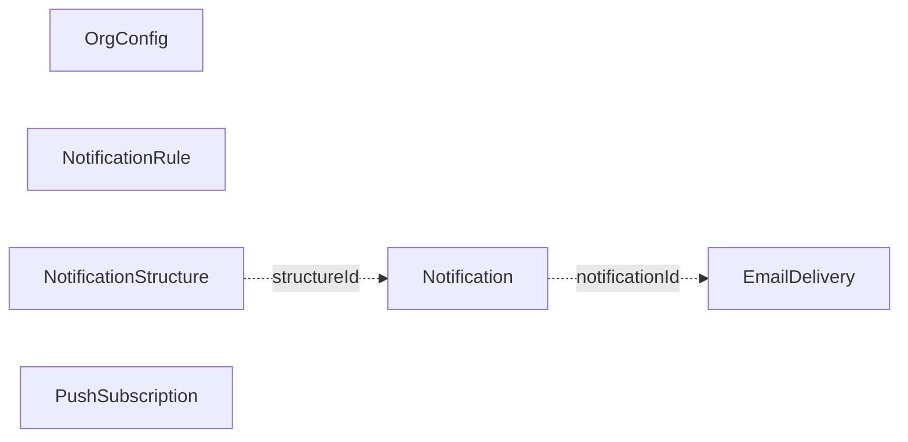
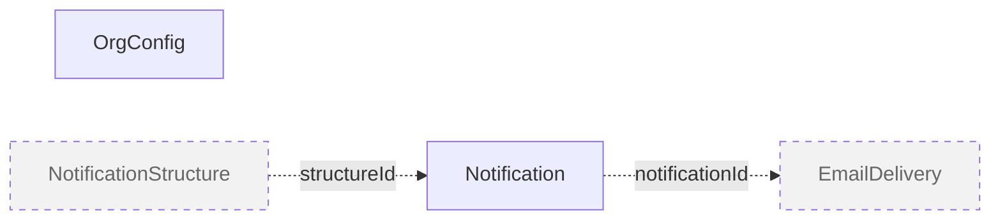
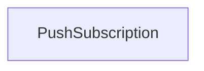
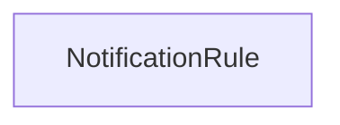
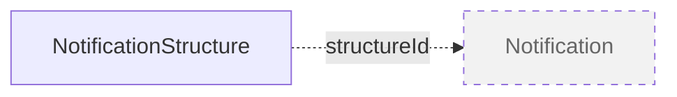
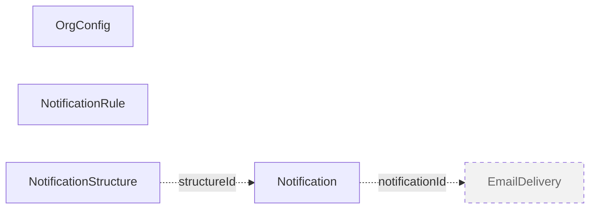
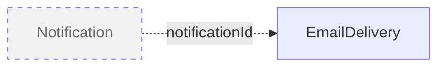
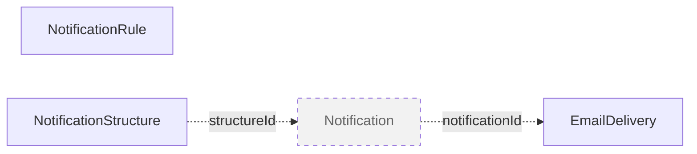
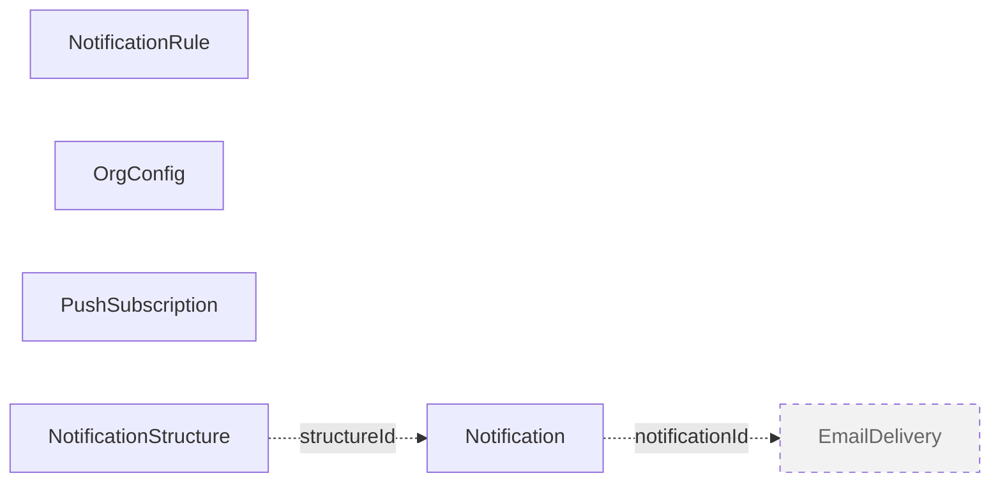
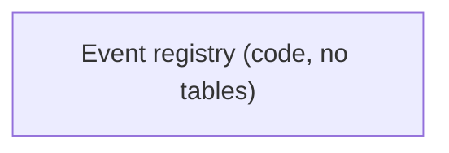

# notification - Existing Database Architecture

## 1. Document Metadata

| Item | Value |
|---|---|
| Service | `notification` (repository `notification-service`) |
| Repository path | `/Users/akshay/Development/autoscal/main-autoscal-repos/notification-service` |
| Branch / commit | `dev` @ `cb1c256` (2026-10-13, "chore(claude): add Claude Code setup for notification-service (#164)") |
| Analysis date | 2026-10-14 |
| Scope | `prisma/schema.prisma`, all 11 folders under `prisma/migrations/` plus `migration_lock.toml`, `prisma/seed.js`, `prisma/seed-tenant.js`, `prisma/structure-defaults.js`, `prisma/seeds/*.js`, runtime code (`index.js`, `config/`, `app/**`), ops code (`scripts/`), deploy files (`entrypoint.sh`, `Dockerfile`, `docker-compose-*.yml`, `check-env.sh`), tests (`tests/`), repo docs (`CLAUDE.md`, `docs/*.js`, `.claude/skills/notification-service-conventions/`). Read-only search of the 8 other active service repos for direct access to this database |
| Method | Static analysis only. Migration SQL was read in full and replayed by hand. Prisma delegate calls, `$transaction`, `$queryRaw` and `$executeRaw` sites were traced from routes, the Redis subscriber, the cron worker and the scripts |
| Not done | No live database was queried (no authorised connection; `.env*` reads are blocked by repo hooks). `prisma migrate diff` and `prisma validate` were not run. Mermaid diagrams were checked structurally, not rendered |

**Important limitations**

- Every table, column and constraint below is what the schema and migrations declare. None of it is confirmed against a running database.
- "Referenced by runtime code" means a static reference was found. It does not prove the code path runs in production.
- `finance-service-backend` (deprecated) and `autoscal-claude-plugins` were excluded.

## 2. Service Overview

notification-service is the platform's notification consumer (`CLAUDE.md:3`). Producer services publish signed events to Redis channels `notifications:*`. This service verifies them, decides recipients and channels in `dispatch.service.js`, writes in-app bell rows, pushes them live over SSE (web push when the user has no open stream) and sends email through a database outbox drained by a cron worker. Tenant admins configure per-event rules, per-event message structures and org-level config. The database is private to this service: no sibling repo references its tables (search of the 8 active service repos for the 6 quoted table names returned no match), and the service cannot join other services' tables (`prisma/schema.prisma:140-141`, `app/controllers/structures.controller.js:424-427`).

| Item | Verified value | Evidence |
|---|---|---|
| Engine | PostgreSQL. Local dev image `postgres:14-alpine3.16`, database `notification_service`, host port 5005. Prod and demo compose files have no Postgres service, so those databases are external | `prisma/schema.prisma:5-8`, `prisma/migrations/migration_lock.toml`, `docker-compose-dev.yml:6-13`, `CLAUDE.md:35` |
| Connection | single datasource, env var `DATABASE_URL`; no `directUrl`, `shadowDatabaseUrl`, `schemas` or `relationMode` | `prisma/schema.prisma:5-8` |
| ORM | Prisma 6 (`prisma` and `@prisma/client` `^6.18.0`), `prisma-client-js`, CommonJS, no preview features | `package.json`, `prisma/schema.prisma:1-3` |
| Client | one plain `new PrismaClient()` with no `$extends`, middleware or logging, exported with one alias per model. No tenant guard | `app/models/index.js:1-13`, `CLAUDE.md:15` |
| Schema organisation | implicit `public` schema; 6 models, 0 enums, 0 `@relation`s in a 252-line `schema.prisma`. All PKs are `TEXT` UUIDs generated client-side. Categorical columns are plain `TEXT` validated by constants in `app/constants/*.js` | `prisma/schema.prisma:10-252` |
| Migration tooling | Prisma Migrate, 11 folders (`20260701062114_init` to `20260911000000_restore_email_parity_for_existing_tenants`). `entrypoint.sh` runs `prisma migrate deploy` then `prisma generate` on every container start | `entrypoint.sh:7-11`, `CLAUDE.md:40` |
| Raw SQL | 2 runtime sites: `$executeRaw` re-dating `Notification.expiresAt` and `$queryRaw` outbox claim with `FOR UPDATE SKIP LOCKED`. 1 migration `DO $$` block | `app/controllers/admin.controller.js:123-128`, `app/services/email/outbox.service.js:180-190`, `20260911000000.../migration.sql:27-65` |
| Transactions | 3 runtime sites: rules bulk toggle (array form), structure create and approve (interactive, `Serializable`). 1 ops site: `scripts/purge-tenant.js:54` | `app/controllers/rules.controller.js:228`, `app/controllers/structures.controller.js:21,133-161,235-268` |
| Seeds | `npm run seed` runs `prisma/seed.js`, which calls `seedTenant` for each id in `TENANT_IDS`. `seedTenant` is also called at runtime by the admin config save | `prisma/seed.js:7-20`, `app/controllers/admin.controller.js:104` |
| Stores outside Postgres | Redis: pub/sub ingest, config caches (`orgconfig:`, `notifrules:`, `structure:`), dedupe claims, SSE tickets and presence. Not a system of record | section [3.1](#31-delivery-pipeline) and [R9](#r9-redis-state-alongside-the-database) |

**Sources used to determine the schema**: `schema.prisma` (declared state) and the replayed migration SQL (historical and final DDL). They agree on every table, column, type, default, index name and index column list (compared by hand). The only structural difference is NOT NULL on array columns ([R1](#r1-array-column-nullability-is-mixed)).

**Live database caveat**: no environment was inspected. Since every environment applies migrations with `prisma migrate deploy` at container start and nothing in the repo reshapes tables outside Prisma, the replayed DDL is the expected live DDL, but this is not verified. Each finding that depends on deployed data has a verification step in [4. Migration Risks and Unresolved Issues](#4-migration-risks-and-unresolved-issues).

### 2.1 Service-Level Metrics

Counting rules are defined in [5.1 Counting rules](#51-counting-rules).

| Metric | Value |
|---|---:|
| Application modules identified | 10 (8 runtime modules with DB access, 1 ops module, 1 runtime module with no DB access: Event registry) |
| Distinct tables (declared or referenced) | 6 |
| Tables declared in schema or migrations (final state) | 6 |
| Tables referenced by code but not declared in this repo | 0 |
| Tables referenced by runtime application code | 6 |
| Tables with no runtime-code reference found | 0 |
| Tables confirmed in a live database | 0 (not verified, no access) |
| Status: Active / Deprecated or legacy / Apparently unused / Uncertain | 6 / 0 / 0 / 0 |
| Uncertain or conflicting cases (not table statuses) | 6: array nullability contradiction ([R1](#r1-array-column-nullability-is-mixed)); "one ACTIVE structure per scope" not enforced by the database ([R2](#r2-structure-invariants-enforced-only-in-application-code)); `20260911` backfill cutoff logic ([R3](#r3-data-migrations-depend-on-updatedat-history)); `purge-tenant.js` scope vs its comment ([R6](#r6-tenant-offboarding-skips-two-tables)); stale `20260829` comment vs current backfill script ([R3](#r3-data-migrations-depend-on-updatedat-history)); `CLAUDE.md` domain map vs code ([R10](#r10-documentation-that-disagrees-with-code)) |
| Tables with a declared primary key | 6 of 6 |
| Declared FK relationships | 0 (none in `schema.prisma`, none in migration SQL) |
| Inferred intra-database relationships (no FK) | 2: `EmailDelivery.notificationId` to `Notification.id`; `Notification.structureId` to `NotificationStructure.id` |
| Cross-service id columns with no FK | 6 `tenantId` columns plus `Notification.entityId`, `NotificationStructure.projectId` and user email columns (targets in other services) |
| Leaf tables (declared FKs) | 0 |
| Isolated tables (declared FKs) | 6 |
| Leaf / isolated tables if inferred relationships are counted | 1 (`EmailDelivery`) / 3 (`NotificationRule`, `OrgConfig`, `PushSubscription`) |
| Declared self-references / FK cycles | 0 / 0 |
| Junction tables | 0 |
| Tables used by more than one module | 6 (every table) |
| Columns documented | 85 |
| Views / materialized views | 0 / 0 |
| Other database objects | 0 enum types; 6 primary keys; 15 secondary indexes (4 unique, 11 non-unique); 0 sequences, CHECK constraints, functions, triggers or extensions; Prisma's `_prisma_migrations` (tooling, not counted, but read by migration `20260911`) |
| Tables created / dropped in Prisma history | 6 / 0 |

- Tables are counted once. Views and enums would never be counted as tables (there are none).
- With no declared FKs, every table is isolated by the strict definition. The two inferred relationships are listed separately and do not change the declared-FK counts.
- Cross-service id columns are documented per table but do not count toward relationship metrics, because their targets live in other databases.

### 2.2 Database Object Inventory

| Object | Type | Category (declared / runtime / live) | Status | Created by | Primary owner module |
|---|---|---|---|---|---|
| [`public."Notification"`](#table-notification) | table | declared, runtime, live unverified | Active | `20260701062114_init` | [Delivery pipeline](#31-delivery-pipeline) |
| [`public."NotificationRule"`](#table-notificationrule) | table | declared, runtime, live unverified | Active | `20260701062114_init` | [Rules config](#34-rules-config) |
| [`public."NotificationStructure"`](#table-notificationstructure) | table | declared, runtime, live unverified | Active | `20260901000000_notification_structures` | [Structures](#35-structures) |
| [`public."OrgConfig"`](#table-orgconfig) | table | declared, runtime, live unverified | Active | `20260701062114_init` | [Org config admin](#36-org-config-admin) |
| [`public."EmailDelivery"`](#table-emaildelivery) | table | declared, runtime, live unverified | Active | `20260829000000_email_channel_and_outbox` | [Email outbox](#37-email-outbox) |
| [`public."PushSubscription"`](#table-pushsubscription) | table | declared, runtime, live unverified | Active | `20260714000000_add_push_subscription` | [Web push](#33-web-push) |
| `public."_prisma_migrations"` | Prisma tooling table | not declared in schema; read by `20260911.../migration.sql:32-43` | Tooling, not counted | Prisma Migrate | n/a |

Table names are case-sensitive quoted identifiers (Prisma model names, no `@@map`). Any SQL against them must quote the name.

No views, materialized views, enums, sequences, functions, triggers or extensions exist in the schema or migrations.

### 2.3 Module Summary

| Module | Purpose | Total Tables | Active | Deprecated/Legacy | Apparently Unused | Shared/Uncertain |
|---|---|---:|---:|---:|---:|---:|
| [Delivery pipeline](#31-delivery-pipeline) | Redis event ingest, gating, recipient expansion, bell row write, resolution | 6 | 3 | 0 | 0 | 3 |
| [Inbox](#32-inbox) | Bell read API: flat and grouped feeds, counts, mark read, SSE stream | 2 | 1 | 0 | 0 | 1 |
| [Web push](#33-web-push) | Browser push subscriptions and delivery | 1 | 1 | 0 | 0 | 0 |
| [Rules config](#34-rules-config) | Per-tenant, per-event enable, audience and channel rules | 1 | 1 | 0 | 0 | 0 |
| [Structures](#35-structures) | Versioned per-event title/body/deep-link templates with approval | 1 | 1 | 0 | 0 | 0 |
| [Org config admin](#36-org-config-admin) | Tenant bell/email switches, categories, retention, provisioning | 4 | 2 | 0 | 0 | 2 |
| [Email outbox](#37-email-outbox) | Durable email queue, cron drain, retries, prune | 1 | 1 | 0 | 0 | 0 |
| [Public service API](#38-public-service-api) | API-key endpoints for producer services | 3 | 1 | 0 | 0 | 2 |
| [Ops scripts and seeds](#39-ops-scripts-and-seeds) | Manual purge, offboarding, backfills, seeding (not runtime) | 5 | 5 | 0 | 0 | 0 |
| [Event registry](#310-event-registry) | In-code event catalogue and email templates (no DB access) | 0 | 0 | 0 | 0 | 0 |

- Total = Active + Deprecated/Legacy + Apparently Unused + Shared/Uncertain.
- **Active**: the module's own files (route, controller, module-named service) query the table, and the module has a known caller or trigger.
- **Shared/Uncertain**: the module reaches the table only through another module's code, for example `getOrgConfig`/`getRules` in `app/services/delivery.service.js:13,58`, `resolveStructure` in `app/services/structure.service.js:44`, `sendWebPush` in `app/services/webpush.service.js`, the outbox in `app/services/email/outbox.service.js`, or `seedTenant` in `prisma/seed-tenant.js`.
- For the ops module, Active counts tables whose status is Active even though the code is run by hand, not by the service.
- Module totals are non-exclusive: `Notification` appears in 4 modules, `NotificationRule` and `NotificationStructure` in 5. Do not add module totals; the service total is 6.

### 2.4 Migration-Relevant Findings

1. **No foreign keys at all.** The two intra-database references (`EmailDelivery.notificationId`, `Notification.structureId`) are unenforced and write-only in app code. Load order is unconstrained, but orphan rows are possible ([R4](#r4-unenforced-references-and-orphans)).
2. **Invariants live in application code.** "Exactly one ACTIVE structure per scope" relies on `Serializable` transactions, and the unique key on `NotificationStructure` never constrains org-wide rows because `projectId` is NULL ([R2](#r2-structure-invariants-enforced-only-in-application-code)).
3. **Array nullability is mixed.** `channels` is NOT NULL, while `audience`, `disabledCategories` and `recipientRoles` are nullable in the database but non-null in Prisma; two migrations give contradictory reasons ([R1](#r1-array-column-nullability-is-mixed)).
4. **Data migrations encode history.** `20260910` and `20260911` rewrote `OrgConfig.emailEnabled` and `NotificationRule.channels` using `updatedAt` cutoffs read from `_prisma_migrations`. A copied database must preserve `updatedAt` and `_prisma_migrations` or these semantics are lost ([R3](#r3-data-migrations-depend-on-updatedat-history)).
5. **Postgres-specific behaviour** the next data layer must keep: `TEXT[]` columns, `JSONB`, `FOR UPDATE SKIP LOCKED` outbox claim, interval arithmetic in raw SQL, timezone-less `TIMESTAMP(3)` with UTC-string binding ([R5](#r5-postgres-specific-behaviour)).
6. **Retention and offboarding gaps.** Notification expiry has no in-process scheduler (manual `scripts/purge-expired.js`); terminal non-sent `EmailDelivery` rows are never pruned; `scripts/purge-tenant.js` skips `NotificationStructure` and `EmailDelivery` ([R6](#r6-tenant-offboarding-skips-two-tables), [R7](#r7-unbounded-growth-and-retention)).
7. **Stored but unused columns.** `Notification.actions` is always NULL, `NotificationRule.skipLevels` and `NotificationStructure.actions`/`isActionable` are stored but not acted on in delivery ([R8](#r8-write-only-and-unused-columns)).
8. **Not verified against a live database.** All findings come from the repository.

## 3. Module Documentation

Modules follow the domain map in `CLAUDE.md:56-65`, corrected against the code (see [R10](#r10-documentation-that-disagrees-with-code)): route groups mounted in `app/routes/index.js:2-6`, the Redis subscriber, the email cron worker, and the manual scripts. Auth middleware (`app/middleware/*.js`) and the SSE relay and stream tickets use only HTTP and Redis and are not counted as separate modules. Each table has exactly one canonical definition, placed under the module that writes it through its own files.

**Diagram conventions (all modules)**: Mermaid flowcharts. Arrows run from the referenced parent table to the child table that holds the reference, labelled with the child column. Solid arrow (`-->`): FK declared in schema and migration SQL (none exist in this service). Dotted arrow (`-.->`): relationship inferred from application code, no FK. Dashed grey box: table outside the module, shown when it is an inferred-relationship neighbour of a module table. Cross-service references are not drawn. No relationship is inferred from naming alone.

### 3.1 Delivery pipeline

**Purpose:** Ingests every producer event. `app/subscriber/event-subscriber.js:44,57` pattern-subscribes to `notifications:*`, verifies the signature (`message-signing.service.js`) and routes to `dispatch` (`notifications:{tenant}:{email}`) or `fanout` (`notifications:broadcast:{tenant}`). `app/services/dispatch.service.js:32` applies gates (org config, category, rule, structure, channel), composes copy from the ACTIVE structure, expands recipients (`audience.service.js`, auth-service HTTP), resolves earlier `pending` rows for outcome events, claims a Redis dedupe key, then per recipient writes the bell row (`delivery.service.js:201 persistAndPush`), sends live SSE or web push, and queues or records the email (outbox). Files: `app/subscriber/`, `app/services/{dispatch,fanout,audience,dedupe,delivery,grouping,message-signing}.service.js`. Interacts with Structures (`resolveStructure`), Web push (`sendWebPush`), Email outbox (`enqueue`, `recordNonDelivery`), Inbox (shares `grouping.service.js`).

**Module metrics:** 6 distinct tables: 3 active (direct), 0 deprecated/legacy, 0 apparently unused, 3 shared/uncertain (via Structures, Web push and Email outbox code). 6 of 6 are also used by other modules.

**Tables used**

| Table | Usage status | Definition |
|---|---|---|
| `Notification` | Active (direct, owner) | [Notification](#table-notification) (here) |
| `OrgConfig` | Active (direct, `getOrgConfig`) | [OrgConfig](#table-orgconfig) (under Org config admin) |
| `NotificationRule` | Active (direct, `getRules`) | [NotificationRule](#table-notificationrule) (under Rules config) |
| `NotificationStructure` | Active (via shared code, `resolveStructure`) | [NotificationStructure](#table-notificationstructure) (under Structures) |
| `PushSubscription` | Active (via shared code, `sendWebPush`) | [PushSubscription](#table-pushsubscription) (under Web push) |
| `EmailDelivery` | Active (via shared code, outbox) | [EmailDelivery](#table-emaildelivery) (under Email outbox) |

**Key database operations**

| Trigger | Operations | Evidence |
|---|---|---|
| Any event | `OrgConfig.findUnique` on Redis cache miss (`orgconfig:{t}`, 300 s, `__null__` sentinel) | `delivery.service.js:13-35` (query at :31) |
| Any event | `NotificationRule.findMany` selecting `eventType, isEnabled, audience, channels` on cache miss (`notifrules:{t}`, 300 s); fails open to `{}` | `delivery.service.js:58-96` (query at :76-79) |
| Structured event | `NotificationStructure.findFirst` ACTIVE by version desc, project row then org row, cached `structure:{t}:{event}:{proj or org}` | `structure.service.js:24,44-68` |
| Outcome event | `Notification.findMany` pending rows for `(tenantId, event in sourceEvents, entityId)`, then `updateMany` to `resolved` with `resolution`, `resolvedAt` | `delivery.service.js:115-149` (:127, :138) |
| Per recipient | `Notification.create` (bell row with `groupKey`, `status`, `structureId`, body parts) | `delivery.service.js:209-232` |
| Live frame | `Notification.count` unread for the SSE frame | `delivery.service.js:276` |
| Broadcast | `Notification.createManyAndReturn` in batches of 500 | `fanout.service.js:175` |
| Offline user | `PushSubscription.findMany`; `delete` on 404/410 | `webpush.service.js:25,41` |
| Email leg | `EmailDelivery.create` pending (`enqueue`) or suppressed/undeliverable (`recordNonDelivery`) with `notificationId` | `dispatch.service.js:282-302`, `outbox.service.js:33,64` |
| Group header | `Notification.groupBy([status, isRead])`, `findMany` actor fields (`describeGroup`) | `grouping.service.js:465,473` |

#### Table details

#### Table: Notification

**Table overview**

- Canonical name: `public."Notification"` (model `Notification`, `prisma/schema.prisma:10-68`).
- Purpose: one in-app bell row per recipient per event, with grouping key, lifecycle status for approval-type events, and structured meta-line parts.
- Accessed by: Delivery pipeline, Inbox, Org config admin (raw `expiresAt` re-date), Ops scripts and seeds (4 modules).
- Classification: **Active**. Evidence: `create` (`delivery.service.js:209`), `createManyAndReturn` (`fanout.service.js:175`), feed reads (`notifications.controller.js:128,134`, `grouping.service.js:285-473`), mark read (`notifications.controller.js:167,222,254`), raw update (`admin.controller.js:123-128`).
- Definition source: created by `20260701062114_init/migration.sql:2-18`; grouping and lifecycle columns added by `20260820113128_notification_grouping:2-9`; body parts by `20260824075024_notification_body_parts:2-6`; `structureId` by `20260901000000_notification_structures:38`.

**Attributes**

| Column | Database Type | Nullable | Default | Key/Constraint | Description |
|---|---|---|---|---|---|
| id | TEXT | No | Prisma `uuid()` (client-side, no DB default) | PK `Notification_pkey` | Row id; referenced logically by `EmailDelivery.notificationId` |
| tenantId | TEXT | No | | Leading column of 4 indexes | auth-service tenant id (cross-service, no FK) |
| userEmail | TEXT | No | | In 3 indexes | Recipient; user scope key (`CLAUDE.md:15`) |
| event | TEXT | No | | In `Notification_tenantId_event_entityId_idx` | Event type from the catalogue in `app/events/` |
| category | TEXT | No | `'general'` | In `Notification_tenantId_userEmail_category_idx`; no CHECK | One of `NOTIFICATION_CATEGORIES` (`app/constants/notification.js:63`) |
| title | TEXT | No | | | Rendered title (from structure template or publisher copy) |
| body | TEXT | No | | | Rendered body; `''` when absent (`delivery.service.js:217`) |
| deepLink | TEXT | Yes | | | Frontend link |
| actions | JSONB | Yes | | | Always written `NULL` (`delivery.service.js:218-220`, `fanout.service.js:71`); responses derive actions from the event catalogue at read. Effectively unused ([R8](#r8-write-only-and-unused-columns)) |
| isRead | BOOLEAN | No | `false` | In `Notification_tenantId_userEmail_isRead_idx` | Read flag, set by mark-read endpoints |
| readAt | TIMESTAMP(3) | Yes | | | Read time; returned by the flat list only |
| createdAt | TIMESTAMP(3) | No | `CURRENT_TIMESTAMP` | | Creation time; base for retention re-date |
| expiresAt | TIMESTAMP(3) | No | | Index `Notification_expiresAt_idx` | `createdAt + retentionDays`; every read filters `expiresAt >= now` (soft expiry) |
| groupKey | TEXT | Yes | | In `Notification_tenantId_userEmail_groupKey_status_idx` | sha1 over `(tenantId, userEmail, event, groupScopeId[, window])` written at insert (`grouping.service.js:23-29,80-110`); NULL renders standalone |
| groupScopeId | TEXT | Yes | | | Scope input to `groupKey`; read only by `scripts/backfill-group-keys.js:49,67` |
| status | TEXT | No | `'info'` | In group index; no CHECK | `info`, `pending`, `resolved` (`NOTIFICATION_STATUS`, `notification.js:6-10`) |
| resolution | TEXT | Yes | | | `approved`, `rejected`, `cancelled`, `expired` (`notification.js:12-17`) |
| resolvedAt | TIMESTAMP(3) | Yes | | | Resolution time |
| entityId | TEXT | Yes | | In `Notification_tenantId_event_entityId_idx` | Id of the owning service's record (leave, timesheet, ...); cross-service, no FK |
| structureId | TEXT | Yes | | No FK (inferred to `NotificationStructure.id`) | Structure version that composed the row; NULL for publisher-copy rows. Write-only in logic |
| actorEmail | TEXT | Yes | | | Actor; drives self-suppression (`dispatch.service.js:178`) |
| actorName | TEXT | Yes | | | Actor display name for group subtitles |
| subjectLabel | TEXT | Yes | | | Meta-line part |
| periodStart | TEXT | Yes | | | Calendar date `YYYY-MM-DD` held as text by design (`schema.prisma:52-56`) |
| periodEnd | TEXT | Yes | | | Calendar date `YYYY-MM-DD` as text |
| quantity | TEXT | Yes | | | Meta-line part |
| note | TEXT | Yes | | | Meta-line part, max 140 chars at write (`NOTE_MAX_LENGTH`, `notification.js:28`) |

Indexes (none unique): `Notification_tenantId_userEmail_isRead_idx`, `Notification_tenantId_userEmail_category_idx`, `Notification_expiresAt_idx`, `Notification_tenantId_userEmail_groupKey_status_idx (tenantId, userEmail, groupKey, status)`, `Notification_tenantId_event_entityId_idx`. No `updatedAt` column.

**Relationships**

| Direction | Related table | Columns | Cardinality | Enforcement | Modules |
|---|---|---|---|---|---|
| Out | [`NotificationStructure`](#table-notificationstructure) | `structureId` to `NotificationStructure.id` | many to 0..1 | Inferred: written from `structure?.id` (`dispatch.service.js:262`, `delivery.service.js:228`); never read by logic | Delivery pipeline, Structures |
| In | [`EmailDelivery`](#table-emaildelivery) | `EmailDelivery.notificationId` to `id` | 1 to 0..many | Inferred: written from `record?.id` (`dispatch.service.js:289,302`); never read | Delivery pipeline, Email outbox |
| Cross-service | auth-service tenants and users; producer records | `tenantId`, `userEmail`, `actorEmail`, `entityId` | | None | all |

**Additional details**

- No soft delete. Expiry is logical (`expiresAt` filter); physical delete only by `scripts/purge-expired.js` (grace 90 days), run by hand or an external scheduler ([R7](#r7-unbounded-growth-and-retention)).
- Four writers: pipeline create, pipeline resolution (`updateMany` filtered on `status: 'pending'`, idempotent), inbox mark read, admin raw re-date.
- Admin retention change runs `UPDATE "Notification" SET "expiresAt" = "createdAt" + (n * INTERVAL '1 day') WHERE "tenantId" = ...` outside the `OrgConfig.upsert` (no transaction) (`admin.controller.js:123-128`).
- Grouped feed uses `groupBy` on `groupKey` served by the group index; group members fetched with `take 1000` (`grouping.service.js:364`).
- Migration risks: client-side UUIDs, timezone-less timestamps ([R5](#r5-postgres-specific-behaviour)), orphan `structureId` values ([R4](#r4-unenforced-references-and-orphans)).

**Module relationship diagram**

Legend: dotted = inferred from application code, no FK. `OrgConfig`, `NotificationRule` and `PushSubscription` have no relationships (joined to the others only by cross-service `tenantId`).

### 3.2 Inbox

**Purpose:** The user's bell under `/api/notifications` (`app/routes/notifications.routes.js`): flat list, grouped list, group members, unread count, mark one/group/all read, `GET /enabled`, SSE stream ticket and stream. Files: `app/controllers/notifications.controller.js`, `app/services/grouping.service.js` (list functions), `delivery.service.js:272 publishReadState`, `sse-relay.service.js`, `stream-ticket.service.js`. Every query is scoped by `tenantId` and `userEmail` and filters `expiresAt >= now`.

**Module metrics:** 2 distinct tables: 1 active (direct), 0 deprecated/legacy, 0 apparently unused, 1 shared/uncertain (`OrgConfig` via `getOrgConfig` in the pipeline's `delivery.service.js`). Both are used by other modules.

**Tables used**

| Table | Usage status | Definition |
|---|---|---|
| `Notification` | Active (direct) | [Notification](#table-notification) (under Delivery pipeline) |
| `OrgConfig` | Active (via shared code, `GET /enabled`) | [OrgConfig](#table-orgconfig) (under Org config admin) |

**Key database operations**

| Endpoint | Operations | Evidence |
|---|---|---|
| `GET /` | `Notification.findMany` + `count` | `notifications.controller.js:128,134` |
| `GET /grouped` | `groupBy([groupKey, event, category, status, isRead])`, standalone `findMany`/`count`, batched members `findMany(take 1000)` | `grouping.service.js:285,336,341,364` |
| `GET /groups/:groupKey` | `findMany` + `count` | `grouping.service.js:437,443` |
| `GET /unread-count` | `count` | `notifications.controller.js:150` |
| `PATCH /:id/read` | `updateMany` scoped by `id`, `tenantId`, `userEmail` | `notifications.controller.js:167` |
| `PATCH /groups/:groupKey/read`, `PATCH /read-all` | `findMany(select id)` then `updateMany` | `notifications.controller.js:218,222,250,254` |
| `GET /enabled` | `getOrgConfig` (cached `OrgConfig.findUnique`) | `delivery.service.js:31` |

**Module relationship diagram**

Legend: dotted = inferred, no FK; dashed grey box = table outside this module.

### 3.3 Web push

**Purpose:** Stores browser push subscriptions (`POST /api/notifications/push-subscription`, `/push-subscription/unsubscribe`) and sends web push when a user has no live SSE connection. Files: `app/controllers/pushSubscription.controller.js`, `app/services/webpush.service.js`. Called by the Delivery pipeline (`persistAndPush`).

**Module metrics:** 1 distinct table: 1 active, 0 deprecated/legacy, 0 apparently unused, 0 shared/uncertain. Also used by Delivery pipeline and Ops scripts.

**Tables used**

| Table | Usage status | Definition |
|---|---|---|
| `PushSubscription` | Active (direct, owner) | [PushSubscription](#table-pushsubscription) (here) |

#### Table details

#### Table: PushSubscription

**Table overview**

- Canonical name: `public."PushSubscription"` (model `PushSubscription`, `prisma/schema.prisma:242-252`).
- Purpose: one browser push endpoint per device, owned by a user in a tenant.
- Accessed by: Web push, Delivery pipeline (via `sendWebPush`), Ops scripts and seeds (`purge-tenant.js`) (3 modules).
- Classification: **Active**. Evidence: `updateMany`/`create`/`deleteMany` (`pushSubscription.controller.js:17,24,32,52`), `findMany`/`delete` (`webpush.service.js:25,41`).
- Definition source: `20260714000000_add_push_subscription/migration.sql:2-18`.

**Attributes**

| Column | Database Type | Nullable | Default | Key/Constraint | Description |
|---|---|---|---|---|---|
| id | TEXT | No | Prisma `uuid()` (client-side) | PK `PushSubscription_pkey` | Row id |
| tenantId | TEXT | No | | In `PushSubscription_tenantId_userEmail_idx` | Tenant (cross-service) |
| userEmail | TEXT | No | | In `PushSubscription_tenantId_userEmail_idx` | Subscriber |
| endpoint | TEXT | No | | UNIQUE `PushSubscription_endpoint_key` | Push service URL; globally unique across tenants |
| keys | JSONB | No | | | Web push `p256dh`/`auth` keys from the browser |
| createdAt | TIMESTAMP(3) | No | `CURRENT_TIMESTAMP` | | Never read |
| updatedAt | TIMESTAMP(3) | No | none (Prisma `@updatedAt`, client-side) | | Never read |

**Relationships**

| Direction | Related table | Columns | Cardinality | Enforcement | Modules |
|---|---|---|---|---|---|
| Cross-service | auth-service tenants and users | `tenantId`, `userEmail` | | None | Web push |

None within this database.

**Additional details**

- Subscribe: `updateMany` scoped to the caller's own endpoint, else `create`; a P2002 unique race retries the scoped `updateMany` and returns 409 when 0 rows match, so one user cannot take over another user's endpoint (`pushSubscription.controller.js:17-32`).
- Hard delete on unsubscribe and on a 404/410 push response (`webpush.service.js:40-41`). No tests cover `webpush.service.js`.
- Migration risk: `endpoint` uniqueness is global, not per tenant; keep it when merging databases.

**Module relationship diagram**

Legend: no declared or inferred relationships.

### 3.4 Rules config

**Purpose:** Tenant admin settings for each configurable event under `/api/rules` (`app/routes/rules.routes.js:10-13`): list the rule map, upsert one rule, bulk toggle a module, delete a rule (also the only way to remove orphan rules for retired events). Validates against the event catalogue (`isCatalogEvent`, `allowedChannels`) and invalidates the `notifrules:{t}` cache. File: `app/controllers/rules.controller.js`.

**Module metrics:** 1 distinct table: 1 active, 0 deprecated/legacy, 0 apparently unused, 0 shared/uncertain. Also used by Delivery pipeline, Org config admin, Public service API and Ops scripts.

**Tables used**

| Table | Usage status | Definition |
|---|---|---|
| `NotificationRule` | Active (direct, owner) | [NotificationRule](#table-notificationrule) (here) |

#### Table details

#### Table: NotificationRule

**Table overview**

- Canonical name: `public."NotificationRule"` (model `NotificationRule`, `prisma/schema.prisma:70-99`).
- Purpose: per-tenant, per-event switch with recipient audience and delivery channels.
- Accessed by: Rules config, Delivery pipeline, Org config admin (via `seedTenant`), Public service API (via `getRules`), Ops scripts and seeds (5 modules).
- Classification: **Active**. Evidence: `findMany`/`upsert`/`deleteMany` (`rules.controller.js:72,143,272`), bulk `$transaction` (`:228-233`), cached read (`delivery.service.js:76`), seed `createMany` (`prisma/seed-tenant.js:39`).
- Definition source: `20260701062114_init/migration.sql:21-31,54`; `audience` added by `20260826000000:6`; `channels` and `NotificationRule_tenantId_idx` by `20260829000000:8-14`; data rewrite by `20260911000000:60-63`.

**Attributes**

| Column | Database Type | Nullable | Default | Key/Constraint | Description |
|---|---|---|---|---|---|
| id | TEXT | No | Prisma `uuid()` (client-side) | PK `NotificationRule_pkey` | Row id |
| tenantId | TEXT | No | | UNIQUE (`tenantId`, `eventType`); index `NotificationRule_tenantId_idx` | Tenant (cross-service) |
| eventType | TEXT | No | | UNIQUE `NotificationRule_tenantId_eventType_key` | Event from the catalogue; orphan rows for retired events are possible (`rules.controller.js:58-60,84-88`) |
| skipLevels | INTEGER | No | `0` | | 0 to 10, validated at write (`rules.controller.js:117-123`). Stored and served, **never used by delivery** (`getRules` select excludes it, `delivery.service.js:78`) |
| isEnabled | BOOLEAN | No | `true` | | Rule switch |
| audience | TEXT[] | **Yes in DB** (Prisma treats as required) | `ARRAY['RECIPIENT']::TEXT[]` | | Union of `RECIPIENT`, `TENANT_ADMIN`, `SUPER_ADMIN` (`notification.js:92-99`) |
| channels | TEXT[] | No | `ARRAY['IN_APP']::TEXT[]` | | Subset of `IN_APP`, `EMAIL` (`notification.js:105-111`). Empty array means "no opinion": readers fall back to the event's `defaultChannelsFor` |
| createdAt | TIMESTAMP(3) | No | `CURRENT_TIMESTAMP` | | Never read |
| updatedAt | TIMESTAMP(3) | No | none (Prisma `@updatedAt`) | | Used as a historical cutoff by migration `20260911` ([R3](#r3-data-migrations-depend-on-updatedat-history)) |

**Relationships**

| Direction | Related table | Columns | Cardinality | Enforcement | Modules |
|---|---|---|---|---|---|
| Logical | app event catalogue (`app/events/index.js:34`) | `eventType` | | Application validation only | Rules config, Delivery pipeline |
| Cross-service | auth-service tenants | `tenantId` | | None | all |

None within this database.

**Additional details**

- Bulk toggle runs `$transaction([updateMany, createMany(skipDuplicates)])` (`rules.controller.js:228-233`).
- Read path is Redis-fronted for 300 s and fails open to "no rules" on error (`delivery.service.js:58-96`).
- `NotificationRule_tenantId_idx` is likely redundant: the unique index on `(tenantId, eventType)` already serves `tenantId =` by leftmost prefix; the comment at `schema.prisma:95-97` and `20260829:12-13` says otherwise.

**Module relationship diagram**

Legend: no declared or inferred relationships.

### 3.5 Structures

**Purpose:** Versioned per-event message definitions under `/api/structures` (`app/routes/structures.routes.js:49-57`): create, edit draft, submit, approve, toggle enabled, discard draft, history, events view and approvals queue. `projectId` NULL is the org-wide default; a project row overrides it for that project. Resolution for delivery is in `app/services/structure.service.js` (cached, revert switch `NOTIFICATION_STRUCTURES=off`, `:42-46`). Files: `app/controllers/structures.controller.js`, `app/services/structure.service.js`, `app/constants/structure.js`, `prisma/structure-defaults.js`.

**Module metrics:** 1 distinct table: 1 active, 0 deprecated/legacy, 0 apparently unused, 0 shared/uncertain. Also used by Delivery pipeline, Org config admin, Public service API and Ops scripts.

**Tables used**

| Table | Usage status | Definition |
|---|---|---|
| `NotificationStructure` | Active (direct, owner) | [NotificationStructure](#table-notificationstructure) (here) |

#### Table details

#### Table: NotificationStructure

**Table overview**

- Canonical name: `public."NotificationStructure"` (model `NotificationStructure`, `prisma/schema.prisma:122-167`).
- Purpose: one definition of how an event is composed and routed, for one scope (org or project) and one version. History is kept, not overwritten.
- Accessed by: Structures, Delivery pipeline (via `resolveStructure`), Org config admin (via `seedTenant`), Public service API (via `resolveStructure`), Ops scripts and seeds (5 modules).
- Classification: **Active**. Evidence: Serializable create and approve transactions (`structures.controller.js:133-161,235-268`), `findFirst` ACTIVE (`structure.service.js:24`), seed `createMany` (`prisma/seed-tenant.js:70`).
- Definition source: `20260901000000_notification_structures/migration.sql:2-33`.

**Attributes**

| Column | Database Type | Nullable | Default | Key/Constraint | Description |
|---|---|---|---|---|---|
| id | TEXT | No | Prisma `uuid()` (client-side) | PK `NotificationStructure_pkey` | Row id; referenced logically by `Notification.structureId` |
| tenantId | TEXT | No | | In unique key and index | Tenant (cross-service) |
| eventType | TEXT | No | | In unique key and index | Event; must have a structure spec in `app/events` (`structureFor`) |
| projectId | TEXT | Yes | | In unique key and index | job-service project id; NULL = org-wide default. Cross-service, no FK |
| version | INTEGER | No | `1` | In UNIQUE `NotificationStructure_tenantId_eventType_projectId_version_key` | Version within the scope; next = max + 1 inside the transaction (`structures.controller.js:103,134`) |
| status | TEXT | No | `'DRAFT'` | In index `..._status_idx`; no CHECK | `DRAFT`, `PENDING_APPROVAL`, `ACTIVE`, `ARCHIVED` (`app/constants/structure.js:6-11`) |
| isEnabled | BOOLEAN | No | `true` | | Per-type switch toggled in place on the ACTIVE row, no new version |
| recipientRoles | TEXT[] | **Yes in DB** (Prisma treats as required, no default) | | | `SUBJECT`, `PROJECT_MANAGER`, `PROJECT_MEMBERS`, `REPORTING_MANAGER`, `SKIP_LEVEL_MANAGER`, `APPROVER` (`structure.js:23-32`); expanded to addresses by the emitting service |
| titleTemplate | TEXT | No | | | `{{var}}` template, max 500 chars, variables validated against the event's declared vars on save |
| bodyTemplate | TEXT | No | | | Same rules as title |
| deepLinkTemplate | TEXT | Yes | | | Deep link template, validated by `isSafeDeepLinkTemplate` (`structure.js:62`) |
| isActionable | BOOLEAN | No | `false` | | Stored and served to publishers (`public-structures.controller.js:30`); not acted on in delivery |
| actions | JSONB | Yes | | | Stored only (`structures.controller.js:95`), never read ([R8](#r8-write-only-and-unused-columns)) |
| createdBy | TEXT | No | | | Author email; `system@seed` for seeded rows (`prisma/seed-tenant.js:16`) |
| approvedBy | TEXT | Yes | | | Approver email |
| approvedAt | TIMESTAMP(3) | Yes | | | Approval time |
| createdAt | TIMESTAMP(3) | No | `CURRENT_TIMESTAMP` | | |
| updatedAt | TIMESTAMP(3) | No | none (Prisma `@updatedAt`) | | |

**Relationships**

| Direction | Related table | Columns | Cardinality | Enforcement | Modules |
|---|---|---|---|---|---|
| In | [`Notification`](#table-notification) | `Notification.structureId` to `id` | 1 to 0..many | Inferred; non-DRAFT rows cannot be deleted, which preserves the trail (`structures.controller.js:324-326`) | Delivery pipeline |
| Cross-service | job-service projects, auth-service tenants | `projectId`, `tenantId` | | None | Structures |

**Additional details**

- Lifecycle: org-wide create goes straight to ACTIVE and archives the previous ACTIVE row; project create is DRAFT, then submit to PENDING_APPROVAL, then approve to ACTIVE, archiving the previous ACTIVE row. Only DRAFT is editable or deletable.
- The unique key does not enforce one ACTIVE row per scope, and with `projectId` NULL it does not constrain org-wide rows at all (Postgres NULLs are distinct). Both invariants depend on `Serializable` transactions ([R2](#r2-structure-invariants-enforced-only-in-application-code)).
- Seeding is idempotent by a prior `findMany`, not by the unique key (`prisma/seed-tenant.js:56-82`).
- Not removed by `scripts/purge-tenant.js` ([R6](#r6-tenant-offboarding-skips-two-tables)).

**Module relationship diagram**

Legend: dotted = inferred, no FK; dashed grey box = table outside this module.

### 3.6 Org config admin

**Purpose:** Tenant admin settings at `GET/PUT /api/admin/config` (`app/routes/admin.routes.js`): bell switch, email switch, disabled categories, retention days. On save it invalidates the `orgconfig:{t}` cache, re-dates the tenant's notifications when retention changes (raw SQL) and provisions rules and structures via `seedTenant` when `notificationsEnabled` is true. Files: `app/controllers/admin.controller.js`, `prisma/seed-tenant.js` (shared with the seed script).

**Module metrics:** 4 distinct tables: 2 active (direct: `OrgConfig`, `Notification`), 0 deprecated/legacy, 0 apparently unused, 2 shared/uncertain (`NotificationRule`, `NotificationStructure` via `seedTenant`). All 4 are also used by other modules.

**Tables used**

| Table | Usage status | Definition |
|---|---|---|
| `OrgConfig` | Active (direct, owner) | [OrgConfig](#table-orgconfig) (here) |
| `Notification` | Active (direct, raw `$executeRaw`) | [Notification](#table-notification) (under Delivery pipeline) |
| `NotificationRule` | Active (via shared code, `seedTenant`) | [NotificationRule](#table-notificationrule) (under Rules config) |
| `NotificationStructure` | Active (via shared code, `seedTenant`) | [NotificationStructure](#table-notificationstructure) (under Structures) |

**Key database operations**

| Endpoint | Operations | Evidence |
|---|---|---|
| `GET /api/admin/config` | `OrgConfig.findUnique` (no cache) | `admin.controller.js:11` |
| `PUT /api/admin/config` | `OrgConfig.upsert`; `seedTenant` (`OrgConfig.upsert` with empty update, `NotificationRule.createMany(skipDuplicates)`, `NotificationStructure.findMany` + `createMany`); raw `UPDATE "Notification"` re-dating `expiresAt`. Not one transaction | `admin.controller.js:81,104,123-128`, `prisma/seed-tenant.js:19-82` |

#### Table details

#### Table: OrgConfig

**Table overview**

- Canonical name: `public."OrgConfig"` (model `OrgConfig`, `prisma/schema.prisma:169-187`).
- Purpose: one row per tenant with the bell switch, email switch, disabled categories and retention. Also the de facto tenant registry for seed scripts (`prisma/seeds/backfillNotificationRules.js:43`, `prisma/seeds/disablePolicyCategory.js:29`).
- Accessed by: Org config admin, Delivery pipeline, Inbox, Ops scripts and seeds (4 modules).
- Classification: **Active**. Evidence: `findUnique`/`upsert` (`admin.controller.js:11,81`), cached `findUnique` (`delivery.service.js:31`), seed `upsert` (`prisma/seed-tenant.js:19`).
- Definition source: `20260701062114_init/migration.sql:34-42,57`; `notificationsEnabled` by `20260709000000:1`; default change by `20260826000000:11`; `emailEnabled` and data copy by `20260910000000:7,13`; data repair by `20260911000000:48-52`.

**Attributes**

| Column | Database Type | Nullable | Default | Key/Constraint | Description |
|---|---|---|---|---|---|
| id | TEXT | No | Prisma `uuid()` (client-side) | PK `OrgConfig_pkey` | Never read |
| tenantId | TEXT | No | | UNIQUE `OrgConfig_tenantId_key` | Tenant (cross-service) |
| notificationsEnabled | BOOLEAN | No | `false` | | Bell (in-app) opt-in. A missing row behaves as disabled |
| emailEnabled | BOOLEAN | No | `true` | | Email channel switch, independent of the bell (`schema.prisma:174-180`) |
| disabledCategories | TEXT[] | **Yes in DB** (Prisma treats as required, no default) | | | Categories muted for the tenant; seeds add `'policy'` |
| retentionDays | INTEGER | No | `30` (was `90` before `20260826`) | No CHECK | One of `RETENTION_OPTIONS` 7, 14, 30, 60, 90 (`notification.js:46-47`); drives `Notification.expiresAt` |
| updatedAt | TIMESTAMP(3) | No | none (Prisma `@updatedAt`) | | Used as a historical cutoff by `20260911` ([R3](#r3-data-migrations-depend-on-updatedat-history)) |

No `createdAt` column.

**Relationships**

| Direction | Related table | Columns | Cardinality | Enforcement | Modules |
|---|---|---|---|---|---|
| Logical | every table | `tenantId` (shared tenant key) | 1 to many | None; tenant ids originate in auth-service, so this is not counted as a relationship | all |
| Cross-service | auth-service tenants | `tenantId` | 1 to 1 | None | all |

**Additional details**

- Read through Redis (`orgconfig:{t}`, 300 s, `__null__` sentinel for missing rows).
- `20260910` copied `notificationsEnabled` into `emailEnabled` for every row; `20260911` set it back to `true` for rows with both flags false and `updatedAt` before the `20260910` finish time ([R3](#r3-data-migrations-depend-on-updatedat-history)).

**Module relationship diagram**

Legend: dotted = inferred, no FK; dashed grey box = table outside this module. `OrgConfig` and `NotificationRule` have no relationships.

### 3.7 Email outbox

**Purpose:** Makes this service the durable owner of every email it owes. A row is written before the SMTP attempt, holding the render context rather than HTML. A node-cron worker drains due rows, re-renders with mustache, re-fetches url attachments and sends with nodemailer. Files: `app/services/email/{email,outbox,worker,renderer,layout,tenant-meta}.service.js`, `app/constants/email.js`. Called by the Delivery pipeline; read by the Public service API.

**Module metrics:** 1 distinct table: 1 active, 0 deprecated/legacy, 0 apparently unused, 0 shared/uncertain. Also used by Delivery pipeline and Public service API.

**Tables used**

| Table | Usage status | Definition |
|---|---|---|
| `EmailDelivery` | Active (direct, owner and only writer) | [EmailDelivery](#table-emaildelivery) (here) |

**Key database operations**

| Trigger | Operations | Evidence |
|---|---|---|
| Pipeline | `create` pending (`enqueue`) or suppressed/undeliverable (`recordNonDelivery`, best-effort) | `outbox.service.js:33,64` |
| Cron `EMAIL_OUTBOX_CRON` (default every minute) and once at boot | `abandonExhausted` (`updateMany` to failed), claim via raw `UPDATE ... WHERE id IN (SELECT ... FOR UPDATE SKIP LOCKED) RETURNING *`, then `update` to sent or pending with backoff or failed | `worker.js:53,63`, `outbox.service.js:116,129,180-190,198` |
| Cron `EMAIL_OUTBOX_PRUNE_CRON` (default `17 3 * * *`) | `deleteMany` sent rows older than 30 days | `worker.js:57`, `outbox.service.js:290` |

#### Table details

#### Table: EmailDelivery

**Table overview**

- Canonical name: `public."EmailDelivery"` (model `EmailDelivery`, `prisma/schema.prisma:195-240`).
- Purpose: one email owed to one recipient, with status machine, retry state and the reason a message was not sent.
- Accessed by: Email outbox, Delivery pipeline (via outbox), Public service API (3 modules).
- Classification: **Active**. Evidence: `outbox.service.js:33,64,116,129,180-190,198,290`, `public-email-deliveries.controller.js:83,97`.
- Definition source: `20260829000000_email_channel_and_outbox/migration.sql:16-38`; `attachments` by `20260831000000:3`; `reason` and recipient index by `20260910000000:17,20`.

**Attributes**

| Column | Database Type | Nullable | Default | Key/Constraint | Description |
|---|---|---|---|---|---|
| id | TEXT | No | Prisma `uuid()` (client-side) | PK `EmailDelivery_pkey` | Row id |
| tenantId | TEXT | No | | Leading column of 2 indexes | Tenant (cross-service) |
| event | TEXT | No | | In 2 indexes | Event type |
| recipient | TEXT | No | | In `EmailDelivery_tenantId_event_recipient_idx` | Recipient address (personal data) |
| template | TEXT | No | | | Template path under `app/emails/templates/` |
| subject | TEXT | No | | | Rendered subject |
| context | JSONB | No | | | Render context; re-rendered on each attempt |
| status | TEXT | No | `'pending'` | In `EmailDelivery_status_nextAttemptAt_idx`; no CHECK | `pending`, `sent`, `failed`, `suppressed`, `undeliverable`; all but pending are terminal (`app/constants/email.js:14-20`) |
| attempts | INTEGER | No | `0` | | Incremented by the claim; max 6 by default (`email.js:45`) |
| reason | TEXT | Yes | | | For suppressed: `email_disabled`, `category_disabled`, `rule_disabled`, `structure_disabled`, `channel_off`; for undeliverable: `no_template`, `render_failed` (`email.js:26-40`) |
| lastError | TEXT | Yes | | | Last SMTP or render error |
| nextAttemptAt | TIMESTAMP(3) | No | `CURRENT_TIMESTAMP` | In claim index | Due time; pushed forward by the 15 min claim lease and by backoff 60 s × 2^(n-1), capped at 3600 s (`email.js:50-53,67`) |
| sentAt | TIMESTAMP(3) | Yes | | | Send time; prune cutoff |
| notificationId | TEXT | Yes | | No FK (inferred to `Notification.id`) | Bell row this email accompanies; NULL for email-only events. Write-only |
| attachments | JSONB | Yes | | | Nodemailer descriptors, url-shaped only; re-fetched on retry |
| createdAt | TIMESTAMP(3) | No | `CURRENT_TIMESTAMP` | | |
| updatedAt | TIMESTAMP(3) | No | none (Prisma `@updatedAt`; set explicitly by claim SQL) | | Never read |

Indexes: `EmailDelivery_status_nextAttemptAt_idx`, `EmailDelivery_tenantId_event_idx` (likely redundant prefix of the next), `EmailDelivery_tenantId_event_recipient_idx`.

**Relationships**

| Direction | Related table | Columns | Cardinality | Enforcement | Modules |
|---|---|---|---|---|---|
| Out | [`Notification`](#table-notification) | `notificationId` to `Notification.id` | many to 0..1 | Inferred; written at `outbox.service.js:41,75`, never read | Delivery pipeline, Email outbox |
| Cross-service | auth-service tenants | `tenantId` | | None | all |

**Additional details**

- Safe across replicas: the claim uses `FOR UPDATE SKIP LOCKED` and a lease, the drain is single-flight per process (`worker.js`).
- Times are bound as UTC ISO strings cast to `::timestamp` because columns are timezone-less (`outbox.service.js:173-175`).
- Only `sent` rows are pruned; `failed`, `suppressed` and `undeliverable` rows are kept indefinitely ([R7](#r7-unbounded-growth-and-retention)).
- Not removed by `scripts/purge-tenant.js` ([R6](#r6-tenant-offboarding-skips-two-tables)).

**Module relationship diagram**

Legend: dotted = inferred, no FK; dashed grey box = table outside this module.

### 3.8 Public service API

**Purpose:** API-key endpoints under `/api/public` (`app/routes/public.routes.js`, `app/middleware/require-api-key.js`) for producer services: `GET /rules/:eventType` (rule lookup for publisher-owned email, now vestigial, see [R8](#r8-write-only-and-unused-columns)), `GET /structures/:eventType` (resolved ACTIVE structure, `project_id` query), `GET /email-deliveries` (delivery reconcile). Files: `app/controllers/public-{rules,structures,email-deliveries}.controller.js`.

**Module metrics:** 3 distinct tables: 1 active (direct: `EmailDelivery`), 0 deprecated/legacy, 0 apparently unused, 2 shared/uncertain (`NotificationRule` via `getRules`, `NotificationStructure` via `resolveStructure`). All 3 are also used by other modules.

**Tables used**

| Table | Usage status | Definition |
|---|---|---|
| `EmailDelivery` | Active (direct) | [EmailDelivery](#table-emaildelivery) (under Email outbox) |
| `NotificationRule` | Active (via shared code, `getRules`) | [NotificationRule](#table-notificationrule) (under Rules config) |
| `NotificationStructure` | Active (via shared code, `resolveStructure`) | [NotificationStructure](#table-notificationstructure) (under Structures) |

**Key database operations**

| Endpoint | Operations | Evidence |
|---|---|---|
| `GET /api/public/email-deliveries` | `EmailDelivery.findMany` + `count` by tenant, event, recipients | `public-email-deliveries.controller.js:83,97` |
| `GET /api/public/rules/:eventType` | cached `NotificationRule.findMany` | `delivery.service.js:76` |
| `GET /api/public/structures/:eventType` | cached `NotificationStructure.findFirst` | `structure.service.js:24` |

**Module relationship diagram**

Legend: dotted = inferred, no FK; dashed grey box = table outside this module.

### 3.9 Ops scripts and seeds

**Purpose:** Code run by hand, not by the service. Dry run unless `--apply` (`CLAUDE.md:41`).

| Script | Tables | Operations | Evidence |
|---|---|---|---|
| `scripts/purge-expired.js` | `Notification` | `count`; batched `findMany(take 1000)` + `deleteMany` where `expiresAt < now - grace` (default 90 days) | `purge-expired.js:68,76,83` |
| `scripts/purge-tenant.js` | `Notification`, `NotificationRule`, `OrgConfig`, `PushSubscription` | dynamic `prisma[delegate]` from `TENANT_TABLES`; `count`, then `$transaction([deleteMany...])` | `purge-tenant.js:28-35,46,54` |
| `scripts/backfill-group-keys.js` | `Notification` | cursor `findMany`, `update` of `groupKey` | `backfill-group-keys.js:38,81` |
| `prisma/seed.js` + `prisma/seed-tenant.js` | `OrgConfig`, `NotificationRule`, `NotificationStructure` | `upsert(update {})`, `createMany(skipDuplicates)`, `findMany` + `createMany` | `seed.js:7-20`, `seed-tenant.js:19,39,62,70` |
| `prisma/seeds/backfillNotificationRules.js` | `OrgConfig` (read), `NotificationRule` | `findMany`, `createMany(skipDuplicates)` | `:43,56-66` |
| `prisma/seeds/disablePolicyCategory.js` | `OrgConfig` | `findMany`, per-tenant `update` appending `'policy'` | `:29,42-45,54-59` |

The seeds under `prisma/` create their own `PrismaClient` (`seed.js:4`, `backfillNotificationRules.js:34`, `disablePolicyCategory.js:20`); `scripts/*.js` reuse `app/models`.

**Module metrics:** 5 distinct tables: 5 active (Active status, non-runtime code), 0 deprecated/legacy, 0 apparently unused, 0 shared/uncertain. `EmailDelivery` is not touched by any script.

**Tables used**

| Table | Usage status | Definition |
|---|---|---|
| `Notification` | Active (ops) | [Notification](#table-notification) (under Delivery pipeline) |
| `NotificationRule` | Active (ops) | [NotificationRule](#table-notificationrule) (under Rules config) |
| `OrgConfig` | Active (ops) | [OrgConfig](#table-orgconfig) (under Org config admin) |
| `PushSubscription` | Active (ops) | [PushSubscription](#table-pushsubscription) (under Web push) |
| `NotificationStructure` | Active (ops, seed only) | [NotificationStructure](#table-notificationstructure) (under Structures) |

**Module relationship diagram**

Legend: dotted = inferred, no FK; dashed grey box = table outside this module.

### 3.10 Event registry

**Purpose:** In-code catalogue of every deliverable event (`app/events/<domain>.js`, `app/events/index.js:34 CATALOG_BY_TYPE`) with category, in-app leg, email template, allowed channels, default audience and structure variables, plus mustache templates in `app/emails/templates/`. No database access. It is the logical domain for the `event`/`eventType` columns of `Notification`, `NotificationRule`, `NotificationStructure` and `EmailDelivery`, enforced only at the write boundary (`dispatch.service.js:38 isDeliverable`, `rules.controller.js:113,194`, `structures.controller.js:45,113`).

**Module metrics:** 0 tables.

**Tables used:** none.

**Module relationship diagram**

Legend: no tables.

## 4. Migration Risks and Unresolved Issues

### 4.1 Schema and history

#### R1. Array column nullability is mixed

- **Evidence:** `NotificationRule.channels` is `TEXT[] NOT NULL` (`20260829000000.../migration.sql:8-10`). `NotificationRule.audience` (`20260826000000:6`), `OrgConfig.disabledCategories` (`20260701062114_init:37`) and `NotificationStructure.recipientRoles` (`20260901000000:10`) are nullable. Prisma types all four as non-null `String[]` (`schema.prisma:82,89,142,182`). `20260826:2-5` says NOT NULL on a list column would leave the schema drifted; `20260829:10` adds it anyway.
- **Potential impact:** a target schema generated from Prisma, or a copy tool that trusts Prisma, may disagree with live nullability. Raw SQL can write NULL to the three nullable columns and Prisma reads would then return values the code does not expect.
- **Next verification step:** in each environment, `SELECT count(*) ... WHERE col IS NULL` for the three columns; run `prisma migrate diff --from-migrations prisma/migrations --to-schema-datamodel prisma/schema.prisma` against a shadow database to settle whether NOT NULL on an array is visible as drift.

#### R2. Structure invariants enforced only in application code

- **Evidence:** UNIQUE `NotificationStructure_tenantId_eventType_projectId_version_key` (`20260901000000:30`) treats NULL `projectId` as distinct, so org-wide rows are never constrained (`:26-29`, `schema.prisma:111-121`). No partial index enforces one ACTIVE row per scope; `structures.controller.js:21,133-161,235-268` relies on `Serializable` transactions.
- **Potential impact:** duplicate org-wide versions or more than one ACTIVE row per scope may already exist and would make `resolveStructure` (`findFirst` by version desc) pick silently. A target that adds a stricter constraint would fail to load such data.
- **Next verification step:** `SELECT "tenantId","eventType","projectId",count(*) FROM "NotificationStructure" WHERE status='ACTIVE' GROUP BY 1,2,3 HAVING count(*)>1`, and the same for `(tenantId, eventType, version) WHERE "projectId" IS NULL`. Decide whether to add a partial unique index (or `NULLS NOT DISTINCT`, Postgres 15+) in the target.

#### R3. Data migrations depend on updatedAt history

- **Evidence:** `20260910000000:13` sets `emailEnabled = notificationsEnabled` for all `OrgConfig` rows. `20260911000000:27-65` reads `_prisma_migrations.finished_at` via dynamic `EXECUTE` and resets `OrgConfig.emailEnabled = true` (`:48-52`) and `NotificationRule.channels = '{}'` (`:60-63`) for rows whose `updatedAt` predates the earlier migration. It cannot distinguish "never configured" from "turned off before 20260910", and any unrelated Prisma write after the cutoff excludes a row (for example `prisma/seeds/disablePolicyCategory.js:54-59`). The comment at `20260829:4-7` points to `seeds/backfillNotificationRules.js` for EMAIL promotion, which that script no longer does (`:21-24`).
- **Potential impact:** current `emailEnabled` and `channels` values reflect this history and may not match admin intent. Copying data without `_prisma_migrations` and original `updatedAt` values loses the ability to audit it. Replaying migrations on a fresh database with copied data would re-run the repair with cutoff `'infinity'`.
- **Next verification step:** compare `OrgConfig` rows with `emailEnabled` differing from `notificationsEnabled` against admin expectations; preserve `updatedAt` and `_prisma_migrations` in the move; mark migrations as applied rather than replaying them on copied data.

### 4.2 Relationships and integrity

#### R4. Unenforced references and orphans

- **Evidence:** zero FKs in schema and SQL. `EmailDelivery.notificationId` and `Notification.structureId` are written (`outbox.service.js:41,75`; `delivery.service.js:228`) and never read. `scripts/purge-expired.js` deletes `Notification` rows while `EmailDelivery` keeps their ids; `structures.controller.js:324-326` only allows deleting DRAFT structures, which a delivered row cannot reference.
- **Potential impact:** orphan `notificationId` values are expected after any purge. Adding FKs in the target would fail without cleanup or `ON DELETE SET NULL`. Load order is unconstrained today.
- **Next verification step:** count `EmailDelivery` rows whose `notificationId` has no `Notification`, and `Notification` rows whose `structureId` has no `NotificationStructure`. Decide whether the target should enforce either reference.

#### R5. Postgres-specific behaviour

- **Evidence:** `TEXT[]` columns with array defaults (4 columns); `JSONB` (5 columns); claim `UPDATE ... FOR UPDATE SKIP LOCKED ... RETURNING *` (`outbox.service.js:180-190`); `INTERVAL '1 day'` arithmetic (`admin.controller.js:123-128`); `DO $$` block with `to_regclass` and `EXECUTE` (`20260911:27-65`); all timestamps `TIMESTAMP(3)` without time zone, bound as UTC strings (`outbox.service.js:173-175`); quoted mixed-case table and column names; UUIDs and `@updatedAt` generated client-side (no DB defaults).
- **Potential impact:** a different engine or a non-Prisma writer must reproduce these, or the outbox loses multi-replica safety and inserts without explicit `id`/`updatedAt` fail.
- **Next verification step:** confirm target engine and version; confirm server time zone is UTC in every environment, since columns carry no zone.

#### R6. Tenant offboarding skips two tables

- **Evidence:** `scripts/purge-tenant.js:28-35` lists `Notification`, `NotificationRule`, `OrgConfig`, `PushSubscription` as "the four tables with a tenantId". `NotificationStructure` and `EmailDelivery` also have `tenantId` and are not deleted.
- **Potential impact:** offboarded tenants may still have structures and email rows (recipient addresses, render context) in the database; a migration would carry them.
- **Next verification step:** `SELECT DISTINCT "tenantId"` from `NotificationStructure` and `EmailDelivery` not present in `OrgConfig` or in auth-service's tenant list.

### 4.3 Application behaviour that affects data

#### R7. Unbounded growth and retention

- **Evidence:** no in-process scheduler deletes expired notifications; `scripts/purge-expired.js:17-18` expects an external scheduler. `pruneSent` deletes only `sent` email rows older than 30 days (`outbox.service.js:290`, `email.js:57`).
- **Potential impact:** table size and the volume to migrate depend on whether an external purge ran. Terminal non-sent email rows grow forever.
- **Next verification step:** per environment, row counts and `min(createdAt)` for `Notification` and `EmailDelivery` by status; confirm whether a scheduler runs `purge-expired.js --apply`.

#### R8. Write-only and unused columns

- **Evidence:** `Notification.actions` always NULL (`delivery.service.js:218-220`, `fanout.service.js:71`); `NotificationRule.skipLevels` stored and served but excluded from `getRules` (`delivery.service.js:78`) and absent from `audience.service.js`; `NotificationStructure.actions` stored only (`structures.controller.js:95`), `isActionable` served but not acted on (`docs/structures.js:63`); `EmailDelivery.notificationId` and `Notification.structureId` write-only. `GET /api/public/rules/:eventType` serves the `EMAIL_OWNER.PUBLISHER` path (`app/events/define.js:120-125`), but no event uses PUBLISHER (`scripts/e2e-demo/flows/channel-controls.js:14-17`).
- **Potential impact:** candidates to drop or keep in the target. None should be dropped without checking data and the frontend, since some are returned in API responses.
- **Next verification step:** check non-default values in each column per environment; confirm with the frontend and producers that nothing reads them.

#### R9. Redis state alongside the database

- **Evidence:** caches `orgconfig:{t}`, `notifrules:{t}`, `structure:{t}:{event}:{proj|org}` (300 s), dedupe keys `notifdedupe:...` (`dedupe.service.js:60`), broadcast throttle, SSE tickets and presence.
- **Potential impact:** after a database move or direct SQL edits, cached config is stale for up to 5 minutes; dedupe keys are not in the database, so replaying events during a cutover can duplicate rows.
- **Next verification step:** plan cache flush (`orgconfig:*`, `notifrules:*`, `structure:*`) at cutover and pause producers or the subscriber during the switch.

#### R10. Documentation that disagrees with code

- **Evidence:** `CLAUDE.md:62` lists `EmailDelivery` under admin, but `admin.controller.js` never touches it; `CLAUDE.md:63` lists a public `config` route that `app/routes/public.routes.js` does not mount; `CLAUDE.md:58` omits `NotificationStructure`, `EmailDelivery` and `PushSubscription` from the pipeline. `docs/notifications.js:158` says groups exclude resolved members, while `grouping.service.js:360-362,460-463` include them.
- **Potential impact:** migration planning from the docs alone would mis-assign table ownership.
- **Next verification step:** use the module map in [section 3](#3-module-documentation); fix the docs separately.

## 5. Evidence and Validation

### 5.1 Counting rules

- A **table** is a `CREATE TABLE` in migration SQL or a Prisma `model`, counted once by canonical name. Prisma tooling tables (`_prisma_migrations`) are excluded. Views, enums and indexes are never counted as tables.
- **Runtime reference**: a Prisma delegate call, `tx.` call or raw SQL naming the table in `index.js`, `config/` or `app/**`. Scripts, seeds and tests do not count as runtime.
- **Module membership**: a module counts a table if its files, or shared code it calls, read or write it. Module totals are non-exclusive.
- **Relationships**: declared = FK in schema and SQL (none). Inferred = id column written from another table's id in application code (2). `tenantId` and other ids whose targets live in other services are cross-service and not counted.
- **Leaf / isolated** use declared FKs; values with inferred relationships are shown separately.
- **Columns documented**: `Notification` 27, `NotificationRule` 9, `NotificationStructure` 18, `OrgConfig` 7, `EmailDelivery` 17, `PushSubscription` 7 = 85.
- **Secondary indexes**: `Notification` 5, `NotificationRule` 2 (1 unique), `NotificationStructure` 2 (1 unique), `OrgConfig` 1 (unique), `EmailDelivery` 3, `PushSubscription` 2 (1 unique) = 15 (4 unique, 11 non-unique). Primary keys counted separately (6).

### 5.2 Evidence index

| Topic | Source |
|---|---|
| Schema | `prisma/schema.prisma:1-252` |
| Migrations | `prisma/migrations/2026*/migration.sql` (11 files, 524 lines), `migration_lock.toml` |
| Prisma client | `app/models/index.js:1-13` |
| Raw SQL | `app/controllers/admin.controller.js:123-128`, `app/services/email/outbox.service.js:180-190` |
| Transactions | `app/controllers/rules.controller.js:228`, `app/controllers/structures.controller.js:21,133-161,235-268`, `scripts/purge-tenant.js:54` |
| Config caches | `app/services/delivery.service.js:13-102`, `app/services/structure.service.js:24-68,127-155` |
| Pipeline writes | `app/services/delivery.service.js:115-149,201-232`, `app/services/fanout.service.js:175`, `app/services/dispatch.service.js:32-302` |
| Outbox | `app/services/email/outbox.service.js`, `app/services/email/worker.js:53-63`, `app/constants/email.js` |
| Status constants | `app/constants/notification.js:6-111`, `app/constants/structure.js:6-32`, `app/constants/email.js:14-78` |
| Seeds and scripts | `prisma/seed.js`, `prisma/seed-tenant.js`, `prisma/seeds/*.js`, `scripts/purge-expired.js`, `scripts/purge-tenant.js`, `scripts/backfill-group-keys.js` |
| Deploy | `entrypoint.sh:7-11`, `docker-compose-dev.yml:6-13` |
| Cross-repo check | grep of 8 active service repos (excluding `.env*`, `node_modules`) for the 6 quoted table names: no matches |

### 5.3 Validation performed

- Replayed all 11 migrations by hand and compared each column, type, nullability, default and index with `schema.prisma`; differences recorded in [R1](#r1-array-column-nullability-is-mixed).
- Re-read the cited lines for the two raw SQL sites, `purge-tenant.js` table list, `getRules` select, `Notification.create` payload, `skipLevels` references and `notificationId` writes to confirm subagent findings. One subagent claim (no raw SQL in `app/`) was wrong and is not used.
- Checked that every table has one canonical `#### Table:` section and appears in each module index that lists it; module totals equal the sum of their breakdowns; service totals reconcile with the inventory in [2.2](#22-database-object-inventory).
- Checked internal links against generated heading anchors with a script after writing (see the completion report).
- Checked that every diagram edge is one of the 2 inferred relationships and that every module table appears as a node.

### 5.4 Checks not completed

- No live database query: table existence, row counts, NULLs in array columns, duplicate ACTIVE structures and orphan references are unverified.
- `prisma migrate diff` and `prisma validate` were not run.
- Mermaid diagrams were not rendered.
- Producer services and the frontend were not traced for reads of the unused columns in [R8](#r8-write-only-and-unused-columns), beyond the table-name search.
