# spark-assist-ai - Existing Database Architecture

## 1. Document Metadata

| Item | Value |
|---|---|
| Service | `spark-assist-ai` |
| Repository path | `/Users/akshay/Development/autoscal/main-autoscal-repos/spark-assist-ai` |
| Branch / commit | `dev` @ `f1fa24a` (2026-10-13, "chore(claude): add Claude Code setup for spark-assist-ai (#294)") |
| Analysis date | 2026-10-15 |
| Scope | `api/models/*.py`, all 56 files in `api/migrations/` (including 2 merge migrations), `spark_assist_ai/settings.py`, runtime code (`api/`, `utils/`, `api_rag/`, `core/`, `spark_assist_ai/`), Celery tasks and Beat schedule, management command `offboard_tenant`, seed helpers, deploy files (`start.sh`, `Dockerfile.pgsql`, `docker-compose.*.yml`), tests (as evidence only), repo docs (`CLAUDE.md`, `MCP.md`, `README.md`, `.claude/skills/spark-assist-conventions/references/*.md`). Read-only search of the 8 other active service repos for direct access to this database |
| Method | Static analysis. Final schema taken from the Django model state and checked three ways: `manage.py makemigrations --check --dry-run` (reports "No changes detected"), Django `MigrationLoader` replay of every operation, and offline DDL generation with the PostgreSQL schema editor in collect-SQL mode (no connection). ORM call sites traced from routes, Celery tasks, auth backends and helpers |
| Not done | No live database was queried (no authorised connection; `.env` reads are blocked by repo hooks). Mermaid diagrams were checked structurally, not rendered |

**Important limitations**

- Every table, column and constraint below is what the models and migrations declare. None of it is confirmed against a running database.
- The offline DDL reflects the current model state. Index and constraint names in a live database come from the migrations that created them; Django derives them with the same deterministic hash, so they should match, but this is unverified ([R16](#r16-live-identity-and-index-state-unverified)).
- "Referenced by runtime code" means a static reference was found. It does not prove the code path runs in production.
- `finance-service-backend` (deprecated) and `autoscal-claude-plugins` were excluded.

## 2. Service Overview

spark-assist-ai is the Autoscal HR assistant (`CLAUDE.md:3`). A chat message is answered by a deterministic multi-turn flow (leave, WFH, asset request, grievance, onboarding, clock in/out), by an LLM tool-calling loop over other services' HTTP APIs, or by document search over uploaded policy documents (pgvector). Its own database holds: a local replica of tenants, roles and users keyed by auth-service ids, assistants, uploaded documents with per-page text and embeddings, web and Slack chat transcripts with citations, rolling chat summaries, optional raw HRMS API responses, and per-tenant LLM provider configuration with encrypted API keys. The deterministic flows and the tool loop keep their state in Redis, not in Postgres (`utils/llm/tools/action_confirmation.py:309-345`). The database is private to this service: a search of the 8 other active service repos for its table names returned no match.

| Item | Verified value | Evidence |
|---|---|---|
| Engine | PostgreSQL with the `pgvector` extension. Local image built from `postgres:16` with pgvector compiled from git (no version pin). Dev compose runs it on host port 10001; prod compose has no Postgres service (external database) | `Dockerfile.pgsql`, `docker-compose.dev.yml`, `docker-compose.prod.yml`, `CLAUDE.md:35` |
| Connection | one alias `default`, `django.db.backends.postgresql`, settings from `DB_NAME`, `DB_USER`, `DB_PASSWORD`, `DB_HOST`, `DB_PORT`. No `DATABASE_ROUTERS`, no `.using()` | `spark_assist_ai/settings.py:171-180` |
| ORM | Django 5.2.9, `psycopg2-binary` 2.9.11, `pgvector` 0.4.2 (`VectorField`), `django-extensions` 4.1 (`TimeStampedModel`) | `requirements.txt` |
| Schema organisation | implicit `public` schema, one Django app `api`. 19 models (all subclass `TimeStampedModel`, UUID primary keys generated in Python) plus 3 auto-created many-to-many tables. No `db_table` overrides, no `managed = False` | `api/models/__init__.py:1-7` |
| Framework apps with tables | `django.contrib.admin`, `auth`, `contenttypes`, `sessions` (10 tables). `SESSION_ENGINE` not set, so sessions are database-backed | `spark_assist_ai/settings.py:82-94` |
| Migration tooling | Django migrations, 56 files `0001_vectorextention` to `0054_resource_effective_date_and_supersedes`, two merges (`0022`, `0026`). `start.sh` runs `manage.py migrate` on every container start | `api/migrations/`, `start.sh`, `CLAUDE.md:36` |
| Raw SQL | Runtime: 2 sites using `RawSQL("api_documentembedding.embeddings <=> %s::vector")` for cosine distance. Migrations: `0029` (ivfflat index, since dropped), `0050` (composite FK), `0051` (backup tables, deletes) | `utils/ai_util.py:138`, `utils/ai/slackQuery.py:268-282`, migrations as cited |
| Transactions | `transaction.atomic` at 6 runtime sites, 1 `select_for_update` | [R13](#r13-transactions-and-locking) |
| Time | `USE_TZ = True`, `TIME_ZONE = "UTC"`; every timestamp column is `timestamp with time zone` | `spark_assist_ai/settings.py:207,211` |
| Stores outside Postgres | Redis: Celery broker and results, Django cache (`django_redis`, `TIMEOUT None`) holding flow sessions, pending write confirmations, hierarchy context, decrypted key cache and active-tenant ids. S3: document files and previews, keyed by `Resource.id` and `Resource.name` | `settings.py:325-365`, `api/models/resource.py:91-96` |

**Sources used to determine the schema**: the 19 model classes in `api/models/` (declared state), the replayed operations of all 56 migrations (history) and the generated DDL. `makemigrations --check` confirms models and migrations agree. Two objects exist only in migration code and not in Django state: the composite FK `api_documentembedding_page_tenant_fk` (`0050`) and the 10 `api_backup_orphan_*` tables (`0051`).

**Live database caveat**: no environment was inspected. Each finding that depends on deployed data has a verification step in [4. Migration Risks and Unresolved Issues](#4-migration-risks-and-unresolved-issues).

### 2.1 Service-Level Metrics

Counting rules are defined in [5.1 Counting rules](#51-counting-rules).

| Metric | Value |
|---|---:|
| Modules identified | 8 (7 application modules, 1 framework module). One application module (Tool loop) owns only 1 table |
| Distinct current tables (declared or referenced) | 42 = 22 application + 10 Django framework + 10 migration backup tables |
| Application tables declared in models and migrations | 22 (19 models + 3 auto-created many-to-many tables) |
| Framework tables (Django contrib, created by `migrate`) | 10 |
| Tables created by raw SQL in migrations | 10 (`api_backup_orphan_*`, `0051`) |
| Tables referenced by code but not declared in this repo | 0 |
| Tables referenced by runtime application code | 22 (all application tables) |
| Tables with no runtime application-code reference | 20 (10 framework, 10 backup). Of these, 3 framework tables are used by Django's own `migrate` |
| Tables confirmed in a live database | 0 (not verified, no access) |
| Status: Active / Deprecated or legacy / Apparently unused / Uncertain | 25 / 10 / 0 / 7 |
| Uncertain or conflicting cases (not table statuses) | 7: backup tables' presence and content per environment ([R3](#r3-orphan-backup-tables-from-migration-0051)); composite FK outside Django state ([R2](#r2-composite-tenant-fk-outside-django-state)); offboarding versus `supersedes` PROTECT ([R4](#r4-tenant-offboarding-versus-supersedes-protect)); runtime use of 7 framework tables ([R14](#r14-framework-tables-and-the-admin-mount)); identity versus serial generation for integer keys ([R16](#r16-live-identity-and-index-state-unverified)); `api_chatapiresponse` population depends on an environment flag ([R11](#r11-growth-retention-and-stale-derived-rows)); mixed vector dimensions in one column ([R5](#r5-pgvector-storage-and-search)) |
| Tables with a declared primary key | 32 of 42 (the 10 backup tables have none) |
| Declared FK constraints | 45 = 35 Django FKs in application tables + 1 composite FK added by raw SQL + 9 in framework tables |
| Inferred intra-database relationships (no FK) | 0 |
| Cross-service id columns with no FK | `api_tenant.external_id`, `api_role.external_id`, `api_user.external_id` (auth-service), ids inside `api_chathistory.attachments` (finance-service) |
| Self-references / other FK cycles | 1 (`api_resource.supersedes_id`) / 0 |
| Leaf tables | 14 (10 application, 4 framework) |
| Isolated tables | 12 (0 application, 2 framework, 10 backup) |
| Junction tables | 8 (application: 3 auto-created many-to-many + 2 explicit citation tables; framework: 3) |
| Tables used by more than one module | 22 (every application table appears in at least 2 modules, because Tenant offboarding reaches all of them) |
| Columns documented | 257 = 152 application + 44 framework + 61 backup |
| Views / materialized views | 0 / 0 |
| Other database objects | 1 extension (`vector`, `0001`); application tables: 22 primary keys, 14 unique constraints, 1 partial unique index, 40 non-unique indexes (34 FK indexes, 2 `external_id` indexes, 3 `varchar_pattern_ops` `_like` indexes, 1 `created` index), 3 CHECK constraints (`>= 0` on positive integer columns). No sequences beyond identity/serial columns, no functions, triggers or vector indexes |
| Tables created / dropped over the migration history | 37 created (27 Django-modelled + 10 backup) / 5 dropped (all in `0042`) |

- Tables are counted once by canonical name. Views and indexes are never counted as tables (there are no views).
- Self-references count as an FK and as a relationship, but `api_resource` is not counted as a leaf or root because it also has other inbound and outbound FKs.
- The composite FK is counted as one relationship, separate from the two single-column Django FKs on the same columns.
- Cross-service id columns are documented per table but do not count toward relationship metrics.

### 2.2 Database Object Inventory

| Object | Type | Category (declared / runtime / live) | Status | Created by | Primary owner |
|---|---|---|---|---|---|
| [`api_tenant`](#table-api_tenant) | table | declared, runtime, live unverified | Active | `0009` | [3.1](#31-tenants-users-roles-and-assistants) |
| [`api_role`](#table-api_role) | table | declared, runtime, live unverified | Active | `0009` | [3.1](#31-tenants-users-roles-and-assistants) |
| [`api_user`](#table-api_user) | table | declared, runtime, live unverified | Active | `0009` | [3.1](#31-tenants-users-roles-and-assistants) |
| [`api_assistant`](#table-api_assistant) | table | declared, runtime, live unverified | Active | `0009` | [3.1](#31-tenants-users-roles-and-assistants) |
| [`api_llmprovider`](#table-api_llmprovider) | table | declared, runtime, live unverified | Active | `0043` | [3.2](#32-llm-providers-and-settings) |
| [`api_llmchatmodel`](#table-api_llmchatmodel) | table | declared, runtime, live unverified | Active | `0043` | [3.2](#32-llm-providers-and-settings) |
| [`api_llmembeddingmodel`](#table-api_llmembeddingmodel) | table | declared, runtime, live unverified | Active | `0043` | [3.2](#32-llm-providers-and-settings) |
| [`api_tenantllmsetting`](#table-api_tenantllmsetting) | table | declared, runtime, live unverified | Active | `0043` | [3.2](#32-llm-providers-and-settings) |
| [`api_resource`](#table-api_resource) | table | declared, runtime, live unverified | Active | `0009` | [3.3](#33-documents-and-embeddings) |
| [`api_resource_roles`](#table-api_resource_roles) | table (auto M2M) | declared, runtime, live unverified | Active | `0018` | [3.3](#33-documents-and-embeddings) |
| [`api_resource_specific_users`](#table-api_resource_specific_users) | table (auto M2M) | declared, runtime, live unverified | Active | `0018` | [3.3](#33-documents-and-embeddings) |
| [`api_resource_assistants`](#table-api_resource_assistants) | table (auto M2M) | declared, runtime, live unverified | Active | `0015` | [3.3](#33-documents-and-embeddings) |
| [`api_resourcepage`](#table-api_resourcepage) | table | declared, runtime, live unverified | Active | `0021` | [3.3](#33-documents-and-embeddings) |
| [`api_documentembedding`](#table-api_documentembedding) | table | declared, runtime, live unverified | Active | `0043` | [3.3](#33-documents-and-embeddings) |
| [`api_suggestion`](#table-api_suggestion) | table | declared, runtime, live unverified | Active | `0020_suggestion` | [3.3](#33-documents-and-embeddings) |
| [`api_chat`](#table-api_chat) | table | declared, runtime, live unverified | Active | `0010` | [3.4](#34-web-chat-and-rag-answers) |
| [`api_chathistory`](#table-api_chathistory) | table | declared, runtime, live unverified | Active | `0010` | [3.4](#34-web-chat-and-rag-answers) |
| [`api_chathistoryresourcepage`](#table-api_chathistoryresourcepage) | table (explicit junction) | declared, runtime, live unverified | Active | `0025` | [3.4](#34-web-chat-and-rag-answers) |
| [`api_chatsummary`](#table-api_chatsummary) | table | declared, runtime, live unverified | Active | `0037` | [3.4](#34-web-chat-and-rag-answers) |
| [`api_chatapiresponse`](#table-api_chatapiresponse) | table | declared, runtime (flag-gated), live unverified | Active | `0035` | [3.5](#35-tool-loop-flows-and-hrms-response-audit) |
| [`api_slackchathistory`](#table-api_slackchathistory) | table | declared, runtime, live unverified | Active | `0028` | [3.6](#36-slack-chat) |
| [`api_slackchathistoryresourcepage`](#table-api_slackchathistoryresourcepage) | table (explicit junction) | declared, runtime, live unverified | Active | `0028` | [3.6](#36-slack-chat) |
| [`django_migrations`](#table-django_migrations) | framework table | Django tooling, live unverified | Active (tooling) | Django `MigrationRecorder` | [3.8](#38-django-framework) |
| [`django_content_type`](#table-django_content_type) | framework table | Django tooling, live unverified | Active (tooling) | `contenttypes` migrations | [3.8](#38-django-framework) |
| [`auth_permission`](#table-auth_permission) | framework table | Django tooling, live unverified | Active (tooling) | `auth` migrations | [3.8](#38-django-framework) |
| [`auth_group`](#table-auth_group) | framework table | no app reference | Uncertain | `auth` migrations | [3.8](#38-django-framework) |
| [`auth_group_permissions`](#table-auth_group_permissions) | framework junction | no app reference | Uncertain | `auth` migrations | [3.8](#38-django-framework) |
| [`auth_user`](#table-auth_user) | framework table | no app reference | Uncertain | `auth` migrations | [3.8](#38-django-framework) |
| [`auth_user_groups`](#table-auth_user_groups) | framework junction | no app reference | Uncertain | `auth` migrations | [3.8](#38-django-framework) |
| [`auth_user_user_permissions`](#table-auth_user_user_permissions) | framework junction | no app reference | Uncertain | `auth` migrations | [3.8](#38-django-framework) |
| [`django_admin_log`](#table-django_admin_log) | framework table | no app reference | Uncertain | `admin` migrations | [3.8](#38-django-framework) |
| [`django_session`](#table-django_session) | framework table | no app reference | Uncertain | `sessions` migrations | [3.8](#38-django-framework) |
| [`api_backup_orphan_chathistoryresourcepage`](#table-api_backup_orphan_chathistoryresourcepage) | backup table | created by migration code, no runtime reference | Legacy | `0051` | [3.9](#39-unassigned-tables-migration-0051-backups) |
| [`api_backup_orphan_slackchathistoryresourcepage`](#table-api_backup_orphan_slackchathistoryresourcepage) | backup table | same | Legacy | `0051` | [3.9](#39-unassigned-tables-migration-0051-backups) |
| [`api_backup_orphan_documentembedding`](#table-api_backup_orphan_documentembedding) | backup table | same | Legacy | `0051` | [3.9](#39-unassigned-tables-migration-0051-backups) |
| [`api_backup_orphan_resourcepage`](#table-api_backup_orphan_resourcepage) | backup table | same | Legacy | `0051` | [3.9](#39-unassigned-tables-migration-0051-backups) |
| [`api_backup_orphan_suggestion`](#table-api_backup_orphan_suggestion) | backup table | same | Legacy | `0051` | [3.9](#39-unassigned-tables-migration-0051-backups) |
| [`api_backup_orphan_resource_roles`](#table-api_backup_orphan_resource_roles) | backup table | same | Legacy | `0051` | [3.9](#39-unassigned-tables-migration-0051-backups) |
| [`api_backup_orphan_resource_specific_users`](#table-api_backup_orphan_resource_specific_users) | backup table | same | Legacy | `0051` | [3.9](#39-unassigned-tables-migration-0051-backups) |
| [`api_backup_orphan_resource_assistants`](#table-api_backup_orphan_resource_assistants) | backup table | same | Legacy | `0051` | [3.9](#39-unassigned-tables-migration-0051-backups) |
| [`api_backup_orphan_resource`](#table-api_backup_orphan_resource) | backup table | same | Legacy | `0051` | [3.9](#39-unassigned-tables-migration-0051-backups) |
| [`api_backup_orphan_assistant`](#table-api_backup_orphan_assistant) | backup table | same | Legacy | `0051` | [3.9](#39-unassigned-tables-migration-0051-backups) |
| `vector` | extension | declared (`0001_vectorextention`, `VectorExtension()`) | Active | `0001` | n/a |
| `api_documentembedding_page_tenant_fk` | composite FK constraint | raw SQL in `0050`, not in Django state | Active | `0050` | [3.3](#33-documents-and-embeddings) |
| `resourcepage_embedding_vector_idx` | ivfflat index | created by raw SQL in `0029`; its column was dropped in `0040`, so the index no longer exists | Dropped | `0029` | n/a |

**Dropped historical tables** (not counted in current totals; see [5.2 Migration history](#52-migration-history)):

| Table | Created | Dropped | Columns at drop time |
|---|---|---|---|
| `api_documents` | `0002` | `0042` | `id` uuid, `user_id` varchar(56) null, `content` text, `embeddings` vector (768 in `0002`, unconstrained after `0039`), `is_private` boolean (`0005`), `tenant_id` varchar (`0007` as `talent_id`, renamed `0008`) |
| `api_documentlabel` | `0005` | `0042` | `id` bigint, `label` varchar(56) unique |
| `api_documents_labels` | `0005` (field `label`), renamed by `0006` to `labels` | `0042` | auto M2M: `id`, `documents_id`, `documentlabel_id`. The rename of the table from `api_documents_label` follows Django's handling of a renamed M2M field (inferred, not read from SQL) |
| `api_organization` | `0009` | `0042` | `id` uuid, `created`, `modified`, `name` varchar(255) unique, `client_id` uuid unique, `client_secret` varchar(64) unique |
| `api_apikey` | `0020_apikey` | `0042` | `id` uuid, `created`, `modified`, `key` varchar(255) unique, `total_requests` integer, `is_active` boolean |

### 2.3 Module Summary

| Module | Purpose | Total Tables | Active | Deprecated/Legacy | Apparently Unused | Shared/Uncertain |
|---|---|---:|---:|---:|---:|---:|
| [Tenants, users, roles and assistants](#31-tenants-users-roles-and-assistants) | Provisioning replica of auth-service tenants, roles, members; request user resolution; assistants | 4 | 4 | 0 | 0 | 0 |
| [LLM providers and settings](#32-llm-providers-and-settings) | Per-tenant provider keys, model catalogue, active chat/embedding selection | 7 | 5 | 0 | 0 | 2 |
| [Documents and embeddings](#33-documents-and-embeddings) | Policy uploads, access grants, page text, vectors, suggested questions | 14 | 13 | 0 | 0 | 1 |
| [Web chat and RAG answers](#34-web-chat-and-rag-answers) | Chats, transcript, citations, summaries, vector retrieval | 18 | 15 | 0 | 0 | 3 |
| [Tool loop, flows and HRMS response audit](#35-tool-loop-flows-and-hrms-response-audit) | Tool calling and deterministic flows over HTTP; optional raw response store and purge | 5 | 1 | 0 | 0 | 4 |
| [Slack chat](#36-slack-chat) | Slack query endpoint via autoscal-middleware | 14 | 12 | 0 | 0 | 2 |
| [Tenant offboarding](#37-tenant-offboarding) | Operator deletion of all rows for one tenant | 22 | 12 | 0 | 0 | 10 |
| [Django framework](#38-django-framework) | Migration bookkeeping, contenttypes, auth, admin, sessions | 10 | 3 | 0 | 0 | 7 |

- Total = Active + Deprecated/Legacy + Apparently Unused + Shared/Uncertain.
- **Active**: the module's own files read or write the table, through a queryset, a related-object load, a join in a filter, or a serializer field.
- **Shared/Uncertain**: the module reaches the table only through another module's code (for example `get_llm_provider_for_tenant` in `utils/llm/factory.py`, `regenerate_embeddings_for_tenant` in `api/tasks.py`, `_record_api_response` in `utils/llm/tools/tool_runner.py`) or only through a Django CASCADE. For the framework module this column holds the 7 tables whose runtime use is uncertain.
- The 10 backup tables belong to no module ([3.9](#39-unassigned-tables-migration-0051-backups)).
- Module totals are non-exclusive: `api_tenant` appears in 6 modules, `api_documentembedding` in 5. Do not add module totals; the service total is 42.

### 2.4 Migration-Relevant Findings

1. **Delete behaviour is not in the database.** All 35 Django FKs are `DEFERRABLE INITIALLY DEFERRED` with no `ON DELETE` clause. CASCADE, SET_NULL and PROTECT are executed by Django in Python. Any other writer (raw SQL, a new ORM, a data copy job) gets plain `NO ACTION` semantics ([R1](#r1-delete-rules-live-in-django-not-in-the-database)).
2. **One constraint lives only in migration SQL.** `api_documentembedding_page_tenant_fk` (`(resource_page_id, tenant_id)` to `api_resourcepage(id, tenant_id)`, not deferrable) enforces tenant consistency of embeddings but is invisible to Django state ([R2](#r2-composite-tenant-fk-outside-django-state)).
3. **Ten unconstrained backup tables** from migration `0051` hold copies of deleted orphan rows (production: 1 assistant and 8 documents with dependents, per the migration's comment). They have no primary keys and are never dropped going forward ([R3](#r3-orphan-backup-tables-from-migration-0051)).
4. **Tenant offboarding likely fails for tenants with superseded documents**, because `Resource.supersedes` is `PROTECT` and Django does not exempt protected rows that are deleted in the same cascade ([R4](#r4-tenant-offboarding-versus-supersedes-protect)).
5. **pgvector specifics**: `api_documentembedding.embeddings` is an unconstrained `vector` column that may hold mixed dimensions; there is no ANN index, so search is an exact scan with `<=>` in raw SQL. Embeddings are derived data that the code can regenerate from `api_resourcepage.content` ([R5](#r5-pgvector-storage-and-search)).
6. **Encrypted secrets**: `api_llmprovider.api_key` holds Fernet tokens under `API_KEY_ENCRYPTION_KEY`; a copied database is useless without that key ([R6](#r6-encrypted-provider-keys)).
7. **Replica data**: tenants, roles and users are copies of auth-service records joined by `external_id`; this service's own UUIDs never equal auth ids ([R7](#r7-cross-service-identifiers-and-replicas)).
8. **Invariants in code only**: same-tenant grants, setting/provider/model tenant agreement, embedding dimension agreement, provider name uniqueness ([R8](#r8-tenant-invariants-enforced-only-in-application-code)).
9. **Not verified against a live database.** All findings come from the repository.

## 3. Module Documentation

Modules follow the domain map in `CLAUDE.md:58-66`, corrected against the code: the CLAUDE.md "Chat and query" domain is split into web chat, Slack chat and the tool loop because each writes its own tables through its own entry point; tenant offboarding is separate because it is the only code that deletes across every table. Each table has exactly one canonical definition, placed under the module that writes it through its own files.

**Diagram conventions (all modules)**: Mermaid flowcharts. Arrows run from the referenced parent table to the child table that holds the FK, labelled with the child column. Solid arrow (`-->`): FK declared in Django models and migrations. Thick arrow (`==>`): FK declared only by raw SQL in a migration. Dotted arrow (`-.->`): relationship inferred from application code with no FK; none exist inside this database, so no dotted edges appear. Dashed grey box (class `ext`): table outside the module, shown to explain a module boundary. Cross-service references are not drawn.

**Common columns**: every model inherits `created` and `modified` from `django_extensions.db.models.TimeStampedModel`. Both are `timestamp with time zone NOT NULL` with no database default: `created` is set once on insert, `modified` on every `save()` (not on `QuerySet.update()`). They are listed in each table. All other defaults below marked "(app)" are applied by Django in Python, not by the database ([R10](#r10-python-side-defaults-and-unchecked-choices)).

### 3.1 Tenants, users, roles and assistants

**Purpose:** Local replica of auth-service tenants, roles and members, written by auth-service over API-key routes, plus the assistants each tenant gets. Every authenticated request resolves its `api_user` row here: `SessionUserAuthentication` (`utils/backends.py:113`) and `AutoscalMiddlewareAPIKeyAuthentication` (`utils/backends.py:76`) both filter `User` by `external_id` and `tenant__external_id`. Files: `api/views/v1/tenant.py`, `api/views/v1/user.py`, `api/views/v1/assistant.py`, `api/serializers/{tenant,user,assistant}.py`, `api/helpers/seed_data.py`, `utils/backends.py`, `core/auth_service/`. Interacts with Tenant offboarding (`DELETE tenants/<external_id>/?confirm=true`, `api/views/v1/tenant.py:182-185`). Tenant activity checks (`core/auth_service/tenant_status.py:87,174-183`) call auth-service over HTTP and cache in Redis; they do not read this database.

**Module metrics:** 4 distinct tables: 4 active, 0 deprecated/legacy, 0 apparently unused, 0 shared/uncertain. All 4 are also used by other modules.

**Tables used**

| Table | Usage status | Definition |
|---|---|---|
| `api_tenant` | Active (direct, owner) | [api_tenant](#table-api_tenant) (here) |
| `api_role` | Active (direct, owner) | [api_role](#table-api_role) (here) |
| `api_user` | Active (direct, owner) | [api_user](#table-api_user) (here) |
| `api_assistant` | Active (direct, owner) | [api_assistant](#table-api_assistant) (here) |

**Key database operations**

| Trigger | Operations | Evidence |
|---|---|---|
| `POST tenants/` (API key, auth-service) | `Tenant` insert and 3 `Assistant` inserts in one `transaction.atomic`; seeding is skipped if the tenant already has assistants | `api/views/v1/tenant.py:56,85-94`, `api/helpers/seed_data.py:25-47` |
| `GET tenants/`, `GET tenants/<external_id>/` (API key) | `Tenant` read; unfiltered listing only when `TENANT_LIST_ENABLED` | `api/views/v1/tenant.py:54,72,160-162` |
| `POST roles/` (API key) / `GET roles/` (session) | `Role` insert / `Role` filtered by `request.user.tenant` | `api/views/v1/user.py:45-63` |
| `POST users/` (API key) | `Tenant` and `Role` lookups by `external_id`, `User` insert | `api/views/v1/user.py:196-225` (lookups at :210-211) |
| `GET/PUT users/<external_id>/` (API key) | `User` read and update of `name`, `email`, `role`, `is_active`, `status` | `api/views/v1/user.py:300-353`, `api/serializers/user.py:42-44` |
| `GET users/role-based/` (session) | `Role` and `User` filtered by role and tenant | `api/views/v1/user.py:376,444-450` |
| Every session or middleware request | `User` by `external_id` + `tenant__external_id` | `utils/backends.py:76,113` |
| `GET/POST assistant/` (session) | `Assistant` list, insert with `tenant=request.user.tenant` | `api/views/v1/assistant.py:42,58-61` |

#### Table details

#### Table: api_tenant

**Table overview**

- Canonical name: `public.api_tenant` (model `Tenant`, `api/models/tenant.py:6-13`).
- Purpose: one row per Autoscal tenant, mirroring auth-service. Root of every tenant-owned row in the service.
- Accessed by: Tenants (3.1), LLM settings (3.2), Documents (3.3), Web chat (3.4), Slack (3.6), Offboarding (3.7). Not the Tool loop (3.5).
- Classification: **Active**. Evidence: insert (`api/views/v1/tenant.py:85-94`), lookups by `external_id` (`api/views/v1/llm.py:69`, `api/views/v1/user.py:101,210`, `utils/ai_util.py:204`, `api_rag/chat.py:18,61`, `api/management/commands/offboard_tenant.py:23`), joins in auth backends (`utils/backends.py:76,113`), delete (`api/helpers/tenant_offboarding.py:76`).
- Definition source: created by `0009` with an `organization` FK to `api_organization`; `0023` altered it; `0042` removed it.

**Attributes**

| Column | Database Type | Nullable | Default | Key/Constraint | Description |
|---|---|---|---|---|---|
| created | timestamp with time zone | No | none (set on insert) | | Row creation time |
| modified | timestamp with time zone | No | none (set on save) | | Last `save()` time; `get_latest_by` |
| id | uuid | No | `uuid4()` (app) | PK | Local tenant id; target of 10 FKs. Never equals the auth-service id |
| name | varchar(255) | Yes | | | Tenant display name from auth-service |
| external_id | varchar(255) | No | | UNIQUE; index `api_tenant_external_id_1f40b6ed_like` (`varchar_pattern_ops`) | auth-service tenant id; every request resolves the tenant by this value (cross-service, no FK) |

**Relationships**

| Direction | Related table | Columns | Cardinality | Enforcement | Modules |
|---|---|---|---|---|---|
| In | [`api_role`](#table-api_role) | `api_role.tenant_id` to `id` | 1 to many | Declared FK, CASCADE (Django) | 3.1, 3.7 |
| In | [`api_user`](#table-api_user) | `api_user.tenant_id` to `id` | 1 to many | Declared FK, CASCADE (Django) | 3.1, 3.7 |
| In | [`api_assistant`](#table-api_assistant) | `api_assistant.tenant_id` to `id` | 1 to many | Declared FK, CASCADE (Django) | 3.1, 3.7 |
| In | [`api_llmprovider`](#table-api_llmprovider) | `tenant_id` | 1 to many | Declared FK, CASCADE | 3.2, 3.7 |
| In | [`api_tenantllmsetting`](#table-api_tenantllmsetting) | `tenant_id` | 1 to many (at most 1 enabled) | Declared FK, CASCADE | 3.2, 3.7 |
| In | [`api_resource`](#table-api_resource) | `tenant_id` | 1 to many | Declared FK, CASCADE | 3.3, 3.7 |
| In | [`api_resourcepage`](#table-api_resourcepage) | `tenant_id` | 1 to many | Declared FK, CASCADE | 3.3, 3.7 |
| In | [`api_documentembedding`](#table-api_documentembedding) | `tenant_id` | 1 to many | Declared FK, CASCADE | 3.3, 3.7 |
| Cross-service | auth-service tenants | `external_id` | 1 to 1 | None | all |

**Additional details**

- No soft delete. Activity state is not stored here; `is_tenant_active` asks auth-service (`core/auth_service/tenant_status.py`).
- Deleting a tenant row through Django cascades to every application table except the backup tables ([3.7](#37-tenant-offboarding)).
- Migration risk: local `id` must be preserved because it is copied into 7 denormalised `tenant_id` columns ([R7](#r7-cross-service-identifiers-and-replicas)).

#### Table: api_role

**Table overview**

- Canonical name: `public.api_role` (model `Role`, `api/models/user.py:19-36`).
- Purpose: tenant roles mirrored from auth-service; used to grant documents to roles.
- Accessed by: Tenants (3.1), Documents (3.3), Web chat (3.4), Slack (3.6), Offboarding (3.7).
- Classification: **Active**. Evidence: insert and list (`api/views/v1/user.py:45-63`), lookups (`api/views/v1/user.py:211,342,444`), retrieval joins `Q(roles__in=[role])` (`utils/ai_util.py:140-147`), count (`api/helpers/tenant_offboarding.py:48`).
- Definition source: `0009` (with `external_id` globally unique); `0013` altered `tenant`; `0047` replaced global uniqueness with `(tenant, external_id)` plus a plain index; `0048` made `tenant` NOT NULL.

**Attributes**

| Column | Database Type | Nullable | Default | Key/Constraint | Description |
|---|---|---|---|---|---|
| created | timestamp with time zone | No | none (set on insert) | | Row creation time |
| modified | timestamp with time zone | No | none (set on save) | | Last save time |
| id | uuid | No | `uuid4()` (app) | PK | Local role id |
| tenant_id | uuid | No | | FK to `api_tenant.id` (CASCADE in Django); index; part of `api_role_tenant_external_id_uniq` | Owning tenant |
| name | varchar(255) | No | | | Role name |
| description | text | Yes | | | Role description |
| external_id | varchar(255) | No | | index `api_role_external_id_8c7e90c3` and `_like`; UNIQUE with `tenant_id` | auth-service role id (cross-service). Indexed alone because API-key provisioning looks it up without a tenant (`api/models/user.py:25-28`) |

**Relationships**

| Direction | Related table | Columns | Cardinality | Enforcement | Modules |
|---|---|---|---|---|---|
| Out | [`api_tenant`](#table-api_tenant) | `tenant_id` to `id` | many to 1 | Declared FK, CASCADE | 3.1 |
| In | [`api_user`](#table-api_user) | `api_user.role_id` to `id` | 1 to many | Declared FK, SET_NULL (Django) | 3.1 |
| In | [`api_resource_roles`](#table-api_resource_roles) | `role_id` | 1 to many | Declared FK, CASCADE | 3.3 |

**Additional details**

- Hard deletes only through tenant cascade; no role delete endpoint found.
- Migration risk: SET_NULL on `api_user.role_id` runs only in Django ([R1](#r1-delete-rules-live-in-django-not-in-the-database)).

#### Table: api_user

**Table overview**

- Canonical name: `public.api_user` (model `User`, `api/models/user.py:39-57`; `MemberStatus` choices at `:7-17`). Not Django's `auth_user`.
- Purpose: tenant members mirrored from auth-service; the `request.user` of every session and Slack request.
- Accessed by: Tenants (3.1), Documents (3.3), Web chat (3.4), Slack (3.6), Offboarding (3.7).
- Classification: **Active**. Evidence: auth lookups (`utils/backends.py:76,113`), insert and update (`api/views/v1/user.py:196-225,300-353`), list (`:158,167,450`), uploader tenant lookup in `Resource.save` (`api/models/resource.py:86-89`), chat ownership filters `user__external_id` (`api/views_v2.py:180,453`).
- Definition source: `0009`; `0014` altered `tenant`; `0016` added `name`; `0045` added `is_active`, `status`; `0047` per-tenant uniqueness; `0048` `tenant` NOT NULL.

**Attributes**

| Column | Database Type | Nullable | Default | Key/Constraint | Description |
|---|---|---|---|---|---|
| created | timestamp with time zone | No | none (set on insert) | | Row creation time |
| modified | timestamp with time zone | No | none (set on save) | | Last save time |
| id | uuid | No | `uuid4()` (app) | PK | Local user id; never equals the auth-service employee id |
| name | varchar(255) | Yes | | | Display name |
| tenant_id | uuid | No | | FK to `api_tenant.id` (CASCADE); index; UNIQUE with `external_id` | Owning tenant |
| role_id | uuid | Yes | | FK to `api_role.id` (SET_NULL); index | Member's single role; drives document access |
| email | varchar(100) | No | | | Email (Django `EmailField` validation only) |
| external_id | varchar(255) | No | | index `api_user_external_id_546fc51b` and `_like`; `api_user_tenant_external_id_uniq` with `tenant_id` | auth-service employee id (cross-service) |
| is_active | boolean | No | `True` (app) | | Active flag synced from auth-service |
| status | varchar(30) | Yes | | choices `MemberStatus` (no CHECK) | `onboarding`, `onboarded`, `PreClearance`, `Clearance`, `InExit`, `Exited`, `PreInvited`, `Invited`, `PendingActivation`, `Deactivated` (mixed case as stored) |

**Relationships**

| Direction | Related table | Columns | Cardinality | Enforcement | Modules |
|---|---|---|---|---|---|
| Out | [`api_tenant`](#table-api_tenant) | `tenant_id` | many to 1 | Declared FK, CASCADE | 3.1 |
| Out | [`api_role`](#table-api_role) | `role_id` | many to 0..1 | Declared FK, SET_NULL | 3.1 |
| In | [`api_resource`](#table-api_resource) | `uploaded_by_id` | 1 to many | Declared FK, CASCADE | 3.3 |
| In | [`api_resource_specific_users`](#table-api_resource_specific_users) | `user_id` | 1 to many | Declared FK, CASCADE | 3.3 |
| In | [`api_chat`](#table-api_chat) | `user_id` | 1 to many | Declared FK, CASCADE | 3.4 |
| In | [`api_slackchathistory`](#table-api_slackchathistory) | `user_id` | 1 to many | Declared FK, CASCADE | 3.6 |
| Cross-service | auth-service employees | `external_id` | 1 to 1 per tenant | None | all |

**Additional details**

- Soft state via `is_active` and `status`; rows are not deleted by any user endpoint.
- Deleting a user through Django would delete every document they uploaded (`uploaded_by` CASCADE) and their chats ([R9](#r9-nullable-owners-and-orphan-rows)).

#### Table: api_assistant

**Table overview**

- Canonical name: `public.api_assistant` (model `Assistant`, `api/models/assistant.py:7-28`).
- Purpose: named assistants per tenant (seeded: HR, IT, Finance per `api/helpers/seed_data.py`); documents can be attached to assistants for list filtering.
- Accessed by: Tenants (3.1), Documents (3.3), Offboarding (3.7).
- Classification: **Active**. Evidence: seed inserts (`api/helpers/seed_data.py:32,42`), list and create (`api/views/v1/assistant.py:42,58-61`), M2M grant validation (`api/serializers/resource.py` `_require_same_tenant`), count (`api/helpers/tenant_offboarding.py:50`).
- Definition source: `0009` (`name` unique); `0012` altered `tenant`; `0017` added `rgb_icon_hex`; `0027` dropped uniqueness of `name`; `0051` made `tenant` NOT NULL after deleting the single tenant-less assistant.

**Attributes**

| Column | Database Type | Nullable | Default | Key/Constraint | Description |
|---|---|---|---|---|---|
| created | timestamp with time zone | No | none (set on insert) | | Row creation time |
| modified | timestamp with time zone | No | none (set on save) | | Last save time |
| id | uuid | No | `uuid4()` (app) | PK | Assistant id |
| tenant_id | uuid | No | | FK to `api_tenant.id` (CASCADE); index | Owning tenant |
| name | varchar(255) | No | | | Assistant name |
| is_active | boolean | No | `True` (app) | | Stored; no logic read found ([R12](#r12-write-only-and-unused-columns)) |
| rgb_icon_hex | varchar(7) | Yes | `'#f27979'` (app); `save()` fills a random colour when empty (`assistant.py:24-28`) | | UI icon colour |

**Relationships**

| Direction | Related table | Columns | Cardinality | Enforcement | Modules |
|---|---|---|---|---|---|
| Out | [`api_tenant`](#table-api_tenant) | `tenant_id` | many to 1 | Declared FK, CASCADE | 3.1 |
| In | [`api_resource_assistants`](#table-api_resource_assistants) | `assistant_id` | 1 to many | Declared FK, CASCADE | 3.3 |

**Additional details**

- Seeding is one transaction with the tenant insert (`api/views/v1/tenant.py:91-94`) and is idempotent per tenant (skips if any assistant exists, `seed_data.py:34-37`).

**Module relationship diagram**

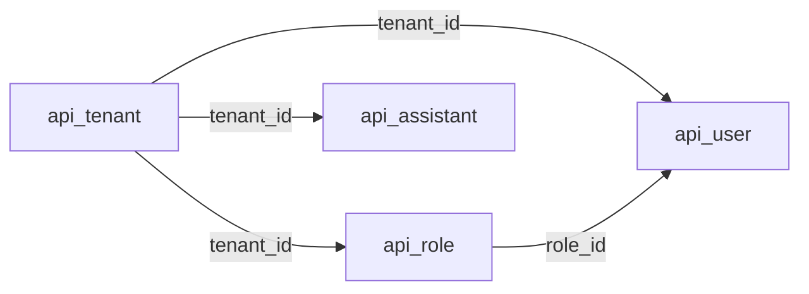

Legend: solid = declared FK. Children in other modules (documents, chats, LLM config) are shown in their own diagrams.

### 3.2 LLM providers and settings

**Purpose:** Tenant admins register providers (`openai`, `azure_openai`, `gemini`) with an encrypted API key, get a seeded model catalogue, and pick one enabled chat model and embedding model per tenant. Every LLM call resolves the provider through `get_llm_provider_for_tenant` (`utils/llm/factory.py:31-87`), which reads the enabled `TenantLLMSetting`, decrypts the key and, on decryption failure, marks the provider `key_status = 'needs_reentry'` (`factory.py:50`). Changing the embedding model or provider enqueues `regenerate_embeddings_for_tenant` (`api_rag/services/tenant_llm_resolver.py:124,234`), which writes embeddings (code in `api/tasks.py`, owned by 3.3). Files: `api/views/v1/llm.py`, `api/serializers/llm.py`, `api_rag/services/tenant_llm_resolver.py`, `utils/llm/factory.py`, `api/helpers/llm_models_seeder.py`, `utils/api_encryption.py`.

**Module metrics:** 7 distinct tables: 5 active, 0 deprecated/legacy, 0 apparently unused, 2 shared/uncertain (`api_resourcepage`, `api_documentembedding`, reached through the regeneration task). All 7 are also used by other modules.

**Tables used**

| Table | Usage status | Definition |
|---|---|---|
| `api_llmprovider` | Active (direct, owner) | [api_llmprovider](#table-api_llmprovider) (here) |
| `api_llmchatmodel` | Active (direct, owner) | [api_llmchatmodel](#table-api_llmchatmodel) (here) |
| `api_llmembeddingmodel` | Active (direct, owner) | [api_llmembeddingmodel](#table-api_llmembeddingmodel) (here) |
| `api_tenantllmsetting` | Active (direct, owner) | [api_tenantllmsetting](#table-api_tenantllmsetting) (here) |
| `api_tenant` | Active (direct, `Tenant.objects.get` by `external_id`) | [api_tenant](#table-api_tenant) (under 3.1) |
| `api_resourcepage` | Shared (via `regenerate_embeddings_for_tenant`) | [api_resourcepage](#table-api_resourcepage) (under 3.3) |
| `api_documentembedding` | Shared (via `regenerate_embeddings_for_tenant`) | [api_documentembedding](#table-api_documentembedding) (under 3.3) |

**Key database operations**

| Trigger | Operations | Evidence |
|---|---|---|
| Register provider | Duplicate check on `(tenant, provider_name, is_disabled)`, `LLMProvider` insert with encrypted key, then `seed_models_for_provider` (`update_or_create` of chat and embedding models, no explicit transaction) | `api/serializers/llm.py:190-218`, `api/helpers/llm_models_seeder.py:105-142` |
| Update provider | Serializer update; clears `key_status` when a key is saved; deletes cached decrypted key | `api/serializers/llm.py:222`, `api/views/v1/llm.py:995`, `utils/llm/factory.py:100` |
| `PATCH .../configured/<id>/status/` | Provider looked up by `id` and tenant and updated through the serializer; no hard delete of `LLMProvider` found in runtime code | `api/views/v1/llm.py:967-995` |
| List models | `LLMChatModel` / `LLMEmbeddingModel` by provider, `is_disabled` filter | `api/views/v1/llm.py:212-248,325-372` |
| `GET/POST/PUT ai/settings/tenant/` | `update_tenant_llm_settings`: validates provider and models are enabled and belong to the tenant's provider; switch runs in `transaction.atomic`: delete the previously disabled setting, disable the current one, insert the new one; enqueue regeneration when provider or embedding model changed | `api/views/v1/llm.py:438,647,907`, `api_rag/services/tenant_llm_resolver.py:42-235` (atomic at :207-234) |
| Any LLM call | `TenantLLMSetting.objects.get(tenant, is_disabled=False)`; decrypt; `UPDATE key_status` on failure | `utils/llm/factory.py:26,50` |

#### Table details

#### Table: api_llmprovider

**Table overview**

- Canonical name: `public.api_llmprovider` (model `LLMProvider`, `api/models/llm.py:15-30`; `ApiKeyStatus` at `:8-12`).
- Purpose: one configured LLM provider account per row, with its encrypted API key.
- Accessed by: LLM settings (3.2), and through the factory by Documents (3.3), Web chat (3.4), Tool loop (3.5), Slack (3.6); Offboarding (3.7).
- Classification: **Active**. Evidence: insert (`api/serializers/llm.py:209`), reads (`api/views/v1/llm.py:212,325,445,625,894,971`, `api_rag/services/tenant_llm_resolver.py:96,148`), `key_status` update (`utils/llm/factory.py:50`).
- Definition source: `0043` with `unique_together (tenant, provider_name)`; `0044` removed that uniqueness and set `get_latest_by`; `0052` added `key_status` and re-encrypted or flagged every stored key (RunPython `classify_and_encrypt_keys`).

**Attributes**

| Column | Database Type | Nullable | Default | Key/Constraint | Description |
|---|---|---|---|---|---|
| created | timestamp with time zone | No | none (set on insert) | | Row creation time |
| modified | timestamp with time zone | No | none (set on save) | | Last save time; `get_latest_by` |
| id | uuid | No | `uuid4()` (app) | PK | Provider id |
| tenant_id | uuid | No | | FK to `api_tenant.id` (CASCADE); index | Owning tenant |
| provider_name | varchar(50) | No | | no uniqueness since `0044` | `openai`, `azure_openai` or `gemini` (help text; no CHECK) |
| api_key | text | No | | | Fernet token encrypted with `API_KEY_ENCRYPTION_KEY` ([R6](#r6-encrypted-provider-keys)) |
| llm_host_url | varchar(200) | Yes | | | Optional custom endpoint (Azure); validated against internal hosts at save and at client build |
| metadata | jsonb | No | `{}` (app) | | Provider-specific fields (for example Azure API version); restricted to declared keys and bounded in size |
| is_disabled | boolean | No | `False` (app) | | Soft disable; disabled providers are skipped by lookups |
| key_status | varchar(20) | Yes | | choices `needs_reentry` (no CHECK); not editable | NULL = key usable; `needs_reentry` = cannot decrypt with the current key |

**Relationships**

| Direction | Related table | Columns | Cardinality | Enforcement | Modules |
|---|---|---|---|---|---|
| Out | [`api_tenant`](#table-api_tenant) | `tenant_id` | many to 1 | Declared FK, CASCADE | 3.2 |
| In | [`api_llmchatmodel`](#table-api_llmchatmodel) | `provider_id` | 1 to many | Declared FK, CASCADE | 3.2 |
| In | [`api_llmembeddingmodel`](#table-api_llmembeddingmodel) | `provider_id` | 1 to many | Declared FK, CASCADE | 3.2 |
| In | [`api_tenantllmsetting`](#table-api_tenantllmsetting) | `provider_id` | 1 to many | Declared FK, CASCADE | 3.2 |

**Additional details**

- Soft delete via `is_disabled`; hard delete only through tenant cascade, which must first remove embeddings because `api_documentembedding.embedding_model_id` is PROTECT (`api/helpers/tenant_offboarding.py:73-75`).
- Uniqueness of a provider name per tenant is enforced only in the serializer (`api/serializers/llm.py:195`) ([R8](#r8-tenant-invariants-enforced-only-in-application-code)).

#### Table: api_llmchatmodel

**Table overview**

- Canonical name: `public.api_llmchatmodel` (model `LLMChatModel`, `api/models/llm.py:33-46`).
- Purpose: chat model catalogue per provider, seeded from `api/helpers/llm_models_seeder.py:9-60`.
- Accessed by: LLM settings (3.2); via factory by Web chat (3.4), Tool loop (3.5), Slack (3.6); cascade in Offboarding (3.7).
- Classification: **Active**. Evidence: `update_or_create` (`llm_models_seeder.py:105,113`), reads (`api/serializers/llm.py:377,439`, `api/views/v1/llm.py:226`, `tenant_llm_resolver.py:102,158`).
- Definition source: `0043`.

**Attributes**

| Column | Database Type | Nullable | Default | Key/Constraint | Description |
|---|---|---|---|---|---|
| created | timestamp with time zone | No | none (set on insert) | | Row creation time |
| modified | timestamp with time zone | No | none (set on save) | | Last save time |
| id | uuid | No | `uuid4()` (app) | PK | Model id |
| provider_id | uuid | No | | FK to `api_llmprovider.id` (CASCADE); index; UNIQUE with `model_name` (`api_llmchatmodel_provider_id_model_name_7b181e19_uniq`) | Provider |
| model_name | varchar(100) | No | | UNIQUE with `provider_id` | Provider-facing name or Azure deployment name |
| base_model_name | varchar(100) | No | | | Underlying model (for example `gpt-4.1-mini`) |
| description | text | Yes | | | Free text |
| metadata | jsonb | No | `{}` (app) | | Model options |
| is_disabled | boolean | No | `False` (app) | | Soft disable; listing defaults to enabled only |

**Relationships**

| Direction | Related table | Columns | Cardinality | Enforcement | Modules |
|---|---|---|---|---|---|
| Out | [`api_llmprovider`](#table-api_llmprovider) | `provider_id` | many to 1 | Declared FK, CASCADE | 3.2 |
| In | [`api_tenantllmsetting`](#table-api_tenantllmsetting) | `chat_model_id` | 1 to many | Declared FK, CASCADE | 3.2 |

**Additional details**

- Seeder runs per provider on create and on model list calls (`api/views/v1/llm.py:250,374`) with `skip_existing=True`.

#### Table: api_llmembeddingmodel

**Table overview**

- Canonical name: `public.api_llmembeddingmodel` (model `LLMEmbeddingModel`, `api/models/llm.py:49-63`).
- Purpose: embedding model catalogue per provider, with its vector dimension.
- Accessed by: LLM settings (3.2), Documents (3.3), Web chat (3.4), Slack (3.6); cascade in Offboarding (3.7).
- Classification: **Active**. Evidence: `update_or_create` (`llm_models_seeder.py:134,142`), reads (`api/serializers/llm.py:387,451`, `api/views/v1/llm.py:339`, `tenant_llm_resolver.py:108,168`), `setting.embedding_model` loads (`utils/ai_util.py:130-131`, `utils/ai/generate_embeddings.py:173-174`, `api/tasks.py:271`).
- Definition source: `0043`.

**Attributes**

| Column | Database Type | Nullable | Default | Key/Constraint | Description |
|---|---|---|---|---|---|
| created | timestamp with time zone | No | none (set on insert) | | Row creation time |
| modified | timestamp with time zone | No | none (set on save) | | Last save time |
| id | uuid | No | `uuid4()` (app) | PK | Model id |
| provider_id | uuid | No | | FK to `api_llmprovider.id` (CASCADE); index; UNIQUE with `model_name` | Provider |
| model_name | varchar(100) | No | | UNIQUE with `provider_id` | Provider-facing name or deployment |
| base_model_name | varchar(100) | No | | | Underlying model (for example `text-embedding-3-small`) |
| dim | integer | No | | CHECK `dim >= 0` | Vector length produced by the model; copied into `api_documentembedding.dim` |
| description | text | Yes | | | Free text |
| metadata | jsonb | No | `{}` (app) | | Model options |
| is_disabled | boolean | No | `False` (app) | | Soft disable |

**Relationships**

| Direction | Related table | Columns | Cardinality | Enforcement | Modules |
|---|---|---|---|---|---|
| Out | [`api_llmprovider`](#table-api_llmprovider) | `provider_id` | many to 1 | Declared FK, CASCADE | 3.2 |
| In | [`api_tenantllmsetting`](#table-api_tenantllmsetting) | `embedding_model_id` | 1 to many | Declared FK, CASCADE | 3.2 |
| In | [`api_documentembedding`](#table-api_documentembedding) | `embedding_model_id` | 1 to many | Declared FK, PROTECT (Django) | 3.3 |

**Additional details**

- PROTECT from embeddings means a provider cascade fails while embeddings for its models exist; offboarding deletes embeddings first for that reason.

#### Table: api_tenantllmsetting

**Table overview**

- Canonical name: `public.api_tenantllmsetting` (model `TenantLLMSetting`, `api/models/llm.py:66-85`).
- Purpose: the tenant's selected provider, chat model and embedding model. At most one enabled row per tenant; the previous selection is kept disabled.
- Accessed by: LLM settings (3.2), Documents (3.3), Web chat (3.4), Slack (3.6), via factory by Tool loop (3.5), Offboarding (3.7).
- Classification: **Active**. Evidence: insert and switch (`tenant_llm_resolver.py:110,198-219`), reads (`utils/llm/factory.py:26`, `utils/ai_util.py:130,205`, `utils/ai/generate_embeddings.py:44,173`, `utils/ai/slackQuery.py:246`, `api/views/v1/llm.py:438,647,907`), `select_for_update` (`api/tasks.py:246,346`).
- Definition source: `0043` (constraint `unique_active_tenant_llm_setting`).

**Attributes**

| Column | Database Type | Nullable | Default | Key/Constraint | Description |
|---|---|---|---|---|---|
| created | timestamp with time zone | No | none (set on insert) | | Row creation time |
| modified | timestamp with time zone | No | none (set on save) | | Last save time |
| id | uuid | No | `uuid4()` (app) | PK | Setting id |
| tenant_id | uuid | No | | FK to `api_tenant.id` (CASCADE); index; partial unique index `unique_active_tenant_llm_setting (tenant_id) WHERE NOT is_disabled` | Tenant |
| provider_id | uuid | No | | FK to `api_llmprovider.id` (CASCADE); index | Selected provider |
| chat_model_id | uuid | No | | FK to `api_llmchatmodel.id` (CASCADE); index | Selected chat model |
| embedding_model_id | uuid | No | | FK to `api_llmembeddingmodel.id` (CASCADE); index | Selected embedding model; selects which embeddings retrieval reads |
| is_regenerating | boolean | No | `False` (app) | | True while `regenerate_embeddings_for_tenant` runs; set and cleared under row lock |
| is_disabled | boolean | No | `False` (app) | part of the partial unique index | Superseded selection |

**Relationships**

| Direction | Related table | Columns | Cardinality | Enforcement | Modules |
|---|---|---|---|---|---|
| Out | [`api_tenant`](#table-api_tenant) | `tenant_id` | many to 1 (1 enabled) | Declared FK, CASCADE | 3.2 |
| Out | [`api_llmprovider`](#table-api_llmprovider) | `provider_id` | many to 1 | Declared FK, CASCADE | 3.2 |
| Out | [`api_llmchatmodel`](#table-api_llmchatmodel) | `chat_model_id` | many to 1 | Declared FK, CASCADE | 3.2 |
| Out | [`api_llmembeddingmodel`](#table-api_llmembeddingmodel) | `embedding_model_id` | many to 1 | Declared FK, CASCADE | 3.2 |

**Additional details**

- Leaf table. History is limited to one disabled row: the switch deletes older disabled rows first (`tenant_llm_resolver.py:207-216`).
- Nothing in the database ties `provider_id`, `chat_model_id` and `embedding_model_id` to the same provider or `provider_id` to the same tenant ([R8](#r8-tenant-invariants-enforced-only-in-application-code)).
- A stuck `is_regenerating = true` is possible if a worker dies between the two locked updates; the `finally` block only covers Python exceptions (`api/tasks.py:344-352`).

**Module relationship diagram**

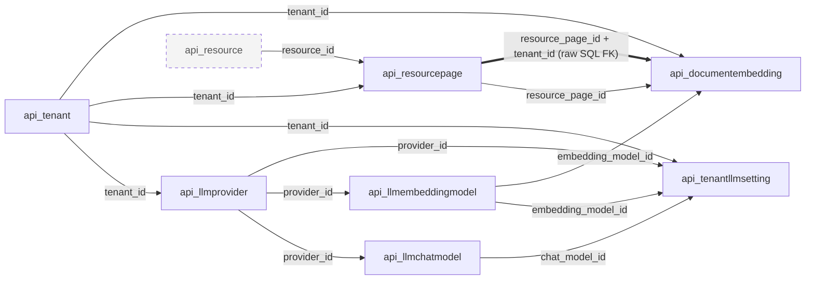

Legend: solid = declared Django FK; thick = FK declared only in migration `0050` raw SQL; dashed grey = table outside this module.

### 3.3 Documents and embeddings

**Purpose:** HR uploads policy documents (PDF, DOC, DOCX) to S3 through presigned URLs; the row records access grants (all members, roles, specific users), assistants, an optional `supersedes` link to the policy it replaces and an `effective_date`. When the frontend reports the upload complete, a Celery chain renders a preview, extracts page text (LlamaParse), embeds each page with the tenant's embedding model and generates suggested questions. Changing the tenant's embedding model regenerates missing embeddings. Files: `api/views/v1/resource.py`, `api/serializers/resource.py`, `api/models/resource.py`, `api/tasks.py:148-352`, `utils/ai/generate_embeddings.py`, `utils/ai/generate_preview.py`, `utils/ai/generate_suggestions.py`, `utils/s3.py`. `attachments/` (`api/views/v1/attachment.py`) proxies finance-service presigned URLs and touches no table.

**Module metrics:** 14 distinct tables: 13 active, 0 deprecated/legacy, 0 apparently unused, 1 shared/uncertain (`api_llmprovider`, reached through `EmbeddingService` and the factory). All 14 are also used by other modules.

**Tables used**

| Table | Usage status | Definition |
|---|---|---|
| `api_resource` | Active (direct, owner) | [api_resource](#table-api_resource) (here) |
| `api_resource_roles` | Active (direct, owner) | [api_resource_roles](#table-api_resource_roles) (here) |
| `api_resource_specific_users` | Active (direct, owner) | [api_resource_specific_users](#table-api_resource_specific_users) (here) |
| `api_resource_assistants` | Active (direct, owner) | [api_resource_assistants](#table-api_resource_assistants) (here) |
| `api_resourcepage` | Active (direct, owner) | [api_resourcepage](#table-api_resourcepage) (here) |
| `api_documentembedding` | Active (direct, owner) | [api_documentembedding](#table-api_documentembedding) (here) |
| `api_suggestion` | Active (direct, owner: written by `generate_suggestion_queries`) | [api_suggestion](#table-api_suggestion) (here) |
| `api_tenant` | Active (direct: `select_related("tenant")`, FK writes) | [api_tenant](#table-api_tenant) (under 3.1) |
| `api_user` | Active (direct: `uploaded_by`, `specific_users`, `Resource.save` lookup) | [api_user](#table-api_user) (under 3.1) |
| `api_role` | Active (direct: grants, access filter) | [api_role](#table-api_role) (under 3.1) |
| `api_assistant` | Active (direct: grants, list filter) | [api_assistant](#table-api_assistant) (under 3.1) |
| `api_tenantllmsetting` | Active (direct: active setting, row lock) | [api_tenantllmsetting](#table-api_tenantllmsetting) (under 3.2) |
| `api_llmembeddingmodel` | Active (direct: `setting.embedding_model`) | [api_llmembeddingmodel](#table-api_llmembeddingmodel) (under 3.2) |
| `api_llmprovider` | Shared (via `utils/llm/factory.py` and `decrypt_api_key`) | [api_llmprovider](#table-api_llmprovider) (under 3.2) |

**Key database operations**

| Trigger | Operations | Evidence |
|---|---|---|
| `POST resources/generate-presigned-url` | `Resource` insert with `uploaded_by=request.user`, `tenant=request.user.tenant`; M2M writes to `roles`, `specific_users`, `assistants` through the `ModelSerializer`; grants validated to the same tenant | `api/views/v1/resource.py:64-74`, `api/serializers/resource.py:13-60` |
| `PUT resources/<id>/update-upload-status/` | `upload_status` save; on `Completed` without preview, `process_resource_instance.delay` | `api/views/v1/resource.py:120-139` |
| Celery `process_resource_instance` | tenant active check (HTTP); preview flag update; `store_document`; `Suggestion` inserts | `api/tasks.py:207-225,148-203` |
| `store_document` | per page: `ResourcePage.get_or_create(resource, page_no)` then content update; `DocumentEmbedding.update_or_create(tenant, resource_page, embedding_model)` | `utils/ai/generate_embeddings.py:165-204` |
| `GET resources/` | `accessible_resources`: tenant + (`is_applicable_to_all` or `specific_users` or `uploaded_by` or `roles`), `distinct()`, optional `name__icontains`, `file_type`, `assistants__id` | `api/views/v1/resource.py:28-46,163-188` |
| `PUT resources/<id>/` | Serializer update; `supersedes` validation (same tenant, not itself, target not already superseded); `roles.clear()` and `specific_users.clear()` when `is_applicable_to_all` | `api/views/v1/resource.py:249-259`, `api/serializers/resource.py:95-136` |
| `DELETE resources/<id>/` | Refuse when `superseded_by.exists()`; delete S3 objects; `instance.delete()` (cascade to pages, embeddings, suggestions, citations, grants); `ProtectedError` caught | `api/views/v1/resource.py:270-293` |
| Celery `regenerate_embeddings_for_tenant` | `select_for_update` on the setting to set `is_regenerating`; iterate `ResourcePage` of the tenant (`iterator(chunk_size=100)`); skip pages with an enabled embedding for the model; insert `DocumentEmbedding`; clear flag under lock | `api/tasks.py:242-352` |

#### Table details

#### Table: api_resource

**Table overview**

- Canonical name: `public.api_resource` (model `Resource`, `api/models/resource.py:19-116`; `UploadStatusChoices` at `:13-16`).
- Purpose: one uploaded policy document: file metadata, processing state, access grants, version link.
- Accessed by: Documents (3.3), Web chat (3.4), Slack (3.6), Offboarding (3.7).
- Classification: **Active**. Evidence: insert (`api/views/v1/resource.py:72`), reads (`resource.py:34-46,108,163,227`, `api/tasks.py:149,167,189,210`, `api/serializers/chat.py:99`, `api/views/v1/chat.py:148`, `utils/ai_util.py:140`, `utils/ai/slackQuery.py:253`), delete (`resource.py:292`).
- Definition source: `0009`; `0015` `assistants`; `0018` `is_applicable_to_all`, `roles`, `specific_users`, `updated_file_name`; `0019` `content` and `embeddings vector(768)` (both removed in `0043`); `0024` `uploaded_by`; `0049` `tenant` with backfill from uploader; `0051` `tenant` NOT NULL after deleting 8 approved orphans; `0054` `effective_date`, `supersedes`.

**Attributes**

| Column | Database Type | Nullable | Default | Key/Constraint | Description |
|---|---|---|---|---|---|
| created | timestamp with time zone | No | none (set on insert) | | Upload row creation |
| modified | timestamp with time zone | No | none (set on save) | | Last save; list ordering `-modified` |
| id | uuid | No | `uuid4()` (app) | PK | Document id; part of the S3 key `{RESOURCES_FILE_PATH}/{id}_{name}` (`resource.py:91-92`) |
| name | varchar(100) | No | | | Original file name; part of the S3 key and preview key |
| updated_file_name | varchar(100) | Yes | | | Display name set by HR |
| size | integer | No | | | File size in bytes (inferred from upload payload) |
| file_type | varchar(100) | No | | validated to `application/pdf`, `pdf`, `doc`, `docx` in serializer | File type |
| upload_status | varchar(20) | No | `'Pending'` (app) | choices `Pending`, `Completed`, `Failed` (no CHECK) | Client-reported upload state; `Completed` triggers processing |
| is_preview_generated | boolean | No | `False` (app) | | Set by preview task (`api/tasks.py:160`) |
| is_processed | boolean | No | `False` (app) | | Set after embedding (`api/tasks.py:179-181`); no logic read found ([R12](#r12-write-only-and-unused-columns)) |
| supersedes_id | uuid | Yes | | FK to `api_resource.id` (PROTECT in Django); index | Policy this upload replaces. "Superseded" is derived from the reverse link; no stored flag by design (`resource.py:33-56`) |
| effective_date | date | Yes | | | Recorded at upload, read by nothing on purpose (`resource.py:57-67`) |
| is_applicable_to_all | boolean | No | `False` (app) | | Grant to every member of the tenant |
| uploaded_by_id | uuid | Yes | | FK to `api_user.id` (CASCADE); index | Uploader; read-only through the API |
| tenant_id | uuid | No | | FK to `api_tenant.id` (CASCADE); index; not editable | Document tenant, set on create from the uploader (`resource.py:80-89`) |

**Relationships**

| Direction | Related table | Columns | Cardinality | Enforcement | Modules |
|---|---|---|---|---|---|
| Out | [`api_tenant`](#table-api_tenant) | `tenant_id` | many to 1 | Declared FK, CASCADE | 3.3 |
| Out | [`api_user`](#table-api_user) | `uploaded_by_id` | many to 0..1 | Declared FK, CASCADE | 3.3 |
| Self | [`api_resource`](#table-api_resource) | `supersedes_id` to `id` | many to 0..1 (validation keeps it 1 to 0..1) | Declared FK, PROTECT | 3.3 |
| In | [`api_resource_roles`](#table-api_resource_roles) | `resource_id` | 1 to many | Declared FK, CASCADE | 3.3 |
| In | [`api_resource_specific_users`](#table-api_resource_specific_users) | `resource_id` | 1 to many | Declared FK, CASCADE | 3.3 |
| In | [`api_resource_assistants`](#table-api_resource_assistants) | `resource_id` | 1 to many | Declared FK, CASCADE | 3.3 |
| In | [`api_resourcepage`](#table-api_resourcepage) | `resource_id` | 1 to many | Declared FK, CASCADE | 3.3 |
| In | [`api_suggestion`](#table-api_suggestion) | `resource_id` | 1 to many | Declared FK, CASCADE | 3.3, 3.4 |
| External | S3 | `id`, `name` build object keys | 1 to 2 objects | None | 3.3, 3.7 |

**Additional details**

- Only self-reference in the schema. A chain v3 to v2 to v1 is blocked when the target is already superseded (`api/serializers/resource.py:103-109`), but the database allows it.
- Retrieval for answers does not exclude superseded documents and does not include `uploaded_by` in its access rule, unlike the list view (`utils/ai_util.py:140-147` versus `api/views/v1/resource.py:36-46`). Not a schema issue; relevant when reimplementing queries.
- Migration risks: S3 key derivation from `id` and `name` ([R5](#r5-pgvector-storage-and-search) notes derived data), PROTECT self-reference blocks tenant cascade ([R4](#r4-tenant-offboarding-versus-supersedes-protect)).

#### Table: api_resource_roles

**Table overview**

- Canonical name: `public.api_resource_roles` (auto-created through table of `Resource.roles`, `api/models/resource.py:70`).
- Purpose: grants a document to roles.
- Accessed by: Documents (3.3), Web chat (3.4), Slack (3.6); cascade in Offboarding (3.7).
- Classification: **Active**. Evidence: serializer M2M writes and `clear()` (`api/serializers/resource.py:130-136`), access filters `Q(roles=...)` (`api/views/v1/resource.py:42`, `utils/ai_util.py:145`, `utils/ai/slackQuery.py:253`).
- Definition source: `0018`.

**Attributes**

| Column | Database Type | Nullable | Default | Key/Constraint | Description |
|---|---|---|---|---|---|
| id | bigint | No | identity (current Django DDL; unverified live, [R16](#r16-live-identity-and-index-state-unverified)) | PK | Row id |
| resource_id | uuid | No | | FK to `api_resource.id` (CASCADE); index; UNIQUE with `role_id` | Document |
| role_id | uuid | No | | FK to `api_role.id` (CASCADE); index | Granted role |

**Relationships**

| Direction | Related table | Columns | Cardinality | Enforcement | Modules |
|---|---|---|---|---|---|
| Out | [`api_resource`](#table-api_resource) | `resource_id` | many to 1 | Declared FK, CASCADE | 3.3 |
| Out | [`api_role`](#table-api_role) | `role_id` | many to 1 | Declared FK, CASCADE | 3.3 |

**Additional details**

- Junction table, no timestamps. Same-tenant rule enforced only in the serializer ([R8](#r8-tenant-invariants-enforced-only-in-application-code)).

#### Table: api_resource_specific_users

**Table overview**

- Canonical name: `public.api_resource_specific_users` (through table of `Resource.specific_users`, `api/models/resource.py:71`).
- Purpose: grants a document to individual members.
- Accessed by: Documents (3.3), Web chat (3.4), Slack (3.6); cascade in Offboarding (3.7).
- Classification: **Active**. Evidence: serializer writes and `clear()` (`api/serializers/resource.py:130-136`), filters (`api/views/v1/resource.py:38`, `utils/ai_util.py:144`, `utils/ai/slackQuery.py:253`).
- Definition source: `0018`.

**Attributes**

| Column | Database Type | Nullable | Default | Key/Constraint | Description |
|---|---|---|---|---|---|
| id | bigint | No | identity (unverified live) | PK | Row id |
| resource_id | uuid | No | | FK to `api_resource.id` (CASCADE); index; UNIQUE with `user_id` | Document |
| user_id | uuid | No | | FK to `api_user.id` (CASCADE); index | Granted member |

**Relationships**

| Direction | Related table | Columns | Cardinality | Enforcement | Modules |
|---|---|---|---|---|---|
| Out | [`api_resource`](#table-api_resource) | `resource_id` | many to 1 | Declared FK, CASCADE | 3.3 |
| Out | [`api_user`](#table-api_user) | `user_id` | many to 1 | Declared FK, CASCADE | 3.3 |

**Additional details**

- Junction table, no timestamps.

#### Table: api_resource_assistants

**Table overview**

- Canonical name: `public.api_resource_assistants` (through table of `Resource.assistants`, `api/models/resource.py:72`).
- Purpose: attaches a document to assistants; used to filter the document list.
- Accessed by: Documents (3.3); cascade in Offboarding (3.7).
- Classification: **Active**. Evidence: serializer writes, list filter `assistants__id` (`api/views/v1/resource.py:186`), nested read (`ResourceListSerializer`, `api/serializers/resource.py:139-150`). Not used by retrieval.
- Definition source: `0015`.

**Attributes**

| Column | Database Type | Nullable | Default | Key/Constraint | Description |
|---|---|---|---|---|---|
| id | bigint | No | identity (unverified live) | PK | Row id |
| resource_id | uuid | No | | FK to `api_resource.id` (CASCADE); index; UNIQUE with `assistant_id` | Document |
| assistant_id | uuid | No | | FK to `api_assistant.id` (CASCADE); index | Assistant |

**Relationships**

| Direction | Related table | Columns | Cardinality | Enforcement | Modules |
|---|---|---|---|---|---|
| Out | [`api_resource`](#table-api_resource) | `resource_id` | many to 1 | Declared FK, CASCADE | 3.3 |
| Out | [`api_assistant`](#table-api_assistant) | `assistant_id` | many to 1 | Declared FK, CASCADE | 3.3 |

**Additional details**

- Migration `0051` removed links from 9 tenant-owned documents to the deleted orphan assistant (copied to the backup table first).

#### Table: api_resourcepage

**Table overview**

- Canonical name: `public.api_resourcepage` (model `ResourcePage`, `api/models/resource.py:119-141`).
- Purpose: extracted text of one page (chunk) of a document; source text for embeddings and citations.
- Accessed by: Documents (3.3), LLM settings (3.2, via regeneration), Web chat (3.4), Slack (3.6), Offboarding (3.7).
- Classification: **Active**. Evidence: `get_or_create` and content update (`utils/ai/generate_embeddings.py:183-191`), regeneration read (`api/tasks.py:300`), citation lookup (`utils/ai_util.py:534`), joins from embeddings (`utils/ai_util.py:159`), count (`api/helpers/tenant_offboarding.py:52`).
- Definition source: `0021` (with `embeddings vector(768)`); `0029` ivfflat index on `embeddings`; `0038`-`0043` embedding column churn, finally removed in `0043`; `0041`/`0043` `unique_together (resource, page_no)`; `0050` `tenant` with backfill, unique `(id, tenant)` and the composite FK target; `0051` `tenant` NOT NULL.

**Attributes**

| Column | Database Type | Nullable | Default | Key/Constraint | Description |
|---|---|---|---|---|---|
| created | timestamp with time zone | No | none (set on insert) | | Row creation time |
| modified | timestamp with time zone | No | none (set on save) | | Last save time |
| id | uuid | No | `uuid4()` (app) | PK; UNIQUE with `tenant_id` (`api_resourcepage_id_tenant_uniq`) | Page id |
| resource_id | uuid | No | | FK to `api_resource.id` (CASCADE); index; UNIQUE with `page_no` | Document |
| content | text | Yes | | | Page text; embeddings are generated from it |
| page_no | integer | No | `0` (app) | CHECK `page_no >= 0`; UNIQUE with `resource_id` | 1-based page number as written by `store_document` |
| tenant_id | uuid | No | | FK to `api_tenant.id` (CASCADE); index; not editable | Copy of the document's tenant, target of the composite FK |

**Relationships**

| Direction | Related table | Columns | Cardinality | Enforcement | Modules |
|---|---|---|---|---|---|
| Out | [`api_resource`](#table-api_resource) | `resource_id` | many to 1 | Declared FK, CASCADE | 3.3 |
| Out | [`api_tenant`](#table-api_tenant) | `tenant_id` | many to 1 | Declared FK, CASCADE | 3.3 |
| In | [`api_documentembedding`](#table-api_documentembedding) | `resource_page_id` | 1 to many (one per embedding model) | Declared FK, CASCADE | 3.3 |
| In | [`api_documentembedding`](#table-api_documentembedding) | `(resource_page_id, tenant_id)` to `(id, tenant_id)` | 1 to many | Raw SQL FK `api_documentembedding_page_tenant_fk`, not deferrable | 3.3 |
| In | [`api_chathistoryresourcepage`](#table-api_chathistoryresourcepage) | `resource_page_id` | 1 to many | Declared FK, CASCADE | 3.4 |
| In | [`api_slackchathistoryresourcepage`](#table-api_slackchathistoryresourcepage) | `resource_page_id` | 1 to many | Declared FK, CASCADE | 3.6 |

**Additional details**

- Re-processing a document updates pages by `page_no` but never deletes pages beyond the new page count ([R11](#r11-growth-retention-and-stale-derived-rows)).
- `api_resourcepage.tenant_id` must equal `api_resource.tenant_id`; only `save()` sets it (`resource.py:138-141`).

#### Table: api_documentembedding

**Table overview**

- Canonical name: `public.api_documentembedding` (model `DocumentEmbedding`, `api/models/resource.py:144-158`).
- Purpose: one embedding vector per page per embedding model; searched by cosine distance.
- Accessed by: Documents (3.3), LLM settings (3.2), Web chat (3.4), Slack (3.6), Offboarding (3.7).
- Classification: **Active**. Evidence: `update_or_create` (`utils/ai/generate_embeddings.py:195`), insert (`api/tasks.py:327`), vector search (`utils/ai_util.py:151-161`, `utils/ai/slackQuery.py:273-282`), delete (`api/helpers/tenant_offboarding.py:75`).
- Definition source: `0043`; composite FK added by raw SQL in `0050`.

**Attributes**

| Column | Database Type | Nullable | Default | Key/Constraint | Description |
|---|---|---|---|---|---|
| created | timestamp with time zone | No | none (set on insert) | | Row creation time |
| modified | timestamp with time zone | No | none (set on save) | | Last save time |
| id | uuid | No | `uuid4()` (app) | PK | Embedding id |
| tenant_id | uuid | No | | FK to `api_tenant.id` (CASCADE); index; in UNIQUE `(tenant_id, resource_page_id, embedding_model_id)`; in composite FK | Tenant, must match the page's tenant |
| resource_page_id | uuid | No | | FK to `api_resourcepage.id` (CASCADE); index; in UNIQUE; in composite FK | Page embedded |
| embedding_model_id | uuid | No | | FK to `api_llmembeddingmodel.id` (PROTECT); index; in UNIQUE | Model that produced the vector |
| embeddings | vector (no dimension) | No | | no index | pgvector value; dimension depends on the model ([R5](#r5-pgvector-storage-and-search)) |
| dim | integer | No | | CHECK `dim >= 0` | Copy of `api_llmembeddingmodel.dim` at write time |
| is_disabled | boolean | No | `False` (app) | | Retrieval filters `is_disabled = false`; no code sets it true ([R12](#r12-write-only-and-unused-columns)) |

**Relationships**

| Direction | Related table | Columns | Cardinality | Enforcement | Modules |
|---|---|---|---|---|---|
| Out | [`api_tenant`](#table-api_tenant) | `tenant_id` | many to 1 | Declared FK, CASCADE | 3.3 |
| Out | [`api_resourcepage`](#table-api_resourcepage) | `resource_page_id` | many to 1 | Declared FK, CASCADE | 3.3 |
| Out | [`api_resourcepage`](#table-api_resourcepage) | `(resource_page_id, tenant_id)` | many to 1 | Raw SQL FK `api_documentembedding_page_tenant_fk` (`0050`), immediate | 3.3 |
| Out | [`api_llmembeddingmodel`](#table-api_llmembeddingmodel) | `embedding_model_id` | many to 1 | Declared FK, PROTECT | 3.2, 3.3 |

**Additional details**

- Search query: filter `tenant`, `embedding_model_id` (from the enabled setting), `resource_page__resource_id__in` (accessible ids), `is_disabled = false`; `select_related` page and resource; `annotate(similarity=RawSQL("api_documentembedding.embeddings <=> %s::vector"))`; `order_by("similarity")` (`utils/ai_util.py:138-161`). The table name is hard-coded in the raw SQL.
- Leaf table. Derived data: can be rebuilt from `api_resourcepage.content` by `regenerate_embeddings_for_tenant`, at the cost of provider API calls.

#### Table: api_suggestion

**Table overview**

- Canonical name: `public.api_suggestion` (model `Suggestion`, `api/models/suggestion.py:7-12`).
- Purpose: LLM-generated sample questions per document, shown as chat suggestions.
- Accessed by: Documents (3.3, writer), Web chat (3.4, reader); cascade in Offboarding (3.7).
- Classification: **Active**. Evidence: insert (`api/tasks.py:203`), read (`api/views/v1/chat.py:134-150`).
- Definition source: `0020_suggestion`.

**Attributes**

| Column | Database Type | Nullable | Default | Key/Constraint | Description |
|---|---|---|---|---|---|
| created | timestamp with time zone | No | none (set on insert) | | Row creation time |
| modified | timestamp with time zone | No | none (set on save) | | Last save time |
| id | uuid | No | `uuid4()` (app) | PK | Suggestion id |
| resource_id | uuid | No | | FK to `api_resource.id` (CASCADE); index | Source document |
| suggestion | text | No | | | Question text |
| is_active | boolean | No | `True` (app) | | Never written or filtered by app code ([R12](#r12-write-only-and-unused-columns)) |

**Relationships**

| Direction | Related table | Columns | Cardinality | Enforcement | Modules |
|---|---|---|---|---|---|
| Out | [`api_resource`](#table-api_resource) | `resource_id` | many to 1 | Declared FK, CASCADE | 3.3, 3.4 |

**Additional details**

- Inserts are not deduplicated; re-processing a document adds a new batch ([R11](#r11-growth-retention-and-stale-derived-rows)).

**Module relationship diagram (part 1: documents and grants)**

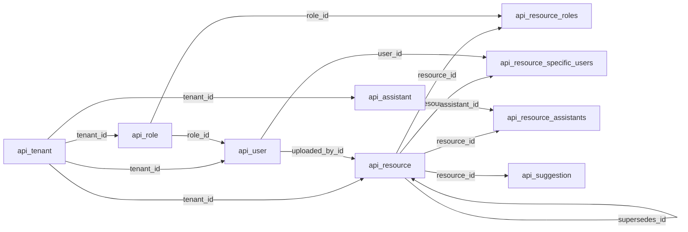

**Module relationship diagram (part 2: pages, embeddings and model selection)**

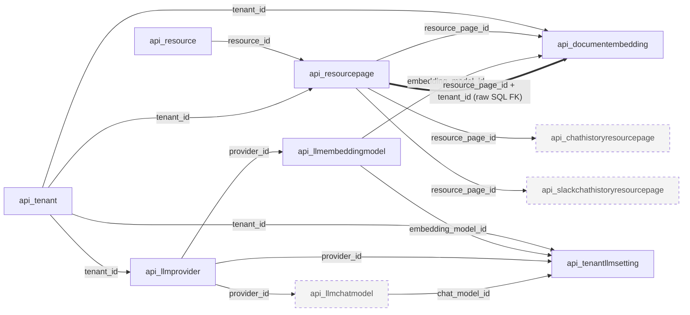

Legend: solid = declared Django FK; thick = FK declared only in migration `0050` raw SQL; dashed grey = outside this module (citation tables show where page deletes cascade).

### 3.4 Web chat and RAG answers

**Purpose:** The web assistant. A chat belongs to a member; each user message is stored immediately, then answered (asynchronously through Celery `process_chat_query` or synchronously) by `answer_query` (`utils/ai_util.py`): active deterministic flow sessions are checked in Redis, documents are searched with pgvector, the tool loop may call other services, and the answer is stored with its page citations. A rolling summary per chat feeds later turns. Files: `api/views_v2.py`, `api/views/v1/chat.py`, `api/serializers/chat.py`, `api/chat_turns.py`, `api/tasks.py:29-140`, `utils/ai_util.py`, `api_rag/chat.py`, `api_rag/services/summarizer.py`.

**Module metrics:** 18 distinct tables: 15 active, 0 deprecated/legacy, 0 apparently unused, 3 shared/uncertain (`api_llmprovider`, `api_llmchatmodel` via the factory; `api_chatapiresponse` via the tool loop). All 18 are also used by other modules.

**Tables used**

| Table | Usage status | Definition |
|---|---|---|
| `api_chat` | Active (direct, owner) | [api_chat](#table-api_chat) (here) |
| `api_chathistory` | Active (direct, owner) | [api_chathistory](#table-api_chathistory) (here) |
| `api_chathistoryresourcepage` | Active (direct, owner) | [api_chathistoryresourcepage](#table-api_chathistoryresourcepage) (here) |
| `api_chatsummary` | Active (direct, owner) | [api_chatsummary](#table-api_chatsummary) (here) |
| `api_suggestion` | Active (direct, read) | [api_suggestion](#table-api_suggestion) (under 3.3) |
| `api_resource` | Active (direct, access filter, citation join) | [api_resource](#table-api_resource) (under 3.3) |
| `api_resource_roles` | Active (direct, join in access filter) | [api_resource_roles](#table-api_resource_roles) (under 3.3) |
| `api_resource_specific_users` | Active (direct, join in access filter) | [api_resource_specific_users](#table-api_resource_specific_users) (under 3.3) |
| `api_resourcepage` | Active (direct, citations) | [api_resourcepage](#table-api_resourcepage) (under 3.3) |
| `api_documentembedding` | Active (direct, vector search) | [api_documentembedding](#table-api_documentembedding) (under 3.3) |
| `api_tenant` | Active (direct) | [api_tenant](#table-api_tenant) (under 3.1) |
| `api_user` | Active (direct, chat owner) | [api_user](#table-api_user) (under 3.1) |
| `api_role` | Active (direct, `user.role`) | [api_role](#table-api_role) (under 3.1) |
| `api_tenantllmsetting` | Active (direct) | [api_tenantllmsetting](#table-api_tenantllmsetting) (under 3.2) |
| `api_llmembeddingmodel` | Active (direct, `settings.embedding_model`) | [api_llmembeddingmodel](#table-api_llmembeddingmodel) (under 3.2) |
| `api_llmprovider` | Shared (via `get_llm_provider_for_tenant`) | [api_llmprovider](#table-api_llmprovider) (under 3.2) |
| `api_llmchatmodel` | Shared (via `get_llm_provider_for_tenant`) | [api_llmchatmodel](#table-api_llmchatmodel) (under 3.2) |
| `api_chatapiresponse` | Shared (via `_record_api_response` in the tool loop) | [api_chatapiresponse](#table-api_chatapiresponse) (under 3.5) |

**Key database operations**

| Trigger | Operations | Evidence |
|---|---|---|
| `GET/POST chat/` | `Chat` list for the user; insert with `user=request.user` | `api/views/v1/chat.py:49,69-72` |
| `GET chat/<id>/history/` | `ChatHistory` list; serializer reads `ChatHistoryResourcePage` then page and resource | `api/views/v1/chat.py:106,122`, `api/serializers/chat.py:29-35` |
| `DELETE chat/<id>/` | `Chat` delete, cascading history, citations, summary, stored API responses | `api/views/v1/chat.py:210-219` |
| `POST chat/<id>/query/` | Chat lookup scoped by `id`, `user__external_id`, `user__tenant__external_id`; user message `ChatHistory` insert; `process_chat_query.delay` or sync path; answer `ChatHistory` insert and one `ChatHistoryResourcePage` per cited page | `api/views_v2.py:180,290-298,336`, `api/chat_turns.py:15-46`, `api/tasks.py:65,95,100` |
| `answer_query` | `Tenant` get, enabled setting, accessible resource ids, vector search, `ChatSummary` read, citation `ResourcePage` lookup limited to retrieved resources, `update_chat_summary` | `utils/ai_util.py:125-161,204-205,392,528-538`, `api_rag/services/summarizer.py:42-53` |
| `POST chat/<id>/execute-action/` | Chat lookup (same scope); confirmed write runs through the tool loop; answer `ChatHistory` insert | `api/views_v2.py:445-470` |
| `GET suggestions/` | `Suggestion` filtered to the user's accessible resources | `api/views/v1/chat.py:134-150` |

#### Table details

#### Table: api_chat

**Table overview**

- Canonical name: `public.api_chat` (model `Chat`, `api/models/chat.py:7-10`).
- Purpose: one web conversation owned by a member.
- Accessed by: Web chat (3.4), Tool loop (3.5, FK parent only), Offboarding (3.7).
- Classification: **Active**. Evidence: list, create, lookup, delete (`api/views/v1/chat.py:49,69-72,122,210-219`, `api/views_v2.py:180,453`, `api/tasks.py:65`), count (`api/helpers/tenant_offboarding.py:54`).
- Definition source: `0010`; `user` added by `0024` (nullable).

**Attributes**

| Column | Database Type | Nullable | Default | Key/Constraint | Description |
|---|---|---|---|---|---|
| created | timestamp with time zone | No | none (set on insert) | | Chat start |
| modified | timestamp with time zone | No | none (set on save) | | Last save of the chat row (not updated per message) |
| id | uuid | No | `uuid4()` (app) | PK | Chat id used in routes |
| user_id | uuid | Yes | | FK to `api_user.id` (CASCADE); index | Owner. Nullable since rows before `0024` had none ([R9](#r9-nullable-owners-and-orphan-rows)) |

**Relationships**

| Direction | Related table | Columns | Cardinality | Enforcement | Modules |
|---|---|---|---|---|---|
| Out | [`api_user`](#table-api_user) | `user_id` | many to 0..1 | Declared FK, CASCADE | 3.4 |
| In | [`api_chathistory`](#table-api_chathistory) | `chat_id` | 1 to many | Declared FK, CASCADE | 3.4 |
| In | [`api_chatsummary`](#table-api_chatsummary) | `chat_id` | 1 to 0..1 | Declared FK (unique), CASCADE | 3.4 |
| In | [`api_chatapiresponse`](#table-api_chatapiresponse) | `chat_id` | 1 to many | Declared FK, CASCADE | 3.5 |

**Additional details**

- No tenant column: tenant is reached through `user.tenant`. Chats with `user_id` NULL belong to no tenant.

#### Table: api_chathistory

**Table overview**

- Canonical name: `public.api_chathistory` (model `ChatHistory`, `api/models/chat.py:13-23`).
- Purpose: transcript messages of a web chat, user and assistant sides.
- Accessed by: Web chat (3.4), Offboarding (3.7).
- Classification: **Active**. Evidence: inserts (`api/chat_turns.py:25,46`, `api/tasks.py:95`, `api/views_v2.py:290,468`), list (`api/views/v1/chat.py:106`), count (`api/helpers/tenant_offboarding.py:55`).
- Definition source: `0010`; `0011` altered `chat`; `0024`/`0025` added and removed `document_name`, `page_no`; `0030`/`0031` added and removed `api_response`; `0032` `is_api_response`, `0033`/`0034` `metadata` added and removed; `0035` removed `is_api_response`; `0036` re-added it; `0046` `attachments`.

**Attributes**

| Column | Database Type | Nullable | Default | Key/Constraint | Description |
|---|---|---|---|---|---|
| created | timestamp with time zone | No | none (set on insert) | | Message time; history ordering |
| modified | timestamp with time zone | No | none (set on save) | | Last save time |
| id | uuid | No | `uuid4()` (app) | PK | Message id |
| chat_id | uuid | No | | FK to `api_chat.id` (CASCADE); index | Conversation |
| message | text | No | | | Message text; assistant answers include a markdown table of records when present (`api/views_v2.py:280-288`) |
| is_user | boolean | No | `True` (app) | | Sender side |
| is_api_response | boolean | No | `False` (app) | | Answer came from other services' APIs |
| attachments | jsonb | No | `[]` (app) | | Attachment descriptors for the user message; files live in finance-service (cross-service, no FK) |

**Relationships**

| Direction | Related table | Columns | Cardinality | Enforcement | Modules |
|---|---|---|---|---|---|
| Out | [`api_chat`](#table-api_chat) | `chat_id` | many to 1 | Declared FK, CASCADE | 3.4 |
| In | [`api_chathistoryresourcepage`](#table-api_chathistoryresourcepage) | `chat_history_id` | 1 to many | Declared FK, CASCADE | 3.4 |
| Cross-service | finance-service attachments | ids in `attachments` | | None | 3.4 |

**Additional details**

- Insert-only; no retention ([R11](#r11-growth-retention-and-stale-derived-rows)). Writes of the user side and failed turns swallow errors by design (`api/chat_turns.py:15-46`).

#### Table: api_chathistoryresourcepage

**Table overview**

- Canonical name: `public.api_chathistoryresourcepage` (model `ChatHistoryResourcePage`, `api/models/chat.py:26-33`).
- Purpose: citations: which document pages an assistant message used.
- Accessed by: Web chat (3.4); cascade in Offboarding (3.7).
- Classification: **Active**. Evidence: inserts (`api/tasks.py:100`, `api/views_v2.py:295`), read (`api/serializers/chat.py:35`).
- Definition source: `0025`.

**Attributes**

| Column | Database Type | Nullable | Default | Key/Constraint | Description |
|---|---|---|---|---|---|
| created | timestamp with time zone | No | none (set on insert) | | Row creation time |
| modified | timestamp with time zone | No | none (set on save) | | Last save time |
| id | uuid | No | `uuid4()` (app) | PK | Row id |
| chat_history_id | uuid | No | | FK to `api_chathistory.id` (CASCADE); index; UNIQUE with `resource_page_id` | Assistant message |
| resource_page_id | uuid | No | | FK to `api_resourcepage.id` (CASCADE); index | Cited page |

**Relationships**

| Direction | Related table | Columns | Cardinality | Enforcement | Modules |
|---|---|---|---|---|---|
| Out | [`api_chathistory`](#table-api_chathistory) | `chat_history_id` | many to 1 | Declared FK, CASCADE | 3.4 |
| Out | [`api_resourcepage`](#table-api_resourcepage) | `resource_page_id` | many to 1 | Declared FK, CASCADE | 3.3, 3.4 |

**Additional details**

- Explicit junction with its own UUID and timestamps. Deleting a document silently removes its citations from old chats.

#### Table: api_chatsummary

**Table overview**

- Canonical name: `public.api_chatsummary` (model `ChatSummary`, `api/models/chat.py:70-77`).
- Purpose: rolling LLM summary of a chat, fed to later tool-calling turns.
- Accessed by: Web chat (3.4); cascade in Offboarding (3.7).
- Classification: **Active**. Evidence: `get_or_create` and save (`api_rag/services/summarizer.py:42-53`), read (`utils/ai_util.py:392`); `update_chat_summary` called from `utils/ai_util.py:228,320,355,378,470,485,555`.
- Definition source: `0037`.

**Attributes**

| Column | Database Type | Nullable | Default | Key/Constraint | Description |
|---|---|---|---|---|---|
| created | timestamp with time zone | No | none (set on insert) | | Row creation time |
| modified | timestamp with time zone | No | none (set on save) | | Last summary update |
| id | uuid | No | `uuid4()` (app) | PK | Row id |
| chat_id | uuid | No | | FK to `api_chat.id` (CASCADE); UNIQUE | Chat (one-to-one) |
| summary_text | text | No | `''` (app) | | Summary text |

**Relationships**

| Direction | Related table | Columns | Cardinality | Enforcement | Modules |
|---|---|---|---|---|---|
| Out | [`api_chat`](#table-api_chat) | `chat_id` | 1 to 1 | Declared FK with UNIQUE, CASCADE | 3.4 |

**Additional details**

- `update_chat_summary` is `@transaction.atomic` and calls the LLM inside the transaction ([R13](#r13-transactions-and-locking)).

**Module relationship diagram (part 1: conversation)**

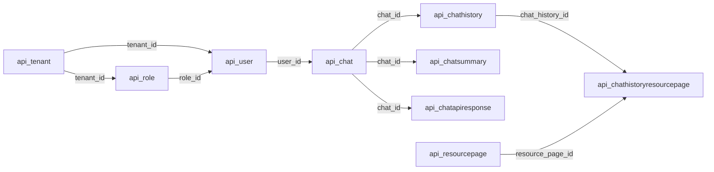

**Module relationship diagram (part 2: retrieval)**

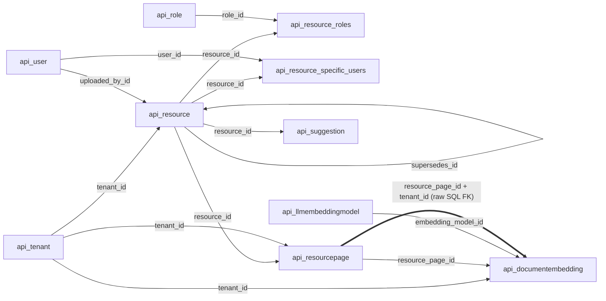

**Module relationship diagram (part 3: model resolution)**

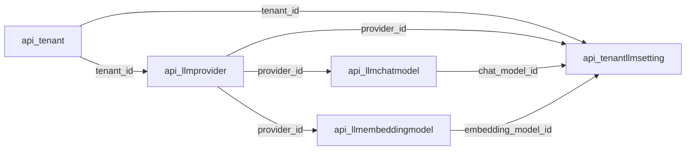

Legend: solid = declared Django FK; thick = FK declared only in migration `0050` raw SQL. Parts 1 to 3 together contain every relationship among the module's 18 tables.

### 3.5 Tool loop, flows and HRMS response audit

**Purpose:** The LLM tool-calling loop (`utils/llm/tools/tool_runner.py`), the endpoint catalogue (`api_rag/services/*.py`, `api_rag/http_executor.py`, `api_rag/tool_executor.py`) and the deterministic flows (`utils/llm/tools/{leave_apply,wfh_apply,asset_request,grievance,onboarding,clock_punch,pending_approvals,chat_flows}/`). They call auth, attendance, finance and job services over HTTP with the user's token. Flow sessions and pending confirmations live in Redis (`utils/llm/tools/action_confirmation.py:309-345`); none of these folders queries a model. The only table the module writes is `api_chatapiresponse`, and only when `PERSIST_HRMS_API_RESPONSES=true` (default false, `spark_assist_ai/settings.py:320`). A Beat task purges it while that flag is on (`settings.py:329-336`, `api/tasks.py:360-383`). LLM calls resolve the provider through the factory (3.2).

**Module metrics:** 5 distinct tables: 1 active, 0 deprecated/legacy, 0 apparently unused, 4 shared/uncertain (`api_chat` passed in from 3.4 as the FK parent; `api_tenantllmsetting`, `api_llmprovider`, `api_llmchatmodel` via the factory). All 5 are also used by other modules.

**Tables used**

| Table | Usage status | Definition |
|---|---|---|
| `api_chatapiresponse` | Active (direct, owner; flag-gated) | [api_chatapiresponse](#table-api_chatapiresponse) (here) |
| `api_chat` | Shared (object passed from 3.4) | [api_chat](#table-api_chat) (under 3.4) |
| `api_tenantllmsetting` | Shared (via factory) | [api_tenantllmsetting](#table-api_tenantllmsetting) (under 3.2) |
| `api_llmprovider` | Shared (via factory) | [api_llmprovider](#table-api_llmprovider) (under 3.2) |
| `api_llmchatmodel` | Shared (via factory) | [api_llmchatmodel](#table-api_llmchatmodel) (under 3.2) |

**Key database operations**

| Trigger | Operations | Evidence |
|---|---|---|
| Tool call returns (direct tools or MCP executor) | `_record_api_response` builds a `ChatAPIResponseSerializer` and saves it when the flag is on; `DatabaseError` is logged and swallowed | `utils/llm/tools/tool_runner.py:890,1069,1074-1099`, `api/serializers/chat.py:133-135` |
| Beat `purge-hrms-api-responses` (daily, flag on) | `ChatAPIResponse` ids older than `HRMS_API_RESPONSE_RETENTION_DAYS` (default 7, minimum 1) deleted in batches of 1000 | `api/tasks.py:360-383`, `spark_assist_ai/settings.py:320-336` |

#### Table details

#### Table: api_chatapiresponse

**Table overview**

- Canonical name: `public.api_chatapiresponse` (model `ChatAPIResponse`, `api/models/chat.py:57-67`).
- Purpose: raw HRMS API responses captured per chat turn, for debugging and audit.
- Accessed by: Tool loop (3.5); cascade from chat deletes (3.4) and Offboarding (3.7).
- Classification: **Active (conditional)**. Writes happen only with `PERSIST_HRMS_API_RESPONSES=true`; the environment values were not readable ([R11](#r11-growth-retention-and-stale-derived-rows)).
- Definition source: `0035`; `0053` added index `api_chatapiresp_created_idx`.

**Attributes**

| Column | Database Type | Nullable | Default | Key/Constraint | Description |
|---|---|---|---|---|---|
| created | timestamp with time zone | No | none (set on insert) | index `api_chatapiresp_created_idx` | Capture time; purge filter |
| modified | timestamp with time zone | No | none (set on save) | | Last save time |
| id | uuid | No | `uuid4()` (app) | PK | Row id |
| chat_id | uuid | No | | FK to `api_chat.id` (CASCADE); index | Chat of the turn |
| query | text | No | | | User query that triggered the call |
| endpoint_name | varchar(255) | No | | | Catalogue tool or endpoint name (code constant, no FK) |
| response_data | jsonb | No | | | Raw response body from another service; contains tenant HR data |

**Relationships**

| Direction | Related table | Columns | Cardinality | Enforcement | Modules |
|---|---|---|---|---|---|
| Out | [`api_chat`](#table-api_chat) | `chat_id` | many to 1 | Declared FK, CASCADE | 3.4, 3.5 |

**Additional details**

- Leaf table. Retention depends on the Beat container running and the flag staying on; turning the flag off stops the schedule, leaving old rows until the task is run by hand (`settings.py:329-331`).

**Module relationship diagram**

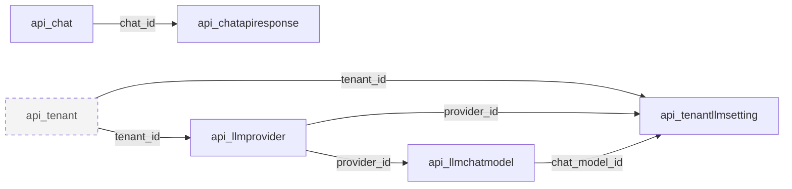

Legend: solid = declared Django FK; dashed grey = outside this module.

### 3.6 Slack chat

**Purpose:** `POST slack/chat/query/` called by autoscal-middleware with `x-api-key` plus `user_id` and `tenant_id`; `AutoscalMiddlewareAPIKeyAuthentication` resolves the local user (`utils/backends.py:62-87`). `SlackQueryService.answer_user_query` reads the user's Slack history, searches documents with the same pgvector query shape as web chat and runs the tool loop (no deterministic flows on Slack, per `.claude/skills/spark-assist-conventions/references/inconsistencies.md` item 4). The serializer stores the question and answer pair and the cited pages in one transaction. Files: `api/serializers/chat.py:66-130`, `utils/ai/slackQuery.py`, `utils/ai/slack_llm.py`.

**Module metrics:** 14 distinct tables: 12 active, 0 deprecated/legacy, 0 apparently unused, 2 shared/uncertain (`api_llmprovider`, `api_llmchatmodel` via the factory). All 14 are also used by other modules.

**Tables used**

| Table | Usage status | Definition |
|---|---|---|
| `api_slackchathistory` | Active (direct, owner) | [api_slackchathistory](#table-api_slackchathistory) (here) |
| `api_slackchathistoryresourcepage` | Active (direct, owner) | [api_slackchathistoryresourcepage](#table-api_slackchathistoryresourcepage) (here) |
| `api_resource` | Active (direct) | [api_resource](#table-api_resource) (under 3.3) |
| `api_resource_roles` | Active (direct, join) | [api_resource_roles](#table-api_resource_roles) (under 3.3) |
| `api_resource_specific_users` | Active (direct, join) | [api_resource_specific_users](#table-api_resource_specific_users) (under 3.3) |
| `api_resourcepage` | Active (direct) | [api_resourcepage](#table-api_resourcepage) (under 3.3) |
| `api_documentembedding` | Active (direct, vector search) | [api_documentembedding](#table-api_documentembedding) (under 3.3) |
| `api_tenantllmsetting` | Active (direct) | [api_tenantllmsetting](#table-api_tenantllmsetting) (under 3.2) |
| `api_llmembeddingmodel` | Active (direct) | [api_llmembeddingmodel](#table-api_llmembeddingmodel) (under 3.2) |
| `api_user` | Active (direct, auth backend) | [api_user](#table-api_user) (under 3.1) |
| `api_tenant` | Active (direct, auth join) | [api_tenant](#table-api_tenant) (under 3.1) |
| `api_role` | Active (direct, `user.role`) | [api_role](#table-api_role) (under 3.1) |
| `api_llmprovider` | Shared (via factory) | [api_llmprovider](#table-api_llmprovider) (under 3.2) |
| `api_llmchatmodel` | Shared (via factory) | [api_llmchatmodel](#table-api_llmchatmodel) (under 3.2) |

**Key database operations**

| Trigger | Operations | Evidence |
|---|---|---|
| Authentication | `User` by `external_id` and `tenant__external_id` | `utils/backends.py:76` |
| History context | `SlackChatHistory` for the user, ordered | `utils/ai/slackQuery.py:221` |
| Retrieval | enabled setting; accessible resource ids (`distinct`); embeddings by tenant, model, resource ids, `is_disabled=false`, ordered by `<=>` | `utils/ai/slackQuery.py:246,253,268-282` |
| Store turn | `transaction.atomic`: `bulk_create` of two `SlackChatHistory` rows, `Resource` names lookup, `bulk_create` of `SlackChatHistoryResourcePage` | `api/serializers/chat.py:86-113` |

#### Table details

#### Table: api_slackchathistory

**Table overview**

- Canonical name: `public.api_slackchathistory` (model `SlackChatHistory`, `api/models/chat.py:36-44`).
- Purpose: flat per-user Slack transcript (no conversation object).
- Accessed by: Slack (3.6), Offboarding (3.7).
- Classification: **Active**. Evidence: `bulk_create` (`api/serializers/chat.py:90`), read (`utils/ai/slackQuery.py:221`), count (`api/helpers/tenant_offboarding.py:56`).
- Definition source: `0028`.

**Attributes**

| Column | Database Type | Nullable | Default | Key/Constraint | Description |
|---|---|---|---|---|---|
| created | timestamp with time zone | No | none (set on insert) | | Message time. Both rows of a pair are built in Python and bulk inserted, so `created` values differ only by microseconds |
| modified | timestamp with time zone | No | none (set on save) | | Last save time |
| id | uuid | No | `uuid4()` (app) | PK | Message id |
| user_id | uuid | Yes | | FK to `api_user.id` (CASCADE); index | Member |
| message | text | No | | | Message text |
| is_user | boolean | No | `True` (app) | | Sender side |

**Relationships**

| Direction | Related table | Columns | Cardinality | Enforcement | Modules |
|---|---|---|---|---|---|
| Out | [`api_user`](#table-api_user) | `user_id` | many to 0..1 | Declared FK, CASCADE | 3.6 |
| In | [`api_slackchathistoryresourcepage`](#table-api_slackchathistoryresourcepage) | `slack_chat_history_id` | 1 to many | Declared FK, CASCADE | 3.6 |

**Additional details**

- `bulk_create` bypasses `save()`; `django-extensions` timestamp fields still fill values through `pre_save` (standard behaviour, not re-verified here).
- No retention ([R11](#r11-growth-retention-and-stale-derived-rows)).

#### Table: api_slackchathistoryresourcepage

**Table overview**

- Canonical name: `public.api_slackchathistoryresourcepage` (model `SlackChatHistoryResourcePage`, `api/models/chat.py:47-54`).
- Purpose: citations for Slack answers.
- Accessed by: Slack (3.6); cascade in Offboarding (3.7).
- Classification: **Active**. Evidence: `bulk_create` (`api/serializers/chat.py:113`). No read found in runtime code.
- Definition source: `0028`.

**Attributes**

| Column | Database Type | Nullable | Default | Key/Constraint | Description |
|---|---|---|---|---|---|
| created | timestamp with time zone | No | none (set on insert) | | Row creation time |
| modified | timestamp with time zone | No | none (set on save) | | Last save time |
| id | uuid | No | `uuid4()` (app) | PK | Row id |
| slack_chat_history_id | uuid | No | | FK to `api_slackchathistory.id` (CASCADE); index; UNIQUE with `resource_page_id` | Assistant message |
| resource_page_id | uuid | No | | FK to `api_resourcepage.id` (CASCADE); index | Cited page |

**Relationships**

| Direction | Related table | Columns | Cardinality | Enforcement | Modules |
|---|---|---|---|---|---|
| Out | [`api_slackchathistory`](#table-api_slackchathistory) | `slack_chat_history_id` | many to 1 | Declared FK, CASCADE | 3.6 |
| Out | [`api_resourcepage`](#table-api_resourcepage) | `resource_page_id` | many to 1 | Declared FK, CASCADE | 3.3, 3.6 |

**Additional details**

- Write-only in runtime code ([R12](#r12-write-only-and-unused-columns)).

**Module relationship diagram (part 1: transcript and identity)**

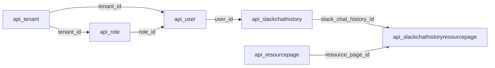

**Module relationship diagram (part 2: retrieval and model resolution)**

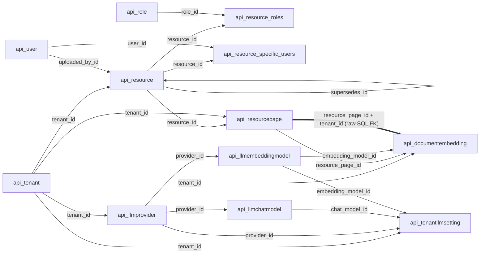

Legend: solid = declared Django FK; thick = FK declared only in migration `0050` raw SQL.

### 3.7 Tenant offboarding

**Purpose:** Operator-only deletion of everything the service holds for one tenant (`api/helpers/tenant_offboarding.py:1-12`), reached through `manage.py offboard_tenant <external_id>` (dry run by default, `--confirm` to delete; `api/management/commands/offboard_tenant.py:23`) or `DELETE tenants/<external_id>/?confirm=true` (`api/views/v1/tenant.py:182-185`). It counts rows per table, then in one `transaction.atomic` deletes the tenant's embeddings first (they PROTECT embedding models) and then the tenant row, letting Django cascade the rest. S3 files are deleted after commit; failures are reported. Backup tables from `0051` and chats with no user are not touched.

**Module metrics:** 22 distinct tables: 12 active (counted or deleted by name), 0 deprecated/legacy, 0 apparently unused, 10 shared (deleted only through Django CASCADE). All 22 are also used by other modules.

**Tables used**

| Table | Usage status | Definition |
|---|---|---|
| `api_tenant` | Active (count, delete) | [api_tenant](#table-api_tenant) |
| `api_role` | Active (count) | [api_role](#table-api_role) |
| `api_user` | Active (count) | [api_user](#table-api_user) |
| `api_assistant` | Active (count) | [api_assistant](#table-api_assistant) |
| `api_resource` | Active (count, S3 key list) | [api_resource](#table-api_resource) |
| `api_resourcepage` | Active (count) | [api_resourcepage](#table-api_resourcepage) |
| `api_documentembedding` | Active (count, explicit delete) | [api_documentembedding](#table-api_documentembedding) |
| `api_chat` | Active (count via `user__tenant`) | [api_chat](#table-api_chat) |
| `api_chathistory` | Active (count) | [api_chathistory](#table-api_chathistory) |
| `api_slackchathistory` | Active (count) | [api_slackchathistory](#table-api_slackchathistory) |
| `api_llmprovider` | Active (count) | [api_llmprovider](#table-api_llmprovider) |
| `api_tenantllmsetting` | Active (count) | [api_tenantllmsetting](#table-api_tenantllmsetting) |
| `api_resource_roles` | Cascade only | [api_resource_roles](#table-api_resource_roles) |
| `api_resource_specific_users` | Cascade only | [api_resource_specific_users](#table-api_resource_specific_users) |
| `api_resource_assistants` | Cascade only | [api_resource_assistants](#table-api_resource_assistants) |
| `api_suggestion` | Cascade only | [api_suggestion](#table-api_suggestion) |
| `api_chathistoryresourcepage` | Cascade only | [api_chathistoryresourcepage](#table-api_chathistoryresourcepage) |
| `api_slackchathistoryresourcepage` | Cascade only | [api_slackchathistoryresourcepage](#table-api_slackchathistoryresourcepage) |
| `api_chatsummary` | Cascade only | [api_chatsummary](#table-api_chatsummary) |
| `api_chatapiresponse` | Cascade only | [api_chatapiresponse](#table-api_chatapiresponse) |
| `api_llmchatmodel` | Cascade only | [api_llmchatmodel](#table-api_llmchatmodel) |
| `api_llmembeddingmodel` | Cascade only | [api_llmembeddingmodel](#table-api_llmembeddingmodel) |

No table has its canonical definition here; all are defined under their owning modules.

**Delete order and risks**

- The cascade is computed by Django's collector, not the database ([R1](#r1-delete-rules-live-in-django-not-in-the-database)). It queries dependent rows in Python to build delete batches (fast deletes only where no further cascade applies); large tenants make this a long single transaction ([R13](#r13-transactions-and-locking)).
- `Resource.supersedes` is PROTECT and is not exempt when the protected row is deleted by the same cascade; any tenant with a superseded document is expected to raise `ProtectedError` and roll back ([R4](#r4-tenant-offboarding-versus-supersedes-protect)).
- Chats and Slack messages whose `user_id` is NULL are not linked to any tenant and survive offboarding ([R9](#r9-nullable-owners-and-orphan-rows)).

**Module relationship diagram (identity, documents, embeddings)**

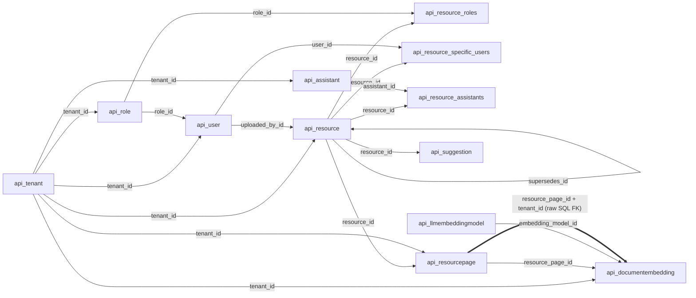

**Module relationship diagram (chats and LLM configuration)**

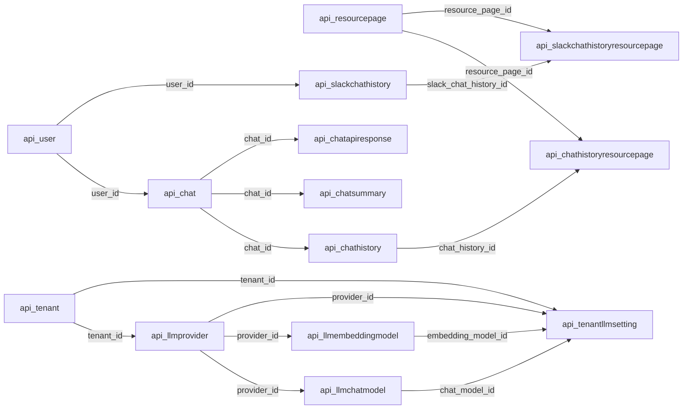

Legend: solid = declared Django FK; thick = FK declared only in migration `0050` raw SQL. Together the two diagrams show all 36 application-table relationships (35 Django FKs plus the composite FK), each exactly once.

### 3.8 Django framework

**Purpose:** Tables created by `manage.py migrate` for the installed contrib apps (`spark_assist_ai/settings.py:82-94`) and Django's migration ledger. The app uses its own `api_user`, not `auth_user`; authentication is token or API-key based (`utils/backends.py`, `core/auth_service/backends.py`). `admin/` is mounted (`spark_assist_ai/urls.py`) but `api/admin.py` registers no models. `SessionMiddleware` is installed with the default database session engine, so `django_session` is written only if something (the admin login) uses sessions. Column definitions come from Django 5.2.9's contrib models (introspected from the installed package).

**Module metrics:** 10 distinct tables: 3 active (Django tooling: `django_migrations`, `django_content_type`, `auth_permission` are written by every `migrate`), 0 deprecated/legacy, 0 apparently unused, 7 uncertain (no app-code reference; reachable only through the admin site).

**Tables used**

| Table | Usage status | Definition |
|---|---|---|
| `django_migrations` | Active (tooling) | [django_migrations](#table-django_migrations) (here) |
| `django_content_type` | Active (tooling) | [django_content_type](#table-django_content_type) (here) |
| `auth_permission` | Active (tooling) | [auth_permission](#table-auth_permission) (here) |
| `auth_group` | Uncertain | [auth_group](#table-auth_group) (here) |
| `auth_group_permissions` | Uncertain | [auth_group_permissions](#table-auth_group_permissions) (here) |
| `auth_user` | Uncertain | [auth_user](#table-auth_user) (here) |
| `auth_user_groups` | Uncertain | [auth_user_groups](#table-auth_user_groups) (here) |
| `auth_user_user_permissions` | Uncertain | [auth_user_user_permissions](#table-auth_user_user_permissions) (here) |
| `django_admin_log` | Uncertain | [django_admin_log](#table-django_admin_log) (here) |
| `django_session` | Uncertain | [django_session](#table-django_session) (here) |

#### Table details

Integer primary keys below use Django's `AutoField` (`integer`) or `BigAutoField` (`bigint`); whether they are identity or serial columns depends on the Django version that first created them and was not verified ([R16](#r16-live-identity-and-index-state-unverified)). All FKs are deferrable, delete rules run in Django.

#### Table: django_migrations

- Purpose: ledger of applied migrations; read and written by `migrate` on every container start (`start.sh`). Must be copied with the data or rebuilt with `--fake` when the schema moves. Source: `django.db.migrations.recorder.MigrationRecorder`. Classification: **Active (tooling)**.

| Column | Database Type | Nullable | Default | Key/Constraint | Description |
|---|---|---|---|---|---|
| id | bigint | No | auto | PK | Row id |
| app | varchar(255) | No | | | App label (`api`, `auth`, ...) |
| name | varchar(255) | No | | | Migration name |
| applied | timestamp with time zone | No | | | Applied time |

Relationships: none (isolated). Additional details: the 56 `api` rows record the history in [5.2](#52-migration-history); merges `0022` and `0026` also have rows.

#### Table: django_content_type

- Purpose: registry of models; rows created by the `post_migrate` signal. Source: `django.contrib.contenttypes`. Classification: **Active (tooling)**.

| Column | Database Type | Nullable | Default | Key/Constraint | Description |
|---|---|---|---|---|---|
| id | integer | No | auto | PK | Content type id |
| app_label | varchar(100) | No | | UNIQUE with `model` | App label |
| model | varchar(100) | No | | UNIQUE with `app_label` | Model name (lowercase); stale rows remain for dropped models such as `documents` (unverified) |

| Direction | Related table | Columns | Cardinality | Enforcement | Modules |
|---|---|---|---|---|---|
| In | [`auth_permission`](#table-auth_permission) | `content_type_id` | 1 to many | Declared FK, CASCADE | 3.8 |
| In | [`django_admin_log`](#table-django_admin_log) | `content_type_id` | 1 to many | Declared FK, SET_NULL | 3.8 |

#### Table: auth_permission

- Purpose: default add/change/delete/view permissions per model, created by `post_migrate`. Source: `django.contrib.auth`. Classification: **Active (tooling)**.

| Column | Database Type | Nullable | Default | Key/Constraint | Description |
|---|---|---|---|---|---|
| id | integer | No | auto | PK | Permission id |
| name | varchar(255) | No | | | Human name |
| content_type_id | integer | No | | FK to `django_content_type.id` (CASCADE); index; UNIQUE with `codename` | Model |
| codename | varchar(100) | No | | UNIQUE with `content_type_id` | Code name |

| Direction | Related table | Columns | Cardinality | Enforcement | Modules |
|---|---|---|---|---|---|
| Out | [`django_content_type`](#table-django_content_type) | `content_type_id` | many to 1 | Declared FK, CASCADE | 3.8 |
| In | [`auth_group_permissions`](#table-auth_group_permissions) | `permission_id` | 1 to many | Declared FK, CASCADE | 3.8 |
| In | [`auth_user_user_permissions`](#table-auth_user_user_permissions) | `permission_id` | 1 to many | Declared FK, CASCADE | 3.8 |

#### Table: auth_group

- Purpose: Django auth groups. No app reference. Classification: **Uncertain**.

| Column | Database Type | Nullable | Default | Key/Constraint | Description |
|---|---|---|---|---|---|
| id | integer | No | auto | PK | Group id |
| name | varchar(150) | No | | UNIQUE | Group name |

| Direction | Related table | Columns | Cardinality | Enforcement | Modules |
|---|---|---|---|---|---|
| In | [`auth_group_permissions`](#table-auth_group_permissions) | `group_id` | 1 to many | Declared FK, CASCADE | 3.8 |
| In | [`auth_user_groups`](#table-auth_user_groups) | `group_id` | 1 to many | Declared FK, CASCADE | 3.8 |

#### Table: auth_group_permissions

- Purpose: junction group to permission. Classification: **Uncertain**.

| Column | Database Type | Nullable | Default | Key/Constraint | Description |
|---|---|---|---|---|---|
| id | bigint | No | auto | PK | Row id |
| group_id | integer | No | | FK to `auth_group.id` (CASCADE); index; UNIQUE with `permission_id` | Group |
| permission_id | integer | No | | FK to `auth_permission.id` (CASCADE); index | Permission |

| Direction | Related table | Columns | Cardinality | Enforcement | Modules |
|---|---|---|---|---|---|
| Out | [`auth_group`](#table-auth_group) | `group_id` | many to 1 | Declared FK, CASCADE | 3.8 |
| Out | [`auth_permission`](#table-auth_permission) | `permission_id` | many to 1 | Declared FK, CASCADE | 3.8 |

#### Table: auth_user

- Purpose: Django admin accounts. Unrelated to `api_user`. No app reference. Classification: **Uncertain** (exists for the admin login; whether any superuser exists is unknown).

| Column | Database Type | Nullable | Default | Key/Constraint | Description |
|---|---|---|---|---|---|
| id | integer | No | auto | PK | User id |
| password | varchar(128) | No | | | Password hash |
| last_login | timestamp with time zone | Yes | | | Last admin login |
| is_superuser | boolean | No | | | Superuser flag |
| username | varchar(150) | No | | UNIQUE | Login name |
| first_name | varchar(150) | No | | | First name |
| last_name | varchar(150) | No | | | Last name |
| email | varchar(254) | No | | | Email |
| is_staff | boolean | No | | | Admin site access |
| is_active | boolean | No | | | Active flag |
| date_joined | timestamp with time zone | No | | | Creation time |

| Direction | Related table | Columns | Cardinality | Enforcement | Modules |
|---|---|---|---|---|---|
| In | [`auth_user_groups`](#table-auth_user_groups) | `user_id` | 1 to many | Declared FK, CASCADE | 3.8 |
| In | [`auth_user_user_permissions`](#table-auth_user_user_permissions) | `user_id` | 1 to many | Declared FK, CASCADE | 3.8 |
| In | [`django_admin_log`](#table-django_admin_log) | `user_id` | 1 to many | Declared FK, CASCADE | 3.8 |

#### Table: auth_user_groups

- Purpose: junction admin user to group. Classification: **Uncertain**.

| Column | Database Type | Nullable | Default | Key/Constraint | Description |
|---|---|---|---|---|---|
| id | bigint | No | auto | PK | Row id |
| user_id | integer | No | | FK to `auth_user.id` (CASCADE); index; UNIQUE with `group_id` | User |
| group_id | integer | No | | FK to `auth_group.id` (CASCADE); index | Group |

| Direction | Related table | Columns | Cardinality | Enforcement | Modules |
|---|---|---|---|---|---|
| Out | [`auth_user`](#table-auth_user) | `user_id` | many to 1 | Declared FK, CASCADE | 3.8 |
| Out | [`auth_group`](#table-auth_group) | `group_id` | many to 1 | Declared FK, CASCADE | 3.8 |

#### Table: auth_user_user_permissions

- Purpose: junction admin user to permission. Classification: **Uncertain**.

| Column | Database Type | Nullable | Default | Key/Constraint | Description |
|---|---|---|---|---|---|
| id | bigint | No | auto | PK | Row id |
| user_id | integer | No | | FK to `auth_user.id` (CASCADE); index; UNIQUE with `permission_id` | User |
| permission_id | integer | No | | FK to `auth_permission.id` (CASCADE); index | Permission |

| Direction | Related table | Columns | Cardinality | Enforcement | Modules |
|---|---|---|---|---|---|
| Out | [`auth_user`](#table-auth_user) | `user_id` | many to 1 | Declared FK, CASCADE | 3.8 |
| Out | [`auth_permission`](#table-auth_permission) | `permission_id` | many to 1 | Declared FK, CASCADE | 3.8 |

#### Table: django_admin_log

- Purpose: admin change log. No models are registered, so new rows are not expected. Classification: **Uncertain**.

| Column | Database Type | Nullable | Default | Key/Constraint | Description |
|---|---|---|---|---|---|
| id | integer | No | auto | PK | Row id |
| action_time | timestamp with time zone | No | | | Action time |
| user_id | integer | No | | FK to `auth_user.id` (CASCADE); index | Admin user |
| content_type_id | integer | Yes | | FK to `django_content_type.id` (SET_NULL); index | Model changed |
| object_id | text | Yes | | | Changed object id |
| object_repr | varchar(200) | No | | | Object label |
| action_flag | smallint | No | | Django adds CHECK `>= 0` (PositiveSmallIntegerField) | 1 add, 2 change, 3 delete |
| change_message | text | No | | | Change description |

| Direction | Related table | Columns | Cardinality | Enforcement | Modules |
|---|---|---|---|---|---|
| Out | [`auth_user`](#table-auth_user) | `user_id` | many to 1 | Declared FK, CASCADE | 3.8 |
| Out | [`django_content_type`](#table-django_content_type) | `content_type_id` | many to 0..1 | Declared FK, SET_NULL | 3.8 |

#### Table: django_session

- Purpose: database session store (default engine). Classification: **Uncertain**. Expired rows are removed only by `manage.py clearsessions`, which is not scheduled anywhere in the repo.

| Column | Database Type | Nullable | Default | Key/Constraint | Description |
|---|---|---|---|---|---|
| session_key | varchar(40) | No | | PK | Session key |
| session_data | text | No | | | Encoded session data |
| expire_date | timestamp with time zone | No | | index | Expiry |

Relationships: none (isolated).

**Module relationship diagram**

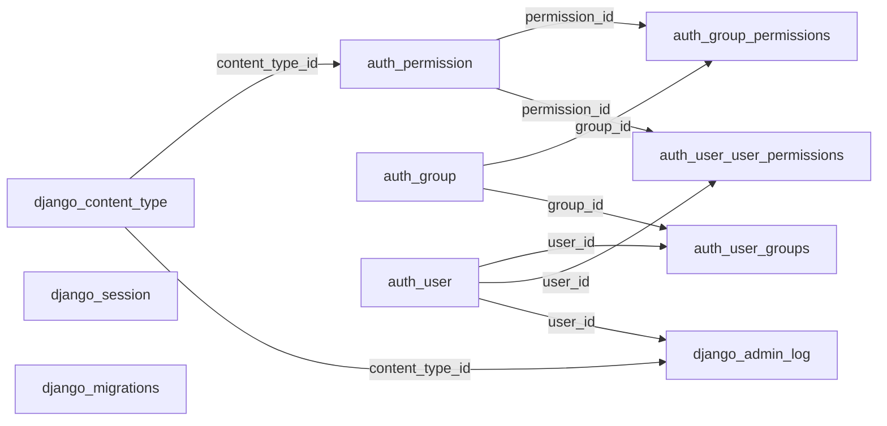

Legend: solid = declared Django FK. `django_session` and `django_migrations` are isolated. No FK links framework tables to application tables.

### 3.9 Unassigned Tables (migration 0051 backups)

These tables are created by `backup_and_delete_orphans` in `api/migrations/0051_remove_orphans_tenant_not_null.py` with `CREATE TABLE api_backup_orphan_<x> AS SELECT * FROM api_<x> WHERE ...`, before the matching rows are deleted. They belong to no module and no runtime code references them. Only the migration's reverse (`restore_orphans`) reads and drops them.

Common facts for all 10:

- **Status: Legacy.** Evidence: no reference outside `0051` (repo-wide search for `api_backup_orphan`).
- **Structure**: `CREATE TABLE AS` copies column names and types only. No primary key, no NOT NULL, no defaults, no FKs, no unique constraints, no indexes. Columns are those of the source table as it stood after `0050` (so `api_backup_orphan_resource` lacks `supersedes_id` and `effective_date`, added by `0054`).
- **Content**: in the environment the migration was written for, 1 assistant (`3fa85d34-ff08-45bd-8530-ce1249996c4d`), 8 documents with uploader and tenant both NULL (ids listed at `0051:7-16`), their pages, embeddings, suggestions, grants and citations, and the 9 tenant-owned documents' links to that assistant. In any other environment where no such rows existed the tables were created empty. Deletion was approved by the owner on 2026-09-29 on condition of this backup (`0051:3-5`).
- **Relationships**: none (isolated). Values still hold ids of deleted and surviving rows (for example `api_backup_orphan_resource_assistants.resource_id` points to 9 live documents) but nothing enforces them.

#### Table: api_backup_orphan_chathistoryresourcepage

Source `api_chathistoryresourcepage`, filter: rows citing pages of the orphan documents.

| Column | Database Type | Nullable | Default | Key/Constraint | Description |
|---|---|---|---|---|---|
| created | timestamp with time zone | Yes | | none | Copied |
| modified | timestamp with time zone | Yes | | none | Copied |
| id | uuid | Yes | | none | Original row id |
| chat_history_id | uuid | Yes | | none | Original message (still live) |
| resource_page_id | uuid | Yes | | none | Deleted page |

#### Table: api_backup_orphan_slackchathistoryresourcepage

Source `api_slackchathistoryresourcepage`, same filter.

| Column | Database Type | Nullable | Default | Key/Constraint | Description |
|---|---|---|---|---|---|
| created | timestamp with time zone | Yes | | none | Copied |
| modified | timestamp with time zone | Yes | | none | Copied |
| id | uuid | Yes | | none | Original row id |
| slack_chat_history_id | uuid | Yes | | none | Original Slack message (still live) |
| resource_page_id | uuid | Yes | | none | Deleted page |

#### Table: api_backup_orphan_documentembedding

Source `api_documentembedding`, filter: embeddings of orphan pages (the `0050` comment says none existed at that time).

| Column | Database Type | Nullable | Default | Key/Constraint | Description |
|---|---|---|---|---|---|
| created | timestamp with time zone | Yes | | none | Copied |
| modified | timestamp with time zone | Yes | | none | Copied |
| id | uuid | Yes | | none | Original id |
| tenant_id | uuid | Yes | | none | Tenant |
| resource_page_id | uuid | Yes | | none | Deleted page |
| embedding_model_id | uuid | Yes | | none | Model |
| embeddings | vector | Yes | | none | Vector (requires the `vector` extension to restore) |
| dim | integer | Yes | | none | Dimension |
| is_disabled | boolean | Yes | | none | Flag |

#### Table: api_backup_orphan_resourcepage

Source `api_resourcepage`, filter: pages of the 8 orphan documents.

| Column | Database Type | Nullable | Default | Key/Constraint | Description |
|---|---|---|---|---|---|
| created | timestamp with time zone | Yes | | none | Copied |
| modified | timestamp with time zone | Yes | | none | Copied |
| id | uuid | Yes | | none | Original page id |
| resource_id | uuid | Yes | | none | Deleted document |
| content | text | Yes | | none | Page text |
| page_no | integer | Yes | | none | Page number |
| tenant_id | uuid | Yes | | none | NULL for these rows |

#### Table: api_backup_orphan_suggestion

Source `api_suggestion`, filter: suggestions of the orphan documents.

| Column | Database Type | Nullable | Default | Key/Constraint | Description |
|---|---|---|---|---|---|
| created | timestamp with time zone | Yes | | none | Copied |
| modified | timestamp with time zone | Yes | | none | Copied |
| id | uuid | Yes | | none | Original id |
| resource_id | uuid | Yes | | none | Deleted document |
| suggestion | text | Yes | | none | Question text |
| is_active | boolean | Yes | | none | Flag |

#### Table: api_backup_orphan_resource_roles

Source `api_resource_roles`, filter: grants of the orphan documents.

| Column | Database Type | Nullable | Default | Key/Constraint | Description |
|---|---|---|---|---|---|
| id | bigint | Yes | | none | Original row id |
| resource_id | uuid | Yes | | none | Deleted document |
| role_id | uuid | Yes | | none | Role |

#### Table: api_backup_orphan_resource_specific_users

Source `api_resource_specific_users`, same filter.

| Column | Database Type | Nullable | Default | Key/Constraint | Description |
|---|---|---|---|---|---|
| id | bigint | Yes | | none | Original row id |
| resource_id | uuid | Yes | | none | Deleted document |
| user_id | uuid | Yes | | none | Member |

#### Table: api_backup_orphan_resource_assistants

Source `api_resource_assistants`, filter: links of the orphan documents or to the orphan assistant.

| Column | Database Type | Nullable | Default | Key/Constraint | Description |
|---|---|---|---|---|---|
| id | bigint | Yes | | none | Original row id |
| resource_id | uuid | Yes | | none | Document (deleted orphan or surviving tenant document) |
| assistant_id | uuid | Yes | | none | Assistant |

#### Table: api_backup_orphan_resource

Source `api_resource`, filter: the 8 approved ids with `tenant_id IS NULL AND uploaded_by_id IS NULL`.

| Column | Database Type | Nullable | Default | Key/Constraint | Description |
|---|---|---|---|---|---|
| created | timestamp with time zone | Yes | | none | Copied |
| modified | timestamp with time zone | Yes | | none | Copied |
| id | uuid | Yes | | none | Original document id; S3 objects for these ids were left in place (`0051` docstring) |
| name | varchar(100) | Yes | | none | File name |
| updated_file_name | varchar(100) | Yes | | none | Display name |
| size | integer | Yes | | none | Size |
| file_type | varchar(100) | Yes | | none | Type |
| upload_status | varchar(20) | Yes | | none | Status |
| is_preview_generated | boolean | Yes | | none | Flag |
| is_processed | boolean | Yes | | none | Flag |
| is_applicable_to_all | boolean | Yes | | none | Grant flag |
| uploaded_by_id | uuid | Yes | | none | NULL for these rows |
| tenant_id | uuid | Yes | | none | NULL for these rows |

#### Table: api_backup_orphan_assistant

Source `api_assistant`, filter: the approved tenant-less assistant.

| Column | Database Type | Nullable | Default | Key/Constraint | Description |
|---|---|---|---|---|---|
| created | timestamp with time zone | Yes | | none | Copied |
| modified | timestamp with time zone | Yes | | none | Copied |
| id | uuid | Yes | | none | Original assistant id |
| tenant_id | uuid | Yes | | none | NULL |
| name | varchar(255) | Yes | | none | Name |
| is_active | boolean | Yes | | none | Flag |
| rgb_icon_hex | varchar(7) | Yes | | none | Colour |

No diagram: these tables have no relationships.

## 4. Migration Risks and Unresolved Issues

### R1 Delete rules live in Django, not in the database

1. **Evidence:** Generated DDL for all 35 application FKs ends with `DEFERRABLE INITIALLY DEFERRED` and contains no `ON DELETE` clause (0 occurrences). CASCADE, SET_NULL (`api_user.role_id`) and PROTECT (`api_resource.supersedes_id`, `api_documentembedding.embedding_model_id`) are Django collector behaviour (`api/models/*.py`). Offboarding relies on it (`api/helpers/tenant_offboarding.py:6-9,72-76`).
2. **Potential impact:** A target that copies the schema literally gets `NO ACTION` FKs: deletes through any non-Django path fail or, if constraints are dropped for loading, leave orphans. A target that translates `on_delete` into SQL `ON DELETE` changes behaviour (PROTECT checks become `RESTRICT`, which allows same-statement cascades that Django refuses). Deferred checking also lets a transaction pass through invalid intermediate states that an immediate FK would reject.
3. **Next verification step:** Query `pg_constraint` (`condeferrable`, `confdeltype`) in each environment; decide per FK whether the new layer enforces delete rules in SQL or code.

### R2 Composite tenant FK outside Django state

1. **Evidence:** `api/migrations/0050_resourcepage_tenant.py` adds `api_documentembedding_page_tenant_fk FOREIGN KEY (resource_page_id, tenant_id) REFERENCES api_resourcepage (id, tenant_id)` with `RunSQL`, not deferrable; target is `api_resourcepage_id_tenant_uniq`. Django models do not represent it (`api/models/resource.py:124-136`); generated DDL from models does not contain it.
2. **Potential impact:** Schema generated from models (or by any tool reading Django state) silently drops the cross-tenant guard on embeddings. Because it is immediate, rows must be loaded pages first, embeddings second. `0051`'s restore order depends on it.
3. **Next verification step:** Confirm the constraint exists in each environment (`\d api_documentembedding`); add it explicitly to the target schema; check `SELECT count(*) FROM api_documentembedding e JOIN api_resourcepage p ON p.id = e.resource_page_id WHERE p.tenant_id <> e.tenant_id` is 0.

### R3 Orphan backup tables from migration 0051

1. **Evidence:** `0051:24-58,87-89` create 10 `api_backup_orphan_*` tables with `CREATE TABLE AS`; forward migration never drops them; only `restore_orphans` (`0051:92-109`) drops them on reverse.
2. **Potential impact:** Tables with no PK and no constraints, outside Django state, holding deleted tenant-less HR documents and their text and vectors. Tools that require primary keys (logical replication, some ETL) fail on them; leaving them unmentioned carries deleted data into the new system; dropping them removes the only restore path for an approved deletion.
3. **Next verification step:** In each environment list `api_backup_orphan_%` tables and row counts; get an owner decision to archive or drop before migrating; record S3 keys of the 8 documents (left in S3 by design).

### R4 Tenant offboarding versus supersedes PROTECT

1. **Evidence:** `Resource.supersedes` is `on_delete=PROTECT` (`api/models/resource.py:42-48`). `offboard_tenant` deletes the tenant and relies on cascade (`api/helpers/tenant_offboarding.py:72-76`); it deletes embeddings first only because of the other PROTECT. Django's PROTECT raises `ProtectedError` even when the protecting row is in the same cascade (that exemption exists only for `RESTRICT`). Django's collector gathers protected objects and raises without checking whether they are in the delete set (`django/db/models/deletion.py:308-357`, Django 5.2.9). `api/tests_tenant_offboarding.py` contains no `supersed` reference.
2. **Potential impact:** Offboarding is expected to fail and roll back for any tenant that has a superseded document; the same applies to any future tenant purge built on cascade. Inference from Django semantics; not executed.
3. **Next verification step:** Run a test offboarding a tenant with a `supersedes` pair (local database only); count tenants with `supersedes_id IS NOT NULL` rows.

### R5 pgvector storage and search

1. **Evidence:** `api_documentembedding.embeddings` is `vector` with no dimension (`0043`, `api/models/resource.py:149`); `dim` and `embedding_model_id` record the model. No vector index exists: the ivfflat index from `0029` was on `api_resourcepage.embeddings`, which `0040` dropped. Search uses `RawSQL("api_documentembedding.embeddings <=> %s::vector")` ordered ascending (`utils/ai_util.py:138-161`, `utils/ai/slackQuery.py:268-282`). Extension created by `0001`; local image builds pgvector from git without a version pin (`Dockerfile.pgsql`). Seeded embedding models include 1536-dimension OpenAI and Gemini models (`api/helpers/llm_models_seeder.py:9-60`).
2. **Potential impact:** The target must provide pgvector (or equivalent) with the `<=>` cosine operator and allow `CREATE EXTENSION`. Mixed dimensions in one column prevent adding an ANN index without partitioning by model or fixing dimensions. Every search is an exact scan of the tenant's embeddings. The raw SQL hard-codes the table name. Embeddings are derived: they can be regenerated from `api_resourcepage.content` (`api/tasks.py:242-352`) instead of copied, at provider cost; S3 keys are derived from `api_resource.id` and `name` (`api/models/resource.py:91-96`), so those values must be preserved exactly.
3. **Next verification step:** `SELECT dim, embedding_model_id, count(*) FROM api_documentembedding GROUP BY 1,2`; record the pgvector version in each environment; check total row counts and query latency.

### R6 Encrypted provider keys

1. **Evidence:** `api_llmprovider.api_key` holds Fernet tokens under `API_KEY_ENCRYPTION_KEY` (`utils/api_encryption.py`, `api/models/llm.py:19`); `0052` encrypted plaintext keys and flagged undecryptable ones (`key_status = 'needs_reentry'`); the factory flags failures at runtime (`utils/llm/factory.py:50`). `settings.py` reads the key with `os.environ[...]` (`CLAUDE.md:42`).
2. **Potential impact:** Moving the data without the same key makes every provider unusable and the factory will flag all of them `needs_reentry` on first use. Running `0052` against a database under a different key would flag rather than corrupt.
3. **Next verification step:** Confirm the key per environment is available to the target; count rows with `key_status IS NOT NULL`.

### R7 Cross-service identifiers and replicas

1. **Evidence:** `api_tenant.external_id`, `api_role.external_id`, `api_user.external_id` hold auth-service ids, written by auth-service through API-key routes (`api/views/v1/tenant.py:56`, `api/views/v1/user.py:62-63,302`). Local UUIDs differ from auth ids (`api/views_v2.py:446-447`). `api_chathistory.attachments` refers to finance-service files (`api/helpers/tenant_offboarding.py:10-11`). No FKs to other services.
2. **Potential impact:** In a consolidated database these replicas duplicate auth-service tables. Merging requires mapping local UUIDs (used in 10 FK columns and many child rows) to auth ids, or keeping the replica. Drift between replica and source (deactivated users, role changes) is possible if sync calls fail.
3. **Next verification step:** Compare `external_id` sets against auth-service per tenant; count local users with no auth match; decide whether local ids are kept as surrogate keys.

### R8 Tenant invariants enforced only in application code

1. **Evidence:** Same-tenant document grants (`api/serializers/resource.py` `_require_same_tenant`); `api_resource.tenant_id` set from the uploader on insert only (`api/models/resource.py:86-89`); `api_resourcepage.tenant_id` copied from the resource (`:138-141`); setting/provider/model belonging checked in `tenant_llm_resolver.py:96-108,148-168`; provider name uniqueness per tenant dropped in `0044` and checked in `api/serializers/llm.py:195`; `api_documentembedding.dim` copied from the model at write (`api/tasks.py:332`, `utils/ai/generate_embeddings.py:201`). Only embedding to page tenant is enforced by the database ([R2](#r2-composite-tenant-fk-outside-django-state)).
2. **Potential impact:** Any writer outside these code paths can create cross-tenant grants or settings. Existing data may already contain violations from before the checks were added (several are audit fixes).
3. **Next verification step:** Run consistency queries before migration: grants whose role or user tenant differs from the resource tenant; resources whose uploader tenant differs; settings whose models' provider differs from `provider_id`; embeddings whose `dim` differs from the model's `dim`; duplicate enabled providers per tenant and name.

### R9 Nullable owners and orphan rows

1. **Evidence:** `api_chat.user_id`, `api_slackchathistory.user_id` and `api_resource.uploaded_by_id` are nullable (`api/models/chat.py:10,39`, `api/models/resource.py:73-79`); `api_chat.user` was added by `0024` with no backfill. Offboarding counts chats through `user__tenant` (`api/helpers/tenant_offboarding.py:54-56`). `uploaded_by` is CASCADE, so deleting a member deletes their documents.
2. **Potential impact:** Chats and Slack messages without a user belong to no tenant, are unreachable through the API and are never offboarded. Any future member deletion in a new platform would delete company policy documents uploaded by that member unless the rule changes.
3. **Next verification step:** `SELECT count(*) FROM api_chat WHERE user_id IS NULL` (and for Slack and resources); decide target ownership rule for `uploaded_by`.

### R10 Python-side defaults and unchecked choices

1. **Evidence:** Generated DDL has no `DEFAULT` clauses; UUIDs, booleans, `{}`/`[]` JSON defaults, `'#f27979'`, `'Pending'` and timestamps are set by Django. Choice fields (`api_user.status`, `api_resource.upload_status`, `api_llmprovider.key_status`, `api_llmprovider.provider_name`) have no CHECK constraints; `MemberStatus` values mix lower and Pascal case (`api/models/user.py:7-17`). Only 3 CHECKs exist (`>= 0`).
2. **Potential impact:** Raw inserts or a different ORM must supply every value, including `created` and `modified`. Unexpected values may already exist in choice columns.
3. **Next verification step:** `SELECT DISTINCT` on each choice column per environment; decide whether the target adds DB defaults and CHECKs.

### R11 Growth, retention and stale derived rows

1. **Evidence:** `api_chatapiresponse` is written and purged only when `PERSIST_HRMS_API_RESPONSES=true` (`settings.py:320-336`, `api/tasks.py:360-383`); environment values were not read. `api_chathistory`, `api_slackchathistory`, `api_chatsummary` have no retention. `store_document` updates pages by `page_no` and never deletes higher-numbered pages left from an earlier, longer version (`utils/ai/generate_embeddings.py:182-204`). `generate_suggestion_queries` inserts without deduplication (`api/tasks.py:188-203`). `django_session` has no scheduled cleanup.
2. **Potential impact:** Data volume and stale page/embedding rows (which still match searches) carry over. `api_chatapiresponse` may be empty or large depending on the flag.
3. **Next verification step:** Row counts and oldest `created` per table; count pages with `page_no` above the latest processed count per resource (needs a page count source, for example S3 or reprocessing logs); check flag values per environment.

### R12 Write-only and unused columns

1. **Evidence:** `api_resource.effective_date` (stored, "read by nothing", `api/models/resource.py:57-67`); `api_resource.is_processed` (written `api/tasks.py:179`, no logic read); `api_documentembedding.is_disabled` (filtered on, never set true); `api_suggestion.is_active` (never written or filtered, not serialized, `api/serializers/chat.py:61`); `api_assistant.is_active` (no logic read; exposed by `fields='__all__'`); `api_slackchathistoryresourcepage` (written, never read).
2. **Potential impact:** Candidates to drop or keep consciously; `effective_date` is deliberately reserved for future versioning logic.
3. **Next verification step:** Check the frontend for reads of these fields before dropping; distinct values per column.

### R13 Transactions and locking

1. **Evidence:** `transaction.atomic` sites: tenant create plus assistant seed (`api/views/v1/tenant.py:91-94`, nested in `seed_data.py:40-47`); Slack turn store (`api/serializers/chat.py:86`); LLM setting switch (`tenant_llm_resolver.py:207-234`); `update_chat_summary` decorator wrapping an LLM call (`api_rag/services/summarizer.py:42-60`); regeneration flag set and clear with `select_for_update` (`api/tasks.py:244-268,344-352`); offboarding delete (`api/helpers/tenant_offboarding.py:72-76`). `ATOMIC_REQUESTS` is not set.
2. **Potential impact:** The summary transaction holds a connection and the new or locked `api_chatsummary` row for the length of an LLM call. Offboarding is one transaction over all of a tenant's rows. Regeneration commits each embedding separately, so a migration window during regeneration sees partial state.
3. **Next verification step:** Ensure no regeneration is running (`is_regenerating = true` rows) and Celery workers are drained before cutover.

### R14 Framework tables and the admin mount

1. **Evidence:** `admin/` route (`spark_assist_ai/urls.py`), empty `api/admin.py`, database sessions by default, contrib apps in `INSTALLED_APPS` (`settings.py:82-94`). No app code references `auth_*`, `django_admin_log` or `django_session`.
2. **Potential impact:** 7 framework tables may be empty or may hold admin accounts and sessions. `django_migrations` and `django_content_type` content must match the schema if Django keeps managing it.
3. **Next verification step:** Row counts for each framework table; `SELECT username, is_superuser FROM auth_user` (without password hashes) to decide if admin access must be preserved.

### R15 Schema history that lost or reset data

1. **Evidence:** `0042` dropped `api_documents`, `api_documentlabel`, `api_documents_labels`, `api_organization`, `api_apikey` without data copy; `0043` dropped `api_resource.embeddings` and `api_resourcepage.embeddings` and created `api_documentembedding` without copying vectors; `0035`/`0036` removed and re-added `api_chathistory.is_api_response`, resetting earlier values to `false`; `0051` deleted approved orphan rows (backed up); `0052` rewrote `api_llmprovider.api_key` values.
2. **Potential impact:** Historical data cannot be recovered from the current database; reports on `is_api_response` before `0036` are unreliable. Environments that never ran these migrations would differ, but `start.sh` applies all migrations at start.
3. **Next verification step:** Check `django_migrations` in each environment shows all 56 `api` migrations applied.

### R16 Live identity and index state unverified

1. **Evidence:** Integer keys of the 3 implicit M2M tables (`bigint`) and the framework tables are identity columns under current Django but serial columns if created by Django before 4.1; the tables were created by `0015`/`0018` and the contrib migrations at unknown Django versions. Index and constraint names were generated from model state, not read from the database.
2. **Potential impact:** Sequence names, ownership and `setval` handling differ between identity and serial when copying data; name mismatches break scripted index or constraint changes.
3. **Next verification step:** `\d+` on the M2M and framework tables; compare `pg_indexes` and `pg_constraint` names with the names in this document.

## 5. Evidence and Validation

### 5.1 Counting rules

- A **table** is a Django model's `db_table`, an auto-created M2M table, a Django framework table created by `migrate`, or a table created by SQL in a migration, counted once by canonical name in its final state. Dropped tables are listed but not counted. Views, indexes, constraints and the extension are never counted as tables.
- **Runtime application-code reference**: a queryset, related-object access, filter join, serializer field or raw SQL naming the table in `api/` (excluding `migrations/` and tests), `utils/`, `api_rag/`, `core/` or `spark_assist_ai/`. Django's own `migrate` machinery is reported separately as "tooling". Tests and migrations do not count.
- **Status**: Active = runtime reference (or Django tooling for framework tables); Legacy = exists only as a migration artefact with no runtime use; Uncertain = framework table with no reference whose use depends on admin activity. No table was classified Deprecated or Apparently unused.
- **Module membership**: a module counts a table if its own files, or shared code they call, read or write it, including Django CASCADE deletes it triggers. Module totals are non-exclusive.
- **Relationships**: declared = Django FK, framework FK, or FK added by migration SQL. Many-to-many and explicit junction tables contribute their two FKs each. The composite FK is counted separately from the single-column FKs on the same columns. No inferred intra-database relationships were found; cross-service ids are not counted.
- **Leaf**: at least one outbound FK and no inbound FK (self-reference counts as both). **Isolated**: no FK in either direction.
- **Columns documented**: application 152 (`api_tenant` 5, `api_role` 7, `api_user` 10, `api_assistant` 7, `api_llmprovider` 10, `api_llmchatmodel` 9, `api_llmembeddingmodel` 10, `api_tenantllmsetting` 8, 3 M2M tables 3 each, `api_resource` 15, `api_resourcepage` 7, `api_documentembedding` 9, `api_chat` 4, `api_chathistory` 8, `api_chathistoryresourcepage` 5, `api_slackchathistory` 6, `api_slackchathistoryresourcepage` 5, `api_chatapiresponse` 7, `api_chatsummary` 5, `api_suggestion` 6); framework 44 (`auth_permission` 4, `auth_group_permissions` 3, `auth_group` 2, `auth_user_groups` 3, `auth_user_user_permissions` 3, `auth_user` 11, `django_admin_log` 8, `django_content_type` 3, `django_session` 3, `django_migrations` 4); backup 61 (5, 5, 9, 7, 6, 3, 3, 3, 13, 7).
- **Application leaf tables (10)**: `api_tenantllmsetting`, `api_resource_roles`, `api_resource_specific_users`, `api_resource_assistants`, `api_documentembedding`, `api_chathistoryresourcepage`, `api_slackchathistoryresourcepage`, `api_chatapiresponse`, `api_chatsummary`, `api_suggestion`. **Framework leaf tables (4)**: `auth_group_permissions`, `auth_user_groups`, `auth_user_user_permissions`, `django_admin_log`. `api_tenant` is the only application root (inbound FKs only).
- **Application indexes and constraints** (from generated DDL): 22 PKs; 14 unique constraints (`api_tenant.external_id`, `api_chatsummary.chat_id`, `api_role_tenant_external_id_uniq`, `api_user_tenant_external_id_uniq`, `api_resourcepage_id_tenant_uniq`, and 9 `unique_together`); 1 partial unique index; 40 non-unique indexes; 3 CHECKs; 35 FKs plus 1 raw SQL FK.

### 5.2 Migration history

| Range | Effect |
|---|---|
| `0001` | `CREATE EXTENSION vector` |
| `0002`-`0008` | Legacy `Documents` table (768-dimension vectors), `DocumentLabel` M2M, `talent_id` renamed `tenant_id` |
| `0009` | `Organization`, `Tenant`, `Role`, `User`, `Assistant`, `Resource` |
| `0010`-`0019` | `Chat`, `ChatHistory`; tenant FK adjustments; `Resource` grants, assistants, content and 768-dimension embeddings; `User.name`; assistant colour |
| `0020_apikey`, `0020_suggestion`, `0021`, `0022` (merge) | `APIKey`, `Suggestion`, `ResourcePage` (768-dimension embeddings) |
| `0023`-`0028` (merge `0026`) | `Chat.user`, `Resource.uploaded_by`, `ChatHistoryResourcePage`, assistant name no longer unique, Slack history tables |
| `0029` | ivfflat index on `api_resourcepage.embeddings` (later dropped with the column in `0040`) |
| `0030`-`0037` | `ChatHistory` column churn, `ChatAPIResponse`, `ChatSummary` |
| `0038`-`0041` | `ResourcePage` embedding column replaced with unconstrained `vector`, `unique_together (resource, page_no)` |
| `0042` | Dropped `APIKey`, `DocumentLabel`, `Documents`, `Organization` and the labels M2M; removed `Tenant.organization` |
| `0043` | Removed embeddings from `Resource`/`ResourcePage`; created `LLMProvider`, `LLMChatModel`, `LLMEmbeddingModel`, `TenantLLMSetting`, `DocumentEmbedding`; partial unique constraint |
| `0044` | Dropped `LLMProvider` `(tenant, provider_name)` uniqueness |
| `0045`-`0048` | `User.is_active`, `User.status`, `ChatHistory.attachments`, per-tenant `external_id` uniqueness, tenant NOT NULL on `Role`/`User` |
| `0049`-`0051` | `Resource.tenant` and `ResourcePage.tenant` with backfills, composite FK, orphan backup and delete, NOT NULL on `Assistant`/`Resource`/`ResourcePage` tenant |
| `0052` | `LLMProvider.key_status`, key encryption data migration |
| `0053` | `api_chatapiresp_created_idx` |
| `0054` | `Resource.effective_date`, `Resource.supersedes` (PROTECT) |

### 5.3 Evidence index

| Topic | Source |
|---|---|
| Models | `api/models/{tenant,user,assistant,resource,chat,llm,suggestion}.py`, `api/models/__init__.py:1-7` |
| Migrations | `api/migrations/0001`-`0054` (56 files); raw SQL and data migrations `0029`, `0049`-`0052` |
| Database settings | `spark_assist_ai/settings.py:82-94,171-180,207-211,237,320-365` |
| Auth and user resolution | `utils/backends.py:62-125`, `core/auth_service/` |
| Document pipeline | `api/views/v1/resource.py`, `api/serializers/resource.py`, `api/tasks.py:148-352`, `utils/ai/generate_embeddings.py:165-204` |
| Retrieval | `utils/ai_util.py:125-161`, `utils/ai/slackQuery.py:246-282` |
| Chat persistence | `api/views_v2.py`, `api/chat_turns.py`, `api/tasks.py:29-140`, `api/views/v1/chat.py`, `api/serializers/chat.py`, `api_rag/services/summarizer.py` |
| LLM config | `api/views/v1/llm.py`, `api/serializers/llm.py`, `api_rag/services/tenant_llm_resolver.py`, `utils/llm/factory.py`, `api/helpers/llm_models_seeder.py` |
| Tool loop audit | `utils/llm/tools/tool_runner.py:890,1069,1074-1099`, `api/tasks.py:360-383` |
| Offboarding | `api/helpers/tenant_offboarding.py`, `api/management/commands/offboard_tenant.py`, `api/views/v1/tenant.py:182-185` |
| Deploy | `start.sh`, `Dockerfile.pgsql`, `docker-compose.dev.yml`, `docker-compose.prod.yml` |
| Repo docs | `CLAUDE.md`, `.claude/skills/spark-assist-conventions/references/{django-and-data,inconsistencies}.md`, `MCP.md` |
| Cross-repo check | ripgrep of 8 active service repos (js, ts, py, sql, yaml; hidden files excluded) for this database's table names: no matches |

### 5.4 Validation performed

- `manage.py makemigrations --check --dry-run` (dummy secrets, unreachable database host): "No changes detected", so models equal the migration state.
- Replayed every operation of the 56 migrations with Django's `MigrationLoader` and reconciled created and dropped tables (37 created, 5 dropped, 22 Django-modelled plus 10 backup remaining) with the inventory.
- Generated the final DDL offline with the PostgreSQL schema editor (`collect_sql=True`, no connection): 22 `CREATE TABLE`, 35 FKs, 40 `CREATE INDEX`, 1 `CREATE UNIQUE INDEX`, 0 `ON DELETE`. Column types, nullability and constraint names in section 3 come from this output and from model introspection.
- Introspected the framework tables from Django 5.2.9 contrib models.
- Cross-checked three subagent reports against an independent grep of every `<Model>.objects` call site; the grep found offboarding and several call sites the reports missed, and two report claims (backup table count, summary references) were corrected from source.
- Re-read the cited lines for offboarding, resource delete, vector search, summary, tool-loop persistence, embedding generation and regeneration.
- Checked that each module total equals the sum of its breakdown and that every module index row links to an existing canonical table section; checked internal links against generated heading anchors with a script after writing (see the completion report).
- Checked that diagram edges match the relationship tables (36 application, 9 framework edges).

### 5.5 Checks not completed

- No live database query: table existence, row counts, backup table contents, FK definitions, identity versus serial, choice values and consistency queries in section 4 are unverified.
- `sqlmigrate` against a real connection was not run; index names are from model-state DDL.
- Environment values (`PERSIST_HRMS_API_RESPONSES`, `TENANT_LIST_ENABLED`, encryption key) were not read (`.env` access is blocked).
- The R4 offboarding failure was inferred from Django semantics, not executed (tests here need a database on the `.env` host).
- Mermaid diagrams were not rendered.
- The frontend was not traced for reads of the columns in [R12](#r12-write-only-and-unused-columns).
